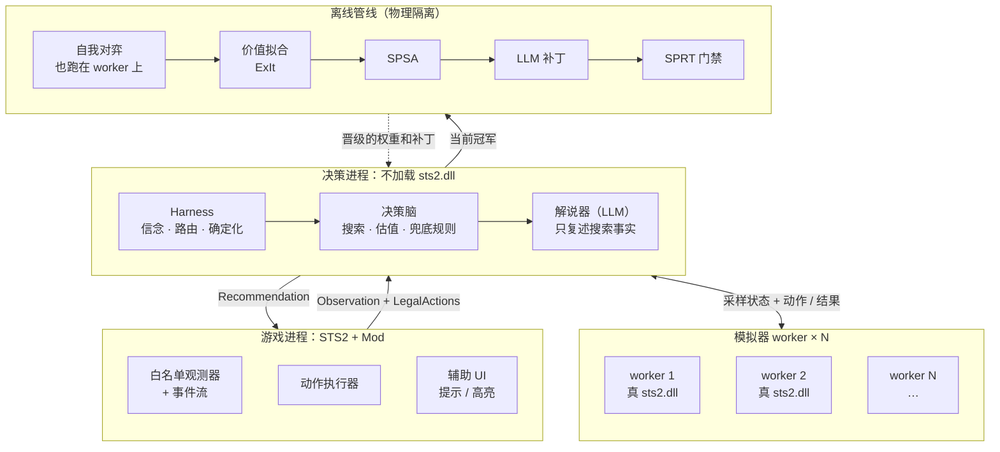
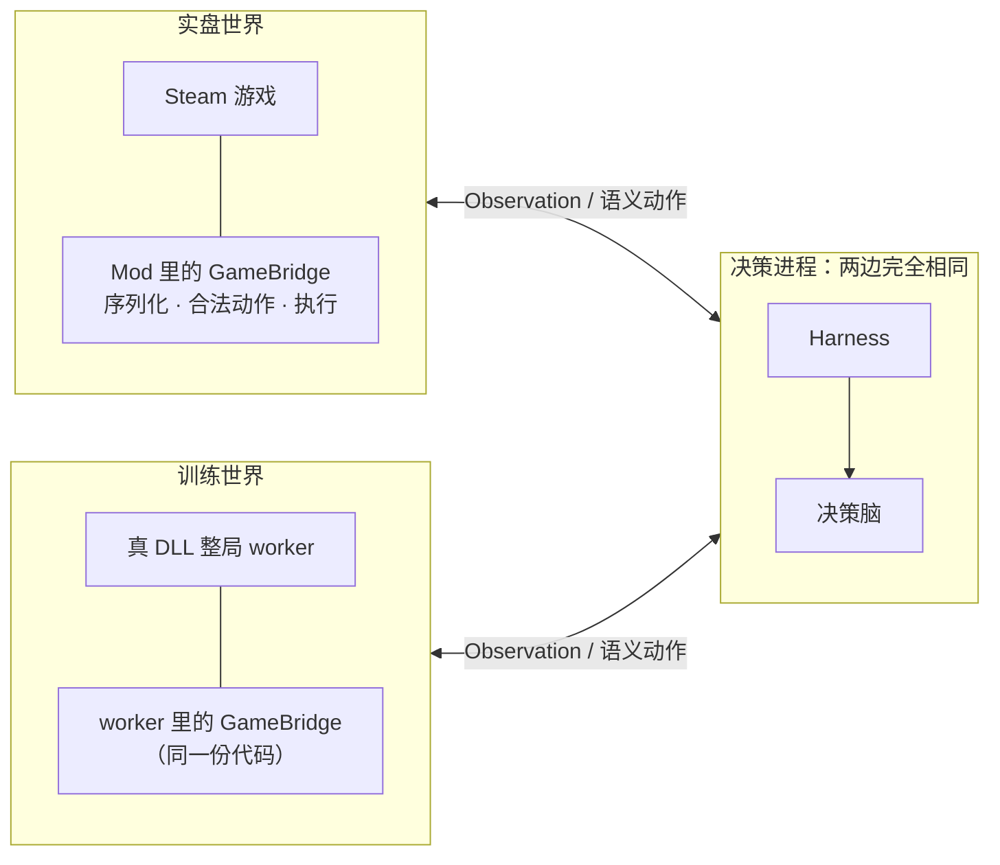
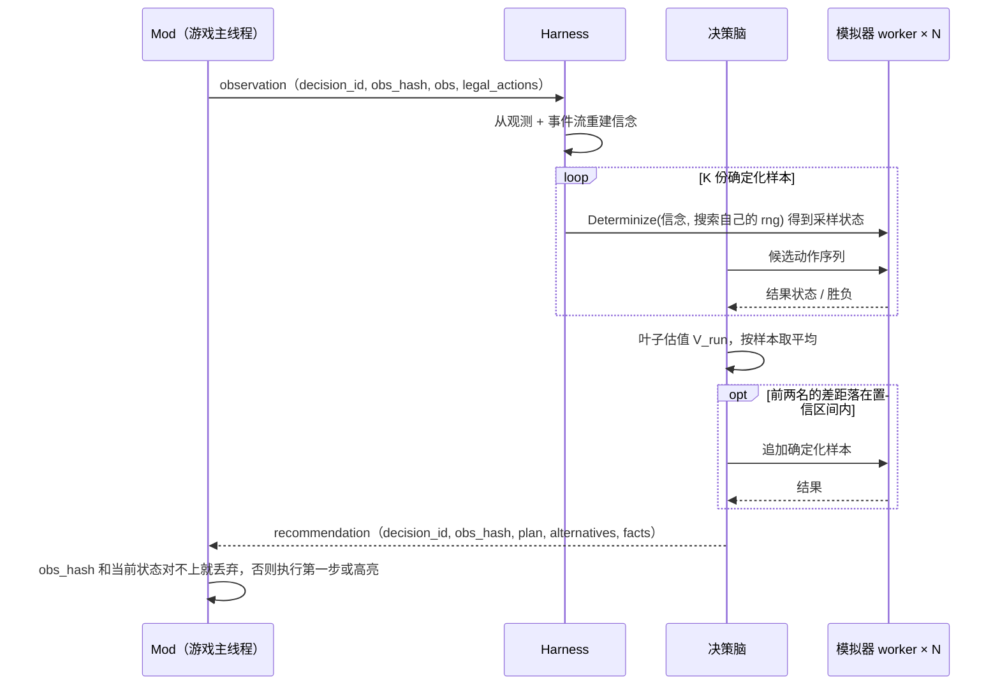
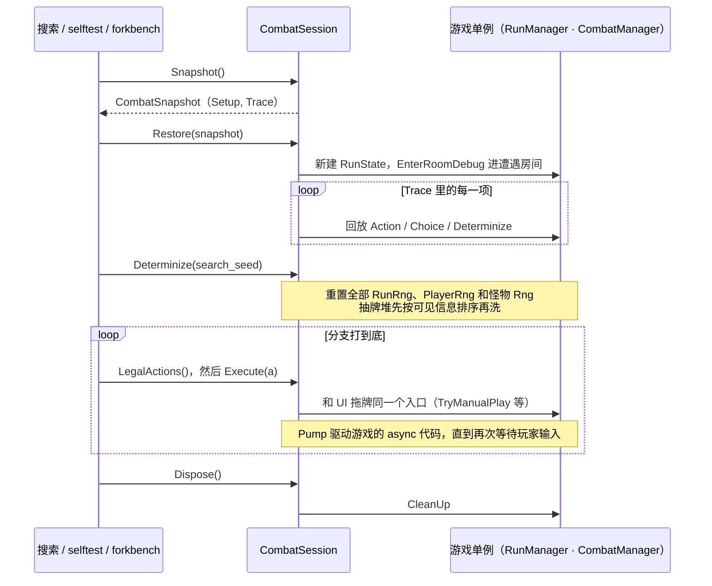
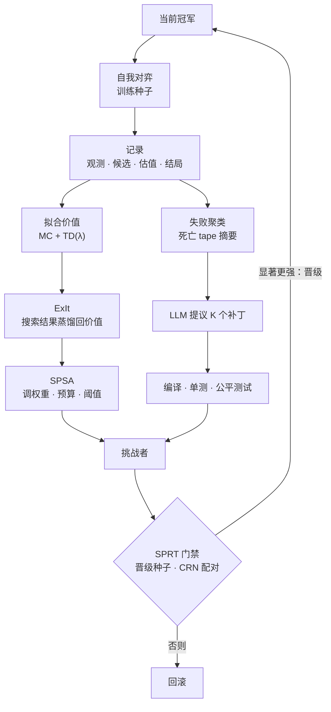
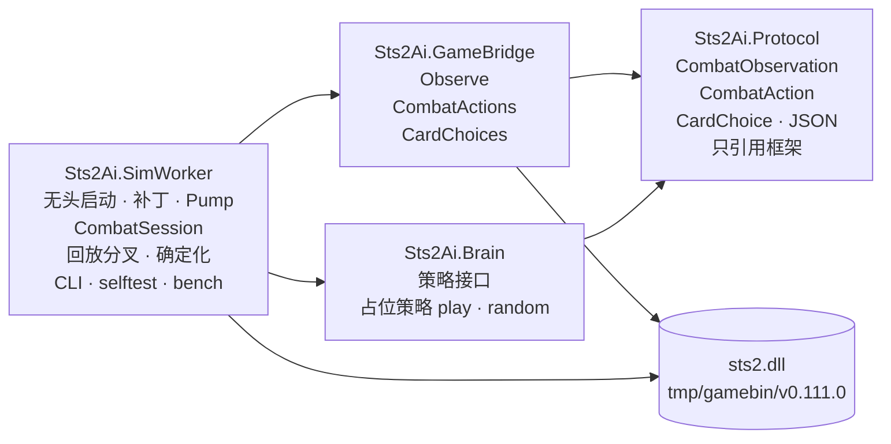
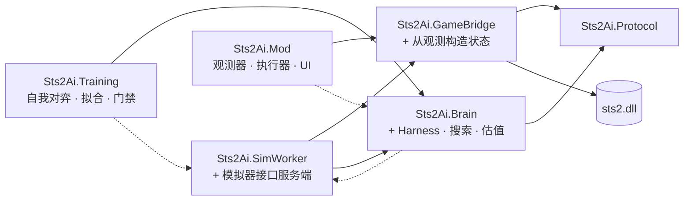

# 架构

STS2 AI 是一个《杀戮尖塔 2》mod，有两种用法：辅助（高亮出牌顺序并说明理由）和全自动代打。
策略从零自我迭代，不照搬人的打法。

**状态**：讨论稿，2026-10-26，游戏版本 v0.111.0。
已有：协议、GameBridge、占位策略，和无头模拟器（[`src/Sts2Ai.SimWorker`](../src/Sts2Ai.SimWorker)）里的单场战斗。其余都是设计。
每节标题后面注明了"已有"还是"计划"。

## 决定架构的四条约束

1. **不作弊**：决策时只用人在同一时刻能看到或推出的信息。搜索只能在"和观测一致的采样状态"上做。
2. **在线决策 = 搜索 + 学到的价值**，只有一把尺子：估计的整局胜率。LLM 不参与在线决策，也不做平局裁判。
3. **训练和实盘走同一条代码路径**：同一个序列化器、同一个 Harness、同一个决策脑。
4. **模拟器就是真 `sts2.dll`**，不重写引擎。

---

## 1. 系统分层与进程边界（计划）

- **游戏进程里只有 mod**：观测、执行、画 UI，不做决策。和决策进程之间只传 JSON（观测、合法动作、推荐），不传游戏对象。
- **决策进程不引用 `sts2.dll`**，拿不到任何游戏对象。"不作弊"由项目引用在编译期保证，不靠自觉（见 §6.1）。
- **模拟器只能多进程**：游戏把局和战斗挂在进程级单例上（`RunManager`、`CombatManager`），一个进程同一时刻只能有一场活着的战斗。
  这条限制刚好和上一条对齐：决策进程本来就不该加载游戏，搜索只能通过 IPC 交给 worker。
- **离线管线和决策进程物理隔离**：训练时可以看隐藏状态（oracle 标签），部署的策略不行。

## 2. 关键不变量：换世界，不换脑（计划）

自我对弈时，"真游戏 + Mod"换成"真 DLL 整局 worker"，Harness、决策脑和协议都不变。
读游戏、列合法动作、执行动作的那层（GameBridge，见 §6.2）是同一份代码，分别编进 mod 和 worker。
语义动作形如 `play:<card_uid>:<target_uid>`、`end_turn`、`map:<col>,<row>`（战斗部分已有，见 §6.1）。

每个里程碑都沿着这条线跑四级评测，分开报告：

| 级 | 世界 | 测什么 |
|---|---|---|
| R1 | 模拟器，Harness 直接驱动 | 策略本身 |
| R2 | R1 + 观测序列化往返 | 观测重建 |
| R3 | 真 DLL 整局（真实解锁、真实 act 抽选），走实盘协议 | 世界设置和接口 |
| R4 | Steam 真机 + Mod | 一切 |

## 3. 一次决策（计划）

- 搜索用的 rng 只来自调用方，不从 run seed 派生，所以不会泄漏未来。
- 每次揭示（抽牌、随机生成）是一个机会节点，K 份样本取**平均**而不是取最大，避免 strategy fusion。
- 只执行第一步，然后重新观测、重新规划。
- 合法动作由 mod 生成，大脑只能从里面选；执行前 mod 再校验一次。

## 4. 模拟器：回放分叉（已有）

游戏没有战斗中途的存读档，单例又让一个进程只能有一场战斗，所以快照不存对象，存"配方"：

> 快照 = 开局设置（`CombatSetup`）+ 轨迹（每个动作、每次选牌、每次确定化）。恢复 = 重新开局，再按轨迹回放。

- **确定性**：游戏的所有随机都来自 run 的种子流；`Pump` 是单线程 `SynchronizationContext`，async 续延都在驱动线程上跑。同样的设置 + 轨迹，得到同样的状态。
- **成本**（单核）：恢复 = 0.55 ms + 0.34 ms × 已走动作数，战斗中段约 5 ms；一次分支（恢复 + 确定化 + 占位策略打到底）中位数约 10 ms，约 100 分支/秒。
- **自检**（`selftest`）：同种子逐步一致；恢复后观测和隐藏状态逐字节相同；确定化不改变观测、可以精确回放、能接着打到底。
- **提速方向**：先用分析器找每个动作 0.34 ms 的热点，再考虑对象图深拷贝（省掉从开局回放）。

## 5. 自我迭代循环（计划）

这是 Stockfish 的开发流程，补丁作者从人换成 flash / luna 加自动调参器。裁判是模拟器，所以弱模型够用。

- **奖励只看整局结局**。辅助项只能用势函数形式 F = Φ(s') − Φ(s)，不改变最优策略；不把"掉血扣分"直接加进奖励，否则学不会"第一幕卖血换后期"。
- **种子分三套，互不重叠**：训练、晋级、最终评测（事先登记）。
- **门禁分层**（整局样本很贵）：战斗补丁先在固定战斗面板上用 CRN 比掉血和死亡率；宏观补丁用幕级指标；只有阶段晋级才跑整局 SPRT。

## 6. 代码结构

### 6.1 现在（已有）

箭头是项目引用。

- **构建**：解决方案是根目录的 `Sts2Ai.sln`。共用设置在 `src/Directory.Build.props`；游戏程序集的引用在 `src/GameReferences.props`，只有 GameBridge 和 SimWorker 导入。
- **公平边界由编译后的引用强制**：
  - selftest 沿程序集引用往下查，Brain 和 Protocol 不能碰到 `sts2`、`GodotSharp`、`0Harmony`、`SmartFormat`、GameBridge 或 SimWorker。
  - GameBridge 做阴性对照：同一个检查必须能在它身上查到 `sts2`，证明检查本身有效。
- **SimWorker 在进程内宿主 Brain**：基准、selftest 和以后的自我对弈不走 IPC，Brain 仍然只看到协议类型。
- **语义 id**：
  - 手牌的 uid 是游戏的 `NetCombatCardDb` 编号，也就是联机消息用的那套；生物的 uid 是 `Creature.CombatId`。
  - 只有手牌和生物有 uid。游戏在开局洗牌之后才按抽牌堆顺序编号，抽牌堆里一张牌的编号就是它的位置，所以抽牌堆、弃牌堆、消耗堆的牌都不带 uid。
  - 动作的文本形式是 `play:<card_uid>[:<target_uid>]`、`potion:<slot>[:<target_uid>]`、`end_turn`，JSON 里也用这个字符串。
  - 轨迹按 uid 记录，回放仍然确定，因为编号的分配本身是确定的。
- **选牌提示**：
  - 选项按 card key（不带 uid 的序列化）排成规范顺序再交给 `IChoicePolicy`，不用游戏给的顺序，因为它可能反映抽牌堆顺序。
  - 完全相同的牌之间的先后，用和隐藏状态无关的种子打乱。
  - 轨迹里记的是游戏自己的下标。
- **执行和等待分开**：`CombatActions.Start` 走 UI 的同一个入口（`TryManualPlay`、`EnqueueManualUse`、`EndPlayerTurnAction`），等游戏结算由宿主负责：worker 用 `Pump`，mod 以后等帧。
- **成本**：拆分后占位基准（act 1 弱/普通战，200 场，单核）猎手 6.7 ms/场，铁甲 5.6 ms/场；拆分前是 6.3 和 5.5。

### 6.2 目标（计划）

实线是项目引用，虚线是运行时调用（进程内或 IPC）。

- Brain 的搜索通过一个只用协议类型的模拟器接口调用模拟器。自我对弈时是进程内实现；实盘时是到 worker 进程的 IPC，决策进程本身不加载 `sts2.dll`（§1）。
- Mod 和 worker 共用 GameBridge：同一个序列化器、同一份合法动作、同一个执行入口。

## 7. 已知缺口

1. **没有"从观测构造模拟器状态"**。现在的分叉只能从 Setup + Trace 回放，世界是模拟器时成立。
   实盘（R4）没有真实轨迹，也不该有，需要按观测和信念采样直接构造战斗。
   构造出来的手牌和生物还得用和真机相同的 uid（`NetCombatCardDb` 有测试用的编号入口），否则推荐的动作在真机上对不上号。
   往返测试 `Observation → Determinize → sim state → Observation'` 依赖它。M2 之前要补。
2. **`Determinize` 不重采样怪物已排好的下一招**（`NextMove`），只重置以后的随机流。
   同一个意图可能对应不同招式（比如 Fogmog），所以这里还漏真信息。要换成"意图 + 招式历史 → 状态机后验"采样。
3. **已知位置的抽牌堆牌没有建模**：刚放到牌堆顶的牌也会被洗乱。这是信息丢失（偏弱），不是作弊。
4. **只有战斗，没有整局**：地图、奖励、商店、事件、篝火还不能跑。
   世界设置用的是 `UnlockState.all` 和默认 act 列表，和真机不一致（真机要用真实解锁和 lobby 的 act-1 抽选）。
5. **选牌提示没有上下文**：`CardChoice` 只有选项和数量，不知道是谁在要、选了做什么（弃牌、消耗、放回牌堆顶……）。
   占位策略用不着；搜索在模拟器里分支时上下文是隐含的；但实盘直接回答提示时需要。

## 相关文档

详细设计目前在本地笔记里（`tmp/` 被 gitignore，未入库）：

- `tmp/notes/plan.md`：整体方案 v1，各层设计、路线图 M0–M5、风险
- `tmp/notes/fair-play-spec.md`：公平对弈规范
- `tmp/notes/output-design.md`：输出层（全自动 / 提示 / 高亮）
- `tmp/notes/testmode-audit.md`：TestMode 分支审计和规则保真补丁
