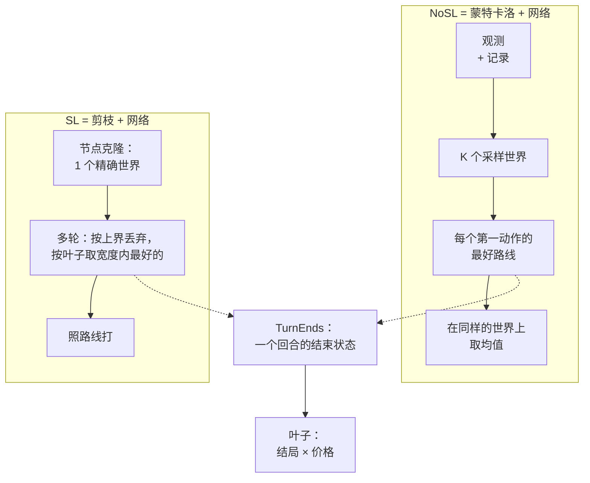

import { Aside, Badge } from '@astrojs/starlight/components';

**战斗大脑**负责打战斗。轮到玩家时，它选择下一个动作：一张牌和它的目标、一瓶药水，或者结束回合。它和[宏观大脑](/arch/macro-brain/)一起运行在决策进程里，后者负责战斗之外的所有决策；[Harness](/arch/harness/) 把每个战斗决策交给它，同时给出它可以搜索的世界和一份预算。

一场战斗是一个搜索问题。游戏自己的代码能从任何状态打出任何一条动作路线，所以大脑不需要把规则当作数据来掌握：它在战斗的模拟副本里尝试各条路线，留下最好的。两种环境（[环境](/arch/environments/)）的区别在于副本有几个、每个知道多少。SL（存档读档，save and load）可以看到当前房间里任何事情的真实结果，所以它拿到一个精确的副本。NoSL 只看得到玩家看得到的东西，所以它拿到几个与可见内容一致的采样副本。

这就给了战斗大脑它的形态，两行就能说完：**SL = 剪枝 + 网络。NoSL = 蒙特卡洛 + 网络**。在 SL 下只有一个世界，问题在于它的规模，所以搜索丢掉不可能影响结果的东西。在 NoSL 下，问题在于隐藏的东西，所以搜索在各世界上取平均。两者底下有两个共用的部件：枚举一个回合的结束状态，以及用战斗网络给出的结局分布、按一组价格给状态估值（[§3](#sec-3)）。

本书的这一部分有三章：

- 本章，两种算法共同的基础：问题本身（[§2](#sec-2)）、形态（[§3](#sec-3)）、接口（[§4](#sec-4)）、叶子估值（[叶子](/arch/combat-brain/leaf/)）、战斗网络（[战斗网络](/arch/combat-brain/network/)、[一个状态走过网络](/arch/combat-brain/walkthrough/)），以及选牌提示、敌人出招记录和 worker 进程池（[提示、招式与 worker](/arch/combat-brain/shared/)）；
- [SL 规划器](/arch/sl-planner/)：剪枝 + 网络，在 SL 唯一的精确世界上；
- [NoSL PIMC](/arch/pimc/)：蒙特卡洛 + 网络，在采样世界上，按动作取平均。

<Aside title="状态">

**已实现，两个冠军都在用**。SL：`SlPlanner` 在节点克隆上规划整场战斗，战斗照着它的计划打（`run --env SL --policy plan`，默认 medium 力度）。NoSL：`PimcBrain` 在 8 个采样世界里各用 300 个节点搜索本回合，再按第一动作取平均（`run --policy pimc`）。两者都在一个 worker 进程池里搜索，并且都用同一个叶子给搜索停下的地方打分：战斗网络，它的结局按手设的数定价（[叶子](/arch/combat-brain/leaf/)）。战斗中的选牌提示交给一条固定规则 `p0`（[提示、招式与 worker §1](/arch/combat-brain/shared/#sec-1)）。一个占位策略供基准测试和测试使用：`PlayPolicy`（`--policy play`，随机打出一张能打的牌）。

**规划中，尚未实现**。两种算法的一个更简单的设计，这些页面在标题或表格行带有 <Badge text="规划中" variant="caution" /> 的地方描述它。它没有任何部分测过，也没有代码；没有这个标记的内容描述的都是现在的代码。

| 部件 | 现在已实现 | 规划中 |
|---|---|---|
| 一个回合的结束状态 | 两个搜索：`SlPlanner.SearchTurn`、`PimcBrain.SearchWorld` | 一个 `TurnEnds`（[§3.1](#sec-3.1)） |
| SL 的搜索 | 贪心下潜，然后是束；简易束、失败计划、重新规划 | 迭代加宽，配一个战斗预算（[SL 规划器：束搜索 §7](/arch/sl-planner/beam/#sec-7)） |
| NoSL 的搜索 | PIMC，预算是 K 和每个世界的节点数 | 同样的 PIMC，基于 `TurnEnds`（[NoSL PIMC：预算 §8](/arch/pimc/budget/#sec-8)） |
| 选牌提示 | 固定规则 `p0` | 搜索分支（[提示、招式与 worker §4](/arch/combat-brain/shared/#sec-4)） |

</Aside>

## 1. 它决定什么

战斗大脑回答两类问题：

1. **玩家的回合**。下一个动作是什么：从手牌里打出一张牌（需要目标时打向一个目标）、使用一瓶药水，还是结束回合。合法动作来自游戏，由 Harness 列出（[协议：观测与动作 §3](/arch/protocol/observation/#sec-3)）。
2. **出牌过程中的选牌提示**。有些牌打出时会提一个问题：弃哪张牌、消耗哪张、把哪张放到抽牌堆顶、从三张生成的牌里拿哪张。目前这些都交给固定规则 `p0`，无论在真实战斗里还是在每个模拟战斗里（[提示、招式与 worker §1](/arch/combat-brain/shared/#sec-1)）。

只有一个合法动作的决策不经搜索就回答。其他每个决策都返回三样东西：第一动作、它之后计划的其余部分，以及搜索看过的每个第一动作和它的估值（即*候选*，决策日志会保存它们，[Harness：决策日志 §5](/arch/harness/decision-log/#sec-5)）。计划很重要：SL 规划器的计划是整场战斗剩下的部分，只要游戏显示的正是计划预期的，战斗就照着它打，不再搜索；PIMC 的计划是本回合剩下的部分，只有在它重复一个循环、并且所有世界都对它意见一致时，才不经搜索直接打出（[NoSL PIMC：预算 §2](/arch/pimc/budget/#sec-2)）。

## 2. 把战斗看作搜索问题

**一个回合**。一个回合是一串以 `end_turn` 结尾的动作。回合之内，不确定性来自抽牌和随机效果（一个随机目标、一张生成的牌）。随后的敌方回合，一旦敌人的招式确定，就是确定性的。一场战斗持续 3–15 个回合。

**分支**。手牌有 5–10 张，一张指向性的牌可以打向每个活着的敌人，药水又增加更多选择。一个回合的序列长 3–8 个动作，所以一个回合最多约有 $10^4$ 个序列。其中很多到达同一个状态：先打 A 再打 B，常常让游戏和先 B 后 A 完全一样。这样的重复就是**置换**（transposition）。有 $n$ 张牌、全都可以按任意顺序打出时，共有

$$
\sum_{j=0}^{n} \frac{n!}{(n-j)!} \quad\text{个有序序列，但只有}\quad 2^n \quad\text{种打出的牌的集合，}
$$

$n = 5$ 时是 326 对 32，$n = 8$ 时是 109,601 对 256。在杀戮尖塔里顺序确实要紧（先上易伤再攻击，先抽牌再打出抽到的牌），所以搜索不能按打出的牌的集合来合并序列。它按序列到达的状态来合并：两条路线结束在同一个状态（包括隐藏的部分）时，从那里只搜一次（[SL 规划器：回合搜索 §2](/arch/sl-planner/turn-search/#sec-2)、[NoSL PIMC：搜索 §1](/arch/pimc/search/#sec-1)）。

**视野**。只搜一个回合是贪心的：它看不到现在的一次格挡能在三个回合后免于一死。搜到战斗结束是精确的，但在 NoSL 下，每次抽牌、每次随机掷骰都是一个*机会节点*（chance node），即搜索必须对它无法知道的各种结果分别展开的地方，而它们一回合接一回合地相乘。所以 NoSL 搜到回合结束为止，用**叶子估值**（leaf value）给那里的状态打分（[叶子](/arch/combat-brain/leaf/)），而没有机会节点的 SL 则一直规划到战斗结束。

**开销**。搜索的每个节点，就是在模拟战斗里由游戏自己的代码打出的一个动作（[模拟器：战斗 §1](/arch/simulator/combat/#sec-1)）。回到更早的状态是一次*恢复*（restore）：从战斗的初始设置重新开始，重放动作直到那个状态。一次恢复耗时 0.28 ms，外加每个重放的动作 0.073 ms；一个分支（恢复、重新采样、打到结束）约 2.8 ms，即单核每秒约 330 个（[模拟器：战斗 §2](/arch/simulator/combat/#sec-2)）。在 SL 下，恢复改为加载节点克隆，约 0.5 ms，加上节点开始以来每一步 0.1 ms，在一场长战斗的后段要 10–20 ms（[模拟器：世界与 SL 克隆 §7](/arch/simulator/worlds/#sec-7)）。时间花在恢复上，而不是叶子上（[提示、招式与 worker §3](/arch/combat-brain/shared/#sec-3)）。

## 3. 两种环境，一种形态

宏观大脑和价值函数 V 在两种环境下相同（[环境：世界 §5](/arch/environments/worlds/#sec-5)）。战斗大脑的两种算法不同，是因为两种环境提出的是不同的问题：一边是一个已知世界里路线太多，另一边是关于世界知道得太少。

| | NoSL：PIMC | SL：规划器 |
|---|---|---|
| 隐藏的是什么 | 抽牌顺序、随机数流、怪物排好的招式 | 房间之内什么都不隐藏 |
| 世界 | 从观测采样的 K 个（[NoSL PIMC §2](/arch/pimc/#sec-2)） | 一个：节点克隆（[SL 规划器 §1](/arch/sl-planner/#sec-1)） |
| 机会节点 | 每次揭示处 | 没有 |
| 什么是最优 | 在各世界上平均最好的动作 | 这一个世界里最好的路线 |
| 现在的搜索 | 每个世界搜到本回合结束，再按第一动作取均值（[NoSL PIMC：搜索](/arch/pimc/search/)） | 跨战斗各回合的束，每个回合完整搜索（[SL 规划器：束搜索](/arch/sl-planner/beam/)） |
| 规划中的搜索 <Badge text="规划中" variant="caution" /> | 同样的搜索，基于 `TurnEnds`（[NoSL PIMC：搜索 §7](/arch/pimc/search/#sec-7)） | 宽度不断增长的多轮，每轮都打到战斗结束（[SL 规划器：束搜索 §7](/arch/sl-planner/beam/#sec-7)） |
| 多久搜索一次 | 每个动作 | 每场战斗一次，除非计划会输（[SL 规划器：束搜索 §6](/arch/sl-planner/beam/#sec-6)） |
| 置换的键 | 观测和这个世界采样出的隐藏状态 | 观测和完整的隐藏状态 |
| 叶子 | 下一回合的开始 | 大多是战斗结束 |

为什么不用一种算法兼顾两者？在测试集上，跑在 SL 唯一精确世界上的 PIMC 打得和 NoSL 下的 PIMC 几乎完全一样：120 场战斗里 112 场结果相同，其余 8 场相差不超过 5 点生命值（[NoSL PIMC：预算 §6](/arch/pimc/budget/#sec-6)）。它的搜索在回合结束处停下，而一个回合之内揭示的东西很少，所以真实世界能告诉它、而八个采样世界不能告诉它的东西很少。只有看得到回合之后的搜索，知道未来才有用，规划器做的正是这个：同样的 120 场战斗，它多赢 9 场（[SL 规划器：预算 §5](/arch/sl-planner/budget/#sec-5)）。所以 PIMC 只在 NoSL 下打。

### 3.1 TurnEnds <Badge text="规划中" variant="caution" />

`TurnEnds` 从一个状态出发，枚举一个回合可能结束的各个状态：深度优先，每一步都可以选择结束回合，状态按观测和隐藏状态合并。两种规划中的算法都调用它，每次在一个世界里。它是搜索的一个步骤，不是网络的输入，网络一次读一个状态。

现在有两个搜索在做这件事，它们并不相同。`SlPlanner` 的回合搜索把一个回合的节点在各个第一动作之间分配，用不完的份额往后传，并返回各个不同的结束状态（[SL 规划器：回合搜索](/arch/sl-planner/turn-search/)）。`PimcBrain` 的世界搜索给每个第一动作相等的份额，在它们之间保留一份估值备忘，并返回每个第一动作之后的最好路线（[NoSL PIMC：搜索 §1](/arch/pimc/search/#sec-1)）。合并它们会改变 PIMC 的节点分配方式，所以合并后的搜索必须通过一个 NoSL 门槛。

### 3.2 叶子

叶子把一个状态变成一个数：网络给出的这场战斗怎样结束的分布，乘以每种结局的价格（[叶子 §3–§5](/arch/combat-brain/leaf/#sec-3)）。



这张图是规划中的形态；现在的代码在搜索那几个方框上有所不同，正如上面的表格所说。

## 4. 接口

```csharp
public sealed record Budget(int Worlds = 8, int NodesPerWorld = 300, int Beam = 0, int Replan = 1, int LossPlans = 0,
    int EasyBeam = 0);
    // PIMC reads Worlds and NodesPerWorld; the SL planner Beam, EasyBeam, Replan, LossPlans and
    // NodesPerWorld (per state and turn). Budget.Effort(level) gives the planner's presets.

public sealed class PimcBrain(ICombatLeaf leaf)
{
    // NoSL: search K sampled worlds, return the first action and the rest of the turn.
    // history: the combat's record of enemy moves so far (MoveRecord), for the leaves.
    public CombatDecisionResult Decide(CombatObservation observation, IReadOnlyList<CombatAction> legal,
                                       IWorldSource worlds, Budget budget, ulong seed,
                                       IReadOnlyList<EnemyTurns>? history = null);
}

public sealed class SlPlanner(ICombatLeaf leaf)
{
    // SL: plan the rest of the combat in the one exact world.
    public SlPlan Plan(CombatObservation observation, ICombatWorld world, Budget budget,
                       IReadOnlyList<EnemyTurns>? history = null);
}

public interface ICombatLeaf
{
    // A search leaf: the state after the turn ends, or after the combat does.
    double Value(CombatStatus status, CombatObservation obs, IReadOnlyList<EnemyTurns> history);
}

public sealed record CombatDecisionResult(
    CombatAction First,                  // one of legal
    IReadOnlyList<CombatAction> Plan,    // the rest of the plan after First
    IReadOnlyList<Candidate> Candidates, // every first action, best first
    IReadOnlyList<ulong>? PlanHashes);   // the observation each step of Plan expects, when it can be followed
```

- `PimcBrain` 在 NoSL 下搜索，`SlPlanner` 在 SL 下搜索；冠军的 `--policy` 指定其中一个（`pimc` 或 `plan`），各自拒绝另一种环境的对局（[Harness：路由、预算与种子 §1](/arch/harness/routing/#sec-1)）。在对局里，它们通过 `PooledPimc` 和 `PooledPlanner` 在 worker 进程池里搜索：这两者把同样的搜索发给 worker 进程，并按固定顺序合并回复，所以答案就是单个进程会给出的那个（[提示、招式与 worker §3](/arch/combat-brain/shared/#sec-3)）。
- `IWorldSource` 提供世界：NoSL 下是 K 个采样世界，SL 下是节点克隆（[协议：世界与工作进程消息 §1](/arch/protocol/worlds/#sec-1)）。大脑从不问自己处在哪种环境；环境由世界带来。
- `TurnPlan` 跟随计划：只要战斗显示的是计划在某一步之前预期的观测（它在 `PlanHashes` 里的哈希），这一步就不经搜索直接打出；否则这个决策重新搜索，并在决策日志里标为 `replanned`。`SlRoute` 加上规划器对失败计划的规则（[SL 规划器：束搜索 §6](/arch/sl-planner/beam/#sec-6)）。
- 规划中：结果里的 `Facts`（预期掉血、几回合能杀死、抽到某张牌的概率），它将是解说的唯一来源（[输出层 §5](/arch/output/#sec-5)）。NoSL 的事实是概率和期望；SL 的事实可以是确切的。
- `ICombatPolicy` 和 `IChoicePolicy` 保留下来，用于占位策略，以及可以在搜索中快速把路线打完的策略。

- <Badge text="规划中" variant="caution" /> 规划器的预算缩减为一场战斗的节点数和一个最小宽度（[SL 规划器：预算 §7](/arch/sl-planner/budget/#sec-7)），PIMC 的仍是 K 和每个世界的节点数（[NoSL PIMC：预算 §8](/arch/pimc/budget/#sec-8)）。这样字段 `Beam`、`EasyBeam`、`Replan` 和 `LossPlans` 就没有读者了。

## 5. 如何检验

1. **战术题**（规划中）：有明确答案的局面（打出斩杀、正好格挡、先上易伤再攻击），找到或没找到。
2. **整局**：版本的晋级门槛让双方打同样的种子并按种子配对，让差异来自大脑而不是运气（[评估：晋级门槛 §5](/arch/evaluation/gates/#sec-5)）。在固定测试集上测得的战斗结果（每个玩家打同样的战斗）见 [SL 规划器：预算 §5](/arch/sl-planner/budget/#sec-5) 和 [NoSL PIMC：预算 §6](/arch/pimc/budget/#sec-6)。
3. **NoSL 反事实**（规划中）：公开记录相同、隐藏状态不同时，对固定的大脑种子必须给出相同的选择。
4. **SL 封存**：越过节点出口的任何一步都会抛异常。已成立（`selftest`）：节点克隆在它的视野边界处加载，拒绝再走一步；SL 世界在它那场战斗结束后拒绝任何动作。
5. **可复现**：预算固定时，同一个种子跑两次给出相同的走法和结果；进程池里的搜索给出单个进程给出的结果（`selftest --workers N`）。
6. **SL 计划一致性**：在节点克隆上做的计划在对局里一步一步执行，每个观测都和计划预期的一样，战斗结束时的生命值和药水正是计划的估值所说的。已成立（`selftest`）；在对局里，对不上的一步记作一次重新规划。
7. **脱离游戏的规划器**（`Sts2Ai.Tests`）：在一个很小的精确战斗上，完整搜索找到的最好路线和尝试每条路线找到的一样，这条路线重放后得到它声称的估值，失败计划在第一个回合后停下（除非它已被证明），已证明的失败计划则重放到底。

## 6. 验证的顺序 <Badge text="规划中" variant="caution" />

这个设计按顺序过门槛，这样每个门槛都能说明它那一步值多少：

1. **提示**变成搜索分支（[提示、招式与 worker §4](/arch/combat-brain/shared/#sec-4)），**然后是加宽**（[SL 规划器：束搜索 §7](/arch/sl-planner/beam/#sec-7)），**然后是预算**（[SL 规划器：预算 §7](/arch/sl-planner/budget/#sec-7)）。

NoSL 有两个自己的条件：合并 `TurnEnds` 需要一个 NoSL 门槛，提示分支需要先测出策略融合（[NoSL PIMC：搜索 §7](/arch/pimc/search/#sec-7)）。

## 7. 三个章节

| 章 | 小节 | 讲什么 | 图 |
|---|---|---|---|
| 战斗大脑 | [叶子](/arch/combat-brain/leaf/) | 搜索在哪里停下、那里的状态值多少：网络的两个输出、价格、上界、估值看不到什么 | 网络在真实局面上的输出 |
| | [战斗网络](/arch/combat-brain/network/) | 网络从输入到输出：每个张量、每个编码器、主体、两个输出头和掩码、大小 | 网络的结构图 |
| | [一个状态走过网络](/arch/combat-brain/walkthrough/) | 跟着一个真实的回合开始，手工走过每一层，直到估值和一个标签 | – |
| | [提示、招式与 worker](/arch/combat-brain/shared/) | `p0` 和作为分支的提示、敌人出招记录、worker 进程池 | – |
| [SL 规划器](/arch/sl-planner/) | 概览 | 节点克隆、为什么最好的路线是对的、规划一次再照着打、规划中的形态 | 一场真实的 Boss 战，在它的第一个决策处规划 |
| | [回合搜索](/arch/sl-planner/turn-search/) | 完整搜索一个回合、置换、节点的分配、`TurnEnds` | 一个回合的搜索树 |
| | [束搜索](/arch/sl-planner/beam/) | 跨回合的束、上界、下潜、简易束、已证明的计划与失败计划；规划中的迭代加宽 | 束，一个回合接一个回合；加宽，一轮接一轮 |
| | [预算](/arch/sl-planner/budget/) | 力度级别、低预算、时间花在哪里、结果、弱点；规划中的战斗预算 | – |
| [NoSL PIMC](/arch/pimc/) | 概览 | 隐藏的是什么、采样世界、它们有多忠实、公平规则、规划中的形态 | 采样出的抽牌顺序 |
| | [搜索](/arch/pimc/search/) | 一个世界里的搜索、平均、噪声与公共随机数、策略融合；基于 `TurnEnds` 的同样搜索 | 一个真实决策，在 8 个世界里 |
| | [预算](/arch/pimc/budget/) | 世界与节点、沿用循环的计划、每个第一动作一份、结果、弱点；规划中的预算 | – |
