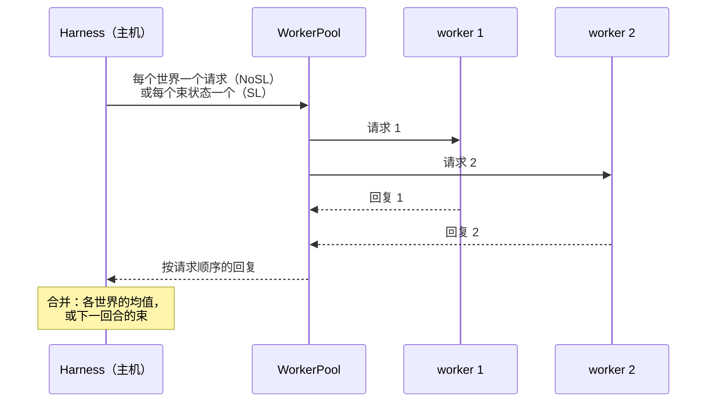

import { Badge } from '@astrojs/starlight/components';

两种算法底下有三个共同的部件。战斗中的选牌提示由一条固定规则回答，无论在真实战斗里还是在每个模拟战斗里，所以搜索预期的正是对局会给出的回答（[§1](#sec-1)）；搜索分支将取代它（[§4](#sec-4)）。敌人每回合显示了什么，这份记录随每个决策一起传递，所以叶子无论在哪里计算，读到的都是同一份历史（[§2](#sec-2)）。搜索在一个 worker 进程池里运行，它的协议让进程池给出的答案和单个进程给出的相同（[§3](#sec-3)）。

## 1. 选牌提示：p0

有些牌打出时会提一个问题：生存者要选一张牌弃掉，计算下注则自己弃掉整手牌，消耗或「把一张牌放到抽牌堆顶」会问是哪张牌，生成三个选项的牌会问拿哪个。现在战斗中的每个选牌提示都交给 `PromptBrain`，称为 `p0`，一条按被选中的牌会怎样来回答的固定规则（[§4](#sec-4) 是规划中的替代）：

- **这回合离开手牌的选择**（弃牌、消耗、放到抽牌堆顶）选最没用的牌，弃牌时先选 Sly 牌，因为弃掉 Sly 牌就会打出它。超过提示的最少张数时，它只多选本来就该扔掉的牌：不能打出的牌，以及弃牌时的 Sly 牌。
- **让一张牌免费的提示**选最贵的那张。
- **其他提示**都是加牌或改进牌（一张牌进手牌、复制、升级），所以选最有用的，能选多少选多少。

一张牌的用处是它各项数值之和再加一个固定部分：

$$
\text{用处} = 5 + \text{伤害} + 1.5\,\text{中毒} + \text{格挡} + 4\,\text{抽牌数} + 4\,\text{能量} + 2\,(\text{虚弱} + \text{易伤}) + 2\,\text{升级}
$$

不能打出的牌（状态牌、诅咒）则毫无用处。`p0` 只读提示本身，从不随机抽取：打平时取规范顺序里的第一个选项。正因如此，模拟世界也能问它：搜索的世界像对局那样回答每个提示，所以一条经过提示的路线是用真正会给出的回答来估值的。在 NoSL 下，这在每个采样世界里都成立；在 SL 下，规划器的计划能精确重放（[SL 规划器 §4](/arch/sl-planner/#sec-4)）。

这条规则是手写的策略，这类东西本项目在别处都交给学到的价值，而一条经过提示的路线只能用这一个回答来估值。在冠军的 V 打的 100 局完整对局里，它回答了 2,035 个提示。

## 2. 敌人出招记录

怪物的下一招取决于它到目前为止出过的招：固定的循环、从不让同一招连出三次的掷骰、总是接在另一招后面的招（[NoSL PIMC §1](/arch/pimc/#sec-1)）。玩家记得每个敌人做过什么。大脑也一样：`MoveRecord` 按 uid 为这场战斗的每个敌人记下它在每回合第一个决策时显示的意图。它是公开记录中目前已经实现的部分（[Harness §4](/arch/harness/#sec-4)）。

- Harness 从它看到的战斗观测里收集这份记录，每个宏观决策之后从头开始，并在每个决策时把它交给战斗大脑（`history`）。决策日志在每个战斗决策旁保存它（[Harness：决策日志 §7](/arch/harness/decision-log/#sec-7)）。
- 搜索在每个请求里把它发给 worker。NoSL 的 worker 根据它重建每个怪物的出招日志，让采样世界里的怪物像真实的怪物那样继续出招（[NoSL PIMC §2](/arch/pimc/#sec-2)）。两种 worker 都把它交给叶子。
- 战斗网络读它：每个敌人在前 3 个回合的意图，以及它已显示了几个回合（[叶子 §3](/arch/combat-brain/leaf/#sec-3)）。一个决策的搜索里，每个叶子都沿用同一份记录：叶子是下一回合的开始，而记录里是直到决策所在回合为止的各回合。SL 规划器之后的回合会加上它自己的路线到达的回合（每个回合结束时的 `MoveRecord.Witness`）。

- <Badge text="规划中" variant="caution" /> 即使网络不再读这份记录，它也要保留下来，供 NoSL 构建世界：在普通战斗上，正是它把构建出的世界的忠实度从 82–89% 提到 96–98%（[NoSL PIMC §3](/arch/pimc/#sec-3)）。

## 3. worker 进程池

一次搜索由许多相互独立的部分组成：NoSL 下是 K 个世界，SL 下是束里的各个状态。它们在一个 worker 进程池里运行。worker 是以 `serve` 启动的同一个可执行文件；`WorkerPool`（在 Harness 里，Harness 只通过协议类型看到游戏）启动 N 个 worker，默认每个世界一个，并在自己的整个生命周期内保留它们（[模拟器：工作进程池 §2](/arch/simulator/pool/#sec-2)）。

**请求**。每个方向一行 JSON，经 worker 的 stdin 和 stdout 传递（[协议：世界与工作进程消息 §4](/arch/protocol/worlds/#sec-4)）：

| 请求 | 谁发送 | worker 做什么 |
|---|---|---|
| `PimcWorldRequest` | NoSL 下的 PIMC（`PooledPimc`） | 用构建种子从观测构建战斗，在由搜索种子抽出的世界中取第 k 个，搜索本回合，回复每个第一动作之后的最佳路线 |
| `SlTurnRequest` | SL 规划器（`PooledPlanner`） | 加载节点克隆，从决策处打出束状态的路径，完整搜索那个回合，回复这个回合最好的几个结束状态（[SL 规划器：回合搜索 §4](/arch/sl-planner/turn-search/#sec-4)） |
| `SlWorldRequest` | SL 世界上的 PIMC，即基线 | 加载节点克隆，在一个第一动作之后搜索本回合。在规划中的设计里是可以删除的候选（[NoSL PIMC：预算 §8](/arch/pimc/budget/#sec-8)） |
| `SlMacroRequest` | 克隆上的宏观大脑 | 在克隆上打出一条宏观回答的路径，回复下一个决策（[宏观大脑：搜索 §6](/arch/macro-brain/search/#sec-6)） |

**自包含**。一个请求带着它的 worker 需要的一切，请求之间不留下任何东西，所以任何空闲的 worker 都能接任何请求。在 NoSL 下，离开主机的只有观测和记录：真实状态永远到不了 worker（[NoSL PIMC §4](/arch/pimc/#sec-4)）。在 SL 下，节点克隆会离开主机，这是 SL 可以知道的。

**确定性**。回复按请求顺序合并，从不按完成的顺序。种子相同时，答案和单进程搜索的完全相等，连估值也一样：`selftest --workers N` 检查这一点；一份用 8 个 worker 跑的 6 场战斗测试集轨迹，和进程内的那份做 diff，结果为空。

**失败**。关闭输出或弄断管道的 worker 会被重启，并再收到一次这个请求；5 分钟内没有回答的 worker（一个请求只要几秒）也一样，先被杀掉再重启。第二次失败就是错误。抛出异常的 worker 发出错误后就退出，因为抛过异常的请求可能让游戏停在已搭好的状态，使之后的每个请求都失败（[模拟器：工作进程池 §6](/arch/simulator/pool/#sec-6)）。

**时间花在哪里**。不在叶子上。在一次整局晋级门槛期间对一个 NoSL worker 采样 40 s：它 87% 的时间在搜索；恢复世界占 48%（从初始设置开始战斗 38%，重放路线 7%，重新采样 4%），打出搜索的动作 16%，构建观测 16%，战斗网络 5%（[模拟器：战斗 §7](/arch/simulator/combat/#sec-7)）。SL 规划器的 worker 忙碌时间约 88% 花在恢复上：加载节点克隆，再重放一条路径到它要搜索的状态。这就是为什么规划器的杠杆是束和计划的数量，而不是节点数（[SL 规划器：预算 §3](/arch/sl-planner/budget/#sec-3)）。每个 worker 占约 160 MB。

**速度**。在 6 场第 1 幕战斗上，用 8 个世界 × 300 个节点，8 个 worker 每个动作 68.7 ms，单进程是 307.5 ms。

## 4. 规划中 <Badge text="规划中" variant="caution" />

- **把提示变成搜索分支**。在搜索里，模拟器的选择器（回答选牌提示的代码）由搜索驱动，于是每个回答都是 `TurnEnds` 的一个分支，像其他动作一样估值，`p0` 也就去掉了。多选是一串单选，这样有很多张牌的提示增加的是深度，而不是一大片子集。真实战斗里的提示和其他决策一样：在 SL 下它是计划的一步，在 NoSL 下它要搜索。这需要世界 API 的提示分支和 `ChoiceContext`（[协议：观测与动作 §6](/arch/protocol/observation/#sec-6)）。
- **这对 NoSL 的代价**。提示的回答是在看到牌之后选的，所以提示上的分支会扩大策略融合；要先跑融合测试集（[NoSL PIMC：搜索 §6](/arch/pimc/search/#sec-6)）。
- **常驻 worker 的世界**。用于对局世界，以及超出一个请求的搜索：按种类（构建、克隆、对局宿主）打开一个世界，按 id 在它上面分支，再关闭它；它的分支优先发往那个 worker，因为在别处恢复要付出一次重放（[模拟器：工作进程池 §8](/arch/simulator/pool/#sec-8)）。
