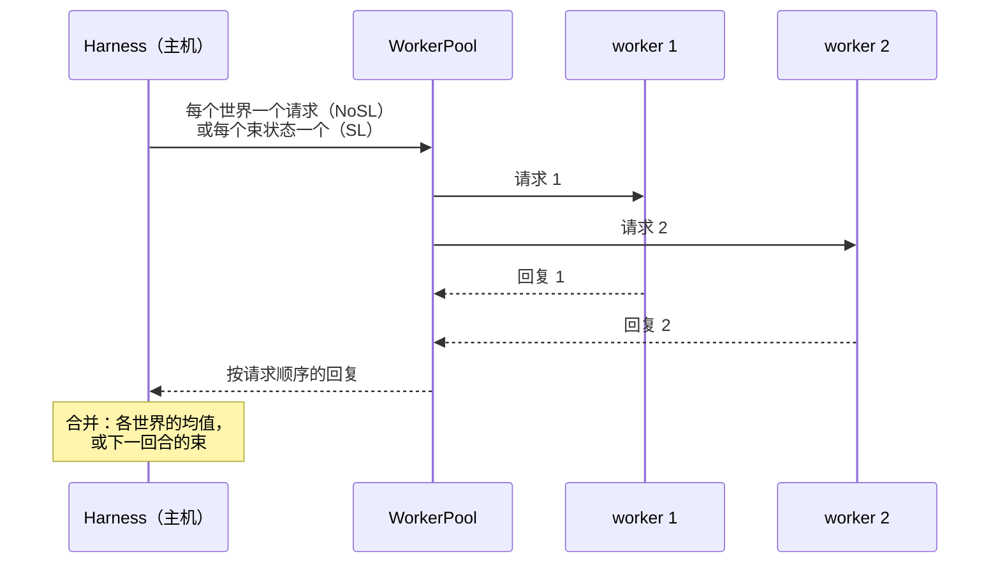

import { Badge } from '@astrojs/starlight/components';

两种算法底下有四个共同的部件。战斗中的选牌提示是搜索的一个分支：一个动作的第一个提示的每个答案都是一条自己的路线，和其他路线一样由叶子估值，搜索选中的答案就是对局给出的答案（[§1](#sec-1)）。敌人每回合显示了什么，这份记录随每个决策一起传递，所以叶子无论在哪里计算，读到的都是同一份历史（[§2](#sec-2)）。搜索在一个 worker 进程池里运行，它的协议让进程池给出的答案和单个进程给出的相同（[§3](#sec-3)）。最后，搜索把一张牌的几个副本算作一个动作，把同样的牌换个顺序算作一个状态（[§5](#sec-5)）。

## 1. 选牌提示：答案作为分支

有些牌打出时会提一个问题：生存者要选一张牌弃掉，消耗或「把一张牌放到抽牌堆顶」会问是哪张牌，生成三个选项的牌会问拿哪个。有些药水也会提问，疯狂之触就会问让手上哪张牌免费；有些在回合结束或下一回合开始时发生的效果也会。这样的问题就是**选牌提示**（card prompt）：选项按规范顺序排列（按牌是什么排序，从不按游戏给的顺序，那个顺序可能反映隐藏的抽牌顺序），并有最少和最多选几个（[协议：观测与动作 §6](/arch/protocol/observation/#sec-6)）。

**每个答案都是一条路线**。在搜索世界里，一个动作的第一个提示是搜索的一个分支（`PromptAnswers.Others`，`src/Sts2Ai.Brain/Combat/Prompts.cs`）。动作一打出，世界就告诉搜索它遇到了哪个提示、这个提示是怎样回答的（`ICombatWorld.LastPrompt`，一个 `PromptSeen`）。这个提示能接受的每个其他答案都变成一个独立的动作，即带着那个答案的同一个动作，紧接着它从同一个状态尝试；每条路线都和其他路线一样由叶子估值，最好的胜出。答案按玩家能分辨的每一种选牌方式各列一次（`PromptSeen.Others`，`src/Sts2Ai.Protocol/World.cs`）：一张牌的两个副本就是同一张牌两次，所以选其中一张就是选第一张。它们先按选的张数从少到多，再按选项的顺序排列：从 A、A、B 的手牌里弃一到两张牌，第一次回答是一张 A 时，接着尝试 B，然后是两张 A，然后是 A 和 B。尝试多少个，取决于这个动作分到的搜索节点份额，每个答案至少一个节点：这是搜索自己的预算，不是对牌的判断（[SL 规划器：回合搜索 §3](/arch/sl-planner/turn-search/#sec-3)、[NoSL PIMC：搜索 §1](/arch/pimc/search/#sec-1)）。

**答案是动作的一部分**。带着答案的动作把它写在一个 `@` 之后：被选中的选项在提示里的位置，按顺序、用逗号分隔，如 `play:12:3@1,3`、`potion:0@2`、`end_turn@0`；回答时一个也不选的提示写作 `play:12@`（`CombatAction.Pick`，`src/Sts2Ai.Protocol/CombatAction.cs`）。它回答这个动作引起的第一个提示，即这张牌或这瓶药水自己的提示；对 `end_turn` 来说，则是回合结束或下一回合开始带来的第一个提示。游戏从不看到它：宿主收到的是不带答案的动作，Harness 把答案交给随后战斗里的第一个选牌提示（`Dispatcher`，`src/Sts2Ai.Harness/Dispatcher.cs`）。计划也以同样的方式重放，在真实战斗里和在克隆上一样。

**没有搜索的地方**。没有搜索权衡的提示，即一个动作的第二个提示，或者搜索已经没有节点留给它的提示，由 `FirstPicks` 回答：按规范顺序取最前面的选项，取提示允许的最少个数（`src/Sts2Ai.Brain/Combat/Prompts.cs`）。它对一张牌值多少没有任何看法；它只是把答案固定下来，在真实战斗里和在每个模拟战斗里都一样，所以搜索预期的正是对局会做的事。在冠军的名字里，战斗提示这条路由是 `first`（[Harness：路由、预算与种子 §1](/arch/harness/routing/#sec-1)）。

## 2. 敌人出招记录

怪物的下一招取决于它到目前为止出过的招：固定的循环、从不让同一招连出三次的掷骰、总是接在另一招后面的招（[NoSL PIMC §1](/arch/pimc/#sec-1)）。玩家记得每个敌人做过什么。大脑也一样：`MoveRecord` 按 uid 为这场战斗的每个敌人记下它在每回合第一个决策时显示的意图。它是公开记录中唯一已经实现的部分（[Harness §4](/arch/harness/#sec-4)）。

- Harness 从它看到的战斗观测里收集这份记录，每个宏观决策之后从头开始，并在每个决策时把它交给战斗大脑（`history`）。决策日志在每个战斗决策旁保存它（[Harness：决策日志 §7](/arch/harness/decision-log/#sec-7)）。
- 搜索在每个请求里把它发给 worker。NoSL 的 worker 根据它重建每个怪物的出招日志，让采样世界里的怪物像真实的怪物那样继续出招（[NoSL PIMC §2](/arch/pimc/#sec-2)）。两种 worker 都把它交给叶子。
- 战斗网络读它：每个敌人在前 3 个回合的意图，以及它已显示了几个回合（[叶子 §3](/arch/combat-brain/leaf/#sec-3)）。一个决策的搜索里，每个叶子都沿用同一份记录：叶子是下一回合的开始，而记录里是直到决策所在回合为止的各回合。SL 规划器之后的回合会加上它自己的路线到达的回合（每个回合结束时的 `MoveRecord.Witness`）。

- <Badge text="规划中" variant="caution" /> 即使网络不再读这份记录，它也要保留下来，供 NoSL 构建世界：构建出的世界里，怪物的出招记录取自它（[NoSL PIMC §3](/arch/pimc/#sec-3)）。

## 3. worker 进程池

一次搜索由许多相互独立的部分组成：NoSL 下是 K 个世界，SL 下是束里的各个状态。它们在一个 worker 进程池里运行。worker 是以 `serve` 启动的同一个可执行文件；`WorkerPool`（在 Harness 里，Harness 只通过协议类型看到游戏）启动 N 个 worker，默认每个世界一个，并在自己的整个生命周期内保留它们（[模拟器：工作进程池 §2](/arch/simulator/pool/#sec-2)）。

**请求**。每个方向一行 JSON，经 worker 的 stdin 和 stdout 传递（[协议：世界与工作进程消息 §4](/arch/protocol/worlds/#sec-4)）：

| 请求 | 谁发送 | worker 做什么 |
|---|---|---|
| `PimcWorldRequest` | NoSL 下的 PIMC（`PooledPimc`） | 用构建种子从观测构建战斗，在由搜索种子抽出的世界中取第 k 个，搜索本回合，回复每个第一动作之后的最佳路线 |
| `SlTurnRequest` | SL 规划器（`PooledPlanner`） | 加载节点克隆，从决策处打出束状态的路径，完整搜索那个回合，回复这个回合最好的几个结束状态（[SL 规划器：回合搜索 §4](/arch/sl-planner/turn-search/#sec-4)） |
| `SlMacroRequest` | 克隆上的宏观大脑 | 在克隆上打出一条宏观回答的路径，回复下一个决策（[宏观大脑：搜索 §6](/arch/macro-brain/search/#sec-6)） |

**自包含**。一个请求带着它的 worker 需要的一切，请求之间不留下任何东西，所以任何空闲的 worker 都能接任何请求。在 NoSL 下，离开主机的只有观测和记录：真实状态永远到不了 worker（[NoSL PIMC §4](/arch/pimc/#sec-4)）。在 SL 下，节点克隆会离开主机，这是 SL 可以知道的。

**确定性**。回复按请求顺序合并，从不按完成的顺序。种子相同时，答案和单进程搜索的完全相等，连估值也一样：`selftest --workers N` 检查这一点。

**失败**。关闭输出或弄断管道的 worker 会被重启，并再收到一次这个请求；5 分钟内没有回答的 worker（一个请求只要几秒）也一样，先被杀掉再重启。第二次失败就是错误。抛出异常的 worker 发出错误后就退出，因为抛过异常的请求可能让游戏停在已搭好的状态，使之后的每个请求都失败（[模拟器：工作进程池 §6](/arch/simulator/pool/#sec-6)）。

**时间花在哪里**。不在叶子上。恢复状态占 worker 时间的最大份额（[模拟器：战斗 §7](/arch/simulator/combat/#sec-7)）：NoSL 的 worker 从观测构建每个世界并重放它的路线，SL 的 worker 加载节点克隆并重放一条路径到它要搜索的状态，而且两者在搜索每次退回一步时都要再恢复一次（[SL 规划器：预算 §3](/arch/sl-planner/budget/#sec-3)）。

## 4. 规划中 <Badge text="规划中" variant="caution" />

- **常驻 worker 的世界**。用于对局世界，以及超出一个请求的搜索：按种类（构建、克隆、对局宿主）打开一个世界，按 id 在它上面分支，再关闭它；它的分支优先发往那个 worker，因为在别处恢复要付出一次重放（[模拟器：工作进程池 §8](/arch/simulator/pool/#sec-8)）。

## 5. 搜索把什么算作相同

手牌里常有副本：两张打击、三张防御。对玩家来说，它们是同一张牌出现两次；对游戏来说，每个副本有自己的 id（`uid`），所以打出不同副本的两条路线，或者以另一种顺序打出同样的牌，到达的观测只在这些 id 或某个牌堆的顺序上不同。搜索把这样的动作和这样的状态算作一个（`src/Sts2Ai.Brain/Combat/CombatBrain.cs:145-181`）。

**同一个动作**。在每个状态上，相同的动作搜索只尝试其中一个（`PimcBrain.Ordered`）：同一张牌，按观测显示的关于它的一切（除了 id）来判断（`ProtocolJson.CardKey`），或者同一瓶药水，打向同一个目标，对它的提示给出同样的答案。保留按搜索顺序的第一个：先是结束回合，然后是按手牌顺序的牌，然后是药水。升级过的打击和普通的打击是两张不同的牌；第二张普通打击就是第一张再来一次。所以根节点的节点份额只分给各个不同的动作（[SL 规划器：回合搜索 §3](/arch/sl-planner/turn-search/#sec-3)、[NoSL PIMC：搜索 §1](/arch/pimc/search/#sec-1)）。提示的答案也以同样的方式列出，按玩家能分辨的每一种选牌方式各列一次（[§1](#sec-1)）。

**同一个状态**。在搜索记住它见过的状态的地方，一个状态的键是按搜索的分辨方式得到的观测（`PimcBrain.StateKey`），旁边放着这个世界的隐藏键：手牌、弃牌堆和消耗堆各自是一个不带 id 的牌的多重集（multiset，按卡牌的键排序），药水也是一个多重集。抽牌堆在观测里本来就是多重集，它的顺序在隐藏键里（[协议：世界与工作进程消息 §1](/arch/protocol/worlds/#sec-1)）。所以以任意顺序打出的同样的牌，或者换成另一个副本，都会汇合成同一个状态。这个键用于：

- SL 规划器的回合搜索，用于它见过的状态，以及每个回合结束状态的键，束按这个键保留各不相同的状态（[SL 规划器：回合搜索 §2](/arch/sl-planner/turn-search/#sec-2)）；
- PIMC 在每个世界里的备忘（[NoSL PIMC：搜索 §1](/arch/pimc/search/#sec-1)）；
- LoopSearch 的兑现（[SL 规划器：回合搜索 §5](/arch/sl-planner/turn-search/#sec-5)）。

计划拿来核对的东西不变：它为每一步带着的观测哈希（对局跟随计划时比较的正是它们）仍是真实观测的哈希（`TurnPlan`）。

**敌人仍然分开**。同一种类的两个敌人是两个敌人：每个都有自己的随机数流，在回合顺序里有自己的位置。

**放弃了什么**。游戏按牌在牌堆里的位置挑选某些随机的牌：木乃伊之手用这场战斗的选牌随机数流在手牌里随机挑一张牌，能量汲取从弃牌堆里随机拿牌。在 SL 下，搜索知道随机数流，所以打出哪个副本，进而手牌和弃牌堆留下的顺序，可能左右这样的挑选。搜索不区分这些路线：两条只在这里不同的路线，它保留先找到的那条。
