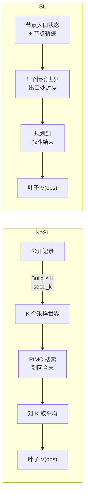

import { Aside, Badge } from '@astrojs/starlight/components';

AI 总是在两种**环境**之一里游玩。两者只差一件事：对游戏还没揭示的随机结果，AI 能知道多少。NoSL 只允许公开信息；SL 还允许知道当前地图点内部的真实结果，就像玩家可以在这里存档、读档。协议、模拟器、两个大脑、学习和评估都把环境当作参数，所以这一页放在最前面。

<Aside title="状态">

已确定。

</Aside>

## 1. 定义

两种环境共享同一套基本规则：

- 只支持单人模式，游戏版本固定为 v0.111.0；
- 规则知识相同，Brain、Harness、Protocol 的代码也相同；
- 使用同一组预先登记的种子，结果分开报告；
- 两种环境都从不在真实游戏里读档：存档字段 `SerializableRun.NumReloads` 始终为 0。

### NoSL：只用公开信息

决策只能依赖本局的公开历史、规则知识，以及离线学到的东西。

**公开历史**指到目前为止屏幕上显示过的一切，加上能从中推断出的信息。例如：记牌；根据怪物的意图历史，推出它下一步动作的后验分布；根据奖励历史，推算奖励概率的计数器。搜索只在**确定化样本**上进行：确定化就是抽取一个具体的隐藏状态（抽牌顺序、怪物动作等），并且保证它与公开历史一致。

### SL：在当前节点内存档、读档

SL 等于 NoSL，再加上**当前节点**内任意动作序列的真实结果。项目里把它叫作「有限作弊」。这相当于一个玩家可以在节点内无限次存档退出，并且什么都记得住。

**节点**就是当前地图点（`MapPoint`），从到达它开始，到选定下一个地图点为止。它包括这个点的所有房间（`MapPointHistoryEntry.Rooms`，例如由事件触发的战斗）、奖励界面、商店购物、休息处选项、宝箱，以及事件的每一页。

SL 可以知道的例子：

- 抽牌顺序和每一次洗牌、怪物动作、生成的卡牌、随机目标、随机费用和随机充能球；
- 动作顺序如何改变上面这些结果（在节点内操纵随机数是允许的）；
- 事件结果。比如在「滑脚木桥」（Slippery Bridge）上，SL 知道每次 HOLD_ON 之后会拿走哪张牌：`SlipperyBridge.GetNewRandomCard` 使用事件自己的 `Rng`，种子由 seed + slot + hash(事件 id) 得到（`Models/EventModel.cs:234`） <Badge text="已核实" variant="success" />；
- 本节点的奖励，包括奖励如何随打法变化；
- Ancient 事件的「随机稀有卡」选项具体会给哪张牌。

SL **不能**知道后面节点的任何信息：`?` 会变成什么、遭遇、奖励、商店货品、事件。尽管模拟器里握有真实的随机数流，这条规则依然成立。

<Aside type="caution" title="已否决">

曾考虑过「整局视野」（知道整局的全部随机顺序），已否决，不要实现。

</Aside>

## 2. 为什么以节点为界

为什么不直接用游戏自己的存档点做边界？游戏会在以下时刻自动存档 <Badge text="已核实" variant="success" />：

- 开局时；
- 到达一个地图点时，在 `?` 掷骰和 `CreateRoom` 之前（`Runs/RunManager.cs:899-901`、915、917）；
- 战斗胜利时，此时房间被标记为预先完成（`Combat/CombatManager.cs:1341-1342`）；
- **Ancient** 事件结束时，而且只有 Ancient 事件会这样（`Rooms/EventRoom.cs:129-141`）。

战斗中途没有存档。读档会原样重演这个房间：相同的遭遇、相同的起手牌、相同的怪物动作。存档里保存着每条随机数流的完整状态 `{counter, s0..s3}`（`Saves/SerializableRng.cs:51-63`）。

所以游戏原生的存读档比「节点」稍窄。战斗胜利后存档已经越过了这场战斗，于是「换一种打法，奖励会不会变？」在真实游戏里没法试。我们仍然选了节点边界：它覆盖一个地图点内的全部内容（房间、奖励、事件的每一页），而且只有一个封存世界的位置。两者的差别记为未决问题 1（[§10](#sec-10)）。

## 3. 信息表

每种环境能用哪些信息：

| 信息 | NoSL | SL |
|---|---|---|
| 屏幕历史及其推断、规则知识、离线学习（特权信息只在训练时使用） | 可以 | 可以 |
| 本节点：抽牌顺序、洗牌 | 只知道有哪些牌（多重集） | 可以 |
| 本节点：怪物的下一步动作 | 意图 + 基于历史的后验 | 可以 |
| 本节点：生成的卡牌、随机目标/费用/充能球 | 只知道分布 | 可以 |
| 本节点：事件结果、宝箱、奖励 | 显示之后 | 可以 |
| 后续节点 | 不可以 | 不可以 |
| 直接读取种子字符串、随机数状态、存档文件 | 不可以 | 不可以（只能通过封存的克隆） |
| 修改状态、控制台、调试或多人模式后门 | 不可以 | 不可以 |
| 真实读档（`NumReloads > 0`）、评估时挑种子 | 不可以 | 不可以 |

灰色地带的裁定，两种环境相同（来自公平规范，本地笔记 `tmp/notes/fair-play-spec.md`）：

- 精确的伤害计算可以用；
- 能力（power）只在 `IsVisible` 时可见，并且只用显示出来的数值；
- 不导出 `move_id`；
- 抽牌堆只作为多重集提供，从不提供顺序；
- 水晶球（Crystal Ball）事件里隐藏的格子永不导出。

## 4. 节点边界

- **入口**：到达一个地图点。这正是游戏的存档点，所以入口状态是一个 `SerializableRun`。
- **出口**：地图移动动作（`VoteForMapCoordAction`）。移动动作属于当前节点，之后的一切属于下一个节点。
- **特殊情况**：开局的 Ancient 事件（Neow）是第 1 个节点；打完 Boss 后，下一幕的第一个点是新节点；一局结束也算出口。
- 越过出口的搜索（例如「这张牌在下一场战斗里值多少？」）必须使用由搜索自己播种的确定化样本，绝不能用真实的随机数流。

## 5. 一个宏观大脑，两种战斗算法

宏观大脑和价值函数 V 在两种环境里是同一个。战斗大脑不是：NoSL 和 SL 面对的是不同的问题，所以在同一个接口（`ICombatBrain`）后面各有各的算法。Harness 按环境选择用哪一个，并交给它对应的世界：

| | NoSL | SL |
|---|---|---|
| 问题 | 有隐藏状态和随机：找在各种可能世界上平均最好的动作 | 确定性的：找这一个世界里最好的路线 |
| 世界从哪来 | 公开记录 → Build / Determinize（[模拟器 §6](/arch/simulator/#sec-6)） | 节点克隆（[模拟器 §7](/arch/simulator/#sec-7)） |
| 世界数量 | K 个，取平均（不做策略融合） | 1 个；挑最好的路线就是对的，没有可融合的东西 |
| 机会节点（chance node） | 每次揭示都有 | 没有 |
| 战斗算法 | PIMC：搜到回合末，按第一个动作取平均，每个动作之后重新规划（[战斗大脑 §2](/arch/combat-brain/#sec-2)） | 跨整场战斗各个回合的束搜索，每个回合内部完整搜索，用结束战斗的最好路线剪枝；只规划一次（[战斗大脑 §3](/arch/combat-brain/#sec-3)） |
| 换位按什么识别 | 观测加上这个世界采样出的隐藏状态 | 观测加上完整的隐藏状态：随机数流、怪物出招记录、本回合的战斗历史 |
| 预算花在 | 样本数 × 深度 | 深度和广度（一场战斗通常能搜到结束） |
| 越过视野边界后 | 本来就是样本 | 世界停止（`AtHorizon`）；只能从出口观测重新确定化后继续 |
| 宏观大脑 | 后状态 + V，对 K 个样本取平均 | 同一个大脑，用唯一的确切结果 |
| 价值 | V(观测) | 同一个 V |

「不做策略融合」是指：NoSL 给每个动作打分时，取它在 K 个世界里的平均值，而不是在每个世界里各自挑最优路线。后一种做法会让计划表现得好像已经知道哪个世界才是真的。

**两种环境共用一个 V**。理论上 SL 也会改变战斗之外的价值：从同一个状态出发，SL 赢得更多，因为它在之后每个节点都打得更好，所以专为 SL 做的价值函数会更愿意冒险（多打精英、多选结果波动大的事件和卡牌）。这一点被有意忽略：两种环境共用一个 V。它用战斗由 SL 战斗大脑来打的对局训练，包括自我对弈和分叉推演（2026-10-28 决定）。宏观大脑在两种环境里看到的信息一样，所以这不是用 SL 去教 NoSL 的战斗：NoSL 的战斗大脑单独训练，两种环境之间宏观价值的差异仍然忽略。

两种环境的叶子估值器都只读观测，所以真实随机数流不可能经由估值泄漏进来。环境只存在于 Harness（它选择战斗大脑和世界来源）和世界的实现里；宏观大脑和 V 都看不到它。接口见 [协议 §7](/arch/protocol/#sec-7)（`IWorldSource`、`ICombatWorld`）。

## 6. SL 克隆从哪来

- **R1–R3**（由模拟器来玩这一局；R1–R4 是[仿真到实机阶梯](/arch/evaluation/#sec-1)的各级）：宿主 worker 进程持有真实状态。进入节点时，它做一个检查点：`RunManager.ToSave(null)`（`Runs/RunManager.cs:670-709`） <Badge text="已核实" variant="success" />，加上存档丢掉的遗物字段。它在游戏到达地图点时存档的那一刻取这个检查点。克隆 = 这个检查点 + 节点轨迹，像游戏「继续游戏」加载存档那样加载，放回遗物字段，然后重放（[模拟器 §7](/arch/simulator/#sec-7)）。
- **R4**（真实游戏）：在游戏到达时存档的那一刻，Mod 在内存里做同样的检查点，从不碰会被云同步的 `current_run.save`。它还记录节点内的每个动作（在游戏提交动作的地方读出），每个决策之前把两者发给大脑（[Mod §6](/arch/mod/#sec-6)）。worker 通过「继续游戏」（Continue）的路径加载，再重放这些动作。
- 加载存档和一直不间断运行的游戏并不一样：加载会重新执行地图钩子和 `OnRunLoaded`，并丢掉没有标记为保存的遗物字段（`Runs/RunManager.cs:815-816`、`Runs/RunState.cs:330-332`）。遗物字段的差别会表现出来：存档丢掉的状态或计数改变了克隆的每个观测，SL 规划器每一步都要重新规划。所以检查点带上每个遗物的简单字段，加载之后放回去，`run --check` 现在找不到任何和原对局不同的节点（[模拟器 §7](/arch/simulator/#sec-7)）。不做校验和验证，不做兜底。
- **NoSL**：这个通道是关闭的。环境在会话开始时确定并记入日志；Mod 从不导出存档，worker 也从不提供克隆。NoSL 日志里只要出现一次导出，这一局就作废。
- 决策进程从不读存档：Brain 不引用游戏程序集，由编译器保证。

## 7. 守护测试

上面的每条规则都有一个测试来守住它。

**两种环境**

1. Brain 和 Protocol 不引用任何游戏程序集（已有，在 selftest 中）。
2. 搜索的随机数只来自调用方，绝不来自本局种子。
3. 兜底决策的数量为 0。
4. `NumReloads == 0`。
5. 观测的每个字段都有白名单测试。

**NoSL**

6. 反事实：公开记录相同、隐藏状态不同（抽牌顺序、所有随机数流、怪物动作及 AI 私有字段、生成池）→ 在固定大脑种子下决策相同。
7. 往返：状态 → 观测 → Build → 观测'，两个观测完全相同（战斗部分已有）。

**SL**

8. 封存：出口动作之后再走任何一步都会抛异常（克隆已有，在 `run --check` 和 `selftest` 中）。一场战斗的 SL 世界也拒绝越过战斗的结束，所以搜索永远不会离开这个房间（已有，在 `selftest` 中）。
9. 视野边界反事实：只扰动出口之后才会读到的状态 → 决策不变。
   - 可以扰动的 <Badge text="已核实" variant="success" />：每一幕 `RoomSet` 中计数器之后的条目（事件、弱/普通/精英遭遇、Boss、第二个 Boss、Ancient；在开局时由 `GenerateRooms` 里的 UpFront 一次定好，`Runs/RunManager.cs:743-767`，通过计数器消耗，`Rooms/RoomSet.cs:70-108`）；UnknownMapPoint 随机数流（只在进入 `?` 时使用，`Odds/UnknownMapPointOdds.cs:140-175`）；TreasureRoomRelics 随机数流和共享遗物抽取袋的尾部；后续各幕的地图种子（`Rng(seed, "act_N_map")`）。
   - 不能扰动的，因为当前节点也在用：Shuffle、MonsterAi、Niche、六条 Combat* 随机数流，以及玩家的 Rewards、Shops、Transformations 随机数流。
   - 每个可扰动字段都需要一个测试，证明当前节点从不读它。
10. 每次决策的克隆查询都记入日志。

## 8. 学习、评估与输出

- 两种环境共用一个 V（[§5](#sec-5)）。冠军、晋级门槛和排行榜仍然按环境分开；新的 V 会同时改变两个冠军，所以必须分别通过两种环境各自的门槛。
- 同一组种子对应两个排行榜。报告里给出 SL − NoSL 的差值，也就是节点级信息的价值。这是计划 v1（本地笔记 `tmp/notes/plan.md`）里「全知 vs 重采样」消融实验的正式版本。
- 输出：NoSL 给出的事实是概率和期望；SL 给出的事实可以是确切结果（「先打 A 再打 B → 会抽到 X」）。

## 9. 对各子系统的影响

| 子系统 | NoSL | SL 额外需要 |
|---|---|---|
| 协议 | 观测、动作、选牌提示、推荐、世界 API | `AtHorizon`；确切结果类事实 |
| GameBridge | 白名单内的观测，枚举 / 执行动作 | 无 |
| 模拟器 | 从记录 Build、Determinize | 节点检查点、加载存档 + 重放、封存 |
| Mod | 观测、执行、覆盖层 | 节点入口导出 + 动作日志（按环境开关） |
| Harness | 记录、K 个世界 | 1 个克隆 |
| 战斗大脑 | PIMC 期望搜索 | 自己的算法：SL 规划器 |
| 宏观大脑 | 后状态 + V | 无（同一个大脑；节点内的结果来自克隆，是确切的） |
| 学习 | V | 无（同一个 V） |
| 评估 | NoSL 排行榜 | SL 排行榜 + 差值 |

## 10. 未决问题

1. 战斗胜利后的奖励：用节点规则（现行）还是游戏的存档规则？整局跑通后，统计奖励有多常受到战斗中随机数流使用方式的影响。Rewards 随机数流与商店、事件共享 <Badge text="已核实" variant="success" />，所以在战斗节点内这种情况大概很少见。
2. SL 的预算：与 NoSL 用相同的墙钟时间，这比相同的分支数更公平。
3. 用真实读档来验证克隆：只允许在带标记的验证局中进行，从不计分。
