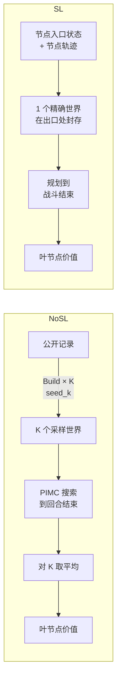

import Determinize from '../../../../components/book/Determinize.svelte';
import StrategyFusion from '../../../../components/book/StrategyFusion.svelte';

两种环境的区别在于搜索可以知道什么（[信息与节点](/arch/environments/information/)）。搜索靠在模拟的游戏里尝试各种打法来了解情况，所以这个区别体现在它可以在*哪些模拟游戏*里尝试。本页讲解这些游戏，也就是**世界**：NoSL 如何根据看到的东西做出它们，对它们取平均之后仍可能犯的错误，以及为什么只有一个精确世界的 SL 需要一种完全不同的战斗算法。最后讲哪些保持不变：两种环境共用一个宏观大脑和一个价值函数 V。

## 1. 世界

**世界**是搜索可以探索的一个模拟器状态：一局正在运行的游戏，搜索可以观测它、在里面行动、保存它（快照）并回到保存的地方（恢复）。搜索从不碰真实游戏。它通过世界 API 请求世界（[协议：世界与工作进程消息 §1](/arch/protocol/worlds/#sec-1)），在其中打出候选的打法，再比较这些打法如何收场。

如今每个世界都是**战斗世界**：一场战斗，由战斗大脑来搜索（[战斗大脑](/arch/combat-brain/)）。宏观大脑在战斗之外的搜索直接使用 SL 克隆（[宏观大脑：搜索 §2](/arch/macro-brain/search/#sec-2)）；NoSL 的对局世界能让它看到当前节点之外，还在规划中（[模拟器：世界与 SL 克隆 §8](/arch/simulator/worlds/#sec-8)）。

世界从哪里来，是环境唯一改变的东西：

| | NoSL 世界 | SL 世界 |
|---|---|---|
| 由什么做成 | 观测和公开记录 | 节点的检查点和节点的步骤 |
| 怎么做 | 构建一场显示出该观测的战斗，再从一个种子抽取隐藏状态（*确定化*） | 像游戏的「继续」那样载入检查点，再重放这些步骤 |
| 每个决策几个 | K 个，各自来自自己的种子 | 一个 |
| 它是什么 | 对隐藏状态的一个合理猜测 | 确切的真实战斗 |
| 类 | `SimWorlds.NoSL`（[模拟器：世界与 SL 克隆 §2](/arch/simulator/worlds/#sec-2)） | `NodeWorld`，在节点的克隆上（[模拟器：世界与 SL 克隆 §7](/arch/simulator/worlds/#sec-7)） |

两者都在工作进程里，根据请求携带的内容构建（[模拟器：工作进程池 §5](/arch/simulator/pool/#sec-5)）。NoSL 请求携带观测，从不携带真实状态，所以 NoSL 工作进程不可能看到比玩家更多的东西。

## 2. 确定化：猜测隐藏状态

NoSL 的搜索看不到隐藏状态，但可以猜。**确定化**就是把玩家不可能知道的一切，换成一个与玩家看到的一切都一致的具体样本。在一个样本上，游戏重新变成一个完全信息的游戏，搜索可以像对待任何其他模拟一样去打它。

一个 NoSL 世界起初是一场构建得恰好显示出该观测的战斗（`CombatBuilder.Setup`，[模拟器：战斗 §5](/arch/simulator/combat/#sec-5)）。然后 `Determinize(seed)` 从种子抽取隐藏的部分（`Simulation/CombatSession.cs:230-276`）：

- 本局、玩家和每个怪物的每条有种子的随机数流都重新播种：洗牌、生成的卡牌、随机目标、怪物 AI；
- 抽牌堆先被排成一个只取决于玩家所见内容的顺序（按卡牌键排序），再用这个种子洗牌；
- 手牌之外的卡牌重新编号：游戏按抽牌顺序给卡牌编号，所以旧编号会泄露真实顺序；
- 每个怪物排队中的行动，从显示相同意图的行动中抽取，它的行动日志的最后一条也被改写以与之相符。

种子只来自调用方，从不来自这一局，所以真实种子的任何东西都不会漏进样本。一个决策的第 k 个世界，使用由该决策的搜索种子和 k 混合而成的种子，所以 K 个世界就是 K 个不同的、同样合理的未来。尚未建模的：玩家确实知道其位置的抽牌堆卡牌（刚被放到顶上的那张），以及怪物的历史如何让它的某些行动比其他行动更可能出现。

下图取自一个较早的战斗网络的训练数据中一个真实的回合开始：39 点生命的静默猎手，对阵虱虫之祖（LOUSE_PROGENITOR），抽牌堆里有九张牌。玩家知道是哪九张；每个世界是它们的一种顺序。抽取 K 个世界，看看每个世界放在最上面的五张牌。一张牌在多大比例的世界里出现，就估计了抽到它的真实概率，K 越小，噪声越大。

<Determinize client:visible lang="zh-CN" />

冠军的 NoSL 战斗大脑默认搜索 8 个世界，每个世界 300 个搜索节点（[NoSL PIMC：预算 §1](/arch/pimc/budget/#sec-1)）。世界一旦建好就很便宜（一次恢复约 0.3 ms，每重放一个动作再加 0.07 ms，[模拟器：战斗 §2](/arch/simulator/combat/#sec-2)），但搜索量要乘以世界的个数，所以 K 是在准确度和时间之间做权衡。

## 3. 策略融合

把每个世界都当作真相来搜索，有一个已知的缺陷。在一个世界里，搜索确切地知道会发生什么，所以它可能规划出这样一条打法：在某个选择所依赖的信息揭示*之前*就做出这个选择，却仍然选对，因为它早已知道。在各个世界上取平均后，这样的打法看起来比任何真实玩家能打出来的都要好。这种错误就是**策略融合**：计划把几种策略（每个世界一种）融合在一起，好像玩家知道哪个世界是真的。

错误可能从两个地方进来。

- **在根节点**。如果每个世界干脆各自挑自己最好的第一个动作，AI 就会打得好像它知道是哪个世界。NoSL 的 PIMC 从不这样做：它用每个第一个动作在 K 个世界上的平均值给它打分，然后打出平均值最好的那个第一个动作（[NoSL PIMC：搜索 §2](/arch/pimc/search/#sec-2)）。下面对比中的「不做融合」指的就是这个。
- **在根节点之下**。第一个动作之后，每个世界的搜索各自继续到回合结束，在那里它仍然看得到自己世界的未来。在一条要求玩家在一张隐藏的牌被抽到之前就做选择的打法里，每个世界都会得到适合那个世界的选择。对第一个动作取平均并不能消除这一点。PIMC 每打一个动作就重新规划，所以它打出的总是一个第一个动作，但它的价值仍可能偏向那些后续步骤被融合了的打法。

下图是一个只有两个世界的决策：抽牌堆最上面那张牌要么是打击，要么是防御。稳妥打法在两个世界里价值相同。另一个第一个动作会引出第二个选择，而这个选择必须在最上面那张牌被抽到之前做出。拖动滑块改变每个世界的可能性，比较每个世界自己的搜索怎么想、PIMC 的平均值怎么想，以及对一个看不到这张牌的玩家来说，这条打法真正值多少。

<StrategyFusion client:visible lang="zh-CN" />

这在真实战斗里代价有多大，要在决策日志中的 NoSL 战斗决策上测量：把 PIMC 的价值与另一种价值对比，后者在各个世界还无法区分的地方把打法合并起来（[NoSL PIMC：搜索 §4](/arch/pimc/search/#sec-4)）。如果剩下的误差被证明很重要，替代方案是 ISMCTS（信息集蒙特卡洛树搜索），它在所有世界上只搜索一棵树，因此在玩家看来相同的世界之间共享同一个选择。

## 4. SL：一个精确的世界

SL 的世界就是节点的克隆：真实战斗的一份精确拷贝，带着真实的随机数流。这改变了问题。

- **不再有任何随机**。每个动作只有一个结果，整场战斗是一个确定性的谜题。在这个世界里找到的打法，就是在真实战斗里行得通的打法。
- **没有可融合的东西**。只有一个世界时，选它最好的打法就是对的：计划不可能假设它没有的知识，因为这个世界*就是*玩家将会遇到的。
- **状态按一切来区分**。搜索会记住它见过的状态（*换位*，transposition），这样同一组出牌的两种顺序只搜索一次。除了观测之外（其中手牌、弃牌堆和消耗堆都作为多重集，所以打出一张牌的另一个副本会与打出第一个汇合，[战斗大脑：提示、招式与 worker §5](/arch/combat-brain/shared/#sec-5)），NoSL 世界的键还包含观测隐藏了的、会改变接下来发生什么的东西：抽牌堆的顺序、每条随机数流的位置和每个怪物排队中的行动（`HiddenState.Key`，`GameBridge/HiddenState.cs:19-29`）。SL 世界的键再加上每个怪物到目前为止的行动，以及本回合战斗历史的条目，后者作为多重集，这样同一组出牌的另一种顺序仍然能汇合到一起（`HiddenState.Full`，`:36-44`）；在那一场真实战斗里，这些会改变接下来发生的事。
- **预算用在深度上**。只有一个世界、不用取平均，搜索通常能一直搜到战斗结束。
- **世界在视野边界处停止**。克隆在节点出口处封存，SL 世界拒绝它的战斗结束之后的任何动作（[信息与节点 §8](/arch/environments/information/#sec-8)）。如今没有东西搜索到出口之外；要是有搜索这样做，它就得像 NoSL 一样，从出口的观测出发、使用确定化的世界。

## 5. 一个宏观大脑，两种战斗算法

所以两种环境提出了两个不同的战斗问题：NoSL 必须选出在它无法区分的各个世界上平均最好的动作，SL 必须在一个已知的世界里找到最好的打法。每个问题都有自己的算法。冠军的选项按环境挑选算法：一局用 `run --policy`（SL 规划器 `plan` 在 SL 之外会被拒绝，PIMC `pimc` 在 NoSL 之外会被拒绝），而在 `brain` 命令里，NoSL 宿主用 `--policy`，SL 宿主用 `--sl-policy`，默认是 SL 规划器（[环境 §5](/arch/environments/#sec-5)）。然后 Harness 在每个战斗决策里把对应的输入交给战斗那条路由：SL 下是节点的克隆，NoSL 下只有观测，工作进程根据它构建自己的世界（`Harness/Dispatcher.cs:116`）。在单个进程里，比如在 `selftest` 里，PIMC 搜索一个 `IWorldSource` 提供的世界（`PimcBrain.Decide`），规划器在它唯一的世界里规划（`SlPlanner.Plan`）（[协议：世界与工作进程消息 §1](/arch/protocol/worlds/#sec-1)）：

| | NoSL | SL |
|---|---|---|
| 问题 | 隐藏状态和随机：在各个可能的世界上平均最好的动作 | 确定性的：这一个世界里最好的打法 |
| 世界从哪来 | 公开记录 → 构建并确定化（[模拟器：世界与 SL 克隆 §2](/arch/simulator/worlds/#sec-2)） | 节点的克隆（[模拟器：世界与 SL 克隆 §4](/arch/simulator/worlds/#sec-4)） |
| 世界数量 | K 个，按第一个动作取平均（根节点不做融合） | 1 个；它最好的打法就是对的，没有可融合的东西 |
| 随机 | 在根节点抽取 K 个确定化的世界；单个世界的搜索内部没有随机 | 完全没有 |
| 战斗算法 | PIMC：把每个世界搜到回合结束，按第一个动作取平均，每个动作之后重新搜索（[NoSL PIMC](/arch/pimc/)） | SL 规划器：在整场战斗的各个回合上做束搜索，每个回合内部完整搜索；它按计划走，在某一步没有按计划发生或计划用完的地方重新规划（[SL 规划器 §3](/arch/sl-planner/#sec-3)） |
| 换位的键 | 观测、抽牌顺序、各随机数流的位置、怪物排队中的行动 | 同上，再加上怪物到目前为止的行动和本回合的战斗历史 |
| 预算花在 | 样本数 × 深度 | 深度和广度：一场战斗通常能搜到结束 |
| 越过视野边界 | –（没有搜索跨越节点） | 世界停止（`AtHorizon`）；没有东西搜索到它之外 |
| 宏观大脑 | 根据画面预测的后状态，由 V 估值 | 同一个大脑；加上 `--afterstates clone` 时，它在克隆上把每个选项打一遍（[宏观大脑：搜索 §2](/arch/macro-brain/search/#sec-2)） |
| 价值 | V(观测) | 同一个 V |

两种搜索的叶节点都只根据公开信息估值：观测和怪物到目前为止的意图记录（[战斗大脑：叶子 §1](/arch/combat-brain/leaf/#sec-1)）。所以真实的随机数流不可能通过估值泄漏进来。宏观大脑和 V 也从不读取环境；在 SL 下加上 `--afterstates clone` 时，Harness 把节点的克隆交给宏观一侧，所以 L0 的搜索不同，而大脑保持不变。

## 6. 两种环境共用一个 V

原则上，SL 对战斗之外的状态也会有不同的估值。从同一个状态出发，SL 赢得更多，因为它在之后的每个节点都打得更好，所以为 SL 做的价值函数会接受更多风险：更多的精英、事件，以及高方差的卡牌。这一点被有意忽略。一个 V 服务两种环境，它用战斗由 SL 战斗大脑来打的对局训练（[宏观大脑：自我对弈 §2](/arch/macro-brain/selfplay/#sec-2)）。

宏观大脑在两种环境里看到的信息相同，V 只读这一局本身是什么样（[宏观大脑：价值网络](/arch/macro-brain/network/)）。两种环境的战斗大脑还共用一个网络文件 c9-1，它学自 SL 的对局；它在 NoSL 下能加载、能打，但从没有在那里训练过，也没有过过门槛（[战斗大脑：叶子 §6](/arch/combat-brain/leaf/#sec-6)）。共用的 V 放弃的，是两种环境在战斗之外的价值差异；在 NoSL 下，它有些偏乐观。

## 7. 排行榜、晋级门槛与解释

- **冠军、晋级门槛和排行榜仍按环境分开**。每种环境有自己的冠军文件，晋级门槛只把挑战者与它自己环境的冠军配对，拒绝来自另一种环境的对局（`Harness/Gate.cs:35-41`）；`gate --promote` 只改写交给它的那个文件（[评估：晋级门槛 §8](/arch/evaluation/gates/#sec-8)）。共用一个 V 并不改变这一点：新的 V 只有通过某种环境自己的文件，才会进入那种环境的冠军。两个文件都指向同一个 V，即 v9-1，以及同一个战斗网络 c9-1。在它们的 NoSL 报告出现之前，NoSL 文件指向的是那些 SL 报告，所以 NoSL 晋级门槛会拒绝与它们配对（[评估 §3](/arch/evaluation/#sec-3)）。
- **同一组种子供给两个排行榜**，每种环境一张表，从不放在一起排名。在它们下面，排行榜为每个在两种环境下都有同名报告的冠军给出 SL − NoSL 差值（[环境 §3](/arch/environments/#sec-3)）。
- **解释会有所不同**。推荐目前还没有事实；有了之后，NoSL 的事实会是一个概率或期望（「平均挡下 6 点生命」），SL 的事实可能是一个确切结果（「先打 A 再打 B，你会抽到 X」）（[输出 §5](/arch/output/#sec-5)）。

## 8. 每个子系统在各环境下做什么

| 子系统 | NoSL | SL 额外需要 |
|---|---|---|
| 协议 | 观测、动作、选牌提示、推荐、世界 API、NoSL 工作进程请求 | `node_checkpoint` 和 `node_action`；克隆类型 `NodeClone`；SL 工作进程请求（`SlTurnRequest`、`SlMacroRequest`） |
| GameBridge | 白名单内的观测、合法动作、发起动作 | 节点检查点（`Checkpoint.Take`、`Open`、`RestoreRelics`）；SL 的换位键（`HiddenState.Full`） |
| 模拟器 | 根据观测构建战斗，确定化 | 节点检查点（两种环境下都会取）、载入存档并重放、封存（`AtHorizon`） |
| Mod | 观测、询问、显示答案（辅助模式；它从不执行） | 节点的检查点和步骤，两种环境下都记录，只在 SL 下发送 |
| Harness | 路由、种子、怪物意图的记录 | 最新的检查点和节点的步骤：一个克隆，供每个战斗决策使用，加上 `--afterstates clone` 时也供每个宏观决策使用 |
| 战斗大脑 | PIMC，一种期望搜索 | 它自己的算法：SL 规划器 |
| 宏观大脑 | 根据画面预测的后状态，由 V 估值 | 同一个大脑；加上 `--afterstates clone` 时，后状态在克隆上打出来（`CloneSearch`、`PooledClone`） |
| 学习 | V 和战斗网络，都学自 SL 的对局 | 没有：两种环境打同样的两个网络文件 |
| 评估 | NoSL 排行榜 | SL 排行榜，以及 SL − NoSL 差值 |
