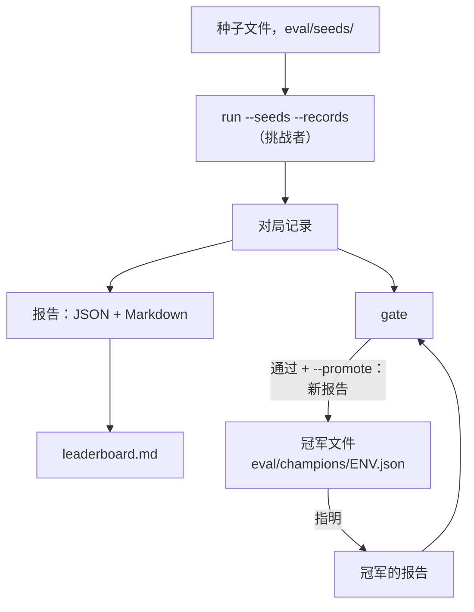

import { Aside } from '@astrojs/starlight/components';

杀戮尖塔 2 的一局是一长串机运：地图、遭遇、提供的牌、每一次抽牌。同一个 AI 可能用一个种子死在第 9 层，换下一个种子就赢了。评估把这些噪声变成两个答案：**AI 有多强**（排行榜），以及**一个改动有没有让它变强**（晋级门槛）。两者都在模拟器里打整局，都把 SL 和 NoSL 两种环境分开，也都建立在固定的、事先登记的种子集上。

先读：[环境](/arch/environments/)，了解 SL 和 NoSL；[模拟器：整局](/arch/simulator/runs/)，了解一局是什么、记录了什么。本章里，`Harness/…` 指 `src/Sts2Ai.Harness` 里的文件，`SimWorker/…` 指 `src/Sts2Ai.SimWorker` 里的文件，`learn/…` 指一个 Python 脚本。

<Aside title="状态">

已实现：两种环境下在模拟器里打整局，即 R1 级（`run --seeds FILE --records FILE`）；报告（`report`）及其作废规则；排行榜（`leaderboard`）；种子文件及其生成器（`seeds`）；配对 SPRT 门槛（`gate`），连同冠军文件和 `--promote`；还有 `learn/gate.py` 在整局上按胜局的配对下界门槛。规划中：R2–R4 级、幕级门槛、A/A 测试、在必须为零的指标里加上 `NumReloads` 和 NoSL 存档导出计数、在报告里加上校准和搜索计算量的数字、把最终种子集跑一遍。

</Aside>

## 1. 两个问题

**它有多强**？一局说明不了什么。强度是在事先固定的种子上、许多局里的一个比率：获胜局数所占的比例，附它的区间；在胜局还很少的时候，再看平均到达层数（[指标、种子与报告 §1](/arch/evaluation/metrics/#sec-1)）。每次评估都产出一份**报告**，每份报告都列上它所在环境的**排行榜**（[§3](#sec-3)）。当前冠军的报告还没有出来。

**改动有没有让它变强**？挑战者（一个新的网络、一个新的搜索预算、一处代码修复）在同样的种子上一对一对地对阵**冠军**，即已接受的最好版本。它必须通过的检验是**晋级门槛**（[晋级门槛](/arch/evaluation/gates/)）。按种子配对能让双方共有的运气相互抵消，序贯检验可以在证据明确时立刻停下。

两个答案分开保存。排行榜列出每一份完整的报告，不论是否被接受；冠军只经由晋级门槛或一个有记录的决定而更换，写进该环境的**冠军文件**（[冠军与基线 §1](/arch/evaluation/champions/#sec-1)）。

## 2. 仿真到实机阶梯

模拟器里的结果，只有能迁移到真实游戏才算数。阶梯用 R1 到 R4 四级逐步走到真实游戏，每级多加一步真实性。每个里程碑都应当跑完所有级，分开报告：

| 级 | 世界 | 测量什么 | 现状 |
|---|---|---|---|
| R1 | 在模拟器里打整局，由 Harness 驱动 | 策略 | 已实现：两种环境下的整局；SL 是主要场景 |
| R2 | R1 + 观测往返（决策只在由观测构建的世界上做） | 观测重建 | 不单独成为一级：NoSL 搜索已经由观测构建它的世界，`run --check` 会检查每个观测的往返 |
| R3 | 在真实 DLL 上打整局，带真实解锁、大厅的幕选择和实际运行的协议 | 世界搭建与接口 | 无 |
| R4 | Steam 版游戏加 Mod | 全部 | 无：Mod 的自动跑局驱动程序还在规划中（[Mod：自动游玩与安全 §2](/arch/mod/auto/#sec-2)） |

**为什么每级只加一个新变量**。每一级和它下面的一级只差一处。如果胜率在相邻两级之间下降，变的只有一样东西，差距就能归因于它：

- R1 → R2：观测重建；
- R2 → R3：世界搭建和接口；
- R3 → R4：动画、时序、UI 状态和执行器（在游戏里执行动作的 Mod 代码）。

如果从 R1 直接跳到真实游戏，胜率变低可能出自其中任何一个原因，无从分辨是哪一个。

- R4 按真实时间运行，所以用于确认，不用于调参。
- 在 NoSL 中，R1 的决策已经走 Build 路径，即由观测构建世界（[模拟器：世界与 SL 克隆 §2](/arch/simulator/worlds/#sec-2)），所以就决策而言，NoSL 的 R1 约等于 R2。SL 则不然：战斗规划器和 `--afterstates clone` 搜索的是节点的克隆，即游戏的存档加上此后的决策，而不是由观测构建的世界（[Harness：路由、预算与种子 §2](/arch/harness/routing/#sec-2)）。
- 对局记录不写级别：它的 `config` 只有游戏、提交、冠军和环境（`Harness/RunRecords.cs:18`），模拟器打的每一局都是 R1。

## 3. 两个排行榜

排行榜给一个环境在一个种子集上的报告排名。每个环境一个，两者从不混在一起：

| | NoSL | SL |
|---|---|---|
| 种子 | 同样的登记种子集 | 相同 |
| 冠军 | NoSL 冠军文件指明的报告 | SL 冠军文件指明的报告 |
| 允许的信息 | [环境：信息与节点 §5](/arch/environments/information/#sec-5) | 同一张表 |
| 预算 | 按每个决策计，同一档 | 相同 |

<Aside type="caution" title="绝不混用环境">

绝不把两种环境放进同一张表，或同一次晋级决定。门槛会拒绝在另一种环境里打的挑战者，`leaderboard` 也为每个环境各写一张表（[指标、种子与报告 §9](/arch/evaluation/metrics/#sec-9)）。

</Aside>

- **现在**。两个冠军共用宏观大脑、同一个 V（`v9-0`）和同一个战斗网络（`c9-0`），即每个角色的网络；它们的战斗搜索不同（[环境：世界 §5](/arch/environments/worlds/#sec-5)）。NoSL 用按画面所示的后状态来打 V，因为克隆是 SL 才有的。这个冠军没有 NoSL 报告，所以 NoSL 文件指向一份 SL 报告：NoSL 门槛会拒绝和它配对（环境不同），NoSL 排行榜也不标出冠军。
- **SL − NoSL**。同一个冠军在同样的种子上、两种环境下成绩的差，就是节点内信息的价值。作为参考，前人项目 spire-mentor 去掉它覆盖整局的作弊后，胜率下降了 22.8–25.5 个百分点（pp，`tmp/notes/refs/strong-bots.md:42`）；我们的作弊只到节点级，所以预计差值更小。`leaderboard` 对每个在两种环境下都有报告的冠军名称计算这个差（`Harness/Reports.cs:205-222`），但还没有哪个排行榜显示过它：SL 冠军的名字是 `combat plan …`，NoSL 的是 `combat pimc …`，所以没有一个名字两边都有。最接近的一对是 `promotion-1` 上较早的一个 V：SL 用规划器 28.25 层，NoSL 用 PIMC 26.16 层，按种子配对相差 +2.09 层（标准误 0.55，由两份报告算出）；由于战斗大脑不同，它把规划器和信息一起量了进去。
- 排行榜如何生成，逐个字段：[指标、种子与报告 §9](/arch/evaluation/metrics/#sec-9)。

## 4. 现状

| 部分 | 状态 | 在哪里 |
|---|---|---|
| 两种环境下的整局（R1）、对局记录 | 已实现 | [指标、种子与报告 §8](/arch/evaluation/metrics/#sec-8) |
| 报告、作废规则、Wilson 区间 | 已实现 | [指标、种子与报告 §2](/arch/evaluation/metrics/#sec-2)、[§7](/arch/evaluation/metrics/#sec-7) |
| 种子集，即 `promotion-1` 及其扩充、`final-1` 和 `a10-check-1`，以及它们的生成器 | 已实现；`final-1` 从未跑过 | [指标、种子与报告 §5](/arch/evaluation/metrics/#sec-5) |
| 排行榜 | 已实现；SL − NoSL 一节从未出现过 | [指标、种子与报告 §9](/arch/evaluation/metrics/#sec-9) |
| 配对 SPRT 门槛 `gate`、冠军文件、晋级 | 已实现 | [晋级门槛 §6](/arch/evaluation/gates/#sec-6) |
| 胜局门槛，即用在整局上的 `learn/gate.py --against` | 已实现，使用中 | [晋级门槛 §10](/arch/evaluation/gates/#sec-10) |
| 幕级门槛、A/A 测试、McNemar 检验 | 规划中 | [晋级门槛 §4](/arch/evaluation/gates/#sec-4)、[§5](/arch/evaluation/gates/#sec-5) |
| R2–R4 | 规划中 | [§2](#sec-2) |

**新网络如何过门槛**。网络在 SL 整局里训练和评判，依据是它获胜的机会（[宏观大脑：自我对弈 §1](/arch/macro-brain/selfplay/#sec-1)）。它的门槛让挑战者用冠军的规划器、按 medium 力度（`--afterstates clone`，不探索）打 `promotion-1-300` 的 300 个种子，把它的对局和冠军的按种子配对，当胜局之差（每局 1 或 0）的均值的 95% 单侧下界大于 0 时晋级它。同样的种子也用 low 预算打一遍，只作参考，不决定任何事。如果一代的两个网络都通过，就晋级胜局更多的那个。所以有两种门槛并存：C# 的 SPRT `gate`，序贯，按层数或按胜局；以及 `learn/gate.py` 按胜局的固定样本下界。

## 5. 本章内容

| 页面 | 讲什么 |
|---|---|
| [指标、种子与报告](/arch/evaluation/metrics/) | 主要指标、必须为零的项、辅助指标、Wilson 区间；种子集及其生成器；报告、对局记录和排行榜，逐个字段 |
| [晋级门槛](/arch/evaluation/gates/) | 为什么要配对；共同随机数、SPRT、McNemar 和 A/A；分层的门槛；`gate` 和胜局门槛的每个选项；不更差、晋级、重定基线 |
| [冠军与基线](/arch/evaluation/champions/) | 冠军文件，历史和报告放在哪里，外部基线，未决问题 |
