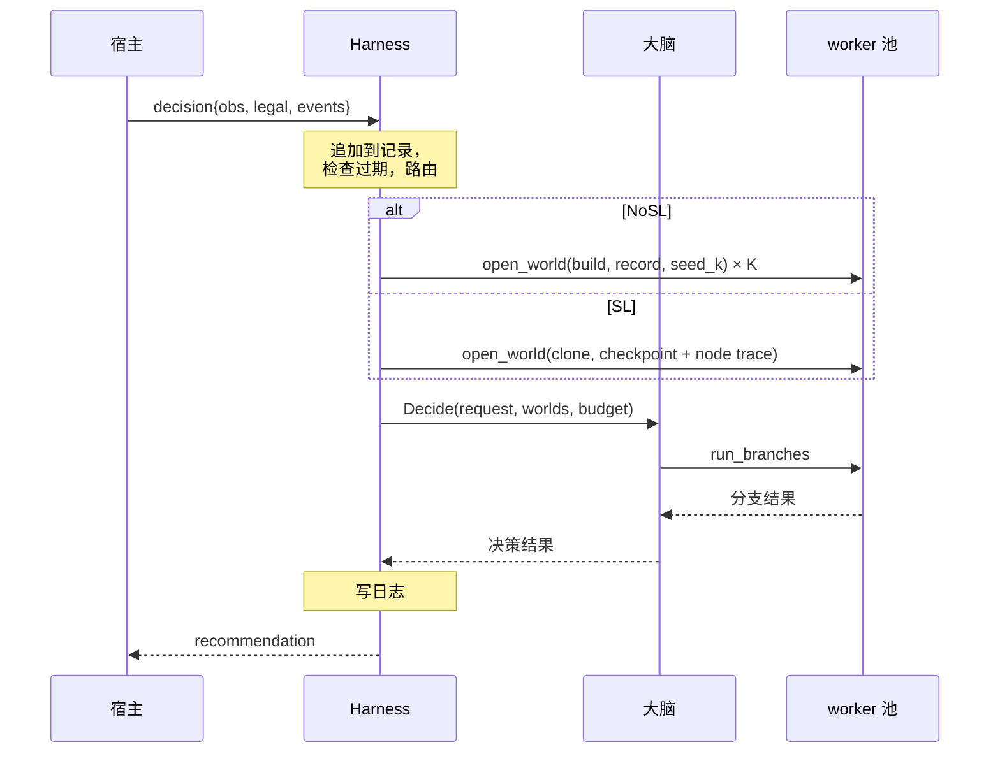

import { Aside } from '@astrojs/starlight/components';

Harness 是决策进程里的调度器。它的一边是**宿主**，也就是真正运行游戏的一方：真实游戏里是 Mod，模拟时是负责跑这一局的宿主 worker 进程。另一边是各个大脑，以及执行搜索的 SimWorker 进程池。Harness 自己没有任何策略，也不碰任何游戏对象，只使用 Protocol 类型。它做的是记账类的工作：AI 到目前为止看到了什么，哪个决策界面交给哪个大脑，一个决策能用多少算力，以及要记哪些日志。

<Aside title="状态">

部分实现。`Sts2Ai.Harness` 里有 worker 进程池（[模拟器：工作进程池 §2](/arch/simulator/pool/#sec-2)）、`PooledPimc`（在进程池里搜索世界的 PIMC 战斗大脑，NoSL 或 SL）、`PooledPlanner`（在进程池里搜索各个回合的 SL 规划器）和 `Dispatcher`：它把一局里的决策路由给大脑，抽取大脑的种子，并写决策日志（[§4](#sec-4)–[§6](#sec-6)）。SimWorker 的 `run` 让每一局都经过它，可以在进程内，也可以走传输协议：`BrainServer` 是 Harness 这一端的宿主–brain 消息处理（[协议：线路 §1](/arch/protocol/wire/#sec-1)），按顺序回答决策。规划中：公开记录的其余部分（[§3](#sec-3)；目前只记录敌人每回合的意图，[§6](#sec-6)）；搜索进行中的过期请求和取消；墙钟预算和基于 CI 的分配；降级回答。

</Aside>

## 1. 职责

Harness 负责六件事：

1. 处理 Protocol 消息：按 `decision_id` 排序，丢弃过期请求，也就是针对游戏已经离开的状态发出的请求（[协议：线路 §5](/arch/protocol/wire/#sec-5)）。
2. 为每一局维护公开记录（[§3](#sec-3)）。在 NoSL 下，这份记录是信念的输入；信念就是 AI 对隐藏状态的认识。在 SL 下，Harness 还要保存节点检查点和节点轨迹。
3. 通过 `IWorldSource` 为当前环境打开世界（[环境：世界 §5](/arch/environments/worlds/#sec-5)、[协议：世界与工作进程消息 §1](/arch/protocol/worlds/#sec-1)）。
4. 把每个决策界面路由给一个大脑，没有兜底（[§4](#sec-4)）。
5. 设定预算（[§5](#sec-5)），并保证搜索种子是确定性的。
6. 写决策日志（[§6](#sec-6)）。

Harness 不做的事：

- 读取或执行游戏：这是宿主里 GameBridge 的工作；
- 构建或确定化状态：这是 worker 进程的工作，因为它需要游戏代码；
- 评判动作的好坏：这是各个大脑的工作（[战斗大脑](/arch/combat-brain/)、[宏观大脑](/arch/macro-brain/)）。

## 2. 进程与流程

一次决策的过程如下。宿主发来一条 `decision` 消息，里面有观测、合法动作，以及自上一个决策以来的事件。Harness 把它们追加到记录里，检查请求是否过期，然后为这个决策界面选定大脑。接着它在 worker 池里打开世界：NoSL 下是从记录构建的 K 个世界，每个世界有自己的搜索种子 `seed_k`；SL 下是由节点检查点加节点轨迹得到的 1 个克隆。大脑在预算内搜索这些世界，用 `run_branches` 把分支交给 worker 池执行。Harness 记录结果，再把推荐（recommendation）发回宿主。



- 宿主是 Mod（R4，真实游戏）或者负责这一局的宿主 worker 进程（R1–R3，模拟）；R1–R4 是[仿真到实机阶梯](/arch/evaluation/#sec-1)的各级。Harness 分辨不出这两者，这正是项目的原则「换世界，不换大脑」（swap the world, not the brain）。SimWorker 的 `brain` 命令单独运行 Harness，在套接字后面等待宿主；`run --brain` 作为宿主连上它跑整局（[模拟器：整局 §8](/arch/simulator/runs/#sec-8)）。
- 搜索用的 worker 进程与宿主进程是分开的。自我对弈时，宿主 worker 只持有真实的这一局，搜索在其他 worker 上进行。
- 单进程模式（bench、selftest）：Harness 和一个 worker 在同一个进程里，接口相同，没有进程间通信（IPC）。

## 3. 公开记录

公开记录就是 NoSL 下的信念：AI 对这一局的全部了解都来自它。

Harness 不维护一个与真实随机数保持同步的镜像游戏。这种镜像正是 spire-mentor 的结构性 bug；spire-mentor 是本设计借鉴过的先行项目。取而代之的做法是：每次决策都从记录重新构建世界。

```csharp
// Planned. Protocol types only.
public sealed class PublicRecord
{
    public RunHeader Header { get; }                    // character, ascension, game version, env
    public IReadOnlyList<RecordEntry> Entries { get; }  // observations, events, own decisions, in order
    public Observation Latest { get; }
}
```

- 记录是 NoSL 世界的唯一输入。worker 拿到（记录，搜索种子），用游戏代码采样出一个与记录一致的状态。所需的规则（怪物状态机、各种池、奖励权重）都在 worker 里。
- 记录必须支持的推断，按优先级排列：
  1. 抽牌堆的多重集，以及位置已知的牌（需要 `move{pos}` 事件）；
  2. 每个怪物下一步动作的后验分布（根据已见信息得到的概率分布），依据它的意图历史和效果历史。目前的重采样是在意图相同的动作之间均匀抽取；
  3. 本回合的历史，由此推出能力和遗物的内部计数器；
  4. 整局层面：至今见过的奖励、商店和事件，由此推出隐藏的概率计数器。
- 记录随这一局的日志一起保存。崩溃恢复就是重放日志，不需要游戏存档。
- SL：记录照样保留，用于日志和解说，但搜索用的世界来自节点克隆（[模拟器：世界与 SL 克隆 §7](/arch/simulator/worlds/#sec-7)）。Harness 保存最新的节点检查点和节点轨迹；每次进入新节点时，轨迹清空重来。`Dispatcher` 从宿主的 `node_checkpoint` 和 `node_action` 消息里保存它们，NoSL 下拒收，并在每个战斗决策时把克隆交给战斗大脑；加上 `--afterstates clone` 时，也在每个宏观决策和每个战斗外的选牌提示处把它交给 L0，L0 的试探由 `PooledClone` 在 worker 进程池里打（[宏观大脑：搜索 §6](/arch/macro-brain/search/#sec-6)）。还没收到任何检查点就来了 SL 决策，会抛异常。

## 4. 决策界面路由

每个决策界面（surface）只交给一个大脑：

| 决策界面 | 大脑 |
|---|---|
| `combat` | 战斗大脑 |
| 战斗中的 `card_choice`（弃牌、消耗、选择、放到牌堆顶……） | 战斗大脑（带 `ChoiceContext`） |
| 战斗外的 `card_choice`（升级、变化、附魔、移除） | 宏观大脑 |
| `map`、`rewards`、`card_reward`、`bundle`、`event`、`shop`、`rest`、`treasure`、`potion_full` | 宏观大脑 |

- 战斗大脑取决于环境：NoSL 用 PIMC，SL 用 SL 规划器（`--policy plan`，[战斗大脑 §3](/arch/combat-brain/#sec-3)），它在节点克隆上规划，在 NoSL 里拒绝运行。在克隆上跑 PIMC（SL 下的 `--policy pimc`）保留下来，作为规划器的基线：它只搜索本回合。宏观大脑在两种环境里是同一个（[环境：世界 §5](/arch/environments/worlds/#sec-5)）。每个宿主在 `hello` 里报出自己的环境，所以 `brain` 命令同时服务两种：NoSL 宿主用 `--policy` 的战斗大脑，SL 宿主用 `--sl-policy` 的，默认是 SL 规划器（[Mod §5](/arch/mod/#sec-5)）。
- `Dispatcher` 为一局实现这张表。宿主把它作为自己的战斗策略、选牌提示策略和宏观策略。它为每一侧各持有一个大脑（战斗、战斗中的提示、宏观、战斗外的提示），并按 `ChoiceContext.InCombat` 把选牌提示交给对应的一侧（[协议：观测与动作 §6](/arch/protocol/observation/#sec-6)）。目前战斗中的提示交给 `p0`（[战斗大脑：提示、招式与 worker §1](/arch/combat-brain/shared/#sec-1) 第 7 条），宏观一侧和它的提示交给 L0 或随机占位策略。
- 找不到路由时报错「uncovered surface」（未覆盖的决策界面）：决策界面不在 `Dispatcher.MacroSurfaces` 里，或大脑的回答不合法，`Dispatcher` 都会抛异常。宿主暂停，请求人工操作，并记录一个覆盖率 bug。绝不随机兜底。评估要求兜底次数为 0（[评估 §3](/arch/evaluation/#sec-3)）。
- 决策界面列表及其游戏入口：[模拟器：整局 §4](/arch/simulator/runs/#sec-4)、[GameBridge §4](/arch/gamebridge/#sec-4)。

## 5. 预算与确定性

预算按分支数计（一个分支就是在某个世界里模拟的一条打法），或者按墙钟时间计，取决于模式：

| 模式 | 单位 | 原因 |
|---|---|---|
| 自我对弈、评估 | 固定的分支数 | 可复现：相同请求 + 大脑种子 + 预算 → 相同推荐 |
| 辅助模式 | 墙钟时间，随时可停（anytime） | 有人在等：先发出目前最好的答案，再逐步改进 |
| 自动游玩（R4） | 墙钟时间上限 + 最少分支数 | 既不卡住，也不搜得太浅 |

「随时可停」是指搜索在任何时刻被打断，都有一个当前最好的答案可以给出。

- 并行算出的结果按固定顺序合并（先按世界编号，再按候选编号），绝不按完成的先后顺序，这样时序就改变不了答案。
- 大脑的随机数由 Harness 提供：`brainSeed = SplitMix64(Hash(runId), decisionIndex)`，其中决策序号计入这一局的每个决策（包括选牌提示），run id 是这一局种子的哈希，所以大脑看不到种子（[协议：线路 §3](/arch/protocol/wire/#sec-3)）。大脑绝不从游戏自己的随机数流里取数。等大脑有了版本，冠军版本号也加入哈希。PIMC 的构建种子就是大脑种子的十六进制形式。
- 分配：当排名前两位的候选之差超出各自的置信区间（CI）时停止；否则增加样本或深度（[NoSL PIMC：预算 §1](/arch/pimc/budget/#sec-1)）。

## 6. 决策日志

每个决策一行 JSON：

```json
{"run": "97eef296cd6717a2", "decision_id": 4, "env": "NoSL", "surface": "combat", "brain": "pimc",
 "obs_hash": "67f99089ea94de49", "legal": 7, "chosen": "play:2", "plan": ["play:3:1", "play:5", "end_turn"],
 "candidates": [{"action": "play:2", "value": 0.673, "ci": 0.0, "samples": 8,
                 "values": [0.673, 0.673, …], "nodes": [37, 35, …]}, …],
 "budget": {"worlds": 8, "nodes_per_world": 300, "elite": 1, "boss": 1, "halving": false, "follow": false}, "seed": 16058448958323553205, "elapsed_ms": 104.6,
 "obs": {"encounter": "NIBBITS_WEAK", "room": "Monster", …}}
```

- `obs_hash` 是大脑看到的内容的哈希：战斗观测、整局观测或选牌提示。`legal` 是合法动作的个数（对提示而言是选项个数）。`chosen` 是文本形式的动作，或选中的选项下标。
- 会搜索的大脑还会加上 `plan`（`chosen` 之后本回合剩下的动作，取第一个世界里的；SL 规划器则是整场战斗剩下的动作）、`candidates`（每个首个动作的平均估值、置信区间半宽 `ci` 和世界数，最好的在前；然后是它在每个世界里的估值，按世界顺序，以及搜索在每个世界里花在它下面的节点数；SL 规划器则是它保留的路线里出现过的每个首个动作，估值取其中最好的路线）和 `budget`。沿用计划打出的一步（[NoSL PIMC：预算 §2](/arch/pimc/budget/#sec-2)）有 `plan` 而没有 `candidates`，和只有一个合法动作的决策一样。占位策略两者都不记。各个世界的估值就是 ExIt 的 policy 目标里的 Q（[学习 §2](/arch/learning/#sec-2)）。
- 在地图上，L0 也会加上 `plan`：`chosen` 之后本幕剩下的路线（[宏观大脑：搜索 §1](/arch/macro-brain/search/#sec-1)）。
- `explored: true` 标出自我对弈的探索抽中的、不是大脑最优选的一步，且大脑给它的估值比最优低出温度的百分之一以上（[学习 §5](/arch/learning/#sec-5)）。差距比这更小就算平手（例如同一回合换了个出牌顺序），不标。用均匀抽取（`--explore ε`）时，每个抽出来的答案都会标上，碰巧就是大脑自己首选的那个也一样。其他步骤没有 `explored`。没有选搜索首选的战斗步骤保留 `candidates`，但没有 `plan`，因为那个计划是首选的。
- `replanned: true` 标出因为大脑计划里的一步对不上（战斗没有出现计划预期的观测）而重新搜索的战斗步骤（[NoSL PIMC：预算 §2](/arch/pimc/budget/#sec-2)）。用 PIMC 的 `--follow` 时，这是回合里揭示了新东西；用 SL 规划器时，说明克隆和真实战斗不同（[SL 规划器 §4](/arch/sl-planner/#sec-4)）。对局那一行统计它们的次数（`replans`）。
- 一局的战斗决策按战斗分块，每场战斗一块，块与块之间隔着宏观决策，顺序与对局记录里的战斗一致。决策靠这个找到它那场战斗的结局（[评估 §6](/arch/evaluation/#sec-6)）。
- 战斗决策还会加上 `obs`，即大脑看到的战斗观测（[协议：观测与动作 §3](/arch/protocol/observation/#sec-3)）：学习得到的战斗部件和融合测试集的输入（[NoSL PIMC：搜索 §4](/arch/pimc/search/#sec-4)）。约 1.6 KB。
- 战斗决策还会加上 `history`：这场战斗里每个敌人在至今每一回合开始时显示的意图，包括本回合，按 uid 分组，每项是 `{round, intents}`。这是目前已实现的那部分公开记录（[§3](#sec-3)）：Harness 从它看到的战斗观测里收集，每次宏观决策后重新开始。战斗网络读它和回合数，这样每个怪物的出招顺序能从数据里学到，而不是靠手写的规则（[学习 §1](/arch/learning/#sec-1)）。Brain 里的 `MoveRecord` 保存这份记录，Harness 每个决策都把它交给战斗大脑（战斗路由的最后一个参数），搜索再把它发给 worker，供叶子使用（[战斗大脑：提示、招式与 worker §2](/arch/combat-brain/shared/#sec-2)）。
- 宏观决策还会加上 `features`：大脑看到的整局观测上 V 的特征（[学习 §1](/arch/learning/#sec-1)），不管是哪个大脑做的决策。V v0 的拟合和 V v2 的训练读的就是它们；两者都已删除，纯 V 不读它们（[学习 §2](/arch/learning/#sec-2)）。
- 宏观决策还会加上 `run_view`：整局观测本身，约 6 KB，V v2 就用它训练（[学习 §2](/arch/learning/#sec-2)）。
- `run --log FILE` 写出日志，每个决策一行（[模拟器：整局 §5](/arch/simulator/runs/#sec-5)）；它和对局记录一起放在 `data/`（[学习 §6](/arch/learning/#sec-6)）。
- `degraded` 标记 worker 故障之后给出的回答，它和在其他 worker 上重新打开世界一起规划（[§7](#sec-7)）。崩溃或卡住的 worker 会被重启，请求再发一次，得到的回答相同，所以目前没有降级的回答。

谁读这份日志：

- 学习：价值目标和 ExIt 标签（ExIt，专家迭代：训练学到的部分去模仿搜索的选择）；
- 评估：兜底次数、每个决策的算力、保守程度；
- 输出层：解说只根据候选和事实（facts）生成。

## 7. 故障处理

| 情况 | 处理 |
|---|---|
| 过期请求（已有更新的 `decision_id`） | 取消搜索，不回复 |
| worker 崩溃或超时 | 在另一个 worker 上从快照重新打开世界；用已完成的分支作答；`degraded=true` |
| 从观测构建失败 | 报告 `BuildDifferences`；不搜索；宿主暂停；记录 bug。绝不随机 |
| 宿主认为动作不合法而拒绝 | 宿主重新请求；连续 2 次 → 暂停 |

目前：死掉的 worker，或 5 分钟内没有回答的 worker，会被杀掉、重启，请求再发一次；第二次失败就让这个决策失败（[模拟器：工作进程池 §6](/arch/simulator/pool/#sec-6)）。一个请求是一个世界的搜索，最多几秒，所以超时抓的是卡住的 worker，不是慢的 worker。没有按观测构建出来的战斗会让这个决策失败，并带上差异（`SimWorlds.NoSL`），在 `run` 里这会让这一局失败。大脑给出不合法的回答时，`Dispatcher` 抛异常。

## 8. 测试

1. 路由覆盖：N 局模拟覆盖到所有决策界面，兜底次数为 0。已有：`run` 列出从未到达的决策界面，遇到未覆盖的界面时 `Dispatcher` 抛异常。
2. 可复现性：重放一份决策日志，得到完全相同的推荐。部分已有：`run --check` 对每个种子打两遍，第二遍走传输协议，连到同一进程里的 Harness，然后比较两份决策日志中除 `elapsed_ms` 外的每个字段。
3. Harness 层面的 NoSL 反事实测试：公开记录相同、隐藏状态不同 → 推荐相同（[环境：信息与节点 §8](/arch/environments/information/#sec-8)）。
4. 过期处理：请求被打乱顺序或重复发送 → 只回答最新的一个。

## 9. 未决问题

1. 记录里事件的粒度：先满足 [§3](#sec-3) 列出的推断，有需要再加。
2. 同一回合内的多个决策之间，是复用已经构建好的世界（增量方式：构建后做一个快照，再把执行过的动作追加到轨迹上），还是每次都重新构建？
