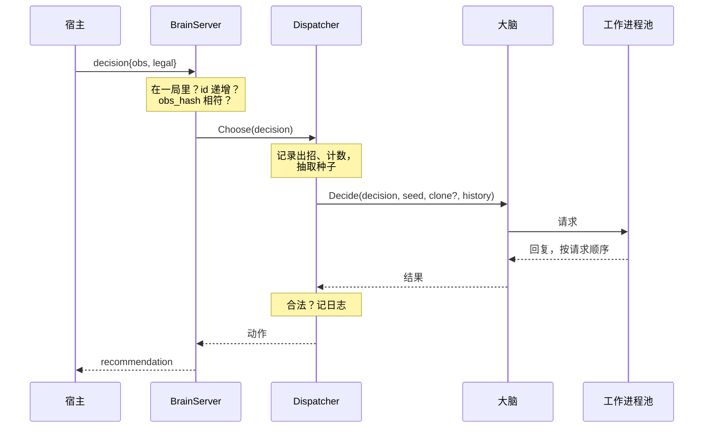

import { Aside, Badge } from '@astrojs/starlight/components';

一个决策始于**宿主**，也就是持有这一局的进程：自我对弈时是模拟器，真实游戏里是 Mod。它终于**大脑**，由大脑评判各个选项：战斗大脑或宏观大脑。两者之间是 Harness（`src/Sts2Ai.Harness`）。它自己没有策略，也不碰任何游戏对象：它只通过协议类型看到游戏（[协议](/arch/protocol/)）。它的工作是记账：哪个大脑回答哪个画面，这一局到目前为止显示了什么，一个决策得到哪个种子，回答是否合法，以及什么写进日志。

<Aside title="状态">

已有：`Dispatcher`，每局一个，它负责路由，保存敌人出招记录和 SL 节点，抽取种子，检查回答，并写决策日志；`BrainServer`，宿主–大脑线路上 Harness 的一端；工作进程池和在其中搜索的大脑（`PooledPimc`、`PooledPlanner`、`PooledClone`）；以及评估使用的类型（对局记录、报告、晋级门槛、冠军文件，[评估](/arch/evaluation/)）。SimWorker 的 `run` 让每一局都经过它，在进程内或通过线路。规划中：公开记录的其余部分（[§4](#sec-4)）；在搜索进行中丢弃过期请求；墙钟预算；降级回答（[路由、预算与种子 §4](/arch/harness/routing/#sec-4)、[§6](/arch/harness/routing/#sec-6)）。

</Aside>

## 1. Harness 做什么，不做什么

Harness 做八件事：

1. 给每一局一个 `Dispatcher`，宿主把它当作自己的战斗、选牌提示和宏观策略来询问（[§2](#sec-2)）。
2. 按决策界面（surface）把每个决策路由给恰好一个大脑，没有兜底（[路由、预算与种子 §1](/arch/harness/routing/#sec-1)）。
3. 保存这一局已经显示过、搜索又需要的东西：敌人出招记录，以及 SL 下当前节点的检查点和轨迹，它由此做出节点的克隆（[§4](#sec-4)）。
4. 用 run id 和决策的序号抽取每个决策的种子，从不取自游戏（[路由、预算与种子 §5](/arch/harness/routing/#sec-5)）。
5. 检查每个回答是否合法，不合法就抛异常。
6. 写决策日志（[决策日志](/arch/harness/decision-log/)）。
7. 提供宿主–大脑线路的服务：`BrainServer`（[§5](#sec-5)）。
8. 把搜索发给别的进程：工作进程池，以及把自己的搜索拆成池的请求的大脑（[模拟器：工作进程池](/arch/simulator/pool/)）。

Harness 不做的事：

- **读取或执行游戏**：这是宿主里的 GameBridge（[GameBridge](/arch/gamebridge/)）；
- **构建或确定化世界**：这由工作进程来做，因为它需要游戏代码。池化的大脑发送自包含的请求，工作进程根据请求带来的东西构建世界；Harness 自己从不打开世界（[协议：世界与工作进程消息 §4](/arch/protocol/worlds/#sec-4)）；
- **评判动作**：这由各个大脑来做（[战斗大脑](/arch/combat-brain/)、[宏观大脑](/arch/macro-brain/)）；
- **丢弃过期请求**：这由 Mod 来做。搜索进行中画面变了时，它发出 `cancel`，等回答到来后把它丢掉；Harness 按顺序回答每个请求（[Mod：主循环 §3](/arch/mod/loop/#sec-3)）。

## 2. 一个决策，一步一步



1. **宿主提问**。通过线路时，宿主发来一条 `decision` 消息：观测、它的哈希和合法动作（[协议：线路 §3](/arch/protocol/wire/#sec-3)）。`BrainServer` 检查它属于一局、它的 id 大于上一个、哈希确实是这个观测的，然后把它作为战斗、选牌提示或宏观决策交给这一局的 `Dispatcher`（[§5](#sec-5)）。在进程内时，模拟器直接询问 `Dispatcher`。
2. **Harness 记下它**。战斗决策的观测加入敌人出招记录（`MoveRecord.Witness`）；宏观决策结束这场战斗的记录（[§4](#sec-4)）。这个决策得到它在这一局里的序号，它的大脑的计数加一，并抽取它的种子（`Dispatcher.cs:205-210`）。
3. **一个大脑做决定**。这个决策界面的路由拿到决策、种子、SL 下节点的克隆，以及这场战斗至今的出招。会搜索的大脑把搜索拆成工作进程请求，再合并回复，回复按请求的顺序返回（[路由、预算与种子 §2](/arch/harness/routing/#sec-2)）。
4. **Harness 检查并记日志**。不合法的回答会抛异常。大脑的名字、计划和候选成为这个决策的注记（`Dispatcher.Last`），开着日志时，还成为决策日志里的一行。
5. **宿主得到一条推荐**：动作、大脑、它的计划和候选，并重复请求的 id 和哈希（[协议：线路 §7](/arch/protocol/wire/#sec-7)）。

**进程内与通过线路**。不带 `--brain` 的 `run` 在自己的进程里给每一局一个 `Dispatcher`。`run --brain SOCKET` 和 Mod 则通过 Unix 套接字把每个决策发给 `brain` 命令，`BrainServer` 在那里同样给这一局一个 `Dispatcher`。两者的回答相同：`run --check` 把每个种子通过线路再打一遍并加以比较（[决策日志 §8](/arch/harness/decision-log/#sec-8)）。宿主会说明自己是 Mod 还是模拟的一局（`hello.role`），但做出冠军时不读它：大脑分不出真实游戏和模拟器。这就是项目的原则「换世界，不换大脑」（[前言 §3](/#sec-3)）。

## 3. Harness 为一局保存什么

| 保存什么 | 用于 | 何时重新开始 |
|---|---|---|
| 决策计数器 | 日志里每个决策的序号和它的种子；战斗决策、选牌提示和宏观决策共用它，从 0 开始 | 一局之内从不 |
| 每个大脑的决策数（`Brains`） | 对局记录的 `brains` | 一局之内从不 |
| `Replans` | 因为计划对不上而重新搜索的战斗步骤 | 一局之内从不 |
| `Last` | 最近一个决策的大脑、计划和候选：推荐带的内容 | 每个决策 |
| 敌人出招记录（`History`） | 战斗大脑的叶子，以及各世界里怪物的出招日志（[§4](#sec-4)） | 宏观决策时，或回合数倒退时 |
| SL 节点：检查点和轨迹 | 节点的克隆，交给战斗大脑，用 `--afterstates clone` 时也交给宏观一侧 | 每个节点检查点 |
| 决策日志 | 这一局的各行，一局结束前都留在内存里 | 一局之内从不 |
| 各路由自己的状态 | PIMC 沿用的计划（`TurnPlan`）和 SL 规划器的路由（`SlRoute`），每局一个 | 从不：战斗结束时不，宏观决策时也不 |

## 4. 公开记录

**思路**。在 NoSL 下，AI 关于一局可以知道的一切，就是这一局已经显示过的东西：**公开记录**。搜索不在真实游戏旁边保留一份运行着的游戏副本。这样一面与真实随机数流保持同步的镜子，正是 spire-mentor 的结构性 bug；spire-mentor 是本设计借鉴过的先行项目。取而代之，每个决策都从公开的东西重建它的世界，工作进程用游戏代码采样其余隐藏的部分（[环境：世界 §2](/arch/environments/worlds/#sec-2)）。

**已实现：敌人出招记录**。公开记录里已有的是一部分：每个敌人显示了什么。`MoveRecord`（`Brain/Combat/MoveRecord.cs`）由 `Dispatcher` 保存，每局一个：

- 在每个回合的第一个决策处，每个有 uid 和意图的活着的敌人添加这个回合数和它的意图。这个回合之后的决策不再添加任何东西。
- 一项是敌人的 uid、它的怪物 id，以及它的各个回合，最早的在前：`{uid, id, turns: [{round, intents}]}`（[协议：世界与工作进程消息 §2](/arch/protocol/worlds/#sec-2)）。
- 宏观决策会清空它，回合数倒退也会，因为那意味着一场新的战斗。选牌提示不会。
- 每个战斗决策都把它交给战斗大脑，大脑的请求再把它带到工作进程。它在那里有两个用处：叶子里的战斗网络连同回合数一起读它，好从数据里学到每个怪物的出招顺序（[战斗大脑：叶子 §3](/arch/combat-brain/leaf/#sec-3)）；由观测构建的 NoSL 世界把每个怪物显示过的招式作为它的出招日志（[模拟器：战斗 §5](/arch/simulator/combat/#sec-5)）。
- 它作为 `history` 写进决策日志的每个战斗行（[决策日志 §7](/arch/harness/decision-log/#sec-7)）。

**已实现：SL 节点**。SL 下宿主还会在进入时发来当前节点的检查点，以及此后在节点里做出的每个决策（[协议：线路 §6](/arch/protocol/wire/#sec-6)）。`Dispatcher` 保存它们：

- `Checkpoint` 拒收 NoSL 下的检查点，以及节点下标没有递增的检查点；它让节点的轨迹重新开始。
- `Act` 拒收 NoSL 下的动作，以及不属于当前节点、或序号不等于轨迹长度的动作；它把动作加到轨迹上。
- 在需要它的决策处，节点的克隆就是检查点的存档、轨迹的一份副本，以及这一局按精英连战规则进行时的这条规则（`NodeClone`）。需要克隆的 SL 决策若出现在任何检查点之前，会抛异常。需要克隆的是每个 SL 战斗决策，用 `--afterstates clone` 时还有每个宏观决策和每个战斗外的选牌提示（[路由、预算与种子 §3](/arch/harness/routing/#sec-3)）。

**规划中：记录的其余部分** <Badge text="规划中" variant="caution" />。要让 NoSL 的信念涵盖怪物招式以外的东西，需要更多公开过的内容：

```csharp
// Planned. Protocol types only.
public sealed class PublicRecord
{
    public RunHeader Header { get; }                    // character, ascension, game version, env
    public IReadOnlyList<RecordEntry> Entries { get; }  // observations, events, own decisions, in order
    public Observation Latest { get; }
}
```

- 记录将是 NoSL 世界的唯一输入：工作进程收到记录和一个搜索种子，用游戏代码采样出一个与记录一致的状态。这需要的规则（怪物状态机、各种池、奖励权重）都在工作进程里。
- 记录必须支持的东西，按优先级排列：
  1. 抽牌堆的多重集，加上位置已知的牌（这需要 `move{pos}` 事件，[协议：观测与动作 §8](/arch/protocol/observation/#sec-8)）；
  2. 每个怪物下一招的后验（在已见信息下的概率分布），依据它的意图历史和效果历史。目前世界里排上的招式，是在显示相同意图的招式之间均匀抽取的（[模拟器：战斗 §5](/arch/simulator/combat/#sec-5)）；
  3. 本回合的历史，由此得出能力和遗物的内部计数器；
  4. 在整局层面，至今见过的奖励、商店和事件，由此得出隐藏的概率计数器。
- 记录会和这一局的日志一起保存，这样崩溃后的恢复就是重放日志；不需要游戏存档。
- SL 下记录照样保存，用于日志和解说，但搜索在节点的克隆上进行。

## 5. 大脑服务器

`BrainServer`（`BrainServer.cs`）是线路的大脑一端（[协议：线路](/arch/protocol/wire/)）。它拿到一个工厂，由宿主的 `hello` 做出一局的 `Dispatcher`；还可以选择性地拿到每次 `run_end` 时要做的事、一个日志记录器，以及一个能看到每条消息的钩子。

**监听**。`Listen(path)` 为连到一个 Unix 套接字的宿主提供服务，一次一个，一直如此。连接出错的宿主（I/O 错误、格式错误的消息、坏的 JSON、对不上的协议版本）会被丢弃并给出警告，然后服务下一个。`Bind(path)` 创建套接字：以 NUL 字节开头的路径表示一个抽象套接字，它没有文件；已经退出的大脑留下的套接字文件会被替换，还有大脑在监听的则会抛异常；套接字所在的目录创建为只让当前用户可读。

**消息循环**（`BrainServer.cs:75-136`）：

| 宿主发来的消息 | 服务器做什么 |
|---|---|
| `hello` | 向工厂要一个新对局的 `Dispatcher`，并回答 `ready{champion}`；如果工厂拒绝这一局（它抛异常），就回答 `error`。第二个 `hello` 不经 `run_end` 就开始新的一局 |
| `decision` | 回答一条 `recommendation`；以下情况则回答 `error`：没有打开的对局，这一局的某条 SL 节点消息被拒绝过，它的 id 不大于上一个，它的观测与哈希不符（「are the mod and the brain built from the same commit?」，即 Mod 和大脑是否用同一个提交构建），战斗决策或选牌提示决策没有对应种类的画面，或 Harness 抛异常（不合法的选择、未覆盖的决策界面）。宿主随即结束这一局 |
| `node_checkpoint`、`node_action` | 把它们交给这一局的 `Dispatcher`；从不回答。拒绝会被记下来，让这一局的下一个决策失败 |
| `run_end` | 把这一局的 `Dispatcher` 交给 `ended` 回调，并关闭这一局 |
| `executed`、`cancel` | 忽略：每个决策都在读下一条消息之前答完，所以没有需要丢弃的搜索 |
| 其他任何消息 | `error` |

**回答**（`BrainServer.cs:138-154`）。战斗决策的合法动作被解析成战斗动作，大脑看到的是它画面上的战斗观测；选牌提示的回答写成 `pick:i,j`；其他每个决策界面都是宏观决策。推荐重复请求的 id 和哈希，并带上这个决策的注记：它的大脑、计划和候选（选牌提示的推荐只带大脑）。

**`brain` 命令**包装了它（[模拟器：参考 §4](/arch/simulator/reference/#sec-4)）。它根据自己的选项做出两个冠军，每种环境一个：NoSL 宿主得到 `--policy` 的战斗大脑，SL 宿主得到 `--sl-policy` 的，默认是 SL 规划器（[环境 §5](/arch/environments/#sec-5)）。两者共用一个工作进程池。`--log FILE` 在每一局的 `run_end` 时写出它的决策日志，所以没发这条消息就断开的宿主不留下任何行；`--wire FILE` 记录宿主发来的每条消息，`clones` 据此检查 Mod 的 SL 记录（[Mod：SL 记录 §8](/arch/mod/sl-record/#sec-8)）。

## 6. 代码

`Sts2Ai.Harness` 引用 Brain（并经由它引用 Protocol）和 `Microsoft.Extensions.Logging.Abstractions` 9.0.22，不引用游戏的任何东西；`selftest` 检查它编译后的引用（[模拟器：参考 §5](/arch/simulator/reference/#sec-5)）。

| 文件 | 类型 | 内容 |
|---|---|---|
| `Dispatcher.cs` | `CombatRoute`、`Route<T>`、`DecisionEntry`、`DecisionNote`、`Dispatcher` | 一局的路由、种子、检查、SL 节点和日志（[路由、预算与种子](/arch/harness/routing/)、[决策日志](/arch/harness/decision-log/)） |
| `BrainServer.cs` | `BrainServer` | 线路的大脑一端（[§5](#sec-5)） |
| `WorkerPool.cs` | `WorkerPool` | 搜索用的工作进程（[模拟器：工作进程池](/arch/simulator/pool/)） |
| `PooledPimc.cs` | `PooledPimc` | 在池里搜索各个世界的 PIMC，NoSL 或 SL |
| `PooledPlanner.cs` | `PooledPlanner` | 在池里搜索各个回合的 SL 规划器 |
| `PooledClone.cs` | `PooledClone` | 给宏观一侧的节点克隆，它的试探在池里打 |
| `RunRecords.cs` | `RunConfig`、`RunRecord`、`CombatEntry`、`CombatEnd` | 对局记录（[评估：指标、种子与报告 §8](/arch/evaluation/metrics/#sec-8)） |
| `Reports.cs` | `Rate`、`BossEntry`、`Metrics`、`EvalReport`、`Leaderboard` | 报告和排行榜（[评估：指标、种子与报告 §7](/arch/evaluation/metrics/#sec-7)） |
| `Gate.cs` | `Gate`、`ChampionFile` | 配对的晋级门槛和冠军文件（[评估：晋级门槛 §6](/arch/evaluation/gates/#sec-6)） |

**`Dispatcher`**（`Dispatcher.cs:80-225`），创建时给定 run id、环境、四个路由、是否记日志，以及在 `--afterstates clone` 下如何为宏观一侧打开节点的克隆：

| 成员 | 内容 |
|---|---|
| `static MacroSurfaces` | 战斗外有路由的决策界面：map、rewards、card_reward、bundle、event、shop、rest、treasure、crystal_sphere |
| `Choose(CombatDecision)` → `CombatAction` | 一个战斗决策（[§2](#sec-2)） |
| `Choose(ChoiceDecision)` → 选择 | 一个选牌提示：若是在战斗中提出的（`ChoiceContext.InCombat`），交给战斗一侧，否则交给宏观一侧；回答必须是提示接受的 |
| `Choose(MacroDecision)` → 动作 | 一个战斗外的决策；未覆盖的决策界面会抛异常 |
| `Checkpoint(NodeCheckpoint)`、`Act(NodeAction)` | SL：节点的检查点和在其中做出的每个决策（[§4](#sec-4)） |
| `Log` | 开着日志时，这一局到目前为止的决策日志 |
| `Env`、`Last`、`Brains`、`Replans`、`History` | 环境，以及 [§3](#sec-3) 里的状态 |
| `Champion` | 报告里这一局各个大脑的名字：`combat B[ budget], combat prompts B, macro B, macro prompts B`（[路由、预算与种子 §1](/arch/harness/routing/#sec-1)） |

**Harness 调用的 Brain 部分**（`Brain/Decisions.cs`、`Brain/Combat/`）：

| 类型 | 内容 |
|---|---|
| `ICombatPolicy`、`IChoicePolicy`、`IMacroPolicy` | 每种决策一个策略；`IChoicePolicy` 和 `IMacroPolicy` 还会说出它们上一个回答是否是探索出来的，`IMacroPolicy` 还会说出它在回答之后的计划 |
| `CombatDecision`、`ChoiceDecision`、`MacroDecision` | 一个决策：它的合法动作（或它的提示）、按需生成的观测，以及对宏观一侧来说，若有打开的节点克隆，就带上这个克隆（`IMacroClone`） |
| `CombatDecisionResult` | 战斗大脑的回答：首个动作、它之后的计划、候选、计划的观测哈希、是否探索、是否重新规划 |
| `Budget`、`TurnPlan`、`SlRoute`、`MoveRecord` | 搜索预算、沿用计划、规划器的路由、敌人出招记录 |

## 7. 本章

| 页面 | 讲什么 |
|---|---|
| [路由、预算与种子](/arch/harness/routing/) | 路由表和每个路由、预算、种子与确定性，以及出故障时会怎样 |
| [决策日志](/arch/harness/decision-log/) | 每个决策一行、每个字段、候选和计划、谁读它，以及测试 |

未决问题：

1. 公开记录里的事件应该多细：先满足 [§4](#sec-4) 里的推断，有需要再加。
2. 在同一回合的各个决策之间复用已构建的世界（构建后做一个快照，再用每个打出的动作延长轨迹），还是像现在这样每次都重新构建？
