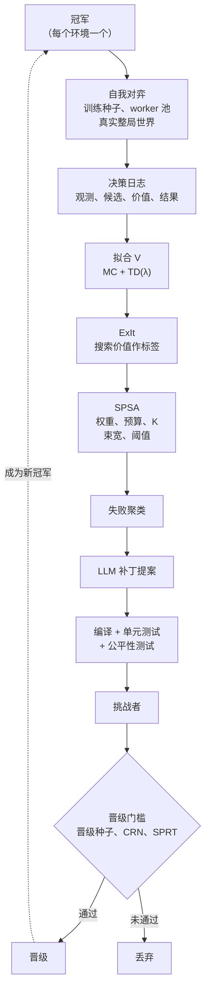

import { Aside } from '@astrojs/starlight/components';

本页定义两个大脑用来给局面打分的价值函数 V，以及不断改进它的离线循环。策略通过自我对弈从零学起，不从用户的对局里学。在线时，每个决策都是「搜索 + 学到的价值」。改进循环照搬 Stockfish（开源国际象棋引擎，这里借鉴它的开发流程）的做法：自我对弈、拟合价值、调参、提出补丁，只有通过晋级门槛（gate）的改动才保留。LLM 只参与离线环节（提出补丁、分析失败），从不参与在线决策。这个循环离线运行，所在进程与决策进程分开。

<Aside title="状态">

V v0 已经实现：Brain 里的 `RunValue`，17 个手写的对局观测特征乘以线性权重，初始权重是手设的（[§1](#sec-1)）。宏观大脑的 L0 用它估值（[宏观大脑 §2](/arch/macro-brain/#sec-2)）。`learn/fit_value.py` 从自对弈数据拟合权重，`learn/spsa.py` 用 SPSA 调这些权重或 PIMC 的叶子权重，`run --value` 用这两种权重来打，`learn/challenge.py` 让挑战者过晋级门槛（[§2](#sec-2)）；还没有拟合或调出的权重晋升为冠军。V v2 也已实现：Brain 里的 `RunNet`，一个读整局的卡牌、遗物、药水和上下文的网络（[§1](#sec-1)），由 `learn/train_value.py` 训练（[§2](#sec-2)）；`run --value` 也能读它的文件，`run --explore` 给自我对弈加上探索（[§5](#sec-5)）。还没有 V v2 晋升为冠军。战斗网络也已实现：Brain 里的 `CombatNet`，PIMC 学到的叶子（`--combat-net`），由 `learn/train_combat.py` 从自我对弈的回合开始局面训练（[§1](#sec-1)、[§2](#sec-2)）；还没有晋升为冠军。`learn/` 是学习循环用的 Python 项目（uv、PyTorch）。

</Aside>

## 1. 价值函数

**V(obs) = P(由当前冠军继续打，从此处赢下本局)**。价值函数估计一个局面有多好。这里的估计值是一个概率：如果由当前的**冠军**（目前已接受的最好版本的 AI）打完剩下的部分，从这个观测出发赢下本局的概率。

- 战斗叶子、宏观后状态和地图共用同一个尺度（[战斗大脑 §4](/arch/combat-brain/#sec-4)、[宏观大脑 §2](/arch/macro-brain/#sec-2)）。因为所有价值都是胜率，一场战斗里掉的血和奖励里拿的一张牌可以直接比较。
- 输入只有观测。训练时可以把隐藏状态当作辅助输入（[§4](#sec-4)），但部署的模型绝不以它为输入。
- 两种环境共用一个 V。SL 策略在之后每个节点都打得更好，所以从同一个观测出发，它真实的胜率更高；共用的 V 忽略这一点，在 SL 里会偏保守（[环境 §5](/arch/environments/#sec-5)）。用哪些对局训练它还未决定（[环境 §10](/arch/environments/#sec-10)）。

规划中的版本：

| 版本 | 形式 | 训练方式 |
|---|---|---|
| v0 | 手写特征乘以线性权重（初始权重之间拉开很大间距，保留字典序的意图） | SPSA |
| v1 | 手写特征 + 小型 MLP | 监督学习：MC + TD(λ) |
| v2 | 观测编码器（卡牌 / 遗物 / 药水 / 上下文的嵌入向量，牌组用集合编码器）+ V v0 的特征；每层一个风险值的输出头 | 监督学习：MC（TD(λ) 和 ExIt 在规划中） |

表中的术语：

- **字典序的意图**（v0）：起步的特征列表来自 bottled_ai（一个前人的杀戮尖塔 AI 项目），它按严格的重要性顺序比较特征：先比第一个，相同时才比下一个（[战斗大脑 §4](/arch/combat-brain/#sec-4)）。初始线性权重之间拉开很大间距，就能重现这个顺序，调参从这里开始。
- **已实现的 V v0**（`RunValue`）：生命值、最大生命值、金币、药水、遗物、牌组大小、不能打出的牌、升级数；能打出的牌的平均伤害（含中毒）、格挡和抽牌；以及地图上前方预计的精英、休息处、商店、宝箱和 `?` 数；还有层数，它没有初始权重：同一个决策的所有选项层数都相同，但拟合需要它，免得把进度的功劳记到随进度而来的东西（遗物、金币）头上。它的权重以 1 点生命值为单位，而不是拉开间距：整局层面的特征之间要互相权衡（一件遗物换多少生命值），严格的先后顺序表达不了这一点。这些权重只是假设，留给调参来替换。
- **已实现的 V v2**（`RunNet`，由 `learn/train_value.py` 训练）：输入是整局观测的词元（token）和标准化后的 V v0 特征。一张牌的向量是它 id 的向量，加上升级次数（最多算 3）乘以它 id 的升级向量，再加上它的附魔和诅咒的向量。一个小 MLP（phi）逐张处理每张牌，牌组取结果的平均值和总和（乘以 1/16）：这是集合编码器，能读任意牌组，也不管牌的顺序。遗物（用完的遗物算作单独的 id）、药水和上下文（角色、幕、Boss、本幕的 Ancient）都是各自向量之和。之后两层 256 宽的网络给每一层输出一个 logit：**风险值**（hazard），即活着到达这一层时死在这一层的概率。训练中出现不到 3 次的 id 都读作同一个未知 id。总共几十万个权重。
  - 从风险值可以读出：从这里起每一层都活下来的概率就是 P(win)；起始层数加上活过每一层的概率，就是**期望到达层数**。在对局偶尔能赢之前，P(win) 没有信号，所以 V v2 的价值取期望到达层数（网络文件里 objective 为 `floor`）；能赢之后改用同一个输出头读出的 P(win)（objective 为 `win`）。
  - 期望到达层数把每一层看得一样重。它可能偏向稳定打到第二幕的稳妥路线，而不是偶尔能赢的冒险路线，所以它只是过渡。
- **牌感**：`ranks --logs LOGS [--value FILE]` 可以读出任一版 V 对卡牌的偏好：每一幕里，给日志中各个卡牌奖励时的牌组再加一张某牌，V 平均变化多少。V v0 远远把 GRAND_FINALE 排在第一（它伤害很高，但要抽牌堆空了才能打出），而 FOOTWORK 这类能力牌接近 0，因为它们不带伤害、格挡或抽牌。
- **MLP** 是小型全连接神经网络。**嵌入向量**（embedding）是学出来的向量，每个卡牌、遗物或能力 id 各一个，这样编码器能读任意牌组。
- **SPSA**（同时扰动随机逼近）只靠带噪声的结果来调参。每一步把所有参数同时朝一个随机方向微调，分别测量「加」和「减」两个版本，再把参数往更好的那边挪。不管参数有多少个，每步只需要两次测量，也不需要梯度，适合那些只能靠打游戏来检验的权重。
- **MC**（蒙特卡洛）目标：本局的真实结果（赢为 1，输为 0），作为局内每个决策的标签。它是无偏的，但噪声大：一局的运气会落到它的所有决策上。
- **TD(λ)**（时序差分）目标：把真实结果和 V 自己在后续决策（k+1、k+2……）上的估计混合起来。λ 取 0 到 1 之间，决定混合比例：λ = 1 就是纯 MC，λ = 0 只往后看一个决策。它的噪声比 MC 小，而且每一步转移都有学习信号。
- **ExIt**（专家迭代）：由 V 引导的搜索比单独的 V 打得更好，于是把搜索得到的价值当作下一版 V 的训练标签。更好的 V 又让下一轮搜索更强，如此往复。

**输出头**（v1 及以后）。输出头是神经网络的一个输出，网络主体由所有输出共享：

- 主输出头：P(win)；已实现的 V v2 里是风险值输出头，P(win) 和期望到达层数都从它读出；
- 辅助输出头，只帮助网络学到好的表示，从不用来做决策：下一场战斗掉的血、到达层数的分布、每个 Boss 的击杀概率；
- 战斗输出头，用于战斗叶子：战斗结局的分布，即一个死亡类别（death class）加上战斗结束时剩余生命值的分桶，可选再加剩余药水数（做法同 STS2 的先行项目 r33hab 和 ytcs）。它不直接预测 P(win)：每场战斗由局外 V 给它的各个结局定一次价（[§3](#sec-3)）。两个训练目标通过晋级门槛比较：
  - 战斗内的 TD(λ ≈ 0.95)，用这个输出头在下一个决策上的分布自举，终点的结局桶用 HL-Gauss 向相邻的桶平滑（约 0.75 个桶宽的高斯），这是 ytcs 的做法；ytcs 发现 λ = 1 更差；
  - 0.3 × 搜索得到的分布 + 0.7 × 实际结局，这是 r33hab 的做法。

**已实现的战斗网络**（`CombatNet`，由 `learn/train_combat.py` 训练）：战斗输出头，放在一个单独的网络上，给一个回合的开始估值（[战斗大脑 §4](/arch/combat-brain/#sec-4)）。

- 卡牌：四个牌堆（手牌、抽牌堆、弃牌堆、消耗堆）里的每张牌都是一个词元：它 id 的向量，加上升级次数乘以它 id 的升级向量、它的附魔和诅咒的向量、它所在牌堆的向量，以及费用 / 3 乘以一个费用向量。一个小 MLP 逐张处理每张牌，每个牌堆是其中各牌之和（乘以 1/8）。
- 玩家：生命值比例、生命值、最大生命值、格挡、能量、最大能量、星辰和回合数，以及它的能力之和（每个能力是 id 的向量加上层数 / 10 乘以 id 的层数向量，再过一个小 MLP）。
- 每个活着的敌人：它 id 的向量，加上它的生命值比例、生命值、最大生命值、格挡和已经出过几回合招的线性投影；它的能力，算法同玩家；以及它的意图槽：现在显示的意图，然后是它前 3 回合的意图，最近的在前。一个槽是其中各意图之和，每个意图是类型的向量，加上每段伤害 / 10 和总伤害 / 20 乘以该类型的向量。一个 MLP 逐个处理每个敌人，再把所有敌人加起来。
- 遗物、药水和上下文（角色、遭遇战、房间类型、幕）都是各自向量之和。每个缩放后的数值都截断在 ±10 以内，因为少数局面会出现极大的数（喷发中的 WATERFALL_GIANT 的生命值）。
- 之后两层 256 宽的网络给出 21 个类别，即死亡，或者剩余生命值比例落在 20 个桶中的哪一个，以及胜利后剩下的药水数。
- 怪物的出招没有一条是手写的。网络从它的 id、回合数、它出过几回合招和它最近的意图里，可以从数据中学到每个怪物的出招顺序，以及它现在走到了顺序里的哪一步。这份历史来自 Harness（[Harness §6](/arch/harness/#sec-6)）。
- 作为叶子，进行中的局面价值是 Σₖ p(k) × (WinBase + PerHp × 第 k 个桶的中点) + P(胜) × PerPotion × 剩余药水数，即 `LeafValue` 给打赢的战斗定的价。改由 V 给各个结局定价是计划中的做法（[§3](#sec-3)）。

## 2. 自我对弈循环

自我对弈时，冠军在真实的整局世界里（即 worker 池中无头运行的真实游戏代码）自己打完整局。这个循环把这些对局变成一个**挑战者**，再由晋级门槛决定它能否取代冠军：

1. **自我对弈**：冠军用训练种子打完整局。日志格式见 [Harness §6](/arch/harness/#sec-6)。
2. **拟合**：目标是 MC 结果与 TD(λ)（从决策 k 到决策 k+1）的混合。早期一局都赢不了，P(win) 的 MC 目标全是 0；V v2 的风险值输出头改从每局死在哪一层学习，在对局能赢之前，它的价值取期望到达层数（[§1](#sec-1)）。绝不在同一次反向传播里混合生命值目标和胜负目标（r33hab 的教训）。

   「到达层数」这类稠密目标只是过渡。它带来的改动，只有用真实结局过了晋级门槛、并且在多个训练种子上复现之后才接受：在一项掼蛋研究（arXiv 2610.29411）里，有一个谱系看起来很强，但它预先登记的 5 个复现种子没有一个是正的。

   v0 的拟合是 `learn/fit_value.py`。决策日志里每个宏观决策都带着 V 的特征（[Harness §6](/arch/harness/#sec-6)），对局记录给出这一局到达的层数，两者按对局 id 对上。拟合用的是在标准化特征上的岭回归（岭回归：最小二乘加上对权重大小的一点惩罚，免得相关的特征拿到极端的权重）。每局权重相同，不管它有多少个决策；每五局（按对局 id）留出一局。它报告留出对局上的 R²（R²：拟合解释了层数方差的多少，最好为 1，比直接用平均值还差时低于 0），并和只用层数的拟合对比。权重写到 `eval/values/NAME.json`；`run --value FILE` 让 L0 用它来打，冠军名里显示为 `l0 NAME`。

   V v2 的训练是 `learn/train_value.py`。决策日志里每个宏观决策也带着它的整局观测（[Harness §6](/arch/harness/#sec-6)），它的目标就是所在对局的结局：从决策所在的层一直活到死亡的那一层，然后死在那里；如果这局赢了，就是每一层都活了下来。被截断的对局从最后一层起不提供信息；失败的对局不用。损失是这些层上风险值的交叉熵。每局权重相同，每五局（按对局 id）留出一局，用于提前停止（AdamW；最多 40 轮，连续 5 轮留出损失没有改善就停）和报告。报告给出留出损失，以及期望到达层数对实际到达层数的 R²，并和只知道层数的基线（训练对局里每一层的风险值）对比。网络文件写到 `eval/values/NAME.json`，附带几个留出的整局观测和训练器给它们的价值；`RunNet` 加载时逐个核对，这保证训练和对局时的编码与前向计算一致（[§7](#sec-7)）。`run --value FILE` 让 L0 用它来打，冠军名里显示为 `l0 NAME`。

   战斗网络的训练是 `learn/train_combat.py`。一个样本是决策日志里每个回合的第一个战斗决策：这正是搜索叶子所处的局面，因为搜索的叶子是下一回合的开始（[战斗大脑 §2](/arch/combat-brain/#sec-2)）。它之前的敌人历史，按 Harness 的做法从前面各回合的观测重建，所以没有 `history` 字段的旧日志也能用。目标是对局记录里这场战斗的结局（[评估 §6](/arch/evaluation/#sec-6)），按对局和战斗的先后顺序对上：结局的类别，以及胜利后剩下的药水数。这是打这些对局的策略下的 MC 目标。损失是交叉熵加上 0.1 × 胜利后药水数的平方误差。按对局 id 留出五分之一的对局（由 `--fold` 选哪一份），用于提前停止（AdamW；最多 60 轮，连续 6 轮留出损失没有改善就停）和报告：留出集上的交叉熵，与一个先验（训练集里各结局的频率）对比；以及网络的价值和 `LeafValue` 的价值相对于真实结局价值的平方误差和相关系数。`--lags 0` 和 `--no-round` 分别去掉意图历史和回合数，用来做消融实验。网络文件附带几个留出的回合开始局面和训练器给它们的结局，`CombatNet` 加载时逐个核对。`--combat-net FILE` 让 PIMC 用它来打，冠军名里显示为 `pimc NAME`。
3. **ExIt**：搜索得到的价值成为 V 和先验（搜索优先尝试哪些动作）的标签。老师是同一环境下的公平搜索，即遵守该环境信息规则的搜索。不要对全知的老师做行为克隆（训练模型去模仿老师的动作）：这在好几个项目里都失败了。

   战斗的 policy 目标是 softmax(先验 logits + c · minmax(Q))，不用访问次数。Q 是每个第一个动作在各个世界上的平均估值，PIMC 已经算出来了；minmax 把一个决策的 Q 缩放到 [0, 1]；先验是均匀的时候，先验 logits 为 0。c 按这个目标预测「大得多的预算下搜索的选择」的对数似然来调。访问次数不适合当目标：根上的 CRN 会把它压平（r33hab），而 mctx（一个 Gumbel MuZero 库）的变换在我们每个世界 300 个节点下，目标几乎是 one-hot。所以决策日志要记下：每个战斗决策里，每个第一个动作在每个世界上的估值和花掉的节点数；每场战斗的结局（死亡、生命值、药水）。两样都已记下：各个世界的估值和节点数在每个候选里（[Harness §6](/arch/harness/#sec-6)），每场战斗的结局在对局记录里（[评估 §6](/arch/evaluation/#sec-6)）。

   两个前提。学到的先验只有在晋级门槛里赢过均匀先验之后，才能引导搜索。学到的叶子只有同时赢过 `LeafValue` 和推演到战斗结束（rollout）之后，才能替换 `LeafValue`：r33hab 在 15 次模拟时，value 头比 rollout 多掉 10.6 点生命值。
4. **SPSA**：调 v0 的权重和搜索参数。

   V 的权重由 `learn/spsa.py` 来调。它从一个权重文件出发（默认是 V 的初始权重，由 `weights` 输出）。每一步给每个权重随机抽一个正负号，把所有权重按这些符号同时加上、再同时减去它们尺度的 c 倍，两个版本在同一批新的训练种子上各打一遍（`run --macro l0 --value`，外加给定的对局选项，例如战斗策略）。有了 CRN，两边在不多的种子上就能比较。然后权重朝平均层数更高的那边挪，步长按 Spall 的递减序列，每步最多挪各自尺度的十分之一。权重的尺度就是它的初始大小。层数的权重不动，因为它不改变任何选择。结果是一个权重文件，供 `run --value` 使用。

   搜索参数方面，`--param leaf` 用同样的办法调 PIMC 的叶子权重（[战斗大脑 §4](/arch/combat-brain/#sec-4)）：两边用 `--leaf` 传权重，起点是默认叶子权重（`weights --leaf`）；这些权重始终保持为正，因为每个都是速率、比例或高于失败的价值。这时对局得用 `--policy pimc`，很慢，所以 `--objective panel` 改打面板战斗（`panel --player pimc --leaf`，[战斗大脑 §7](/arch/combat-brain/#sec-7)）：赢下的战斗得分为剩余 HP 占开战时 HP 的比例，其他结局得 −1。面板得分的范围是 2，而一局的层数范围约 50，所以它的默认步长更大（0.5 对 0.02）。结果是一个叶子权重文件，供 `--leaf` 使用，最终仍由整局门槛决定。
5. **LLM**：输入是预先聚合好的失败聚类和死亡摘要；输出是 K 个候选补丁（特征、剪枝规则、参数）。候选先经过编译、单元测试和公平性测试的筛选，再过晋级门槛。只通过 LLM 网关使用便宜的模型。
6. **晋级门槛**：见[评估 §5](/arch/evaluation/#sec-5)。`learn/challenge.py` 带一个挑战者（由它的对局选项给出）过门槛：在冠军的种子集上分批打，每批之后过一次门槛。结论是不通过或作废就停下；通过之后把种子集剩下的打完并让它晋级，也就是改写冠军文件、重建排行榜。

**循环怎么跑**（计划）：

- 探索噪声（Gumbel）只加在自对弈的战斗搜索的根上，评估时关掉。局外的探索见 [§5](#sec-5)。
- PCR（playout cap randomization，来自 KataGo）：25% 的决策用全预算，提供 policy 目标；另外 75% 只用四分之一预算，只提供 value 目标。
- Reanalyse（来自 MuZero）：每出一版新网络，从种子和 trace 重放一部分旧局面，用它重新搜索，刷新这些局面的 policy 目标和自举的 value 目标。
- 每一代都要过晋级门槛。AlphaZero 去掉门槛，是因为它的信号干净、对局多；这里一局的方差大，局数又少。

## 3. 奖励与信用分配

奖励只有一局的结果。难点不是缺少信号，而是信用分配（credit assignment：一局里众多决策中，到底是哪些导致了输赢）和方差（运气掩盖了单个决策的效果）。

1. 分层缩短了链条。战斗由搜索解决，它的结果是一个结局分布 p(k)：死亡，或者战斗结束时剩余生命值落在第 k 个桶。局外 V 每场战斗给它定一次价：开战时算 u[k] = V（战斗之后的后状态，生命值取第 k 个桶），药水或遗物变了再重算，死亡时 u = 0；叶子的值就是 Σₖ p(k) · u[k]。所以战斗网络不随 V 的版本变：换了 V 只需重新定价，而战斗和局外仍然在同一个尺度上拿生命值和其他东西做取舍。V v0 对生命值是线性的，用它定价时就退化成 P(死亡) 和生命值的期望。这样整局层面的信用分配只需要跨越大约 50 个宏观决策，再加上各场战斗的结果。
2. TD(λ) 在每一步转移上都给出梯度。
3. 辅助奖励项只能是基于势函数的形式：F = Φ(s') − Φ(s)（Ng、Harada、Russell，1999），见下文。
4. 辅助输出头提供密集的监督，只用于学习表示。
5. 方差：反向课程（从靠近 Boss 的地方开始），以及在关键决策上用 CRN 配对的分叉（[§5](#sec-5)）。

**基于势函数的奖励塑形**。奖励塑形是加上一些中间奖励，让学习者在一局结束之前就得到反馈。在基于势函数的形式里，有一个函数 Φ 给每个状态打分，从 s 走到 s' 的奖励是 Φ(s') − Φ(s)。整局加起来，这些奖励逐项相消（telescope），只剩 Φ(终点) − Φ(起点)：奖励只取决于一局从哪里开始、到哪里结束，与中间走哪条路无关。Ng、Harada 和 Russell 证明了这种形式的塑形不会改变最优策略。直接按生命值扣分就不会这样相消：它会禁止「第一幕卖血、换第三幕取胜」这样的打法。

**反向课程**。训练先从接近结尾的局面开始（Boss 战前的快照），那里结果近在眼前，信号清楚；然后把起点逐步往前推（[§5](#sec-5)）。

**CRN**（公共随机数）：两条路线用同样的随机种子来打，它们共有的运气就从差值里抵消了。在一个决策点**分叉**，就是从同一个点出发，分别打它的两个选项。

## 4. 训练时的特权信息

特权信息指玩家看不到的隐藏状态。公平规范（本地笔记 `tmp/notes/fair-play-spec.md`）允许在训练时使用它，前提是部署的策略只读观测：

- **神谕评论家**（oracle critic）分支是一个只在训练时使用的价值分支，它能看到隐藏状态（真实的抽牌顺序、怪物动作），用来降低训练目标的方差。部署的只有观测分支。
- 反事实标签：在同一个决策点、用同样的随机性分叉，两条路线都打到底，得到两者差值的无偏标签。
- 这些只存在于离线流水线中，程序集和进程都与决策进程分开。

## 5. 局部最优与全局最优

自我提升的循环可能陷入局部最优：一种打法，任何小改动都会让它变差，但另一种截然不同的打法其实赢得更多（例如永远保守）。下面这些机制用来对抗它：

| 机制 | 作用 |
|---|---|
| 价值目标只用一局的结果 | 生命值值多少，从数据中学出来 |
| 反向课程 | 先用第二、三幕和 Boss 战前的快照池；先学会后期的价值，再往前推 |
| 反事实实验室 | 在抽样出的关键宏观决策上，用 CRN 分叉两条路线并都打到底，得到无偏的 ΔP(win)；用来检验「第一幕卖血」这类假设 |
| 种群 / 存档库 | 每个风格描述符一个冠军（MAP-Elites），防止坍缩成「永远保守」 |
| 探索 | 自我对弈时在宏观决策上用 Thompson 采样或 ε 探索；后状态的 MC 目标对此是稳健的。ε 探索已实现：`run --explore E` 让 L0 在每个战斗外的决策（含选牌提示）上以概率 E 随机作答（冠军名里显示为 `l0 explore E`）；评估时从不开启 |
| 保守性监控 | 打精英次数、跳过率、到达 Boss 时的生命值、囤积金币/药水（[评估 §3](/arch/evaluation/#sec-3)） |
| 反常识假设 | 人工或 LLM 提出的想法 → 受约束的策略变体 → 模拟器 A/B 测试；结果拿回来讨论 |

- **MAP-Elites** 保留一个存档库，而不是只保留一个最好的策略。每个策略按它的风格描述符（几个描述它怎么打的数字）放进一个格子，每个格子保留自己最好的冠军。暂时不是最好的风格也能存活，种群就不会坍缩成单一风格。
- **Thompson 采样**的探索方式是：根据每个选项的不确定性，为它抽一个可能的价值，选抽到最高的那个；一个选项被尝试的频率，大致等于它真正是最好选项的概率。**ε-贪心**以一个小概率 ε 随机选一个选项。
- **模拟器 A/B 测试**：两个策略变体在模拟器里用同一组种子各打一遍，比较结果。

## 6. 基础设施

从对局到权重的流水线（一**代**就是 [§2](#sec-2) 中循环的一轮）：

- 算力：8 个物理核 / 16 线程。8 个进程约 1,860 场战斗/秒，单进程为 275 场/秒（[模拟器 §4](/arch/simulator/#sec-4)）。GPU（RTX 5070 Ti）只用于训练价值网络。
- 训练用 Python，由 uv 管理，读取 JSONL 日志。推理在 Brain 里用 C# 完成：`RunNet` 把整局观测转成计算图的输入，再用 ONNX Runtime（`Microsoft.ML.OnnxRuntime`）在 CPU 上单线程运行训练器导出的 ONNX 计算图，每个宏观决策约 0.9 毫秒。`CombatNet` 在 worker 里对每个搜索叶子做同样的事。网络结构只在 Python 里定义一次。网络文件是 JSON：base64 编码的计算图，加上词表、特征的标准化参数和测试用的对局。
- 可复现：每一代记录冠军、种子集、超参数和提交（commit）。日志按代分目录存放，即 `tmp/selfplay/gN/`，不进 git。
- 存储：每局约 50 个宏观决策加几百个战斗决策，大部分字节在战斗观测和宏观决策的整局观测里；目前还没有压缩。旧的代按需清理。

## 7. 测试

1. 在留出的种子上检验校准。校准指预测与现实相符：V 说 30% 的那些局面里，应该大约有 30% 赢下来。用可靠性图来检查（把预测分箱，画出预测胜率与实际胜率的对比）。Brier 分数（预测概率与 0/1 结果之间的均方误差）必须优于常数预测；ytcs（一个前人的杀戮尖塔 2 求解器项目）的整局模型就没通过这一项。
2. 势函数辅助项精确地逐项相消。
3. 训练与部署的输入一致：部署的模型只读协议观测，训练读的是同样的 JSON。V v2 的网络文件带有测试用的对局，`RunNet` 加载时逐个核对；战斗网络的文件带有测试用的回合开始局面，`CombatNet` 同样逐个核对。
4. 晋级门槛的 A/A 测试：挑战者就是冠军自己时，本来就没有提升可言，所以门槛让它晋级的频率不能高于 SPRT 的假阳性率。

## 8. 未决问题

1. v0 特征集：V v0 从 17 个特征起步；是否往 bottled_ai 的 42 个特征扩展，尚未决定。
2. V v2 的价值什么时候从期望到达层数换成 P(win)：要先有多少局胜利，用什么办法检查输出头的校准。
3. 一个网络加一位环境输入，还是分开的网络（先分开）。
