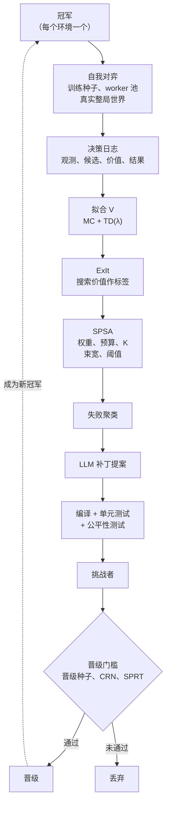

import { Aside } from '@astrojs/starlight/components';

本页定义两个大脑用来给局面打分的价值函数 V，以及不断改进它的离线循环。策略通过自我对弈从零学起，不从用户的对局里学。在线时，每个决策都是「搜索 + 学到的价值」。改进循环照搬 Stockfish（开源国际象棋引擎，这里借鉴它的开发流程）的做法：自我对弈、拟合价值、调参、提出补丁，只有通过晋级门槛（gate）的改动才保留。LLM 只参与离线环节（提出补丁、分析失败），从不参与在线决策。这个循环离线运行，所在进程与决策进程分开。

<Aside title="状态">

规划中。还没有学到任何东西；目前只有供 bench 使用的占位策略。

</Aside>

## 1. 价值函数

**V(obs) = P(由当前冠军继续打，从此处赢下本局)**。价值函数估计一个局面有多好。这里的估计值是一个概率：如果由当前的**冠军**（目前已接受的最好版本的 AI）打完剩下的部分，从这个观测出发赢下本局的概率。

- 战斗叶子、宏观后状态和地图共用同一个尺度（[战斗大脑 §4](/arch/combat-brain/#sec-4)、[宏观大脑 §2](/arch/macro-brain/#sec-2)）。因为所有价值都是胜率，一场战斗里掉的血和奖励里拿的一张牌可以直接比较。
- 输入只有观测。训练时可以把隐藏状态当作辅助输入（[§4](#sec-4)），但部署的模型绝不以它为输入。
- 两种环境共用一个 V。SL 策略在之后每个节点都打得更好，所以从同一个观测出发，它真实的胜率更高；共用的 V 忽略这一点，在 SL 里会偏保守（[环境 §5](/arch/environments/#sec-5)）。用哪些对局训练它还未决定（[环境 §10](/arch/environments/#sec-10)）。

规划中的版本：

| 版本 | 形式 | 训练方式 |
|---|---|---|
| v0 | 手写特征乘以线性权重（初始权重之间拉开很大间距，保留字典序的意图） | SPSA |
| v1 | 手写特征 + 小型 MLP | 监督学习：MC + TD(λ) |
| v2 | 观测编码器（卡牌 / 遗物 / 能力的嵌入向量）+ 多个输出头 | 同上 + ExIt |

表中的术语：

- **字典序的意图**（v0）：起步的特征列表来自 bottled_ai（一个前人的杀戮尖塔 AI 项目），它按严格的重要性顺序比较特征：先比第一个，相同时才比下一个（[战斗大脑 §4](/arch/combat-brain/#sec-4)）。初始线性权重之间拉开很大间距，就能重现这个顺序，调参从这里开始。
- **MLP** 是小型全连接神经网络。**嵌入向量**（embedding）是学出来的向量，每个卡牌、遗物或能力 id 各一个，这样编码器能读任意牌组。
- **SPSA**（同时扰动随机逼近）只靠带噪声的结果来调参。每一步把所有参数同时朝一个随机方向微调，分别测量「加」和「减」两个版本，再把参数往更好的那边挪。不管参数有多少个，每步只需要两次测量，也不需要梯度，适合那些只能靠打游戏来检验的权重。
- **MC**（蒙特卡洛）目标：本局的真实结果（赢为 1，输为 0），作为局内每个决策的标签。它是无偏的，但噪声大：一局的运气会落到它的所有决策上。
- **TD(λ)**（时序差分）目标：把真实结果和 V 自己在后续决策（k+1、k+2……）上的估计混合起来。λ 取 0 到 1 之间，决定混合比例：λ = 1 就是纯 MC，λ = 0 只往后看一个决策。它的噪声比 MC 小，而且每一步转移都有学习信号。
- **ExIt**（专家迭代）：由 V 引导的搜索比单独的 V 打得更好，于是把搜索得到的价值当作下一版 V 的训练标签。更好的 V 又让下一轮搜索更强，如此往复。

**输出头**（v1 及以后）。输出头是神经网络的一个输出，网络主体由所有输出共享：

- 主输出头：P(win)；
- 辅助输出头，只帮助网络学到好的表示，从不用来做决策：下一场战斗掉的血、到达层数的分布、每个 Boss 的击杀概率；
- 战斗输出头，用于战斗叶子：战斗结束时生命值的分布，加上死亡类别（death class，做法同前人项目 r33hab）。

## 2. 自我对弈循环

自我对弈时，冠军在真实的整局世界里（即 worker 池中无头运行的真实游戏代码）自己打完整局。这个循环把这些对局变成一个**挑战者**，再由晋级门槛决定它能否取代冠军：

1. **自我对弈**：冠军用训练种子打完整局。日志格式见 [Harness §6](/arch/harness/#sec-6)。
2. **拟合**：目标是 MC 结果与 TD(λ)（从决策 k 到决策 k+1）的混合。早期一局都赢不了，所有 MC 目标都是 0；这时由「到达层数」辅助目标提供信号，主输出头仍然是 P(win)。绝不在同一次反向传播里混合生命值目标和胜负目标（r33hab 的教训）。
3. **ExIt**：搜索得到的价值成为 V 和先验（搜索优先尝试哪些动作）的标签。老师是同一环境下的公平搜索，即遵守该环境信息规则的搜索。不要对全知的老师做行为克隆（训练模型去模仿老师的动作）：这在好几个项目里都失败了。
4. **SPSA**：调 v0 的权重和搜索参数。
5. **LLM**：输入是预先聚合好的失败聚类和死亡摘要；输出是 K 个候选补丁（特征、剪枝规则、参数）。候选先经过编译、单元测试和公平性测试的筛选，再过晋级门槛。只通过 LLM 网关使用便宜的模型。
6. **晋级门槛**：见[评估 §5](/arch/evaluation/#sec-5)。

## 3. 奖励与信用分配

奖励只有一局的结果。难点不是缺少信号，而是信用分配（credit assignment：一局里众多决策中，到底是哪些导致了输赢）和方差（运气掩盖了单个决策的效果）。

1. 分层缩短了链条。战斗由搜索解决，它的「奖励」就是战斗结束后的 V。所以整局层面的信用分配只需要跨越大约 50 个宏观决策，再加上各场战斗的结果。
2. TD(λ) 在每一步转移上都给出梯度。
3. 辅助奖励项只能是基于势函数的形式：F = Φ(s') − Φ(s)（Ng、Harada、Russell，1999），见下文。
4. 辅助输出头提供密集的监督，只用于学习表示。
5. 方差：反向课程（从靠近 Boss 的地方开始），以及在关键决策上用 CRN 配对的分叉（[§5](#sec-5)）。

**基于势函数的奖励塑形**。奖励塑形是加上一些中间奖励，让学习者在一局结束之前就得到反馈。在基于势函数的形式里，有一个函数 Φ 给每个状态打分，从 s 走到 s' 的奖励是 Φ(s') − Φ(s)。整局加起来，这些奖励逐项相消（telescope），只剩 Φ(终点) − Φ(起点)：奖励只取决于一局从哪里开始、到哪里结束，与中间走哪条路无关。Ng、Harada 和 Russell 证明了这种形式的塑形不会改变最优策略。直接按生命值扣分就不会这样相消：它会禁止「第一幕卖血、换第三幕取胜」这样的打法。

**反向课程**。训练先从接近结尾的局面开始（Boss 战前的快照），那里结果近在眼前，信号清楚；然后把起点逐步往前推（[§5](#sec-5)）。

**CRN**（公共随机数）：两条路线用同样的随机种子来打，它们共有的运气就从差值里抵消了。在一个决策点**分叉**，就是从同一个点出发，分别打它的两个选项。

## 4. 训练时的特权信息

特权信息指玩家看不到的隐藏状态。公平规范（本地笔记 `tmp/notes/fair-play-spec.md`）允许在训练时使用它，前提是部署的策略只读观测：

- **神谕评论家**（oracle critic）分支是一个只在训练时使用的价值分支，它能看到隐藏状态（真实的抽牌顺序、怪物动作），用来降低训练目标的方差。部署的只有观测分支。
- 反事实标签：在同一个决策点、用同样的随机性分叉，两条路线都打到底，得到两者差值的无偏标签。
- 这些只存在于离线流水线中，程序集和进程都与决策进程分开。

## 5. 局部最优与全局最优

自我提升的循环可能陷入局部最优：一种打法，任何小改动都会让它变差，但另一种截然不同的打法其实赢得更多（例如永远保守）。下面这些机制用来对抗它：

| 机制 | 作用 |
|---|---|
| 价值目标只用一局的结果 | 生命值值多少，从数据中学出来 |
| 反向课程 | 先用第二、三幕和 Boss 战前的快照池；先学会后期的价值，再往前推 |
| 反事实实验室 | 在抽样出的关键宏观决策上，用 CRN 分叉两条路线并都打到底，得到无偏的 ΔP(win)；用来检验「第一幕卖血」这类假设 |
| 种群 / 存档库 | 每个风格描述符一个冠军（MAP-Elites），防止坍缩成「永远保守」 |
| 探索 | 自我对弈时在宏观决策上用 Thompson 采样或 ε 探索；后状态的 MC 目标对此是稳健的 |
| 保守性监控 | 打精英次数、跳过率、到达 Boss 时的生命值、囤积金币/药水（[评估 §3](/arch/evaluation/#sec-3)） |
| 反常识假设 | 人工或 LLM 提出的想法 → 受约束的策略变体 → 模拟器 A/B 测试；结果拿回来讨论 |

- **MAP-Elites** 保留一个存档库，而不是只保留一个最好的策略。每个策略按它的风格描述符（几个描述它怎么打的数字）放进一个格子，每个格子保留自己最好的冠军。暂时不是最好的风格也能存活，种群就不会坍缩成单一风格。
- **Thompson 采样**的探索方式是：根据每个选项的不确定性，为它抽一个可能的价值，选抽到最高的那个；一个选项被尝试的频率，大致等于它真正是最好选项的概率。**ε-贪心**以一个小概率 ε 随机选一个选项。
- **模拟器 A/B 测试**：两个策略变体在模拟器里用同一组种子各打一遍，比较结果。

## 6. 基础设施

从对局到权重的流水线（一**代**就是 [§2](#sec-2) 中循环的一轮）：

- 算力：8 个物理核 / 16 线程。8 个进程约 1,860 场战斗/秒，单进程为 275 场/秒（[模拟器 §4](/arch/simulator/#sec-4)）。GPU（RTX 5070 Ti）只用于训练价值网络。
- 训练用 Python，由 uv 管理，读取 JSONL 日志。推理在 Brain 里用 C# 完成（小网络，跑在 CPU 上；用 ONNX Runtime 或手写的前向计算）。
- 可复现：每一代记录冠军、种子集、超参数和提交（commit）。日志按代分目录存放。
- 存储：每局约 50 个宏观决策加几百个战斗决策，压缩存储；旧的代按需清理。

## 7. 测试

1. 在留出的种子上检验校准。校准指预测与现实相符：V 说 30% 的那些局面里，应该大约有 30% 赢下来。用可靠性图来检查（把预测分箱，画出预测胜率与实际胜率的对比）。Brier 分数（预测概率与 0/1 结果之间的均方误差）必须优于常数预测；ytcs（一个前人的杀戮尖塔 2 求解器项目）的整局模型就没通过这一项。
2. 势函数辅助项精确地逐项相消。
3. 训练与部署的输入一致：部署的模型只读协议观测，训练读的是同样的 JSON。
4. 晋级门槛的 A/A 测试：挑战者就是冠军自己时，本来就没有提升可言，所以门槛让它晋级的频率不能高于 SPRT 的假阳性率。

## 8. 未决问题

1. v0 特征集：用 bottled_ai 的 42 个特征，还是先用约 10 个特征的最小集。
2. 推理格式（ONNX Runtime 会是一个新包）。
3. 一个网络加一位环境输入，还是分开的网络（先分开）。
