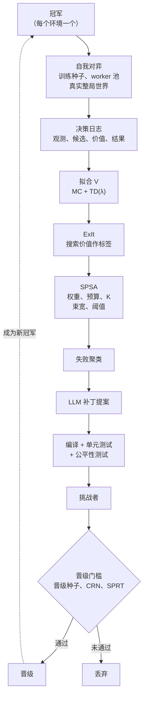

import { Aside } from '@astrojs/starlight/components';

本页定义两个大脑用来给局面打分的价值函数 V，以及不断改进它的离线循环。策略通过自我对弈从零学起，不从用户的对局里学。在线时，每个决策都是「搜索 + 学到的价值」。改进循环照搬 Stockfish（开源国际象棋引擎，这里借鉴它的开发流程）的做法：自我对弈、拟合价值、调参、提出补丁，只有通过晋级门槛（gate）的改动才保留。LLM 只参与离线环节（提出补丁、分析失败），从不参与在线决策。这个循环离线运行，所在进程与决策进程分开。

<Aside title="状态">

V v0 已经实现：Brain 里的 `RunValue`，17 个手写的对局观测特征乘以线性权重，初始权重是手设的（[§1](#sec-1)）。宏观大脑的 L0 用它估值（[宏观大脑 §2](/arch/macro-brain/#sec-2)）。`learn/fit_value.py` 从自对弈数据拟合权重，`learn/spsa.py` 用 SPSA 调这些权重或 PIMC 的叶子权重，`run --value` 用这两种权重来打，`learn/challenge.py` 让挑战者过晋级门槛（[§2](#sec-2)）；还没有拟合或调出的权重晋升为冠军。V v2 也已实现：Brain 里的 `RunNet`，一个读整局的卡牌、遗物、药水和上下文的网络（[§1](#sec-1)），由 `learn/train_value.py` 训练（[§2](#sec-2)）；`run --value` 也能读它的文件，`run --macro-explore` 和 `--combat-explore` 给自我对弈加上探索（[§5](#sec-5)）。它的 n2-b0.03 从 2026-10-28 起是 NoSL 冠军的 V（[§2](#sec-2)）。战斗网络也已实现：Brain 里的 `CombatNet`，PIMC 学到的叶子（`--combat-net`），由 `learn/train_combat.py` 从自我对弈的回合开始局面训练（[§1](#sec-1)、[§2](#sec-2)）；它的第一代 c2 自 2026-10-27 起是 NoSL 冠军的叶子（[战斗大脑 §7.2](/arch/combat-brain/#sec-7.2)）。`learn/` 是学习循环用的 Python 项目（uv、PyTorch）。

</Aside>

## 1. 价值函数

**V(obs) = P(由当前冠军继续打，从此处赢下本局)**。价值函数估计一个局面有多好。这里的估计值是一个概率：如果由当前的**冠军**（目前已接受的最好版本的 AI）打完剩下的部分，从这个观测出发赢下本局的概率。

- 战斗叶子、宏观后状态和地图共用同一个尺度（[战斗大脑 §4](/arch/combat-brain/#sec-4)、[宏观大脑 §2](/arch/macro-brain/#sec-2)）。因为所有价值都是胜率，一场战斗里掉的血和奖励里拿的一张牌可以直接比较。
- 输入只有观测。训练时可以把隐藏状态当作辅助输入（[§4](#sec-4)），但部署的模型绝不以它为输入。
- 两种环境共用一个 V。SL 策略在之后每个节点都打得更好，所以从同一个观测出发，它真实的胜率更高；共用的 V 有意忽略这一点（[环境 §5](/arch/environments/#sec-5)）。它用战斗由 SL 战斗大脑来打的对局训练，包括自我对弈和分叉推演（2026-10-28 决定）；宏观大脑在两种环境里看到的信息一样。

规划中的版本：

| 版本 | 形式 | 训练方式 |
|---|---|---|
| v0 | 手写特征乘以线性权重（初始权重之间拉开很大间距，保留字典序的意图） | SPSA |
| v1 | 手写特征 + 小型 MLP | 监督学习：MC + TD(λ) |
| v2 | 观测编码器（卡牌 / 遗物 / 药水 / 上下文的嵌入向量，牌组用集合编码器）+ V v0 的特征；每层一个风险值的输出头 | 监督学习：MC（TD(λ) 和 ExIt 在规划中） |

表中的术语：

- **字典序的意图**（v0）：起步的特征列表来自 bottled_ai（一个前人的杀戮尖塔 AI 项目），它按严格的重要性顺序比较特征：先比第一个，相同时才比下一个（[战斗大脑 §4](/arch/combat-brain/#sec-4)）。初始线性权重之间拉开很大间距，就能重现这个顺序，调参从这里开始。
- **已实现的 V v0**（`RunValue`）：生命值、最大生命值、金币、药水、遗物、牌组大小、不能打出的牌、升级数；能打出的牌的平均伤害（含中毒）、格挡和抽牌；以及地图上前方预计的精英、休息处、商店、宝箱和 `?` 数；还有层数，它没有初始权重：同一个决策的所有选项层数都相同，但拟合需要它，免得把进度的功劳记到随进度而来的东西（遗物、金币）头上。它的权重以 1 点生命值为单位，而不是拉开间距：整局层面的特征之间要互相权衡（一件遗物换多少生命值），严格的先后顺序表达不了这一点。这些权重只是假设，留给调参来替换。
- **已实现的 V v2**（`RunNet`，由 `learn/train_value.py` 训练）：输入是整局观测的词元（token）和标准化后的 V v0 特征。一张牌的向量是它 id 的向量，加上升级次数（最多算 3）乘以它 id 的升级向量，再加上它的附魔和诅咒的向量。一个小 MLP（phi）逐张处理每张牌，牌组取结果的平均值和总和（乘以 1/16）：这是集合编码器，能读任意牌组，也不管牌的顺序。遗物（用完的遗物算作单独的 id）、药水和上下文（角色、幕、Boss、本幕的 Ancient）都是各自向量之和。牌和遗物上的数值按下面战斗网络的方式读入：一张牌加上它的费用、修饰的数值、星费和 X 费，以及按名字读的每个数值；一个遗物加上它的计数、是否显示计数、是否熔化，以及它的状态。进阶等级并入特征。之后两层 256 宽的网络给每一层输出一个 logit：**风险值**（hazard），即活着到达这一层时死在这一层的概率。训练中出现不到 3 次的 id 都读作同一个未知 id。总共几十万个权重。
  - 从风险值可以读出：从这里起每一层都活下来的概率就是 P(win)；起始层数加上活过每一层的概率，就是**期望到达层数**。在对局偶尔能赢之前，P(win) 没有信号，所以 V v2 的价值取期望到达层数（网络文件里 objective 为 `floor`）；能赢之后改用同一个输出头读出的 P(win)（objective 为 `win`）。
  - 期望到达层数把每一层看得一样重。它可能偏向稳定打到第二幕的稳妥路线，而不是偶尔能赢的冒险路线，所以它只是过渡。
- **牌感**：`ranks --logs LOGS [--value FILE]` 可以读出任一版 V 对卡牌的偏好：每一幕里，给日志中各个卡牌奖励时的牌组再加一张某牌，V 平均变化多少。V v0 远远把 GRAND_FINALE 排在第一（它伤害很高，但要抽牌堆空了才能打出），而 FOOTWORK 这类能力牌接近 0，因为它们不带伤害、格挡或抽牌。
- **MLP** 是小型全连接神经网络。**嵌入向量**（embedding）是学出来的向量，每个卡牌、遗物或能力 id 各一个，这样编码器能读任意牌组。
- **SPSA**（同时扰动随机逼近）只靠带噪声的结果来调参。每一步把所有参数同时朝一个随机方向微调，分别测量「加」和「减」两个版本，再把参数往更好的那边挪。不管参数有多少个，每步只需要两次测量，也不需要梯度，适合那些只能靠打游戏来检验的权重。
- **MC**（蒙特卡洛）目标：本局的真实结果（赢为 1，输为 0），作为局内每个决策的标签。它是无偏的，但噪声大：一局的运气会落到它的所有决策上。
- **TD(λ)**（时序差分）目标：把真实结果和 V 自己在后续决策（k+1、k+2……）上的估计混合起来。λ 取 0 到 1 之间，决定混合比例：λ = 1 就是纯 MC，λ = 0 只往后看一个决策。它的噪声比 MC 小，而且每一步转移都有学习信号。
- **ExIt**（专家迭代）：由 V 引导的搜索比单独的 V 打得更好，于是把搜索得到的价值当作下一版 V 的训练标签。更好的 V 又让下一轮搜索更强，如此往复。

**输出头**（v1 及以后）。输出头是神经网络的一个输出，网络主体由所有输出共享：

- 主输出头：P(win)；已实现的 V v2 里是风险值输出头，P(win) 和期望到达层数都从它读出；
- 辅助输出头，只帮助网络学到好的表示，从不用来做决策：下一场战斗掉的血、到达层数的分布、每个 Boss 的击杀概率；
- 战斗输出头，用于战斗叶子：战斗结局的分布，即一个死亡类别（death class）加上战斗结束时剩余生命值的分桶，可选再加剩余药水数（做法同 STS2 的先行项目 r33hab 和 ytcs）。它不直接预测 P(win)：每场战斗由局外 V 给它的各个结局定一次价（[§3](#sec-3)）。两个训练目标通过晋级门槛比较：
  - 战斗内的 TD(λ ≈ 0.95)，用这个输出头在下一个决策上的分布自举，终点的结局桶用 HL-Gauss 向相邻的桶平滑（约 0.75 个桶宽的高斯），这是 ytcs 的做法；ytcs 发现 λ = 1 更差；
  - 0.3 × 搜索得到的分布 + 0.7 × 实际结局，这是 r33hab 的做法。

**已实现的战斗网络**（`CombatNet`，由 `learn/train_combat.py` 训练）：战斗输出头，放在一个单独的网络上，给一个回合的开始估值（[战斗大脑 §4](/arch/combat-brain/#sec-4)）。

- 卡牌：四个牌堆（手牌、抽牌堆、弃牌堆、消耗堆）里的每张牌都是一个词元：它 id 的向量，加上升级次数乘以它 id 的升级向量、它的附魔和诅咒的向量、它所在牌堆的向量，以及费用 / 3 乘以一个费用向量。一个小 MLP 逐张处理每张牌，每个牌堆是其中各牌之和（乘以 1/8）。
- 玩家：生命值比例、生命值、最大生命值、格挡、能量、最大能量、星辰和回合数，以及它的能力之和（每个能力是 id 的向量加上层数 / 10 乘以 id 的层数向量，再过一个小 MLP）。
- 每个活着的敌人：它 id 的向量，加上它的生命值比例、生命值、最大生命值、格挡和已经出过几回合招的线性投影；它的能力，算法同玩家；以及它的意图槽：现在显示的意图，然后是它前 3 回合的意图，最近的在前。一个槽是其中各意图之和，每个意图是类型的向量，加上每段伤害 / 10 和总伤害 / 20 乘以该类型的向量。一个 MLP 逐个处理每个敌人，再把所有敌人加起来。
- 遗物、药水和上下文（角色、遭遇战、房间类型、幕）都是各自向量之和。每个缩放后的数值都截断在 ±10 以内，因为少数局面会出现极大的数（喷发中的 WATERFALL_GIANT 的生命值）。
- 最初的网络（c1、c2）没读、自 2026-10-27 起读入的内容。编码完全相同的两个局面，数据再多也分不开，所以观测里的这些数值都要进来：
  - 牌上的数值：附魔和诅咒的数值 / 10（各乘以对应修饰的数值向量）、星费 / 3 和是否 X 费，以及每个数值（`vars`）/ 10 乘以它名字的向量；
  - 能力的层数（只在提示里与图标数字分开写出时，例如 Sloth），乘以它 id 的层数向量；以及它保留的那张牌（Nightmare），用那张牌的向量；
  - 遗物的计数 / 10 乘以它 id 的计数向量（Pen Nib、Nunchaku、Happy Flower、Stone Calendar），是否显示计数、是否熔化，以及它的状态；
  - 球（id、被动和激发数值 / 10）和活着的盟友（id、生命值比例、生命值、最大生命值、格挡和能力，过一个小 MLP），各自求和；
  - 进阶等级 / 10、球槽数 / 10 和金币 / 100。

  在此之前做出的网络文件不声明这些输入，而 `CombatNet` 和 `RunNet` 只喂图里声明的输入，所以 c2 的打法不变。每个新输入的一致性都用随机权重的网络检查过，权重经过放大，让每个输入都能明显改变输出：训练器给出的测试局面能通过加载检查，而只改其中任何一个输入的副本都会在加载时被拒绝。
- 之后两层 256 宽的网络给出 51 个类别，即死亡，或者从现在起还要再掉的生命值（占最大生命值的比例）落在 50 个桶中的哪一个（从 −0.25，即战斗中回了血，到 1），以及胜利前还要用掉的药水数。
- 输出头预测的是「之后还会发生什么」，而不是「最后还剩多少」。第一个网络（c1）预测的是战斗结束时剩余的生命值比例，结果只学到了现在的生命值在结局里一半的分量：现在少 1 点血，它的估值只降 0.0038，而最后实际会少整整 1 点血，按 `LeafValue` 的定价是 0.0078。于是它的搜索太轻易地拿血去换别的，普通战和精英战比冠军掉血更多（每场胜利掉 7.8 对 6.5、26.4 对 18.0），过门槛时在第 32 对就被判不通过（层数 −1.41）。改成预测从现在起还要掉的血以后，现在的生命值被完整计入（同样那些局面上每点血 0.0083），留出集上估值的平方误差也从 0.0090 降到 0.0077。
- 怪物的出招没有一条是手写的。网络从它的 id、回合数、它出过几回合招和它最近的意图里，可以从数据中学到每个怪物的出招顺序，以及它现在走到了顺序里的哪一步。这份历史来自 Harness（[Harness §6](/arch/harness/#sec-6)）。
- 作为叶子，进行中的局面价值是 Σₖ p(k) × (WinBase + PerHp × (现在的生命值比例 − 第 k 个桶的中点)) + P(胜) × PerPotion × (现有药水数 − 要用掉的药水数)，即 `LeafValue` 给打赢的战斗定的价。改由 V 给各个结局定价是计划中的做法（[§3](#sec-3)）。

## 2. 自我对弈循环

自我对弈时，冠军在真实的整局世界里（即 worker 池中无头运行的真实游戏代码）自己打完整局。这个循环把这些对局变成一个**挑战者**，再由晋级门槛决定它能否取代冠军：

1. **自我对弈**：冠军用训练种子打完整局，带探索（[§5](#sec-5)）。日志格式见 [Harness §6](/arch/harness/#sec-6)。
2. **拟合**：目标是 MC 结果与 TD(λ)（从决策 k 到决策 k+1）的混合。早期一局都赢不了，P(win) 的 MC 目标全是 0；V v2 的风险值输出头改从每局死在哪一层学习，在对局能赢之前，它的价值取期望到达层数（[§1](#sec-1)）。绝不在同一次反向传播里混合生命值目标和胜负目标（r33hab 的教训）。

   「到达层数」这类稠密目标只是过渡。它带来的改动，只有用真实结局过了晋级门槛、并且在多个训练种子上复现之后才接受：在一项掼蛋研究（arXiv 2610.29411）里，有一个谱系看起来很强，但它预先登记的 5 个复现种子没有一个是正的。

   v0 的拟合是 `learn/fit_value.py`。决策日志里每个宏观决策都带着 V 的特征（[Harness §6](/arch/harness/#sec-6)），对局记录给出这一局到达的层数，两者按对局 id 对上，每份日志只和它的 `run` 在旁边写下的那份记录文件对（`--logs` 和 `--records` 按同样的顺序列出）。对局 id 只是种子的哈希，所以同一种子的另一局（换了策略，或探索扫描）可能在别的文件里；同一份记录文件里出现两次的对局 id 会被拒绝。拟合用的是在标准化特征上的岭回归（岭回归：最小二乘加上对权重大小的一点惩罚，免得相关的特征拿到极端的权重）。每局权重相同，不管它有多少个决策；每五局（按对局 id）留出一局。它报告留出对局上的 R²（R²：拟合解释了层数方差的多少，最好为 1，比直接用平均值还差时低于 0），并和只用层数的拟合对比。权重写到 `weights/CHARACTER/NAME.json`（[§6](#sec-6)）；`run --value FILE` 让 L0 用它来打，冠军名里显示为 `l0 NAME`。

   V v2 的训练是 `learn/train_value.py`。决策日志里每个宏观决策也带着它的整局观测（[Harness §6](/arch/harness/#sec-6)），像 v0 的拟合那样对上它的对局，它的目标就是所在对局的结局：从决策所在的层一直活到死亡的那一层，然后死在那里；如果这局赢了，就是每一层都活了下来。被截断的对局从最后一层起不提供信息；失败的对局不用。损失是这些层上风险值的交叉熵。每局权重相同，每五局（按对局 id）留出一局，用于提前停止（AdamW，学习率 3e-5；最多 40 轮，连续 5 轮留出损失没有改善就停）和报告。输出头从基线的风险值（见下）开始，所以网络学的是局面让每一层的风险值偏离基线多少。报告给出留出损失，以及期望到达层数对实际到达层数的 R²，并和只知道层数的基线（训练对局里每一层的风险值）对比。网络文件写到 `weights/CHARACTER/NAME.json`，附带几个留出的整局观测和训练器给它们的价值；`RunNet` 加载时逐个核对，这保证训练和对局时的编码与前向计算一致（[§7](#sec-7)）。`run --value FILE` 让 L0 用它来打，冠军名里显示为 `l0 NAME`。第二个头只在训练时用：预测这一局接下来六场战斗各自花掉多少比例的最大生命（来自对局记录）；它的平方误差以 `--aux-weight`（默认 3）计入损失。它塑造两个头共同读取的主体，网络文件里只有风险值。实验用的选项：`--train-share S` 和 `--train-start A` 只用训练对局里按对局 id 排在 [A, A + S) 的那一部分，用来画学习曲线；起点不重叠就得到不相交的两半，用于分半检验，留出的对局不变。`--aux-act` 让第二个头针对决策所在的那一幕再学两项：这一局有没有打赢这一幕最后一场 Boss 战，以及打完后剩下的最大生命比例（没打赢为 0）；打到那场 Boss 战之前就被截断、没有死的对局在这里没有标签。`--width W` 按比例调整网络的宽度（嵌入向量 32、单牌网络 128、主体 256），`--attention N` 在牌组的牌向量汇总之前加 N 个自注意力块，让一张牌的向量能取决于其他牌。`--state-out FILE` 另外存下 torch 网络（两个头都在），供分析用。`--boss-sims FILES` 加入模拟的 Boss 战作为标签：对日志里的卡牌奖励，每个选项的后续状态（它的牌组、遗物和药水，生命值固定为最大生命的一个比例：第 1 幕 96%、第 2 幕 81%，大约是对局进入这场 Boss 战时剩下的比例）用 SL 规划器和本幕的 Boss 打几次，同一个决策的各个选项用同样的种子，所以各个选项的运气相同。这些由 `learn/bosslab.py`（提交 `7b5ed23`）产生：`tasks` 为每个选项写一条 `panel` 命令，`play` 把它们打完，`collect` 把各场战斗接回决策、供 `--boss-sims` 读取，`compare` 给出 V 估值最高的选项就是战斗结果最好的选项的比例。它的规划器预算是 `c8d45b3` 之前的 low（`--effort low --nodes 150 --beam 4 --easy-beam 0 --loss-plans 0 --replan 0`），每场约 9 s；和 `learn/` 里其它脚本不同，它只用 Python 标准库。`--boss-afterstates FILES` 给出这些决策的后续状态（`afterstates`，见下）。模拟的绝对胜率和实际对局差得很远：规划器较弱，生命值固定，牌组是决策当时的牌组。第 2 幕的模拟战斗只赢了 2.6%（打完的前 92 个决策，共 742 场），第 1 幕 24%（30 个决策的样本）；而 g3 的 SL 对局里，打到第 1 幕 Boss 的 413 局有 359 局打赢（87%）。所以模拟不给 hazard 标签，只用同一决策内各选项之间的差别（提交 `a2071ca`）。每个选项的各场战斗有一个平均 Boss 分数：赢了是 0.5 加上剩余生命占最大生命比例的一半，输了是打掉的 Boss 生命比例的一半。V 的期望层数减掉决策内的平均，拟合到分数减掉决策内的平均再乘 2k 层；k 是打赢本幕 Boss 在对局里值多少层，即打赢它的对局平均到达的层数减掉 Boss 那一层，每幕一个，而一胜对一负约差半个分数单位。平方误差以目标的均方为单位，一个决策的各个选项合起来算一个决策的权重，再乘 `--boss-weight`（默认 1）；决策和其它数据一样按局 id 划分。分数也是第二个头多出的一个目标，只用来塑造网络主体。报告另外给出每幕的 k（`boss_worth`）、模拟上的留出损失（`held_out_boss_loss`）、在留出的、只有一个最好选项的决策上 V 的最好选项就是模拟的最好选项的比例（`boss_agree`，与打出日志的 V 的 `boss_agree_logged` 并列），以及 V 减去决策平均后的值与目标的相关系数（`boss_corr`）。

   第一批测量，在 g0 和 g1 上（859 局，60,480 个宏观决策），一折：留出损失 1.229，基线是 1.291；R² 0.368，基线是 0.313。V v0 的 17 个特征在同样的对局上重新拟合（`fit_value.py`）得到 0.315，不比基线好。同一局的决策共享这一局唯一的结局，所以可学的结局只有大约 700 个，网络很快过拟合。从随机的输出头、学习率 1e-3 开始，它一轮之内就记住了各局：第一轮后 1.331，第六轮后 4.12。从基线开始，学习率 1e-3 是 1.573，1e-4 是 1.235，3e-5 是 1.229；权重衰减从 1e-4 改成 0.1 没有变化。它的卡牌感（用 `ranks` 跑 g1 的日志）在第 0 幕把毒系牌排在最前：多一张 OUTBREAK 值 0.77 层，其次是 SNAKEBITE、BUBBLE_BUBBLE、BOUNCING_FLASK 和 DEADLY_POISON。第 1 幕到达的对局少得多，那里是噪声：诅咒太少见，没有自己的 id，以 +0.1 排在前面。n1 训练时没有第二个头。加上它（权重 3），在同样的对局、三个训练种子上，留出损失是 1.222 对 1.235（1.208、1.237、1.222 对 1.229、1.246、1.232），R² 0.384 对 0.371，每个种子都是损失更低、R² 更高；权重 1 和 10（一个种子）是 1.224 和 1.210。

   n1 的门槛（L0 用 n1，对冠军那个用 V v0 初始权重的 L0，战斗相同，都是 c2）在 200 个种子中的 157 个之后不通过。200 个种子全部打完：21.97 层对 22.58（配对 −0.61 ± 1.32）。它的打法不一样：2,261 次卡牌奖励只跳过 15 次（冠军 2,081 次跳过 906 次），每局打 0.94 场精英（冠军 0.39）。它赢第 1 幕 Boss 更多（打到 Boss 的 171 局里赢 100 局，冠军 190 局里赢 94 局），但在去 Boss 的路上和第 2 幕死得更多，而它的训练对局很少走到第 2 幕：22 局打到第 2 幕 Boss，冠军 45 局。几乎每张牌都拿，是训练对局里的相关，不是某张牌本身的作用：赢的战斗越多的局拿的牌越多、走得也越深，于是牌组大看上去就像层数深。探索和更多的对局能给网络把两者分开所需的对比。

   **反事实配对**。同类对局再多也拆不开它：每一局里选择和运气都是一起出现的。拆得开的是同一个局面、同样的运气、两个不同的选择，也就是 [§5](#sec-5) 的反事实实验室，为 V v2 的下一代而建。决策日志只记录每个决策之前的局面和选了什么，所以两个命令都要回到那个局面。它们从种子重放日志里的一局，按日志回答每个决策（战斗和选牌提示也一样），并把每个观测的哈希和日志里的对比。g1 的 508 局全部逐位重放；g0 的 356 局在同样的界面上走到同样的结局，但多数哈希不同，因为观测后来加了字段。重放一局约 0.7 秒。
   - `afterstates --log LOGS --records RECORDS --out FILE [--start I] [--n N] [冠军选项]` 写出每个宏观决策的所有选项，按 L0 用冠军的 V 估值的样子：每个选项的后续状态（它改变的那些局面字段）和值，以及 V v0 对它算的特征（V v2 也读这些特征）。
   - `fork --log LOGS --records RECORDS --out FILE [--per-run K] [--surfaces map,card_reward,rest,shop] [--act 0] [冠军选项]` 从日志的每一局里，按界面轮流抽这一幕的 K 个决策，把这一局重放到那里，然后从那里打两次：一次用 L0 的最佳动作，一次用这个界面上均匀抽的另一个动作（不抽药水动作，每个界面都有）。两条分支都由冠军打到这一幕结束（打过 Boss）。决策之前，两条分支的游戏随机状态和大脑种子完全相同；决策之后，游戏的随机流只在选择改变了它们的地方错开。每个分叉记录两条分支的结局（死了还是活着、层数、血量、金币）和到达终点时的局面。
   - 步骤 0，g1 的局上 27 个分叉：两条分支到达的层数相关 ρ = 0.66（算上剩余血量比例 0.64），所以差值的方差约为两局独立对局的三分之一。27 个里有 20 个抽在奖励界面，那里的选择大多是先拿哪个奖励，其中 17 个结果相同；之后默认不抽奖励界面，各界面轮流抽。多数配对在这一幕的结局一样（都死在 Boss，或都活过），区分它们的是幕末的血量和牌组。一个分叉的两条分支共约 70 秒（一个进程）。

   `train_value.py` 两者都读。`--forks FILES`：每条分支的后续状态是一个样本，和决策的样本一样，活过这一幕的在幕末删失（`--fork-weight`，默认 1）；两个后续状态的期望层数之差拟合配对实际打出的差（`--pair-weight`，默认 1，以实际差值的均方为单位）：死了的分支到达它死的那一层，活着的分支取 V 对它终点局面的期望，不传梯度（n 步自举，幕末局面按 V 现在的估值；早停不看这一项，因为它的目标随 V 的学习而变）。`--afterstates FILES --kl-weight β` 把 V 在每个日志决策上对各选项的 softmax 往打出这些日志的策略拉，即按日志自己的探索温度对打出日志的 V 的值取 softmax：这是保守更新，和数据覆盖窄时的离线强化学习一样（BCQ、CQL、TD3+BC），让 V 的 argmax 停在数据覆盖到的地方。V 自己的 softmax 用和日志策略相当的温度：V v0 的日志用 `--kl-temperature`（单位是层）；V v2 网络的日志用日志自己的温度，因为这种网络和 V 一样以层数估值。后续状态必须由日志所写的那个 V 估值。日志标为没探索的选择，离最佳不到 T / 100，所以对每个大脑，如果这类选择里超过 1% 不是后续状态里的最佳，就发出警告：g1 和 g2 分别是 0.1% 和 0%，g0 是 12%，因为它的观测后来加了字段。分叉和决策和其它数据一样按局 id 划分。报告另外给出：留出的分叉上，V 预测的差和实际差（到达层数加剩余血量比例，每对按差的大小加权，相同的不算）符号一致的比例，旁边是 V v0 的；留出的决策上，按界面给出相对日志策略的 KL、V 的最佳和 V v0 的最佳一致的比例，以及卡牌奖励上各自跳过的比例；同一决策内 V 的值对 V v0 的值的斜率（V v0 的温度乘以它，就是以层为单位的同一温度）；在哪个温度下 V 探索的比例和日志的策略一样（`explore_temperature`）；以及一个离策略检验（逆倾向加权）：在 V v0 的最佳选项被抽中的概率在 2% 到 98% 之间的决策上，抽到其它选项后到达的层数对比抽到最佳的，各按其概率的倒数加权，旁边是 V 对同一件事的预期。

   **n2**，在 g0–g2 上训练（1,198 局，85,089 个宏观决策；g2 的 339 局由 c2 加 V v0 打，探索温度 0.25）：
   - 只用结局训练的网络（同 n1，加第二个头，g0 和 g1）重现了 n1 的问题：卡牌奖励上它的最佳选项是"跳过"的只有留出决策的 0.2%，V v0 是 14.4%；它的最佳和 V v0 的最佳一致的比例是 56%，卡牌奖励上 35%，商店里 26%。
   - 拉力的温度来自同一决策内 V 的值对 V v0 的值的斜率 0.031：V v0 的 0.25 约等于 0.008 层，所以拉力用 0.01。在这个温度下，拉力的梯度约为结局损失的 β / 0.01 倍。β = 1 时留出的结局损失三轮都不动：V 照抄了 V v0 的排序。β = 0.1 时为 1.319，只看层数的基线 1.350（R² 0.330 对 0.312）；V 的最佳与 V v0 的一致 93.5%，卡牌奖励跳过 13.1%（V v0 13.8%）。β = 0.03 时：1.318、89.9% 和 15.9%。β = 0.01 时：1.317、84.4% 和 14.1%（R² 0.335）。
   - 分叉：在 g1 和 g2 的局上共 651 个（每个约 111 秒，一个进程）。两条分支的"到达层数加剩余血量比例"相关 ρ = 0.62；303 对两条都死（几乎都死在第 1 幕 Boss），226 对都活，122 对一死一活。L0 的最佳比另一个动作好的幅度（这一幕内到达的层数加剩余血量比例）：地图 0.24、篝火 0.10、卡牌奖励 0.08、商店 0.07：在这一幕之内，单个选择的影响很小。留出分叉上，V 预测的差和实际差符号一致的比例：β = 0.1 为 0.605，β = 0.03 为 0.658，同样的分叉上 V v0 分别是 0.605 和 0.615（分别是 54 个和 74 个分叉：这两个网络训练时分叉还没打完）；β = 0.01 在全部 114 个上为 0.698，V v0 为 0.643。
   - 分叉和拉力一起用（β = 0.1，分叉和配对的权重都是 1）：留出的结局损失 1.359，高于只看层数的基线 1.350（R² 0.273），虽然留出分叉的符号一致率是 0.685，V v0 为 0.643。分叉为什么让自我对弈结局的拟合变差，还没有定论；一个猜测是：分支由贪心的冠军打，死亡率和带探索的自我对弈不同。没有对它跑门槛。
   - 离策略检验分不出这几个网络的高下：在 4,703 个留出决策上，抽到 V v0 最佳之外的选项，比抽到最佳少走 0.37 ± 1.23 层，而每个网络的预期都约为 −0.02。
   - n2-b0.1 的门槛（L0 用它，对冠军的 L0，战斗相同，都是 c2）在 200 个种子中的 122 个之后通过，+2.00 层（LLR 2.95）。200 个种子全部打完：23.96 层对 22.58（配对 +1.39 ± 0.65）。打到第 1 幕 Boss 的 186 局里赢 117 局，冠军 190 局里赢 94 局；62 局打到第 2 幕 Boss，冠军 45 局；卡牌奖励跳过 36%，冠军 44%；每局打 0.44 场精英，冠军 0.39。它从 2026-10-28 起是 NoSL 冠军，同一天被 n2-b0.03 取代。
   - n2-b0.03 的门槛（对 n2-b0.1）在 200 个种子中的 136 个之后通过，+1.78 层（LLR 2.99）。200 个种子全部打完：26.16 层对 23.96（配对 +2.20 ± 0.63）。打到第 1 幕 Boss 的 190 局里赢 137 局，对方 186 局里赢 117 局；83 局打到第 2 幕 Boss，对方 62 局；卡牌奖励跳过 34%，对方 36%。第一次在两个修复之前的构建上打，有一局失败、两局被截断：篝火选了锻造，V 却不想升级任何牌，于是退回篝火又选锻造；构建器无法把 WATERFALL_GIANT 的爆发值设到 99 以上（[宏观大脑 §2](/arch/macro-brain/#sec-2)、[模拟器](/arch/simulator/)）。在修复后的构建上重打，判定相同，200 个种子里 182 个的结局和第一次一样。它从 2026-10-28 起是 NoSL 冠军。每个都只有一个训练种子；消融（只用拉力、只用分叉、两者都用，对比只用结局的网络）每个要三个训练种子。

   战斗网络的训练是 `learn/train_combat.py`。一个样本是决策日志里每个回合的第一个战斗决策：这正是搜索叶子所处的局面，因为搜索的叶子是下一回合的开始（[战斗大脑 §2](/arch/combat-brain/#sec-2)）。它之前的敌人历史，按 Harness 的做法从前面各回合的观测重建，所以没有 `history` 字段的旧日志也能用。目标是对局记录里这场战斗的结局（[评估 §6](/arch/evaluation/#sec-6)），像 v0 的拟合那样按对局、再按战斗的先后顺序对上：结局的类别（由这个局面到结束之间掉的生命值比例决定），以及胜利前用掉的药水数。这是打这些对局的策略下的 MC 目标。损失是交叉熵加上 0.1 × 胜利后药水数的平方误差。按对局 id 留出五分之一的对局（由 `--fold` 选哪一份），用于提前停止（AdamW；最多 60 轮，连续 6 轮留出损失没有改善就停）和报告：留出集上的交叉熵，与一个先验（训练集里各结局的频率）对比；以及网络的价值和 `LeafValue` 的价值相对于真实结局价值的平方误差和相关系数。`--lags 0` 和 `--no-round` 分别去掉意图历史和回合数，`--train-share` 只用一部分训练对局，`--width` 按比例调整每一层的宽度，都用来做消融实验。`--next-weight W` 加一个只在训练时使用的输出头：从每个敌人自己的向量预测它在下一回合开始时的意图（类型和总伤害）；报告里会给出它猜对类型的比例，并和「敌人重复当前意图」这一猜法对比。

   第一批测量，用 315 局自我对弈（13,954 个回合开始局面），三折：
   - 限制网络的是数据，不是规模。分别用四分之一、一半和全部训练对局，留出交叉熵是 1.446、1.379 和 1.337。宽度减半时相同（1.337），宽度加倍也没有更好（1.340）。
   - 网络能从数据里学到怪物的出招。加上预测下回合意图的输出头后，它对 57.7% 的敌人猜对了下回合意图的类型，而重复当前意图的猜法只有 28.9%；下回合总伤害平均差 4.15，后者差 7.65。大部分只需要知道是哪个怪物和它当前的意图：去掉历史和回合数后是 56.7%。历史帮助最大的是少数几个怪物，比如 LAGAVULIN_MATRIARCH（43% 对 33%）和 NIBBIT（41% 对 35%）。猜错的很多是游戏随机挑选的招式。
   - 这个输出头对结局的留出交叉熵和估值误差的影响都在噪声范围内，所以默认关闭；它用来检查每一代有没有学会出招。网络文件写到 `weights/CHARACTER/NAME.json`，附带几个留出的回合开始局面和训练器给它们的结局，`CombatNet` 加载时逐个核对。`--combat-net FILE` 让 PIMC 用它来打，冠军名里显示为 `pimc NAME`。
   c3 在 g1 的 505 局（27,909 个回合开始局面，由 c2 打出）上训练，三折：
   - 宽度仍然无关紧要。宽度 1 时留出交叉熵是 1.348、1.348 和 1.334，宽度减半时是 1.356、1.327 和 1.317（先验：2.041、1.973 和 2.014），在各折的差异之内相同。它也不改变搜索的速度：在一个 8 场第 1 幕战斗的固定面板上并排跑，宽度 0.5、1、2 的网络和 c2 每个动作花 1.58–1.76 秒，因为游戏模拟的开销远大于网络。c3 保持宽度 1，让它的门槛只检验数据这一项改动。优化器的设置也无关紧要：在第 0 折上，学习率用 3e-4 或 1e-4 代替 1e-3，或权重衰减用 1e-2 代替 1e-4，得到 1.346–1.348，而原来是 1.348。
   - 网络的估值与真实结局的估值相关系数是 0.960，`LeafValue` 是 0.829。
   - c3 的门槛（其余选项同冠军）在 200 个种子中的 160 个之后作废：它有一局在 Sozu 下的商店里反复买同一瓶药水，直到被截断，这是已修复的框架 bug（提交 `c5ee8de`）。到那时为止，它平均比冠军多到 0.58 层（LLR −0.65，未定）。这么大的提升远低于门槛的 δ（1.5 层）。
3. **ExIt**：搜索得到的价值成为 V 和先验（搜索优先尝试哪些动作）的标签。老师是同一环境下的公平搜索，即遵守该环境信息规则的搜索。不要对全知的老师做行为克隆（训练模型去模仿老师的动作）：这在好几个项目里都失败了。

   战斗的 policy 目标是 softmax(先验 logits + c · minmax(Q))，不用访问次数。Q 是每个第一个动作在各个世界上的平均估值，PIMC 已经算出来了；minmax 把一个决策的 Q 缩放到 [0, 1]；先验是均匀的时候，先验 logits 为 0。c 按这个目标预测「大得多的预算下搜索的选择」的对数似然来调。访问次数不适合当目标：根上的 CRN 会把它压平（r33hab），而 mctx（一个 Gumbel MuZero 库）的变换在我们每个世界 300 个节点下，目标几乎是 one-hot。所以决策日志要记下：每个战斗决策里，每个第一个动作在每个世界上的估值和花掉的节点数；每场战斗的结局（死亡、生命值、药水）。两样都已记下：各个世界的估值和节点数在每个候选里（[Harness §6](/arch/harness/#sec-6)），每场战斗的结局在对局记录里（[评估 §6](/arch/evaluation/#sec-6)）。

   两个前提。学到的先验只有在晋级门槛里赢过均匀先验之后，才能引导搜索。学到的叶子只有同时赢过 `LeafValue` 和推演到战斗结束（rollout）之后，才能替换 `LeafValue`：r33hab 在 15 次模拟时，value 头比 rollout 多掉 10.6 点生命值。
4. **SPSA**：调 v0 的权重和搜索参数。

   V 的权重由 `learn/spsa.py` 来调。它从一个权重文件出发（默认是 V 的初始权重，由 `weights` 输出）。每一步给每个权重随机抽一个正负号，把所有权重按这些符号同时加上、再同时减去它们尺度的 c 倍，两个版本在同一批新的训练种子上各打一遍（`run --macro l0 --value`，外加给定的对局选项，例如战斗策略）。有了 CRN，两边在不多的种子上就能比较。然后权重朝平均层数更高的那边挪，步长按 Spall 的递减序列，每步最多挪各自尺度的十分之一。权重的尺度就是它的初始大小。层数的权重不动，因为它不改变任何选择。结果是一个权重文件，供 `run --value` 使用。

   搜索参数方面，`--param leaf` 用同样的办法调 PIMC 的叶子权重（[战斗大脑 §4](/arch/combat-brain/#sec-4)）：两边用 `--leaf` 传权重，起点是默认叶子权重（`weights --leaf`）；这些权重始终保持为正，因为每个都是速率、比例或高于失败的价值。这时对局得用 `--policy pimc`，很慢，所以 `--objective panel` 改打面板战斗（`panel --player pimc --leaf`，[战斗大脑 §7](/arch/combat-brain/#sec-7)）：赢下的战斗得分为剩余 HP 占开战时 HP 的比例，其他结局得 −1。面板得分的范围是 2，而一局的层数范围约 50，所以它的默认步长更大（0.5 对 0.02）。结果是一个叶子权重文件，供 `--leaf` 使用，最终仍由整局门槛决定。
5. **LLM**：输入是预先聚合好的失败聚类和死亡摘要；输出是 K 个候选补丁（特征、剪枝规则、参数）。候选先经过编译、单元测试和公平性测试的筛选，再过晋级门槛。只通过 LLM 网关使用便宜的模型。
6. **晋级门槛**：见[评估 §5](/arch/evaluation/#sec-5)。`learn/challenge.py` 带一个挑战者（由它的对局选项给出）过门槛：在冠军的种子集上分批打，每批之后过一次门槛。结论是不通过或作废就停下；通过之后把种子集剩下的打完并让它晋级，也就是改写冠军文件、重建排行榜。挑战者的对局记录留在 `--records-dir`，即 `data/CHARACTER/ENV/eval/日期-gate-名字/`（[§6](#sec-6)）。

**循环怎么跑**（计划）：

- 战斗的探索只加在自我对弈搜索的根上，评估时关掉。它已经实现（[§5](#sec-5)）：打出的动作按根上各动作的价值 Q，以 ∝ exp(Q / T) 的概率抽取，等价于给 Q / T 加上 Gumbel 噪声再取最大。
- PCR（playout cap randomization，来自 KataGo）：25% 的决策用全预算，提供 policy 目标；另外 75% 只用四分之一预算，只提供 value 目标。
- Reanalyse（来自 MuZero）：每出一版新网络，从种子和 trace 重放一部分旧局面，用它重新搜索，刷新这些局面的 policy 目标和自举的 value 目标。
- 每一代都要过晋级门槛。AlphaZero 去掉门槛，是因为它的信号干净、对局多；这里一局的方差大，局数又少。

## 3. 奖励与信用分配

奖励只有一局的结果。难点不是缺少信号，而是信用分配（credit assignment：一局里众多决策中，到底是哪些导致了输赢）和方差（运气掩盖了单个决策的效果）。

1. 分层缩短了链条。战斗由搜索解决，它的结果是一个结局分布 p(k)：死亡，或者战斗结束时剩余生命值落在第 k 个桶。局外 V 每场战斗给它定一次价：开战时算 u[k] = V（战斗之后的后状态，生命值取第 k 个桶），药水或遗物变了再重算，死亡时 u = 0；叶子的值就是 Σₖ p(k) · u[k]。所以战斗网络不随 V 的版本变：换了 V 只需重新定价，而战斗和局外仍然在同一个尺度上拿生命值和其他东西做取舍。V v0 对生命值是线性的，用它定价时就退化成 P(死亡) 和生命值的期望。这样整局层面的信用分配只需要跨越大约 50 个宏观决策，再加上各场战斗的结果。
2. TD(λ) 在每一步转移上都给出梯度。
3. 辅助奖励项只能是基于势函数的形式：F = Φ(s') − Φ(s)（Ng、Harada、Russell，1999），见下文。
4. 辅助输出头提供密集的监督，只用于学习表示。
5. 方差：反向课程（从靠近 Boss 的地方开始），以及在关键决策上用 CRN 配对的分叉（[§5](#sec-5)）。

**基于势函数的奖励塑形**。奖励塑形是加上一些中间奖励，让学习者在一局结束之前就得到反馈。在基于势函数的形式里，有一个函数 Φ 给每个状态打分，从 s 走到 s' 的奖励是 Φ(s') − Φ(s)。整局加起来，这些奖励逐项相消（telescope），只剩 Φ(终点) − Φ(起点)：奖励只取决于一局从哪里开始、到哪里结束，与中间走哪条路无关。Ng、Harada 和 Russell 证明了这种形式的塑形不会改变最优策略。直接按生命值扣分就不会这样相消：它会禁止「第一幕卖血、换第三幕取胜」这样的打法。

**反向课程**。训练先从接近结尾的局面开始（Boss 战前的快照），那里结果近在眼前，信号清楚；然后把起点逐步往前推（[§5](#sec-5)）。

**CRN**（公共随机数）：两条路线用同样的随机种子来打，它们共有的运气就从差值里抵消了。在一个决策点**分叉**，就是从同一个点出发，分别打它的两个选项。

## 4. 训练时的特权信息

特权信息指玩家看不到的隐藏状态。公平规范（本地笔记 `tmp/notes/fair-play-spec.md`）允许在训练时使用它，前提是部署的策略只读观测：

- **神谕评论家**（oracle critic）分支是一个只在训练时使用的价值分支，它能看到隐藏状态（真实的抽牌顺序、怪物动作），用来降低训练目标的方差。部署的只有观测分支。
- 反事实标签：在同一个决策点、用同样的随机性分叉，两条路线都打到底，得到两者差值的无偏标签。
- 这些只存在于离线流水线中，程序集和进程都与决策进程分开。

## 5. 局部最优与全局最优

自我提升的循环可能陷入局部最优：一种打法，任何小改动都会让它变差，但另一种截然不同的打法其实赢得更多（例如永远保守）。下面这些机制用来对抗它：

| 机制 | 作用 |
|---|---|
| 价值目标只用一局的结果 | 生命值值多少，从数据中学出来 |
| 反向课程 | 先用第二、三幕和 Boss 战前的快照池；先学会后期的价值，再往前推 |
| 反事实实验室 | 在抽样出的关键宏观决策上，用 CRN 分叉两条路线并都打到底，得到无偏的 ΔP(win)；用来检验「第一幕卖血」这类假设 |
| 种群 / 存档库 | 每个风格描述符一个冠军（MAP-Elites），防止坍缩成「永远保守」 |
| 探索 | 自我对弈时用 Thompson 采样或 softmax 抽样做决策；后状态的 MC 目标对此是稳健的。softmax 已实现（见下）；评估时从不开启 |
| 保守性监控 | 打精英次数、跳过率、到达 Boss 时的生命值、囤积金币/药水（[评估 §3](/arch/evaluation/#sec-3)） |
| 反常识假设 | 人工或 LLM 提出的想法 → 受约束的策略变体 → 模拟器 A/B 测试；结果拿回来讨论 |

- **MAP-Elites** 保留一个存档库，而不是只保留一个最好的策略。每个策略按它的风格描述符（几个描述它怎么打的数字）放进一个格子，每个格子保留自己最好的冠军。暂时不是最好的风格也能存活，种群就不会坍缩成单一风格。
- **Thompson 采样**的探索方式是：根据每个选项的不确定性，为它抽一个可能的价值，选抽到最高的那个；一个选项被尝试的频率，大致等于它真正是最好选项的概率。
- **softmax 探索**（已实现）按大脑给各选项的估值，以 ∝ exp((v − 最优) / T) 的概率抽取每个选项：接近最优的常被尝试，差的很少，一样好的机会均等。它取代了均匀的 ε 探索，后者尝试差选项和好选项一样频繁。`run --macro-explore T` 让 L0 在每个战斗外的决策（含选牌提示；提示里的每次选取和是否停下都算）上按 V 的估值这样抽取；`--combat-explore T` 让 pimc 的首个动作按搜索的候选估值这样抽取。冠军名里会显示（`l0 explore T`、`pimc c2 explore T`）；晋级门槛拒绝带探索的挑战者（[评估 §5](/arch/evaluation/#sec-5)）。决策日志标出抽到比最优差的步骤（`explored`，[Harness §6](/arch/harness/#sec-6)）；`train_value.py` 读这个标记，检查后续状态是否由打出日志的 V 估值（[§2](#sec-2)）。
- **温度**的单位分别是 V 的和叶子的，所以它们一变，温度就要重选。选法：pimc 每场战斗约损失 1 HP；L0 取让它约 4–5% 的决策被探索的温度。只计有两个及以上合法选项的决策，并且只计抽到比最佳差的选项：平局不算，`p0` 的选牌提示不探索。
  - pimc 用 c2 叶子：按搜索自己的估值，T = 0.003 每场战斗约损失 1.0 HP（自我对弈的 54 场战斗；T = 0.002 时 0.5 HP，0.005 时 2.3 HP）。在 g1 的日志里，普通战斗每场 0.85 HP，搜索的 22 个决策里探索 3.1 个；精英每场 1.13 HP；Boss 每场 1.85 HP，34 个里探索 8.3 个。
  - L0 用 V v0 的初始权重（单位是 HP），战斗用 T = 0.003 的 pimc c2，每个温度 8 局：T = 0.25 探索 L0 决策的 4.8%（49 次卡牌奖励里 7 次），0.4 探索 7.1%，0.7 探索 13.5%。选 T = 0.25。层数差（−1.75、−2.00、−4.38）在 8 局下只是噪声。V v2 的温度将按同样的规则选，单位是层数。
  - L0 用 n2-b0.03（单位是层数）：它各选项的估值比 V v0 的近约 40 倍，所以 T = 0.25 在 g3 最初的对局里探索了 45% 的宏观决策（2026-10-28），接近随机，这些对局已停下。按 n2-b0.03 对其中 2,355 个决策的估值，被探索的比例：T = 0.01 为 8.5%，0.008 为 6.9%，0.006 为 5.3%，0.005 为 4.5%；V v0 在 g2 的决策上 T = 0.25 时为 5.4%。选 T = 0.006。`train_value.py` 对它训练的每个网络报告：在哪个温度下，网络探索的比例和日志的策略一样（`explore_temperature`，[§2](#sec-2)），也就是下一代的 `--macro-explore`。
  - L0 以前的规则是取最多少 1 层的最高温度，在占位战斗策略 `play` 下选出 T = 2：按种子配对的 600 局里平均少 0.90 ± 0.39 层。pimc 下牌组更要紧，T = 2 的代价更大。g1 最初的对局用战斗 0.003、宏观 2，平均到达 17.1 层，而 c2 冠军 199 局平均 21.80 层（第 1 幕 Boss 181 次里赢 85 次）。在 g1 最初的 56 个种子上配对：
    - 不探索：21.68 层，第 1 幕 Boss 51 次里赢 25 次；
    - 只探索战斗，T = 0.003：少 0.89 ± 1.82 层，Boss 53 次里赢 17 次，在规则之内；
    - 只探索宏观，T = 2：40 局里少 3.10 ± 2.10 层，Boss 35 次里赢 9 次；
    - 两者都探索，即 g1 的打法：少 4.65 ± 2.01 层，Boss 48 次里赢 5 次。

    宏观 T = 2 时探索了 3,009 个 L0 决策的 24.9%，卡牌奖励的 55%。
  - 自我对弈用战斗 T = 0.003、宏观 T = 0.25（V v0；n2-b0.03 用 0.006），随着对局进来，用冠军的报告检查它的平均层数。g1 最初在宏观 T = 2 下打的 56 局留在数据里，用它们自己的冠军名（`macro l0 explore 2`）。
- **模拟器 A/B 测试**：两个策略变体在模拟器里用同一组种子各打一遍，比较结果。

## 6. 基础设施

从对局到权重的流水线（一**代**就是 [§2](#sec-2) 中循环的一轮）：

- 算力：8 个物理核 / 16 线程。8 个进程约 1,860 场战斗/秒，单进程为 275 场/秒（[模拟器 §4](/arch/simulator/#sec-4)）。GPU（RTX 5070 Ti）只用于训练价值网络。
- 训练用 Python，由 uv 管理，读取 JSONL 日志。推理在 Brain 里用 C# 完成：`RunNet` 把整局观测转成计算图的输入，再用 ONNX Runtime（`Microsoft.ML.OnnxRuntime`）在 CPU 上单线程运行训练器导出的 ONNX 计算图，每个宏观决策约 0.9 毫秒。`CombatNet` 在 worker 里对每个搜索叶子做同样的事。网络结构只在 Python 里定义一次。网络文件是 JSON：base64 编码的计算图，加上词表、特征的标准化参数和测试用的对局。
- 代码：`learn/` 里的脚本用 Typer 读选项（`--help`），用 loguru 把日志写到 stderr，级别由 `LOG_LEVEL` 决定（默认 INFO），所以 stdout 只输出结果。`LearnError`（输入有错、文件挡路、模拟器失败）让脚本报一行信息后以退出码 1 结束；其他异常都是 bug，带着 traceback 结束。模拟器的命令行也是这样（[模拟器 §1](/arch/simulator/#sec-1)）。
- 数据：对局记录和决策日志是原始数据，不进 git，放在 `data/CHARACTER/ENV/`（ENV 是 `sl` 或 `nosl`），每个任务一个文件夹。文件夹里的 `manifest.json` 说明谁打的（提交、对局选项、权重名）、打的哪些种子、为什么打、留下了多少局。文件是 `rec-SHARD.jsonl`（对局记录）、`log-SHARD.jsonl`（决策日志）和 `out-SHARD.txt`（模拟器的输出），每个进程各一份。
  - 自对弈放在 `selfplay/gN/bK/`。第 N 代是循环的第 N 轮（[§2](#sec-2)），两个环境用同一套编号：`sl/selfplay/g3/` 和 `nosl/selfplay/g3/` 是第三轮分别在两个环境里打的。第 K 批是一次启动，最多几个小时。一批的后续状态（`afterstates` 的输出）放在它自己的文件夹里。
  - 评估放在 `eval/日期-种类-对象/`：种类是 `gate`、`rebaseline`、`eval`、`panel` 或 `bench`，对象照它的权重名或选项原样写，例如 `2026-10-28-gate-n2-b0.01`。分叉放在 `forks/日期-对象/`，真实游戏里助手模式的日志放在 `assist/日期-对象/`（[Mod §8](/arch/mod/#sec-8)）。
  - 不能用的数据（选项用错、停得太早）移到 `data/CHARACTER/void/` 下原来的路径，附一个 `VOID.txt` 写明原因。
  - 共用的训练集是 `data/CHARACTER/lists/` 下的清单：`NAME-logs.txt` 和 `NAME-recs.txt` 每行一个相对仓库根目录的路径，一份的第 i 行是另一份第 i 行那些对局记录的决策日志，所以训练脚本的 `--logs` 和 `--records` 按同样的顺序拿到同一个集合（每个路径前加上根目录，用逗号连起来）。文件夹里的 `manifest.json` 说明每份清单装的是什么。`v-g0-g3` 是 V 到目前为止的自对弈：NoSL 的 g0–g2 和 SL 的 g3，各取第 1 批，分别是 1,198 局和 419 局；g0–g2 另有 5 局失败的对局，训练时不用。
- 账本：`eval/CHARACTER/ledger.md` 在 git 里，用来理清来龙去脉。它列出每一批自对弈（代、环境、打它的大脑、训练种子、局数、用不用）和每一个权重文件（种类、从哪几代学的、门槛结果）。每一批从这里领一段新的训练种子，宽 100,000（`run --seed 1 --start K`），所以两批永远不会用到同一个种子。
- 权重：每个角色单独训练、单独评判，各有自己的大脑；同一个角色的所有进阶等级都由这一个大脑来打，它逐级往上爬。所以每个角色的文件有自己的文件夹。训练脚本（`fit_value.py`、`spsa.py`、`train_value.py`、`train_combat.py`）写出的每个文件，除非 `--out` 另行指定，都写到 `weights/CHARACTER/NAME.json`（静默猎手是 `weights/silent/`），并且永不覆盖，所以一个名字只用一次，永远指同一份权重。训练脚本的 `--character`（默认 SILENT）指定角色：记录里有别的角色的对局就拒绝，文件里也记下这个角色。名字是种类加编号，变体写在短横线后面：战斗网络是 `cN`，V v2 的网络是 `nN`（`n2-b0.03`）。冠军文件直接引用权重文件所在的路径（[评估 §5](/arch/evaluation/#sec-5)）。`weights/` 进 git：一个文件 1–2 MB，而且不会改，所以一个提交就同时确定了代码、权重和冠军文件。没有被任何保留下来的对局用到的试验文件，用 `--out` 放到别处。
- 存储：每局约 50 个宏观决策加几百个战斗决策，大部分字节在战斗观测和宏观决策的整局观测里；目前还没有压缩。旧的代按需清理。

## 7. 测试

1. 在留出的种子上检验校准。校准指预测与现实相符：V 说 30% 的那些局面里，应该大约有 30% 赢下来。用可靠性图来检查（把预测分箱，画出预测胜率与实际胜率的对比）。Brier 分数（预测概率与 0/1 结果之间的均方误差）必须优于常数预测；ytcs（一个前人的杀戮尖塔 2 求解器项目）的整局模型就没通过这一项。
2. 势函数辅助项精确地逐项相消。
3. 训练与部署的输入一致：部署的模型只读协议观测，训练读的是同样的 JSON。V v2 的网络文件带有测试用的对局，`RunNet` 加载时逐个核对；战斗网络的文件带有测试用的回合开始局面，`CombatNet` 同样逐个核对。如果改动某个输入让输出的变化小于容差，检查照样会通过，所以新输入还要在一个让每个输入都起作用的网络上再检查一次（[§1](#sec-1)）。
4. 晋级门槛的 A/A 测试：挑战者就是冠军自己时，本来就没有提升可言，所以门槛让它晋级的频率不能高于 SPRT 的假阳性率。
5. 脚本的单元测试：在 `learn/` 里运行 `uv run pytest`（共用的辅助函数、战斗网络的目标和输入、权重文件写到哪里），以及 `uv run ruff check`。C# 一侧有自己的单元测试（[模拟器 §9](/arch/simulator/#sec-9)）。

## 8. 未决问题

1. v0 特征集：V v0 从 17 个特征起步；是否往 bottled_ai 的 42 个特征扩展，尚未决定。
2. V v2 的价值什么时候从期望到达层数换成 P(win)：要先有多少局胜利，用什么办法检查输出头的校准。
3. 一个网络加一位环境输入，还是分开的网络（先分开）。
