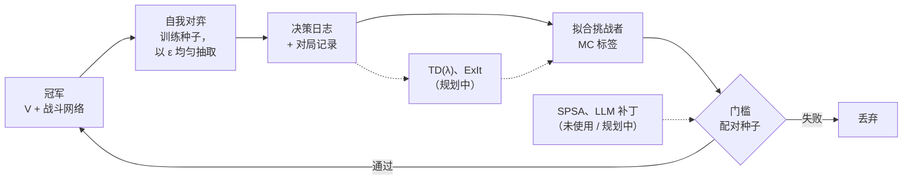

import { Aside, Badge } from '@astrojs/starlight/components';

本章讲 AI 中靠学习而不是靠手写得来的部分，以及让它们变得更好的循环。学的东西有两样：宏观大脑的价值函数 V，它给战斗外的每个局面打分；以及战斗网络，它告诉战斗搜索，前瞻尽头的状态值多少。两者都从 AI 自己打的对局中学习。对其中任何一个的改动，只有通过晋级门槛才会取代当前版本：晋级门槛是在固定种子上与正在使用的版本做的配对测试。

先读：[宏观大脑](/arch/macro-brain/)，了解 V 用来做什么；[战斗大脑：叶子](/arch/combat-brain/leaf/)，了解战斗网络在搜索中做什么。宏观大脑一章还详细讲解了 V 的网络和它的训练标签（[宏观大脑：价值网络](/arch/macro-brain/network/)、[宏观大脑：从风险值到价值](/arch/macro-brain/value/)）；本章链接到那里而不重复，只讲那里没有的内容：战斗网络的训练、整个循环及其已用或计划使用的方法，以及文件和脚本。

<Aside title="状态">

已实现：V 的训练器 `learn/v/`（`v.train`）和战斗网络的训练器 `learn/combat/`（`combat.train`），两者都用蒙特卡洛目标（每个决策的标签是它所在对局真实的结局）；自我对弈的均匀抽取探索（`run --explore ε`）；`learn/gate.py`，一个 V 的对局的报告和配对门槛。规划中、尚未实现：TD(λ) 目标、专家迭代、LLM 补丁提案、奖励塑形、特权训练，以及均匀抽取之外对抗局部最优的机制（[循环](/arch/learning/loop/)）。

</Aside>

## 1. 学什么

**宏观大脑的 V**。在战斗外，宏观大脑把一个决策的每个选项都打一遍，看紧接着它的局面（*后状态*），然后选 V 给后状态估值最高的那个选项（[宏观大脑 §2](/arch/macro-brain/#sec-2)）。V 是一个神经网络，读入这一局是什么（它的卡牌、遗物、药水、幕和 Boss 的 id，以及前方的地图）、牌上增长的数、遗物的计数和状态、遗物保留的牌和六个原始数字，返回一个数，即从这里赢下这一局的概率（[宏观大脑：从风险值到价值 §1](/arch/macro-brain/value/#sec-1)）。一个 V 给每个决策界面（surface）打分，所以一张牌、一件遗物、一次回血和地图上的一条路线在同一个尺度上比较，不需要手写的兑换比率。

**战斗网络**。战斗搜索向前看一个回合或一整场战斗，然后必须说出它到达的状态值多少：它的*叶节点价值*。战斗网络读入一个回合的开始，预测这场战斗会怎样结束：死亡，或者还要再损失多少最大生命值（分成 50 个桶），以及赢下之后每瓶持有的药水没有了的概率（[战斗网络](/arch/combat-brain/network/)、[战斗大脑：叶子 §4](/arch/combat-brain/leaf/#sec-4)）。它的训练见[训练战斗网络](/arch/learning/combat-net/)。

**一个单位**。V 的单位是这一局的胜率，战斗叶子的单位也一样：它把战斗网络预测的每个结局，按那个结局留下的那局游戏由 V 定价，死亡为 0（[战斗大脑：叶子 §5](/arch/combat-brain/leaf/#sec-5)）。

**策略是学出来的，不是写出来的**。两个网络里都没有手写任何关于怎么打的东西：没有哪张牌被说成好牌，也没有列出任何怪物的出招顺序。手写的是游戏规则（模拟器运行的就是真实的游戏）和目标（一局怎样结束，一场战斗怎样结束）。V 从零学起，从 AI 自己的对局中学，而不是从人类的对局中学。

**只在离线时学习**。训练在单独的进程里、用记录下来的对局进行。在线时，每个决策都是搜索加上学到的价值；决策过程中没有任何东西在学习。语言模型将只参与离线环节，提出补丁交给门槛评判，从不参与决策；这部分还在规划中（[循环 §7](/arch/learning/loop/#sec-7)）。

## 2. 一张图看懂循环

这个循环仿照开源国际象棋引擎 Stockfish 的开发方式。Stockfish 的开发者提出一个改动，一个分布式框架（Fishtest）让改动后的引擎和当前的引擎对弈数千局，一个序贯检验（SPRT）只在改动可测地更强时才接受它；它的评估网络用引擎自己对局中的局面训练，搜索参数用 SPSA 调。这里的核心思想相同：**自我对弈、拟合、门槛**。当前最好的版本，即*冠军*，自己打对局；一个新版本，即*挑战者*，在这些对局上拟合；挑战者只有在它从未训练过的种子上赢下配对比较，才取代冠军。

1. **自我对弈**。冠军在训练种子上打对局，其中比例为 ε 的宏观决策随机抽取，让数据显示其他选项会通向哪里（[循环 §2](/arch/learning/loop/#sec-2)、[§9](/arch/learning/loop/#sec-9)）。
2. **拟合**。在这些对局上训练一个新的 V（或战斗网络）。每个决策的标签是它所在对局实际的结局，即*蒙特卡洛*目标（[循环 §3](/arch/learning/loop/#sec-3)）。TD(λ) 和专家迭代还会从搜索算出的价值中学习，它们在规划中（[§4](/arch/learning/loop/#sec-4)、[§5](/arch/learning/loop/#sec-5)）。
3. **门槛**。挑战者打固定的评估种子，逐个种子与冠军的对局配对，只有差值明显大于零时才通过（[循环 §8](/arch/learning/loop/#sec-8)）。

一*代*就是这个循环转一圈（[宏观大脑：自我对弈 §4](/arch/macro-brain/selfplay/#sec-4)）。

## 3. 已实现与规划中

| 部分 | 状态 | 位置 |
|---|---|---|
| 自我对弈：整局，以 ε 均匀抽取 | 已实现 | `run --explore`，[循环 §2](/arch/learning/loop/#sec-2) |
| V 的训练，蒙特卡洛标签 | 已实现 | `learn/v/`，[宏观大脑：从风险值到价值 §5](/arch/macro-brain/value/#sec-5) |
| 战斗网络的训练，蒙特卡洛标签 | 已实现 | `learn/combat/`，[训练战斗网络](/arch/learning/combat-net/) |
| 反事实分叉 | <Badge text="规划中" variant="caution" /> | [循环 §10](/arch/learning/loop/#sec-10) |
| 门槛：模拟器的 SPRT，胜局的配对下界 | 已实现 | `gate`、`learn/gate.py`，[循环 §8](/arch/learning/loop/#sec-8) |
| TD(λ) 目标 | <Badge text="规划中" variant="caution" /> | [循环 §4](/arch/learning/loop/#sec-4) |
| 专家迭代（搜索价值作标签，学到的先验） | <Badge text="规划中" variant="caution" /> | [循环 §5](/arch/learning/loop/#sec-5) |
| 用 SPSA 调手设的权重 | 未使用 | [循环 §6](/arch/learning/loop/#sec-6) |
| LLM 补丁提案 | <Badge text="规划中" variant="caution" /> | [循环 §7](/arch/learning/loop/#sec-7) |
| 基于势函数的奖励塑形、特权训练、对抗局部最优的存档库 | <Badge text="规划中" variant="caution" /> | [循环 §11](/arch/learning/loop/#sec-11)–[§13](/arch/learning/loop/#sec-13) |

## 4. 本章内容

- [训练战斗网络](/arch/learning/combat-net/)：简述它读什么、预测什么，它的样本、标签和训练，以及它的测量结果。
- [循环](/arch/learning/loop/)：自我对弈、蒙特卡洛、TD(λ)、专家迭代、SPSA、LLM 补丁和门槛，探索、信用分配、奖励塑形、特权信息和局部最优，每一项都说明实现了什么。
- [参考](/arch/learning/reference/)：进程与输出、数据目录、清单、种子、权重名、网络文件、C# 推理、每个脚本及其选项、测试和未决问题。

冠军见[评估：冠军与基线 §1](/arch/evaluation/champions/#sec-1)。两个冠军打同样的两个网络，冠军的 V 和冠军的战斗网络，每个都是全部五个角色、每个进阶和两种环境共用的一套权重。
