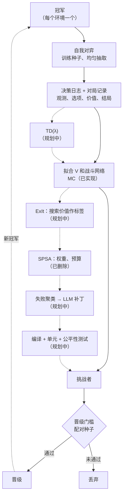

import { Aside, Badge } from '@astrojs/starlight/components';
import TdTargets from '../../../../components/book/TdTargets.svelte';
import ShapingToy from '../../../../components/book/ShapingToy.svelte';

循环把冠军自己的对局变成一个挑战者，再由晋级门槛决定挑战者是否取代冠军。本页按设计时的样子一步步讲这个循环，并逐步说明其中哪些已经实现。好几步依靠强化学习的方法（蒙特卡洛目标、TD(λ)、专家迭代、SPSA、奖励塑形）；每种方法都在它第一次出现的地方从头讲起。先读[学习](/arch/learning/)，了解学的是什么；宏观大脑这一侧的循环在计划 v6 中是怎么跑的，见[宏观大脑：自我对弈](/arch/macro-brain/selfplay/)。

<Aside title="状态">

已实现：带均匀抽取探索的自我对弈，V 和战斗网络的蒙特卡洛拟合，以及三种晋级门槛（模拟器的 SPRT，通过 `learn/challenge.py` 运行；`learn/gauntlet.py` 在进度上或胜局上的配对下界）。已删除：SPSA。规划中：TD(λ)、专家迭代、PCR 和 Reanalyse、LLM 补丁提案、基于势函数的奖励塑形、特权训练、MAP-Elites 存档库、Thompson 采样和反向课程。

</Aside>

## 1. 设计中的循环

| 步骤 | 做什么 | 状态 |
|---|---|---|
| 自我对弈（[§2](#sec-2)） | 冠军在训练种子上打对局，带探索 | 已实现 |
| 拟合（[§3](#sec-3)） | 用对局的结局训练 V 和战斗网络 | 已实现：蒙特卡洛 |
| TD(λ)（[§4](#sec-4)） | 把结局和 V 之后的估值混合起来的目标 | <Badge text="规划中" variant="caution" /> |
| ExIt（[§5](#sec-5)） | 把搜索的估值用作 V 和先验的标签 | <Badge text="规划中" variant="caution" /> |
| SPSA（[§6](#sec-6)） | 靠实际对局来调手设的数字 | 已删除 |
| LLM 补丁（[§7](#sec-7)） | 根据聚类后的失败提出代码改动 | <Badge text="规划中" variant="caution" /> |
| 晋级门槛（[§8](#sec-8)） | 挑战者只有在配对种子上赢过冠军才保留 | 已实现 |

循环离线运行，所在的进程和机器都与任何决策分开；LLM 从来就不打算参与决策。每一代都要过晋级门槛。AlphaZero 去掉了门槛，因为它的信号干净、对局又多；这里一局的方差大，局数又少。

## 2. 自我对弈

自我对弈时，冠军在*训练种子*上自己打对局；训练种子与晋级门槛所用的评估种子分开（[参考 §5](/arch/learning/reference/#sec-5)）。每一局都是在模拟器里无头运行的真实游戏：宿主进程运行这一局唯一的那份活游戏，工作进程池运行搜索（[模拟器：整局](/arch/simulator/runs/)、[模拟器：工作进程池](/arch/simulator/pool/)）。每个决策都写进决策日志，即观测、选项和大脑给出的估值（[Harness：决策日志](/arch/harness/decision-log/)）；每一局的结局写进它的对局记录，包括每场战斗是怎么结束的（[评估：指标、种子与报告 §8](/arch/evaluation/metrics/#sec-8)）。两者按对局 id 对上，就是训练数据。

自我对弈打的东西随计划而变：

| 自我对弈 | 对局 | 战斗 | 打的 V | 数据 |
|---|---|---|---|---|
| g0–g2（2026-10-27/28） | 整局 NoSL 对局 | PIMC 用 `LeafValue`，后来用 c2 | V v0 | 1,198 局 |
| g3（2026-10-28） | 整局 SL 对局 | SL 规划器用 c2 | n2-b0.03 | 419 局 |
| Boss 连战试点（2026-10-29） | 每场战斗在开始时判赢；Boss 在门前开打 | SL 规划器，低预算 | 第二批是 pure-1-g（第一批的不在账本里） | 门前状态，只作标签 |
| 计划 v6（2026-10-29/30） | 精英连战：怪物战斗在开始时判赢，精英和 Boss 真打 | SL 规划器，低预算 | pure-1-g、v6-1、v6-2 | 三代共 26,683 局 |
| 计划 v7（2026-10-30 起） | 整局 SL 对局 | SL 规划器，低预算 | v6-3-2 | 正在打第 1 代 |

**探索**。自我对弈会有意抽取一些决策，而不取 V 的最优，让数据显示其他选项会导向什么（[§9](#sec-9)）。

**最新一代**。从计划 v6 的第三代起，网络只用最新一代的对局训练：较弱的 V 打出的对局，给局面的标签比冠军现在来打时要低（[宏观大脑：自我对弈 §3](/arch/macro-brain/selfplay/#sec-3)）。每一代的对局是每个探索档一个限时作业，共用一个截止时间，打的过程中可以挪动（[参考 §1](/arch/learning/reference/#sec-1)）。

**预算**。自我对弈用 SL 规划器的低预算（`--effort low --nodes 150 --beam 4 --easy-beam 0 --loss-plans 0 --replan 0`），晋级门槛用冠军的中等预算（[SL 规划器：预算、开销与结果 §2](/arch/sl-planner/budget/#sec-2)）。

## 3. 拟合：蒙特卡洛目标

训练价值函数，每个训练状态都需要一个目标：它在那里本该预测出的数字。最简单的是**蒙特卡洛（MC）目标**：把这一局打到结束，用它的真实结局 $G$（赢为 1，输为 0；或者用代理目标，即到达的层数）作为其中每个决策 $k$ 的标签，

$$
y_k = G .
$$

对这一局剩下部分的运气取期望，它恰好是决策 $k$ 的状态在打这一局的策略下的价值，所以这个目标是*无偏*的。但它*噪声大*：一局的运气，即决策 $k$ 之后的每一次抽取、每一场战斗，同样落在这一局的所有决策上，而一局的宏观决策（计划 v6 第一代平均每局 108 个，第三代 146 个，本书的例子对局 181 个；[宏观大脑 §1](/arch/macro-brain/#sec-1)）全都共享它唯一的结局。

**已实现的两个训练器都只用 MC 目标**。V 的目标是每局结束所在那一层的掩码风险值标签（[宏观大脑：从风险值到价值 §2](/arch/macro-brain/value/#sec-2)）；战斗网络的目标是每场战斗怎么结束（[训练战斗网络 §3](/arch/learning/combat-net/#sec-3)）。`learn/` 里没有任何东西在估值上自举。两项措施压住 MC 的噪声：

- **每一局权重相同**，不管它有多少个决策（每个样本的权重是它那一局决策数的倒数），留出的对局按局划分，而不是按决策；
- **第二个输出头**有更密集的目标，即接下来六场战斗的生命值代价，它塑造网络的主干（[价值函数 §9](/arch/learning/value/#sec-9)）。设计中有一条来自 r33hab（一个前人的 STS2 项目）的规则：绝不在同一次反向传播里混合生命值目标和胜负目标。纯 V 的训练确实把它们混在一起，第二个输出头的平方误差以权重 3 加进风险值的损失（`learn/v/train.py:376`）；在试过的每个训练种子上，它都降低了留出损失（[实验记录 §3](/arch/learning/experiments/#sec-3)）。

**代理目标只有通过晋级门槛才被接受**。像到达层数这样的稠密目标只是权宜之计（[价值函数 §2](/arch/learning/value/#sec-2)）。它带来的改动，只有通过基于真实结局的晋级门槛，并且在多个训练种子上复现之后才被接受：在一项掼蛋研究（arXiv 2610.29411）里，有一个谱系看起来很强，但它预先登记的 5 个复现种子没有一个是正的。

## 4. TD(λ) 目标 <Badge text="规划中" variant="caution" />

**时序差分（TD）学习**把真实结局的一部分换成 V 自己的估计。一局的状态 $s_0, s_1, \dots, s_{N-1}$ 是各个宏观决策；结束之前没有奖励，结束时的结局是 $G$。记 $V_k$ 为 V 在决策 $k$ 处的估值。于是：

- **TD(0)**，一步：$y_k = V_{k+1}$，且 $y_{N-1} = G$。标签就是 V 自己在一个决策之后的看法。它的方差小（只有一步的运气），但带着 V 的误差造成的偏差。
- **$n$ 步**：$y^{(n)}_k = V_{k+n}$，当 $k + n \ge N$ 时为 $G$。
- **TD(λ)** 把所有的 $n$ 平均起来，每个以 $(1-\lambda)\lambda^{n-1}$ 加权，所有 $n \ge N-k$ 的权重都归给 $G$。这就是 *λ 回报*：

$$
G^\lambda_k = (1-\lambda)\sum_{n=1}^{N-1-k} \lambda^{n-1}\, V_{k+n} \;+\; \lambda^{N-1-k}\, G,
\qquad
G^\lambda_k = (1-\lambda)\, V_{k+1} + \lambda\, G^\lambda_{k+1}, \quad G^\lambda_{N-1} = G .
$$

$\lambda$ 在 0 和 1 之间，决定混合的比例。$\lambda = 1$ 给出 $G^\lambda_k = G$，即纯 MC；$\lambda = 0$ 给出 TD(0)。两者之间，标签大约往前看 $1/(1-\lambda)$ 个决策：$\lambda = 0.9$ 时约十个。要点在于方差：标签往前看得越远，带的运气就越多，而一个决策的标签应该主要反映它之后不久发生的事。TD 还在每一次转移上都给出学习信号，这有助于信用分配（[§10](#sec-10)）。

图在本书的例子对局上计算这些目标，即 v6-3-2 在种子 `0SSL7NS01MU6` 上打到第 48 层赢下的那一局整局 SL 对局（[宏观大脑 §1](/arch/macro-brain/#sec-1)）。每个点是它 181 个宏观决策之一的 λ 回报，对照 V 自己的估值。

<TdTargets client:visible lang="zh-CN" />

这一局赢了，所以它的 MC 目标 49 远高于 V 早期的估值：V 从 33 开始，而 MC 标签把整局的运气记在每一个早期决策上（前 60 个决策平均比 V 自己的估值高 12.1）。在 $\lambda = 0.9$ 时，这些标签平均只比 V 高 1.2：大部分功劳归给 V 的估值上升之前的那些决策，在第 1 幕和第 2 幕的 Boss 附近（第 16–17 层和第 32–33 层）。在 $\lambda = 0$ 时，每个标签就是 V 的下一个估值。

**规划中的部分**。V v1 原本要用 MC 和 TD(λ) 目标的混合来训练，战斗的输出头在一场战斗内用 TD(λ ≈ 0.95)（[训练战斗网络 §7](/arch/learning/combat-net/#sec-7)）。现在 `learn/` 里没有任何代码计算 λ 回报；图中的目标是在页面里算的（`components/book/td.ts`），并在同样的 181 个估值上与上面的显式求和核对过。

## 5. 专家迭代 <Badge text="规划中" variant="caution" />

**专家迭代**（ExIt）把搜索当作老师。由 V 引导的搜索比单独的 V 打得好，因为它往前看；于是搜索找到的估值和选择，成为下一个 V 的训练标签，也成为一个*先验*的训练标签，先验是告诉搜索先试哪些动作的策略。更好的 V 让下一次搜索更强，如此往复。AlphaZero 是最有名的例子。

- **公平的老师**。老师是同一环境里的搜索，遵守该环境的信息规则。不对全知的老师做行为克隆（训练一个模型去照抄老师的走法），这在好几个项目里都失败了。
- **战斗的策略目标**是 $\mathrm{softmax}(\text{prior logits} + c \cdot \mathrm{minmax}(Q))$，而不是搜索的访问次数。$Q$ 是每个第一个动作在各个世界上的平均估值，PIMC 已经算出来了；minmax 把一个决策的 $Q$ 缩放到 $[0, 1]$；先验是均匀的时候，先验的 logits 为 0；$c$ 按这个目标预测预算大得多的搜索所做选择的程度（对数似然）来调。访问次数不是好的目标：根节点上的共同随机数会把它压平（r33hab），而用 mctx（一个 Gumbel MuZero 库）的变换，在我们每个世界 300 个节点下，目标几乎是 one-hot。
- **日志里现在为它存了什么**。决策日志里 PIMC 的候选带着每个第一个动作在每个世界上的估值和花在它上面的节点数（[Harness：决策日志 §5](/arch/harness/decision-log/#sec-5)），每场战斗的结局在对局记录里。打 SL 冠军战斗的 SL 规划器，每个候选只记一个估值，不记节点数（`Brain/Combat/SlPlanner.cs:214-215`），所以 SL 的数据里没有逐个世界的 Q。
- **两个前提**。学到的先验只有在晋级门槛里赢过均匀先验之后，才能引导搜索。学到的叶子只有同时赢过 `LeafValue` 和推演到战斗结束的 rollout 之后，才能取代 `LeafValue`：在 r33hab 里，15 次模拟时，价值输出头比 rollout 多掉 10.6 点生命。c2 通过了其中前一半（对 `LeafValue`，[训练战斗网络 §5](/arch/learning/combat-net/#sec-5)）；rollout 叶子还没有实现。
- **PCR**（playout cap randomization，来自 KataGo）：25% 的决策用全预算，提供策略目标；另外 75% 用四分之一的预算，只提供价值目标。
- **Reanalyse**（来自 MuZero）：每出一个新网络，就从种子和轨迹重放一部分旧局面，用它重新搜索，刷新它们的策略目标和自举的价值目标。

## 6. SPSA <Badge text="已删除" variant="note" />

**SPSA**（simultaneous perturbation stochastic approximation，同时扰动随机逼近）只靠带噪声的结果来调参数。每一步给每个参数抽一个随机符号 $\Delta_i = \pm 1$，分别测出 $\theta + c\Delta$ 和 $\theta - c\Delta$ 的结果 $J$，然后同时挪动所有参数：

$$
\hat g_i = \frac{J(\theta + c\Delta) - J(\theta - c\Delta)}{2c\,\Delta_i}, \qquad \theta \leftarrow \theta + a\,\hat g .
$$

不管参数有多少，它每步只要两次测量，也不需要梯度，适合那些只能靠打对局来检验的权重；Stockfish 就是这样调它的搜索的。

`learn/spsa.py` 曾用这个办法调 V v0 的权重，加 `--param leaf` 时调 PIMC 的叶子权重（[战斗大脑：叶子 §2](/arch/combat-brain/leaf/#sec-2)）：每一步两边都在同一批新的训练种子（或测试集战斗）上打。调出的权重没有晋级过，这个脚本已在 `9b9d170` 删除（留在 git 历史里）。现在没有工具调这些权重：策略交给网络，`LeafValue` 要换成学到的价值，而不是手调。搜索自身的参数（预算、K、束宽、阈值）原本也要这样调；一个都没有调。

## 7. LLM 补丁提案 <Badge text="规划中" variant="caution" />

输入会是预先聚合好的失败聚类（按怎么输、在哪里输分组的对局）加上死亡摘要；输出是 K 个候选补丁（特征、剪枝规则、参数）。候选先经过编译、单元测试和公平性测试的筛选，再像任何挑战者一样过晋级门槛。只通过项目的 LLM 网关使用便宜的模型，并且绝不用在决策里。这些都还没有实现。

## 8. 晋级门槛

晋级门槛是挑战者要取代冠军必须通过的检验：它在从没训练过的种子上打，逐个种子和冠军的对局配对，这样一局的大部分运气由双方共享，在差值里抵消（共同随机数，[评估：晋级门槛 §2](/arch/evaluation/gates/#sec-2)）。带探索的挑战者会被拒绝：探索是自我对弈的事（`SimWorker/Commands/EvalCommands.cs:92-93`）。已实现的门槛有三种。

**模拟器的 SPRT**（`gate`，`Harness/Gate.cs`；计划 v6 之前的每一道门槛都是它）。在 `promotion-1` 的 200 个种子上的序贯检验，一出现明确的判定就停：按层数（δ = 1.5 层）或按胜局，α = β = 0.05，或者用 `--not-worse` 做非劣效检验（[评估：晋级门槛 §6](/arch/evaluation/gates/#sec-6)）。`learn/challenge.py` 带一个挑战者过这道门槛：它分批在冠军的种子集上打（默认每批 40 个），每批之后跑一次门槛，遇到失败或作废的判定就停；通过之后把种子集剩下的打完，并让挑战者晋级，即改写冠军文件、重建排行榜（[参考 §9](/arch/learning/reference/#sec-9)）。V v2 的网络和 c2 都是这样过门槛的。

**进度上的配对下界**（`learn/gauntlet.py --against`，计划 v6）。在精英连战里，用它的 500 个评估种子，按训练预算：对种子 $i$，$d_i$ 是挑战者的进度减去冠军的进度；在双方都打完的种子上有 $n$ 对时，

$$
\bar d = \frac1n \sum_i d_i, \qquad \mathrm{SE} = \frac{\mathrm{sd}(d)}{\sqrt n}, \qquad \text{promote if } \bar d - 1.645\, \mathrm{SE} > 0,
$$

即 95% 单侧下界大于 0（`learn/gauntlet.py:136-161`；[宏观大脑：自我对弈 §4](/arch/macro-brain/selfplay/#sec-4)）。

**胜局上的配对下界**（同一份代码用在整局上，计划 v7）。$d_i$ 是 1 − 0、0 − 1 或 0：挑战者是否赢下种子 $i$，减去冠军是否赢下。在 `promotion-1-500` 的 500 个种子上，按冠军的中等预算，胜局平均差的下界大于 0 时挑战者通过，在 500 个种子上这大约需要多赢 2–3 个百分点；报告也给出层数的配对。在 v6-3-2 和 v6-2 的整局报告上核对过：300 对，胜局 23 对 1，胜局 +0.073 ± 0.016，下界 +0.047，层数 +2.20 ± 0.62（提交 `7ce03bd`）。

**晋级**。模拟器的门槛在通过时写冠军文件。`learn/gauntlet.py` 只给出判定：计划 v6 和 v7 的晋级都是手工改写冠军文件，而 v6-3-2 是凭它的整局报告、没有过门槛就成了两个冠军的 V（提交 `dc4ee30`；[评估：冠军与基线 §2](/arch/evaluation/champions/#sec-2)）。晋级门槛的 A/A 测试，即让冠军对它自己，测量在毫无提升可言时门槛有多常通过，在规划中（[参考 §11](/arch/learning/reference/#sec-11)）。

## 9. 探索

V 只从对局做过的事里学。如果自我对弈总是取 V 的最优选项，数据就永远不会显示其他选项导向什么，V 也就永远发现不了自己对它们的判断错了。所以自我对弈有时会有意选别的选项；怎么挑这个选项很重要（[宏观大脑：自我对弈 §2](/arch/macro-brain/selfplay/#sec-2)，附有一张基于真实决策的图）。

**均匀抽取**（`run --explore ε`，已实现，提交 `7a9f845`；`Uniform`，`Brain/Exploration.cs:47-65`），精英连战以来 V 的探索方式。一个宏观决策以概率 ε 在它的 $n$ 个选项中均匀抽取答案，不管 V 怎么说；否则 L0 取 V 的最优 $a^\ast$：

$$
P(a) = (1-\varepsilon)\,[a = a^\ast] + \frac{\varepsilon}{n} .
$$

它覆盖战斗外的每一个决策：卡牌奖励的结果，在它的牌和跳过之间抽（抽到跳过就不打开，抽到某张牌就打开并拿下）；选牌提示的选取（先均匀抽选几张，再抽选哪几张）；其他每个画面的选项，但药水栏的选项和会回到已经决定过的状态的选项除外。ε 每局固定。抽到什么既不取决于 V，也不取决于这一局有多强，所以它的结果是关于这些选项的因果证据，每种决策被抽到的频率也一样。每个抽出的答案在日志里都标为 `explored`（[Harness：决策日志 §6](/arch/harness/decision-log/#sec-6)），冠军的名字以 `eps ε` 结尾。

- **档位**。一代的对局分成三个 ε 档，每档占三分之一的对局：计划 v6 的第 1–2 代为 1.0、0.5 和 0.15，从它的第 3 代起以及在计划 v7 中为 0.3、0.15 和 0.05。
- **标签带着之后的抽取**。一个决策的标签是它所在对局怎么结束的，包括在它之后的抽取，而 V 不知道这一局的 ε；同一个局面，在探索更多的对局里得到的标签更低。每局一个*切分点*可以消除这个问题（切分点之前抽取，之后取 V 的最优，只用切分点之后的决策训练，就像 AlphaGo 的价值网络每局只用一个局面训练那样）；目前没有这样做，计划 v7 又一次推迟了它（[宏观大脑：弱点与下一步 §4](/arch/macro-brain/next/#sec-4)）。
- **检查**。在自我对弈里，有两个及以上选项的决策中，`explored` 的比例应该约为 ε：计划 v7 的第一次测试里，ε = 0.15 时 2,347 个决策中为 0.161。

**softmax 探索**（已实现；`Softmax`，`Brain/Exploration.cs:9-40`）以如下概率抽取每个选项

$$
P(a) = \frac{\exp\big((v_a - v_{a^\ast})/T\big)}{\sum_b \exp\big((v_b - v_{a^\ast})/T\big)}
$$

所依据的是大脑给各选项的估值，温度 $T$ 以估值的单位计：接近最优的选项常被尝试，差的很少，一样好的机会均等。一次抽取比最优低超过 $T/100$ 才算探索，更接近的就和平局一样好。`run --macro-explore T` 让 L0 在战斗外的每个决策上这样做，包括选牌提示（每次选取以及是否停下），依据 V 的估值；`--combat-explore T` 让 PIMC 的第一个动作这样做，依据搜索的候选，只在自我对弈搜索的根节点上。这等价于给 $v/T$ 加上 Gumbel 噪声再取最大。冠军的名字会显示它（`l0 explore T`、`pimc c2 explore T`）。

- 它在精英连战之前是 V 的探索方式，后来均匀抽取取代了它来产生 V 的数据：softmax 在 V 的各选项估值接近的地方（选牌）比相差大的地方（休息处、商店）探索得多得多，而且它跟着 V 自己的看法走，所以数据里永远没有这些看法的反例（用 V v0 时，在 75% 生命下，T = 2 的 softmax 选锻造、而不选比它多值 18 点生命的休息，大约 8,000 次里才有一次）。
- 它留给较早的作业和战斗用。`--combat-explore` 需要 `--policy pimc`（`SimWorker/Commands/Args.cs:259`），所以 SL 自我对弈（它的战斗由 SL 规划器来打）不探索战斗。
- **温度**以 V 的单位和叶子的单位计，所以它们一变，温度就要重选。规则：对 PIMC，按搜索自己的估值，每场战斗约让出 1 点生命；对 L0，取让它约 4–5% 的决策被探索的温度，只计有两个及以上合法选项的决策，也只计比最优差的抽取。给了日志里各决策的选项时，`v.train --afterstates` 报告新网络在哪个温度下探索留出决策的频率与打出这些日志的大脑相同（`explore_temperature`，`learn/v/train.py:147-174`）。实测的温度见[实验记录 §6](/arch/learning/experiments/#sec-6)。

**卡牌抽取**（已删除）：`run --card-explore P` 曾以概率 P 在卡牌奖励的牌和跳过之间均匀抽取结果；Boss 连战试点就带着它打。均匀抽取取代了它。

**Thompson 采样** <Badge text="规划中" variant="caution" /> 会根据 V 的不确定性为每个选项抽一个可能的价值，选抽到最高的那个，这样一个选项被尝试的频率，大致等于它真正是最好选项的可能。V 目前还没有可供抽取的不确定性估计。

## 10. 信用分配

唯一的奖励是一局的结局。难点不在于缺少信号，而在于*信用分配*（一局里众多决策中，是哪些导致了输赢）和*方差*（掩盖任何单个决策效果的运气）。设计从两方面入手：

1. **分层缩短了链条**。战斗由搜索解决，它的结果是一个结局分布 $p(k)$：死亡，或剩余生命落在第 $k$ 个桶。宏观 V 每场战斗给它定一次价：开战时，$u_k$ = 战斗之后、生命值落在第 $k$ 个桶时的后状态的 V，药水或遗物变化时重算，另有死亡的价格；叶子的值是 $\sum_k p(k)\, u_k$。这样战斗网络就不依赖 V 的版本：新的 V 只需要重新定价，战斗和宏观在同一个尺度上拿生命值和其他一切做取舍。于是整局层面的信用分配只需跨越各个宏观决策加上各场战斗的结果。**已实现的**是 SL 规划器的 `--leaf-prices v`（`PricedLeaf`，`Brain/Combat/PricedLeaf.cs:16-26`；[战斗大脑：叶子 §5](/arch/combat-brain/leaf/#sec-5)），没有过门槛，也没有冠军在用。它对死亡的定价是这一局所在的层，即 V 在 `floor` 和 `progress` 单位下给一局在那里结束的估值（`PricedLeaf.cs:25`）；`win` 网络的估值在 $[0, 1]$ 内，死亡值 0。
2. **TD(λ)** <Badge text="规划中" variant="caution" /> 在每一次转移上都给出学习信号（[§4](#sec-4)）。
3. **辅助奖励项必须基于势函数** <Badge text="规划中" variant="caution" />（[§11](#sec-11)）。
4. **辅助输出头**提供密集的监督，只用于表示：已实现的是第二个输出头（[价值函数 §9](/arch/learning/value/#sec-9)）。
5. **方差**：每个晋级门槛里都用共同随机数（已实现），关键决策上的反事实分叉（命令已实现，见下），以及反向课程（规划中，[§13](#sec-13)）。

### 反事实分叉

同类对局再多，也拆不开一个选择和随它而来的运气：在每一局里它们都一起出现。拆得开的是同一个局面，用两个选择和同样的运气接着打。**CRN**（共同随机数）：两条路线用同样的随机种子来打，它们共有的运气就从差值里抵消了。*分叉*一个决策，就是从同一个点出发，分别打它的两个选项。

决策日志只保留每个决策之前的对局和选了什么，所以有两个模拟器命令回到那里。两者都从种子重放日志里的一局，按日志回答每个决策（战斗和选牌提示也一样），并把每个观测的哈希和日志里的核对；重放一局约 0.7 s。

- `afterstates --log LOGS --records RECORDS --out FILE [--start I] [--n N] [champion options]` 写出每个宏观决策的选项，按 L0 用冠军的 V 权衡它们的样子：每个选项的后状态（它改变的那些整局观测字段）和估值，以及 V v0 对它算出的特征（`SimWorker/Commands/Forks.cs:84`）。
- `fork --log LOGS --records RECORDS --out FILE [--per-run 2] [--surfaces map,card_reward,rest,shop] [--act 0] [--max-decisions 20000] [champion options]` 从日志的每一局里抽这一幕的 K 个决策，一次一种决策界面（surface）轮流抽，把这一局重放到每个决策，从那里打两次：一次用 L0 的最佳动作，一次用这个画面上均匀抽取的另一个动作（不抽药水的动作，每个画面都有）。冠军把两条分支都打到这一幕结束，打过它的 Boss。到决策为止，两条分支共享游戏的随机状态和大脑的种子；决策之后，游戏的随机数流保持同步，只在选择挪动了它们的地方错开。每个分叉记录两条分支的结局（死了还是活着、层数、生命、金币）和视野边界处的对局（`Forks.cs:137-145`）。

V v2 的训练器读过分叉；现在没有训练器读。分叉测出了什么，见[实验记录 §4](/arch/learning/experiments/#sec-4) 和 [§5](/arch/learning/experiments/#sec-5)。

## 11. 基于势函数的奖励塑形 <Badge text="规划中" variant="caution" />

*奖励塑形*加上一些小的中间奖励，让学习者在一局结束之前就得到反馈。天真地做会改变最优策略是什么：每掉一点生命就罚分，会禁止「第 1 幕卖血、换第 3 幕取胜」这样的打法。**基于势函数**的形式避免了这一点（Ng、Harada 和 Russell，1999）。一个函数 $\Phi$ 给每个状态打分，从 $s$ 到 $s'$ 一步的奖励是

$$
F(s, s') = \Phi(s') - \Phi(s), \qquad \Phi(\text{end of run}) = 0 .
$$

整局下来，这些奖励*逐项相消*（telescope）：每个中间项都抵消掉，总和是 $\Phi(\text{end}) - \Phi(s_0) = -\Phi(s_0)$，对从同一起点出发的每种打法都一样。所以任何策略塑形后的回报，都是它的真实回报减去同一个常数，最优策略不变；Ng、Harada 和 Russell 证明了，只有基于势函数的项能对每个任务都有这个保证。终止状态的势必须对每种结局都相同（这里是 0）；否则总和就会取决于一局怎么结束。

<ShapingToy client:visible lang="zh-CN" />

`learn/` 里没有任何东西做奖励塑形：V 的标签只有结局。检验塑形项精确逐项相消的测试，等塑形项实现时一起加上（[参考 §11](/arch/learning/reference/#sec-11)）。

## 12. 特权信息 <Badge text="规划中" variant="caution" />

*特权信息*是玩家看不到的隐藏状态：抽牌顺序、怪物排好的招式、随机数流。项目的公平游戏规范（一份本地笔记 `tmp/notes/fair-play-spec.md`，不在 git 里）允许在训练时使用它，只要部署的策略只读观测（[环境：信息与节点](/arch/environments/information/)）：

- **神谕评论家**（oracle critic），一个只在训练时使用的价值分支，会看到隐藏状态，以降低目标的方差；部署的只有观测分支；
- **反事实标签**：用同样的随机性分叉同一个决策，两条路线都打到底，得到差值的无偏标签（[§10](#sec-10)）；
- 这些都只存在于离线流水线里，所在的程序集和进程与决策进程分开。

现在没有训练器读隐藏状态：V 读整局观测（`learn/v/data.py`），战斗网络读观测（`learn/combat/data.py`）。

## 13. 局部最优

自我提升的循环可能陷入*局部最优*：一种打法，任何小改动都会让它变差，而一种截然不同的打法其实赢得更多（例如永远保守）。下面这些机制对抗它：

| 机制 | 作用 | 状态 |
|---|---|---|
| 价值目标只是一局的结局 | 生命值值多少从数据中学出来，而不是设定的 | 已实现 |
| 均匀抽取 | 每种决策都被尝试，与 V 无关（[§9](#sec-9)） | 已实现 |
| 对决策做 softmax 或 Thompson 采样 | 按 V 认为选项有多好（或可能有多好）的比例尝试选项 | softmax 已实现；Thompson 规划中 |
| 反事实实验室 | 在抽样出的关键决策上，用 CRN 分叉两条路线并都打到底，得到无偏的差值；检验「第 1 幕卖血」这类假设（[§10](#sec-10)） | 命令已实现；没有训练器读分叉 |
| 反向课程 | 先在接近结尾的情形上训练（Boss 战之前的快照），那里结局近在眼前、信号清楚，然后把起点往前移 | 规划中；Boss 连战试点的门前状态最接近 |
| 种群 / 存档库 | 每个风格描述符一个冠军（MAP-Elites），不会坍缩成单一风格 | 规划中 |
| 保守性监控 | 打精英次数、跳过率、到 Boss 时的生命、囤积金币和药水（[评估：指标、种子与报告 §3](/arch/evaluation/metrics/#sec-3)） | 部分：`learn/gauntlet.py` 报告精英，以及休息处、地图和商店的选择；报告给出精英、跳过和金币 |
| 反常识假设 | 来自人或 LLM 的想法 → 受约束的策略变体 → 在模拟器里 A/B；结果拿回去讨论 | 规划中 |

- **MAP-Elites** 保留一个存档库，而不是单个最好的策略。每个策略按它的*风格描述符*（描述它怎么打的几个数字，比如每局打几场精英、跳过几张牌）放进一个格子，每个格子保留自己最好的那个。暂时不是最好的风格也能存活，种群就不会坍缩成单一风格。
- **模拟器 A/B**：在模拟器里用同样的种子打两个策略变体并比较结果，就像晋级门槛那样。
