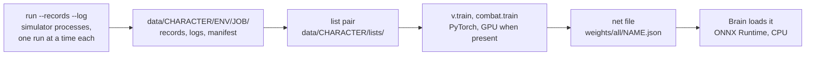

import { Badge } from '@astrojs/starlight/components';
import NetFileAnatomy from '../../../../components/book/NetFileAnatomy.svelte';

本页供查阅。前面几页讲学习循环；这一页列出它的机制。本页和代码（`learn/`、`src/Sts2Ai.Brain`、`src/Sts2Ai.SimWorker`、`weights/`、`eval/`）不一致时，以代码为准。Python 文件的路径相对于仓库，C# 路径相对于 `src/Sts2Ai.*`。

## 1. 进程与输出

- **模拟**。自我对弈和评估都是模拟器的 `run` 进程（[§10](#sec-10)）。每个进程一次打一局，依次打它的种子，搜索在它自己的工作进程上（`--workers`）；一个作业的种子分给几个这样的进程，各自写自己的文件（[§3](#sec-3)）。模拟器按进程扩展：8 个进程约 1,860 场战斗/秒，单进程为 275 场（[模拟器：战斗 §7](/arch/simulator/combat/#sec-7)）。按冠军的中等预算，一局整局 SL 对局占一个进程 5 到 17 分钟，视角色而定（[评估：冠军与基线 §2](/arch/evaluation/champions/#sec-2)）。
- **输出**。`--records FILE` 和 `--log FILE` 写对局记录和决策日志，每条一行 JSON，写完一行就刷新，所以进程中途停下最多丢掉正在写的那一行。一个作业的文件放进 `data/` 下它自己的文件夹，不进 git（[§3](#sec-3)）。
- **训练**用 Python 和 PyTorch，有 GPU 时在 GPU 上跑（`device = "cuda" if torch.cuda.is_available()`），读一对清单（[§4](#sec-4)）；结果是 `weights/all/` 里的一个网络文件，它进 git（[§6](#sec-6)）。推理用 C#，在 CPU 上，在决策进程和工作进程里（[§8](#sec-8)）。

## 2. `learn/` 项目

`learn/` 是循环的 Python 项目，用 uv 管理（`learn/pyproject.toml`、`uv.lock`）：`sts2-learn` 0.1.0，Python ≥ 3.12，依赖 loguru ≥ 0.7.3、onnx ≥ 1.23.2、torch（来自 PyTorch 的 CUDA 12.8 索引）和 typer ≥ 0.27.3；开发依赖 pytest ≥ 9.1.1 和 ruff ≥ 0.17.3（行长 120，规则 E、F、W、I、B、UP）。在 `learn/` 里用 `uv run python -m v.train …` 或 `uv run python gate.py …` 运行脚本。

**约定**（`learn/common.py`）：

- 每个脚本只有一个 Typer 命令，帮助文本就是它的 docstring（`common.app`，`:24-26`），所以 `--help` 显示 docstring。
- 日志通过 loguru 写到 stderr，级别为 `LOG_LEVEL`（默认 INFO），格式为 `HH:mm:ss LEVEL message`；stdout 只输出结果，报告是一行 JSON（`common.run`，`:29-41`）。
- `LearnError`（输入有错、文件挡路、模拟器失败）让脚本报一行信息后以退出码 1 结束；其他异常都是 bug，带着 traceback 结束。模拟器的命令行也是这样（[模拟器：参考 §2](/arch/simulator/reference/#sec-2)）。

## 3. 数据目录

对局记录和决策日志是原始数据，不进 git，放在 `data/CHARACTER/ENV/`（`ENV` 是 `sl` 或 `nosl`；`.gitignore:10-11`），每个作业一个文件夹。

| 文件夹 | 内容 | 例子 |
|---|---|---|
| `selfplay/vNgM/aAA-eXXX/` | 一代的作业，每个进阶和 ε 一个文件夹（`a00-e030` 即进阶 0、ε = 0.3）；`vNgM` 指数据，从不指网络 | `sl/selfplay/vNgM/a00-e030` |
| `eval/DATE-SUBJECT/` | 评估和晋级门槛，每个角色每一方一个文件夹；SUBJECT 写出打的是什么，即进阶和两个网络 | `sl/eval/DATE-a0-V-C` |
| `forks/DATE-SUBJECT/` | 试打的对局，例如对一个构建或一组选项的冒烟测试 | – |
| `data/CHARACTER/void/` | 不能用的数据（选项用错、停得太早），保持原来的路径，附一个 `VOID.txt` 写明原因 | `void/sl/selfplay/vNgM/a00-e030` |
| `data/CHARACTER/lists/` | 共用的训练集（[§4](#sec-4)） | `lists/NAME-logs.txt` |

**文件**。作业的文件夹里每批种子一套文件，文件名是打这批的分片（即那个进程）加这批的第一个序号：`rec-SHARD-INDEX.jsonl`（对局记录）、`log-SHARD-INDEX.jsonl`（决策日志）、`out-SHARD-INDEX.txt`（模拟器的输出）、`tally-SHARD-INDEX.txt`（每局的结局、幕和层数）、`counts-SHARD-INDEX.txt`（每个文件的行数），最后写 `done-SHARD-INDEX.txt`（这批对局的序号）。所以一批要么完整，要么不存在；读作业时，没有 `done-` 文件的批会被排除。决策日志和同名的记录文件成对，清单对把这两个文件放在同一行（[§4](#sec-4)）。决策日志的大部分字节是战斗观测和宏观决策的整局观测。

**manifest**（`manifest.json`，每个作业一份）说明打的是什么、为什么打：`job`、`kind`、`character`、`env`、`owner`、`purpose`、`rev`（构建模拟器的提交）、`game`（游戏版本）、`options`（对局选项，种子文件或训练种子也在其中）、`inputs`（作业读取的 `eval/` 和 `weights/` 文件从哪里来）、`launched` 和 `status`。

## 4. 清单

共用的训练集是 `data/CHARACTER/lists/` 里的清单对：`NAME-logs.txt` 和 `NAME-recs.txt` 每行一个路径，相对于仓库根目录（或绝对路径），一份的第 i 行是另一份第 i 行那些对局记录的决策日志（`common.lists`，`learn/common.py:84-95`）。`v.train --list PREFIX` 和 `combat.train --list PREFIX` 读一对清单；训练器只把每份日志和同一行上的记录文件对上。网络训练所用的清单装的是一代里每个角色的自我对弈（[循环 §2](/arch/learning/loop/#sec-2)）；用 `combat.train --test-list` 读的清单只报告，从不训练。文件夹里的 `manifest.json` 说明每份清单装的是什么。

## 5. 种子

- **训练种子**是 `run --seed 1 --start K`，即从序号 K 起的种子 `MakeSeed(1, i)`（[评估：指标、种子与报告 §6](/arch/evaluation/metrics/#sec-6)）。每个数据集打自己的一个 100,000 宽的区段，它的每个作业打其中自己的一段，所以没有两局共用一个种子。
- **规则**：训练种子和测试种子从不相遇。自我对弈作业打训练种子，评估作业打 `eval/seeds/` 里的文件；序号低于 40,134,134 的训练种子都不会给出评估种子的生成器种子（[评估：指标、种子与报告 §6](/arch/evaluation/metrics/#sec-6)），两个训练器也都拒绝含有评估作业对局的清单（`common.train_lists`）。

评估种子文件在 `eval/seeds/` 里：`promotion-1`（200 个）、`promotion-1-300`（按顺序是它的 200 个，再加接下来的 100 个）、它的切片 `promotion-1-100`、`promotion-1-200` 和 `promotion-101-300`、`final-1` 和 `a10-check-1`；`eval/seeds/retired/` 存放 `promotion-1-500`，它后 200 个种子在训练数据里（[评估：指标、种子与报告 §5](/arch/evaluation/metrics/#sec-5)）。`eval/CHARACTER/leaderboard.md` 由 `leaderboard` 从整局报告生成。

## 6. 权重

战斗网络和 V 各是一个网络，用于每个角色、每个进阶和两种环境，所以它们的文件共用一个文件夹 `weights/all/`（`learn/weights.py`）。每个角色仍然单独评判：它的报告和排行榜在 `eval/CHARACTER/` 里，它的数据在 `data/CHARACTER/` 里（[§3](#sec-3)）；冠军文件是所有角色共用的，在 `eval/champions/` 里。

`weights/all/` 里有 V 的文件 `v9-0.json`、`v9-1.json` 和 `v9-2.json`，以及战斗网络的 `c9-0.json`、`c9-1.json` 和 `c9-2.json`。SL 和 NoSL 的两个冠军文件都为每个角色指明冠军的两个文件 `weights/all/v9-2.json` 和 `weights/all/c9-2.json`（[评估：冠军与基线 §1](/arch/evaluation/champions/#sec-1)）。

- **永不覆盖**。训练器写到 `weights/all/NAME.json`，除非 `--out` 另行指定；如果某个名字的文件在 `weights/all/` 里已经存在，它就拒绝（`out_path`，`learn/weights.py:14-20`），所以一个名字只用一次，永远指同一份权重。没有任何保留下来的对局用到的试验文件，用 `--out` 放到别处。
- **每个角色**。两个训练器都读清单里每个角色的对局（`runs_by_log`，`learn/common.py:61-81`），因为网络是共用的；网络文件不记录角色。
- **名字**。`vN-M` 是 V，`cN-M` 是战斗网络，有变体时在编号后面加字母（`vN-Ma`）。`vNgM` 指一代的数据，从不指网络。
- **在 git 里**。`weights/` 进 git：一个文件 6.0–9.6 MB，而且不会改，所以一个提交就同时确定了代码、权重和冠军文件；冠军文件直接引用权重所在的路径。
- **环境**。战斗网络的文件写明它学自哪个环境（`env`），C# 不读它：SL 和 NoSL 打同一个文件（[战斗大脑：叶子 §6](/arch/combat-brain/leaf/#sec-6)）。冠军的战斗网络学自 SL 的对局；它在 NoSL 下能加载、能打，但从没有在那里训练过，也没有过过门槛。

## 7. 网络文件

网络文件是 JSON：base64 编码的 ONNX 计算图，加上 C# 喂给它所需的东西，以及加载时要核对的测试输入和训练器的输出。网络只在 Python 里定义一次；C# 只负责把一局或一个回合开始局面变成计算图的输入（[§8](#sec-8)）。

**V 的文件**（`learn/v/export.py:44-64`）：

| 字段 | 内容 | C# 是否读取 |
|---|---|---|
| `name` | 网络的名字，和冠军显示的一样（`l0 NAME`） | 是 |
| `floors` | 64 | 是 |
| `vocab` | 每张表，这个游戏版本的每个 id（`learn/game_ids.py`），第 0 项是 `<unk>`：`cards`、`modifiers`、`relics`、`potions`、`context`、`map`、`relic_status` | 是 |
| `state` | `names`（floor、hp、max_hp、gold、ascension、potion_slots）、`mean`、`std` | 是 |
| `fit` | 训练报告（[§9](#sec-9)） | 否 |
| `onnx` | 计算图：输入名照 `learn/v/encode.py` 的 `INPUTS`，在 `state` 之后是遗物的 `relic_values` 和 `relic_status`，以及保留的牌的 `held` 和 `held_mask`，批大小和长度维度不固定；输出 `hazards`（batch × 64）；opset 20 | 是 |
| `tests` | 按训练种子抽出的最多 8 个留出样本：`run`（整局观测）和 `value`（训练器在 CPU 上给的值） | 是 |

**战斗网络的文件**（`learn/combat/export.py:72-106`）：

| 字段 | 内容 | C# 是否读取 |
|---|---|---|
| `name` | 和冠军显示的一样（`pimc NAME`、`plan NAME`） | 是 |
| `env` | 它学自哪个环境的对局，作为记录写入 | 否 |
| `buckets`、`loss_min` | 从 −0.25 起的 50 个分桶：网络预测什么 | 是 |
| `potion_groups` | 5：分桶每相邻 10 个为一组，药水的概率按组给出 | 是 |
| `lags` | 之前 3 个回合的意图 | 是 |
| `vocab` | 每张表，这个游戏版本的每个 id：`cards`、`modifiers`、`powers`、`enemies`、`intents`、`relics`、`potions`、`context`、`orbs`、`allies`、`relic_status`；`context` 只含遭遇 | 是 |
| `fit` | 训练报告 | 否 |
| `onnx` | 输入名照 `learn/combat/encode.py` 的 `INPUTS`；`extra` 有 4 个数；输出 `outcome`（batch × 51，softmax，关闭的分桶为 0）和 `potion_used`（batch × 5 组 × 药水 id，sigmoid） | 是 |
| `tests` | 最多 16 个留出的回合开始局面，其中有多段攻击、持有药水和低生命的状态：`obs`、`history`、`outcome`、`potion_used`（5 × 66 个数，一组接一组） | 是 |

图中逐个字段打开冠军的两个网络文件，V 的和战斗网络的：大小、计算图的输入和输出及其形状、它的初始化器（权重张量，只列形状）和算子，以及训练报告。

<NetFileAnatomy client:visible lang="zh-CN" />

## 8. C# 里的推理

- **用哪些网络**。`run --value FILE` 读 V 的网络文件（`RunNet.Read`）；`--value` 和 `--macro l0` 或 `--combat-net` 一起用，两者都需要它（`SimWorker/Commands/Args.cs:235`）。`run --combat-net FILE` 加载战斗网络（`CombatNet.Load`），即每个战斗搜索的叶子，它的结局由那个 V 定价：`--combat-net` 和 `--policy pimc` 或 `plan` 必须一起用（`:234`）。
- **`IRunValue`**（`Brain/Macro/RunValue.cs`）是宏观大脑眼中的 V：一个名字，以及对整局观测的估值。`RunNet` 实现了它。
- **`RunNet`**（`Brain/Macro/RunNet.cs`）用 ONNX Runtime（`Microsoft.ML.OnnxRuntime`）运行计算图，intra-op 和 inter-op 各一个线程（`:53-54`），因为模拟器跑很多进程，而一个宏观决策只给少数几个小输入估值。它像 `learn/v/encode.py` 那样从整局观测构建输入，遗物的数值和状态由两个网络共用的 `CombatNet.RelicInputs` 构建。未知的 id 读作第 0 项。`Value` 是从这一局当前的层起每一层都活下来的机会（`:80-87`）。
- **`CombatNet`**（`Brain/Combat/CombatNet.cs`）对状态做同样的事，也是一个线程。`Graph` 从 `Cards`、`Player`、`Enemies`、`PowerNumbers`、`RelicNumbers`、`Allies`、`Bag` 和 `Powers` 构建输入，与 `learn/combat/encode.py` 读状态的方式相同，并返回两个输出；`Outcome` 按每个结局会留下的那局游戏用 V 给它定价，死亡为 0，每瓶持有的药水按它在结局分桶所在那一组的概率保留（[战斗大脑：叶子 §5](/arch/combat-brain/leaf/#sec-5)）。
- **加载检查**。`RunNet.Load` 给每个测试对局估值，任何一个值的偏差超过 10⁻³ × |value| 和 10⁻⁶ 中较大的那个，就拒绝这个文件（`:64-78`）；`CombatNet.Load` 预测每个测试状态，任何一个类别或药水概率的偏差超过 10⁻³，或某个输出的长度不同，就拒绝它。这保证训练和对局时的编码与前向计算一致。

## 9. 脚本

### `learn/common.py` 和 `learn/weights.py`

| 函数 | 作用 |
|---|---|
| `read_lines(paths, needle)` | 逗号分隔的各文件里含有 needle 的 JSON 行；跳过空行和还在写的行；缺文件是 `LearnError`（`:44-58`） |
| `runs_by_log(logs, records)` | 把第 i 份日志和第 i 份记录文件配对（数量必须相同）；每份记录文件按对局 id 列出它的对局；拒绝同一文件里出现两次的对局 id；读每个角色的对局（`:61-81`） |
| `lists(prefix)` | 一对清单，作为两个用逗号连接的字符串（`:84-95`） |
| `train_lists(prefix)` | 网络训练用的一对清单：和 `lists` 一样，但拒绝评估作业里的路径（`:98-104`） |
| `out_path(name, out)` | 权重文件写到哪里（[§6](#sec-6)） |

### `v.train`：V

`uv run python -m v.train --list PREFIX --name NAME [options]`（`learn/v/train.py:48-59`）。

| 选项 | 默认 | 含义 |
|---|---|---|
| `--list` | 必需 | 清单对 `PREFIX-logs.txt` 和 `PREFIX-recs.txt` |
| `--name` | 必需 | 网络的名字，冠军会这样显示它 |
| `--out` | `weights/all/NAME.json` | 文件写到哪里 |
| `--init` | – | 接着训练的网络文件：沿用它的状态缩放和权重，第二个输出头重新开始 |
| `--seed` | 0 | torch 和 Python 的种子；也决定那 8 个测试对局 |

**拒绝的情况**（`:70-71`、`:81-82`）：训练或留出样本太少；`--init` 的表与游戏的不同，或缺少网络的某个权重、形状不对（`export.weights`，`learn/v/export.py:97-98`）。

**常量**（`:40-44`）：64 层；最多 40 轮，连续 5 轮留出损失没有降低 10⁻⁴ 以上就停；每批 256 个决策；AdamW，学习率 3 × 10⁻⁵，权重衰减 10⁻⁴；第二个输出头权重 3。网络的大小是 `Net` 的：嵌入 64，单牌网络 256，主干 512（`learn/v/net.py:86-111`）。

**流程**。读取样本；按对局 id 划分；取游戏的表（`learn/game_ids.py`），并算出状态的加权均值和标准差（或取 `--init` 的）；基线风险值，即每一层的 $(\text{deaths} + 0.5)/(\text{alive} + 1)$，限制在 $[10^{-4}, 1 - 10^{-4}]$ 内，作为输出头的偏置；训练；保留留出风险值损失最好的那一轮。第二个输出头的接下来战斗项每轮都记日志，但不加进去（`:145-148`）。模块的 docstring 说提前停止对各项的加权「与损失相同」；代码并没有加这一项。然后是报告和文件。

**报告**（一行 JSON，`:165-177`）：

| 字段 | 何时有 | 内容 |
|---|---|---|
| `runs`、`held_out_runs`、`samples`、`won` | 总有 | 读到的对局和决策，以及获胜的对局 |
| `vocab` | 总有 | 每张表的大小 |
| `held_out_loss`、`held_out_loss_floor_only` | 总有 | 每局的留出风险值损失，以及基线的 |
| `held_out_next_combats` | 总有 | 第二个输出头的留出平方误差 |
| `won_held_out_runs`、`brier_held_out`、`brier_held_out_floor_only` | 总有 | 留出对局中获胜的局数，以及获胜机会的 Brier 分数，和基线的对比 |
| `init_held_out_loss`、`init_brier_held_out` | 有 `--init` 时 | 训练前文件自己的留出风险值损失和 Brier 分数 |

### `combat.train`：战斗网络

`uv run python -m combat.train --list data/CHARACTER/lists/NAME --env SL --name NAME`，另有可选的 `--test-list LIST`、`--out`、`--init`（接着训练的网络文件）和 `--seed`（0）；它读每个角色的对局。`--list` 含有评估作业的对局就拒绝；`--test-list` 指明一对清单，其中的对局只报告，放在 `medium` 里。`learn/combat/report.py` 存放报告（`ranks`、`rank_within`、`auc_within`、`potion_rates`、`log_loss`、`predict`、`summary`）。它的样本、损失、常量和报告见[训练战斗网络 §3](/arch/learning/combat-net/#sec-3)–[§4](/arch/learning/combat-net/#sec-4)。

### `learn/gate.py`：一个 V 的报告和门槛

`uv run python gate.py --records R1,R2 [--logs L1,L2] [--against C1,C2]`（`learn/gate.py:154-170`）。它读打完的对局，失败的排除，被截断的保留（`:40-42`）。输出一行 JSON：

- **来自记录**（`runs_report`，`:45-72`）：`runs`、`floor` 和 `floor_se`；`won`；每幕的 `boss`（打到、打赢、比率）；`elites_per_run`、`elite_deaths`；`died_in`，按幕列出每局失败的对局死在哪种房间的战斗里，或 `outside combat`；
- **来自日志**（`logs_report`，`:101-127`），只算有记录的对局：`rest`，休息处的选择，按生命比例分（0–40%、40–70%、70–90%、90–100%）；`monster_or_rest`，地图上同时提供怪物和休息处时的选择，按同样的比例分；`shop`，商店卖出了什么（遗物、卡牌、药水，以下一个决策的整局观测为准），以及删牌和离开；
- **用 `--against` 时**（`paired`，`:130-151`），放在 `against` 下，在双方都打完的种子上按种子配对：`pairs`、`won`、`champion_won`、`wins_diff`、`wins_diff_se`、`wins_lower_95`（均值 − 1.645 SE）、`floor_diff`、`floor_diff_se` 和 `promote`，按胜局判定。

## 10. 循环用到的模拟器命令

每个命令及其全部选项见[模拟器：参考 §4](/arch/simulator/reference/#sec-4)。循环调用的是这些：

| 命令 | 用途 |
|---|---|
| `run --explore ε` | 自我对弈的均匀抽取（[循环 §9](/arch/learning/loop/#sec-9)）；需要 `--macro l0` |
| `run --value FILE`、`--combat-net FILE` | 用哪个 V、哪个叶子来打 |
| `run --log FILE --records FILE` | 决策日志和对局记录 |
| `report`、`gate`、`leaderboard` | 报告、SPRT 门槛、排行榜（[评估：晋级门槛 §6](/arch/evaluation/gates/#sec-6)、[评估：指标、种子与报告 §7](/arch/evaluation/metrics/#sec-7)） |

## 11. 测试

**Python**（在 `learn/` 里 `uv run pytest`，7 个文件共 59 个测试；`uv run ruff check`）：

| 文件 | 测试数 | 内容 |
|---|---|---|
| `test_common.py` | 11 | `train_lists` 拒绝任一环境中评估作业的对局，接受自我对弈和分叉；`read_lines` 跳过空行和不完整的行、读每个文件、找到 needle、缺文件时报错；清单对按同样的顺序给出日志和记录；`runs_by_log` 把每份日志和它自己的记录对上、每份日志一份记录文件、拒绝出现两次的对局 id，并读每个角色的对局 |
| `test_weights.py` | 3 | 默认路径在 `weights/all/` 里；那里的文件从不替换；别处的显式路径可以替换 |
| `test_v_encode.py` | 9 | 带前方层数的可达地图，选路时要进入的点（只在那时读入），在任何访问之前和在 Boss 处；只有 id；遗物连同它的计数、状态和保留的牌，读法和战斗网络一样；牌的关键词和 Tinker Time 把它做成了什么；一局在牌上增长的数；状态的顺序 |
| `test_v_train.py` | 11 | 样本和每局权重；输掉的对局里没有结束记录的最后一场战斗，代价是当时剩下的生命值；风险值标签和删失；获胜机会；ONNX 与 torch 对比；读回网络文件的权重，第二个输出头重新开始，导出时被合并成相同的权重也分开读回；`--init` 沿用表和状态缩放，并拒绝其他的表；网络文件及其报告；选路的样本 |
| `test_game_ids.py` | 3 | 每张表以 `<unk>` 开头，每个 id 只出现一次，且按顺序；每个角色和网络读的东西都在；没有游戏的测试模型 |
| `test_combat.py` | 18 | 卡牌词元：id、升级、牌堆、修饰词元、费用和数值；牌的关键词、Tinker、用掉的附魔和汇总的数值；能力被挪动的数值和偷走的牌、遗物的效果已用掉；玩家和每个敌人缩放后的原始状态；意图从最近的开始；结局的桶；战斗后从观测中消失的药水；生命值排除掉的分桶；牌的数值和修饰词元以及充能球的数值与顺序会改变输出；胜利后在持有药水上的药水损失；一场胜利的药水概率取它那一组分桶的；带历史的回合开始样本；拒绝另一个环境；ONNX 与 torch 对比；训练写出它所在环境的网络文件；读回 `c9-0.json` 的权重能给出它的测试状态；从网络文件接着训练并保留它（除非某一轮胜过它）；对局在第一个决策之前就死在其中的战斗 |
| `test_gate.py` | 4 | Boss、精英和死亡；按生命分的休息选择和商店购买；按生命分的怪物或休息；整局按胜局和层数配对、按胜局晋级 |

**C#**（[模拟器：参考 §7](/arch/simulator/reference/#sec-7)），网络在训练和部署之间的一致性，用 `Sts2Ai.Tests/Fixtures/` 里的测试数据和这两个网络文件本身：

- `RunNetTests`（4）：一个极小、未训练的网络（`pure-v-tiny-win.json`，风险值输出头的偏置降低 6），给三个真实的整局观测按训练器的获胜机会估值，其中一个带遗物的计数、一个状态、一件熔化的遗物和保留着牌的佩尔之牙；`v9-0.json` 能加载，它的测试对局得到训练器给的估值；共用的测试地图上的地图词元；要进入的点只在选路时才读入。
- `CombatNetTests`（6）：`c9-0.json` 能加载，它的 16 个测试状态读出来和训练器一样；一个极小、未训练的网络（`combat-tiny.json`），它的测试状态是真实的 SL 回合开始，带一个敌人四个回合的历史、一个盟友、同一 id 的两瓶药水、表外的一瓶药水、一个 5% 生命的状态、一次多段攻击、带伤害的牌，以及表内和表外、超过网络能分辨的位置的充能球，读出来和训练器一样，每组分桶各有自己的药水概率；进行中的状态值它的结局所留下的那些局的 V；每瓶药水按它自己在分桶那一组的概率保留；持有的生命值排除掉的分桶没有权重；赢下的战斗值它那局游戏的 V，输掉的为 0。
- 改动一个输入时，只要输出的变化小于容差，检查就会通过，所以每个新输入都在一个让每个输入都起作用的网络上再检查了一次（[战斗网络 §9](/arch/combat-brain/network/#sec-9)）。

**规划** <Badge text="规划中" variant="caution" />：

1. **校准**，在留出的种子上：V 说 30% 的那些局面里，应该大约有 30% 赢下来。可靠性图（把预测分箱，画出预测胜率与实际胜率的对比）还没有实现；Brier 分数（预测概率与 0/1 结果之间差距的平方的均值）已经实现，在 `v.train` 的整局报告里，它必须优于基线的（ytcs，一个前人的 STS2 求解器，它的整局模型就没通过这一项）。
2. **奖励塑形精确地逐项相消**，等有了塑形项之后（[循环 §11](/arch/learning/loop/#sec-11)）。
3. **晋级门槛的 A/A 测试**：挑战者就是冠军自己时，门槛让它通过的频率不能高于门槛的假阳性率。`Sts2Ai.Tests/Harness/GateTests.cs` 检查 400 个各自只有一方获胜、两方轮流获胜的配对不通过（`NoGainFails`），这是一个确定性的检查，不是测出来的比率。

## 12. 未决问题

1. 冠军的网络在 NoSL 下值多少：两者都从没有在那里训练过，也没有过过门槛，NoSL 的冠军文件也没有指明报告（[评估：冠军与基线 §2](/arch/evaluation/champions/#sec-2)）。
2. 这两个网络各是五个角色共用的一套权重，它们是否需要为此变宽；网络可以在保持输出不变的情况下变宽。
3. 一旦 V 按 P(win) 做决策，除了 Brier 分数，还能怎样检查 P(win) 的校准。
4. 每个决策的标签都带着它那一局之后的抽取。每局一个切分点就能去掉它们：切分点之前抽取，之后取 V 的最优，只用切分点之后的决策训练，AlphaGo 的价值网络就是这样训练的（[循环 §9](/arch/learning/loop/#sec-9)）。目前没有这样做。
5. 标签只有蒙特卡洛目标的 V，TD(λ) 或专家迭代会不会对它有帮助。
