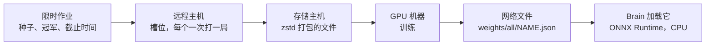

import { Badge } from '@astrojs/starlight/components';
import NetFileAnatomy from '../../../../components/book/NetFileAnatomy.svelte';

本页供查阅。前面几页讲学习循环；这一页列出它的机制。所有内容都对照了本页写成时那个提交的代码（`learn/`、`src/Sts2Ai.Brain`、`src/Sts2Ai.SimWorker`、`weights/`、`eval/`）；代码说的和这里不一样时，以代码为准。Python 文件的路径相对于仓库，C# 路径相对于 `src/Sts2Ai.*`。

## 1. 算力

- **模拟**。模拟器按进程扩展：8 个进程约 1,860 场战斗/秒，单进程为 275 场（[模拟器：战斗 §7](/arch/simulator/combat/#sec-7)）。按低预算，一局整局 SL 对局在一台主机上占一个槽位 43–52 s，在另一台上 83 s。自我对弈和晋级门槛同时在几台远程主机上运行。
- **限时作业**。一个作业给的是截止时间而不是局数，种子比能打完的多；每台主机到截止时间就停，作业的结果就是打完的那些。截止时间是每台主机上的一个文件 `~/sts2/deadline/NAME.txt`（一行注释，然后是一个时间）；用同一个 `NAME` 启动的作业共用它，所以改一次就挪动一代的所有作业。每个槽位在每批之前读它，打一局时还有一个监视器每 10 s 读一次；到截止时间还在打的一局会被结束并丢弃，所以只保留完整打完的对局。作业怎么启动、挪动、停止和取回，写在一个项目技能 `.claude/skills/fleet/SKILL.md` 里；SL 自我对弈、晋级门槛和评估怎么跑（选项、探索、检查），写在另一个技能 `.claude/skills/sl-selfplay/SKILL.md` 里。
- **数据去哪里**。每台主机在作业结束时把它的文件发到一台存储主机，用 zstd 打包（日志缩小 40–80 倍）。它们在存放的地方解包和分析，网络在一台 GPU 机器上训练，每块 GPU 一个训练；只有结果（权重、报告文本）到达开发机，开发机负责构建、测试和运行大脑服务。训练器用一个从 `git archive REV learn/` 建出的 uv 虚拟环境运行，所以一次训练的代码就是一个提交。
- **训练**用 Python 和 PyTorch，有空闲的 GPU 时在 GPU 上跑（`device = "cuda" if torch.cuda.is_available()`）。推理用 C#，在 CPU 上，在决策进程和工作进程里（[§8](#sec-8)）。

## 2. `learn/` 项目

`learn/` 是循环的 Python 项目，用 uv 管理（`learn/pyproject.toml`、`uv.lock`）：`sts2-learn` 0.1.0，Python ≥ 3.12，依赖 loguru ≥ 0.7.3、onnx ≥ 1.23.2、torch（来自 PyTorch 的 CUDA 12.8 索引）和 typer ≥ 0.27.3；开发依赖 pytest ≥ 9.1.1 和 ruff ≥ 0.17.3（行长 120，规则 E、F、W、I、B、UP）。在 `learn/` 里用 `uv run python -m v.train …` 或 `uv run python gauntlet.py …` 运行脚本。

**约定**（`learn/common.py`）：

- 除 `bosslab.py` 外，每个脚本只有一个 Typer 命令，帮助文本就是它的 docstring（`common.app`，`:25-27`），所以 `--help` 显示 docstring。
- 日志通过 loguru 写到 stderr，级别为 `LOG_LEVEL`（默认 INFO），格式为 `HH:mm:ss LEVEL message`；stdout 只输出结果，报告是一行 JSON（`common.run`，`:30-42`）。
- `LearnError`（输入有错、文件挡路、模拟器失败）让脚本报一行信息后以退出码 1 结束；其他异常都是 bug，带着 traceback 结束。模拟器的命令行也是这样（[模拟器：参考 §2](/arch/simulator/reference/#sec-2)）。
- `bosslab.py` 只用标准库和 argparse，打印到 stdout，没有 `LearnError`：打它的任务的那些主机用普通的 `python3` 运行它。

## 3. 数据目录

对局记录和决策日志是原始数据，不进 git，放在 `data/CHARACTER/ENV/`（`ENV` 是 `sl` 或 `nosl`；`.gitignore:8-9`），每个作业一个文件夹。完整的文件放在存储主机上；开发机只保留每个作业的 `manifest.json` 和小文件。

| 文件夹 | 内容 | 例子 |
|---|---|---|
| `selfplay/gN/bK/` | 较早的自我对弈第 N 代第 K 批（一次启动，最多几个小时） | `sl/selfplay/g3/b1` |
| `selfplay/vNgM/eXXX/`、`eXXX-b`、`-c`、`-d` | 一代的作业，每个 ε 一个文件夹（`e030` 即 ε = 0.3），一代后来的限时作业加后缀；`vNgM` 指数据，从不指网络 | `sl/selfplay/v7g1/e030` |
| `eval/DATE-KIND-SUBJECT/` | 评估；KIND 是 `gate`、`rebaseline`、`eval`、`panel`、`bench`、`gauntlet`、`gauntlet-ref`、`gauntlet-smoke`，或者 `train`（一次训练的清单、脚本和日志）；SUBJECT 照它的权重名或选项写出被测的对象 | `sl/eval/2026-10-31-eval-v7-1f-clone`、`sl/eval/2026-10-31-train-v7` |
| `forks/DATE-SUBJECT/` | 反事实分叉、Boss 连战试点和测试 | `sl/forks/2026-10-31-deadline-test` |
| `assist/DATE-SUBJECT/` | 真实游戏里助手模式的日志（[Mod：自动游玩与安全 §3](/arch/mod/auto/#sec-3)） | – |
| `data/CHARACTER/void/` | 不能用的数据（选项用错、停得太早），保持原来的路径，附一个 `VOID.txt` 写明原因 | `void/sl/selfplay/g3/t025` |
| `data/CHARACTER/lists/` | 共用的训练集（[§4](#sec-4)） | `lists/c7-logs.txt` |

**文件**。作业的文件夹里每批种子一套文件，文件名是打这批的分片加这批的第一个序号：`rec-SHARD-INDEX.jsonl`（对局记录）、`log-SHARD-INDEX.jsonl`（决策日志）、`counts-SHARD-INDEX.txt`（这两个文件的行数），最后写 `done-SHARD-INDEX.txt`（这批对局的序号）。所以一批要么完整，要么不存在；读作业时，没有 `done-` 文件的批会被排除。每个分片另有一个 `out-SHARD.txt`，是模拟器的输出。较早的作业还是每个分片一套：`rec-SHARD.jsonl`、`log-SHARD.jsonl`，限时作业还有 `done-SHARD.txt`。无论哪种，决策日志都和同名的记录文件成对，清单对把这两个文件放在同一行（[§4](#sec-4)）。按低预算，一局整局的决策日志约 1.6 MB，一局连战约 1 MB；大部分字节是战斗观测和宏观决策的整局观测。

**manifest**（`manifest.json`，每个作业一份）说明打的是什么、为什么打：`job`、`kind`、`character`、`env`、`owner`、`purpose`、`rev`（构建模拟器的提交）、`game`（游戏版本）、`options`（对局选项）、`inputs`（作业读取的 `eval/` 和 `weights/` 的副本，在模拟器的提交较旧时）、`shards`、`launched`、`status`，限时作业还有 `box`：截止时间（UTC 和 epoch、文件、它的改动）、种子范围、每批的大小、每台主机的槽位、速度、时钟偏差和队列。取回时加上 `done`（打完的局数）、`prefix`（范围中完整的开头部分）、每个槽位的结束，以及各槽位停下的时间相差多远。

## 4. 清单

共用的训练集是 `data/CHARACTER/lists/` 里的清单对：`NAME-logs.txt` 和 `NAME-recs.txt` 每行一个路径，相对于仓库根目录（或绝对路径），一份的第 i 行是另一份第 i 行那些对局记录的决策日志（`common.lists`，`learn/common.py:91-102`）。`v.train --list PREFIX` 和 `combat.train --list PREFIX` 读一对清单；训练器只把每份日志和同一行上的记录文件对上。文件夹里的 `manifest.json` 说明每份清单装的是什么。

| 清单 | 内容 | 由谁读 |
|---|---|---|
| `v8g2` | 第 `v8g2` 代在进阶 10 的全部 SL 自我对弈 | `v.train` 和 `combat.train --list`，用于 v8-3 和 c8-3 |
| `v8g1` | 进阶 10 的全部 SL 自我对弈，即第 `v7g2` 代，用的是它的训练给它的名字 | `v.train` 和 `combat.train --list`，用于 v8-2 和 c8-2 |
| `v7g1` | 第 `v7g1` 代的全部 SL 自我对弈 | `v.train`，用于 v8-1 的权重 |
| `c7` | 战斗网络较早的训练集：整局 SL 自我对弈和 `promotion-301-500` 上 600 局中等预算对局，放在数据旁边 | `combat.train --list`，用于 c8-1 的权重 |
| `medium` | 中等预算的对局，全部只报告，从不训练 | `combat.train --test-list` |
| `v-g0-g3`、`sl-combat` | 较早的自我对弈和评估对局，和数据放在一起 | `weights/` 里没有对应的网络 |

## 5. 账本和种子

`eval/CHARACTER/ledger.md` 在 git 里，是本项目网络和数据唯一的历史：哪个大脑打出了哪些数据，哪些数据训练出了哪些权重，每道门槛给出了什么结果。运行训练循环的会话负责维护它：

- 一段说明冠军；
- **种子区段**：训练种子是 `run --seed 1 --start K`；每个数据集在开始之前登记一个 100,000 宽的区段，它的作业取其中的子范围，所以两批永远不会共用一个种子。100000–199999 放 `v7g1`（第 1 代用 100000–159999，测试用 199000–199999）；200000–299999 放连战的对局；300000–399999 放着精英连战的评估种子 300000–300499，固定不变，从不用来训练；400000–499999 归 A10 数据集 `v7g2`（对它的训练来说是 `v8g1`）；500000–599999 归 `v8g2`；600000–699999 归 `v8g3`；下一个空闲的区段是 700000–799999；
- **规则**：训练种子和测试种子从不相遇。自我对弈和分叉作业打训练种子，评估作业打 `eval/seeds/` 里的文件；`box.py` 拒绝其他做法。两个训练器都拒绝含有评估作业对局的清单（`common.train_lists`）；
- **批次表**：批次、环境、打它的大脑、提交、训练种子、局数、用不用，以及它的文件夹；
- **权重表**：名字、种类、训练所用的数据、它的门槛、它的角色。

评估种子文件在 `eval/seeds/` 里：`promotion-1`（200 个）、`promotion-1-300`（按顺序是它的 200 个，再加接下来的 100 个）、它的切片 `promotion-1-100`、`promotion-1-200` 和 `promotion-101-300`、`final-1` 和 `a10-check-1`；`eval/seeds/retired/` 存放 `promotion-1-500`，它后 200 个种子在训练数据里（[评估：指标、种子与报告 §5](/arch/evaluation/metrics/#sec-5)）。`eval/CHARACTER/gauntlet-leaderboard.md` 存放精英连战的结果，手工维护；`eval/CHARACTER/leaderboard.md` 由 `leaderboard` 从整局报告生成。

## 6. 权重

战斗网络和 V 各是一个网络，用于每个角色、每个进阶和两种环境，所以它们的文件共用一个文件夹 `weights/all/`（`learn/weights.py`）。每个角色仍然单独评判：它的冠军文件、报告和账本在 `eval/CHARACTER/` 里，它的数据在 `data/CHARACTER/` 里（[§3](#sec-3)）。

`weights/all/` 里有 `v9-0.json`，宏观大脑的 V，和 `c9-0.json`，战斗网络，SL 和 NoSL 的两个冠军都为每个角色打它们（[评估：冠军与基线 §1](/arch/evaluation/champions/#sec-1)）。`weights/silent/` 里是网络共用之前静默猎手的网络，留作它们训练的记录：`v8-3.json` 和 `c8-3.json`，v9-0 和 c9-0 带着它们的权重，以及它们接着训练的那些网络。大脑一个也不加载。

- **永不覆盖**。训练器写到 `weights/all/NAME.json`，除非 `--out` 另行指定；如果某个名字的文件在 `weights/` 的任何文件夹里已经存在，它就拒绝（`out_path`，`learn/weights.py:14-20`），所以一个名字只用一次，永远指同一份权重。没有任何保留下来的对局用到的试验文件，用 `--out` 放到别处。
- **角色**。训练器的 `--character`（默认 SILENT）指定它的对局的角色：记录里有别的角色的对局就拒绝（`learn/common.py:84-85`），文件里也记下角色。共用的文件记下 `ALL`。
- **名字**。`vN-M` 是 V，`cN-M` 是战斗网络，有变体时在编号后面加字母（`v7-1f`）。`vNgM` 指一代的数据，从不指网络。
- **在 git 里**。`weights/` 进 git：一个文件 1.4–2.7 MB，而且不会改，所以一个提交就同时确定了代码、权重和冠军文件；冠军文件直接引用权重所在的路径。不再使用的网络文件留在 git 历史里（最后一次在 `20970d9`），`eval/silent/ledger.md` 写明每个是什么。
- **环境**。战斗网络的文件写明它学自哪个环境（`env`），C# 不读它：SL 和 NoSL 打同一个文件（[战斗大脑：叶子 §6](/arch/combat-brain/leaf/#sec-6)）。c9-0 的权重学自 SL 的对局；它在 NoSL 下能加载、能打，但从没有在那里训练过，也没有过过门槛。

## 7. 网络文件

网络文件是 JSON：base64 编码的 ONNX 计算图，加上 C# 喂给它所需的东西，以及加载时要核对的测试输入和训练器的输出。网络只在 Python 里定义一次；C# 只负责把一局或一个回合开始局面变成计算图的输入（[§8](#sec-8)）。

**V 的文件**（`learn/v/export.py:40-62`）：

| 字段 | 内容 | C# 是否读取 |
|---|---|---|
| `name` | 网络的名字，和冠军显示的一样（`l0 NAME`） | 是 |
| `character` | 角色，例如 `SILENT` | 否 |
| `objective` | `floor` 或 `win`；v9-0 的是 `win` | 是 |
| `floors` | 64 | 是 |
| `vocab` | 每张表，这个游戏版本的每个 id（`learn/game_ids.py`），第 0 项是 `<unk>`：`cards`、`modifiers`、`relics`、`potions`、`context`、`map` | 是 |
| `state` | `names`（floor、hp、max_hp、gold、ascension、potion_slots）、`mean`、`std` | 是 |
| `fit` | 训练报告（[§9](#sec-9)） | 否 |
| `onnx` | 计算图：输入名照 `learn/v/encode.py` 的 `INPUTS`，批大小和长度维度不固定；输出 `hazards`（batch × 64）；opset 20 | 是 |
| `tests` | 按训练种子抽出的最多 8 个留出样本：`run`（整局观测）和 `value`（训练器在 CPU 上给的值） | 是 |

**战斗网络的文件**（`learn/combat/export.py:62-88`）：

| 字段 | 内容 | C# 是否读取 |
|---|---|---|
| `name` | 和冠军显示的一样（`pimc NAME`、`plan NAME`） | 是 |
| `character` | 角色 | 否 |
| `env` | 它学自哪个环境的对局，作为记录写入 | 否 |
| `buckets`、`loss_min` | 从 −0.25 起的 50 个分桶：网络预测什么 | 是 |
| `lags` | 之前 3 个回合的意图 | 是 |
| `vocab` | 每张表，这个游戏版本的每个 id：`cards`、`modifiers`、`powers`、`enemies`、`intents`、`relics`、`potions`、`context`、`orbs`、`allies`、`relic_status`；`context` 只含遭遇 | 是 |
| `fit` | 训练报告 | 否 |
| `onnx` | 输入名照 `learn/combat/encode.py` 的 `INPUTS`；输出 `outcome`（batch × 51，softmax，关闭的分桶为 0）和 `potion_used`（batch × 药水 id，sigmoid） | 是 |
| `tests` | 最多 16 个留出的回合开始局面，其中有多段攻击、持有药水和低生命的状态：`obs`、`history`、`outcome`、`potion_used` | 是 |

图中逐个字段打开两个网络文件 v9-0.json 和 c9-0.json：大小、计算图的输入和输出及其形状、它的初始化器（权重张量，只列形状）和算子，以及训练报告。

<NetFileAnatomy client:visible lang="zh-CN" />

## 8. C# 里的推理

- **用哪些网络**。`run --value FILE` 读 V 的网络文件（`RunNet.Read`）；`--value` 和 `--macro l0` 必须一起用（`SimWorker/Commands/Args.cs:243`）。`run --combat-net FILE` 加载战斗网络（`CombatNet.Load`），它需要 `--policy pimc` 或 `plan`。没有战斗网络时，搜索用手工叶子 `HandLeaf` 给它的叶子估值，也就是 `LeafValue` 加上它对进行中战斗的预估（[战斗大脑：叶子 §2](/arch/combat-brain/leaf/#sec-2)）。
- **`IRunValue`**（`Brain/Macro/RunValue.cs`）是宏观大脑眼中的 V：一个名字，以及对整局观测的估值。`RunNet` 实现了它。
- **`RunNet`**（`Brain/Macro/RunNet.cs`）用 ONNX Runtime（`Microsoft.ML.OnnxRuntime`）运行计算图，intra-op 和 inter-op 各一个线程（`:71`），因为模拟器跑很多进程，而一个宏观决策只给少数几个小输入估值。它像 `learn/v/encode.py` 那样从整局观测构建输入。未知的 id 读作第 0 项。`Value` 读取 objective（`:93-106`）。
- **`CombatNet`**（`Brain/Combat/CombatNet.cs`）对状态做同样的事，也是一个线程。`Graph` 从 `Cards`、`Player`、`Enemies`、`PowerNumbers`、`RelicNumbers`、`Allies`、`Bag` 和 `Powers` 构建输入，与 `learn/combat/encode.py` 读状态的方式相同，并返回两个输出；`Value` 用 `LeafValue` 的价格给它们定价（[战斗大脑：叶子 §5](/arch/combat-brain/leaf/#sec-5)）。
- **加载检查**。`RunNet.Load` 给每个测试对局估值，任何一个值的偏差超过 10⁻³ × |value| 和 10⁻⁶ 中较大的那个，就拒绝这个文件（`:78-91`）；`CombatNet.Load` 预测每个测试状态，任何一个类别或药水概率的偏差超过 10⁻³，或某个输出的长度不同，就拒绝它。这保证训练和对局时的编码与前向计算一致。
- **开销**。一个结构相同的较早的 V 每次调用 0.093 ms，而一个用克隆的宏观决策要 70–90 ms（提交 `b0ec4b7`）。

## 9. 脚本

### `learn/common.py` 和 `learn/weights.py`

| 函数 | 作用 |
|---|---|
| `read_lines(paths, needle)` | 逗号分隔的各文件里含有 needle 的 JSON 行；跳过空行和还在写的行；缺文件是 `LearnError`（`:46-60`） |
| `runs_by_log(logs, records, character)` | 把第 i 份日志和第 i 份记录文件配对（数量必须相同）；每份记录文件按对局 id 列出它的对局；拒绝同一文件里出现两次的对局 id 和别的角色的对局（`:63-88`） |
| `lists(prefix)` | 一对清单，作为两个用逗号连接的字符串（`:91-102`） |
| `train_lists(prefix)` | 网络训练用的一对清单：和 `lists` 一样，但拒绝评估作业里的路径（`:105-111`） |
| `start_sim`、`wait_sims` | 启动模拟器命令，输出写到日志文件；以第一个失败命令的最后 12 行日志报错（`:114-129`） |
| `out_path(name, out, character)` | 权重文件写到哪里（[§6](#sec-6)） |

### `v.train`：V

`uv run python -m v.train --list PREFIX --name NAME [options]`（`learn/v/train.py:150-179`）。

| 选项 | 默认 | 含义 |
|---|---|---|
| `--list` | 必需 | 清单对 `PREFIX-logs.txt` 和 `PREFIX-recs.txt` |
| `--name` | 必需 | 网络的名字，冠军会这样显示它 |
| `--out` | `weights/all/NAME.json` | 文件写到哪里 |
| `--character` | SILENT | 这些对局的角色 |
| `--boss-sims` | – | Boss 模拟战（`bosslab.py collect`），逗号分隔；只能和 `--boss-afterstates` 一起用 |
| `--boss-afterstates` | – | Boss 模拟战所基于的后状态（`afterstates`） |
| `--boss-states` | – | 门前状态（`bosslab.py states`，汇总后），逗号分隔 |
| `--door-logs` | – | Boss 连战试点的日志（`run --auto-win`），`--boss-states` 里的门前状态来自它们 |
| `--afterstates` | – | 日志里各决策的选项，只用于 `explore_temperature` |
| `--objective` | `floor` | 整局的价值：`floor`（期望层数）或 `win`（获胜的机会） |
| `--init` | – | 接着训练的网络文件：沿用它的状态缩放和权重，第二个输出头重新开始 |
| `--seed` | 0 | torch 和 Python 的种子；也决定那 8 个测试对局 |

**拒绝的情况**（`:181-202`、`:229-230`）：objective 不是 `floor` 或 `win`；Boss 模拟战配 `win`；`--init` 不是 64 层、状态名不同，或表与游戏的不同；`--boss-sims` 没有 `--boss-afterstates`，或反过来；训练或留出样本太少。

**常量**（`:58-64`）：64 层；最多 40 轮，连续 5 轮留出总损失没有降低 10⁻⁴ 以上就停；每批 256 个决策，每一步另加 64 个 Boss 模拟战决策和 64 个门前状态；AdamW，学习率 3 × 10⁻⁵，权重衰减 10⁻⁴；第二个输出头权重 3，Boss 模拟战和门前状态权重 1。网络的大小是 `Net` 的：嵌入 32，单牌网络 128，主干 256（`learn/v/net.py:83-99`）。

**流程**。读取样本（只为 Boss 模拟战、门前状态或后状态保留整局观测）；按对局 id 划分；取游戏的表（`learn/game_ids.py`），并算出状态的加权均值和标准差（或取 `--init` 的）；基线风险值，即每一层的 $(\text{deaths} + 0.5)/(\text{alive} + 1)$，限制在 $[10^{-4}, 1 - 10^{-4}]$ 内，作为输出头的偏置；训练；保留留出总损失最好的那一轮。提前停止看的总损失是留出的风险值损失加上 Boss 模拟战和门前状态的项；第二个输出头的接下来战斗项每轮都记日志，但不加进去（`:335`）。模块的 docstring 说留出对局对各项的加权「与损失相同」；代码并没有加这一项。然后是报告和文件。

**报告**（一行 JSON，`:368-394`）：

| 字段 | 何时有 | 内容 |
|---|---|---|
| `runs`、`held_out_runs`、`samples`、`won` | 总有 | 读到的对局和决策，以及获胜的对局 |
| `objective`、`vocab` | 总有 | 训练的是什么，每张表的大小 |
| `held_out_loss`、`held_out_loss_floor_only` | 总有 | 每局的留出风险值损失，以及基线的 |
| `held_out_next_combats` | 总有 | 第二个输出头的留出平方误差 |
| `r2_held_out`、`r2_held_out_floor_only` | 总有 | 期望层数对实际到达的层数的 $R^2$ |
| `won_held_out_runs`、`brier_held_out`、`brier_held_out_floor_only` | 总有 | 留出对局中获胜的局数，以及获胜机会的 Brier 分数，和基线的对比 |
| `boss_sims`、`held_out_boss_sims`、`boss_worth`、`held_out_boss_loss`、`boss_decisions`、`boss_agree`、`boss_corr` | Boss 模拟战 | 见下文 |
| `doors`、`held_out_doors`、`held_out_door_loss`、`door_corr` | 门前状态 | 见下文 |
| `explore_decisions`、`explore_share_logs`、`explore_temperature` | 后状态 | 留出的日志决策，日志里的大脑探索的比例，以及这个 V 以同样频率探索时的 `--macro-explore` |

### `combat.train`：战斗网络

`uv run python -m combat.train --list data/silent/lists/v8g2 --env SL --name NAME --test-list data/silent/lists/medium`，另有可选的 `--out`、`--character`（SILENT）、`--init`（接着训练的网络文件）和 `--seed`（0）。`--list` 含有评估作业的对局就拒绝；`--test-list` 指明一对清单，其中的对局只报告，放在 `medium` 里。`learn/combat/report.py` 存放报告（`ranks`、`rank_within`、`auc_within`、`potion_rates`、`log_loss`、`predict`、`summary`）。它的样本、损失、常量和报告见[训练战斗网络 §3](/arch/learning/combat-net/#sec-3)–[§4](/arch/learning/combat-net/#sec-4)。

### `learn/gauntlet.py`：一个 V 的报告和门槛

`uv run python gauntlet.py --records R1,R2 [--logs L1,L2] [--against C1,C2]`（`learn/gauntlet.py:164-183`）。它读打完的对局（失败的排除，被截断的保留），全都是同一种：精英连战的或整局的，从不混用（`:42-48`）。输出一行 JSON，`{"gauntlet": …, …}`：

- **来自记录**（`runs_report`，`:51-78`）：`runs`、`floor` 和 `floor_se`；连战还有 `progress` 和 `progress_se`；`won`；每幕的 `boss`（打到、打赢、比率）；`elites_per_run`、`elite_deaths`；`died_in`，按幕列出每局失败的对局死在哪种房间的战斗里，或 `outside combat`；
- **来自日志**（`logs_report`，`:107-133`），只算有记录的对局：`rest`，休息处的选择，按生命比例分（0–40%、40–70%、70–90%、90–100%）；`monster_or_rest`，地图上同时提供怪物和休息处时的选择，按同样的比例分；`shop`，商店卖出了什么（遗物、卡牌、药水，以下一个决策的整局观测为准），以及删牌和离开；
- **用 `--against` 时**（`paired`，`:136-161`），在双方都打完的种子上按种子配对：连战给出 `pairs`、`diff`、`diff_se`、`lower_95`（均值 − 1.645 SE）和 `promote`；整局给出 `pairs`、`won`、`champion_won`、`wins_diff`、`wins_diff_se`、`wins_lower_95`、`floor_diff`、`floor_diff_se` 和 `promote`，按胜局判定。

### `learn/challenge.py`：模拟器的门槛，分批跑

`uv run python challenge.py --sim CMD --champion FILE --records-dir DIR [--chunk 40] [--processes 4] [--metric floor|win] [--not-worse] [--promote PATH] -- RUN OPTIONS`（`learn/challenge.py:91-161`）。

- 它读冠军文件和它的报告：种子集、它的大小，以及第一局的角色和进阶等级，挑战者也照这个打。
- 每一批，它打 `run --seeds eval/seeds/SET.txt --start A --n N --records DIR/AAAA-BBBB.jsonl --character C --asc A RUN OPTIONS`，分到各个进程上，每个进程的日志写到它的记录文件名加 `.log`；然后运行 `gate --champion FILE --records … --metric M [--not-worse] RUN OPTIONS`，读取它的判定。
- 遇到失败或作废的判定，或在整个种子集上都没有判定，它就以退出码 1 停下。通过之后，若有 `--promote`，它把种子集剩下的打完，用 `--promote PATH` 再跑一次门槛，并重建排行榜（`leaderboard --character C`）。它只写对局记录，不写决策日志。
- 记录写到 `--records-dir`，即 `data/CHARACTER/ENV/eval/DATE-gate-NAME/`。路径都相对于仓库根目录，模拟器在那里运行。

### `learn/bosslab.py`：Boss 标签

`python3 bosslab.py SUBCOMMAND …`（只用标准库；`learn/bosslab.py:423-472`）。`tasks`、`doors` 和 `states` 共有的选项：`--seeds 2`（每个选项或每个生命档位打几场），`--budget`（默认 `--effort low --nodes 150 --beam 4 --easy-beam 0 --loss-plans 0 --replan 0`，每场约 9 s），`--combat-net weights/silent/c8-1.json`，`--results res`（输出写到哪里，按打这些任务的主机看到的路径），`--out`（必需）。每个子命令写出 `OUT/tasks.txt`，每个选项一条 `panel --player plan --env SL BUDGET --combat-net NET --n SEEDS --seed S --out RES/KEY.jsonl LOADOUT`（种子：对局 id 模 100000 再加决策 id，同一决策的每个选项都一样），以及 `OUT/decisions.jsonl`。

| 子命令 | 选项 | 作用 |
|---|---|---|
| `tasks` | `--logs`、`--afterstates`、`--acts 1`、`--every 1` | 每个卡牌奖励的选项，每个选项的后状态按本幕的生命比例（0.96、0.81、0.6）和本幕的 Boss 打 |
| `doors` | `--logs`、`--records`、`--afterstates`、`--act 1`、`--acts`、`--max-runs` | 每个选项在 Boss 门前打：用对局进 Boss 战之前的配置，带着进门时的生命，把选中的那个换成这个选项 |
| `states` | `--logs`、`--records`、`--act 1`、`--hp-shares 0.4,0.7,1`、`--max-runs` | 只用各局在 Boss 门前的配置，按进门时的生命和各个比例打，每扇门一行 |
| `play SIM TASKS PROCS [--root]` | – | 打输出还缺的任务行，同时 PROCS 个，nice 19，同一决策的各选项放在一起，各决策按固定的打乱顺序；中途停下不会留下不完整的文件 |
| `collect` | `--decisions`、`--results`、`--out` | 把输出接回去：每个选项的 `fights`（是否赢、生命、开始时的生命、敌人的生命和最大生命、回合数）和 `failed` |
| `compare DECISIONS RESULTS` | – | 在每个选项都打了两次的决策上：战斗的最好选项与 V 的最好选项、与对局的选择一致的频率，种子 1 的最好与种子 2 的最好一致的频率，以及分数的遗憾值 |

**Boss 模拟战**（`v.train --boss-sims FILES --boss-afterstates FILES`；`tasks`、`play`、`collect`）。在卡牌奖励处，每个选项的后状态用 SL 规划器和本幕的 Boss 打几次，生命值固定为最大生命的一个比例，一个决策的每个选项用同样的种子。这些战斗的绝对胜算和真实对局相差很远，所以不给风险值标签，只有决策内各选项的差值才算数。**Boss 分数**（`bosslab.py:378-383`）：赢了是 0.5 加上剩余生命占最大生命比例的一半，输了是打掉的 Boss 生命比例的一半。V 的期望层数减去决策内的平均，拟合到分数减去决策内的平均再乘以每单位分数 $2k$ 层，其中 $k$ 每幕一个，是打赢这个 Boss 的对局平均到达的层数减去 Boss 那一层（`boss_worth`，`learn/v/data.py:129-136`）。这个分数也是第二个输出头的第七个目标。`win` 网络拒收 Boss 模拟战，因为后者的目标是层数。

**门前状态**（`v.train --boss-states FILES`；`doors`、`states`）。一局在某一幕 Boss 门前的整套配置，用进门时的生命值以及最大生命的几个比例和 Boss 打。第二个输出头学它们的 Boss 分数，这只塑造主干。门前状态大多来自 Boss 连战试点（`run --auto-win`，[模拟器：整局 §7](/arch/simulator/runs/#sec-7)），试点的记录从不算作对局（`--door-logs FILES` 只读它们的整局观测）。

配置是后状态的牌组、遗物和药水；卡牌保留升级等级和附魔；用完或失效的遗物不算在内（`loadout`，`:69-86`）。

## 10. 循环用到的模拟器命令

每个命令及其全部选项见[模拟器：参考 §4](/arch/simulator/reference/#sec-4)。循环调用的是这些：

| 命令 | 用途 |
|---|---|
| `run --explore ε` | 自我对弈的均匀抽取（[循环 §9](/arch/learning/loop/#sec-9)）；需要 `--macro l0` |
| `run --macro-explore T`、`--combat-explore T` | softmax 探索；后者需要 `--policy pimc` |
| `run --value FILE`、`--combat-net FILE` | 用哪个 V、哪个叶子来打 |
| `run --gauntlet`、`run --auto-win` | 精英连战和 Boss 连战试点（[模拟器：整局 §7](/arch/simulator/runs/#sec-7)） |
| `run --log FILE --records FILE` | 决策日志和对局记录 |
| `afterstates`、`fork` | 每个日志决策的选项及其估值；反事实配对（[循环 §10](/arch/learning/loop/#sec-10)） |
| `panel` | 由某个策略打的一场固定战斗，`bosslab.py` 的任务就是这种命令 |
| `report`、`gate`、`leaderboard` | 报告、SPRT 门槛、排行榜（[评估：晋级门槛 §6](/arch/evaluation/gates/#sec-6)、[评估：指标、种子与报告 §7](/arch/evaluation/metrics/#sec-7)） |
| `ranks` | V 的牌感：`ranks --logs LOGS --value FILE [--per-act 200] [--top 30]`（`SimWorker/Commands/EvalCommands.cs:175-232`）：每一幕里，给日志中一批卡牌奖励样本的牌组再加一张某牌，计算 V 的平均变化。这是供阅读的平均值，不是检验 |

## 11. 测试

**Python**（在 `learn/` 里 `uv run pytest`，8 个文件共 79 个测试；`uv run ruff check`）：

| 文件 | 测试数 | 内容 |
|---|---|---|
| `test_common.py` | 12 | `train_lists` 拒绝任一环境中评估作业的对局，接受自我对弈和分叉；`read_lines` 跳过空行和不完整的行、读每个文件、找到 needle、缺文件时报错；`wait_sims` 的失败尾部和成功；`runs_by_log` 配对日志和记录文件、每份日志一份记录文件、拒绝出现两次的对局 id 和别的角色 |
| `test_weights.py` | 3 | 默认路径；在角色文件夹里从不替换；别处的显式路径可以替换 |
| `test_v_encode.py` | 6 | 带前方层数的可达地图，选路时要进入的点，在任何访问之前和在 Boss 处；只有 id；状态的顺序 |
| `test_v_train.py` | 27 | 清单对；样本和每局权重；保留的整局观测；拒绝 Boss 连战试点和精英连战的对局；连战对局的结局；`boss_worth`；门前状态；Boss 分数；从大脑名得到的温度；风险值标签和删失；期望层数、获胜机会；`explored` 按对数抽取，V 多大都一样，值为 0 的抽不到；`centred`；floor 和 win 网络的 ONNX 与 torch 对比；读回的权重；`--init` 保留缩放并拒绝其他的表；网络文件及其报告；门前日志只提供整局观测；选路的样本；输掉的对局里没有结束记录的最后一场战斗，代价是当时剩下的生命值 |
| `test_game_ids.py` | 3 | 每张表以 `<unk>` 开头，每个 id 只出现一次，且按顺序；每个角色和网络读的东西都在；没有游戏的测试模型 |
| `test_combat.py` | 15 | 带费用和伤害的卡牌词元、缩放后的状态、意图从最近的开始、结局的桶、战斗后从观测中消失的药水、生命值排除掉的分桶、胜利后在持有药水上的药水损失、带历史的回合开始样本、拒绝另一个环境、ONNX 与 torch 对比、牌的伤害和充能球的数值与顺序会改变输出、读回 `c8-1.json` 的权重能给出它的测试状态、从网络文件接着训练并保留它（除非某一轮胜过它）、对局在第一个决策之前就死在其中的战斗、训练写出它所在环境的网络文件 |
| `test_gauntlet.py` | 6 | 进度、Boss、精英和死亡；按生命分的休息选择和商店购买；按生命分的怪物或休息；整局按胜局和层数配对、按胜局晋级；连战和整局从不配对；连战按种子配对 |
| `test_bosslab.py` | 7 | 有效的遗物和本幕的生命比例；升级和附魔；每个决策用同样的种子；门前的替换；门前任务；赢的分数高于输；不同生命等级下的门前状态 |

**C#**（[模拟器：参考 §7](/arch/simulator/reference/#sec-7)），网络在训练和部署之间的一致性，用 `Sts2Ai.Tests/Fixtures/` 里的测试数据和这两个网络文件本身：

- `RunNetTests`（5）：一个极小、未训练的网络带三个真实的整局观测（`pure-v-tiny.json`），被估值得和训练器给的一样；一个胜局网络（`pure-v-tiny-win.json`，同一个网络，风险值输出头的偏置降低 6），按训练器的获胜机会估值；`v8-1.json` 能加载，它的测试对局得到它的权重出自的那次训练的估值；共用的测试地图上的地图词元；要进入的点只在选路时才读入。
- `CombatNetTests`（5）：`c8-1.json` 能加载，它的 16 个测试状态读出来和它的权重出自的那次训练一样；一个极小、未训练的网络（`combat-tiny.json`），它的测试状态是真实的 SL 回合开始，带一个敌人四个回合的历史、一个盟友、同一 id 的两瓶药水、表外的一瓶药水、一个 5% 生命的状态、一次多段攻击、带伤害的牌，以及表内和表外、超过网络能分辨的位置的充能球，读出来和训练器一样；进行中的状态值它的结局和留下的药水；持有的生命值排除掉的分桶没有权重；已结束的状态和上界都是 `LeafValue` 的。
- 改动一个输入时，只要输出的变化小于容差，检查就会通过，所以每个新输入都在一个让每个输入都起作用的网络上再检查了一次（[战斗网络 §9](/arch/combat-brain/network/#sec-9)）。

**规划** <Badge text="规划中" variant="caution" />：

1. **校准**，在留出的种子上：V 说 30% 的那些局面里，应该大约有 30% 赢下来。可靠性图（把预测分箱，画出预测胜率与实际胜率的对比）还没有实现；Brier 分数（预测概率与 0/1 结果之间差距的平方的均值）已经实现，在 `v.train` 的整局报告里，它必须优于基线的（ytcs，一个前人的 STS2 求解器，它的整局模型就没通过这一项）。
2. **奖励塑形精确地逐项相消**，等有了塑形项之后（[循环 §11](/arch/learning/loop/#sec-11)）。
3. **晋级门槛的 A/A 测试**：挑战者就是冠军自己时，门槛让它通过的频率不能高于门槛的假阳性率。`Sts2Ai.Tests/Harness/GateTests.cs` 检查 200 个零差值的配对不通过（`NoGainFails`），这是一个确定性的检查，不是测出来的比率。

## 12. 未决问题

1. 冠军的权重在整局里值多少：它们以 v8-3 和 c8-3 的身份用静默猎手在进阶 10 上过门槛，V 在 200 个种子上按配对胜局通过，战斗网络单独看没有显出提升，这一对单独对上 v8-2 和 c8-2 差一点才通过（95 % 下界 −0.26），两个网络也都没有见过循环的结局（[评估：冠军与基线 §2](/arch/evaluation/champions/#sec-2)）；在 NoSL 下两者都从没有训练过，也没有过过门槛。
2. 一个学全部五个角色的网络，能保留多少它对一个角色已有的认识，以及它是否需要为它们变宽：只有五个角色的数据能回答，而网络可以在保持输出不变的情况下变宽。
3. 一旦 V 按 P(win) 做决策，除了 Brier 分数，还能怎样检查 P(win) 的校准。
4. 每个决策的标签都带着它那一局之后的抽取。每局一个切分点就能去掉它们：切分点之前抽取，之后取 V 的最优，只用切分点之后的决策训练，AlphaGo 的价值网络就是这样训练的（[循环 §9](/arch/learning/loop/#sec-9)）。目前没有这样做。
5. 标签只有蒙特卡洛目标的 V，TD(λ) 或专家迭代会不会对它有帮助。
