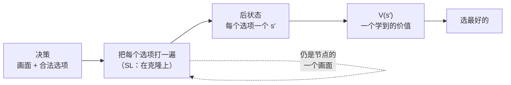

import { Aside } from '@astrojs/starlight/components';

**宏观大脑**负责战斗之外的所有决策：下一个去哪个地图点、领取哪些奖励、拿哪张牌、买什么、在事件、休息处或宝箱里选哪个选项。它和[战斗大脑](/arch/combat-brain/)一起运行在决策进程里。Harness 把所有不是战斗的决策界面都交给它（[Harness：路由、预算与种子 §1](/arch/harness/routing/#sec-1)）。

它的方法一句话就能说完：把每个选项都打一遍，看看紧接着的局面，问一个学到的价值函数 V 这个局面有多好，然后选最好的。本章从基本原理出发，逐一解释这句话的每个部分：选项是什么，「紧接着的局面」指什么，选项怎样打出来，V 读什么、算什么，它的训练标签从哪里来，以及每个新的 V 怎样被接受或拒绝。

<Aside title="状态">

L0 已经实现：Brain 里的 `MacroBrain`，用 `run --macro l0` 来跑（[模拟器：整局 §5](/arch/simulator/runs/#sec-5)）。它回答所有宏观决策界面和战斗外的选牌提示，用 V 给选项估值，V 从网络文件读入（[价值网络](/arch/macro-brain/network/)）。SL 下加上 `--afterstates clone` 时，L0 在节点克隆上把每个选项打一遍，并在节点的各个画面里继续往下搜（[搜索 §2](/arch/macro-brain/search/#sec-2)）；NoSL 下它根据画面预测每个后状态（[搜索 §1](/arch/macro-brain/search/#sec-1)）。供自我对弈用的 `--explore ε` 把比例为 ε 的决策改为均匀抽取（[自我对弈 §3](/arch/macro-brain/selfplay/#sec-3)）。规划中：NoSL 下从对局世界得到后状态和多步搜索、L1 推演复核，以及 `IMacroBrain` 接口（[弱点与下一步 §2](/arch/macro-brain/next/#sec-2)）。

</Aside>

## 1. 它决定什么

宏观大脑处理的决策画面（*决策界面*，surface）如下。「选择后的随机性」指选定之后才揭示的东西。「影响范围」指这个选择的效果能延续多远（「整局」指本局剩下的全部）。

| 决策界面 | 选项数 | 选择后的随机性 | 影响范围 |
|---|---|---|---|
| 地图（下一个点） | 1–4 | `?` 掷骰、遭遇、奖励 | 本幕剩余部分 |
| 奖励（领取顺序 / 跳过） | ≤6 | 无（金币、药水、遗物都已显示） | 整局 |
| 卡牌奖励 | 3–4 + 跳过/重掷 | 重掷结果 | 整局 |
| 牌组提示：升级 / 删除 / 附魔 | 牌组大小 | 无 | 整局 |
| 变化（transform） | 牌组大小 | 变出的牌 | 整局 |
| 选一张牌 / 卡包（bundle） | ≤3 | 无 | 整局 |
| 事件 / Ancient 选项 | 1–4 | 事件结果、下一页 | 整局 |
| 商店 | 货品 + 删牌服务 + 离开 | 无（货品可见） | 整局 |
| 休息处 | 休息/锻造（smith）/举重（lift）/挖掘（dig）/… | 挖掘等 | 整局 |
| 宝箱 | 选遗物/跳过 | 无 | 整局 |
| 药水栏满 | 丢弃/使用/跳过 | 无 | 短 |

这些界面的共同点：选项少、影响远、执行成本低、难以估值。一个战斗回合可能有上千种动作序列；这里一个决策只有几个选项，每个都能在模拟世界里以几乎为零的成本试一遍。难的是，一个选择的效果要过很多层才显现出来。第 2 层拿的一张牌，到第 3 幕 Boss 时还在牌组里；第 43 层为了多打一场怪物战而跳过的休息处，可能决定这一局能不能到达第 48 层。

一局里有很多这样的决策，一局赢下的对局有 174 个，它们都共享所在那一局唯一的结局。很多决策对应一个结局，这个比例正是学习 V 的核心难点（[从风险值到价值 §3](/arch/macro-brain/value/#sec-3)）。

## 2. 一张图看懂方法

1. **选项**：画面上的合法动作，由 Harness 列出。
2. **后状态**：执行每个选项，执行之后紧接着、任何随机的事情发生之前的局面，就是它的*后状态*（[后状态 §1](/arch/macro-brain/afterstates/#sec-1)）。SL 下选项是在当前节点的克隆上、在真实游戏里打出来的；如果游戏接着显示同一节点的另一个画面（购买之后的商店、事件的下一页），搜索就穿过它继续往下（[搜索 §3](/arch/macro-brain/search/#sec-3)）。
3. **一个价值**：V 读一个后状态，返回一个数。同一个 V 给每个决策界面的每个选项打分，所以一张牌、一件遗物、一次升级、一次回血和地图上的一条路，都在同一个尺度上比较，不需要手写的换算比率（[后状态 §2](/arch/macro-brain/afterstates/#sec-2)）。
4. **最好的**：L0 选价值最高的选项，打平时取第一个合法的。自我对弈有时会故意抽另一个，以便学到它会通向哪里（[自我对弈 §3](/arch/macro-brain/selfplay/#sec-3)）。

V 本身是一个神经网络，只读这一局是什么（它的卡牌、遗物、药水、幕、Boss 的 id，以及前方地图上的点）、牌上增长的数、遗物的计数和状态、遗物保留的牌和六个原始数字，并对每一层预测这一局在那里结束的概率；这些概率合起来给出胜率（[价值网络](/arch/macro-brain/network/)、[从风险值到价值 §2](/arch/macro-brain/value/#sec-2)）。它从自我对弈中学习：每个决策的标签就是它所在那一局真实的结局（[从风险值到价值 §3](/arch/macro-brain/value/#sec-3)）。

## 3. 本章内容

| 小节 | 讲什么 | 图 |
|---|---|---|
| [后状态与单一价值函数](/arch/macro-brain/afterstates/) | 为什么大脑给选项之后的状态估值，为什么一个 V 能服务所有决策界面，NoSL 与 SL | – |
| [搜索](/arch/macro-brain/search/) | 根据画面预测后状态；SL 克隆上的 L0：beam、试探、选牌提示、不走回头路 | – |
| [价值网络](/arch/macro-brain/network/) | 从输入到输出的网络：每个输入张量、牌组的集合网络，遗物、药水、上下文和地图这几个袋，遗物保留的牌，MLP 主干、风险值输出头，以及它的大小和局限 | 结构图；地图上的一个岔路；一局真实对局走过每一层 |
| [从风险值到价值](/arch/macro-brain/value/) | V 是什么意思、风险值和 P(win)；记录下来的决策作为样本、它的标签和损失；训练和报告 | – |
| [自我对弈](/arch/macro-brain/selfplay/) | 整局对局、均匀抽取、各代、按配对胜局判定的晋级门槛 | – |
| [弱点与下一步](/arch/macro-brain/next/) | 已知的弱点、规划中但还没实现的部分、未决问题 | – |
