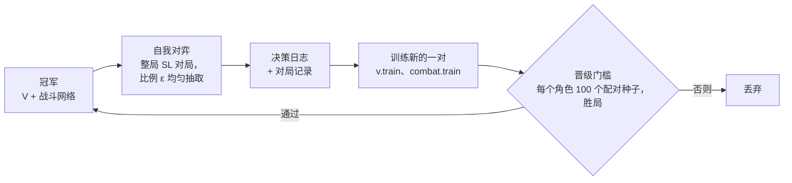

import { Aside } from '@astrojs/starlight/components';

V 从冠军自己打的对局里学习。本节一步一步介绍这个流程：对局本身，它们怎样探索，一代怎样打、怎样训练，以及新的网络怎样被评判。通用的循环以及其中战斗网络的部分，见[学习：循环](/arch/learning/loop/)。

## 1. 循环



## 2. 对局

自我对弈打完整的游戏，SL：每个宏观决策由节点克隆上的 L0 做出（[搜索 §2](/arch/macro-brain/search/#sec-2)），每场战斗，包括普通怪物战，都由 SL 战斗规划器配它的战斗网络去打。它照冠军原样来打，只多加一个选项 `--explore`：

```text
run --champion eval/champions/sl.json --character CHARACTER --asc N --workers 4 \
    --explore ε --seed 1 --start K --n RUNS --log DIR/log.jsonl --records DIR/rec.jsonl
```

- `--champion` 采用冠军文件里的选项：SL，medium 预算的规划器，克隆上的 L0，冠军的 V 和战斗网络（[评估：冠军与基线 §1](/arch/evaluation/champions/#sec-1)）。命令行上给出的选项优先于文件里的。
- `--character` 和 `--asc` 由作业自己给：每个角色，进阶 0 到 10 的每一级（[§4](#sec-4)）。
- `--explore ε` 是均匀抽取的宏观决策的比例（[§3](#sec-3)）。
- `--seed 1 --start K --n RUNS` 打下标 K 到 K + RUNS − 1 的训练种子（[§4](#sec-4)）。
- `--log` 和 `--records` 写出决策日志和对局记录，每个决策、每局各一行 JSON（[Harness：决策日志](/arch/harness/decision-log/)，[评估：指标、种子与报告 §8](/arch/evaluation/metrics/#sec-8)）。`DIR` 是这个作业在 `data/CHARACTER/sl/` 下的文件夹（[学习：参考 §3](/arch/learning/reference/#sec-3)）。
- `--workers` 是一局用多少个搜索进程（默认 8 个）。

模拟器怎样构建和启动，见[模拟器：参考 §1](/arch/simulator/reference/#sec-1)。

**预算**。自我对弈用冠军自己的预算 medium 来打，也就是评判它时用的预算。V 是在冠军的打法下赢下的概率（[从风险值到价值 §1](/arch/macro-brain/value/#sec-1)），所以它的标签来自按冠军的打法打出来的对局。

## 3. 探索：均匀抽取

V 只能从对局实际做过的事里学习。如果自我对弈总是选 V 的最佳选项，数据就永远不会显示其他选项通向哪里，V 也永远无法发现自己对它们的判断错了。所以自我对弈有时会故意选另一个选项。

**均匀抽取**（`run --explore ε`）。以概率 ε，一个宏观决策的答案在它的选项中均匀抽取，不管 V 怎么说；否则 L0 选 V 的最佳。有 $n$ 个选项、V 的最佳为 $a^\ast$ 时：

$$
P(a) = (1 - \varepsilon)\,[a = a^\ast] + \frac{\varepsilon}{n} .
$$

它覆盖战斗之外的每个决策：卡牌奖励的结果，在它的各张牌和跳过之间抽（抽到跳过就不打开，抽到一张牌就打开并拿走它）；选牌提示的选择（先均匀抽选几张，再抽选哪几张）；以及其他每个画面的选项，药水的选项也在其中，但那些会回到已经决定过的状态的选项除外（[搜索 §5](/arch/macro-brain/search/#sec-5)）。药水的选项就是 L0 权衡的那些：战斗外可用的药水（果汁、血液药水、熵之酿、龙涎香、在商人面前的恶臭药水），以及丢弃，只在它能为画面提供的药水腾出位置时才有（[搜索 §1](/arch/macro-brain/search/#sec-1)）。ε 每局固定。每个抽出的答案在决策日志里都标为 `explored`，冠军的名字以 `eps ε` 结尾，晋级门槛拒收带探索的挑战者。

**为什么要均匀**。抽到什么既不取决于 V，也不取决于这一局打得好不好，所以被抽中的决策的结局是关于各选项的因果证据，包括 V 认为差的那些选项，而且每种决策被抽中的频率相同。按 V 自己的估值加权的抽取，只会去试 V 已经喜欢的选项，很少试到能纠正它的反例。

**档位**。一代的对局按 ε 分为三档，各占三分之一：0.3、0.1 和 0.02。较高的 ε 每局覆盖更多选项；较低的 ε 能打到靠后的层，赢下一局的决策就在那里。

<Aside>

**标签带着之后的抽取**。一个决策的标签是它所在对局的结局，其中包括在它之后的抽取。V 不知道这一局的 ε，于是同一个局面，在探索更多的对局里得到的标签更低（[弱点与下一步 §1](/arch/macro-brain/next/#sec-1)）。

</Aside>

## 4. 一代

一*代*是循环的一轮：一份数据集，由一个冠军打出。

1. **打**。冠军按角色、档位和进阶等级各打一个作业（5 × 3 × 11 个作业），并排运行，每个都用 [§2](#sec-2) 的命令。对局数不固定：一个作业拿到的种子可以比它打完的多，这一代就是各作业打完的那些对局。
2. **种子**。训练种子是 `run --seed 1 --start K`，即下标为 K 的种子。每一代占用自己的一段 100,000 个下标，每个作业打其中自己的一个区间，所以一代里没有两局共用一个种子。评估的种子文件由其他基数生成，训练器也拒收含有评估作业对局的清单（`common.train_lists`），所以训练种子永远不会碰上测试种子（[学习：参考 §5](/arch/learning/reference/#sec-5)）。
3. **清单**。各作业的决策日志和对局记录写进一对清单 `PREFIX-logs.txt` 和 `PREFIX-recs.txt`，每行一个文件，一份的第 i 行是另一份第 i 行那些记录的日志（[学习：参考 §4](/arch/learning/reference/#sec-4)）。
4. **训练**。新的 V 和新的战斗网络只用这一代的对局训练，各自从冠军的文件接着训练（`--init`），在 `learn/` 下运行：

   ```text
   uv run python -m v.train --list PREFIX --name NAME --init ../VALUE
   uv run python -m combat.train --list PREFIX --env SL --name NAME --init ../COMBAT_NET
   ```

   `VALUE` 和 `COMBAT_NET` 是冠军文件里的 `value` 和 `combat-net`，即从仓库根目录算起的路径；`NAME` 是一个新名字，从不复用已有的名字（[学习：参考 §6](/arch/learning/reference/#sec-6)）。两者各写出 `weights/all/NAME.json`（[从风险值到价值 §5](/arch/macro-brain/value/#sec-5)，[学习：训练战斗网络 §4](/arch/learning/combat-net/#sec-4)）。较弱的冠军打出的对局，给局面的标签比现在的冠军打出来的要低，所以不混入更早的代。
5. **晋级门槛**。新的一对网络与冠军的那一对对阵（[§5](#sec-5)）。
6. **晋级**。通过的一对网络取代两个冠军文件里的 V 和战斗网络（[评估：冠军与基线 §1](/arch/evaluation/champions/#sec-1)），下一代用它们来打。

失败的对局在读取样本时被排除（[从风险值到价值 §3](/arch/macro-brain/value/#sec-3)）。

## 5. 晋级门槛

新的 V 和用同样数据训练的战斗网络一起接受评判：冠军的那对网络和新的那对网络都用每个角色打 `promotion-1-100` 的同样 100 个种子，不探索，每个角色的对局按种子配对、按胜局比较。五个角色放在一起读，因为一个冠军打它们全部。流程、命令和判定规则见[评估：晋级门槛 §10](/arch/evaluation/gates/#sec-10)。

门槛要实际对局，是因为没有哪个留出分数能做这个决定：Brier 分数衡量 V 区分不同对局的局面的能力，而不是它能否把同一局面的各个选项排对顺序（[从风险值到价值 §6](/arch/macro-brain/value/#sec-6)）。
