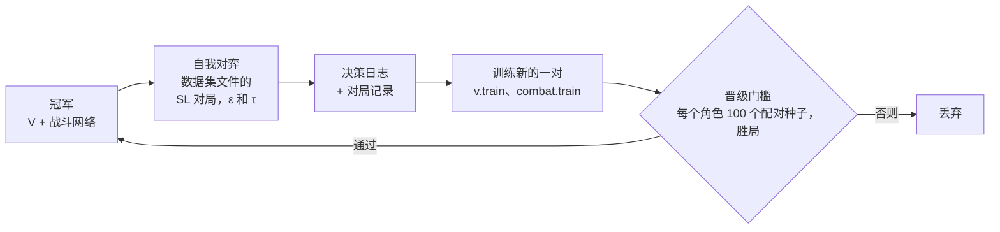

import { Aside } from '@astrojs/starlight/components';

V 从冠军自己打的对局里学习。本节一步一步介绍这个流程：对局本身，它们怎样探索，一代怎样打、怎样训练，以及新的网络怎样被评判。通用的循环以及其中战斗网络的部分，见[学习：循环](/arch/learning/loop/)。

## 1. 循环



## 2. 对局

自我对弈打 SL：每个宏观决策由节点克隆上的 L0 做出（[搜索 §2](/arch/macro-brain/search/#sec-2)），它打的每场战斗都由 SL 战斗规划器配它的战斗网络去打。它照冠军原样来打，加上只有自我对弈才用的选项：

```text
run --champion eval/champions/sl.json --character CHARACTER --asc N --workers 4 \
    --effort medium --elite-effort medium --boss-effort high [--auto-win 1,2] \
    --explore ε [--macro-explore τ] --seed 1 --start K --n RUNS --log DIR/log.jsonl --records DIR/rec.jsonl
```

- `--champion` 采用冠军文件里的选项：SL，medium 预算的规划器，克隆上的 L0，冠军的 V 和战斗网络（[评估：冠军与基线 §1](/arch/evaluation/champions/#sec-1)）。命令行上给出的选项优先于文件里的。
- `--character` 和 `--asc` 由作业自己给：任一角色，进阶 0 到 10 的任一级（[§4](#sec-4)）。
- `--effort`、`--elite-effort` 和 `--boss-effort` 是规划器在其他战斗、精英战和 Boss 战里的力度级别（[SL 规划器：预算 §1](/arch/sl-planner/budget/#sec-1)）。
- `--auto-win ACTS` 让这一局按自动胜利规则来打：在这些幕里（从 1 开始编号），普通怪物战在开始时就赢下，所以那里只打精英和 Boss（[模拟器：整局 §8](/arch/simulator/runs/#sec-8)）。没有它，这一局就是完整的游戏。
- `--explore ε` 和 `--macro-explore τ` 是它的探索：均匀抽取的宏观决策的比例，以及其余决策所用 softmax 的温度（[§3](#sec-3)）。
- `--seed 1 --start K --n RUNS` 打下标 K 到 K + RUNS − 1 的训练种子（[§4](#sec-4)）。
- `--log` 和 `--records` 写出决策日志和对局记录，每个决策、每局各一行 JSON（[Harness：决策日志](/arch/harness/decision-log/)，[评估：指标、种子与报告 §8](/arch/evaluation/metrics/#sec-8)）。`DIR` 是这个作业在 `data/CHARACTER/sl/` 下的文件夹（[学习：参考 §3](/arch/learning/reference/#sec-3)）。
- `--workers` 是一局用多少个搜索进程（默认 8 个）。

这些选项每一个都由数据集的文件按作业设定（[§4](#sec-4)）。模拟器怎样构建和启动，见[模拟器：参考 §1](/arch/simulator/reference/#sec-1)。

**两种游戏**。整局和按自动胜利规则打的一局是两种不同的游戏。在后一种里，第 1、2 幕的一场普通怪物战什么也不花，照样给奖励，所以那里的一个局面，胜率和整局里同样的局面不同。V 以它九个数字中的三个读出一个局面属于哪种游戏（[价值网络 §2](/arch/macro-brain/network/#sec-2)），所以一个 V 从两种游戏里学习，并在各自的游戏里给每个局面估值；晋级门槛和真实游戏都是整局，读到的规则是 0, 0, 0。战斗网络不需要这样的输入：它的目标是这场战斗本身的结局，在哪种游戏里都一样（[学习：训练战斗网络 §3](/arch/learning/combat-net/#sec-3)）。按这条规则打的一局所打的战斗是精英和 Boss，它们决定了大多数对局，所以花同样的对弈时间，它给战斗网络更多这样的战斗。

**预算**。自我对弈用冠军自己的预算 medium 来打，也就是评判它时用的预算，只有数据集给某个房间设了自己的力度级别时例外，比如 Boss 战用 high。V 是在产生其标签的打法下赢下的概率（[从风险值到价值 §1](/arch/macro-brain/value/#sec-1)），所以它的标签来自按冠军的打法打出来的对局，只是那个房间打得更用力。

## 3. 探索：均匀抽取和 softmax

V 只能从对局实际做过的事里学习。如果自我对弈总是选 V 的最佳选项，数据就永远不会显示其他选项通向哪里，V 也永远无法发现自己对它们的判断错了。所以自我对弈有时会故意选另一个选项，方式有两种。

**均匀抽取**（`run --explore ε`）。以概率 ε，一个宏观决策的答案在它的选项中均匀抽取，不管 V 怎么说；否则 L0 按 V 来回答。有 $n$ 个选项、V 的最佳为 $a^\ast$、没有 softmax 时：

$$
P(a) = (1 - \varepsilon)\,[a = a^\ast] + \frac{\varepsilon}{n} .
$$

它覆盖战斗之外的每个决策：卡牌奖励的结果，在它的各张牌和跳过之间抽（抽到跳过就不打开，抽到一张牌就打开并拿走它）；选牌提示的选择（先均匀抽选几张，再抽选哪几张）；以及其他每个画面的选项，药水的选项也在其中，但那些会回到已经决定过的状态的选项除外（[搜索 §5](/arch/macro-brain/search/#sec-5)）。药水的选项就是 L0 权衡的那些：战斗外可用的药水（果汁、血液药水、熵之酿、龙涎香、在商人面前的恶臭药水），以及丢弃，只在它能为画面提供的药水腾出位置时才有（[搜索 §1](/arch/macro-brain/search/#sec-1)）。

**softmax**（`run --macro-explore τ`）。均匀抽取留给 V 的每个答案，都按 V 来抽，而不是直接取最佳：选项 $a$ 的概率随它估值的对数增长，温度为 τ，

$$
P(a \mid \text{left to V}) = \frac{\exp(\log V(a) / \tau)}{\sum_b \exp(\log V(b) / \tau)} = \frac{V(a)^{1/\tau}}{\sum_b V(b)^{1/\tau}} .
$$

V 是一个概率，在一局之内跨越好几个数量级（在 A10 从 $10^{-3}$ 一直到 $10^{-7}$），所以温度作用在它的比值上，在任何 V 下都一样：τ = 0.05 时，价值为最佳的 0.97 的选项被抽中的频率是最佳的 $0.97^{20} \approx 0.54$ 倍，价值为最佳一半的选项大约百万次才抽中一次。它用在宏观决策上，也用在选牌提示回答的每一步上（`MacroBrain.Pick`，`Brain/Macro/MacroBrain.cs:362-371`；`Softmax`，`Brain/Exploration.cs:33-56`）。价值为零的选项，或会回到已经决定过的状态的选项，除非所有选项都是这样，否则从不被抽中。两者都用时，$P(a) = \varepsilon / n + (1 - \varepsilon)\,P(a \mid \text{left to V})$；τ = 0 时第二项就只是 V 的最佳，即上面的公式。

ε 和 τ 每局固定。每个均匀抽出的答案在决策日志里都标为 `explored`，softmax 抽出的、在对数上比最佳低 τ / 100 以上的答案也一样（更接近的就和平局一样好）。冠军的名字以 `explore τ eps ε` 结尾，晋级门槛拒收带探索的挑战者。

**为什么要均匀，又为什么还要 softmax**。均匀抽取抽到什么既不取决于 V，也不取决于这一局打得好不好，所以被抽中的决策的结局是关于各选项的因果证据，包括 V 认为差的那些选项，而且每种决策被抽中的频率相同。按 V 自己的估值加权的抽取，会去试 V 已经喜欢的选项，很少试到能纠正它的反例。这正是 softmax 的用处：它去试 V 评得接近最佳的选项，那里排错顺序代价最大，V 的估值也最接近；离得远的留给均匀抽取。

**档位**。一份数据集的对局分成几个探索档，每档是一对 ε 和 τ，各档对局数相同，由它的文件设定（[§4](#sec-4)），比如 ε 为 0.3、0.1 和 0.02。较高的 ε 每局覆盖更多选项；较低的 ε 能打到靠后的层，赢下一局的决策就在那里。

<Aside>

**标签带着之后的抽取**。一个决策的标签是它所在对局的结局，其中包括在它之后的抽取。V 不知道这一局的 ε 和 τ，于是同一个局面，在探索更多的对局里得到的标签更低（[弱点与下一步 §1](/arch/macro-brain/next/#sec-1)）。

</Aside>

## 4. 一代

一*代*是循环的一轮：一份数据集，由一个冠军打出。

1. **数据集文件**。一代写成一个文件 `eval/datasets/NAME.toml`，`eval/datasets/example.toml` 展示了它的每一个键。这个文件写明种子段、角色、冠军文件及其搜索 worker、探索档位、游戏，以及若干行对局：

   ```toml
   explore = [{ epsilon = 0.3 }, { epsilon = 0.1, tau = 0.05 }, { epsilon = 0.02, tau = 0.05 }]

   [games.gauntlet]                  # acts 1 and 2: elites and bosses only
   auto_win = [1, 2]
   effort = { monster = "medium", elite = "medium", boss = "high" }

   [games.full]                      # the whole game
   auto_win = []
   effort = { monster = "medium", elite = "medium", boss = "high" }

   [[runs]]                          # for every character of the file
   game = "gauntlet"
   asc = 10
   n = 4000

   [[runs]]
   game = "full"
   asc = [0, 5, 10]
   n = [100, 300, 1000]

   [[runs]]                          # one character only, with its own tier
   characters = ["NECROBINDER"]
   game = "gauntlet"
   asc = 5
   n = 300
   explore = [{ epsilon = 0.1, tau = 0.1 }]
   ```

   一种游戏就是普通怪物战在开始时就赢下的那些幕（完整的游戏没有这样的幕），加上按房间定的战斗力度级别。一行是一种游戏、它的进阶等级和每个进阶的对局数，适用于文件里的每个角色或这一行指明的角色，用文件的档位或这一行自己的档位。每一行在一个进阶上的对局平均分到它的各档，每一份是 [§2](#sec-2) 命令的一个作业，名为 `aNN-GAME-eEEE`（τ 大于 0 时加上 `-tTTT`；ε 和 τ 以百分之一为单位），所以 `a10-gauntlet-e010-t005` 就是进阶 10、自动胜利的游戏、ε 0.1、τ 0.05。这些数就是实际打的局数，所以文件写明了这一代的每一个比例：角色、进阶、游戏和档位。这个文件也是这一代的记录：它作为 `dataset.toml` 放在每个角色的文件夹里、数据旁边，第一行是这一代打局时的提交。
2. **打**。冠军并排运行文件里的作业，每个作业用它自己的选项。对局数不固定：一个作业拿到的种子可以比它打完的多，这一代就是各作业打完的那些对局。
3. **种子**。训练种子是 `run --seed 1 --start K`，即下标为 K 的种子。每一代占用自己的一段 100,000 个下标，即文件的 `seeds`：SILENT、IRONCLAD、DEFECT、REGENT 和 NECROBINDER 中的第 k 个角色（k 从 0 开始）从这一段的起点加 20,000 k 处开始打，它的各行按文件里的顺序首尾相接，所以一代里没有两局共用一个种子。一个角色的 20,000 个中，最后 1,000 个留给试打，每个角色、每行、每个进阶各一局，在这一代之前打。评估的种子文件由其他基数生成，训练器也拒收含有评估作业对局的清单（`common.train_lists`），所以训练种子永远不会碰上测试种子（[学习：参考 §5](/arch/learning/reference/#sec-5)）。
4. **清单**。各作业的决策日志和对局记录写进一对清单 `PREFIX-logs.txt` 和 `PREFIX-recs.txt`，每行一个文件，一份的第 i 行是另一份第 i 行那些记录的日志（[学习：参考 §4](/arch/learning/reference/#sec-4)）。
5. **训练**。新的 V 和新的战斗网络只用这一代的对局训练，两种游戏的对局都用，各自从冠军的文件接着训练（`--init`），在 `learn/` 下运行：

   ```text
   uv run python -m v.train --list PREFIX --name NAME --init ../VALUE
   uv run python -m combat.train --list PREFIX --env SL --name NAME --init ../COMBAT_NET
   ```

   `VALUE` 和 `COMBAT_NET` 是冠军文件里的 `value` 和 `combat-net`，即从仓库根目录算起的路径；`NAME` 是一个新名字，从不复用已有的名字（[学习：参考 §6](/arch/learning/reference/#sec-6)）。两者各写出 `weights/all/NAME.json`（[从风险值到价值 §5](/arch/macro-brain/value/#sec-5)，[学习：训练战斗网络 §4](/arch/learning/combat-net/#sec-4)）。较弱的冠军打出的对局，给局面的标签比现在的冠军打出来的要低，所以不混入更早的代。
6. **晋级门槛**。新的一对网络与冠军的那一对对阵（[§5](#sec-5)）。
7. **晋级**。通过的一对网络取代两个冠军文件里的 V 和战斗网络（[评估：冠军与基线 §1](/arch/evaluation/champions/#sec-1)），下一代用它们来打。

失败的对局在读取样本时被排除（[从风险值到价值 §3](/arch/macro-brain/value/#sec-3)）。

## 5. 晋级门槛

新的 V 和用同样数据训练的战斗网络一起接受评判：冠军的那对网络和新的那对网络都用每个角色打 `promotion-1-100` 的同样 100 个种子，不探索，每个角色的对局按种子配对、按胜局比较。五个角色放在一起读，因为一个冠军打它们全部。流程、命令和判定规则见[评估：晋级门槛 §10](/arch/evaluation/gates/#sec-10)。

门槛要实际对局，是因为没有哪个留出分数能做这个决定：Brier 分数衡量 V 区分不同对局的局面的能力，而不是它能否把同一局面的各个选项排对顺序（[从风险值到价值 §6](/arch/macro-brain/value/#sec-6)）。
