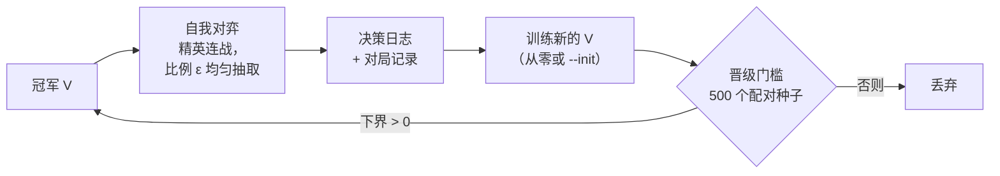

import { Aside } from '@astrojs/starlight/components';
import DecisionBars from '../../../../components/v/DecisionBars.svelte';
import Generations from '../../../../components/v/Generations.svelte';

V 从冠军自己打的对局里学习。本节介绍计划 v6 中实际运行的循环：对局所用的玩法（精英连战），自我对弈怎样探索，以及每一代的网络怎样训练、怎样过晋级门槛。通用的循环以及其中战斗网络的部分，见[学习 §2](/arch/learning/#sec-2)。

## 1. 精英连战

**精英连战**（`run --gauntlet`）是一种简化的对局。每个宏观决策照常由节点克隆上的 L0 做出。普通怪物战斗一开始就判赢，并拿到它的奖励。精英和 Boss 由 SL 战斗规划器去打，HP 和药水带进带出，死了这一局就结束。事件、商店、休息处和地图都是游戏原样的。

为什么用这种玩法：

- **大多数对局死于 Boss 和精英**。当时 SL 冠军的整局对局 200 局中有 134 局死在 Boss 处，而一场普通怪物战平均只花掉 3%（第 1 幕）到 18% 的最大生命。
- **它便宜**。在训练预算下，一局连战用一个进程 45–53 s，只是一局完整 SL 对局的一小部分。
- **精英要真打**。最初的一个版本连精英也一开始就判赢，还没运行就被放弃了：V 会学到精英总是越多越好。

**预算**。SL 规划器用它的 low 预算（`--effort low --nodes 150 --beam 4 --easy-beam 0 --loss-plans 0 --replan 0`）。选定之前，在满 HP 下打了 515 个 Boss 门口：low 预算下两个种子的结果相关 0.83，同一个种子上 low 和 medium 预算相关 0.94。所以便宜的预算给配置排序，和同一预算换一个种子一样准。

**进度**。一局连战的目标是它的进度：到达的层数，对输在战斗里的对局再加上那场战斗里打掉的敌人生命比例；赢下的对局结束在最后一层，最后一个 Boss 的生命全部打掉（+1）。这就是连战的 V 有比例头的原因（[从风险值到价值 §1](/arch/macro-brain/value/#sec-1)）。整局的 V 拒收连战的对局，连战的 V 拒收整局对局。

这种玩法的代价是：V 学到的是一个怪物战免费的游戏。这是它带进整局对局的主要弱点（[弱点与下一步 §1](/arch/macro-brain/next/#sec-1)）。

## 2. 探索：均匀抽取

V 只能从对局实际做过的事里学习。如果自我对弈总是选 V 的最佳选项，数据就永远不会显示其他选项通向哪里，V 也永远无法发现自己对它们的判断错了。所以自我对弈有时会故意选另一个选项。它怎样挑这个选项很重要。

**均匀抽取**（`run --explore ε`）。以概率 ε，一个宏观决策的答案在它的选项中均匀抽取，不管 V 怎么说；否则 L0 选 V 的最佳。有 $n$ 个选项、V 的最佳为 $a^\ast$ 时：

$$
P(a) = (1 - \varepsilon)\,[a = a^\ast] + \frac{\varepsilon}{n} .
$$

它覆盖战斗之外的每个决策：卡牌奖励的结果，在它的各张牌和跳过之间抽（抽到跳过就不打开，抽到一张牌就打开并拿走它）；选牌提示的选择（先均匀抽选几张，再抽选哪几张）；以及其他每个画面的选项，但药水栏的选项和那些会回到已经决定过的状态的选项除外（[搜索 §5](/arch/macro-brain/search/#sec-5)）。ε 每局固定。每个抽出的答案在决策日志里都标为 `explored`，冠军的名字以 `eps ε` 结尾，晋级门槛拒收带探索的挑战者。

另一种做法是 **softmax**，以如下概率抽取每个选项：

$$
P(a) = \frac{\exp\big((V(a) - V(a^\ast))/T\big)}{\sum_b \exp\big((V(b) - V(a^\ast))/T\big)},
$$

所以接近最佳的选项常被尝试，差的选项很少。它是精英连战之前 V 的探索方式，对学习 V 来说有两个缺陷：

- **它在 V 的选项估值接近的地方探索，而不是在 V 可能出错的地方**。选牌的各选项常常只差几分之一层；休息处和商店的选择则相差更远。在任何温度下，softmax 尝试选牌都远比尝试休息处频繁。
- **它跟着 V 自己的看法走**。V 认为差的选项几乎从不被尝试，所以数据里永远没有能纠正 V 的反例。用 V v0 时，在 75% HP 下，T = 2 的 softmax 放弃多回 18 HP 的休息而选锻造，大约 8,000 次里才有一次。

均匀抽取没有这两个缺陷：抽到什么既不取决于 V，也不取决于这一局打得好不好，所以被抽中的决策的结局是关于各选项的因果证据，而且每种决策被抽中的频率相同。下图在贯穿全章的例子的真实决策上比较两者：在 n2-b0.03 时期的温度 T = 0.006 层下，当选项估值相差较远时，softmax 几乎从不离开 V 的最佳，而 ε = 0.15 以相同的概率抽取每个选项。

<DecisionBars client:visible lang="zh-CN" explore start="card_reward" />

**档位**。每一代的对局按 ε 分为三档，每档占三分之一：第 1–2 代为 1.0、0.5 和 0.15，从第 3 代起为 0.3、0.15 和 0.05。在 ε = 1.0 时，一局几乎不取决于 V（pure-1-g 的进度为 21.8，v6-1 为 21.2，而在 ε = 0.15 时从 31.9 升到 34.1），而且约 69% 的训练权重落在第 1 幕，而冠军已经有 95% 的时候能打赢这一幕的 Boss。在 ε = 0.15 时，一局连战约有 102 个可以抽取的决策，其中 15 个被抽中；奖励画面占抽取的一半以上，卡牌奖励和地图各占约八分之一。

<Aside>

**标签带着之后的抽取**。一个决策的标签是它所在对局的结局，其中包括在它之后的抽取。V 不知道这一局的 ε：在第 3 代的第二个限时任务里，三个档位的进度分别是 32.8、36.4 和 39.1。于是同一个局面，在探索更多的对局里得到的标签更低。每局设一个切分点可以消除这个问题（切分点之前抽取，之后选 V 的最佳，只用之后的决策训练），目前还没有这样做（[弱点与下一步 §4](/arch/macro-brain/next/#sec-4)）。

</Aside>

## 3. 各代

一*代*是循环的一轮：冠军打一批对局，用它们训练一个网络，再让这个网络过晋级门槛。计划 v6 跑了三代：

| 代 | 由谁打 | 对局（决策） | ε 档位 | 训练数据 | 网络 | 进度 |
|---|---|---|---|---|---|---|
| 1 | pure-1-g | 5,775（624,955） | 1.0 / 0.5 / 0.15 | 第 1 代 | v6-1，从零开始 | 36.07 ± 0.34 |
| 2 | v6-1 | 6,080 | 1.0 / 0.5 / 0.15 | 第 1–2 代（11,855 局） | v6-2，从零开始 | 40.69 ± 0.38 |
| 3 | v6-2 | 14,828（2,160,792） | 0.3 / 0.15 / 0.05 | 只用第 3 代 | v6-3-1，从零开始 | 42.42 ± 0.43 |
| | | | | 只用第 3 代 | v6-3-2，从 v6-2 的权重开始 | 43.36 ± 0.38 |

第 3 代只用它自己的对局训练：较弱的 V 打出的对局，给局面的标签比冠军现在打出来的要低。它的两个网络检验从哪里开始训练：同样的数据，一个从零开始，一个从上一个网络的权重开始（`--init`）；从 v6-2 接着训练的那个以 +0.94 ± 0.49 胜出。

各代也改变了 V 的打法。在连战里，用整局训练的 pure-1-g 每局打 2.37 个精英，500 局评估对局中有 95 局死在精英战里；晚一代的 v6-1 每局打 1.21 个，死了 39 局。在连战的训练对局里，每个精英都要花 HP，每种决策都被均匀抽取，所以打不打精英的后果都在数据里。

## 4. 晋级门槛

新的 V 只有通过晋级门槛才能取代冠军。在连战里，挑战者在 500 个评估种子 300000–300499 上打，不探索，用训练预算，在克隆上；冠军在同样种子上的对局已经有了。对局按种子配对：对种子 $i$，$d_i$ 是挑战者的进度减去冠军的进度，有 $n$ 对时

$$
\bar d = \frac{1}{n}\sum_i d_i, \qquad \mathrm{SE} = \frac{\mathrm{sd}(d)}{\sqrt n}, \qquad \text{promote if } \bar d - 1.645\,\mathrm{SE} > 0,
$$

也就是说，平均差值的 95% 单侧下界大于 0 时晋级。在两个策略分道扬镳之前，一个种子固定了地图、遭遇和奖励，所以一局的大部分运气由双方共享，在 $d_i$ 里相互抵消（公共随机数）。`learn/gauntlet.py` 计算这些；在那几台主机上，一次晋级门槛需要 16–20 分钟（[评估 §5](/arch/evaluation/#sec-5)）。

<Generations client:visible lang="zh-CN" />

点是 500 个评估种子上的平均进度，须线是 95% 置信区间（±1.96 个标准误）；第一张表给出每一幕的 Boss 被打赢的比例（占到达那里的对局）以及赢下的对局数。每一代都通过了门槛：v6-1 对 pure-1-g +1.60 ± 0.44（下界 +0.88），v6-2 对 v6-1 +4.62 ± 0.46（+3.86），v6-3-2 对 v6-2 +2.67 ± 0.49（+1.87）。参考线是 n2-b0.03（33.71）和每个决策都均匀抽取（21.89）：V 的选择比随机选择多出约 21 层的进度。

**在整局对局里**（第二张表：SL，`promotion-1-300` 的 300 个种子，SL 冠军的规划器用 medium 力度，在克隆上），v6-3-2 到达第 33.56 层，赢 23 局，在到达第 1–3 幕 Boss 的对局中分别有 95%、55% 和 35% 打赢了 Boss。2026-10-30，凭这份报告它成为两个冠军的 V（[评估 §5](/arch/evaluation/#sec-5)）。

## 5. 连战的排序在哪里没能延续

连战在一个怪物免费的游戏里按进度给各个 V 排序。整局对局并不总是同意：

| | 连战进度 | 整局：层数 | 整局：300 局中赢的局数 |
|---|---|---|---|
| v6-3-1 对 v6-2 | +1.73 ± 0.54 | −0.26 ± 0.70 | 13 对 1 |
| v6-3-2 对 v6-2 | +2.67 ± 0.49 | +2.20 ± 0.62 | 23 对 1 |

v6-3-1 在连战里明显更好，赢下的整局也多得多，平均到达的层数却没有更高。层数和胜局不一致，而连战两者都不直接衡量。这是下一个计划在整局对局里、按胜局来训练 V 和设门槛的原因之一（[弱点与下一步 §2](/arch/macro-brain/next/#sec-2)）。
