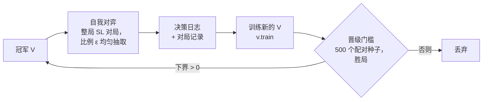

import { Aside } from '@astrojs/starlight/components';

V 从冠军自己打的对局里学习。本节介绍 V 的这个循环：对局本身，它们怎样探索，一代怎样训练出一个网络，以及这个网络怎样被评判。通用的循环以及其中战斗网络的部分，见[学习：循环](/arch/learning/loop/)。

## 1. 循环



## 2. 对局

自我对弈打完整的游戏，SL：每个宏观决策由节点克隆上的 L0 做出（[搜索 §2](/arch/macro-brain/search/#sec-2)），每场战斗，包括普通怪物战，都由 SL 战斗规划器配它的战斗网络去打。

```text
run --env SL --policy plan --macro l0 --afterstates clone --workers 4 --character CHARACTER --asc 0 \
    --effort low --nodes 150 --beam 4 --easy-beam 0 --loss-plans 0 --replan 0 \
    --combat-net weights/all/c9-1.json --value weights/all/V.json --explore ε --seed 1
```

**预算**。最近的一代 `v9g0` 用规划器的 low 预算，在进阶 0 上打了全部五个角色，如上所示。`v8g2` 用冠军的 medium 力度在进阶 10 上打静默猎手，晋级门槛也是这个力度，每局约 290 s；`v7g1` 用 low 预算打，每局占一个槽位约 45–85 s。便宜的预算在同样的算力下给出多得多的对局，而且给配置排序的能力相差不大：在满 HP 下打的 515 个 Boss 门口上，同一个种子上 low 和 medium 预算相关 0.94，low 预算下两个种子相关 0.83（[SL 规划器：预算、开销与结果 §2](/arch/sl-planner/budget/#sec-2)）。

## 3. 探索：均匀抽取

V 只能从对局实际做过的事里学习。如果自我对弈总是选 V 的最佳选项，数据就永远不会显示其他选项通向哪里，V 也永远无法发现自己对它们的判断错了。所以自我对弈有时会故意选另一个选项。

**均匀抽取**（`run --explore ε`）。以概率 ε，一个宏观决策的答案在它的选项中均匀抽取，不管 V 怎么说；否则 L0 选 V 的最佳。有 $n$ 个选项、V 的最佳为 $a^\ast$ 时：

$$
P(a) = (1 - \varepsilon)\,[a = a^\ast] + \frac{\varepsilon}{n} .
$$

它覆盖战斗之外的每个决策：卡牌奖励的结果，在它的各张牌和跳过之间抽（抽到跳过就不打开，抽到一张牌就打开并拿走它）；选牌提示的选择（先均匀抽选几张，再抽选哪几张）；以及其他每个画面的选项，但药水栏的选项和那些会回到已经决定过的状态的选项除外（[搜索 §5](/arch/macro-brain/search/#sec-5)）。ε 每局固定。每个抽出的答案在决策日志里都标为 `explored`，冠军的名字以 `eps ε` 结尾，晋级门槛拒收带探索的挑战者。

**为什么要均匀**。抽到什么既不取决于 V，也不取决于这一局打得好不好，所以被抽中的决策的结局是关于各选项的因果证据，包括 V 认为差的那些选项，而且每种决策被抽中的频率相同。按 V 自己的估值加权的抽取，只会去试 V 已经喜欢的选项，很少试到能纠正它的反例。

**档位**。一代的对局按 ε 分为三档：`v7g1` 是 0.3、0.15 和 0.05；`v7g2` 是 0.15、0.08 和 0.03；`v8g2` 是 0.06、0.03 和 0.01；`v9g0` 是 0.3、0.1 和 0.02，又变宽了，因为对其中四个角色来说这是第一批数据。较高的 ε 每局覆盖更多选项；较低的 ε 能打到靠后的层，赢下一局的决策就在那里。

<Aside>

**标签带着之后的抽取**。一个决策的标签是它所在对局的结局，其中包括在它之后的抽取。V 不知道这一局的 ε，于是同一个局面，在探索更多的对局里得到的标签更低（[弱点与下一步 §1](/arch/macro-brain/next/#sec-1)）。

</Aside>

## 4. 一代

一*代*是循环的一轮。

1. **打**。冠军每档打一个限时作业，并排运行。对局数不固定：每个槽位一直打到截止时间，截止时间写在每台主机的一个文件里，作业运行时可以挪动。训练种子来自开工前登记在账本里的一段种子，每档的种子（20,000 个）远多于能打完的局数，而且和晋级门槛的种子从不重叠。
2. **训练**。新的 V 只用这一代的对局训练。较弱的 V 打出的对局，给局面的标签比冠军现在打出来的要低，所以不混入更早的代。有这种结构的上一个网络时，从它的权重接着训练（`--init`），否则从零开始（[从风险值到价值 §5](/arch/macro-brain/value/#sec-5)）。
3. **晋级门槛**。新的 V 与冠军对阵（[§5](#sec-5)）。
4. **晋级**。通过的网络取代两个冠军文件里的 V（[评估：冠军与基线 §1](/arch/evaluation/champions/#sec-1)），下一代用它来打。

一代的规模，取自最近打完的一代：

| ε | 对局 |
|---|---|
| 0.06 | 3,603 |
| 0.03 | 3,283 |
| 0.01 | 3,152 |
| **全部** | **10,038**，其中赢 165 局，没有失败 |

失败的对局在读取样本时被排除（[从风险值到价值 §3](/arch/macro-brain/value/#sec-3)）。

## 5. 晋级门槛

新的 V 由晋级门槛评判，和用同样数据训练的战斗网络一起：冠军的那对网络对新的那对。冠军的 V 是 v9-1，它和 c9-1 一起在每个角色上以进阶 0 通过了门槛（[评估：冠军与基线 §2](/arch/evaluation/champions/#sec-2)）。每个角色用它的数据所打的进阶等级来打，两对网络用同样的种子，不探索，在克隆上：用冠军的 medium 规划器预算打 `promotion-1-100` 的 100 个种子，用低预算打 `promotion-1-200` 的 200 个。对局按种子配对，一次一个角色：对种子 $i$，$d_i$ 是挑战者的胜负（1 或 0）减去冠军的胜负（1 或 0），有 $n$ 对时

$$
\bar d = \frac{1}{n}\sum_i d_i, \qquad \mathrm{SE} = \frac{\mathrm{sd}(d)}{\sqrt n}, \qquad \text{promote if } \bar d - 1.645\,\mathrm{SE} > 0,
$$

也就是说，平均差值的 95% 单侧下界大于 0 时晋级。在两个策略分道扬镳之前，一个种子固定了地图、遭遇和奖励，所以一局的大部分运气由双方共享，在 $d_i$ 里相互抵消（公共随机数）。在 500 个种子上，这大约需要多赢 2–3 个百分点。层数列在胜局旁边，五个角色放在一起读，因为一个冠军打它们全部（[评估：晋级门槛 §10](/arch/evaluation/gates/#sec-10)）。

`learn/gate.py --against` 计算这些（[评估：晋级门槛 §10](/arch/evaluation/gates/#sec-10)）。它的报告还保留胜局显示不出的东西：平均层数、每一幕的 Boss 到达和打赢的次数、输掉的对局死在哪里（Boss、精英、怪物或战斗外，按幕分）、每局的精英数、按 HP 比例分的休息处选择和地图上「怪物还是休息处」的选择，以及商店卖出了什么。
