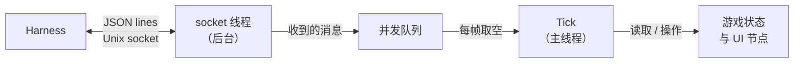

import { Aside, Badge, FileTree } from '@astrojs/starlight/components';

Mod 是 AI 在真实游戏里的宿主。它由游戏自带的 Mod 加载器加载进游戏进程，通过 GameBridge 观测游戏，经本机 socket 向 Harness（在独立的决策进程里）请求推荐，然后要么把答案显示给玩家（辅助模式，见[输出层](/arch/output/)），要么直接执行（自动游玩），每一步都记入日志。搜索、学习和策略都在决策进程里；Mod 只负责把游戏和它连起来。

<Aside title="状态">

辅助模式已经在两种环境下覆盖所有决策界面：`src/Sts2Ai.Mod` 能加载进真实游戏（v0.111.0，从 Steam 启动），连上大脑，在最上层的屏幕空闲时对每个决策发出询问（战斗、选牌提示、地图、奖励、卡牌奖励、卡包、事件、商店、休息处、宝箱、水晶球），并在一个文字面板里用游戏里的名字显示答案（[§3](#sec-3)、[§5](#sec-5)）。面板上有一个勾选框，选 SL 辅助还是 NoSL 辅助。SL 下 Mod 会发送节点的检查点和节点内的每一步，大脑因此在节点的克隆上规划每场战斗（[§6](#sec-6)）；在真实游戏里，90 个 SL 决策放到各自的克隆上重放，89 个问出同一个决策，剩下那个的原因已经修好（[§12](#sec-12)）。还没有在真实游戏里看它跑完一整局。规划中：执行适配器（[§4](#sec-4)）、自动开局驱动（[§7](#sec-7)）和决策日志（[§8](#sec-8)）。之前的调研见本地笔记 `tmp/notes/mod-research.md` 和 `tmp/notes/output-design.md`。

</Aside>

## 1. 职责

Mod 是真实游戏里的一个薄宿主，只做四件事：观测游戏（通过 GameBridge）、经 socket 询问 Harness、渲染答案（[输出层](/arch/output/)）和/或执行它、记日志。游戏进程里不做搜索、不做学习、不含策略。只支持单人模式，多人模式下禁用。

项目是 `src/Sts2Ai.Mod`。它针对游戏 DLL（外加 Godot 引擎的 C# API 程序集 GodotSharp）编译，并把 GameBridge 和 Protocol 的源码一起编译进来（[§2](#sec-2)），不引用 Brain。它的 `UI/` 文件夹放画面上的部分（面板、地图和战斗标记、设置和「AI」标签页）；宿主、大脑连接、辅助驱动和 SL 记录放在根目录。

## 2. 加载

游戏如何发现并启动一个 Mod。本节内容都在游戏源码里读过，并且在本机的游戏里对这个 Mod 成立 <Badge text="已核实" variant="success" />。

游戏递归扫描自己的 `mods/` 目录寻找清单（manifest），并加载每个清单旁边名为 `<id>.dll` 的 DLL（`Modding/ModManager.cs`）。本机的游戏目录是 `~/.local/share/Steam/steamapps/common/Slay the Spire 2`，其中：

<FileTree>

- mods/
  - Sts2Ai/
    - Sts2Ai.json 清单
    - Sts2Ai.dll Mod 本体（`<id>.dll`），GameBridge 和 Protocol 都在里面

</FileTree>

- **清单**字段：`id`、`version`、`has_dll:true`、`has_pck:false`（没有 Godot 资源包）、`affects_gameplay:false`、`min_game_version:"0.111.0"`。`affects_gameplay` 只在多人模式握手时起作用，而 Mod 本来就拒绝多人模式。
- **同意**：玩家需要在游戏里点一次，同意加载 Mod。这个选择 `PlayerAgreedToModLoading` 存在 `settings.save` 的 `mods_enabled` 里。Mod 只在启动时加载。
- **档案**：带 Mod 的局使用单独的档案目录 `modded/`，第一次使用时从原版（不带 Mod）的档案复制而来。
- **入口**：一个标了 `[ModInitializer(nameof(Init))]` 的静态方法。它在 `ModelDb.Init` 之前运行，所以凡是要碰游戏模型的工作，都推迟到第一帧或 `RunStarted` 再做。
- **版本守卫**：游戏版本与固定版本不同时，Mod 拒绝启用，并在面板上显示原因。
- **单个 DLL**：加载器在调用入口之前先列出 Mod 的全部类型（`Assembly.GetTypes`），而游戏的程序集加载上下文（AssemblyLoadContext，.NET 里决定去哪里找程序集依赖的机制）不会去 Mod 的目录里找。只要有一个类型依赖放在 `Sts2Ai.dll` 旁边的 DLL，这一步就会失败，Mod 不被加载；在 `Init` 里装解析器也来不及。所以 Mod 项目把 GameBridge 和 Protocol 的源码编译进 `Sts2Ai.dll`。
- **安装**：`dotnet build src/Sts2Ai.Mod/Sts2Ai.Mod.csproj -t:Install` 构建 Mod，并把 `Sts2Ai.json` 和 `Sts2Ai.dll` 复制到 `mods/Sts2Ai/`。游戏下次启动时发现新 Mod，默认启用。

## 3. 主线程循环与空闲检测

**游戏只认一个线程**。Godot 和大多数游戏引擎一样，要求游戏状态和 UI 节点只在主线程上访问。所以所有对游戏的读写都放在一个每帧回调 `Tick` 里，用 `GetTree().ProcessFrame += Tick` 挂上。`ProcessFrame` 是一个普通的 C# 事件，每帧触发一次，因此不需要 Godot 的源代码生成器。等待 socket 会卡住这一帧，所以 socket 读写放在后台线程上，收到的消息放进一个并发队列，由 `Tick` 每帧取空。这是 STS2MCP（MIT 许可，[§11](#sec-11)）的做法。



**循环**。决策界面（surface）指当前显示的决策屏幕的种类：战斗、地图、商店、选牌提示等。每一帧，`Tick` 按三条规则行事：

| 本帧情况 | Mod 的动作 |
|---|---|
| 当前决策界面已连续空闲至少 3 帧，且 `obs_hash` 变了 | 发送 `decision` |
| 收到一个 `recommendation`，其哈希与当前一致 | 渲染和/或执行它（[§4](#sec-4)） |
| 哈希变了 | 发送 `cancel`（状态已经往前走了，大脑放弃那次搜索） |

`obs_hash` 是观测的哈希（对观测的规范化 JSON 取 FNV-1a 64，[协议 §2](/arch/protocol/#sec-2)），所以哈希变了就说明屏幕上能看到的东西变了。

**同时只有一个决策在途**。大脑按顺序逐个回答决策。所以 Mod 最多只开着一个决策：如果答案到达之前状态就往前走了，它发送 `cancel`，并等那个答案到达（然后丢掉），才询问新的状态。这样即使玩家出手比大脑思考快，慢的大脑也不会越积越落后。

**空闲**。「空闲」指游戏界面真正准备好接受玩家输入：游戏逻辑在等输入，没有排队中的动作，没有还在演出的东西，也没有别的屏幕挡在要决策的屏幕上面。如果提前发出决策，它描述的状态马上就会变，点击也可能落空。无头（headless）运行时，GameBridge 的 `CombatActions.WaitingForInput` 就够了；在真实游戏里不够（[GameBridge §2](/arch/gamebridge/#sec-2)）。所以 Mod 用游戏自己的 `ActiveScreenContext.GetCurrentScreen()` 读出玩家正在看的屏幕：打开的模态框、打开着的地图、覆盖层栈顶，否则就是当前房间。由它的类型决定决策界面 <Badge text="已核实" variant="success" />。之后这个决策还必须连续成立至少 3 帧，这样一闪而过的「看似空闲」不算数。

| 最上层的屏幕 | 决策界面 | 何时算空闲 |
|---|---|---|
| `NCombatRoom`（也包括事件里的战斗） | 战斗 | `CombatActions.WaitingForInput`、`ActionQueueSet.IsEmpty`、`Hand.CurrentMode == Play && !InCardPlay` |
| `NCombatRoom`，手牌处于选择模式 | 选牌提示 | `NPlayerHand.IsInCardSelection` |
| 网格选牌屏幕、`NCombatPileCardSelectScreen`、`NChooseACardSelectionScreen` | 选牌提示 | 在最上层：游戏在某个动作内部等它，所以不检查队列 |
| `NCardRewardSelectionScreen`、`NChooseABundleSelectionScreen` | 卡牌奖励、卡包 | 在最上层 |
| `NRewardsScreen`、`NCrystalSphereScreen`、可以移动时的 `NMapScreen` | 奖励、水晶球、地图 | 在最上层，且 `ActionQueueSet.IsEmpty` |
| `NEventRoom`（以及假商人的屏幕）、`NMerchantRoom` 或它的货架、`NRestSiteRoom`、已经亮出遗物的 `NTreasureRoom` | 事件、商店、休息处、宝箱 | 在最上层，且 `ActionQueueSet.IsEmpty` |

每个决策界面的询问方式和模拟器（`RunSession`）一样，用的是同样的 GameBridge 调用，所以大脑在两边看到的观测和合法动作相同。药水栏的动作也在同样的屏幕上提供：除了卡牌奖励、卡包和选牌提示之外都有。屏幕提供了什么，从屏幕节点的私有字段里读取，这些字段装的正是它显示的东西：奖励组、卡牌奖励的卡和按钮、卡包、提示的卡和 `CardSelectorPrefs`。手牌的选择模式和战斗牌堆提示则是对一个牌堆做筛选，所以 Mod 把它们的筛选条件用在那个牌堆上。

**选牌提示**。提示的选项按规范顺序排列（`CardChoices.Canonical`），平局用固定的种子打破，所以观测和它的哈希每帧都保持不变。它的上下文来自 `ChoiceContexts.Last`（[GameBridge §5](/arch/gamebridge/#sec-5)）：屏幕在入口第一次 await 之后才打开，那时 `Current` 已经没了。每个提示（一个新的屏幕节点，或一次新的手牌选择）取一次最新的上下文。如果那个上下文已经被之前的提示用过，说明这个提示没有带上下文：Mod 记一条日志，把这个提示留给玩家。

**答案**。一个答案对应一个观测哈希加一组合法动作：休息处在用过一个选项之后，观测不变也可能允许离开。战斗里面板只列出到本回合结束为止的计划；SL 规划器规划的是整场战斗，后面几回合要打的牌还没抽到，所以只报回合数。面板用游戏本地化表里的名字（卡牌、遗物、药水、怪物、事件选项、休息处选项、地图图例里的房间名）描述动作，找不到就用 id。在地图上，它还会画出路线：推荐的地图点上有一个会脉动的紫色圆圈，大脑在它之后规划的路线上，每段路径都有一条紫色的线，一直画到 Boss。两者都画在 Mod 自己的图层里，随地图滚动跟着游戏的节点（地图点，以及每段路径上的小点）走（[输出层 §3](/arch/output/#sec-3)）。

**未知决策界面**。在辅助模式下，如果屏幕问的不是 Mod 认识的决策（模态框、牌组查看、还没打开的宝箱），面板只显示状态行；宝箱没打开时会加一句「open the chest」。对自动游玩来说：如果没有适配器匹配，或者空闲检查成立却没有合法动作，Mod 就暂停自动游玩，面板显示「manual needed」（需要手动操作），并把它作为覆盖率 bug 记入日志。绝不退回随机动作。

## 4. 执行适配器

适配器把一个决策界面上的协议动作和屏幕上的 Godot 节点对应起来。GameBridge 从不接触 Godot 节点（[GameBridge §1](/arch/gamebridge/#sec-1)），所以这部分节点相关的工作放在 Mod 里。两种输出模式共用一个接口：高亮问「这个动作在屏幕上的哪里」，自动游玩让适配器去执行它。

```csharp
// One adapter per surface; highlight and auto-play share the action → node mapping.
interface ISurfaceAdapter
{
    string Surface { get; }
    bool Matches();                       // current screen/room is this surface
    Control? AnchorFor(string action);    // node to highlight; null = panel only
    bool Execute(string action);          // same entry point a human click reaches
}
```

`Execute` 在各类决策界面上调用什么：

| 决策界面 | `Execute` |
|---|---|
| 战斗 | `CombatActions.Start`（GameBridge）；只有 `CanTurnBeEnded` 时才结束回合 |
| 按钮 | 调用按钮的处理函数，但要先检查 `IsEnabled && IsVisibleInTree()`。`ForceClick` 两样都不检查 <Badge text="已核实" variant="success" /> |
| 商店 | `entry.OnTryPurchaseWrapper(inv)`。对商人节点调用 `ForceClick` 没有任何效果 |
| 地图 | `NMapScreen.OnMapPointSelectedLocally(point)` |
| 选牌提示 | 点击卡牌槽（holder），再点确认。走这条 UI 路径，`PlayerChoice` 会留在重放记录里（[GameBridge §4](/arch/gamebridge/#sec-4)） |

`Execute` 之后，Mod 期望哈希在超时内变化：游戏速度为 Fast 时默认 10 秒，Instant 时 3 秒。如果没变，就重新观测；连续失败 3 次则暂停并记日志。

每个决策界面的 Mod 路径和对应的模拟器路径，在 [GameBridge §4](/arch/gamebridge/#sec-4) 里成对列出。

## 5. 与大脑的连接

- **Socket**：Unix 域套接字 `~/.local/state/sts2ai/brain.sock`（设置了 `$XDG_STATE_HOME` 时放在它下面），传输 JSON lines（[协议 §2](/arch/protocol/#sec-2)）。Mod 是客户端，Harness 是服务端。Harness 由用户启动，或由 Mod 按配置的路径拉起；Mod 自己从不做搜索。服务端已经实现：SimWorker 的 `brain` 命令在这个套接字上等待，`run --brain` 已经作为宿主连上它跑模拟对局（[模拟器 §5](/arch/simulator/#sec-5)）。
- **Steam 的容器**：Steam 在它的 Linux 运行时容器（pressure-vessel）里启动游戏。容器与主机共享主目录，但有自己的 `$XDG_RUNTIME_DIR`，放在那里的套接字游戏访问不到，所以套接字放在主目录下。大脑创建它的目录时，只允许用户本人访问。
- **环境**：由面板卡头上的 SL/NoSL 开关选定（[环境](/arch/environments/)），默认是 SL；这个选择和 Mod 的其它设置一起存在 `~/.local/state/sts2ai/settings.json`，和套接字放在一起，不在游戏的档案目录里（[输出层 §2](/arch/output/#sec-2)）。`hello` 带上它；对大脑来说，它在一局里固定不变：在一局中途切换时，Mod 发出 `run_end`（`aborted`）和新的 `hello`，大脑从这一刻起当作新的一局。一个大脑同时服务两种环境：`brain` 对 NoSL 宿主用 `--policy` 的战斗大脑（冠军的 PIMC），对 SL 宿主用 `--sl-policy` 的战斗大脑（默认是 SL 规划器），宏观大脑相同（[Harness §4](/arch/harness/#sec-4)）。
- **连不上大脑**：辅助模式下面板显示「No brain running」（没有大脑在运行）；自动游玩时 Mod 暂停。连接每 2 秒重试一次；新的连接从 `hello` 重新开始。
- **大脑出错**：收到 `error` 回答（大脑拒绝这一局，或答不出）后，Mod 在这一局余下的部分关闭，面板显示错误信息。

## 6. SL 导出

SL 下，大脑在当前节点的精确克隆上规划战斗（[环境：信息与节点 §7](/arch/environments/information/#sec-7)）。worker 用节点的检查点，加上进入节点以来做过的每一个决策来构建克隆；决策的写法与模拟器自己的轨迹相同（[模拟器 §7](/arch/simulator/#sec-7)）。Mod 在两种环境下都把这两样东西记在内存里（`NodeRecord`），所以在任何房间里勾上 SL 都能马上用；只有 SL 才把它们发出去。

- **检查点**：在游戏到达地图点、存档的那一刻，用 GameBridge 的 `Checkpoint.Take` 取：在 `SaveManager.SaveRun` 上挂一个前缀（prefix），只在它的「已完成房间」为空时取，与模拟器取检查点是同一时刻。开局时游戏以同样方式进入第一个地图点。继续游戏（Continue）时，游戏重新进入存档所在的地图点，但不再存档（`RunManager.LoadIntoLatestMapCoord`）：如果存档是到达时存的，就在这里取检查点；如果是房间里更晚的存档（战斗胜利后、Ancient 事件后），房间的开头已经不在了，这个节点就没有克隆。Mod 从不写会被云同步的 `current_run.save`，也不写档案目录下的任何其他文件。
- **步骤**：玩家的每个决策，都在游戏提交它的地方读出来；这些入口也正是模拟器自己调用的入口（[GameBridge §4](/arch/gamebridge/#sec-4)），所以在游戏执行之前就能精确知道这一步。未决问题 1 因此选了钩子，而不是比较前后的状态：状态比较分不出两张一样的牌，玩家操作得比画面稳定还快时也会漏掉动作。

| 玩家 | 挂钩的方法（Harmony 前缀） | 步骤 |
|---|---|---|
| 出牌、使用或丢弃药水、结束回合、移动 | `ActionQueueSynchronizer.RequestEnqueue`，动作为 `PlayCardAction`、`UsePotionAction`、`DiscardPotionGameAction`、`EndPlayerTurnAction`、`VoteForMapCoordAction` | `combat play:…`、`combat potion:…`、`combat end_turn`；战斗外是药水栏的 `potion:S` 或 `discard_potion:S`，记在使用它的那个界面上；`map map:C,R` |
| 回答选牌提示、卡牌奖励、卡包 | `PlayerChoiceSynchronizer.SyncLocalChoice` | `card_choice I,J`（游戏自己的序号）、`card_reward card:I` 或 `card_alt:ID`、`bundle bundle:I` |
| 选事件选项、休息处选项 | `EventSynchronizer.ChooseLocalOption`、`RestSiteSynchronizer.ChooseLocalOption` | `event event:I`、`rest rest:ID` |
| 领取奖励、离开奖励界面 | `RewardsSetSynchronizer.SelectLocalReward`；在奖励界面上的 `SkipLocalRewardsSet`、`ProceedFromTerminalRewardsScreen`、`ActChangeSynchronizer.SetLocalPlayerReady` | `rewards reward:I`、`rewards rewards_done` |
| 拿或跳过宝箱的遗物 | `TreasureRoomRelicSynchronizer.PickRelicLocally` | `treasure relic:I`、`treasure relic_skip` |
| 购买、删牌 | `MerchantEntry.OnTryPurchaseWrapper`、`MerchantCardRemovalEntry.OnTryPurchaseWrapper` | `shop buy:I`、`shop remove` |
| 占卜 | `CrystalSphereMinigame.CellClicked` | `crystal_sphere big:X,Y`、`crystal_sphere small:X,Y` |
| 离开事件、商店、休息处 | 地图要求选择移动时 | `event proceed`、`shop leave`、`rest leave` |

出牌动作的卡牌从动作的 `NetCombatCard` 取得：动作要到执行时才去找它的卡牌。只有需要选目标的牌和药水才保留目标，与合法动作的写法一致。什么都没改变的购买或占卜（金币不够、格子已经揭开）不算一步。离开宝箱房、离开没有奖励的战斗时也会调用同样的方法，这些也不算一步：只有在奖励界面上的才算。事件选项、休息选项、领取奖励、购买和占卜都作为游戏自己的任务运行，界面要等任务结束才显示这一步的结果；在那之前，Mod 不在这个界面上发问，和模拟器等待正在运行的任务一样。

- **记录中断**：遇到模拟器里没有对应决策的步骤，这个节点余下的记录就中断：战斗中丢弃药水、收回结束回合、没有选择就关掉卡牌奖励、在 Mod 读不了的界面上做选择。这时，以及在没有检查点的节点里，Mod 不询问 SL 的战斗决策：面板说明原因，下一个节点又会有克隆。选牌提示和战斗外的决策照常询问，因为它们的大脑不需要克隆。钩子从不让异常传到游戏里：出了错就把记录标为中断，并写日志。
- **发送**：SL 下，每个决策之前，Mod 先把节点的检查点发一次（`node_checkpoint`），再发大脑还没收到的步骤（`node_action`，在节点内从 0 编号，[协议 §2](/arch/protocol/#sec-2)）。节点最后一个决策之后的步骤（比如它的移动）永远用不到，不发送。节点从 Mod 运行后游戏进入的第一个节点开始编号。
- **NoSL**：照样记录，但从不发送。NoSL 日志里只要出现任何 `node_checkpoint`，这一局就作废。

## 7. 自动跑局驱动

驱动在真实游戏里自己完整地打一局又一局，用于 R4 评估：R4 是[仿真到实机阶梯](/arch/evaluation/#sec-1)里真实游戏的那一级。

- **按种子开局**：调用 `NGame.StartNewSingleplayerRun(character, shouldSave:false, acts, modifiers, seed, GameMode.Standard, asc)`（`Nodes/NGame.cs:1137`），幕的选择与大厅（lobby）的做法相同（[模拟器 §5.1](/arch/simulator/#sec-5.1)）。另一种办法是在按下 Confirm 按钮之前设置 `NGame.DebugSeedOverride`（`AutoSlayer.cs:500-502`）。
  `shouldSave:false` 时 `current_run.save` 不会被改动，参数文档里这样写（`NGame.cs:1130`） <Badge text="已核实" variant="success" />。不过局历史和进度大概仍会写入 <Badge text="推断" variant="caution" />，所以自动跑局只用带 Mod 的档案。
- **一局结束**：检测到死亡（所有玩家都死了）或 `WinRun`；记录 `run_end`；回到主菜单；从预先登记的种子列表里取下一个种子。
- **速度**：只在自动跑局期间设置 `PrefsSave.FastMode = Instant`。这里有两个游戏行为要注意：非编辑器构建在启动时会把 Instant 降为 Fast，而设置会在退出时保存。所以在自动跑局停止时和游戏退出时，Mod 都要把用户原来的值恢复回去。
- **放弃或崩溃**：这个种子记为 `aborted`，并写明原因。绝不为了挑更好的结果而重跑一个种子。

## 8. 日志与 R3 = R4

- **每次决策**记录：观测、合法动作、推荐、执行的动作、延迟、环境、游戏版本、Mod 版本，以及 `NumReloads`（必须为 0）。
- **等价测试**：同一个种子、同一串决策，在模拟器（R3）和游戏（R4）里打出来，观测流必须完全相同。出现分歧说明 GameBridge 或模拟器有 bug；测试会报告第一个分歧点。

## 9. 操作键与安全

| 操作 | 作用 |
|---|---|
| F8 | 显示 / 隐藏面板和所有标记 |
| SL/NoSL 开关 | 在面板卡头上：SL 辅助或 NoSL 辅助（[§5](#sec-5)） |
| AI 标签页 | 在游戏的设置画面里：Mod 的设置（[输出层 §2](/arch/output/#sec-2)） |
| F9 | 暂停 / 继续自动游玩 |
| 单步模式 | 每按一次键执行一个动作 |
| 空格（半自动） | 高亮显示计划；按空格执行 `plan[0]` |

- 自动游玩只在单人局中运行；进入任何多人大厅都会禁用它。
- 绝不：修改状态、使用控制台、写存档、读档，或把种子、随机数状态放进消息（`RunView` 不含种子）。

## 10. 补丁与 JIT

**Harmony 补丁**在运行时改写游戏的方法：Harmony 是一个 .NET 库，能让 Mod 在原方法之前（*prefix*）或之后（*postfix*）运行自己的代码。比起 Harmony，Mod 优先使用游戏自己的 C# 事件：`CombatManager.*`、`RunManager.RoomEntered`、`ActionExecutor.*`、`CardPile.*`。

无法避免的补丁是 `CardSelectCmd.From*` 上的上下文 prefix（[GameBridge §5](/arch/gamebridge/#sec-5)）。它们最先安装，早于任何其他会编译游戏代码的操作：在补丁之前编译的调用方可能把入口内联进去，从而绕过补丁。这在无头运行时见过：另一个补丁重新编译 SapphireSeed 时把入口内联了。它们的另一个风险来自 JIT。游戏在 .NET 的**分层编译**下运行：方法先被快速编译一遍，常用的方法之后再带优化重新编译一次（rejit）。一次 rejit 可能悄无声息地丢掉补丁；这在无头运行时见过。

应对办法：

- **心跳**：每个补丁触发时给一个计数器加一。
- **缺少上下文**：选牌提示到来却没有上下文时，记日志并在面板上显示警告。
- **启动参数**：建议用 `DOTNET_TieredCompilation=0` 启动游戏 <Badge text="推断" variant="caution" />。需要核实：游戏宿主的 .NET 运行时是否认这个变量（未决问题 2，[§13](#sec-13)）。

## 11. 已有工作

STS2MCP（MIT 许可）是一个现成的 Mod，让外部程序通过 HTTP 操控 STS2。

**照搬**：

- 在 `ProcessFrame` 上取空的主线程队列（[§3](#sec-3)）；
- 它按屏幕写的动作代码，作为参考。

**避开**：

- 直接 `new PlayCardAction`：它跳过 `CanPlayTargeting` 和出牌效果；
- 直接结束回合；
- 暴露种子 / 路径（seed/path）；
- 带 CORS `*` 的 HTTP：任何网页都能操控游戏。我们只用 Unix socket。

## 12. 测试

- **加载**：Mod 能初始化，版本守卫生效，面板能显示。
- **真实游戏里的决策界面覆盖**：脚本化的 R4 局走遍每一种决策界面；兜底 / 手动次数为 0。
- **空闲检查**：动画进行中从不发出决策。决策日志带上帧号，检查没有一条与排队中的动作重叠。
- **SL 导出往返**：`brain --wire FILE` 把宿主发来的每条消息写下来。`clones --wire FILE` 为每个 SL 决策加载它的克隆（检查点，加上这个决策之前发出的步骤），检查克隆接下来问的是同一个决策，观测逐项相同；不同时指出第一个不同的字段。在模拟器自己的导出上（一局 SL，455 个决策），每个决策都相同。在真实游戏里，开着辅助玩的一局 SL 的第 2–5 层（4 个节点：3 场战斗和 1 个事件），90 个 SL 决策中有 89 个相同。另一个是在事件选项还在运行时问的，界面上还是选项之前的金币；Mod 现在会等这一步的任务结束（[§6](#sec-6)），这一点还没有在真实游戏里重放验证。更早一次第 1–2 层的记录发现出牌没有被记下来，因为排进队列的出牌动作要到执行时才去找它的卡牌。
- **SL 规划器的等待**：把同一份记录对一个新启动的大脑重放，大脑和游戏在同一台机器上（`plan` c2，8 个 worker 上 beam 8×300）：一场战斗的第一个决策要 3–15 秒，因为它规划整场战斗；抽牌或敌人偏离计划时的重新规划要 1–11 秒；其余 66 个战斗决策中的 56 个按计划走，不到 50 毫秒。战斗以外的决策不到 20 毫秒。
- **速度恢复**：停止和退出时都恢复 Instant/Fast 设置。

## 13. 未决问题

1. 辅助模式下捕获人的动作：已定，在游戏提交动作的地方挂钩子（[§6](#sec-6)）。
2. 游戏是否认分层编译的环境变量？
