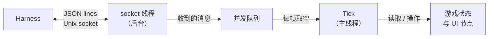

import { Aside, Badge, FileTree } from '@astrojs/starlight/components';

Mod 是 AI 在真实游戏里的宿主。它由游戏自带的 Mod 加载器加载进游戏进程，通过 GameBridge 观测游戏，经本机 socket 向 Harness（在独立的决策进程里）请求推荐，然后要么把答案显示给玩家（辅助模式，见[输出层](/arch/output/)），要么直接执行（自动游玩），每一步都记入日志。搜索、学习和策略都在决策进程里；Mod 只负责把游戏和它连起来。

<Aside title="状态">

规划中。一个探针 Mod 已能构建（本地目录 `tmp/mods/StsAiProbe`，清单 `affects_gameplay:false`），但从未安装过。之前的调研见本地笔记 `tmp/notes/mod-research.md` 和 `tmp/notes/output-design.md`。

</Aside>

## 1. 职责

Mod 是真实游戏里的一个薄宿主，只做四件事：观测游戏（通过 GameBridge）、经 socket 询问 Harness、渲染答案（[输出层](/arch/output/)）和/或执行它、记日志。游戏进程里不做搜索、不做学习、不含策略。只支持单人模式，多人模式下禁用。

项目将是 `src/Sts2Ai.Mod`。它引用游戏 DLL（外加 Godot 引擎的 C# API 程序集 GodotSharp）、GameBridge 和 Protocol，不引用 Brain。

## 2. 加载

游戏如何发现并启动一个 Mod。除最后一条外，本节内容都在游戏源码里读过 <Badge text="已核实" variant="success" />。

游戏递归扫描自己的 `mods/` 目录寻找清单（manifest），并加载每个清单旁边名为 `<id>.dll` 的 DLL（`Modding/ModManager.cs`）。本机的游戏目录是 `~/.local/share/Steam/steamapps/common/Slay the Spire 2`，其中：

<FileTree>

- mods/
  - Sts2Ai/
    - Sts2Ai.json 清单
    - Sts2Ai.dll Mod 本体（`<id>.dll`）
    - Sts2Ai.GameBridge.dll 放在旁边一起发布（推断，见未决问题 1）
    - Sts2Ai.Protocol.dll 放在旁边一起发布（推断，见未决问题 1）

</FileTree>

- **清单**字段：`id`、`version`、`has_dll:true`、`has_pck:false`（没有 Godot 资源包）、`affects_gameplay:false`、`min_game_version:"0.111.0"`。`affects_gameplay` 只在多人模式握手时起作用，而 Mod 本来就拒绝多人模式。
- **同意**：玩家需要在游戏里点一次，同意加载 Mod。这个选择 `PlayerAgreedToModLoading` 存在 `settings.save` 的 `mods_enabled` 里。Mod 只在启动时加载。
- **档案**：带 Mod 的局使用单独的档案目录 `modded/`，第一次使用时从原版（不带 Mod）的档案复制而来。
- **入口**：一个标了 `[ModInitializer(nameof(Init))]` 的静态方法。它在 `ModelDb.Init` 之前运行，所以凡是要碰游戏模型的工作，都推迟到第一帧或 `RunStarted` 再做。
- **版本守卫**：游戏版本与固定版本不同时，Mod 拒绝启用，并在面板上显示原因。
- **依赖**：GameBridge 和 Protocol 的 DLL 放在 `Sts2Ai.dll` 旁边一起发布 <Badge text="推断" variant="caution" />。需要核实：游戏的程序集加载上下文（AssemblyLoadContext，ALC，.NET 里决定去哪里找程序集依赖的机制）能否找到同目录的 DLL？如果不能，就像 ILMerge 那样合并成单个 DLL。这是未决问题 1（[§13](#sec-13)）。

## 3. 主线程循环与空闲检测

**游戏只认一个线程**。Godot 和大多数游戏引擎一样，要求游戏状态和 UI 节点只在主线程上访问。所以所有对游戏的读写都放在一个每帧回调 `Tick` 里，用 `GetTree().ProcessFrame += Tick` 挂上。`ProcessFrame` 是一个普通的 C# 事件，每帧触发一次，因此不需要 Godot 的源代码生成器。等待 socket 会卡住这一帧，所以 socket 读写放在后台线程上，收到的消息放进一个并发队列，由 `Tick` 每帧取空。这是 STS2MCP（MIT 许可，[§11](#sec-11)）的做法。



**循环**。决策界面（surface）指当前显示的决策屏幕的种类：战斗、地图、商店、选牌提示等。每一帧，`Tick` 按三条规则行事：

| 本帧情况 | Mod 的动作 |
|---|---|
| 当前决策界面已连续空闲至少 3 帧，且 `obs_hash` 变了 | 发送 `decision` |
| 收到一个 `recommendation`，其哈希与当前一致 | 渲染和/或执行它（[§4](#sec-4)） |
| 哈希变了 | 发送 `cancel`（状态已经往前走了，大脑放弃那次搜索） |

`obs_hash` 是观测的哈希（对观测的规范化 JSON 取 FNV-1a 64，[协议 §2](/arch/protocol/#sec-2)），所以哈希变了就说明屏幕上能看到的东西变了。

**空闲**。「空闲」指游戏界面真正准备好接受玩家输入：游戏逻辑在等输入，没有排队中的动作，没有还在演出的东西，也没有别的屏幕挡在要决策的屏幕上面。如果提前发出决策，它描述的状态马上就会变，点击也可能落空。无头（headless）运行时，GameBridge 的 `CombatActions.WaitingForInput` 就够了；在真实游戏里不够（[GameBridge §2](/arch/gamebridge/#sec-2)）。所以除了 GameBridge 的 `PendingSurface`（[GameBridge §6](/arch/gamebridge/#sec-6)）之外，Mod 还要检查屏幕和 Godot 节点 <Badge text="已核实" variant="success" />。检查必须连续成立至少 3 帧，这样一闪而过的「看似空闲」不算数。

| 决策界面 | 何时算空闲 |
|---|---|
| 战斗 | 同时满足：`CombatActions.WaitingForInput`、`ActionQueueSet.IsEmpty`、`Hand.CurrentMode == Play && !InCardPlay`、`NOverlayStack.ScreenCount == 0`、`!NMapScreen.IsOpen` |
| 手牌选择提示 | `Hand.CurrentMode` 为 `SimpleSelect` 或 `UpgradeSelect` |
| 覆盖层上的提示和屏幕 | 按 `NOverlayStack.Peek()` 的类型区分：卡牌奖励、网格选牌、三选一选牌（choose-a-card）、卡包（bundle）、奖励 |
| 房间（事件、休息处、商店、宝箱） | 房间的根节点处于激活状态，且它的按钮可用 |

**未知决策界面**。如果没有适配器匹配，或者空闲检查成立却没有合法动作，Mod 就暂停自动游玩，面板显示「manual needed」（需要手动操作），并把它作为覆盖率 bug 记入日志。绝不退回随机动作。

## 4. 执行适配器

适配器把一个决策界面上的协议动作和屏幕上的 Godot 节点对应起来。GameBridge 从不接触 Godot 节点（[GameBridge §1](/arch/gamebridge/#sec-1)），所以这部分节点相关的工作放在 Mod 里。两种输出模式共用一个接口：高亮问「这个动作在屏幕上的哪里」，自动游玩让适配器去执行它。

```csharp
// One adapter per surface; highlight and auto-play share the action → node mapping.
interface ISurfaceAdapter
{
    string Surface { get; }
    bool Matches();                       // current screen/room is this surface
    Control? AnchorFor(string action);    // node to highlight; null = panel only
    bool Execute(string action);          // same entry point a human click reaches
}
```

`Execute` 在各类决策界面上调用什么：

| 决策界面 | `Execute` |
|---|---|
| 战斗 | `CombatActions.Start`（GameBridge）；只有 `CanTurnBeEnded` 时才结束回合 |
| 按钮 | 调用按钮的处理函数，但要先检查 `IsEnabled && IsVisibleInTree()`。`ForceClick` 两样都不检查 <Badge text="已核实" variant="success" /> |
| 商店 | `entry.OnTryPurchaseWrapper(inv)`。对商人节点调用 `ForceClick` 没有任何效果 |
| 地图 | `NMapScreen.OnMapPointSelectedLocally(point)` |
| 选牌提示 | 点击卡牌槽（holder），再点确认。走这条 UI 路径，`PlayerChoice` 会留在重放记录里（[GameBridge §4](/arch/gamebridge/#sec-4)） |

`Execute` 之后，Mod 期望哈希在超时内变化：游戏速度为 Fast 时默认 10 秒，Instant 时 3 秒。如果没变，就重新观测；连续失败 3 次则暂停并记日志。

每个决策界面的 Mod 路径和对应的模拟器路径，在 [GameBridge §4](/arch/gamebridge/#sec-4) 里成对列出。

## 5. 与大脑的连接

- **Socket**：Unix 域套接字 `$XDG_RUNTIME_DIR/sts2ai/brain.sock`，传输 JSON lines（[协议 §2](/arch/protocol/#sec-2)）。Mod 是客户端，Harness 是服务端。Harness 由用户启动，或由 Mod 按配置的路径拉起；Mod 自己从不做搜索。
- **环境**：`hello` 消息带上环境（NoSL 或 SL，见[环境](/arch/environments/)），在开局时从 Mod 配置中选定，整局固定不变，并记入日志。
- **连不上大脑**：辅助模式下面板显示「no brain」（没有大脑）；自动游玩时 Mod 暂停。

## 6. SL 导出

本节只在 SL 环境下运行，由环境开关控制。在 SL 下，大脑可以在当前节点的精确克隆上搜索（[环境 §6](/arch/environments/#sec-6)）。为了构建这个克隆，worker 进程需要节点入口时的状态，以及此后节点内做过的每一个动作。

- **节点检查点**：进入节点时（地图移动后的 `RunManager.RoomEntered`，以及开局时），Mod 在内存里调用 `RunManager.ToSave(null)`（`Runs/RunManager.cs:670-709`），把 `node_checkpoint{json}` 发给 Harness。它从不写会被云同步的 `current_run.save`，也不写档案目录下的任何其他文件。
- **节点动作日志**：节点内的每一个动作，不论是 Mod 执行的还是人打出的，都按顺序作为协议动作放进 `node_action` 消息发出，连同所有选牌提示的回答。辅助模式下是人在操作，所以 Mod 通过比较动作前后的状态与合法动作集合，来捕获人的动作。另一种办法是钩住 `ActionExecutor.BeforeActionExecuted`（`GameActions/ActionExecutor.cs:52`） <Badge text="推断" variant="caution" />。选哪种是未决问题 2（[§13](#sec-13)）。
- **NoSL**：以上都不运行。代码编译在内，但在 `hello` 时关闭。NoSL 日志里只要出现任何 `node_checkpoint`，这一局就作废。

## 7. 自动跑局驱动

驱动在真实游戏里自己完整地打一局又一局，用于 R4 评估：R4 是[仿真到实机阶梯](/arch/evaluation/#sec-1)里真实游戏的那一级。

- **按种子开局**：调用 `NGame.StartNewSingleplayerRun(character, shouldSave:false, acts, modifiers, seed, GameMode.Standard, asc)`（`Nodes/NGame.cs:1137`），幕的选择与大厅（lobby）的做法相同（[模拟器 §5.1](/arch/simulator/#sec-5.1)）。另一种办法是在按下 Confirm 按钮之前设置 `NGame.DebugSeedOverride`（`AutoSlayer.cs:500-502`）。
  `shouldSave:false` 时 `current_run.save` 不会被改动，参数文档里这样写（`NGame.cs:1130`） <Badge text="已核实" variant="success" />。不过局历史和进度大概仍会写入 <Badge text="推断" variant="caution" />，所以自动跑局只用带 Mod 的档案。
- **一局结束**：检测到死亡（所有玩家都死了）或 `WinRun`；记录 `run_end`；回到主菜单；从预先登记的种子列表里取下一个种子。
- **速度**：只在自动跑局期间设置 `PrefsSave.FastMode = Instant`。这里有两个游戏行为要注意：非编辑器构建在启动时会把 Instant 降为 Fast，而设置会在退出时保存。所以在自动跑局停止时和游戏退出时，Mod 都要把用户原来的值恢复回去。
- **放弃或崩溃**：这个种子记为 `aborted`，并写明原因。绝不为了挑更好的结果而重跑一个种子。

## 8. 日志与 R3 = R4

- **每次决策**记录：观测、合法动作、推荐、执行的动作、延迟、环境、游戏版本、Mod 版本，以及 `NumReloads`（必须为 0）。
- **等价测试**：同一个种子、同一串决策，在模拟器（R3）和游戏（R4）里打出来，观测流必须完全相同。出现分歧说明 GameBridge 或模拟器有 bug；测试会报告第一个分歧点。

## 9. 操作键与安全

| 操作 | 作用 |
|---|---|
| F8 | 显示 / 隐藏面板 |
| F9 | 暂停 / 继续自动游玩 |
| 单步模式 | 每按一次键执行一个动作 |
| 空格（半自动） | 高亮显示计划；按空格执行 `plan[0]` |

- 自动游玩只在单人局中运行；进入任何多人大厅都会禁用它。
- 绝不：修改状态、使用控制台、写存档、读档，或把种子、随机数状态放进消息（`RunView` 不含种子）。

## 10. 补丁与 JIT

**Harmony 补丁**在运行时改写游戏的方法：Harmony 是一个 .NET 库，能让 Mod 在原方法之前（*prefix*）或之后（*postfix*）运行自己的代码。比起 Harmony，Mod 优先使用游戏自己的 C# 事件：`CombatManager.*`、`RunManager.RoomEntered`、`ActionExecutor.*`、`CardPile.*`。

无法避免的补丁是 `CardSelectCmd.From*` 上的上下文 prefix（[GameBridge §5](/arch/gamebridge/#sec-5)）。它们最先安装，早于任何其他会编译游戏代码的操作：在补丁之前编译的调用方可能把入口内联进去，从而绕过补丁。这在无头运行时见过：另一个补丁重新编译 SapphireSeed 时把入口内联了。它们的另一个风险来自 JIT。游戏在 .NET 的**分层编译**下运行：方法先被快速编译一遍，常用的方法之后再带优化重新编译一次（rejit）。一次 rejit 可能悄无声息地丢掉补丁；这在无头运行时见过。

应对办法：

- **心跳**：每个补丁触发时给一个计数器加一。
- **缺少上下文**：选牌提示到来却没有上下文时，记日志并在面板上显示警告。
- **启动参数**：建议用 `DOTNET_TieredCompilation=0` 启动游戏 <Badge text="推断" variant="caution" />。需要核实：游戏宿主的 .NET 运行时是否认这个变量（未决问题 3，[§13](#sec-13)）。

## 11. 已有工作

STS2MCP（MIT 许可）是一个现成的 Mod，让外部程序通过 HTTP 操控 STS2。

**照搬**：

- 在 `ProcessFrame` 上取空的主线程队列（[§3](#sec-3)）；
- 它按屏幕写的动作代码，作为参考。

**避开**：

- 直接 `new PlayCardAction`：它跳过 `CanPlayTargeting` 和出牌效果；
- 直接结束回合；
- 暴露种子 / 路径（seed/path）；
- 带 CORS `*` 的 HTTP：任何网页都能操控游戏。我们只用 Unix socket。

## 12. 测试

- **加载**：Mod 能初始化，版本守卫生效，面板能显示。
- **真实游戏里的决策界面覆盖**：脚本化的 R4 局走遍每一种决策界面；兜底 / 手动次数为 0。
- **空闲检查**：动画进行中从不发出决策。决策日志带上帧号，检查没有一条与排队中的动作重叠。
- **SL 导出往返**：检查点 + 动作日志 → worker 的重放能跑完，且日志里每个动作都合法。
- **速度恢复**：停止和退出时都恢复 Instant/Fast 设置。

## 13. 未决问题

1. 游戏的 ALC 能否找到同目录的 DLL（GameBridge、Protocol）？
2. 辅助模式下捕获人的动作：用事件钩子，还是比较状态差异？
3. 游戏是否认分层编译的环境变量？
