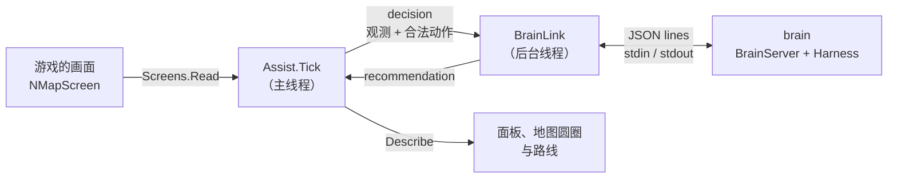

import { Aside, Badge, FileTree } from '@astrojs/starlight/components';

本书其余部分都以无头方式运行：模拟器在没有窗口的情况下运行游戏自己的 `sts2.dll`，由各个大脑回答它。**Mod** 是唯一在真实游戏里运行的部分：游戏从 Steam 启动，有一位玩家坐在键盘前。它是 AI 在那里的宿主，就像自我对弈时的模拟器一样（[协议：线路 §8](/arch/protocol/wire/#sec-8)）：它读取画面上的决策，通过大脑的 stdin 和 stdout 询问它启动的大脑，并把答案显示在游戏之上。本章写给想在游戏里使用 Mod 或修改它的人。如果观测、决策界面（surface）和合法动作这些术语还陌生，请先读[协议](/arch/protocol/)和 [GameBridge](/arch/gamebridge/)。

<Aside title="状态">

已实现：两种环境下、每个决策界面上的辅助模式。`src/Sts2Ai.Mod` 能在真实游戏（v0.111.0）里加载，启动它自带的大脑，在最上层的画面空闲满 3 帧后询问每个决策（战斗、选牌提示、地图、奖励、卡牌奖励、卡包、事件、商店、休息处、宝箱、水晶球），并在一个面板里用游戏里的名字显示答案和每个选项的胜率，同时在地图上、在战斗中的卡牌和目标上画出标记（[输出](/arch/output/)）。玩家要求时，AI 也会通过面板的工具栏自己打出答案：一个动作、本回合或这个房间剩下的部分，或者一直自己打下去，直到被暂停（[自动游玩与安全](/arch/mod/auto/)）。面板上的一个开关选择 SL 或 NoSL，Mod 自带的那一个大脑两种都打（[§4](#sec-4)）。SL 下 Mod 发送节点的检查点和在节点里走过的每一步，大脑因此在节点的克隆上规划每场战斗，并评估战斗以外的每个选项（[SL 记录](/arch/mod/sl-record/)）。规划中：没人坐在键盘前时打完整局（自动跑局驱动），以及它自己的决策日志（[自动游玩与安全 §2](/arch/mod/auto/#sec-2)、[§3](/arch/mod/auto/#sec-3)）。

</Aside>

## 1. Mod 做什么，不做什么

Mod 做五件事，都在游戏的主线程上：

1. **读取画面上的决策**：哪个画面在最上层，它是否空闲，以及它提供的观测和合法动作，用的是模拟器所用的同一批 GameBridge 调用（[主循环 §4](/arch/mod/loop/#sec-4)）。
2. **询问大脑**：通过大脑的 stdin 和 stdout 一次发一条 `decision` 消息，画面先变了就发 `cancel`（[主循环 §3](/arch/mod/loop/#sec-3)、[§8](/arch/mod/loop/#sec-8)）。
3. **显示答案**：面板、地图上的路线，以及战斗中计划的标记（[输出](/arch/output/)）。
4. **在玩家要求时打出答案**：工具栏的各个目标，从一个动作到自动游玩，每个动作都按玩家点击时的方式执行（[自动游玩与安全](/arch/mod/auto/)）。
5. **维护 SL 记录**：节点的检查点，以及在节点里做出的每个决策，不论是玩家的还是 AI 的，都在游戏提交它的地方读取；SL 在每个决策之前把它们发出去（[SL 记录](/arch/mod/sl-record/)）。

它不做的事：

- **思考**：游戏进程里不运行任何搜索、学习或策略。大脑是一个单独的进程 `brain`，由 Mod 从自己的文件夹启动（[§4](#sec-4)）；
- **不经要求就行动**：AI 只在玩家通过工具栏或它的按键要求时才打，而且只打出大脑对画面上那个决策的回答（[自动游玩与安全 §4](/arch/mod/auto/#sec-4)）。没有东西会自己开始一局：自动跑局驱动还在规划中（[自动游玩与安全 §2](/arch/mod/auto/#sec-2)）；
- **多人模式**：游戏在多人大厅里仍会加载 Mod，把它当作不影响游戏玩法的 Mod，但多于一名玩家的对局得不到帮助：面板显示「多人模式下关闭」，SL 记录也忽略这类对局的节点；
- **写游戏的文件**：不写游戏档案下的任何东西，不存档，不用控制台命令，不读档。它只写自己的设置、大脑的日志，以及玩家要求时大脑的录制文件，都在它的状态文件夹里、游戏的档案之外（[§4](#sec-4)、[§5](#sec-5)），以及它在游戏日志里的行（[自动游玩与安全 §3](/arch/mod/auto/#sec-3)）。

## 2. 一个决策，从画面到面板

以本书示例对局里的一个决策为例，看它在游戏里的样子：第 43 层的地图（第三幕，玩家生命值 24/66），有两个点可去。

1. 每一帧，`Screens.Read` 向游戏询问哪个画面在最上层（`ActiveScreenContext.GetCurrentScreen()`）。可以移动的地图画面就是 `map` 决策界面；动作队列一空，就用 GameBridge 的 `MapActions` 读出它的观测和合法动作，和模拟器的读法一样：这里是 `map:4,10` 和 `map:6,10`，有药水时再加上药水栏的动作。
2. `Assist.Tick` 对观测取哈希。观测和它的合法动作保持 3 帧不变，且没有别的决策还开着时，它发送 `decision`，带上哈希、决策界面、观测和合法动作。
3. 大脑里的 Harness 把这个决策路由给宏观大脑，宏观大脑用 V 评估每个选项的后状态，回答 `map:4,10`，并把本幕剩下的路线作为它的计划（[宏观大脑：搜索 §1](/arch/macro-brain/search/#sec-1)）。
4. 这个答案只对应那个哈希和那组合法动作。只要它们还成立，面板就说出这个房间（「去」加上地图图例里它的名字）以及通往 Boss 的路线上的各个房间，地图上则在这个点上出现一个脉动的圆圈，并沿路线画出一条线（[输出 §3](/arch/output/#sec-3)）。
5. 玩家点击一个点，或者按下 F10，AI 就像点击那样走到那里（[自动游玩与安全 §1](/arch/mod/auto/#sec-1)）。Mod 在游戏把这次移动加入队列的地方读到它，并记进 SL 记录（[SL 记录 §3](/arch/mod/sl-record/#sec-3)）；画面变化，下一个决策从头开始。

## 3. 安装与加载

Mod 如何构建和安装，以及游戏如何发现并启动它。游戏怎样处理一个 Mod，都在游戏源码里读过，并且对 Linux 上游戏里的这个 Mod 成立 <Badge text="已核实" variant="success" />。

游戏递归扫描自己的 `mods/` 文件夹寻找清单（manifest）（还有 `mods_STEAMTEST/`，它把其中的内容当作创意工坊物品读取），并加载每个清单旁边名为 `<id>.dll` 的 DLL（`Modding/ModManager.cs`）。在 Linux 上，游戏文件夹默认是 `~/.local/share/Steam/steamapps/common/Slay the Spire 2`。装好的 Mod 在其中：

<FileTree>

- mods/
  - Sts2Ai/
    - Sts2Ai.json 清单
    - Sts2Ai.dll Mod 本体（`<id>.dll`），GameBridge 和 Protocol 都在里面
    - brain/ Mod 启动的大脑
      - champion.json 它所用的冠军文件
      - nets/ 冠军的网络，名为 `NAME.net`
      - linux-x64/ 每个平台一个自包含的大脑，启动程序是 `Sts2Ai.SimWorker`
      - osx-arm64/
      - win-x64/

</FileTree>

**构建与安装**。`distro/build.sh [REV]` 从一个提交（默认 HEAD，用 `git archive` 取出）把这个文件夹，也就是创意工坊物品，构建到 `out/Sts2Ai/`（不在 git 里），并在 `out/commit` 里写下这个提交。安装就是把 `out/Sts2Ai/` 复制进游戏的 `mods/` 文件夹；游戏在下次启动时发现新 Mod，并默认启用。这个脚本：

- 只构建一次 Mod，供所有平台使用，因为它跑在游戏自己的 .NET 上；和模拟器一样针对游戏的 DLL 构建（[模拟器：参考 §1](/arch/simulator/reference/#sec-1)）；
- 用配置文件 `Properties/PublishProfiles/brain.pubxml` 为 `linux-x64`、`osx-arm64` 和 `win-x64` 发布大脑（`Sts2Ai.SimWorker`）：自包含，因为玩家没有 .NET；是一个文件夹而不是单个文件，因为 Harmony 通过 JIT 自己的库打补丁，而单文件构建会把这个库并进可执行文件；不裁剪，因为大脑在运行时加载玩家自己的 `sts2.dll`，这需要完整的框架。游戏的文件一个都不随附：游戏的程序集只用于编译；
- 在一台 Mac 上用 `codesign` 给 `osx-arm64` 的启动程序做临时（ad hoc）签名：Apple 芯片只运行签过名的代码；
- 把 NoSL 冠军的文件 `eval/champions/nosl.json` 复制为 `brain/champion.json`（大脑在两种环境下都用它，[§4](#sec-4)），把它的网络复制进 `brain/nets/` 并去掉 `.json` 后缀：游戏会把 Mod 文件夹下的每个 `.json` 当作可能的清单来读，网络文件里的 `name` 字段会让它记一条错误。大脑自己的 `deps.json` 和 `runtimeconfig.json` 没有清单的任何字段，游戏会跳过它们。

**清单**（`Sts2Ai.json`）：

| 字段 | 值 | 原因 |
|---|---|---|
| `id` | `Sts2Ai` | 指定加载器要找的 DLL |
| `name`、`author`、`description` | `STS2 AI`、…、「An AI for single-player runs: shows its recommended action with each option's chance to win, and plays it when asked. Starts its own brain, a background program, while the game runs.」（一个用于单人对局的 AI：显示它推荐的动作和每个选项的胜率，并在被要求时打出它。游戏运行时，它会启动自己的大脑，一个后台程序。） | 显示在游戏的 Mod 列表里 |
| `version` | `0.2.0` | |
| `has_dll`、`has_pck` | `true`、`false` | 有一个 DLL，没有 Godot 资源包 |
| `affects_gameplay` | `false` | 只在多人模式握手时起作用，而 Mod 在多人模式下保持关闭 |
| `dependencies` | `[]` | |
| `min_game_version` | `0.111.0` | |

**游戏怎样处理它**：

- **同意**。玩家在游戏里点一次，同意加载 Mod。这个回答 `PlayerAgreedToModLoading` 存在 `settings.save` 里，记作 `mods_enabled`。Mod 只在启动时加载。
- **档案**。带 Mod 的对局使用单独的档案文件夹 `modded/`，第一次使用时从原版（不带 Mod）的档案复制而来。
- **入口**。加载器调用一个标了 `[ModInitializer(nameof(Init))]` 的静态方法：`ModEntry.Init`，它再调用 `Host.Start`。它在 `ModelDb.Init`（游戏的卡牌、遗物和怪物数据库）之前运行，所以 `Start` 只做准备，真正的工作从第一帧开始。
- **单个 DLL**。加载器在调用入口之前先列出 Mod 的类型（`Assembly.GetTypes`），而游戏的程序集加载上下文（.NET 里决定到哪里寻找程序集依赖的机制）不会去 Mod 的文件夹里找。只要有一个类型需要放在 `Sts2Ai.dll` 旁边的 DLL，这次列举就会失败，Mod 也就不会被加载；由 `Init` 安装的解析器又来得太晚。所以 Mod 项目把 GameBridge 和 Protocol 的源码编译进 `Sts2Ai.dll`（`Sts2Ai.Mod.csproj:19`），不引用项目里的其他任何东西。`brain/` 下的 DLL 属于大脑，一个单独的程序；游戏一个都不加载。

**`Host.Start` 做什么**（`Host.cs:23-46`）：

1. **版本守卫**。如果 `NGame.GetGameVersion()` 不是 `v0.111.0`（GameBridge 所针对的版本），Mod 保持关闭：它什么补丁都不打，也不启动大脑，面板显示「off: game V, the mod is for v0.111.0」（已关闭：游戏版本为 V，本 Mod 适用于 v0.111.0）。
2. **先打补丁**。赶在其他任何东西编译可能内联被补丁方法的游戏代码之前：选牌提示的上下文（[GameBridge：读取游戏 §6](/arch/gamebridge/observe/#sec-6)）、SL 记录的钩子（[SL 记录 §3](/arch/mod/sl-record/#sec-3)）和设置标签页（[输出 §2](/arch/output/#sec-2)）。为什么要先打：[自动游玩与安全 §5](/arch/mod/auto/#sec-5)。
3. **大脑**：`BundledBrain.Find` 寻找 Mod 旁边为本平台随附的大脑，大脑连接在自己的线程上启动它（[§4](#sec-4)、[主循环 §8](/arch/mod/loop/#sec-8)）。
4. **帧回调**：`Tick`，挂在场景树的 `ProcessFrame` 上（[主循环 §1](/arch/mod/loop/#sec-1)）。

## 4. 它自带的大脑

Mod 自己启动它的大脑：从它自己的文件夹，作为游戏的子进程（`BundledBrain.cs`），所以玩家不需要另外安装或启动任何东西。

- **运行什么**。适合游戏的平台和处理器的 `brain/RID/Sts2Ai.SimWorker`（Windows 上是 `.exe`，`BundledBrain.Find`）；没有为它们随附的大脑时，Mod 在没有大脑的情况下运行，并说明这一点（[§6](#sec-6)）。命令是 SimWorker 的 `brain`（[模拟器：整局 §7](/arch/simulator/runs/#sec-7)）：`brain --champion champion.json --workers N`，N 是逻辑处理器数的一半，取 1 到 8：游戏保有自己的份额，也不超过规划器的 8 个世界。在 Windows 以外，启动程序缺少可执行位时 Mod 会补上，因为不能指望下载会保留它。
- **它的环境**。工作文件夹是 `brain/`，冠军的网络（`nets/NAME.net`）就在那里找到。`STS2_BIN_DIR` 是游戏加载 `sts2.dll` 的文件夹，所以大脑用的是正在运行的游戏自己的程序集。`DOTNET_ReadyToRun=0`，和模拟器的每个启动脚本一样（[模拟器：参考 §1](/arch/simulator/reference/#sec-1)）。`SENTRY_GODOT_LIB_PATH` 被移除：游戏的 Sentry 扩展在游戏进程里设置它，被继承后，它会让每个搜索工作进程里 `sts2.dll` 的模块初始化器在 Godot 之外加载这个扩展，工作进程在启动时就崩溃。
- **线路**。经大脑的 stdin 和 stdout 传递 JSON 行（[主循环 §8](/arch/mod/loop/#sec-8)）。大脑服务启动它的那一个宿主，直到它的 stdin 关闭。
- **它的日志**。大脑的 stderr 写进 Mod 的状态文件夹 `$XDG_STATE_HOME/sts2ai`（默认 `~/.local/state/sts2ai`）里的 `brain.log`，在设置旁边（[§5](#sec-5)）。一次游戏会话里第一个启动的大脑新建这个文件；重新启动的大脑接着往里写。大脑启动时写一行，说出它的冠军，然后每局一行：对局 id、宿主的身份（`mod`）、这一局如何结束、它到达的层、它的决策数，以及重新规划和工作进程里的游戏错误（如果有）。
- **它结束时**。大脑的 stdout 结束或管道出错时，Mod 把大脑连同它的搜索工作进程一起杀掉，等 2 秒，再启动它（[主循环 §8](/arch/mod/loop/#sec-8)）；这期间面板说明大脑为什么结束（[§6](#sec-6)）。
- **冠军**。`champion.json` 是 NoSL 冠军的文件，一个大脑服务两种环境：`brain` 按宿主的环境设定 L0 的后状态，对 NoSL 宿主根据画面预测，对 SL 宿主在节点的克隆上实际走一遍（`BrainCommand.Champions`）。NoSL 对局得到文件里的冠军，即带冠军战斗网络的 PIMC 和带它的 V 的 L0；SL 对局得到用同样两个网络的 SL 规划器和在克隆上下的 L0，也就是 SL 冠军（[Harness：路由、预算与种子 §1](/arch/harness/routing/#sec-1)、[评估：冠军与基线](/arch/evaluation/champions/)）。所以面板上的开关不需要第二个大脑。两种环境用同样的网络，它们从 SL 的对局里学来：NoSL 目前不训练。
- **力度**。Mod 的力度设置（[§5](#sec-5)）在 `hello` 里向大脑要求这一局用 SL 规划器的某个预设：`low`、`medium`、`high` 或 `max`（[SL 规划器：预算、开销与结果 §1](/arch/sl-planner/budget/#sec-1)）。大脑就用这个预设的预算来打这一局的 SL 规划器，并在它发回的冠军里写明；没有要求时，它打自己的。别的战斗大脑（PIMC）照原样打（[Harness §5](/arch/harness/#sec-5)）。
- **录制**。`--log FILE` 写出 Harness 的决策日志，`--wire FILE` 写出宿主发来的每条消息，供 `clones` 重播（[SL 记录 §8](/arch/mod/sl-record/#sec-8)）。只有设置文件里的 `Record` 打开时（默认关闭，手动设置，[§5](#sec-5)），Mod 才传这两个选项：这时它启动的每个大脑都写一对以启动时间（UTC）命名的文件，`captures/STAMP-wire.jsonl` 和 `captures/STAMP-decisions.jsonl`（`STAMP` 形如 `yyyy-MM-dd-HHmmss`），放在状态文件夹里（`BundledBrain.Captures`）。

然后从 Steam 启动游戏，同意一次加载 Mod（[§3](#sec-3)），开始或继续一局单人对局。大脑读到这一局的 `hello` 之后，面板就显示大脑的冠军。

## 5. 操作与设置

| 操作 | 位置 | 作用 |
|---|---|---|
| F8 | 任何地方 | 隐藏或显示面板和所有标记 |
| F5、F10、F11 | 面板头部下方的工具栏 | AI 来打：一直自己打直到被暂停，一个动作，或者打到本回合或这个房间结束（[自动游玩与安全 §2](/arch/mod/auto/#sec-2)） |
| SL / NoSL | 面板的头部 | 环境（[环境](/arch/environments/)）；切换会结束大脑眼中的这一局，下一个决策从那里开始新的一局 |
| 力度 | 工具栏下方的一排切换按钮 | SL 规划器的力度；改动会像切换开关那样结束大脑眼中的这一局，下一个决策以这个力度开始新的一局（SL 下会重新发送节点的检查点）；头部的冠军名字会显示这个预算 |
| 速度、停止条件 | 自动游玩进行时在工具栏下方 | 自动游玩的等待，以及它在哪里停下 |
| AI 标签页 | 游戏的设置画面，排在通用、图形、声音和输入之后 | Mod 的设置 |

设置（`Settings.cs`，AI 标签页的各行在 `SettingsTab.cs` 里）保存在 `~/.local/state/sts2ai/settings.json`（设置了 `$XDG_STATE_HOME` 时在 `$XDG_STATE_HOME/sts2ai` 下），在大脑的日志旁边，不在游戏的档案里。启动时读一次，每次改动时写入；读不了的文件给出默认值。

| 行 | 取值 | 默认 | 含义 |
|---|---|---|---|
| AI 辅助 | 关、开 | 开 | 关：Mod 什么都不问、什么都不画，大脑眼中的这一局随之结束 |
| 环境 | SL、NoSL | SL | 与面板开关相同的选择 |
| 面板 | 关、开 | 开 | 面板卡片；标记各有自己的行 |
| 候选项 | 关、数值、数值 + 条 | 数值 + 条 | 大脑打过分的那些选项及其胜率，显示在面板里 |
| 卡牌上的出牌顺序 | 关、开 | 开 | 计划在本回合打出的牌上显示步骤编号 |
| 目标与结束回合标记 | 关、开 | 开 | 计划的目标上和结束回合按钮上的圆圈 |
| 地图路线 | 关、下一个点、整条路线 | 整条路线 | 下一个点上的圆圈，以及沿路线的线 |
| 面板不透明度 | 60% 到 100%，步长 2% | 92% | 卡片的背景 |
| 思考深度 | 大脑默认、低、中、高、最高 | 大脑默认 | Mod 向大脑要求的 SL 规划器力度；与工具栏下那一排相同的选择 |
| 自动打的速度 | 慢、中、快 | 中 | AI 每个动作之前的等待：1.5 秒、0.8 秒、0.2 秒 |
| 精英、Boss 前停下 | 关、开 | 开 | 自动游玩在走到精英或 Boss 之前停下 |
| 胜率掉 3 点时停下 | 关、开 | 开 | 当 V 给出的胜率比自动游玩开始以来的最高值低 3 个百分点以上时，自动游玩停下 |

最后三行在它们自己的标题「自动打」之下。最后一个按钮「重置 AI 设置」恢复默认值。文件里有一个字段没有对应的行：`Record`（默认 `false`），它让 Mod 启动的每个大脑录下自己的会话（[§4](#sec-4)）。每个标签都用游戏的语言显示（[输出 §2](/arch/output/#sec-2)）。按键以及每个按键打到哪里，见[自动游玩与安全 §4](/arch/mod/auto/#sec-4)。

## 6. 面板显示什么

面板的头部显示大脑的冠军（在大脑报出它的名字之后，带着它的预算）、一行状态和开关。大脑接下这一局之后，状态行就是这一局自己的：角色、进阶、层数和生命值，取最近一个决策时的值（「静默猎手 · A0 · 第 9 层 · HP 53/70」）；在那之前它是一个词。主体显示答案，或者一条说明为什么没有答案的消息，下面是较淡的第二行（`Assist.cs:163-280`、`Host.cs:48-69`）：

| 状态 | 消息 | 第二行 | 何时 |
|---|---|---|---|
| `启动中` | 正在连接大脑 | 大脑的启动程序，或「no brain ships with this copy of the mod for this platform」（这份 Mod 没有为本平台随附大脑） | 直到大脑第一次启动，或启动失败 |
| `离线` | 大脑没有在运行 | 原因 · 每 2 秒重试 | 大脑结束了（原因里有它的退出码、它在 stderr 上的最后一行和日志的路径）、启动不了，或者没有为本平台随附大脑 |
| `就绪` | 开始或继续一局 | 仅限单人 | 没有对局 |
| `关闭` | 多人模式下关闭 | | 多于一名玩家的对局；开关上两种环境都不选中 |
| `已发送本局` | 等待大脑 | 正在为本局载入冠军 | 已发送 `hello`，`ready` 还没回来 |
| `本局关闭` | 大脑出错 | 大脑的消息 · 下一局恢复 | 大脑回答了 `error`，直到下一个 `hello`（[主循环 §8](/arch/mod/loop/#sec-8)） |
| 这一局的状态行 | 等待下一个决定 | 先要做什么，例如「打开宝箱」 | 画面上没有可决策的东西，或者还有东西在动 |
| 这一局的状态行 | 这个房间没有 SL 副本 | 原因 · 下个房间会有 | SL 下，节点的记录缺失或已中断：这个节点里不询问任何 SL 决策（[SL 记录 §6](/arch/mod/sl-record/#sec-6)） |
| 这一局的状态行 | 思考中… | 到目前为止的秒数，只要画面上的决策就是所问的那个 | 决策已经发出、还没得到答案，或者一个更早的决策已被取消、它的答案还没回来（[主循环 §3](/arch/mod/loop/#sec-3)） |
| 这一局的状态行 | 答案 | 预计在它之后这场战斗或这一局会怎样；底部写出大脑及其用时 | （[输出 §2](/arch/output/#sec-2)） |
| `关闭` | off: game V, the mod is for v0.111.0 | | 版本守卫（[§3](#sec-3)）；没有开关，也没有 AI 标签页 |
| `出错` | Mod 出错 | 异常的消息 | 这一帧抛了异常；每种不同的错误只记一次日志 |

从大脑的 `ready` 起，工具栏、力度那一排，以及带胜率和 AI 状态的横条，显示在消息或答案上方（[输出 §2](/arch/output/#sec-2)）。辅助关闭时，面板和标记都隐藏。表里的每个词都用游戏的语言显示；第二行里的原因（大脑为什么结束、大脑的消息、异常）按原样显示，是英文。

## 7. 代码

`src/Sts2Ai.Mod`，17 个源文件。它针对游戏的 DLL 和 GodotSharp（Godot 引擎的 C# API）构建，用的是和模拟器同一份快照（`src/GameReferences.props`），并把 GameBridge 和 Protocol 一起编译进来（[§3](#sec-3)）。它不引用 Brain 或 Harness。

| 文件 | 行数 | 内容 |
|---|---|---|
| `ModEntry.cs` | 13 | 加载器调用的入口 |
| `Host.cs` | 70 | 版本守卫、补丁、大脑、帧回调和错误 |
| `BrainLink.cs` | 110 | 与大脑的连接：在自己的线程上启动它，它结束 2 秒后再启动；一个读线程和一个写线程、收件箱（[主循环 §8](/arch/mod/loop/#sec-8)） |
| `BundledBrain.cs` | 104 | Mod 旁边随附的大脑：按平台找到它，带着它的选项和环境启动，把它的 stderr 写进 `brain.log`，要求时还有它的录制文件（[§4](#sec-4)） |
| `Assist.cs` | 488 | 辅助模式和 AI 的游玩，每帧一次：大脑眼中的这一局、空闲、同时只有一个决策在途、各个目标及其等待与停止条件、面板显示什么（[主循环](/arch/mod/loop/)、[自动游玩与安全 §2](/arch/mod/auto/#sec-2)） |
| `Executor.cs` | 221 | 按玩家点击的方式执行一个答案，以及「推一把」（[自动游玩与安全 §1](/arch/mod/auto/#sec-1)） |
| `Screens.cs` | 170 | 最上层画面要求的决策（[主循环 §4](/arch/mod/loop/#sec-4)） |
| `NodeRecord.cs` | 299 | SL 记录及其钩子（[SL 记录](/arch/mod/sl-record/)） |
| `UI/Panel.cs` | 702 | 面板卡片及其工具栏和按键，以及它管理的标记（[输出 §2](/arch/output/#sec-2)） |
| `UI/Icons.cs` | 64 | 工具栏的图标，用代码画出（[输出 §2](/arch/output/#sec-2)） |
| `UI/Fonts.cs` | 33 | Mod 的文字所用的游戏自己的字体，按游戏的语言选取（[输出 §2](/arch/output/#sec-2)） |
| `UI/L10n.cs` | 175 | Mod 自己的用语，用游戏的语言（[输出 §2](/arch/output/#sec-2)） |
| `UI/Describe.cs` | 226 | 用游戏里的名字说出答案，以及它的各个选项的值是什么（[主循环 §6](/arch/mod/loop/#sec-6)） |
| `UI/MapMark.cs` | 93 | 地图上的圆圈和路线（[输出 §3](/arch/output/#sec-3)） |
| `UI/CombatMark.cs` | 139 | 战斗中计划的标记（[输出 §3](/arch/output/#sec-3)） |
| `UI/Settings.cs` | 96 | 设置及其文件，以及 Mod 的状态文件夹（`Settings.Dir`）（[§5](#sec-5)） |
| `UI/SettingsTab.cs` | 224 | 游戏设置画面里的 AI 标签页（[输出 §2](/arch/output/#sec-2)） |

项目文件是 `Sts2Ai.Mod.csproj`（28 行），清单是 `Sts2Ai.json`（12 行）。Mod 没有自己的单元测试：它与模拟器共用的部分，即 GameBridge 和 Protocol，在模拟器那边测试，其余部分在游戏里检查（[自动游玩与安全 §7](/arch/mod/auto/#sec-7)）。

## 8. 本章

- [主循环](/arch/mod/loop/)：游戏只有一个线程，逐步拆解每一帧，同时只有一个决策在途，每种画面的空闲判定，选牌提示，答案，以及大脑连接。
- [SL 记录](/arch/mod/sl-record/)：节点的检查点，在游戏提交的地方读取的每一步，中断的记录，发送什么，以及检查它的往返。
- [自动游玩与安全](/arch/mod/auto/)：执行器，按目标打，规划中的自动跑局驱动，日志，操作与安全，补丁与 JIT，已有工作，测试和未决问题。
