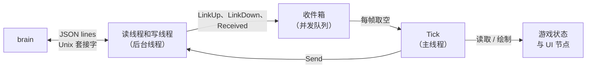

import { Badge } from '@astrojs/starlight/components';
import TickDemo from '../../../../components/book/TickDemo.svelte';

出现决策时，游戏并不会调用 Mod。根本没有这样的事件：决策只是游戏在等玩家、而且没有东西还在动的某个时刻。所以 Mod 每一帧都去看，只有当一个状态保持不动之后才询问大脑；当玩家让 AI 来打时，同一帧会打出答案。本页沿着这个循环来讲：它在哪里运行，每一帧做什么，如何保证同时只有一个决策在途，如何判定一个画面已经空闲，以及如何与大脑通信。AI 如何打出一个答案，见[自动游玩与安全](/arch/mod/auto/)。[概览](/arch/mod/)讲 Mod 是什么；[输出](/arch/output/)讲答案如何画出来。

## 1. 游戏只有一个线程

Godot 和大多数游戏引擎一样，要求游戏状态和 UI 节点只在它的主线程上访问。所以对游戏的每一次读写都发生在一个每帧回调 `Host.Tick` 里，它用 `((SceneTree)Engine.GetMainLoop()).ProcessFrame += Tick` 挂上（`Host.cs:41`）。`ProcessFrame` 是场景树每帧触发一次的普通 C# 事件，所以 Mod 不需要 Godot 的源代码生成器，也不需要自己的节点脚本。

等待套接字会卡住这一帧，所以套接字的 IO 放在从不接触游戏的后台线程上：读线程把收到的东西放进一个并发队列，即**收件箱**（inbox），写线程发送主线程排进队列的东西。`Tick` 在每一帧开始时把收件箱取空。这是 STS2MCP 的做法（[自动游玩与安全 §6](/arch/mod/auto/#sec-6)）。

`Tick` 在第一帧搭建面板，读取按键（F8，以及工具栏的 F5、F10 和 F11），并把这一帧交给 `Assist.Tick`；如果 Mod 处于关闭状态（版本守卫），它只显示原因。这一帧里的异常会写进日志，并显示为「Mod 出错」，每种不同的错误只一次，而不是每帧一次（`Host.cs:44-65`）。

## 2. 每一帧，一步一步

`Assist.Tick`（`Assist.cs:162-278`）每一帧按这个顺序做同样的步骤。大多数帧会提前停下。

1. **取空收件箱**：连接的变化、`ready`、答案或 `error`（[§8](#sec-8)）。
2. **环境和力度**。如果其中任一设置变了，大脑眼中的这一局就结束（`run_end`，`aborted`），下一个决策用新的设置开始新的一局。
3. **对局**。游戏的对局状态、本地玩家，以及由种子哈希得到的对局 id（`RunHeader.IdOf`）。id 与告诉过大脑的那一局不同，就结束那一局：游戏已经结束则为 `won` 或 `lost`，否则为 `aborted`。关闭辅助也一样。已经结束的对局会让 AI 停下。
4. **读取画面**，只限单人对局：`Screens.Read` 返回画面上的决策，或者什么都不返回（[§4](#sec-4)）。辅助关闭、没有大脑时也照样做，因为 SL 记录需要知道玩家回答的是哪个画面（[SL 记录 §3](/arch/mod/sl-record/#sec-3)）。玩家在这个决策界面上走的一步如果还在进行中（事件选项、休息处选项、奖励、购买、占卜），在它的任务结束之前，决策会被隐藏。
5. **辅助关闭**：隐藏一切并停下。
6. **谁在场**。没有连接、没有对局、多人对局、这一局大脑出过错，或者还没收到 `ready`：显示原因（[概览 §6](/arch/mod/#sec-6)）并停下。有连接时，一局的第一帧发送 `hello`。
7. **没有要决策的**：显示「等待下一个决定」，把空闲计数清零，并停下。当 AI 自己打、或者打到一个房间结束时，一个没有决策却在等待的画面（宝箱、继续按钮）会在 1.2 秒后被按下（[自动游玩与安全 §1](/arch/mod/auto/#sec-1)）。SL 下，没有节点克隆的战斗也在这里停下（[SL 记录 §6](/arch/mod/sl-record/#sec-6)）。
8. **空闲**。决策的键是它的观测哈希加上它的合法动作。新的键让计数重新开始；连续不满 3 帧，这一帧就停下，面板保持原样。
9. **显示、打出或询问**。有这个键的答案就显示它，如果玩家让 AI 来打，就在它的等待结束后打出它（[自动游玩与安全 §2](/arch/mod/auto/#sec-2)）。否则面板显示「思考中…」，Mod 发出询问，除非已经有一个决策开着（[§3](#sec-3)）：SL 下先发节点的检查点和步骤（[SL 记录 §7](/arch/mod/sl-record/#sec-7)），再发 `decision`。

下图在一场虚构的 SL 战斗上逐帧运行这些规则：

<TickDemo client:visible lang="zh-CN" />

## 3. 同时只有一个决策在途

大脑按顺序、一次一个地回答一条连接上的决策（[Harness §5](/arch/harness/#sec-5)）。所以 Mod 最多只开着一个决策：

- **键**。一个决策对应一个键：观测的哈希（`DecisionRequest.HashOf`，对它的 JSON 取 FNV-1a 64，[协议 §4](/arch/protocol/#sec-4)）加上它的合法动作。同一个观测可能允许不同的动作：休息处在用过一个选项之后就可以离开，尽管别的看得见的东西都没变（`Assist.cs:246-247`）。
- **询问**。一个键保持了 3 帧，没有别的决策开着，也还没有它的答案，就作为 `decision` 发出，带上下一个 id；在这条连接上，每一局的 id 都从 0 开始计。
- **状态先往前走了**。决策还开着时，如果一个新的键保持了 3 帧，Mod 就带上那个决策的 id 发一次 `cancel`，然后等待。只有在旧决策的答案回来之后，它才询问新的键。那个答案会被丢掉。
- **答案**。答案按 id 与开着的决策对应；Mod 不读它的 `obs_hash`。答案按它被问到时的键保存，在这个键持续的每一帧都显示。状态回到这个键时会再次显示它，不用重新询问。
- **取消之后又回来的键**。如果状态从 A 变到 B，又在 A 被取消的答案到达之前回到 A，A 不会被再问一次：那个答案到了会被丢掉，而 A 已经问过了，所以面板一直显示「思考中…」，直到键发生变化（`Assist.cs:259-265`、`426-431`）。

这样，即使玩家出手比大脑思考还快，慢的大脑也不会越落越远：Mod 从不在第一个问题后面再排一个问题。大脑收到 `cancel` 并不会停止搜索（[协议：线路 §5](/arch/protocol/wire/#sec-5)）；被取消的答案只是照样花掉它所需的时间。

为什么是 3 帧：在同一个动作的两步之间，队列可能短暂为空，游戏会有一帧看起来是空闲的。那时发出的决策描述的是一个马上就要变的状态。一个状态必须保持的时长，就是连续 3 帧键相同、且每一帧画面的空闲检查都通过（`Assist.cs:47`）。

## 4. 空闲，逐个画面

「空闲」指游戏真正在等玩家：游戏逻辑在等待，没有排队中的动作，没有东西还在进行，也没有别的画面挡在要决策的画面上面。无头运行时，GameBridge 的 `CombatActions.WaitingForInput` 就够了；在真实游戏里不够（[GameBridge：各决策界面的动作 §1](/arch/gamebridge/actions/#sec-1)）。所以 `Screens.Read`（`Screens.cs:52-115`）从玩家正在看的画面出发，也就是游戏自己的 `ActiveScreenContext.Instance.GetCurrentScreen()`：打开着的模态框，打开着的地图，覆盖层栈的栈顶，否则就是当前房间 <Badge text="已核实" variant="success" />。它的类型决定决策界面：

| 最上层的画面 | 决策界面 | 何时询问 |
|---|---|---|
| `NCombatRoom`，手牌处于选择模式（`NPlayerHand.IsInCardSelection`） | `card_choice` | 立即：游戏在一个动作内部等这个提示 |
| `NCombatRoom`（也包括事件里的战斗） | `combat` | `CombatActions.WaitingForInput`，动作队列为空，且手牌处于出牌模式、不在出牌过程中 |
| `NCombatPileCardSelectScreen`、`NCardGridSelectionScreen`、`NChooseACardSelectionScreen` | `card_choice` | 立即 |
| `NCardRewardSelectionScreen` | `card_reward` | 立即 |
| `NChooseABundleSelectionScreen` | `bundle` | 立即 |
| 带有奖励组的 `NRewardsScreen` | `rewards` | 动作队列为空 |
| `NCrystalSphereScreen`，小游戏还没结束 | `crystal_sphere` | 动作队列为空 |
| `NMapScreen`，可以移动且不在移动中 | `map` | 动作队列为空 |
| 事件房间里的 `NEventRoom`、`NFakeMerchant` 或 `NMerchantInventory` | `event` | 动作队列为空 |
| 商人房间里的 `NMerchantRoom` 或 `NMerchantInventory` | `shop` | 动作队列为空 |
| `NRestSiteRoom` | `rest` | 动作队列为空 |
| 已经亮出遗物的 `NTreasureRoom` | `treasure` | 动作队列为空；宝箱还关着时显示「打开宝箱」 |

提示之所以立即询问，是因为游戏在一个动作或一次奖励的*内部*等它们，此时队列是忙的；其他画面都在队列为空时等待。

**与模拟器的询问方式相同**。每个决策界面都用模拟器的 `RunSession` 所用的同一批 GameBridge 调用来询问，所以大脑在两种宿主里看到相同的观测和合法动作（[模拟器：整局 §4](/arch/simulator/runs/#sec-4)）。画面提供了什么，从画面节点的私有字段里读取，这些字段装的正是它显示的东西：奖励组，卡牌奖励的卡牌和它剩下的替代选项（重抽用过之后，会返回一个不再含有它的新列表），卡包，提示的卡牌和它的 `CardSelectorPrefs`。手牌的选择模式和战斗牌堆提示则是对一个牌堆做筛选，所以 Mod 把它们的筛选条件用在那个牌堆上。

**药水栏**在与模拟器相同的画面上提供：除了卡牌奖励、卡包和选牌提示之外处处都有；在战斗中，它的动作就在战斗自己的动作之中。

**没有合法动作的画面**（一段动画，一个画面在等着被按的继续按钮）不是决策：画面的合法动作为空时，`Ask` 什么都不返回。

## 5. 选牌提示

选牌提示是要玩家挑牌的画面：三选一、弃两张、升级一张（[协议：观测与动作 §6](/arch/protocol/observation/#sec-6)）。有三样东西让它在游戏里能用（`Screens.cs:133-159`）：

- **它的上下文**。大脑需要知道为什么会出现这个提示：是哪张牌、哪个遗物或哪个事件发出的，选出的牌会怎样。GameBridge 在 `CardSelectCmd.From*` 上的前缀在游戏发出每个提示时记录它的上下文（[GameBridge：读取游戏 §6](/arch/gamebridge/observe/#sec-6)）。画面在入口的第一次 await 之后才打开，那时当前上下文已经没了，所以 Mod 取最近记录的那一个，`ChoiceContexts.Last`。每个提示（一个新的画面节点，或一次新的手牌选择）取它一次。如果它已经被之前的提示用过，说明这个提示没带上下文：Mod 记一条「a card prompt without its context, left to the player」（一个没有上下文的选牌提示，留给玩家），什么都不问。
- **它的数量范围**。能选几张牌，来自画面的 `CardSelectorPrefs`，再按上下文修正（`ChoiceContexts.Bounds`）。「选一张牌」画面不论能否跳过，都按 0 到 1 张询问，和 `CardSelectCmd` 询问选择器的方式一样。
- **规范顺序**。选项按规范顺序排列（`CardChoices.Canonical`），平局用 `new Random(0)` 打破，所以观测和它的哈希每帧都保持不变，大脑的答案也不依赖画面上的顺序。答案选的是规范序号；SL 记录保存的是游戏自己的序号（[SL 记录 §3](/arch/mod/sl-record/#sec-3)），AI 也按游戏自己的序号打出它们，通过一个把每个规范序号映射回去的映射（`Asking.GameIndex`）。

战斗中的提示也带着这场战斗。SL 下没有节点克隆时，提示照样询问，战斗以外的决策也一样；只有战斗要等（[SL 记录 §6](/arch/mod/sl-record/#sec-6)）。没带上下文的提示不会被询问，而在 SL 下，对它的回答会让节点的记录中断，因为记录无法对照一个它从没见过的提示来读这个回答。

## 6. 用游戏里的名字说出答案

大脑用动作文本回答：`play:1:1`、`map:4,10`、`reward:0`。面板按画面的叫法、用游戏的语言给它们命名，依据的是答案所对应的观测（`UI/Describe.cs`）。游戏里没有文本的 id 原样显示。名字周围 Mod 自己的用语（「去」「拿」「结束回合」）也随游戏的语言（[输出 §2](/arch/output/#sec-2)）。

| 决策界面 | 一个动作显示为 |
|---|---|
| 战斗 | 卡牌的名字（升级过的加 `+`）和它的目标，「→ 骇鳗」；有多个敌人存活时，名字后面加「#2」；药水是「喝」加药水名；「结束回合」 |
| 选牌提示 | 「选」加所选的牌，或者「都不选」 |
| 地图 | 「去」加地图图例里这个房间的名字 |
| 奖励 | 「拿 25 金币」，「拿」加药水或遗物，「打开卡牌奖励」加它的卡牌，「移除一张牌」；`rewards_done` 是「继续」，或「跳过其余，继续」 |
| 卡牌奖励 | 「拿」加这张牌，或者替代选项自己的名字（跳过、重抽） |
| 卡包 | 「第 2 包:」加它的卡牌 |
| 事件 | 选项的标题，取自事件的文本表或先古之民的文本表 |
| 商店 | 「买」加商品再加「（75 金币）」，「移除一张牌（75 金币）」，「离开商店」 |
| 休息处 | 选项的名字，或「离开」 |
| 宝箱 | 遗物的名字，或「跳过遗物」 |
| 水晶球 | 「在 3,4 大占卜」，「在 3,4 小占卜」 |
| 药水栏 | 「喝」或「丢掉」加药水名 |

**计划**。在战斗中，面板列出到本回合结束为止的计划：先是第一个动作，然后是计划里直到下一个 `end_turn` 为止的各步。SL 规划器规划整场战斗，但它后面几个回合要打的牌还没抽到，画面无法给它们命名，所以只计数：「之后还规划 2 回合」（`Describe.Turn`）。在地图上，计划就是路线：它经过的各个房间，一直到 Boss。在别处，计划的动作按原样列出。

**考虑过的选项**是大脑打过分的选项中最多五个，选中的在前，其余从好到差：SL 规划器的第一动作，各带这场战斗的胜率和它最佳路线上剩下的生命值；PIMC 的第一动作，各带得分和置信区间；在战斗外，是每个合法选项，各带 V 给出的、选它之后赢下这一局的概率，在地图上还带上每个选项的路线（[输出 §2](/arch/output/#sec-2)）。在下一个动作下面，一行较淡的文字说明预计在它之后这场战斗或这一局会怎样。

**标记**。同一个答案也画在游戏上：地图上的圆圈和路线，战斗中卡牌、目标和结束回合按钮上的编号和圆圈（[输出 §3](/arch/output/#sec-3)）。

## 7. Mod 何时等待

除了大脑还在思考之外，面板还会等游戏：

- **有东西在动**：动作队列不空，手牌正在出牌过程中，地图正在移动。画面稳定下来之前什么都不问。
- **一步还在进行**。事件选项、休息处选项、奖励、购买和占卜都作为游戏自己的任务运行，画面要等任务结束才显示这一步的结果：在那之前，画面显示的仍是它刚回答过的决策。Mod 在玩家发起每个这样的任务的地方把它记下来，在它结束之前不在那个决策界面上发问，就像模拟器等待它正在运行的任务一样（`NodeRecord.Running`，[SL 记录 §4](/arch/mod/sl-record/#sec-4)）。
- **Mod 不读的画面**：模态框、牌组查看、还关着的宝箱。它显示「等待下一个决定」；关着的宝箱会加上「打开宝箱」。

AI 打的时候，它等的是同样的东西：它只打出对画面上那个决策的答案。没有决策却在等待的画面，只有在自动游玩或房间目标期间才会被按下；而一个按钮始终没就绪的决策，会让 AI 在 10 秒后停下：绝不会有随机动作（[自动游玩与安全 §1](/arch/mod/auto/#sec-1)、[§2](/arch/mod/auto/#sec-2)）。

## 8. 大脑连接

`BrainLink`（`BrainLink.cs`）是线路在 Mod 这一端（[协议：线路](/arch/protocol/wire/)）。

- **套接字**：Unix 域套接字 `~/.local/state/sts2ai/brain.sock`（设置了这个环境变量时为 `$XDG_STATE_HOME/sts2ai/brain.sock`；`BrainSocket.DefaultPath`），传输 JSON lines。Mod 是客户端，大脑是服务端（[概览 §4](/arch/mod/#sec-4)）。
- **为什么放在那里**。Steam 在它的 Linux 运行时容器（pressure-vessel）里启动游戏，容器与主机共享主目录，但有自己的 `$XDG_RUNTIME_DIR`。放在那里的套接字游戏访问不到，所以套接字放在主目录下。大脑创建它的文件夹时，只允许用户本人读取。
- **连接**。一个后台线程负责连接，启动一个写线程，然后一直读到连接结束；接着等 2 秒再连，永远如此。每次连接开始时收件箱里出现一个 `LinkUp`，每次结束时出现一个带原因的 `LinkDown`。
- **发送**就是把一条消息排进写线程的队列。没有连接时，消息被丢掉：新的连接会从 `hello` 重新开始，所以旧连接上的东西都用不着。

**大脑眼中的这一局**（`Assist.cs:112-126`、`204-208`、`407-475`）：

| 时机 | Mod 发送 | 或者做 |
|---|---|---|
| 单人对局的第一帧，已连接 | `hello`：游戏版本、环境、身份 `mod`、这一局（它的 id、角色和进阶等级），以及玩家选了的话 SL 规划器的力度 | 把决策 id 和 SL 计数器清零 |
| 收到 `ready` | | 显示它报出的冠军 |
| 一个决策被询问、被回答或被取消 | `decision`、`cancel`（[§3](#sec-3)）；SL 下先发 `node_checkpoint` 和 `node_action` | |
| AI 打出了一个答案 | `executed`：决策的 id、动作、`ok` | 把它加进面板的最近动作（[自动游玩与安全 §2](/arch/mod/auto/#sec-2)） |
| 对局 id 变了，或者不再有对局 | `run_end`：游戏已经结束则为 `won` 或 `lost`，否则为 `aborted` | 让 AI 停下，并清掉面板上的胜率和最近动作 |
| 切换了环境或力度，或关闭了辅助 | `run_end` `aborted` | 下一个决策发送新的 `hello` |
| 收到 `error` | `run_end` `failed` | 关闭到下一个 `hello` 为止：「大脑出错」，「下一局恢复」。下一个 `hello` 随新的一局到来，也会在切换环境或力度、关掉再打开辅助或重新连接之后到来，这些都会在同一局游戏里让大脑重新开始它的那一局 |
| 连接断开 | 什么都不发：连接已经没了 | 忘掉这一局和开着的决策，并让 AI 停下；下一次连接从 `hello` 重新开始 |

继续的一局得到与之前相同的对局 id，因为 id 是种子的哈希；重新连接或切换之后大脑得到的那一局也一样，只是决策 id 再次从 0 开始，节点也重新发送。Mod 不期望从大脑收到的消息会记进日志并被忽略；`ready` 不论何时到来，都会设置冠军的名字。断开连接期间，头部保留上一个冠军的名字。

**一个大脑服务两种环境**。`hello` 带有环境，它在大脑眼中的这一局里保持不变。`brain` 给 NoSL 对局它的冠军的战斗大脑，给 SL 对局 `--sl-policy` 的战斗大脑，宏观大脑相同（[Harness：路由、预算与种子 §1](/arch/harness/routing/#sec-1)），所以面板上的开关不需要第二个大脑，只要宏观大脑在两种环境里都能下（[概览 §4](/arch/mod/#sec-4)）。

**大脑打印什么**。启动时打印 `brain: NoSL C; SL C; listening on PATH`，之后每个 `run_end` 一行：`RUN_ID (mod) REASON floor F, N decisions`，有重新规划和工作进程的游戏错误时也一并附上（`Commands/BrainCommand.cs:48-53`）。
