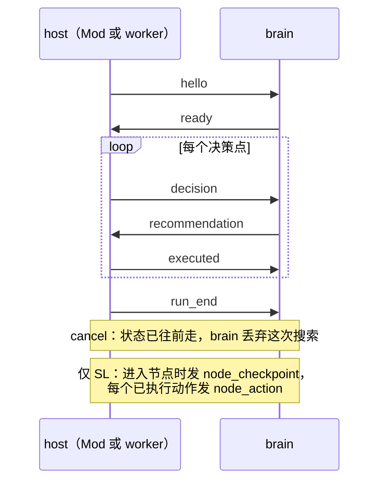

import { Aside } from '@astrojs/starlight/components';

Protocol（协议）是项目各进程之间的共同语言。游戏宿主（真实游戏里的 Mod，或无头运行整局的 SimWorker）发出观测和合法动作；决策进程（Harness 和各个大脑）回复推荐；搜索则通过这里定义的世界 API 接触模拟出来的游戏。程序集 `Sts2Ai.Protocol` 只引用 .NET 框架，所以 Brain 使用它时不需要引用任何游戏代码。

这个程序集同时就是观测的**白名单**：一个字段只有在游戏 UI 显示它（或者能从 UI 显示的内容推断出来）、并且有测试检查这一点时，才会出现在这里。不在 Protocol 里的值，到不了大脑那里。

<Aside title="状态">

战斗部分、带有每个决策界面画面的整局观测（[§3](#sec-3)）和 `ChoiceContext`（[§4](#sec-4)）已实现（`src/Sts2Ai.Protocol`）。战斗世界 API 也已实现（[§7](#sec-7)），承载 PIMC 世界搜索的 worker 消息也已实现（[§7.1](#sec-7.1)）。宿主与 brain 之间的消息已实现（`Wire.cs`，[§2](#sec-2)），包括 SL 消息，模拟器已经能通过它们跑整局。事件流和事实还在规划中。

</Aside>

## 1. 现有类型

下面这些类型已经存在，覆盖战斗、选牌提示和整局观测。

- `CombatObservation`：玩家在一场战斗里能看到的一切。它包括遭遇 id 和它的房间类型（Monster、Elite 或 Boss，与地图上显示的一致）、幕、进阶等级、回合数、一个 `PlayerView`、手牌（带 uid）、按卡牌键（card key）排序的抽牌堆、弃牌堆和消耗堆、每个槽位的药水、遗物、友方单位，以及敌人和它们的意图 `IntentView{type, damage per hit, hits}`（类型、每段伤害、段数）。抽牌堆要排序，是因为它的真实顺序是隐藏的。
- `CardView{id, uid?, up, cost|x_cost, stars, enchant, affliction, keywords sorted, vars sorted}`：玩家眼中的一张牌。`ProtocolJson.CardKey` 是这张牌去掉 uid 之后的序列化结果，也就是它对玩家可见的身份：键相同的两张牌，在玩家看来一模一样。`vars` 不含计算出的数值（完美打击的伤害）：牌面把它显示为一个基础数值加上额外数值乘以状态里的某个计数，而这两部分都已列出。
- `PowerView{id, amount, stacks?, card?}`：图标和提示框里看到的一个能力。`amount` 是图标上的数字。`stacks` 是能力本身的层数，提示框里会写出来；只有图标显示别的数字时才有这一项（Sloth 的图标数的是本回合打出的牌数，层数才是上限）。`card` 是能力保存的一张牌，提示框里会写出它的名字：Nightmare 下回合要复制的那张牌。
- `CombatAction`：一个战斗动作，文本形式为 `play:C[:T]`（打出牌 C，可选目标 T）、`potion:S[:T]`（使用槽位 S 的药水）或 `end_turn`。动作用 **uid** 指代对象：uid 是取自游戏本身的稳定 id，而不是列表里的位置。手牌的 uid 是它的 `NetCombatCardDb` id，生物的 uid 是它的 `CombatId`。因此手牌变化时动作依然有效，而且在模拟器和真实游戏里含义相同。
- `CardChoice{options canonical-sorted by card key, ties by hidden-state-free seed; min; max; context}` 以及 `Accepts(picks)`：一个选牌提示，比如「弃 1 张牌」或「3 选 1」。选项按**规范顺序**排列：按卡牌键排序，键相同时用一个不含隐藏状态的种子打破平局，从不使用游戏自己的顺序。一个回答要选 min 到 max 个选项；`Accepts(picks)` 检查回答是否有效。`context` 说明游戏为什么要问（[§4](#sec-4)）。
- `Observation{run, screen}`：玩家在任一决策点看到的内容（[§3](#sec-3)）；`Surfaces` 常量（`Surfaces.cs`）给各个画面命名。
- `ProtocolJson`：JSON 设置：字段名用 snake_case，值为 null 的字段省略。`ProtocolJson.Hash(obs)` 计算 `obs_hash`（[§2](#sec-2)）。

## 2. 传输

所有消息都是 **JSON lines**：每行一个 UTF-8 编码的 JSON 对象。

- **Mod ↔ brain**：Unix 域套接字。不用 TCP，所以从本机以外无法访问。
- **brain ↔ worker**：子进程的 stdin/stdout 管道。只有性能分析表明 JSON 占了主要开销时，才换成二进制编码。
- 每条消息的形式是 `{"type": ..., "v": PROTOCOL_VERSION, ...}`。任何不兼容的改动都要升版本号，日志里会记录版本号。

下面的消息里，**host**（宿主）是运行游戏的进程：真实游戏里的 Mod，或者承载一局的 worker（由 `role` 字段说明是哪一种）。**brain** 是决策进程。

```
host → brain   hello{v, game_version, env: "NoSL"|"SL", role: "mod"|"worker", run: {run_id, character, ascension}}
brain → host   ready{champion}                // the run is accepted
host → brain   decision{decision_id, obs_hash, surface, obs, legal[], events[]}
brain → host   recommendation{decision_id, obs_hash, action, brain, plan?, candidates?, facts[], degraded?}
brain → host   error{message}                 // instead of ready or a recommendation; the host ends the run
host → brain   executed{decision_id, action, ok, error?}
host → brain   cancel{decision_id}            // state moved on; brain drops the search
host → brain   run_end{won, floor, reason}
// SL only (env-gated, docs: mod §6; a NoSL log containing these is invalid)
host → brain   node_checkpoint{node_index, save_json}      // RunManager.ToSave(null) at node entry
host → brain   node_action{node_index, seq, action}  // every decision in the node, as "surface action"
```

| 消息 | 方向 | 时机 / 内容 |
|---|---|---|
| `hello` | host → brain | 每局开始时：协议版本、游戏版本、环境（`NoSL` 或 `SL`）、角色（`mod` 或 `worker`）、对局头信息（对局 id、角色、进阶等级） |
| `ready` | brain → host | 对 `hello` 的回答：brain 接下这一局，并说明由哪个冠军来打 |
| `decision` | host → brain | 一个决策点：决策 id、观测哈希、决策界面、观测、合法动作（选牌提示的合法动作为空，它的回答是 `pick:i,j,…`，[§3](#sec-3)）、自上一个决策以来的事件 |
| `recommendation` | brain → host | 回答：动作、做出选择的大脑、计划、候选动作、事实、可选的降级标记（[§6](#sec-6)） |
| `error` | brain → host | 代替 `ready` 或 `recommendation`：brain 接不了这一局，或答不了这个决策（未覆盖的决策界面、不合法的选择、与哈希不符的观测）；宿主随即结束这一局 |
| `executed` | host → brain | 某个决策实际执行了哪个动作、是否成功，以及可能的错误 |
| `cancel` | host → brain | 状态已经往前走了；brain 丢弃这次搜索 |
| `run_end` | host → brain | 一局结束：是否获胜、层数、原因（`won`、`lost`、触及决策上限的 `truncated`、`failed` 或 `aborted`） |
| `node_checkpoint` | host → brain | 仅 SL：进入节点时做的存档 `RunManager.ToSave(null)` |
| `node_action` | host → brain | 仅 SL：节点内做出的每个决策，用 `seq` 从 0 编号，在下一个决策之前发送，形式是 `surface action` 文本（选牌提示的选择用游戏自己的下标） |

这两种 SL 消息按环境开关（[Mod §6](/arch/mod/#sec-6)）。NoSL 日志里只要出现其中任何一种，这份日志就无效；NoSL 下 brain 会在下一个决策时用 `error` 回应它们。节点在一局里从 0 编号；检查点加上它之后的决策就是这个节点的克隆（[模拟器 §7](/arch/simulator/#sec-7)）。

一局里正常的消息往来：



有两个字段用来防止过时的回答：

- `obs_hash` 是对 `obs` 的规范 JSON 计算的 FNV-1a 64（一种快速的 64 位哈希，`ProtocolJson.Hash`）。如果一个推荐的哈希与当前的不同，也就是说它是针对一个已经不在屏幕上的状态算出来的，宿主就丢弃它。
- `decision_id` 在一局内严格递增，brain 只回答最新的那一个。

往来的其他规则：

- 一条连接上依次跑多局，每局从 `hello` 到 `run_end`。brain 一侧为每局单独建一个 Harness，在 `hello` 时建好。
- `run_id` 是对局种子的哈希（FNV-1a 64，十六进制），所以种子从不离开宿主（[Mod §9](/arch/mod/#sec-9)）。Harness 从它派生各个大脑的种子（[Harness §5](/arch/harness/#sec-5)）。
- brain 按顺序回答决策，答完一个才读下一条消息，所以目前 `cancel` 没有可丢弃的搜索。
- 游戏走到下一个决策或一局结束时，宿主才报告上一个动作 `executed`。在模拟器里，只有这一局失败时 `ok` 才为 false。
- brain 还会用收到的观测核对 `obs_hash`：对不上说明 JSON 在传输中走了样，回答 `error`。

## 3. 观测

每个决策一个 `Observation`（`Observation.cs`、`Screens.cs`）。它是一个**联合类型**（union）：整局部分总是存在，界面部分恰好是若干变体之一，也就是正在询问的那个决策界面对应的变体。**决策界面**（surface）指一类决策画面（战斗、地图、商店……）。在 JSON 里，界面部分带一个 `"surface"` 字段，值是决策界面的名字，说明它是哪个变体。观测由 GameBridge 构建（[GameBridge §3](/arch/gamebridge/#sec-3)）。

```
Observation{run: RunView, screen: ScreenView}       // screen JSON carries "surface": <Surfaces constant>
RunView{character, ascension, act (from 0), act_id, floor (run total), hp, max_hp, gold,
        deck (sorted by card key), relics, potions (per slot, null = empty), map}
MapView{points (sorted by row, col: start row 0 .. boss / second boss), visited (this act, last = current),
        boss, second_boss?, ancient?}
MapPointView{col, row, type (map icon; "?" stays Unknown after the visit), next (sorted), quest?}
```

- `act_id` 说明这一局抽到的是该幕的哪个变体。`floor` 按整局累计，与顶栏显示的一致。
- `map` 是当前这一幕的地图：每个点及其图标、它的路径通向的点、本幕走过的点（最后一个是玩家当前所在的位置），以及地图上画出的 Boss、第二个 Boss 和 Ancient。`quest` 标记一个任务奖励到达的点。

每个界面变体以它的决策界面命名。决策界面的名字同时也是 Harness 把决策路由给某个大脑时用的键（[Harness §4](/arch/harness/#sec-4)）。

| 决策界面 | 画面载荷 | 合法动作形式 |
|---|---|---|
| `combat` | `combat: CombatObservation` | `play:C[:T]`、`potion:S[:T]`、`end_turn` |
| `card_choice` | `choice: CardChoice`（带它的 `context`，[§4](#sec-4)）；战斗进行中时还有 `combat` | `pick:i,j,…`（规范索引；只有 min = 0 时才允许一张都不选） |
| `map` | `travelable`：可前往的坐标，按合法动作的顺序（地图本身在 `run.map` 里） | `map:col,row` |
| `rewards` | 还没领取的奖励：`{index, kind, id?, amount?, card?, cards?}`，kind 为 `gold`、`potion`、`relic`、`card`、`special_card` 或 `remove_card`；`cards` 是选卡奖励里的牌（界面出现前就已掷好；玩家可以打开奖励看一眼再跳过，没有任何代价） | `reward:i`、`rewards_done` |
| `card_reward` | `cards`，以及 `alternatives`：其他按钮的 id（跳过、重抽、遗物添加的按钮） | `card:i`、`card_alt:<id>` |
| `bundle` | `bundles`：若干组卡牌 | `bundle:i` |
| `event` | `id`、`page`（本地化键）、`options{index, key, locked?, relic?, tips?, kills?}`（事件结束后为空）、`finished` | `event:i`、`proceed` |
| `shop` | `entries{slot, kind, card? or id?, cost, on_sale?}`：仍在出售的商品，kind 为 `card`、`relic` 或 `potion`；`removal_cost`（用过之后不再出现） | `buy:<slot>`、`remove`、`leave` |
| `rest` | `options{id, enabled, heal?}`，`heal` 是 HEAL 选项回复的生命值，以选项文字上显示的为准（遗物会改变它） | `rest:<id>`、`leave`（只在某个选项成功一次之后，或已没有选项可选时） |
| `treasure` | `relics`：宝箱里的遗物 id | `relic:i`、`relic_skip` |
| `crystal_sphere` | `rows`：11x11 网格，`rows[y][x]` 为 `#`（隐藏）、`.`（已揭开且为空），或已揭开格子所显示内容的一部分（`R` 遗物、`P` 药水、`C` 卡牌奖励、`G` 金币、`X` 诅咒）；`divinations_left` | `big:X,Y`（3x3）、`small:X,Y`（只在会揭开隐藏格子时） |

一局的结束是传输消息 `run_end`（[§2](#sec-2)），不是一个决策界面。

每个宏观决策界面（除 `combat` 和 `card_choice` 以外的所有决策界面）还会列出药水栏动作：`potion:S`（可随时使用的药水）和 `discard_potion:S`（丢弃药水）。药水栏满时，药水奖励和药水购买会从合法动作里去掉，直到空出一个槽位；没有单独的 `potion_full` 决策界面。事件动作 `proceed` 表示离开、回到地图：事件已结束时，或者通过 Ancient 事件的 PROCEED 按钮。

宏观决策界面以 `MacroDecision{surface, legal, observation}`（在 Brain 里）交给策略；`card_choice` 以 `ChoiceDecision{choice, observation}` 交给 `IChoicePolicy`。两者都只在策略读取时才生成观测；单独开局的战斗没有对局，它的提示也就不带观测。

- 如果 UI 顺序是公开的（奖励、事件、商店槽位），直接用游戏所给列表的索引没有问题。顺序可能反映隐藏状态的卡牌列表（各个牌堆）一律经过规范排序（`CardChoice`）。
- 牌组按卡牌键排序，所以以不同顺序得到的同一副牌组给出相同的观测。
- 地图从不包含未来某个 `?` 的结果；Boss 和 Ancient 画在地图上，所以包括在内。
- 文本以本地化键（loc key，`table.key`；事件选项用它的文本键）发送，从不发送已经解析好的字符串。游戏填进事件文本的数字暂不包括：有些事件把页面上不显示的数值也放在其中，所以要先有一份按事件划分的白名单。悬停提示（提示里显示的卡牌或遗物）是可见的，所以选项的 `tips` 列出它们的模型 id（`+` 表示升级过的牌）。
- 观测是惰性构建的：只在有人读取时才构建（`MacroDecision.Observation`、`CombatDecision.Observation`，或整局会话的 `observed` 回调）。

## 4. ChoiceContext

`CardChoice` 只说明有哪些选项，不说明游戏为什么要问：同样的选项，用于升级、移除还是弃牌，意义完全不同。在真实游戏里，策略可能单独收到一个选牌提示，没有别的信息告诉它这个提示是做什么用的。`ChoiceContext` 带上的就是这个原因。它由 GameBridge 填写（[GameBridge §5](/arch/gamebridge/#sec-5)）。

```csharp
public sealed record ChoiceContext
{
    public required string Purpose { get; init; }       // from the CardSelectCmd entry, or "<pile>_pile"
    public string? Source { get; init; }                // card/relic/power/event id that asked
    public required bool Cancelable { get; init; }      // a cancel or skip button closes the prompt
    public required bool InCombat { get; init; }        // asked during a combat
    public string? PromptKey { get; init; }             // the prompt's loc key, "table.key"
    public ModifierView? Enchantment { get; init; }     // for deck_for_enchantment
}
```

| 字段 | 含义 |
|---|---|
| `Purpose` | 提示的种类：游戏所用 `CardSelectCmd` 入口的名字，去掉 "From"，转成 snake_case：`deck_for_upgrade`、`deck_for_transformation`、`deck_for_enchantment`、`deck_for_removal`、`deck_generic`、`hand`、`hand_for_discard`、`hand_for_upgrade`、`choose_a_card_screen`、`simple_grid`、`simple_grid_for_rewards`。针对战斗中某个牌堆的提示是 `draw_pile`、`discard_pile`、`exhaust_pile`…… |
| `Source` | 发起询问的卡牌、遗物、能力或事件的 id，在游戏指明时给出：入口的 `source` 参数，否则是它的 `PlayerChoiceContext` 最近涉及的模型（可选） |
| `Cancelable` | `CardSelectorPrefs.Cancelable`，或「3 选 1」画面的 `canSkip` |
| `InCombat` | 提示打开时的 `CombatManager.IsInProgress`：是卡牌或能力结算中的提示，而不是休息处、事件或商店里的。Harness 按它路由提示（[Harness §4](/arch/harness/#sec-4)） |
| `PromptKey` | 提示文本的本地化键（可选） |
| `Enchantment` | 用于 `deck_for_enchantment`：被选中的牌获得的附魔及其数值 |

- 取消或跳过就是空回答，所以只要 `Cancelable` 为真，`min` 就是 0。
- 没有跳过按钮的「3 选 1」画面向选择器要 0 或 1 张牌，然后自己强制必须选一张，所以它的 `min` 是 1（`ChoiceContexts.Bounds`）。
- 一个入口调用另一个入口时（移除卡牌会经过通用的牌组提示），由最外层的入口给出用途。

## 5. 事件

每条 `decision` 消息都带有自上一个决策以来的**事件**。这些事件合起来就是公开历史流：玩家本可以亲眼看到的经过。事件集合是最小的，只包含**信念**需要的内容。信念指决策进程根据公开历史对隐藏状态做出的估计（[Harness §3](/arch/harness/#sec-3)）。

```
draw{card}  play{card_uid, target?}  move{card, from, to, pos: top|bottom|random|null}
generate{card, to}  shuffle{}  intents{creature, intents[]}  move_done{creature, effects…}
reward_seen{…}  shop_seen{…}  event_page{…}
```

`move` 是一张牌从一个牌堆移到另一个牌堆；`move_done` 报告一个生物完成了它的行动，以及行动的效果。最后一行记录奖励界面、商店或事件页面显示了什么。

- 事件里用 `CardView` 标识一张牌；牌在手牌中时再加上它的 uid。
- 在游戏一侧，GameBridge 订阅游戏的钩子和事件来生成这条流（[GameBridge §8](/arch/gamebridge/#sec-8)）。
- 只有某个信念特征需要时，才扩充事件集合。

## 6. 推荐

大脑对一条 `decision` 的回答。`Wire.cs` 里已经有它，只是还没有 `Facts` 和 `Degraded`，这两项在规划中：

```csharp
public sealed record Recommendation(long DecisionId, string ObsHash, string Action, string Brain,
    IReadOnlyList<string>? Plan = null,          // rest of the turn/screen, or of the act's route on the map
    IReadOnlyList<Candidate>? Candidates = null) : WireMessage;
// Planned:
//   IReadOnlyList<Fact> Facts                   // the only source for explanations
//   bool Degraded                               // worker loss etc.; docs: harness §7
public sealed record Candidate(string Action, double Value, double Ci, int Samples);
public sealed record Fact(string Kind, IReadOnlyDictionary<string, double> Values, bool Exact); // planned; Exact only in SL
```

- `Action` 是该决策的合法动作之一；选牌提示的回答是 `pick:i,j,…`。
- `Brain` 说明是哪个大脑做的选择，取自冠军的路由表（[Harness §4](/arch/harness/#sec-4)）。宿主按大脑统计决策数写进对局记录，其中占位策略的决策数必须为零（[评估 §3](/arch/evaluation/#sec-3)）。
- `Candidates` 只来自会搜索的大脑，`Plan` 来自会规划的大脑（战斗搜索，以及地图上的宏观大脑），与决策日志里一样（[Harness §6](/arch/harness/#sec-6)）。
- `Plan` 是本回合或本界面剩下的步骤，在地图上是本幕剩下的路线，用于高亮和解说。
- `Candidates` 列出评估过的动作，每个带有 `Value`、`Ci`（置信区间）和样本数 `Samples`。
- `Facts` 是解释的唯一来源。
- 事实的 `Exact` 标记只在 SL 中设置，因为 SL 的事实可以是确切结果（[环境 §8](/arch/environments/#sec-8)）。
- `Degraded` 表示这个回答是在出问题时给出的，例如丢失了一个 worker 进程（[Harness §7](/arch/harness/#sec-7)）。

## 7. 世界 API

搜索从不直接接触游戏，而是从这个 API 拿到**世界**：可以观测、执行动作、做快照和恢复的模拟战斗。类型定义在 Protocol 里（`World.cs`），所以 Brain 不引用游戏也能使用；实现在 SimWorker 里（[模拟器 §6](/arch/simulator/#sec-6)）。NoSL 和 SL 的世界有何不同，见 [环境 §5](/arch/environments/#sec-5)。

```csharp
public enum PlayEnvironment { NoSL, SL }
public enum CombatStatus { InProgress, Won, Lost }

// Hands out the worlds for one decision.
public interface IWorldSource
{
    PlayEnvironment Environment { get; }
    // NoSL: k samples drawn from searchSeed. SL: the one exact copy.
    IReadOnlyList<ICombatWorld> Worlds(int k, ulong searchSeed);
}

public interface ICombatWorld
{
    CombatObservation Observe();
    IReadOnlyList<CombatAction> Legal();   // empty once the combat is over
    CombatStatus Status { get; }
    void Execute(CombatAction action);     // card prompts are answered inside the world
    WorldSnapshot Snapshot();
    void Restore(WorldSnapshot snapshot);  // a snapshot taken from this same world
}

public sealed record WorldSnapshot(IReadOnlyList<string> Steps);
public sealed record Candidate(string Action, double Value, double Ci, int Samples);
```

- NoSL 世界是隐藏状态的一个样本，与观测一致；SL 世界是真实战斗的一份精确副本。
- 目前只有战斗世界：它唯一的使用者是战斗大脑。整局级的世界等到宏观搜索时再加。
- `WorldSnapshot` 是这个世界从开始以来走过的步骤列表（动作、选牌回答、确定化步骤），以文本形式保存。对搜索来说它是不透明的；只有生成它的那个世界会读它，并通过重放恢复。因为它是纯文本，任何 worker 都能恢复它。
- 世界里弹出的选牌提示在世界内部回答。v0 交给 `p0`，也就是这一局自己回答提示所用的固定规则，所以世界里的选择和这一局一样；把每个选项变成搜索分支还在规划中（[战斗大脑 §2](/arch/combat-brain/#sec-2) 第 7 条）。
- `Candidate` 是一个打过分的动作：它在各个世界上的平均估值、95% 置信区间的半宽，以及世界的个数。

规划中：SL 封存：上一个动作离开节点之后（`AtHorizon`），`Execute` 会抛异常（[模拟器 §7](/arch/simulator/#sec-7)）。

### 7.1 worker 消息

worker 进程池（[模拟器 §8](/arch/simulator/#sec-8)）不会一步一步地通过线路操作世界：一次进程间往返（几十 µs）和一个模拟步（约 0.1 ms）的开销相当，而搜索每个决策要走几千步。所以一个请求要的是一整块工作，这里是一个世界的搜索（`Worker.cs`）：

```csharp
// The worker's first line, once it has booted.
public sealed record WorkerHello(string Game);

// A request, typed by "type" on the wire; its reply carries the same id.
public abstract record WorkerRequest(long Id);

// "pimc_world": build the combat from Observation with BuildSeed, take world World of Worlds drawn
// from SearchSeed, and search this turn after each of First, in that order.
public sealed record PimcWorldRequest(long Id, CombatObservation Observation, IReadOnlyList<CombatAction> First,
    string BuildSeed, ulong SearchSeed, int World, int Worlds, int NodesPerWorld) : WorkerRequest(Id);

// "sl_world": load Node, the SL clone, and search this turn after each of First.
public sealed record SlWorldRequest(long Id, NodeClone Node, IReadOnlyList<CombatAction> First,
    int NodesPerWorld) : WorkerRequest(Id);

// Lines[i] is the best line after First[i]. Error is set instead when the request failed.
public sealed record WorkerReply(long Id, IReadOnlyList<PlannedLine>? Lines, string? Error, IReadOnlyList<string> GameErrors);

public sealed record PlannedLine(double Value, IReadOnlyList<CombatAction> Actions);
```

- 请求带着 worker 需要的一切，所以任何 worker 都能处理它，崩溃的 worker 的请求可以重发。
- NoSL 请求里是观测，绝不是真实状态：worker 看到的不会比玩家多。SL 请求里是节点克隆，这是 SL 允许知道的。
- `GameErrors` 是处理请求期间游戏的 `Log.Error` 输出，供宿主计数。

## 8. 不变量与测试

- **往返**：每个类型序列化再反序列化后，得到相同的 JSON。战斗：selftest；整局：一批 `run --check` 中的每个观测。
- **白名单**：每个字段都有测试，证明该字段在 UI 上可见。新增任何字段时，评审者要在公平性表（fair-play table）里加一行。
- 没有任何字段携带种子、随机数计数器、怪物动作 id（move id）、牌堆的隐藏顺序或存档路径。
- 只要游戏的顺序可能反映隐藏状态，就使用规范顺序。

## 9. 未决问题

1. 事件流的粒度：先从最小集合开始，按需扩充。
2. worker 的管道是否需要二进制编码（实测决定）。
3. 还有哪些内容要进入观测：事件文本里的数字（按事件的白名单）、卡牌奖励的稀有度提示、变化（transform）在确认前显示的预览。
