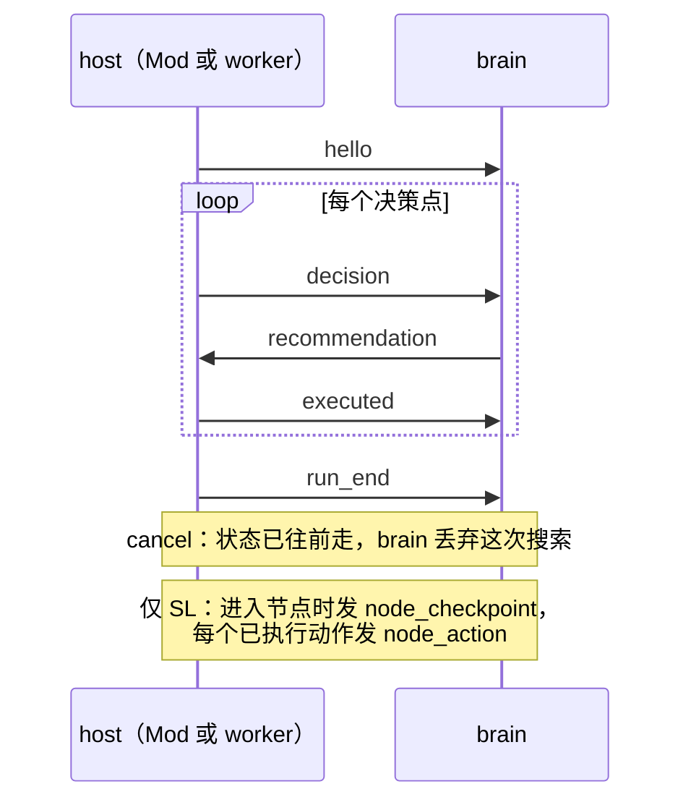

import { Aside } from '@astrojs/starlight/components';

Protocol（协议）是项目各进程之间的共同语言。游戏宿主（真实游戏里的 Mod，或无头运行整局的 SimWorker）发出观测和合法动作；决策进程（Harness 和各个大脑）回复推荐；搜索则通过这里定义的世界 API 接触模拟出来的游戏。程序集 `Sts2Ai.Protocol` 只引用 .NET 框架，所以 Brain 使用它时不需要引用任何游戏代码。

这个程序集同时就是观测的**白名单**：一个字段只有在游戏 UI 显示它（或者能从 UI 显示的内容推断出来）、并且有测试检查这一点时，才会出现在这里。不在 Protocol 里的值，到不了大脑那里。

<Aside title="状态">

战斗部分已实现（`src/Sts2Ai.Protocol`）。整局层面的界面、消息信封、事件流和世界 API 还在规划中。每个有动作的决策界面都已经能列出并执行合法动作，但界面载荷（payload）还没有实现（[§3](#sec-3)）。

</Aside>

## 1. 现有类型

下面这些类型已经存在，覆盖战斗和选牌提示。

- `CombatObservation`：玩家在一场战斗里能看到的一切。它包括遭遇 id、幕、进阶等级、回合数、一个 `PlayerView`、手牌（带 uid）、按卡牌键（card key）排序的抽牌堆、弃牌堆和消耗堆、每个槽位的药水、遗物、友方单位，以及敌人和它们的意图 `IntentView{type, damage per hit, hits}`（类型、每段伤害、段数）。抽牌堆要排序，是因为它的真实顺序是隐藏的。
- `CardView{id, uid?, up, cost|x_cost, stars, enchant, affliction, keywords sorted, vars sorted}`：玩家眼中的一张牌。`ProtocolJson.CardKey` 是这张牌去掉 uid 之后的序列化结果，也就是它对玩家可见的身份：键相同的两张牌，在玩家看来一模一样。
- `CombatAction`：一个战斗动作，文本形式为 `play:C[:T]`（打出牌 C，可选目标 T）、`potion:S[:T]`（使用槽位 S 的药水）或 `end_turn`。动作用 **uid** 指代对象：uid 是取自游戏本身的稳定 id，而不是列表里的位置。手牌的 uid 是它的 `NetCombatCardDb` id，生物的 uid 是它的 `CombatId`。因此手牌变化时动作依然有效，而且在模拟器和真实游戏里含义相同。
- `CardChoice{options canonical-sorted by card key, ties by hidden-state-free seed; min; max}` 以及 `Accepts(picks)`：一个选牌提示，比如「弃 1 张牌」或「3 选 1」。选项按**规范顺序**排列：按卡牌键排序，键相同时用一个不含隐藏状态的种子打破平局，从不使用游戏自己的顺序。一个回答要选 min 到 max 个选项；`Accepts(picks)` 检查回答是否有效。
- `ProtocolJson`：JSON 设置：字段名用 snake_case，值为 null 的字段省略。

## 2. 传输

所有消息都是 **JSON lines**：每行一个 UTF-8 编码的 JSON 对象。

- **Mod ↔ brain**：Unix 域套接字。不用 TCP，所以从本机以外无法访问。
- **brain ↔ worker**：子进程的 stdin/stdout 管道。只有性能分析表明 JSON 占了主要开销时，才换成二进制编码。
- 每条消息的形式是 `{"type": ..., "v": PROTOCOL_VERSION, ...}`。任何不兼容的改动都要升版本号，日志里会记录版本号。

下面的消息里，**host**（宿主）是运行游戏的进程：真实游戏里的 Mod，或者承载一局的 worker（由 `role` 字段说明是哪一种）。**brain** 是决策进程。

```
host → brain   hello{v, game_version, env: "NoSL"|"SL", role: "mod"|"worker", run_header}
host → brain   decision{decision_id, obs_hash, surface, obs, legal[], prompt?, events[]}
brain → host   recommendation{decision_id, obs_hash, action, plan[], candidates[], facts[], degraded?}
host → brain   executed{decision_id, action, ok, error?}
host → brain   cancel{decision_id}            // state moved on; brain drops the search
host → brain   run_end{won, floor, reason}
// SL only (env-gated, docs: mod §6; a NoSL log containing these is invalid)
host → brain   node_checkpoint{node_index, save_json}      // RunManager.ToSave(null) at node entry
host → brain   node_action{node_index, seq, action}  // every executed action + prompt answer
```

| 消息 | 方向 | 时机 / 内容 |
|---|---|---|
| `hello` | host → brain | 开始时发送一次：协议版本、游戏版本、环境（`NoSL` 或 `SL`）、角色（`mod` 或 `worker`）、对局头信息（run header） |
| `decision` | host → brain | 一个决策点：决策 id、观测哈希、决策界面、观测、合法动作、可选的 `prompt`、自上一个决策以来的事件 |
| `recommendation` | brain → host | 回答：动作、计划、候选动作、事实、可选的降级标记（[§6](#sec-6)） |
| `executed` | host → brain | 某个决策实际执行了哪个动作、是否成功，以及可能的错误 |
| `cancel` | host → brain | 状态已经往前走了；brain 丢弃这次搜索 |
| `run_end` | host → brain | 一局结束：是否获胜、层数、原因 |
| `node_checkpoint` | host → brain | 仅 SL：进入节点时做的存档 `RunManager.ToSave(null)` |
| `node_action` | host → brain | 仅 SL：节点内每个已执行的动作和每个选牌提示的回答，用 `seq` 编号 |

这两种 SL 消息按环境开关（[Mod §6](/arch/mod/#sec-6)）。NoSL 日志里只要出现其中任何一种，这份日志就无效。

一局里正常的消息往来：



有两个字段用来防止过时的回答：

- `obs_hash` 是对 `obs` 的规范 JSON 计算的 FNV-1a 64（一种快速的 64 位哈希）。如果一个推荐的哈希与当前的不同，也就是说它是针对一个已经不在屏幕上的状态算出来的，宿主就丢弃它。
- `decision_id` 在一局内严格递增，brain 只回答最新的那一个。

## 3. 观测

这部分在规划中：每个决策一个 `Observation`。它是一个**联合类型**（union）：整局部分总是存在，界面部分恰好是若干变体之一，也就是正在询问的那个决策界面对应的变体。**决策界面**（surface）指一类决策画面（战斗、地图、商店……）。

```csharp
// Planned. One per decision; the screen part says which surface is asking.
public sealed record Observation
{
    public required RunView Run { get; init; }       // always present
    public required ScreenView Screen { get; init; } // exactly one variant
}

public sealed record RunView
{
    public required string Character { get; init; }
    public required int Ascension { get; init; }
    public required int Act { get; init; }            // index from 0
    public required int Floor { get; init; }          // total floor, as the top bar shows
    public required int Hp { get; init; }
    public required int MaxHp { get; init; }
    public required int Gold { get; init; }
    public required IReadOnlyList<CardView> Deck { get; init; }   // deck view order (public)
    public required IReadOnlyList<RelicView> Relics { get; init; }
    public required IReadOnlyList<string?> Potions { get; init; }
    public required MapView Map { get; init; }
}
```

每个界面变体以它的决策界面命名。决策界面的名字同时也是 Harness 把决策路由给某个大脑时用的键（[Harness §4](/arch/harness/#sec-4)）。

| 决策界面 | 载荷 | 合法动作形式 |
|---|---|---|
| `combat` | `CombatObservation` | `play:C[:T]`、`potion:S[:T]`、`end_turn` |
| `card_choice` | `CardChoice` + `ChoiceContext`（[§4](#sec-4)） | `pick:i,j,…`（规范索引；只有 min = 0 时才允许一张都不选） |
| `map` | 可前往的坐标（当前地图在 `RunView.Map` 里） | `map:col,row` |
| `rewards` | 按 UI 顺序排列的奖励 `{kind, id/amount}` | `reward:i`、`rewards_done` |
| `card_reward` | 卡牌 + 替代选项（跳过、重抽、由钩子添加的；最多 2 个） | `card:i`、`card_alt:<id>` |
| `bundle` | 若干组卡牌（bundle） | `bundle:i` |
| `event` | 事件 id、页面键、选项 `{index, key, locked, tips}` | `event:i`、`proceed` |
| `shop` | 商品条目 `{slot, kind, id, cost, stocked, affordable}`，移除卡牌服务 `{cost, used}` | `buy:<slot>`、`remove`、`leave` |
| `rest` | 选项 `{id, enabled}` | `rest:<id>`、`leave`（只在某个选项成功一次之后，或已没有选项可选时） |
| `treasure` | 可选的遗物 | `relic:i`、`relic_skip` |
| `crystal_sphere` | 11x11 网格：每格是隐藏的，或显示它的内容；剩余占卜次数 | `big:X,Y`（3x3）、`small:X,Y`（只在会揭开隐藏格子时） |
| `game_over` | 是否获胜、层数 | — |

每个宏观决策界面（除 `combat` 和 `card_choice` 以外的所有决策界面）还会列出药水栏动作：`potion:S`（可随时使用的药水）和 `discard_potion:S`（丢弃药水）。药水栏满时，药水奖励和药水购买会从合法动作里去掉，直到空出一个槽位；没有单独的 `potion_full` 决策界面。事件动作 `proceed` 表示离开、回到地图：事件已结束时，或者通过 Ancient 事件的 PROCEED 按钮。

**目前已实现**：每个有动作的决策界面都能列出合法动作并执行。宏观决策界面以 `MacroDecision(surface, legal)` 传递，界面常量在 `MacroDecision.cs` 的 `Surfaces` 里；`card_choice` 仍然走 `IChoicePolicy`。表中的载荷还没有实现。

- 如果 UI 顺序是公开的（奖励、事件、商店槽位），直接用游戏所给列表的索引没有问题。顺序可能反映隐藏状态的卡牌列表（各个牌堆）一律经过规范排序（`CardChoice`）。
- `MapView` 包含所有点 `{col,row,type}`（`?` 一直是 `unknown`）、边、走过的坐标、当前坐标，以及显示出来时的 Boss id。它从不包含未来某个 `?` 的结果。
- 文本：事件和选项的 id 以本地化键（loc key）发送，从不发送已经解析好、可能带有隐藏数值的字符串。悬停提示（提示里显示的卡牌或遗物）是可见的，所以包括在内。

## 4. ChoiceContext

这个类型填补一个已知缺口：`CardChoice` 只说明有哪些选项，不说明游戏为什么要问。在真实游戏里，策略可能单独收到一个选牌提示，没有别的信息告诉它这个提示是做什么用的。`ChoiceContext` 带上的就是这个原因。它还在规划中，将由 GameBridge 填写（[GameBridge §5](/arch/gamebridge/#sec-5)）。

```csharp
// Planned. Why the game is asking, so a policy can answer a lone prompt in the real game.
public sealed record ChoiceContext
{
    public required string Purpose { get; init; }   // discard, exhaust, upgrade, transform, enchant, remove,
                                                    // choose, put_on_draw_top, retain, … (from the CardSelectCmd entry)
    public string? Source { get; init; }            // card/relic/power/event id that asked
    public required bool Cancelable { get; init; }  // CardSelectorPrefs.Cancelable (needs a prefix to expose, docs: simulator §5)
    public string? PromptKey { get; init; }         // the prompt's loc key
}
```

| 字段 | 含义 |
|---|---|
| `Purpose` | 这次选牌做什么：discard（弃牌）、exhaust（消耗）、upgrade（升级）、transform（变化）、enchant（附魔）、remove（移除）、choose（选择）、put_on_draw_top（放到抽牌堆顶）、retain（保留）……；取自游戏所用的 `CardSelectCmd` 入口 |
| `Source` | 发起询问的卡牌、遗物、能力或事件的 id（可选） |
| `Cancelable` | `CardSelectorPrefs.Cancelable`；要暴露它需要一个前缀（prefix）补丁（[模拟器 §5](/arch/simulator/#sec-5)） |
| `PromptKey` | 提示的本地化键（可选） |

## 5. 事件

每条 `decision` 消息都带有自上一个决策以来的**事件**。这些事件合起来就是公开历史流：玩家本可以亲眼看到的经过。事件集合是最小的，只包含**信念**需要的内容。信念指决策进程根据公开历史对隐藏状态做出的估计（[Harness §3](/arch/harness/#sec-3)）。

```
draw{card}  play{card_uid, target?}  move{card, from, to, pos: top|bottom|random|null}
generate{card, to}  shuffle{}  intents{creature, intents[]}  move_done{creature, effects…}
reward_seen{…}  shop_seen{…}  event_page{…}
```

`move` 是一张牌从一个牌堆移到另一个牌堆；`move_done` 报告一个生物完成了它的行动，以及行动的效果。最后一行记录奖励界面、商店或事件页面显示了什么。

- 事件里用 `CardView` 标识一张牌；牌在手牌中时再加上它的 uid。
- 在游戏一侧，GameBridge 订阅游戏的钩子和事件来生成这条流（[GameBridge §8](/arch/gamebridge/#sec-8)）。
- 只有某个信念特征需要时，才扩充事件集合。

## 6. 推荐

大脑对一条 `decision` 的回答。这部分在规划中。

```csharp
// Planned.
public sealed record Recommendation
{
    public required long DecisionId { get; init; }
    public required string ObsHash { get; init; }
    public required string Action { get; init; }                 // one of legal[]
    public required IReadOnlyList<string> Plan { get; init; }    // rest of the turn/screen, for highlight + narration
    public required IReadOnlyList<Candidate> Candidates { get; init; }
    public required IReadOnlyList<Fact> Facts { get; init; }     // the only source for explanations
    public bool Degraded { get; init; }                          // worker loss etc.; docs: harness §7
}
public sealed record Candidate(string Action, double Value, double Ci, int Samples);
public sealed record Fact(string Kind, IReadOnlyDictionary<string, double> Values, bool Exact); // Exact only in SL
```

- `Action` 是该决策的合法动作之一。
- `Plan` 是本回合或本界面剩下的步骤，用于高亮和解说。
- `Candidates` 列出评估过的动作，每个带有 `Value`、`Ci`（置信区间）和样本数 `Samples`。
- `Facts` 是解释的唯一来源。
- 事实的 `Exact` 标记只在 SL 中设置，因为 SL 的事实可以是确切结果（[环境 §8](/arch/environments/#sec-8)）。
- `Degraded` 表示这个回答是在出问题时给出的，例如丢失了一个 worker 进程（[Harness §7](/arch/harness/#sec-7)）。

## 7. 世界 API

搜索从不直接接触游戏，而是从这个 API 拿到**世界**：可以观测、执行动作、做快照和恢复的模拟游戏。类型定义在 Protocol 里，所以 Brain 不引用游戏也能使用；实现在 SimWorker 里，可以在同一进程内，也可以经由管道。NoSL 和 SL 的世界有何不同，见 [环境 §5](/arch/environments/#sec-5)。

```csharp
public enum PlayEnvironment { NoSL, SL }

// The only way search touches a game. Given by Harness per decision.
public interface IWorldSource
{
    PlayEnvironment Environment { get; }
    // NoSL: k worlds sampled from the public record, seeded from searchSeed.
    // SL: one clone of the current node; k and searchSeed are ignored.
    IReadOnlyList<ISimWorld> Worlds(int k, ulong searchSeed);
}

public interface ISimWorld : IDisposable
{
    Observation Observe();
    IReadOnlyList<string> Legal();
    void Execute(string action);       // throws if illegal, or if AtHorizon
    bool AtHorizon { get; }            // SL: the last action left the node. NoSL: always false.
    WorldSnapshot Snapshot();          // opaque, serializable recipe (worker-side replay)
    void Restore(WorldSnapshot snapshot);
    // Batched to amortize IPC: run each branch from the snapshot, return the leaf observations.
    IReadOnlyList<BranchResult> RunBranches(WorldSnapshot from, IReadOnlyList<Branch> branches);
}
public sealed record Branch(IReadOnlyList<string> Actions, string? RolloutPolicy, int MaxActions);
public sealed record BranchResult(Observation Leaf, bool AtHorizon, bool Ended, int ActionsRun);
```

- `IWorldSource` 由 Harness 在每个决策时提供，是搜索接触游戏的唯一途径。NoSL 下它返回从公开记录采样出的 k 个世界，用 `searchSeed` 播种。SL 下它返回当前节点的一个克隆，忽略 `k` 和 `searchSeed`。
- `ISimWorld.Execute` 遇到非法动作会抛异常，世界处于 `AtHorizon` 之后也会抛异常。SL 下 `AtHorizon` 表示上一个动作离开了节点；NoSL 下它始终为 false。
- `WorldSnapshot` 是一份不透明、可序列化的配方，worker 通过重放来恢复它。因此它能挺过 worker 崩溃：任何 worker 都能通过重放恢复它。
- 之所以有 `RunBranches`，是因为每一步一次 IPC 往返（约几十 µs）和一个模拟步（约 0.1 ms）的开销相当。所以推演（rollout）在 worker 内部运行，使用 Brain 的推演策略；SimWorker 本来就引用了 Brain。推演是指用一个快速策略把一条路线往下打，以估计它的好坏。每个 `Branch` 给出一串动作、一个可选的推演策略和动作数上限。每个 `BranchResult` 给出叶子观测、世界是否到达视野边界（horizon）、是否已结束，以及实际执行了多少个动作。

## 8. 不变量与测试

- **往返**：每个类型序列化再反序列化后，得到相等的记录（战斗部分已有）。
- **白名单**：每个字段都有测试，证明该字段在 UI 上可见。新增任何字段时，评审者要在公平性表（fair-play table）里加一行。
- 没有任何字段携带种子、随机数计数器、怪物动作 id（move id）、牌堆的隐藏顺序或存档路径。
- 只要游戏的顺序可能反映隐藏状态，就使用规范顺序。

## 9. 未决问题

1. 事件流的粒度：先从最小集合开始，按需扩充。
2. `RunView.Deck` 的顺序：牌组界面会排序吗？使用公开的 UI 顺序；需在游戏中核实。
3. worker 的管道是否需要二进制编码（实测决定）。
