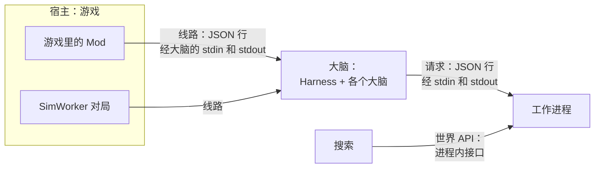

import { Aside } from '@astrojs/starlight/components';

项目的各个程序从不共享对象：游戏、大脑和搜索用的工作进程在不同的进程里运行，而大脑完全不能看到游戏（[前言 §2](/#sec-2)）。它们共享的是一种语言，即程序集 `Sts2Ai.Protocol`（`src/Sts2Ai.Protocol`）里的类型。一个部分告诉另一个部分的一切，都是这些类型之一，通常是一行 JSON。本章讲的就是这种语言：每条消息、每个字段是什么意思，其中可以有什么、不可以有什么。

<Aside title="状态">

已有：每个决策画面的观测，包括战斗和选牌提示；文本形式的动作；宿主与大脑之间的线路及其 SL 节点消息，游戏里的 Mod 通过它给出建议，`run --check` 通过它把模拟器的对局再打一遍；战斗世界 API；三种工作进程请求。规划中：公开历史的事件流、用于解说的事实，以及推荐的 `degraded` 标志（[§6](#sec-6)）。

</Aside>

## 1. 三种对话

这些类型服务于三种对话：

| 对话 | 双方 | 承载什么 | 页面 |
|---|---|---|---|
| 线路 | 一个**宿主**，即运行游戏的进程（真实游戏里的 Mod，或承载一局的模拟器），和**大脑**，即决策进程 | hello、每个决策及其观测和合法动作、推荐、一局的结束；SL 下还有节点的检查点和决策 | [线路](/arch/protocol/wire/) |
| 工作进程请求 | 大脑的搜索和模拟器的工作进程 | 每个请求一份搜索工作：一个战斗决策的一个世界、SL 规划器的一个回合、在克隆上的一组试探 | [世界与工作进程消息](/arch/protocol/worlds/) |
| 世界 API | 一次搜索和它在其中进行的各个世界 | 观测、列出合法动作、执行、快照、还原 | [世界与工作进程消息](/arch/protocol/worlds/) |

三种对话都承载的观测和动作，有自己单独的一页：[观测与动作](/arch/protocol/observation/)。

## 2. 一个不认识游戏的程序集

`Sts2Ai.Protocol` 只引用 .NET 框架：不引用游戏程序集，也不引用别的项目。它存在的意义全在于此。大脑（`Sts2Ai.Brain`）引用 Protocol，不引用游戏的任何东西，而 Harness 引用 Brain，所以大脑能读到的，永远只有 Protocol 类型承载的东西。读取游戏的 GameBridge 把游戏翻译成 Protocol 类型（[GameBridge](/arch/gamebridge/)）。

| 项目 | 引用 |
|---|---|
| `Sts2Ai.Protocol` | 什么都不引用 |
| `Sts2Ai.Brain` | Protocol（以及用于网络的 ONNX Runtime） |
| `Sts2Ai.Harness` | Brain，因而也引用 Protocol |
| `Sts2Ai.GameBridge` | Protocol 和游戏的程序集 |
| `Sts2Ai.SimWorker` | 以上全部 |
| `Sts2Ai.Mod` | 把 GameBridge 和 Protocol 的源文件编译进自身，并在游戏内运行 |

这条边界由 `BoundaryTests`（xUnit，不需要游戏）检查：它遍历 Brain、Protocol 和 Harness 编译后的引用，只要有一个够到游戏程序集就失败；GameBridge 作为对照，它确实够得到（[模拟器：参考 §7](/arch/simulator/reference/#sec-7)）。

## 3. 其中可以有什么

Protocol 类型就是大脑被允许知道的东西，所以往里面放什么是一个关乎公平的决定，而不是图方便。规则如下：

- **只有玩家能看到的东西**。一个字段之所以存在，是因为游戏画面显示了它，或者它可以从画面显示过的东西推出。每个类型的文档注释写明游戏在哪里显示它（`CombatObservation.cs:3-12`）。
- **绝不包含隐藏状态**：没有种子、随机数流计数器、怪物已排定的招式（只有它们的意图）、玩家看不到的牌堆顺序，也没有存档路径。抽牌堆是一个排好序的列表；怪物显示它的意图，从不显示它的招式（[观测与动作 §3](/arch/protocol/observation/#sec-3)）。
- **不用可能泄露隐藏状态的顺序**。游戏自己给一个列表的顺序如果可能取决于隐藏的东西，这个列表就改用规范顺序发出（[观测与动作 §4](/arch/protocol/observation/#sec-4)）。
- **SL 的例外是明确写出的**。SL 下大脑可以精确地知道当前节点，所以有两种消息承载 NoSL 永远不能知道的东西：节点检查点，它的存档里有这一局的种子和随机数流；以及工作进程请求里的节点克隆。两者都受环境把关：NoSL 对局会拒绝它们（[线路 §6](/arch/protocol/wire/#sec-6)），而搜索只通过世界读取它们，从不直接读取。

没有逐个字段检查它在游戏里可见的测试：这些规则靠评审、文档注释和下面的观测往返来维持。一个新字段到达玩家那里时，会在输出一章的公平性表里得到自己的一行（[输出 §6](/arch/output/#sec-6)）。

## 4. JSON 约定

每条 Protocol 消息都是由 `ProtocolJson`（`ProtocolJson.cs`）写出的 JSON：

- 属性名用 `snake_case`（`max_hp`、`decision_id`）；值为 null 的字段省略；
- **枚举写成数字**，因为没有设置字符串转换器：`TurnEnd` 的 `status` 是 `0`、`1` 或 `2`；
- **字典的键保持原样**：卡牌的 `vars` 保留游戏的名字（`"Damage"`、`"Block"`）；
- **`ulong` 写成 JSON 数字**：哈希、隐藏键和搜索种子。JavaScript 读取时会丢失它们的精度；.NET 和 Python 能精确读取；
- 列表保留其中的 null：空的药水槽位在 `potions` 里是 `null`；
- **战斗动作写成文本**，`play:7:1`，用它们自己的转换器，所以日志里的一行读起来就是那个动作。

两个函数给出身份：

- `ProtocolJson.Hash(value)` 是 FNV-1a 64，一种快速的非加密哈希，对值的 JSON 的 UTF-8 字节计算。它为一个观测命名（`obs_hash`，写成 16 位十六进制数），为一局命名（`run_id`，取自种子的 JSON 字符串），也为一场战斗的隐藏状态命名（世界的隐藏键）。它哈希的是 JSON，所以取决于序列化方式：类型相差一个字段的两个构建，会把同一个观测哈希成不同的值，大脑就靠这一点抓出来自另一个构建的宿主（[线路 §5](/arch/protocol/wire/#sec-5)）。
- `ProtocolJson.CardKey(card)` 是卡牌去掉 uid 之后的 JSON：玩家看到的这张牌的一切。键相同的两张牌，在玩家看来就是同一张牌；每个顺序不能取决于隐藏状态的列表，都按它排序。

## 5. 测试

| 检查什么 | 在哪里 |
|---|---|
| 边界：Brain、Protocol 和 Harness 够不到任何游戏程序集 | `BoundaryTests` |
| 每个战斗观测和每个战斗动作都能经受 JSON 往返，作为文本和作为 JSON 都是 | `selftest`，每场战斗（[模拟器：参考 §5](/arch/simulator/reference/#sec-5)） |
| 一局的每个观测都能经受 JSON 往返，同一局给出相同的观测哈希 | `run --check`（[模拟器：整局 §6](/arch/simulator/runs/#sec-6)） |
| 一局在进程内和通过线路打出来一样：轨迹、观测、对局记录、决策日志 | `run --check` |
| 大脑在 NoSL 下拒绝节点消息；SL 节点的克隆就是它的检查点加上此后的决策 | `DispatcherTests` |
| 线路版本：读取时拒绝 `v` 不同的消息 | `WireStream.Receive` |
| 宿主发出的 SL 决策在它们的克隆上重播，得到相同的观测 | 在 `brain --wire` 日志上运行的 `clones`，例如 Mod 在 `Record` 打开时录下的那份（[Mod：SL 记录 §8](/arch/mod/sl-record/#sec-8)） |

## 6. 规划中

- **事件流**。每条 `decision` 会带上自上一条以来的公开事件（抽到和移动的牌、显示过的意图、看到过的画面），以便由它们建立对隐藏状态的信念（[观测与动作 §8](/arch/protocol/observation/#sec-8)）。
- 推荐里的**事实**：解说的唯一来源，只在 SL 下是精确的（[线路 §7](/arch/protocol/wire/#sec-7)）。
- **`degraded`**：在出问题时给出的推荐，例如丢失了一个工作进程。如今丢失工作进程会让这个决策失败（[模拟器：工作进程池 §6](/arch/simulator/pool/#sec-6)）。

## 7. 本章

| 页面 | 讲什么 |
|---|---|
| [线路](/arch/protocol/wire/) | 宿主与大脑之间的对话：它的连接、每条消息和每个字段、一步一步走完的一局、规则、SL 节点消息、推荐，以及两种宿主有何不同 |
| [观测与动作](/arch/protocol/observation/) | 每个决策的观测：这一局、一场战斗、卡牌身份和规范顺序、每个画面及其动作、选牌提示及其上下文，以及哪些东西被排除在外 |
| [世界与工作进程消息](/arch/protocol/worlds/) | 搜索在其中进行的世界 API、节点克隆和敌人出招记录，以及三种工作进程请求和它们的回答 |

未决问题：

1. 事件流应该多细：从信念需要的内容开始，按需扩充。
2. 工作进程的管道是否需要二进制编码；只有性能分析表明 JSON 占了主要开销时才需要。
3. 还有什么要进入观测：事件文本里的数字（需要一份按事件划分的白名单，因为有些事件保存着它们页面上不显示的数值）、卡牌奖励的稀有度提示、变化在确认前显示的预览。
