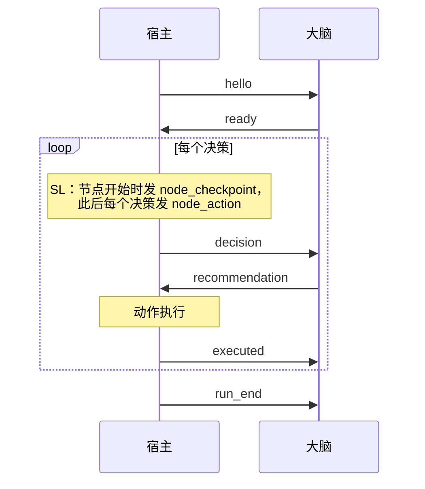

import WireExchange from '../../../../components/book/WireExchange.svelte';

大脑从不在游戏里运行。游戏一侧，即**宿主**，每个决策问它一个问题，得到一个回答。宿主是真实游戏里的 Mod，或承载一局的模拟器（`run --brain`）；**大脑**是带着冠军各个大脑的 Harness，由 `brain` 命令提供服务（[模拟器：整局 §7](/arch/simulator/runs/#sec-7)）。两端使用相同的类型（`Sts2Ai.Protocol/Wire.cs`），所以不管是哪个宿主在问，一局都打得一样。

## 1. 连接

- **Unix 域套接字**，从不用 TCP，所以本机以外的任何东西都够不到大脑。默认是 `$XDG_STATE_HOME/sts2ai/brain.sock`，该变量未设置时是 `~/.local/state/sts2ai/brain.sock`（`BrainSocket.DefaultPath`）：Steam 在一个容器里运行游戏，这个容器与主机系统共享主目录，但不共享 `$XDG_RUNTIME_DIR`。
- **大脑负责监听**（`BrainServer.Listen`，`Sts2Ai.Harness/BrainServer.cs`）。它创建套接字所在的目录，只让当前用户可读；替换已经退出的大脑留下的套接字文件；如果那里还有大脑在监听，就拒绝启动。以 NUL 字节开头的路径表示一个抽象套接字，它没有文件：`run --check` 为它的进程内大脑使用一个这样的套接字。
- **一次一个宿主**。大脑服务一个连接，直到宿主关闭它，再接下一个。字节不是有效消息的连接会被丢弃并给出警告，大脑继续监听。
- **一局接一局**。一个连接依次承载多局，每局从 `hello` 到 `run_end`。

## 2. 格式

每条消息是一行 UTF-8 JSON（`WireStream`）。第一个属性是 `type`，即消息的种类；第二个是 `v`，即协议版本，目前是 1；然后是消息的各个字段，按声明的顺序，用 `snake_case`，值为 null 的字段省略（[协议 §4](/arch/protocol/#sec-4)）：

```json
{"type":"executed","v":1,"decision_id":0,"action":"event:0","ok":true}
```

任何不兼容的改动都会升版本号。读取方会拒绝 `v` 与自己不同的消息。在同一个版本内，一方不认识的字段在读取时会被丢掉；这时观测哈希就会不同，所以用与大脑不同的提交构建的宿主，会在它的第一个决策处失败，并给出一条说明这一点的消息（[§5](#sec-5)）。

## 3. 消息

| 类型 | 方向 | 字段 | 含义 |
|---|---|---|---|
| `hello` | 宿主 → 大脑 | `game_version`、`env`（`"NoSL"` 或 `"SL"`）、`role`（`"mod"` 或 `"worker"`）、`run`：`{run_id, character, ascension}`、`effort`?（`"low"`、`"medium"`、`"high"` 或 `"max"`） | 一局开始；环境在这一局里固定不变，宿主要求的 SL 规划器力度（如果有）也是（[Harness §5](/arch/harness/#sec-5)） |
| `ready` | 大脑 → 宿主 | `champion` | 大脑接下这一局，并说出打这一局的冠军 |
| `decision` | 宿主 → 大脑 | `decision_id`、`obs_hash`、`surface`、`obs`、`legal` | 一个决策点：画面的种类、观测（[观测与动作](/arch/protocol/observation/)）、合法动作；选牌提示的 `legal` 为空，它的回答是 `pick:i,j,…` |
| `recommendation` | 大脑 → 宿主 | `decision_id`、`obs_hash`、`action`、`brain`、`plan`?、`candidates`? | 回答（[§7](#sec-7)） |
| `executed` | 宿主 → 大脑 | `decision_id`、`action`、`ok`、`error`? | 宿主打出了一个决策的回答 |
| `cancel` | 宿主 → 大脑 | `decision_id` | 回答到达之前，游戏已经往前走了 |
| `run_end` | 宿主 → 大脑 | `won`、`floor`、`reason` | 一局结束；`reason` 是 `won`、`lost`、`truncated`（触及决策上限）、`failed` 或 `aborted` |
| `error` | 大脑 → 宿主 | `message` | 代替 `ready` 或 `recommendation`：大脑接不了这一局，或答不了这个决策；宿主随即结束这一局 |
| `node_checkpoint` | 宿主 → 大脑 | `node_index`、`checkpoint` | 仅 SL：一个节点开始（[§6](#sec-6)） |
| `node_action` | 宿主 → 大脑 | `node_index`、`seq`、`action` | 仅 SL：节点内做出的一个决策（[§6](#sec-6)） |

`run_id` 是对种子的 JSON 字符串计算的 `ProtocolJson.Hash`，写成 16 位十六进制数（`RunHeader.IdOf`）：大脑能凭这个 id 区分各局，并用它给自己的随机数流播种，却无法从中得知种子（[Harness：路由、预算与种子 §5](/arch/harness/routing/#sec-5)）。`decision_id` 在每一局里从 0 开始计数。`obs_hash` 是观测的哈希，写成 16 位十六进制数。

## 4. 一局，一步一步



本书示例对局的开头，按承载它的模拟器在 SL 下会发出的样子：

<WireExchange client:visible lang="zh-CN" />

## 5. 往来的规则

**回答与游戏保持同步**。

- 大脑按顺序回答决策，每个都在读下一条消息之前答完。不大于上一个的 `decision_id` 会得到一个 `error`（`BrainServer.cs:101-105`）。
- 大脑检查 `obs_hash` 是否就是它收到的 `obs` 的哈希。对不上说明观测在传输中走了样，最常见的原因是两端用不同的提交构建；这时会得到一个说明这一点的 `error`。
- 推荐重复决策的 id 和哈希。两者任一不同时，模拟器这个宿主会让这一局失败；Mod 按决策 id 保存回答，只在游戏仍显示相同的观测和合法动作列表时才显示它（[§8](#sec-8)）。
- 动作必须是该决策的合法动作之一（对选牌提示来说，是提示接受的选择）；Harness 拒绝其他任何东西，所以不合法的回答会以 `error` 的形式到达宿主。

**`error` 的含义**。大脑拒绝这一局时（冠军打不了的环境，例如 NoSL 对局里的 SL 规划器，或者它不认识的力度），发 `error` 代替 `ready`；答不了时，发它代替推荐：对局之外的决策、未覆盖的决策界面、不合法的选择、对不上的哈希、被拒绝的节点消息之后的决策。宿主随即结束这一局：模拟器的这一局失败；Mod 发出带 `failed` 的 `run_end`，并在这一局里关闭助手。

**`executed` 和 `cancel`**。游戏走到下一个决策或一局结束时，模拟器这个宿主才为一个决策发出 `executed`；只有这一局失败时 `ok` 才为 false。大脑读取这两种消息，然后忽略它们：它答完每个决策才往下读，所以从来没有需要丢弃的搜索。Mod 为 AI 应玩家要求打出的每个回答发送 `executed`，`ok` 为 true（[Mod：自动游玩与安全 §2](/arch/mod/auto/#sec-2)），玩家自己的动作则不发；回答到达之前游戏就往前走时，它发 `cancel`，并等那个回答到了才再次提问。

**对局**。一局中途的 `hello` 会开始新的一局：大脑丢掉旧对局的 Harness。在 `run_end` 时，`brain` 命令写出这一局的决策日志，并为它打印一行。各宿主的结束原因：模拟器以 `won`、`lost`、`truncated` 或 `failed` 结束一局；Mod 以 `won`、`lost`、`failed` 结束，或者在玩家中途切换环境或力度、或关闭助手时以 `aborted` 结束。

## 6. SL：节点消息

SL 下大脑可以精确地知道当前节点；节点就是一个地图点，从到达开始，到离开它的移动为止（[环境：信息与节点 §3](/arch/environments/information/#sec-3)）。宿主分两条消息，发出大脑重建它所需的东西，即节点的克隆（[模拟器：世界与 SL 克隆 §3](/arch/simulator/worlds/#sec-3)）：

- **`node_checkpoint`**，在节点开始时发出：`node_index`（从 0 开始，即宿主看到的第一个节点；Mod 可能中途才加入一局）；以及 `checkpoint`，一个自成一体的 JSON 字符串，装着到达时游戏的存档和每个遗物的简单字段。
- **`node_action`**，节点内做出的每个决策发一条：`seq`，在节点内从 0 开始；以及这个决策的轨迹形式，即决策界面、一个空格、然后是动作（`map 0,1`、`combat play:7:1`）。选牌提示的步骤是 `card_choice`，选择用游戏自己的下标，而不是 `pick:` 的规范下标（[观测与动作 §4](/arch/protocol/observation/#sec-4)），因为克隆通过游戏的选牌器重播它。

**时机**。两者都是惰性发送的，就在下一个决策之前：如果此后开始了新节点，先发检查点，再发节点里每个还没发过的决策（`Brains/RunBrains.cs:88-99`）。因此节点的移动，也就是它的最后一个决策，从来不会发出：下一个决策在下一个节点里，而那个节点以它自己的检查点开始。

**规则**（`Sts2Ai.Harness/Dispatcher.cs:170-186`）：NoSL 对局里的节点消息会被拒绝；节点下标必须递增；`seq` 必须等于节点到目前为止的动作数；在任何检查点之前出现的 SL 战斗决策是错误。大脑不回答节点消息：它拒绝的节点消息会让这一局的下一个决策失败，并给出原因。

**SL 放行的东西**。检查点带着游戏的存档，存档里有这一局的种子和随机数流，所以在 SL 下种子终究还是到了大脑这里。SL 可以知道它：节点的结果就是游戏自己的结果（[环境：信息与节点 §2](/arch/environments/information/#sec-2)）。大脑读取检查点的唯一方式，是在工作进程里把它加载成一个在节点出口处封存的克隆。

## 7. 推荐

```csharp
public sealed record Recommendation(long DecisionId, string ObsHash, string Action, string Brain,
    IReadOnlyList<string>? Plan = null, IReadOnlyList<Candidate>? Candidates = null) : WireMessage;

public sealed record Candidate(string Action, double Value, double Ci, int Samples,
    IReadOnlyList<double>? Values = null, double? Win = null, double? Hp = null,
    IReadOnlyList<string>? Plan = null);
```

| 字段 | 含义 |
|---|---|
| `action` | 该决策的合法动作之一；对选牌提示来说是 `pick:i,j,…` |
| `brain` | 做出选择的大脑，名字取自冠军的路由表（[Harness：路由、预算与种子 §1](/arch/harness/routing/#sec-1)）；宿主按大脑统计决策数写进对局记录，其中占位决策的数目必须为零（[评估：指标、种子与报告 §2](/arch/evaluation/metrics/#sec-2)） |
| `plan` | 大脑在这个动作之后的计划：PIMC 给出本回合剩下的部分，SL 规划器给出这场战斗剩下的部分，地图上的宏观大脑给出本幕剩下的路线 |
| `candidates` | 大脑打过分的选项，选中的在前，其余从好到差：会搜索的战斗大脑的各个首个动作；战斗外的决策或选牌提示处 L0 的选项，由 V 估值（回答是探索抽出来的时就没有）。选牌提示的选项是回答（`pick:i,j`）；战斗中的选牌提示没有 |

`Candidate`（`World.cs:70`）是一个打过分的选项：

| 字段 | 含义 |
|---|---|
| `value` | 搜索在它的各个世界上的平均值；在战斗外，是 V 给出的、选这个选项之后赢下这一局的概率 |
| `ci`、`samples` | 95% 置信区间的半宽和世界的个数；SL 规划器和 V 的是 0 和 1 |
| `values`? | 在搜索保留了它们时，它在每个世界里的值，保留 4 位小数 |
| `win`?、`hp`? | SL 规划器的：在这个动作的最佳路线上赢下这场战斗的概率，路线打到战斗结束处时为 1 或 0，否则取战斗网络的 1 − P(死亡)；以及在这条路线上赢下时、结束时持有的生命值，在结束处是精确的，否则是从网络的分桶得到的期望（[战斗大脑：叶子 §5](/arch/combat-brain/leaf/#sec-5)） |
| `plan`? | 在地图上，宏观大脑在这个选项之后会走的、通往 Boss 的路线；只给显示答案的宿主（[Harness §5](/arch/harness/#sec-5)） |

计划和战斗的候选也是决策日志保存的内容（[Harness：决策日志 §5](/arch/harness/decision-log/#sec-5)）；战斗外的选项只发给宿主。它们全都是输出展示给玩家的内容（[输出 §2](/arch/output/#sec-2)）。

**规划中**：

- `facts`：解说的唯一来源。每条事实会是一个种类和它的数值，只在 SL 下标为精确，因为 SL 的事实可以是确切的结果（[环境：世界 §7](/arch/environments/worlds/#sec-7)）。
- `degraded`：在出问题时给出的回答，例如丢失了一个工作进程（[Harness：路由、预算与种子 §6](/arch/harness/routing/#sec-6)）。

## 8. 两种宿主

| | 模拟器（`run --brain`、`run --check`） | 游戏里的 Mod |
|---|---|---|
| `role` | `worker` | `mod` |
| 何时提问 | 在这一局走到的每个决策处 | 画面静止 3 帧之后（相同的观测哈希和合法动作列表），一次一个决策 |
| 对回答怎么做 | 打出它 | 显示它；玩家要求时由 AI 打出它（[Mod：自动游玩与安全 §2](/arch/mod/auto/#sec-2)） |
| `executed` | 每个动作之后 | AI 打出的每个动作之后 |
| `cancel` | 从不 | 画面先变了的时候 |
| 节点消息 | SL 下，每个决策之前 | SL 下，每个决策之前 |
| 大脑发来的 `error` | 这一局失败 | `run_end` `failed`；这一局余下的部分里助手关闭 |
| `run_end` 的原因 | `won`、`lost`、`truncated`、`failed` | `won`、`lost`、`failed`、`aborted` |
| `hello` 里的 `effort` | 从不 | 玩家的选择，如果有 |

Mod 一侧在 [Mod：主循环 §8](/arch/mod/loop/#sec-8) 和 [Mod：SL 记录 §7](/arch/mod/sl-record/#sec-7) 里讲：它只在单人对局里运行，并且只在它构建时针对的游戏版本上运行。
