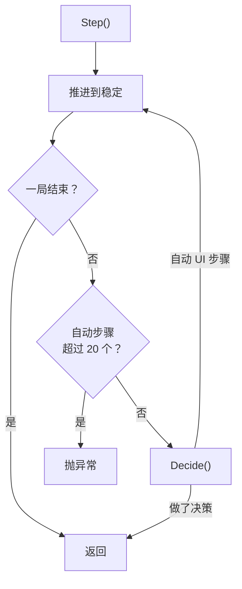

import { Aside, Badge, Steps } from '@astrojs/starlight/components';

模拟器就是 `Sts2Ai.SimWorker`：一个普通的 .NET 进程，加载游戏自己的 `sts2.dll`，以**无头**（headless）方式运行游戏规则，没有 Godot 引擎、窗口、渲染和声音。规则就是游戏本身的代码，不是重写的（[总览 §1](/#sec-1)，约束 4）。决策进程从不加载游戏，而是与模拟器进程通信（[总览 §3](/#sec-3)）。

<Aside title="状态">

已有：无头宿主、单场战斗会话、Determinize、CombatBuilder、整局会话、战斗世界（[§6](#sec-6)）、SL 节点克隆（[§7](#sec-7)），以及给 PIMC 的 NoSL 和 SL 世界、给 SL 规划器的各个回合用的 worker 进程池（[§8](#sec-8)）。规划中：整局世界。

</Aside>

一个 worker 进程有三种角色：

- **(a)** R1–R3 中「真实」一局的宿主（R1–R3 是[仿真到实机阶梯](/arch/evaluation/#sec-1)中由模拟器而不是真实游戏来玩这一局的几级）；
- **(b)** 搜索世界：NoSL 样本和 SL 克隆（[环境 §5](/arch/environments/#sec-5)）；
- **(c)** 基准测试和 selftest。

每个进程同一时刻只持有**一个活着的一局或一场战斗**。游戏把一局和战斗放在进程级单例（`RunManager`、`CombatManager`）里，所以第二局无法与第一局并存。因此分支靠重放来做（[§2](#sec-2)），并行搜索需要多个进程（[§8](#sec-8)）。

像 `Runs/RunManager.cs:295-312` 这样的文件引用指向反编译出的游戏程序集。Godot 节点文件（`NGame.cs`、`NRestSiteRoom.cs`）按文件名唯一，所以只写文件名。

## 1. 无头宿主

游戏是一个 Godot 应用。规则写在托管 C# 里（「模型层」），界面写在 Godot 节点里。无头运行时只跑模型层。这要靠三样东西：原生引擎的桩（stub）、一组 Harmony 补丁（在运行时改写游戏方法），以及游戏自带的 `TestMode`：这是游戏为自动化测试准备的开关，打开后大部分模型代码会跳过表现层。

`HeadlessGame.Boot` 每个进程运行一次：

<Steps>

1. `GodotNativeStub.Install`。GodotSharp 通过一张原生函数指针表访问引擎。没有引擎时，桩把每个槽都填成同一个返回清零内存的小函数，于是碰到 Godot 的托管代码可以无副作用地跑过去。
2. `HeadlessPatches.Apply`：安装下面列出的各组补丁。
3. `TestMode.TurnOnInternal`。
4. `ModManager.State=Skipped`：无头时从不加载 Mod。
5. `AssemblyInfo.Init`、`ModelDb.Init`、`ModelIdSerializationCache.Init`、`ModelDb.InitIds`：加载游戏的模型数据库。
6. `LocalContext.NetId=1`。
7. 测试用的设置和偏好，`FastMode=Instant`。

</Steps>

游戏的 `Log.Error` 输出和未观察到的任务异常都会被收集起来，selftest 断言它们为零。

补丁分组（`Runtime/Patches/`，分部类 `HeadlessPatches` 每组一个文件；`HeadlessPatches.Apply` 把它们全部装上，GameBridge 的 `ChoiceContexts` 最先）：

| 分组 | 作用 |
|---|---|
| 引擎外壳 | 用托管外壳代替引擎：OS、Time、单例、资源、本地化、玩家名 |
| 资源预加载 | 关闭 |
| 表现层 | 模型代码中没有 TestMode 守卫就进入表现层的地方：Kaiser Crab 的手臂、SoulNexus、`EventPresentation` 转译器（[§5.2](#sec-5.2)） |
| 持久化 | 关闭：`SaveRun`、进度、回放。任何磁盘 IO 都会抛异常。 |
| 规则保真 | 恢复被 TestMode 改掉的正式版规则：RollingBoulder 逐个敌人命中；`ShippedBranch` 转译器在 MerchantPotionEntry、Cauldron、CallingBell 中把 TestMode 分支换回正式版分支 |
| 速度 | `FastCreatures`、`FastPlayerCreatures`、`FastPlayers`；`FastHookListeners`，通过反向补丁与游戏原本的监听器逐一比对 |
| 选择 | `ChooseABundle`、`CrystalSphereScreen`、`CardRemovalUsed`；另有 GameBridge 的 `ChoiceContexts`，最先打补丁（[GameBridge §5](/arch/gamebridge/#sec-5)） |
| 游戏瑕疵 | 正式版游戏同样会记下的错误，修掉它们，好让每个游戏错误都是真的问题：玩家在出牌途中死亡（Sly 打出一张牌时，敌人的 Thorns 杀死玩家），出牌会提前返回，把这张牌留在它的选择上下文（`PlayerChoiceContext`）上，随后发起这次出牌的钩子就记下一条错误；`PopCardAfterEarlyReturn` 把这张牌弹出 |

转译器（transpiler）是一种 Harmony 补丁，它直接改写方法的 IL，而不是在方法外面包一层。

**JIT。** csproj 里设了 `TieredCompilation=false`。开启分层编译时，运行时会在后台重新 JIT 热点方法，曾有一次重新 JIT 在几千场战斗之后悄悄丢掉了一个 Harmony 补丁。启动时还要设 `DOTNET_ReadyToRun=0`（快约 20%）。

**Pump。** `Pump` 是一个单线程的 `SynchronizationContext`。游戏的异步代码（动作、钩子、命令）把后续回调投递给它，驱动方 pump 时，这些回调全部在驱动线程上执行。没有任何东西在别的线程上跑，事件顺序因此固定：确定性正是从这里来的。`RunUntil(cond)` 一直 pump 到条件成立；`Drain()` 执行队列里的全部回调。**推进到稳定**（settle）指一直 pump，直到游戏再次等待玩家操作。

**运行方式。** 把 `HOME` 设成一个临时目录，并设 `DOTNET_ROOT=~/.dotnet`。可执行文件是 `src/Sts2Ai.SimWorker/bin/Release/net9.0/Sts2Ai.SimWorker`。

**命令行。** `--help` 列出所有命令，`COMMAND --help` 列出一个命令的选项（System.CommandLine）。每个命令是一个类，带着自己的选项；几个命令共用的选项组（配装、遭遇池、预算、叶子、冠军）在 `Commands/Args.cs` 里。stdout 只输出命令的结果，供脚本读取（`serve` 的 stdout 就是线路）。日志（Microsoft.Extensions.Logging）写到 stderr，每条一行，默认 Information 及以上；`--verbose` 再加上 Debug：游戏自己的日志。失败的战斗或对局会以 Error 记下调用栈；若是 worker 里的某个世界失败，还附上 worker 的完整异常。罕见的失败未必会再出现。退出码：0 完成；1 完成但有失败（战斗或对局失败、晋级门槛没通过）；2 命令行或它指定的文件有错，报一行；70 程序 bug，附调用栈。

代码按职责分文件夹，命名空间不变：`Runtime/` 让游戏脱离引擎运行（无头宿主、`Pump`、补丁），`Simulation/` 放战斗和整局的游戏一侧（`CombatSession`、`CombatBuilder`、`RunSession`、各种世界），`Brains/` 放一局的大脑需要的东西（大脑连接、冠军选项、日志里的对局），`Commands/` 放各个命令，`Checks/` 放诊断：只检查和测量，不产出训练或评估数据（`selftest`、`fidelity`、`forkbench`）。`Simulation/` 和 `Runtime/` 不用 `Commands/` 里的任何东西。

| 命令 | 作用 |
|---|---|
| `list` | 列出本游戏版本里的角色、幕和遭遇 |
| `combat --encounter ID` | 跑一场战斗，打印每一步 |
| `combat --from OBS.json` | 同上，但从一场按该观测构建的战斗开始（[§3](#sec-3)） |
| `run` | 跑整局（[§5](#sec-5)）；`--policy pimc` 让战斗大脑在 worker 里打其中的战斗（[§8](#sec-8)），`--macro l0` 让宏观大脑做其余决策；`--auto-win` 让它成为 Boss 连战（[§5](#sec-5)） |
| `brain` | 单独运行的大脑：Harness 一次服务一个连上来的宿主（[§5](#sec-5)、[协议 §2](/arch/protocol/#sec-2)） |
| `report` | 用对局记录生成评估报告（[评估 §6](/arch/evaluation/#sec-6)） |
| `gate` | 用挑战者的对局记录对比冠军的报告，以及它的晋级（[评估 §5](/arch/evaluation/#sec-5)） |
| `leaderboard` | 从报告生成排行榜（[评估 §2](/arch/evaluation/#sec-2)） |
| `seeds` | 输出一个种子集的种子（[评估 §4](/arch/evaluation/#sec-4)） |
| `weights` | 把 V 的初始权重输出成权重文件（加 `--leaf` 则输出 PIMC 的默认叶子权重），供调参起步（[学习 §2](/arch/learning/#sec-2)） |
| `ranks` | V 的选牌眼光：每一幕里，日志中的牌组多一张某牌时 V 的平均变化（[学习 §1](/arch/learning/#sec-1)） |
| `afterstates` | 重放日志里的对局，写出每个宏观决策中每个选项的后状态和估值（[学习 §2](/arch/learning/#sec-2)） |
| `fork` | 反事实配对：重放到日志里的决策，再分别用 L0 的最优动作和另一个动作打下去（[学习 §2](/arch/learning/#sec-2)） |
| `bench` | 在一个遭遇池上跑大量战斗：吞吐量和失败数（[§4](#sec-4)） |
| `selftest` | 检查确定性、恢复、确定化等（[§9](#sec-9)） |
| `forkbench` | 一次恢复和一个搜索分支的开销（[§4](#sec-4)） |
| `panel` | 固定的战斗测试集：占位策略或战斗大脑，每个玩家用同样的种子（[战斗大脑 §7](/arch/combat-brain/#sec-7)）；实验用的 `--prompt-prefer IDS` 让提供了其中某些牌的选牌提示改选列在最前的那张，而不是 `p0` 的选择，在真实战斗和规划器的世界里都如此 |
| `fusion` | 融合测试集：取决策日志里的 NoSL 战斗决策，比较 PIMC 值和合并后的值（[战斗大脑 §8](/arch/combat-brain/#sec-8)） |
| `fidelity` | 从观测构建的战斗打起来和真实战斗有多接近，采样的部分除外（[§6](#sec-6)） |
| `clones` | 在节点克隆上重放宿主消息里的每个 SL 决策，比较观测（[Mod §12](/arch/mod/#sec-12)） |
| `serve` | 作为 worker 运行：从 stdin 读 JSON 行请求，在 stdout 回复（[§8](#sec-8)）；`--leaf FILE` 设定它搜索用的叶子权重，`--combat-net FILE` 设定学到的叶子 |

所有会跑战斗的命令都接受配装选项（角色、牌组、遗物、药水、生命值）。`--deck` 里的一张牌可以带上它的升级，以及它的附魔和附魔的数值（`LEADING_STRIKE+@SHARP:2`，提交 `2534961`）。配装里的遗物像拾取时那样给出药水槽（Potion Belt +2、Phial Holster +1、Alchemical Coffer +4，取自遗物的 `PotionSlots`）；从配装开始的一局不会再跑一遍遗物的拾取效果，以前再跑一遍会让它们给的药水槽和最大生命翻倍（提交 `a4582df`）。

## 2. 战斗会话

战斗会话在真实引擎里跑一场战斗。它由 `CombatSetup(Character, Encounter, ActIndex, Seed, Ascension, Loadout?, From?)` 描述，启动过程如下：

1. `Player.CreateForNewRun(ch, UnlockState.all)`，然后套用配装；
2. 用 `MockSinglePointActMap` 调 `RunState.CreateForTest`；
3. `RunManager.SetUpTest`；
4. `EnterRoomDebug(Monster, encounter)`。

这**不是**真实的移动路径：它跳过了 `?` 掷骰及其概率，也跳过了 `GenerateRooms` <Badge text="已核实" variant="success" />。对孤立的战斗没问题，对整局则是错的，整局有自己的开局方式（[§5](#sec-5)）。

**快照与恢复。** 快照是一份配方，而不是游戏对象的拷贝：`(Setup, Trace)`。轨迹（trace）的每一项是 `Action`、`Choice(game indexes)`、`Determinize(seed)` 三者之一。恢复时，按 setup 重新开一场战斗，再重放轨迹。相同的 setup 和轨迹总是得到相同的状态，因为所有随机性都来自带种子的随机数流。`Rng.Chaotic`（用时钟做种子）只影响外观 <Badge text="已核实" variant="success" />：皮肤、屏幕震动、对白、Trial 的参赛者编号、YummyCookie 图标、加牌动画的时间。

**确定化。** `Determinize(seed)` 把玩家不可能知道的一切换成由 `seed` 抽出的样本，可见状态保持不变。只从确定化状态出发分支的搜索用不到真实的未来，不同的种子给出不同但合理的未来。种子只来自调用方，绝不来自本局。它调用 `Resample(new Rng(seed))`，做以下几件事：

- 为每条 `RunRngType` 流、每条 `PlayerRngType` 流和每个怪物的 `Rng` 重新播种；
- 重排抽牌堆：先按卡牌键排序（这个顺序只取决于玩家看得到的东西），再做一次 Fisher–Yates 洗牌；
- 给手牌以外的牌重新编号（`CombatBuilder.NumberCards`）。游戏按抽牌顺序给牌编号，旧 id 会泄漏真实的抽牌顺序；
- 对每个敌人，在显示相同意图的动作中均匀地重新抽取 `NextMove`，并把状态日志的最后一项（`StateLog[^1]`）改成与之一致。

**执行。** `Execute` 通过 `CombatActions.Start`（UI 入口）发起动作，然后推进到稳定：一直 pump 到 `WaitingForInput` 或战斗结束。

**uid。** 动作用 uid 指代卡牌和生物：手牌用它的 `NetCombatCardDb` id，生物用它的 `CombatId`。例如 `play:7:2` 表示把 7 号牌打向 2 号生物。因为编号是确定的，重放也是确定的。

## 3. CombatBuilder

`CombatBuilder` 构建一场显示给定观测的战斗。`CombatBuilder.Setup(obs, seed)` 的步骤：

1. 用观测里的牌组、遗物和生命开始这场遭遇。开战时的效果可能杀死生命很低的玩家（Royal Poison 在第一回合开始时造成 4 点伤害，而每次构建都从第一回合开始），死去的玩家的遗物、能力和卡牌不再起作用；这样的战斗会以满生命重新开始，再由 `Apply` 照常设成观测的生命。按开战时生命设标志的遗物（Red Skull 的力量）这时可能不对，只有这种罕见的开局才有这个风险；
2. `Apply` 覆盖可见状态：回合数；敌人（增、删、排序）；生命值和格挡；能量；金币；药水；充能球栏位和充能球，连同它们显示的数值；遗物计数器（显示的或隐藏的）和已用尽的遗物；遗物保存的牌（Pael's Tooth 的牌，它的计数就是牌数），用标准副本，因为提示里看不出升级，而且这些牌要到战斗之后才回来；能力，图标显示别的数字时连同层数，以及能力保存的牌；4 个牌堆及每张牌的修改；意图；
3. `Resample(StableHash(seed))` 抽取隐藏状态；
4. `BuildDifferences` 按 JSON 路径比较输入观测与重建后战斗的观测。为空表示完全一致。

细节：

- **旋钮求解。** 显示出来的数字由内部数字推出，每种能力或遗物的推法都不同。构建器逐个尝试这些数字（数值、动态变量、字段，以及能力内部数据里的整数和小数字段，例如 `HARDENED_SHELL_POWER` 本回合已受的伤害），直到显示一致。观测中已用尽的遗物（用过的 `LIZARD_TAIL`、飞行次数用完的 `WINGED_BOOTS`）也这样处理：在它的计数之后，逐个尝试它的整数和布尔字段，直到重建的遗物同样用尽、计数仍与观测一致。`SILVER_CRUCIBLE` 要计数用完、并且进过宝箱房之后才算用尽。
- **意图。** 构建器在显示所观测意图的动作中选择。被眩晕的敌人会得到一个合成的眩晕动作，做法与 `Creature.StunInternal` 相同（`FollowUpStateId = StateLog.Last().Id`）。先搜索能力里隐藏的枚举开关（例如 `SurroundedPower._facing`），再搜索怪物自己的整数字段（例如瀑布巨人的压力枪伤害，每开一次火就涨一次），使匹配的敌人数最多。
- **uid** 与观测对齐；其他牌编在它们之后。
- 玩家之外的**盟友**像敌人一样构建：遗物带来的宠物在战斗开始时就加入，按怪物 id 对上；缺的那个按召唤的方式成为玩家的宠物加入。任何角色都能用别的角色卡池里的牌召唤 Osty（`KALEIDOSCOPE` 会给这种牌），在构建盟友之前，这让 g1 的 165 局里失败了一局。
- **费用。** 牌自己的费用这样设：叠上全局修正（能力、遗物）之后得到显示的费用；它可以低于 0。攻击药水让一张 `PINPOINT` 本回合免费，本回合每打出一张技能牌它还会再少 1 费；被缠绕（`TANGLED_POWER` 加 1）之后它仍显示 0。把牌自己的费用截在 0 让 g1 的 452 局里失败了一局。
- **出招日志。** 怪物按它出过的招选下一招（同一招不连出三次、固定循环），而新开的战斗日志是空的。`Setup(obs, seed, history)` 拿到每个敌人在每一回合开始时显示的记录（[Harness §6](/arch/harness/#sec-6)），给每个怪物它的日志：先是之前每一回合的招，再是当前这一招。之前某一回合匹配显示相同意图的招，否则匹配意图类型和段数相同的招，再否则只匹配类型相同的招，因为数值会随怪物的力量增长。有某一回合匹配不到任何招的怪物，保留新开的日志。眩晕和游戏里一样不进日志：显示为眩晕的回合跳过；当前被眩晕的怪物，眩晕之后接着打它在本回合开始时显示的那一招。没有记录时，每个怪物都是新开的日志。
- **近似（缺口）**：本回合的历史，以及能力和怪物内部的计数器；费用修正的持续时间；玩家减益的衰减；没有记录时眩晕动作的后续；牌组 = 见过的所有牌，包括生成的牌。`fidelity` 在模拟器里衡量它们的代价（[§6](#sec-6)）；从未在真实游戏的观测上验证过。

selftest 矩阵（2026-10-27），所有检查都通过：

| 组合 | 战斗数 |
|---|---|
| SILENT | 60/60 |
| IRONCLAD | 58/58 |
| SILENT，精英 + Boss，第 0 / 1 / 2 幕 | 57 / 57 / 58 |

## 4. 性能

测于 2026-10-26，Release 构建，`DOTNET_ReadyToRun=0`。

**战斗**（`bench`，第 0 幕弱遭遇 + 普通遭遇，`play` 策略）：

| 角色 | 战斗数 | 战斗/秒 | 动作/秒 | 每场用时 |
|---|---|---|---|---|
| SILENT | 5000 | 319 | 10.3k | 3.1 ms |
| IRONCLAD | 2000 | 379 | | |

短批次（n=200）约 6.7 ms 一场：主要耗在启动和 JIT 预热上。

**分支**（`forkbench`）。一个搜索分支 = 一次恢复 + 一次确定化 + 用占位策略推演（rollout）到战斗结束。

| 指标 | 数值 |
|---|---|
| 恢复 | 0.28 ms + 每个重放动作 0.073 ms |
| 分支 | 中位数 2.78 ms，p90 3.97 ms |
| 平均根深度 / 平均推演长度 | 15.8 / 16.6 个动作 |
| 吞吐量 | 每核 329 分支/秒 |

**搜索 worker 的时间花在哪里。** 在一次整局门槛的某个 worker 上采样 40 秒（2026-10-27：从观测构建的 NoSL 世界，战斗网络 c2，16 个线程上 4 个对局各 8 个 worker），worker 87% 的时间在搜索，其余在等请求。恢复世界占 48%：从 setup 开始战斗 38%（进房间 9%，套用观测 8%，重采样 4%，比较构建结果与观测 10%），重放这条线 7%，确定化 4%。执行搜索的动作占 16%，建观测 16%（不算那次比较是 11%），战斗网络 5%。恢复不再比较构建结果——同一请求的第一次构建已经检查过（提交 `5032064`）：冠军的对局完全相同，在那样的负载下快 7%。

**多进程**（每个进程 `bench` n=3000；墙钟时间包含约 1.2 s 启动）：

| 进程数 | 战斗/秒 |
|---|---|
| 1 | 275 |
| 4 | 1060 |
| 8 | 1860 |
| 12 | 1879 |
| 16 | 2019 |

机器有 8 个物理核；SMT 约多 8%。默认进程池为 8 个进程。每个 worker 约占 160 MB 内存。

**整局**（`run`：SILENT A0，9999 生命值，随机宏观策略 + `play` 战斗策略；耗时主要在随机打法下拖得很长的战斗上）：每进程约 1,800 个决策/秒，每局约 0.4 s；8 个进程各跑 50 局，墙钟 22 s。

**可用的提速手段**，按顺序：

1. 减少重放深度：深度优先搜索中复用前缀；节点检查点（[§5.4](#sec-5.4)）。
2. 按钩子过滤监听器（需要 `perf`，尚未安装）。
3. 对象图深拷贝：消除重放开销；AlphaZero 式搜索需要它。

## 5. 整局会话

`RunSession`（`RunSession.cs`）跑完整的一局：使用真实的世界初始化（[§5.1](#sec-5.1)），每个决策都经由 GameBridge 入口，与 Mod 将来调用的是同一批函数。游戏自己运行每个房间；驱动方扮演 UI 的角色：当前显示哪个界面、界面上的按钮做什么。

界面本该记住的东西按房间存放在 `RoomProgress` 里：已离开房间、已发放奖励、休息成功、宝箱已打开、遗物已选。`CurrentRoom` 变化时它会重置，事件里的战斗结束、回到该事件时也算变化。

**Step。** `Step()` 先推进到稳定，再调用 `Decide()`。`Decide()` 做一个决策，或者做一个自动的 UI 步骤（发放战斗奖励、打开宝箱、离开宝箱房）。连续超过 20 个自动步骤就抛异常。

**推进到稳定。** 战斗中，pump 到 `WaitingForInput`（EndTurn 之后：要到后面的回合）。战斗外，pump 到 pump 队列为空且动作执行器空闲。然后收集驱动方发起的游戏任务（`_running`：购买、休息选项、奖励、占卜……）。出错的任务会抛异常。

**Decide 的顺序：**

1. 最新打开的奖励界面；
2. 驱动方的任务还在运行，却没有可以应答的界面：抛异常；
3. 地图（在 `MapRoom` 里，或已离开房间）；
4. 按房间：战斗、事件（先处理水晶球小游戏）、商店、休息处、宝箱。其他房间抛异常。

**策略：**

- 战斗：`ICombatPolicy`；
- 选牌提示：经由 `PolicySelector`，以 `ChoiceDecision(choice, observation)` 交给 `IChoicePolicy`（另有卡牌奖励和卡包的处理器）；
- 其他所有界面：`IMacroPolicy`（`MacroDecision(surface, legal, observation)`）：宏观大脑（[宏观大脑](/arch/macro-brain/)）或占位实现 `RandomMacro`。

选牌提示的选择数量范围来自它的上下文（`ChoiceContexts.Bounds`）：可取消的提示 min 为 0。

**输出：**

- 轨迹：每个决策记为「surface action」，包括在其他动作内部回答的选牌提示；
- 每一幕地图的哈希；
- `Summary()`：幕、层数、房间、生命值、金币、牌组、遗物、药水；
- 可选的 `observed` 回调：在每个决策的动作生效之前，收到该决策的 `Observation`。

`IsOver = RunState.IsGameOver`。一局在胜利房间里结束即为获胜。

**命令行**：`run [--n] [--start] [--seed | --seeds FILE] [--asc] [--champion FILE] [--env NoSL|SL] [--policy play|random|pimc|plan] [--macro random|l0] [--value FILE] [--afterstates screen|clone] [--leaf FILE] [--combat-net FILE] [--leaf-prices leaf|v] [--worlds] [--nodes] [--elite-x] [--boss-x] [--halving] [--follow] [--effort] [--beam] [--easy-beam] [--replan] [--loss-plans] [--macro-explore T] [--combat-explore T] [--explore ε] [--workers] [--max-decisions] [--check] [--trace] [--obs] [--auto-win] [--gauntlet] [--log FILE] [--records FILE] [--brain SOCKET]`，外加配装选项。每个决策都经过 Harness 的 `Dispatcher`（[Harness §4](/arch/harness/#sec-4)），会话把它当作自己的战斗、提示和宏观策略。用 `pimc` 时，每个战斗决策都在 worker 进程池里搜索，除非 `--workers` 另行指定，每个世界一个 worker；这一局本身一直活在本进程里；`--leaf` 设定搜索用的叶子权重，`--combat-net` 设定学到的叶子（[战斗大脑 §4](/arch/combat-brain/#sec-4)）；`--elite-x` 和 `--boss-x` 让精英战和 Boss 战里每个世界的节点数乘上倍数，`--halving` 让这些节点按 Sequential Halving 分给各个第一个动作，而不是平分，`--follow` 把每个世界都规划得一样的本回合剩余动作直接打出，不再搜索（[战斗大脑 §5](/arch/combat-brain/#sec-5)）。用 `plan` 时（只在 SL 下），SL 规划器在 worker 进程池里规划每场战斗（[战斗大脑 §3](/arch/combat-brain/#sec-3)）：`--effort` 设定它的预算（默认 `medium`），`--beam`、`--easy-beam`、`--replan`、`--loss-plans` 和 `--nodes` 覆盖其中的部分；`--elite-x` 和 `--boss-x` 放大它的束宽和轻松束宽（[战斗大脑 §5](/arch/combat-brain/#sec-5)）；`--leaf-prices v` 让它的叶子用 V 给结局定价（[战斗大脑 §4](/arch/combat-brain/#sec-4)）。`--env` 选择环境（默认 NoSL）：SL 下搜索的是节点克隆，而不是 NoSL 世界（[§7](#sec-7)）。`--macro` 选择战斗之外所有决策的大脑：`random`（占位策略）或 `l0`（宏观大脑），它的 V 是 `--value` 读入的东西：网络文件（V v2 或纯 V，[学习 §1](/arch/learning/#sec-1)），或已不再拟合的 V v0 权重（默认是 V v0 的初始权重）；战斗中的选牌提示交给 `p0`（[战斗大脑 §2](/arch/combat-brain/#sec-2) 第 7 条）。`--afterstates clone`（只在 SL 下）让 L0 在节点克隆上把每个选项真的打一遍，读出真实的后状态，而不是像默认的 `screen` 那样根据界面预测它（[宏观大脑：搜索 §2](/arch/macro-brain/search/#sec-2)）。`--macro-explore T` 和 `--combat-explore T` 只用于自我对弈：l0 和 pimc 按各自的估值抽取答案，而不是总取最好的那个（[学习 §5](/arch/learning/#sec-5)）。`--explore ε` 同样只用于自我对弈：L0 把比例为 ε 的决策的答案在它们的选项中均匀抽取，不管 V 怎么说（[学习 §5](/arch/learning/#sec-5)）。`--champion FILE` 打冠军文件指明的冠军（[评估 §5](/arch/evaluation/#sec-5)）；给出的选项覆盖文件里的。`--seeds` 从 `--start` 起跑一个种子文件里的种子，`--records` 为每局写一条对局记录，供 `report` 使用（[评估 §4](/arch/evaluation/#sec-4)、[§6](/arch/evaluation/#sec-6)）。`--check` 还会观测每个决策：每个观测的 JSON 往返必须完全一致，重放时比较观测哈希，每局的结果行末尾附上它们的摘要（`obs`）。`--obs` 打印每个观测。`--log` 写出决策日志（[Harness §6](/arch/harness/#sec-6)）。`--check` 把每个种子再打一遍，这一遍走传输协议（[协议 §2](/arch/protocol/#sec-2)），连到同一进程里一个线程上运行的 `BrainServer`，冠军相同，然后比较两遍：轨迹、观测、对局记录和决策日志。SL 下第二遍还带着节点消息。

**Boss 连战试点。** `run --auto-win` 在每场战斗（包括 Boss 战）的第一个决策就赢下它，做法和游戏的 `win` 控制台命令（`WinConsoleCmd`）一样：每个敌人去掉所有能力后被杀死，然后游戏检查是否获胜；被杀后复活或召唤同伴的敌人会再被杀一次，最多 5 次。战斗奖励照常发放，和任何一场胜利之后一样，也不会问任何战斗决策。这样一局大约一秒就能走到每一幕的 Boss 门口，只打局外决策（n2-b0.03 的 L0 加上后来已删除的 `--card-explore 0.5` 跑 5 局：共 3.1 秒，三幕的 Boss 都过了，没有游戏错误）；之后由 `bosslab.py states` 在这些门口开打（[学习 §2](/arch/learning/#sec-2)）。这种对局的记录标有 `auto_win`，`gate`、`report` 和纯 V 的训练都会拒收，因为它们的层数和生命说明不了一局真正打得怎样（[评估 §6](/arch/evaluation/#sec-6)）。它不能和 `--check` 一起用：节点检查点不保存这条规则。

**精英连战。** `run --gauntlet`（提交 `7a9f845`）是用来训练和评判 V 的简化对局（[学习 §2](/arch/learning/#sec-2)）。遭遇是普通怪物的战斗（`RoomType.Monster`，包括事件里的）在第一个决策就判赢，和 `--auto-win` 一样，奖励照发。精英和 Boss（包括事件里的）由战斗大脑来打，用这一局当时的生命和药水；死了这一局就结束。其余一切都照游戏本身。这条规则跟着这一局的 SL 克隆走：节点检查点把它带给大脑（`NodeCheckpoint.Gauntlet`，提交 `e970b60`），所以 L0 在克隆上的试探赢下的是同样那些战斗；没有它时，每次在一场判赢的怪物战斗的奖励处试探，都会把那场战斗当作要真打的重放一遍，这一局就失败了。记录标有 `gauntlet`，每场战斗的 `end` 在死亡时还给出敌人的生命值和最大生命值（判赢的战斗里敌人已经没了，是 0/0）。`report`、`gate` 和整局用的 V 都拒收这些记录（[评估 §6](/arch/evaluation/#sec-6)）；连战的 V 只读这种记录（[学习 §1](/arch/learning/#sec-1)）。

`--brain SOCKET` 则让这些对局连到在 SOCKET 上等待的 brain 去打，与将来的 Mod 一样：每局发送 `hello`，带上由种子哈希得到的对局 id，每个决策都连同它的观测一起发出。冠军由 brain 决定，所以 `--policy`、`--macro`、预算选项和 `--log` 都属于 brain。`brain [--socket PATH] [--champion FILE] [--policy …] [--macro …] [--worlds] [--nodes] [--workers] [--log FILE]` 就是这个 brain：单独运行的 Harness，一次服务一个连上来的宿主，默认套接字是 `~/.local/state/sts2ai/brain.sock`（[Mod §5](/arch/mod/#sec-5)）。它自己不需要游戏；pimc 的搜索 worker 各自启动游戏。它每局打印一行，附上它的 worker 的游戏错误，宿主的对局记录不计入这些错误。

### 5.1 开局

一局的开始方式与游戏开始一局新的单人游戏相同。游戏里负责这件事的代码是 `NGame.StartRun`，它在一个 Godot 节点里 <Badge text="已核实" variant="success" />，所以 `RunSession` 复制了它的逻辑。从 `RunSetup(Character, Seed, Ascension, Loadout?)` 出发：

1. `Player.CreateForNewRun(ch, UnlockState.all, NetId)`，然后套用配装；
2. 用 `ActModel.GetRandomList(Rng(hash(seed),"act_selection"), UnlockState.all, false)` 掷出各幕，与 `StartRunLobby.BeginRunLocally` 的做法相同；
3. `RunState.CreateForNewRun`；
4. `SetUpNewSingleplayer(run, shouldSave:false)`；
5. `FinalizeStartingRelics`、`Launch`、`EnterAct(0, false)`；
6. 推进到稳定。第一个决策是 Neow。

出处：`Nodes/NGame.cs:1138-1145,1176-1187`；`Runs/RunManager.cs:295-312,711-738`。

- 不用 `SetUpTest`，因为它跳过 `GenerateRooms`（`RunManager.cs:743-771`）：没有 Ancient 事件，也没有双 Boss。
- `UnlockState.all` 表示全部已发现，且 `NumberOfRuns` 很大，所以没有新手调整，一局从 Neow 开始。
- 尚未做：照搬用户真实的存档档案（需与 R4 对照验证）；把进阶等级限制在角色的上限内（`StartRunLobby.cs:485-491`）。调用方传入的都是合法值。

### 5.2 决策界面

决策界面（surface）指决策屏幕的种类。下表按已实现的情况列出每一种；动作语法见 [协议 §3](/arch/protocol/#sec-3)。「合法动作」是 GameBridge 列出的内容，「执行」是实际完成这个动作的游戏调用。

| 界面 | 合法动作（GameBridge） | 执行 | 备注 |
|---|---|---|---|
| map | `MapActions.Travelable`：沿用 `NMapScreen.RecalculateTravelability` 的规则，按 (行, 列) 排序 | `RequestEnqueue(VoteForMapCoordAction(…))` | |
| combat | `CombatActions.Legal` | `CombatActions.Start` | 获胜后：`room.OfferRoomEndRewards()`；若 `!Encounter.ShouldGiveRewards` 则 `ProceedFromTerminalRewardsScreen`。自动完成，与 `NCombatUi.OnCombatWon` 相同。 |
| rewards | 未领取的奖励（药水只在有空槽时出现）；`rewards_done`，除非 `DisallowSkipping` | `SelectLocalReward` | 奖励组通过 `RewardsSet.testSelector` 送达（`ThrowInTestIfRewardsNotTaken=false`）。非终结的奖励组在 `IsRewardsSetCompleted` 后关闭。选择完成时：非终结组 → `SkipLocalRewardsSet`；Boss 或胜利（不在双 Boss 之间） → `ActChangeSynchronizer.SetLocalPlayerReady`；否则 `ProceedFromTerminalRewardsScreen`（与 `NRewardsScreen` 的做法相同）。 |
| card_reward | 各张卡牌加替代选项；每个界面可重抽一次（用过后按钮仍在列表里） | `PolicySelector.GetSelectedCardReward` 处理器 | |
| card_choice | 经由 `PolicySelector` 交给 `IChoicePolicy`；数量范围由 `ChoiceContexts.Bounds` 给出 | 回答就是所选的牌；空回答表示取消或跳过 | 上下文在 `CardSelectCmd.From*` 入口内部读取。没有跳过按钮的选一张牌 min 为 1（游戏在选择器之后强制执行）。 |
| bundle | `bundle:i` | 在 `CardSelectCmd.FromChooseABundleScreen` 上加前缀补丁：预留选择 id、询问、`SyncLocalChoice` | TestMode 会强制选 `bundles[0]`。唯一的调用方是 ScrollBoxes。 |
| event | 去掉锁定项后的选项 | `EventSynchronizer.ChooseLocalOption(i)` | `IsProceed` 选项是 UI 按钮：Ancient 事件的「PROCEED」对应 `proceed`；Trial 的 DOUBLE_DOWN（放弃弹窗）永远不合法。事件结束后唯一的动作是 `proceed`，即打开地图（无头时 `NEventRoom.Proceed` 会抛空引用异常）。 |
| crystal_sphere | `big:X,Y`（3x3 区域）或 `small:X,Y`（单格），仅当能揭开隐藏格子时提供 | `SetTool` + `CellClicked` | CRYSTAL_SPHERE 小游戏。`NCrystalSphereScreen.ShowScreen` 上的前缀补丁把它交给驱动方（`HeadlessPatches.CrystalSphereShown`）。最后一次占卜后，奖励以一个奖励组送达。提供小工具是为了能避免把诅咒完整揭开。 |
| shop | 有货且买得起的 `buy:i`（药水需要空槽，且角色可以获得药水：Sozu 禁止获得，购买会失败且什么都不变）；`remove`；`leave` | `OnTryPurchaseWrapper(inv)` | `CardRemovalUsed` 把删牌标记为已用，这本是删牌节点的工作；它也覆盖 Lord's Parasol 的免费删牌。TestMode 下 `MerchantRoom.Exit` 提前返回，所以不写历史（只影响外观）。 |
| rest | 可用的选项；成功一次后或没有可用选项时提供 `leave` | `RestSiteSynchronizer.ChooseLocalOption` → `Task<bool>` | `NRestSiteRoom.cs:333,571-596` |
| treasure | `relic:i`、`relic_skip` | 宝箱自动打开（`DoNormalRewards` + `DoExtraRewardsIfNeeded`）。选或跳过一次，然后 `ProceedFromTerminalRewardsScreen`。 | 单人模式下跳过后 `CurrentRelics` 仍非空，所以需要 `RelicPicked` 标记。 |
| 药水栏 | `potion:S`（随时可用的药水）、`discard_potion:S`；附加在每个宏观决策界面上 | `EnqueueManualUse` / `DiscardPotionGameAction` | 药水栏满时，药水奖励和药水购买都会隐藏，直到空出一个槽。 |
| 失败 / 胜利 | 无 | 无 | `RunState.IsGameOver`。胜利房间表示获胜；之后游戏会杀死玩家。 |

**整局需要的补丁**（[§1](#sec-1)）：

- 资源预加载；
- 模型代码中绕过 TestMode 守卫的表现层代码：Kaiser Crab 的手臂（`BeforeDeath`）和 SoulNexus（`AfterDeath`）；
- `EventPresentation` 转译器。在每个 `EventModel` 子类里（包括其中的 lambda 和异步状态机），调用 Godot 对象或返回 Godot 对象的调用会被丢掉并返回默认结果，`Task.Delay` 变成已完成的任务。涉及 Amalgamator、DenseVegetation、DollRoom、JungleMazeAdventure、PunchOff 和 Trial；
- `CrystalSphereScreen`；
- `ChooseABundle`；
- `CardRemovalUsed`。

用 9999 生命值配装时观察到的**正常游戏行为**（不是 bug）：

- 击杀机制：THE_INSATIABLE 的 Sandpit `Kill`，以及 THE_LOST_AND_FORGOTTEN 偷取力量和敏捷（约 156 回合）；
- PunchOff 的「event not finished」警告：它的战斗带有 `shouldResumeAfterCombat:false`，真实游戏里也会同样警告。

### 5.3 确定性

测于 2026-10-26，200 个种子（SILENT A0，9999 生命值，随机宏观策略 + `play` 战斗策略）：

- `--check` 在同一进程内重放每一局：200/200 完全相同（轨迹、摘要、地图哈希）。
- 同样的 200 个种子换一种进程划分（8 个进程各 25 局对比 4 个进程各 50 局），逐行完全相同：结果、摘要、决策数、地图哈希。所以 `MapPoint.Children` 顺序不一致的风险没有出现；`MapActions` 仍然会排序。
- IRONCLAD、DEFECT、REGENT、NECROBINDER（各 25 局，`--check`）：重放全部相同，0 失败，0 游戏错误。
- 加上观测后（相同设置）：每个观测的 JSON 往返都完全一致；200/200 重放相同，包括每个决策的观测哈希；8 × 25 与 4 × 50 的每局结果行相同，包括观测摘要；其他 4 个角色（各 25 局）相同；0 失败，0 游戏错误，0 次空闲等待。每个决策界面都到达过；最少见的是 bundle，200 局里出现在 9 局。

TestMode 会改动一些规则。对整局有影响的分支（来自本地笔记 `tmp/notes/testmode-audit.md`）：

| TestMode 分支 | 处理方式 |
|---|---|
| RewardsSet 自动领取 | `testSelector` |
| ChooseABundle | 前缀补丁（[§5.2](#sec-5.2)） |
| ActModel 第 1 幕调整和新手调整 | 使用 `UnlockState.all` 时不会发生 |
| `MerchantRoom.Exit` | 只影响外观 |

**真实时间等待。** 模型代码不能使用 `Task.Delay`：真实时间的等待会破坏静止判定，推进到稳定时就无法判断游戏何时空闲。Amalgamator 已打补丁。其他几处在无头时不会走到：`ActionExecutor.WaitForUnpause`（暂停时每 50 ms 轮询一次）、`CombatState.GodotTimerTask`（按 net id 查找生物时的超时）、休息处的悬停提示（UI）。守护手段是 pump 的空闲等待计数，即它不得不阻塞、等待其他线程投递工作的次数：在 200 局的批次里 `pump idle waits` = 0。

**内联执行。** 在 `NonInteractiveMode` 下，游戏内联执行动作，而不是每帧让出一次，所以「发出即不管」（fire-and-forget）的工作顺序可能与真实游戏不同。这一点记在 R2/R3 差异清单里。

### 5.4 整局快照

从开局重放整局，要付出 0.073 ms 乘以几千个动作的代价。所以改为：

- 每次进入节点时，保存 `RunManager.ToSave(null)`，即游戏自己的序列化器；
- 整局快照 = `(checkpoint, node trace)`；
- 恢复时加载检查点（走 [§7](#sec-7) 的路径），再重放节点轨迹。

这就是 SL 克隆的机制（[§7](#sec-7)），所以只有一条代码路径，开销也在那里测量。

## 6. NoSL 世界

NoSL 世界是一个确定化样本：一个与玩家见过的一切都一致的完整游戏状态（[环境 §1](/arch/environments/#sec-1)）。战斗世界已实现；整局世界还在规划中。

- **输入**：公开记录（协议类型）和一个搜索种子。**输出**：与之一致的采样状态。
- **战斗世界**：`SimWorlds` 在一个进程内实现世界 API（[协议 §7](/arch/protocol/#sec-7)）。根是 `CombatBuilder.Setup(combat obs, build seed)`，从观测构建，从不取自真实战斗。第 k 个世界 = 根 + `Determinize(seed_k)`，`seed_k` 由搜索种子和 k 混合得到。怪物的出招日志来自它们意图的记录（[§3](#sec-3)）；本回合的历史和隐藏计数器的后验仍是缺口。
- **所有世界共用一场活战斗**。每个世界保存自己的轨迹，它的快照就是这份轨迹。当另一个世界正处于活状态时使用某个世界，它会从根开始重放来重建自己；只在一个世界里进行的搜索，只有回退时才重放。世界里的选牌提示交给 `p0`，与这一局相同（[战斗大脑 §2](/arch/combat-brain/#sec-2) 第 7 条），所以搜索预期的正是这一局会做的选择。世界的轨迹取自活战斗，所以也包含战斗开始时问到的提示（每回合开始时都会问的遗物）；重放按顺序发放记录下的选择，缺了这些，后面某个提示的选择就会被它们拿走。
- **与真实战斗共用一个进程**。进程内搜索（不带 `--workers` 的 `panel`，[战斗大脑 §7](/arch/combat-brain/#sec-7)）在每个决策之前把真实战斗保存为快照，让世界使用这个进程，之后再通过重放把真实战斗放回去。用 worker 进程池（[§8](#sec-8)）时，世界在 worker 里，真实的战斗或一局一直活着，没有这种交接。
- `SimWorlds.SL` 是同一个类，以真实战斗的快照为根、只有一个世界：这场战斗的精确副本，没有封存。它要求真实战斗在同一进程里，所以只有测试集用它；整局里的 SL 世界是节点克隆（[§7](#sec-7)）。两种 SL 世界都按完整的隐藏状态（`HiddenState.Full`）区分状态：除了 NoSL 世界的键里有的，还有每个怪物到目前为止出过的招，以及战斗历史里本回合的内容（作为多重集，[战斗大脑 §3](/arch/combat-brain/#sec-3)）。
- **整局世界**（越过节点的宏观搜索）：从 `RunView`（牌组、遗物、药水、生命值、金币、幕、层数、地图、已访问的点）构建一个 `SerializableRun`，隐藏部分用采样填充：每条随机数流；`RoomSet` 的内容和计数器（依据规则：各幕的池子减去已见过的）；抽取袋（grab bag）；概率（能从奖励历史推断的就推断，否则用先验）。像存档一样加载它（[§7](#sec-7)）。是否精确由观测往返测试来检验。
- **保真度。** `fidelity` 衡量一个世界打起来和真实战斗有多接近，`Determinize` 采样的部分除外。在 panel 战斗中每隔 k 个决策，真实战斗用一个占位策略继续打到回合结束，包括敌人的回合。从这个决策的观测和记录构建出来的战斗，拿到真实战斗的采样状态（抽牌顺序、RNG 流、每个怪物的 RNG 和下一招：`CombatSession.Mirror`），打同样的动作。第一个不同的观测（不计 uid）按 JSON 路径计数。静默猎手初始牌组，策略 `play`，每隔一个决策（2026-10-27）：

  | 战斗 | 决策数 | 直到敌人回合结束都相同：无记录 → 有记录 |
  |---|---|---|
  | 第 0 幕弱怪 + 普通，30 | 459 | 82.4% → 96.3%；加上眩晕的后续是 97.4% |
  | 第 1 幕弱怪 + 普通，30 | 478 | 88.7% → 98.1%；加上眩晕的后续是 99.0% |
  | 第 0 幕 Boss，9 | 201 | 96.5% → 96.5% |
  | 第 0 幕精英，15 | 289 | 99.0% → 99.0% |

  没有构建错的战斗，构建出的战斗里也没有不合法的动作。回合内不同的最多 1%。其余在回合结束后才不同：第 0 幕是 `TWO_TAILED_RAT` 的意图，它召唤与否取决于怪物内部的计数（还要几回合才能召唤、已经召唤了几次）；第 1 幕是 `PARAFRIGHT` 的意图；Boss 战是瀑布巨人的伤害。被眩晕的 `CORPSE_SLUG`（另一只鼻涕虫死了）以前会接错招，眩晕的后续改为取自记录之后就对了。
- R1 与 R4 走同一条 Build 路径，决策时不走「对真实状态做确定化」的捷径，所以各级阶梯上的行为完全相同。对真实状态做 `Determinize` 只保留给测试和基准测试。

## 7. SL 节点克隆

SL 克隆是当前节点的一个精确副本，在节点出口处封存（[环境 §6](/arch/environments/#sec-6)）。`run --env SL` 在 worker 进程池里搜索它（[§8](#sec-8)）。

- **节点与检查点**：节点是一个地图点，从到达开始，到离开为止。到达时游戏会保存这一局（`RunManager.ToSave(null)`；无头宿主留下这份存档而不写盘）。节点的检查点是这份存档，加上每个遗物的简单字段（数字、标志和枚举，其中包括它的状态）；遗物没有标记为保存的字段，存档会丢掉（GameBridge 里的 `Checkpoint`，Mod 也用它）。`RunSession` 保留它，以及此后的每个决策，形式是「界面 动作」文本；卡牌提示的选择用游戏自己的下标，卡牌提示从节点入口开始编号。
- **克隆**：`NodeClone(save, trace)`，一个只有模拟器读取的协议类型。`RunSession.Clone()` 可以在节点内任意时刻生成克隆，`RunSession.Load(clone)` 加载它：像游戏的「继续游戏」那样加载存档，放回遗物字段，再重放决策。

加载走游戏「继续游戏」（Continue）的路径（`NMainMenu` 的 Continue 和 `NGame.LoadRun`，去掉节点树部分）<Badge text="已核实" variant="success" />：

<Steps>

1. `SaveManager.FromJson<SerializableRun>(save)`，然后 `RunState.FromSerializable(save)`。
2. `await RunManager.Instance.SetUpSavedSingleplayer(state, save)`。它要求 `State==null`，所以要先对上一个会话调用 `CleanUp()`。它会让 `NumReloads` 加一，而这个字段只有统计会读。它还会打开存档；克隆再把它关掉，和模拟器开始的任何一局一样，否则一局结束时会写入进度。
3. `Launch()`；`await GenerateMap()`（存档里的地图）。
4. `await LoadIntoLatestMapCoord(AbstractRoom.FromSerializable(save.PreFinishedRoom, state))`。它像到达时那样进入这个点：相同的 `?` 掷骰结果、遭遇、怪物生命值、开局洗牌和怪物动作。
5. 重放轨迹：战斗和宏观决策从队列里取，卡牌选择交给选牌器。记录的界面与被问到的界面不同，或者某一步一直没被问到，都算分歧，会抛异常。

</Steps>

- **id**：多人测试加载器（`Nodes.Debug.Multiplayer/NMultiplayerTest.cs:552-556`）还会把存档里没有的动作、钩子、选择和奖励 id 快进到位。克隆不这样做：没有任何观测显示这些 id，不快进时克隆的观测也与原局一致。
- **封存**：离开节点的移动是节点的最后一个决策。克隆记录它，但停在那里不移动，并设置 `AtHorizon`；之后任何 `Step` 都会抛异常。一局如果在节点内结束，克隆也随之结束。
- **存档丢掉的遗物状态**：存档里没有的东西，按加载时的设置回来。在遗物的状态和计数上表现出来的有 `KUSARIGAMA`、`WHETSTONE`，以及 `LAVA_ROCK`：它在第 1 幕 boss 的奖励之后把自己禁用，却只保存「已触发」。此后的每个克隆都把这个遗物显示为正常，SL 规划器的每一步都遇到它没预料到的观测，此后的每个战斗决策都要重新规划（40 局 SL 对局里有 2 局分别重新规划了 148 次和 120 次，[战斗大脑 §7.2](/arch/combat-brain/#sec-7.2)）。所以检查点带上每个遗物的简单字段，加载存档之后再把它们放回去（2026-10-28）。存放引用的字段（一张牌、一个列表）不带；真有要紧的，`run --check` 会发现。
- **检验**：`run --check` 检查一局的每个节点，不允许任何差异。五个角色，每个角色 86 局 9999 生命（宏观随机）和 90 局正常生命（宏观 L0），战斗用 `play`：共 9,747 个节点，全部精确重放，游戏也没有记录错误（2026-10-28）。检查点带上遗物字段之前，7,335 个节点里有 35 个在遗物状态上不同。
- **开销**：一次加载加重放，正常生命下平均每个节点 8–11 ms（最多 241 ms）。9999 生命下 Boss 战很长，平均 25–38 ms（最多 8.8 s，一个很长的 Boss 节点）。
- **整局里**：SL 下，宿主到达节点时发送检查点，节点里每个决策做出之后也发送（`node_checkpoint`、`node_action`，[协议 §2](/arch/protocol/#sec-2)）。Harness 保存最新的检查点和此后的决策；到了战斗决策时，它们就是克隆（[Harness §3](/arch/harness/#sec-3)）。模拟器的整局宿主发送它们，Mod 也从游戏里发送（[Mod §6](/arch/mod/#sec-6)）；`clones` 把宿主的 SL 决策放到各自的克隆上重放，比较观测（[Mod §12](/arch/mod/#sec-12)）。
- **SL 世界**：`NodeWorld` 把克隆当作战斗世界（[§6](#sec-6)）：加载并重放之后，它就是决策时的真实战斗。一个动作是克隆的又一步；恢复时连同保留的步骤重新加载克隆，因为一个进程只能持有一局。世界里的选牌提示交给 `p0`，与 NoSL 世界相同。战斗之外的决策会抛异常：搜索只在战斗之内。一次恢复的代价约为加载 0.5 ms，加上从进入节点起每重放一步约 0.1 ms（2026-10-28；上面的 8–11 ms 包含了每一步都建一次观测，那是 `run --check` 用来比较的，搜索不需要），所以长战斗的后段一次恢复要 10–20 ms。
- **视野边界反事实的辅助工具**（规划中）：扰动 RoomSet 的尾部、UnknownMapPoint、TreasureRoomRelics、抽取袋的尾部和后续地图种子（[环境 §7](/arch/environments/#sec-7)）；逐一测试节点内从不读取它们。

## 8. worker 进程池与 IPC

worker 就是同一个可执行文件以 `serve` 启动。`WorkerPool`（在 `Sts2Ai.Harness` 里，它只通过协议类型看到游戏）启动 N 个 worker，在池的整个生命周期里一直用它们。

- **线路**。每条消息是 stdin/stdout 上的一行 JSON（[协议 §7](/arch/protocol/#sec-7)）。worker 启动完（约 1.2 s）先写一行 `WorkerHello{game}`，之后按顺序对每一行请求回一行 `WorkerReply`，直到 stdin 关闭。游戏启动之前，`serve` 把 `Console.Out` 转到 stderr，所以游戏打印的任何东西都进不了这条流。池为每个 worker 保留最后 20 行 stderr，用于错误信息。
- **目前有四种请求**。`PimcWorldRequest` 是 PIMC 对一个战斗决策中一个 NoSL 世界的搜索。worker 用构建种子从观测构建战斗（`SimWorlds.NoSL`，[§6](#sec-6)），取由搜索种子抽出的第 k 个世界，对本回合做深度优先搜索（[战斗大脑 §2](/arch/combat-brain/#sec-2)），回复每个首个动作之后的最佳路线。`PooledPimc` 每个世界发一个请求，再用与进程内 PIMC 相同的方式合并回复（[战斗大脑 §2](/arch/combat-brain/#sec-2)）；用 Sequential Halving 时每一轮发一组这样的请求，只带还留着的第一个动作（[战斗大脑 §5](/arch/combat-brain/#sec-5)）。
- `SlWorldRequest` 是 PIMC 在一个首个动作之后对 SL 世界的搜索：worker 加载节点克隆（`NodeWorld`，[§7](#sec-7)），搜索本回合。SL 只有一个世界，所以 `PooledPimc` 改为按首个动作拆分：每个首个动作一个请求，每个请求拿到该动作在一次搜索里应得的那份预算。每个请求有自己的转置备忘表，而单进程搜索在各首个动作之间共用一张，所以答案可能与进程内搜索不同。
- `SlTurnRequest` 是 SL 规划器从束里的一个状态出发对一个回合的搜索（[战斗大脑 §3](/arch/combat-brain/#sec-3)）：worker 加载节点克隆，从决策处走完这个状态的路径，搜索这个回合，回复这个回合最好的几个结束状态（`TurnSearch`）。`PooledPlanner` 在束的每个回合里对每个保留状态发一个请求，带上目前最好的完整路线作为剪枝的下限。一个回合的搜索整个在一个请求里，所以计划和单进程里的一样，`selftest --workers N` 会检查这一点。
- `SlMacroRequest` 是 L0 在战斗外的决策处对节点克隆的试探（[宏观大脑：搜索 §6](/arch/macro-brain/search/#sec-6)）：对每条答案路径，worker 加载克隆，从这个决策起把答案依次打出，回复游戏接着问的下一个决策：它的 `RunView`、界面、画面和合法动作（`NodeProbe`）；战斗、地图或对局结束和其他决策一样，都会让试探停下。`PooledClone` 把一次搜索的路径按顺序分成每个 worker 一个请求。一条路径的后状态只取决于克隆和路径，所以怎么分都不改变结果。
- **自包含的请求**。请求带着 worker 需要的一切，请求之间不留任何状态。所以任何空闲的 worker 都能接任何请求。NoSL 下离开宿主进程的只有观测：真实状态永远不会到达 worker。SL 下离开的是节点克隆，这是 SL 允许知道的。请求还带着这场战斗至今的敌人出招记录：NoSL 的 worker 用它构建怪物的出招日志（[§3](#sec-3)），各种请求都把它交给叶子（[战斗大脑 §4](/arch/combat-brain/#sec-4)）。
- **确定性**。回复按请求顺序合并，绝不按完成顺序。种子相同时，结果与进程内搜索完全相同，连数值也一样：`selftest --workers N` 检查四个决策；6 场战斗的 panel 轨迹，用 8 个 worker 和进程内相比，diff 为空。
- **崩溃**。关闭 stdout 或管道断开的 worker 会被重启，请求再发一次；第二次失败就报错。在池的超时（5 分钟）内没有启动完或没有回答的 worker 也一样，先被杀掉：一个请求最多几秒，这样的 worker 是卡住了。次数报告为 `worker restarts`。带错误的回复（worker 内的异常）让这个决策失败；进程池保留回复里的游戏错误，交给调用方报告。回复里写明最内层异常抛出的位置，worker 发完后就退出：抛了异常的请求可能让游戏停在已搭好的状态（战斗仍在），之后的每个请求都会失败；下一个请求会重启它。worker 里游戏的 `Log.Error` 输出随回复返回，与宿主的一起计数。
- **速度**。6 场第 1 幕战斗、默认预算（8 个世界 × 300 个节点）下，8 个 worker 每个动作 68.7 ms，进程内是 307.5 ms（9.4 s 对 42.1 s）。用 `pimc` 战斗策略打整局，同时跑两局、每局 8 个 worker 时，每局约 19.9 s（[战斗大脑 §7.2](/arch/combat-brain/#sec-7.2)）。SL 只搜索一个世界而不是八个：在前三个种子上，8 个 worker 下每局 6–9 s，战斗决策的中位数是 47 ms；这里一次恢复的代价是加载加重放这个节点。

为整局世界和一个请求装不下的搜索规划的请求：按种类（构建、克隆、整局宿主）打开一个世界，得到世界 id；然后对它做快照、恢复、执行、查合法动作、观测和分支；最后关闭。这样的世界在它的 worker 里保有活状态，所以它的分支应优先发给这个 worker（亲和性），因为换个 worker 恢复要付出重放的代价；快照仍可移植，所以任何 worker 都能接手。那时崩溃就从快照重新打开该 worker 的世界。

## 9. 测试

**已有，在 `selftest` 中：**

- 确定性；
- 恢复，且隐藏状态逐字节相同；
- 确定化保持观测不变，能重放，并能继续打下去；
- 构建出的战斗显示该观测，能恢复，并能继续打下去；只存在模型自身状态里的数值也能显示出来（磨损过的玻璃充能球、用完的白银熔炉、保存着两张牌的 Pael's Tooth、本回合受过伤害的坚硬外壳）；
- 以 3 点生命、带着 Royal Poison 构建的玩家能活过开局，遗物和能力照常起作用；
- 快速钩子监听器与游戏原本的结果相同；
- Brain、Protocol 和 Harness 不触及任何游戏程序集（以 GameBridge 作为反面对照）；
- 带 `--workers N` 时：池化的 PIMC 与进程内 PIMC 选出相同的动作，数值相同，没有 worker 重启，worker 里也没有游戏错误；
- 协议往返；
- Rolling Boulder 的补丁路径被走到过；
- 玩家在出牌途中死亡（Sly 打出一张牌时被敌人的 Thorns 杀死）不会留下游戏错误（[§1](#sec-1) 的游戏瑕疵）；
- 搜索世界在选牌提示之后能精确恢复，带着每回合开始都会提问的遗物（Toasty Mittens）也一样；
- 整局里一场战斗的 SL 世界显示这场战斗，和原对局打得一样，并能恢复；
- SL 封存：记下了离开动作的节点克隆，加载后停在视野边界，拒绝再走一步；SL 世界打到它那场战斗结束后，拒绝任何动作；
- SL 克隆保留存档丢掉的遗物状态（一件遗物像 `LAVA_ROCK` 那样被禁用，[§7](#sec-7)）；
- Boss 连战试点：一局用 `--auto-win`、随机的宏观大脑和一个绝不能被问到的战斗大脑，赢下每场战斗，包括第 1 幕的 Boss，不掉一点生命（[§5](#sec-5)）；
- 精英连战：一局用 `--gauntlet` 和随机的宏观、战斗大脑，打进第二幕或打到结束，只在精英战和 Boss 战里问战斗大脑（至少一次），每场普通怪物战斗都赢下且不掉一点生命；输掉的对局死在它的最后一场战斗里，那是真打的一场，它的结局带着敌人的生命值（[§5](#sec-5)）；
- 配装的药水槽：配装的遗物在战斗里和一局开始时都给出药水槽，一局开始时进阶 4（Tight Belt）会拿走一个，遗物的拾取效果也不会再跑一遍；
- SL 计划成立：规划器在节点克隆上为对局里一场战斗剩下的部分做计划（满血的普通战斗，必须赢）；对局重新打到那个决策，然后一步一步照着计划打，每个观测都和计划预期的一样，战斗结束时的生命值和药水正是计划的估值所说的；用 `--workers N` 时，进程池里的规划器做出相同的计划，连节点数都相同；
- 没有游戏错误。

**已有，在 `run` 中：**

- `--check` 在同一进程内重放每一局，重放走传输协议，连到进程内的 brain，然后比较轨迹、摘要、地图哈希、观测哈希、对局记录和决策日志（除了其中的耗时）；每个观测还必须能完整地经过 JSON 往返；
- 报告列出从未到达的决策界面、驱动方失败（没有兜底：未知界面直接抛异常）、游戏的 `Log.Error` 输出，以及 pump 空闲等待（真实时间等待）。出现任何一项，退出码就是 1；
- 跨进程：同样的种子换一种进程划分再跑，对比每局的输出行。
- `--check` 还会把第一遍对局的每个节点从它的检查点加载出来，重放这个节点的决策（[§7](#sec-7)）。克隆必须逐个给出与原对局相同的观测，移动之后停在视野边界上，并拒绝越过边界再走一步。任何差异或游戏错误都算失败。SL 下两遍都把检查点和决策发给 brain，由它搜索克隆；走传输协议的一遍必须和进程内的一遍打得一样。

2026-10-26 的结果见 [§5.3](#sec-5.3)。

**已有，在 `src/Sts2Ai.Tests` 中**（xUnit，`dotnet test src/Sts2Ai.Tests`），按被测的项目分文件夹（`Brain/`、`Harness/`、`SimWorker/`），每个测试类一个文件，覆盖不需要游戏就能运行的部分：敌人出招记录、叶子价值、预算、报告与晋级门槛、Harness 的路由（选了不合法的动作或遇到没有路由的界面就抛异常，战斗大脑拿到目前为止的出招记录，宏观决策清空这份记录）、探索（softmax 的抽取、l0 和 pimc 的探索、日志里的标记）、L0 在克隆上的搜索（在一个玩具克隆上：商店值它最好的一篮购买，事件选项值它下一页给的东西，地图上的移动不去实际走，要选两张牌的提示找到最好的一对，到达两次的状态只搜一次），以及命令行（默认值、错误输入、冠军文件的选项垫在给出的选项之下、冠军的选项能重新打出同一个冠军）。`BoundaryTests` 不启动游戏，检查 `selftest` 启动游戏时检查的同一件事：Brain、Protocol 和 Harness 不触及任何游戏程序集，而这项检查确实看得到 GameBridge 对 `sts2` 的引用。

**规划中**：视野边界反事实字段；Mod 能记录整局后，做 R3 与 R4 的同种子差异对比。

## 10. 未决问题

1. 深拷贝还是重放：等搜索做出来、性能剖析表明恢复是主要开销时再定。
2. 从 `RunView` 构建整局世界：`RoomSet` 和各种概率中，有多少能推断出来，有多少只能用先验。
