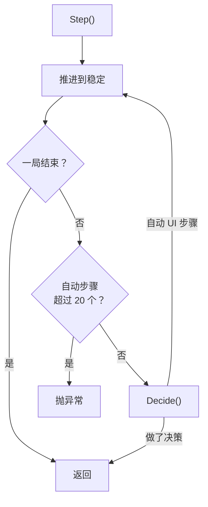

import { Aside, Badge, Steps } from '@astrojs/starlight/components';

模拟器就是 `Sts2Ai.SimWorker`：一个普通的 .NET 进程，加载游戏自己的 `sts2.dll`，以**无头**（headless）方式运行游戏规则，没有 Godot 引擎、窗口、渲染和声音。规则就是游戏本身的代码，不是重写的（[总览 §1](/#sec-1)，约束 4）。决策进程从不加载游戏，而是与模拟器进程通信（[总览 §3](/#sec-3)）。

<Aside title="状态">

已有：无头宿主、单场战斗会话、Determinize、CombatBuilder、整局会话、战斗世界（[§6](#sec-6)），以及给 PIMC 的 NoSL 世界用的 worker 进程池（[§8](#sec-8)）。规划中：SL 克隆，以及单个 PIMC 世界之外的 worker 请求。

</Aside>

一个 worker 进程有三种角色：

- **(a)** R1–R3 中「真实」一局的宿主（R1–R3 是[仿真到实机阶梯](/arch/evaluation/#sec-1)中由模拟器而不是真实游戏来玩这一局的几级）；
- **(b)** 搜索世界：NoSL 样本和 SL 克隆（[环境 §5](/arch/environments/#sec-5)）；
- **(c)** 基准测试和 selftest。

每个进程同一时刻只持有**一个活着的一局或一场战斗**。游戏把一局和战斗放在进程级单例（`RunManager`、`CombatManager`）里，所以第二局无法与第一局并存。因此分支靠重放来做（[§2](#sec-2)），并行搜索需要多个进程（[§8](#sec-8)）。

像 `Runs/RunManager.cs:295-312` 这样的文件引用指向反编译出的游戏程序集。Godot 节点文件（`NGame.cs`、`NRestSiteRoom.cs`）按文件名唯一，所以只写文件名。

## 1. 无头宿主

游戏是一个 Godot 应用。规则写在托管 C# 里（「模型层」），界面写在 Godot 节点里。无头运行时只跑模型层。这要靠三样东西：原生引擎的桩（stub）、一组 Harmony 补丁（在运行时改写游戏方法），以及游戏自带的 `TestMode`：这是游戏为自动化测试准备的开关，打开后大部分模型代码会跳过表现层。

`HeadlessGame.Boot` 每个进程运行一次：

<Steps>

1. `GodotNativeStub.Install`。GodotSharp 通过一张原生函数指针表访问引擎。没有引擎时，桩把每个槽都填成同一个返回清零内存的小函数，于是碰到 Godot 的托管代码可以无副作用地跑过去。
2. `HeadlessPatches.Apply`：安装下面列出的各组补丁。
3. `TestMode.TurnOnInternal`。
4. `ModManager.State=Skipped`：无头时从不加载 Mod。
5. `AssemblyInfo.Init`、`ModelDb.Init`、`ModelIdSerializationCache.Init`、`ModelDb.InitIds`：加载游戏的模型数据库。
6. `LocalContext.NetId=1`。
7. 测试用的设置和偏好，`FastMode=Instant`。

</Steps>

游戏的 `Log.Error` 输出和未观察到的任务异常都会被收集起来，selftest 断言它们为零。

补丁分组（`HeadlessPatches.cs`）：

| 分组 | 作用 |
|---|---|
| 引擎外壳 | 用托管外壳代替引擎：OS、Time、单例、资源、本地化、玩家名 |
| 资源预加载 | 关闭 |
| 表现层 | 模型代码中没有 TestMode 守卫就进入表现层的地方：Kaiser Crab 的手臂、SoulNexus、`EventPresentation` 转译器（[§5.2](#sec-5.2)） |
| 持久化 | 关闭：`SaveRun`、进度、回放。任何磁盘 IO 都会抛异常。 |
| 规则保真 | 恢复被 TestMode 改掉的正式版规则：RollingBoulder 逐个敌人命中；`ShippedBranch` 转译器在 MerchantPotionEntry、Cauldron、CallingBell 中把 TestMode 分支换回正式版分支 |
| 速度 | `FastCreatures`、`FastPlayerCreatures`、`FastPlayers`；`FastHookListeners`，通过反向补丁与游戏原本的监听器逐一比对 |
| 选择 | `ChooseABundle`、`CrystalSphereScreen`、`CardRemovalUsed`；另有 GameBridge 的 `ChoiceContexts`，最先打补丁（[GameBridge §5](/arch/gamebridge/#sec-5)） |

转译器（transpiler）是一种 Harmony 补丁，它直接改写方法的 IL，而不是在方法外面包一层。

**JIT。** csproj 里设了 `TieredCompilation=false`。开启分层编译时，运行时会在后台重新 JIT 热点方法，曾有一次重新 JIT 在几千场战斗之后悄悄丢掉了一个 Harmony 补丁。启动时还要设 `DOTNET_ReadyToRun=0`（快约 20%）。

**Pump。** `Pump` 是一个单线程的 `SynchronizationContext`。游戏的异步代码（动作、钩子、命令）把后续回调投递给它，驱动方 pump 时，这些回调全部在驱动线程上执行。没有任何东西在别的线程上跑，事件顺序因此固定：确定性正是从这里来的。`RunUntil(cond)` 一直 pump 到条件成立；`Drain()` 执行队列里的全部回调。**推进到稳定**（settle）指一直 pump，直到游戏再次等待玩家操作。

**运行方式。** 把 `HOME` 设成一个临时目录，并设 `DOTNET_ROOT=~/.dotnet`。可执行文件是 `src/Sts2Ai.SimWorker/bin/Release/net9.0/Sts2Ai.SimWorker`。

**命令行**（完整选项见 `Cli.cs` 文件头）：

| 命令 | 作用 |
|---|---|
| `list` | 列出本游戏版本里的角色、幕和遭遇 |
| `combat --encounter ID` | 跑一场战斗，打印每一步 |
| `combat --from OBS.json` | 同上，但从一场按该观测构建的战斗开始（[§3](#sec-3)） |
| `run` | 跑整局（[§5](#sec-5)）；`--policy pimc` 让战斗大脑在 worker 里打其中的战斗（[§8](#sec-8)），`--macro l0` 让宏观大脑做其余决策 |
| `report` | 用对局记录生成评估报告（[评估 §6](/arch/evaluation/#sec-6)） |
| `seeds` | 输出一个种子集的种子（[评估 §4](/arch/evaluation/#sec-4)） |
| `bench` | 在一个遭遇池上跑大量战斗：吞吐量和失败数（[§4](#sec-4)） |
| `selftest` | 检查确定性、恢复、确定化等（[§9](#sec-9)） |
| `forkbench` | 一次恢复和一个搜索分支的开销（[§4](#sec-4)） |
| `panel` | 固定的战斗测试集：占位策略或战斗大脑，每个玩家用同样的种子（[战斗大脑 §7](/arch/combat-brain/#sec-7)） |
| `serve` | 作为 worker 运行：从 stdin 读 JSON 行请求，在 stdout 回复（[§8](#sec-8)） |

所有会跑战斗的命令都接受配装选项（角色、牌组、遗物、药水、生命值）。

## 2. 战斗会话

战斗会话在真实引擎里跑一场战斗。它由 `CombatSetup(Character, Encounter, ActIndex, Seed, Ascension, Loadout?, From?)` 描述，启动过程如下：

1. `Player.CreateForNewRun(ch, UnlockState.all)`，然后套用配装；
2. 用 `MockSinglePointActMap` 调 `RunState.CreateForTest`；
3. `RunManager.SetUpTest`；
4. `EnterRoomDebug(Monster, encounter)`。

这**不是**真实的移动路径：它跳过了 `?` 掷骰及其概率，也跳过了 `GenerateRooms` <Badge text="已核实" variant="success" />。对孤立的战斗没问题，对整局则是错的，整局有自己的开局方式（[§5](#sec-5)）。

**快照与恢复。** 快照是一份配方，而不是游戏对象的拷贝：`(Setup, Trace)`。轨迹（trace）的每一项是 `Action`、`Choice(game indexes)`、`Determinize(seed)` 三者之一。恢复时，按 setup 重新开一场战斗，再重放轨迹。相同的 setup 和轨迹总是得到相同的状态，因为所有随机性都来自带种子的随机数流。`Rng.Chaotic`（用时钟做种子）只影响外观 <Badge text="已核实" variant="success" />：皮肤、屏幕震动、对白、Trial 的参赛者编号、YummyCookie 图标、加牌动画的时间。

**确定化。** `Determinize(seed)` 把玩家不可能知道的一切换成由 `seed` 抽出的样本，可见状态保持不变。只从确定化状态出发分支的搜索用不到真实的未来，不同的种子给出不同但合理的未来。种子只来自调用方，绝不来自本局。它调用 `Resample(new Rng(seed))`，做以下几件事：

- 为每条 `RunRngType` 流、每条 `PlayerRngType` 流和每个怪物的 `Rng` 重新播种；
- 重排抽牌堆：先按卡牌键排序（这个顺序只取决于玩家看得到的东西），再做一次 Fisher–Yates 洗牌；
- 给手牌以外的牌重新编号（`CombatBuilder.NumberCards`）。游戏按抽牌顺序给牌编号，旧 id 会泄漏真实的抽牌顺序；
- 对每个敌人，在显示相同意图的动作中均匀地重新抽取 `NextMove`，并把状态日志的最后一项（`StateLog[^1]`）改成与之一致。

**执行。** `Execute` 通过 `CombatActions.Start`（UI 入口）发起动作，然后推进到稳定：一直 pump 到 `WaitingForInput` 或战斗结束。

**uid。** 动作用 uid 指代卡牌和生物：手牌用它的 `NetCombatCardDb` id，生物用它的 `CombatId`。例如 `play:7:2` 表示把 7 号牌打向 2 号生物。因为编号是确定的，重放也是确定的。

## 3. CombatBuilder

`CombatBuilder` 构建一场显示给定观测的战斗。`CombatBuilder.Setup(obs, seed)` 的步骤：

1. 用观测里的牌组和遗物开始这场遭遇；
2. `Apply` 覆盖可见状态：回合数；敌人（增、删、排序）；生命值和格挡；能量；金币；药水；充能球栏位和充能球，连同它们显示的数值；遗物计数器（显示的或隐藏的）和已用尽的遗物；能力；4 个牌堆及每张牌的修改；意图；
3. `Resample(StableHash(seed))` 抽取隐藏状态；
4. `BuildDifferences` 按 JSON 路径比较输入观测与重建后战斗的观测。为空表示完全一致。

细节：

- **旋钮求解。** 显示出来的数字由内部整数推出，每种能力或遗物的推法都不同。构建器逐个尝试整数（数值、动态变量、字段），直到显示一致。观测中已用尽的遗物（用过的 `LIZARD_TAIL`、飞行次数用完的 `WINGED_BOOTS`）也这样处理：逐个尝试它的整数和布尔字段，直到重建的遗物同样用尽。
- **意图。** 构建器在显示所观测意图的动作中选择。被眩晕的敌人会得到一个合成的眩晕动作，做法与 `Creature.StunInternal` 相同（`FollowUpStateId = StateLog.Last().Id`）。先搜索能力里隐藏的枚举开关（例如 `SurroundedPower._facing`），再搜索怪物自己的整数字段（例如瀑布巨人的压力枪伤害，每开一次火就涨一次），使匹配的敌人数最多。
- **uid** 与观测对齐；其他牌编在它们之后。
- **近似（缺口）**：每回合的历史和内部计数器；费用修正的持续时间；玩家减益的衰减；真实眩晕动作的后续；牌组 = 见过的所有牌，包括生成的牌；非玩家盟友不构建。从未在真实游戏的观测上验证过。

selftest 矩阵（2026-10-27），所有检查都通过：

| 组合 | 战斗数 |
|---|---|
| SILENT | 60/60 |
| IRONCLAD | 58/58 |
| SILENT，精英 + Boss，第 0 / 1 / 2 幕 | 57 / 57 / 58 |

## 4. 性能

测于 2026-10-26，Release 构建，`DOTNET_ReadyToRun=0`。

**战斗**（`bench`，第 0 幕弱遭遇 + 普通遭遇，`play` 策略）：

| 角色 | 战斗数 | 战斗/秒 | 动作/秒 | 每场用时 |
|---|---|---|---|---|
| SILENT | 5000 | 319 | 10.3k | 3.1 ms |
| IRONCLAD | 2000 | 379 | | |

短批次（n=200）约 6.7 ms 一场：主要耗在启动和 JIT 预热上。

**分支**（`forkbench`）。一个搜索分支 = 一次恢复 + 一次确定化 + 用占位策略推演（rollout）到战斗结束。

| 指标 | 数值 |
|---|---|
| 恢复 | 0.28 ms + 每个重放动作 0.073 ms |
| 分支 | 中位数 2.78 ms，p90 3.97 ms |
| 平均根深度 / 平均推演长度 | 15.8 / 16.6 个动作 |
| 吞吐量 | 每核 329 分支/秒 |

**多进程**（每个进程 `bench` n=3000；墙钟时间包含约 1.2 s 启动）：

| 进程数 | 战斗/秒 |
|---|---|
| 1 | 275 |
| 4 | 1060 |
| 8 | 1860 |
| 12 | 1879 |
| 16 | 2019 |

机器有 8 个物理核；SMT 约多 8%。默认进程池为 8 个进程。每个 worker 约占 160 MB 内存。

**整局**（`run`：SILENT A0，9999 生命值，随机宏观策略 + `play` 战斗策略；耗时主要在随机打法下拖得很长的战斗上）：每进程约 1,800 个决策/秒，每局约 0.4 s；8 个进程各跑 50 局，墙钟 22 s。

**可用的提速手段**，按顺序：

1. 减少重放深度：深度优先搜索中复用前缀；节点检查点（[§5.4](#sec-5.4)）。
2. 按钩子过滤监听器（需要 `perf`，尚未安装）。
3. 对象图深拷贝：消除重放开销；AlphaZero 式搜索需要它。

## 5. 整局会话

`RunSession`（`RunSession.cs`）跑完整的一局：使用真实的世界初始化（[§5.1](#sec-5.1)），每个决策都经由 GameBridge 入口，与 Mod 将来调用的是同一批函数。游戏自己运行每个房间；驱动方扮演 UI 的角色：当前显示哪个界面、界面上的按钮做什么。

界面本该记住的东西按房间存放在 `RoomProgress` 里：已离开房间、已发放奖励、休息成功、宝箱已打开、遗物已选。`CurrentRoom` 变化时它会重置，事件里的战斗结束、回到该事件时也算变化。

**Step。** `Step()` 先推进到稳定，再调用 `Decide()`。`Decide()` 做一个决策，或者做一个自动的 UI 步骤（发放战斗奖励、打开宝箱、离开宝箱房）。连续超过 20 个自动步骤就抛异常。

**推进到稳定。** 战斗中，pump 到 `WaitingForInput`（EndTurn 之后：要到后面的回合）。战斗外，pump 到 pump 队列为空且动作执行器空闲。然后收集驱动方发起的游戏任务（`_running`：购买、休息选项、奖励、占卜……）。出错的任务会抛异常。

**Decide 的顺序：**

1. 最新打开的奖励界面；
2. 驱动方的任务还在运行，却没有可以应答的界面：抛异常；
3. 地图（在 `MapRoom` 里，或已离开房间）；
4. 按房间：战斗、事件（先处理水晶球小游戏）、商店、休息处、宝箱。其他房间抛异常。

**策略：**

- 战斗：`ICombatPolicy`；
- 选牌提示：经由 `PolicySelector`，以 `ChoiceDecision(choice, observation)` 交给 `IChoicePolicy`（另有卡牌奖励和卡包的处理器）；
- 其他所有界面：`IMacroPolicy`（`MacroDecision(surface, legal, observation)`）：宏观大脑（[宏观大脑 §2](/arch/macro-brain/#sec-2)）或占位实现 `RandomMacro`。

选牌提示的选择数量范围来自它的上下文（`ChoiceContexts.Bounds`）：可取消的提示 min 为 0。

**输出：**

- 轨迹：每个决策记为「surface action」，包括在其他动作内部回答的选牌提示；
- 每一幕地图的哈希；
- `Summary()`：幕、层数、房间、生命值、金币、牌组、遗物、药水；
- 可选的 `observed` 回调：在每个决策的动作生效之前，收到该决策的 `Observation`。

`IsOver = RunState.IsGameOver`。一局在胜利房间里结束即为获胜。

**命令行**：`run [--n] [--start] [--seed | --seeds FILE] [--asc] [--policy play|random|pimc] [--macro random|l0] [--worlds] [--nodes] [--workers] [--max-decisions] [--check] [--trace] [--obs] [--log FILE] [--records FILE] [--brain SOCKET]`，外加配装选项。每个决策都经过 Harness 的 `Dispatcher`（[Harness §4](/arch/harness/#sec-4)），会话把它当作自己的战斗、提示和宏观策略。用 `pimc` 时，每个战斗决策都在 worker 进程池里搜索（NoSL），除非 `--workers` 另行指定，每个世界一个 worker；这一局本身一直活在本进程里。`--macro` 选择战斗之外所有决策的大脑：`random`（占位策略）或 `l0`（宏观大脑）；战斗中的选牌提示仍然随机。`--seeds` 从 `--start` 起跑一个种子文件里的种子，`--records` 为每局写一条对局记录，供 `report` 使用（[评估 §4](/arch/evaluation/#sec-4)、[§6](/arch/evaluation/#sec-6)）。`--check` 还会观测每个决策：每个观测的 JSON 往返必须完全一致，重放时比较观测哈希，每局的结果行末尾附上它们的摘要（`obs`）。`--obs` 打印每个观测。`--log` 写出决策日志（[Harness §6](/arch/harness/#sec-6)）。`--check` 把每个种子再打一遍，这一遍走传输协议（[协议 §2](/arch/protocol/#sec-2)），连到同一进程里一个线程上运行的 `BrainServer`，冠军相同，然后比较两遍：轨迹、观测、对局记录和决策日志。

`--brain SOCKET` 则让这些对局连到在 SOCKET 上等待的 brain 去打，与将来的 Mod 一样：每局发送 `hello`，带上由种子哈希得到的对局 id，每个决策都连同它的观测一起发出。冠军由 brain 决定，所以 `--policy`、`--macro`、预算选项和 `--log` 都属于 brain。`brain [--socket PATH] [--policy …] [--macro …] [--worlds] [--nodes] [--workers] [--log FILE]` 就是这个 brain：单独运行的 Harness，一次服务一个连上来的宿主，默认套接字是 `~/.local/state/sts2ai/brain.sock`（[Mod §5](/arch/mod/#sec-5)）。它自己不需要游戏；pimc 的搜索 worker 各自启动游戏。它每局打印一行，附上它的 worker 的游戏错误，宿主的对局记录不计入这些错误。

### 5.1 开局

一局的开始方式与游戏开始一局新的单人游戏相同。游戏里负责这件事的代码是 `NGame.StartRun`，它在一个 Godot 节点里 <Badge text="已核实" variant="success" />，所以 `RunSession` 复制了它的逻辑。从 `RunSetup(Character, Seed, Ascension, Loadout?)` 出发：

1. `Player.CreateForNewRun(ch, UnlockState.all, NetId)`，然后套用配装；
2. 用 `ActModel.GetRandomList(Rng(hash(seed),"act_selection"), UnlockState.all, false)` 掷出各幕，与 `StartRunLobby.BeginRunLocally` 的做法相同；
3. `RunState.CreateForNewRun`；
4. `SetUpNewSingleplayer(run, shouldSave:false)`；
5. `FinalizeStartingRelics`、`Launch`、`EnterAct(0, false)`；
6. 推进到稳定。第一个决策是 Neow。

出处：`Nodes/NGame.cs:1138-1145,1176-1187`；`Runs/RunManager.cs:295-312,711-738`。

- 不用 `SetUpTest`，因为它跳过 `GenerateRooms`（`RunManager.cs:743-771`）：没有 Ancient 事件，也没有双 Boss。
- `UnlockState.all` 表示全部已发现，且 `NumberOfRuns` 很大，所以没有新手调整，一局从 Neow 开始。
- 尚未做：照搬用户真实的存档档案（需与 R4 对照验证）；把进阶等级限制在角色的上限内（`StartRunLobby.cs:485-491`）。调用方传入的都是合法值。

### 5.2 决策界面

决策界面（surface）指决策屏幕的种类。下表按已实现的情况列出每一种；动作语法见 [协议 §3](/arch/protocol/#sec-3)。「合法动作」是 GameBridge 列出的内容，「执行」是实际完成这个动作的游戏调用。

| 界面 | 合法动作（GameBridge） | 执行 | 备注 |
|---|---|---|---|
| map | `MapActions.Travelable`：沿用 `NMapScreen.RecalculateTravelability` 的规则，按 (行, 列) 排序 | `RequestEnqueue(VoteForMapCoordAction(…))` | |
| combat | `CombatActions.Legal` | `CombatActions.Start` | 获胜后：`room.OfferRoomEndRewards()`；若 `!Encounter.ShouldGiveRewards` 则 `ProceedFromTerminalRewardsScreen`。自动完成，与 `NCombatUi.OnCombatWon` 相同。 |
| rewards | 未领取的奖励（药水只在有空槽时出现）；`rewards_done`，除非 `DisallowSkipping` | `SelectLocalReward` | 奖励组通过 `RewardsSet.testSelector` 送达（`ThrowInTestIfRewardsNotTaken=false`）。非终结的奖励组在 `IsRewardsSetCompleted` 后关闭。选择完成时：非终结组 → `SkipLocalRewardsSet`；Boss 或胜利（不在双 Boss 之间） → `ActChangeSynchronizer.SetLocalPlayerReady`；否则 `ProceedFromTerminalRewardsScreen`（与 `NRewardsScreen` 的做法相同）。 |
| card_reward | 各张卡牌加替代选项；每个界面可重抽一次（用过后按钮仍在列表里） | `PolicySelector.GetSelectedCardReward` 处理器 | |
| card_choice | 经由 `PolicySelector` 交给 `IChoicePolicy`；数量范围由 `ChoiceContexts.Bounds` 给出 | 回答就是所选的牌；空回答表示取消或跳过 | 上下文在 `CardSelectCmd.From*` 入口内部读取。没有跳过按钮的选一张牌 min 为 1（游戏在选择器之后强制执行）。 |
| bundle | `bundle:i` | 在 `CardSelectCmd.FromChooseABundleScreen` 上加前缀补丁：预留选择 id、询问、`SyncLocalChoice` | TestMode 会强制选 `bundles[0]`。唯一的调用方是 ScrollBoxes。 |
| event | 去掉锁定项后的选项 | `EventSynchronizer.ChooseLocalOption(i)` | `IsProceed` 选项是 UI 按钮：Ancient 事件的「PROCEED」对应 `proceed`；Trial 的 DOUBLE_DOWN（放弃弹窗）永远不合法。事件结束后唯一的动作是 `proceed`，即打开地图（无头时 `NEventRoom.Proceed` 会抛空引用异常）。 |
| crystal_sphere | `big:X,Y`（3x3 区域）或 `small:X,Y`（单格），仅当能揭开隐藏格子时提供 | `SetTool` + `CellClicked` | CRYSTAL_SPHERE 小游戏。`NCrystalSphereScreen.ShowScreen` 上的前缀补丁把它交给驱动方（`HeadlessPatches.CrystalSphereShown`）。最后一次占卜后，奖励以一个奖励组送达。提供小工具是为了能避免把诅咒完整揭开。 |
| shop | 有货且买得起的 `buy:i`（药水需要空槽）；`remove`；`leave` | `OnTryPurchaseWrapper(inv)` | `CardRemovalUsed` 把删牌标记为已用，这本是删牌节点的工作；它也覆盖 Lord's Parasol 的免费删牌。TestMode 下 `MerchantRoom.Exit` 提前返回，所以不写历史（只影响外观）。 |
| rest | 可用的选项；成功一次后或没有可用选项时提供 `leave` | `RestSiteSynchronizer.ChooseLocalOption` → `Task<bool>` | `NRestSiteRoom.cs:333,571-596` |
| treasure | `relic:i`、`relic_skip` | 宝箱自动打开（`DoNormalRewards` + `DoExtraRewardsIfNeeded`）。选或跳过一次，然后 `ProceedFromTerminalRewardsScreen`。 | 单人模式下跳过后 `CurrentRelics` 仍非空，所以需要 `RelicPicked` 标记。 |
| 药水栏 | `potion:S`（随时可用的药水）、`discard_potion:S`；附加在每个宏观决策界面上 | `EnqueueManualUse` / `DiscardPotionGameAction` | 药水栏满时，药水奖励和药水购买都会隐藏，直到空出一个槽。 |
| 失败 / 胜利 | 无 | 无 | `RunState.IsGameOver`。胜利房间表示获胜；之后游戏会杀死玩家。 |

**整局需要的补丁**（[§1](#sec-1)）：

- 资源预加载；
- 模型代码中绕过 TestMode 守卫的表现层代码：Kaiser Crab 的手臂（`BeforeDeath`）和 SoulNexus（`AfterDeath`）；
- `EventPresentation` 转译器。在每个 `EventModel` 子类里（包括其中的 lambda 和异步状态机），调用 Godot 对象或返回 Godot 对象的调用会被丢掉并返回默认结果，`Task.Delay` 变成已完成的任务。涉及 Amalgamator、DenseVegetation、DollRoom、JungleMazeAdventure、PunchOff 和 Trial；
- `CrystalSphereScreen`；
- `ChooseABundle`；
- `CardRemovalUsed`。

用 9999 生命值配装时观察到的**正常游戏行为**（不是 bug）：

- 击杀机制：THE_INSATIABLE 的 Sandpit `Kill`，以及 THE_LOST_AND_FORGOTTEN 偷取力量和敏捷（约 156 回合）；
- PunchOff 的「event not finished」警告：它的战斗带有 `shouldResumeAfterCombat:false`，真实游戏里也会同样警告。

### 5.3 确定性

测于 2026-10-26，200 个种子（SILENT A0，9999 生命值，随机宏观策略 + `play` 战斗策略）：

- `--check` 在同一进程内重放每一局：200/200 完全相同（轨迹、摘要、地图哈希）。
- 同样的 200 个种子换一种进程划分（8 个进程各 25 局对比 4 个进程各 50 局），逐行完全相同：结果、摘要、决策数、地图哈希。所以 `MapPoint.Children` 顺序不一致的风险没有出现；`MapActions` 仍然会排序。
- IRONCLAD、DEFECT、REGENT、NECROBINDER（各 25 局，`--check`）：重放全部相同，0 失败，0 游戏错误。
- 加上观测后（相同设置）：每个观测的 JSON 往返都完全一致；200/200 重放相同，包括每个决策的观测哈希；8 × 25 与 4 × 50 的每局结果行相同，包括观测摘要；其他 4 个角色（各 25 局）相同；0 失败，0 游戏错误，0 次空闲等待。每个决策界面都到达过；最少见的是 bundle，200 局里出现在 9 局。

TestMode 会改动一些规则。对整局有影响的分支（来自本地笔记 `tmp/notes/testmode-audit.md`）：

| TestMode 分支 | 处理方式 |
|---|---|
| RewardsSet 自动领取 | `testSelector` |
| ChooseABundle | 前缀补丁（[§5.2](#sec-5.2)） |
| ActModel 第 1 幕调整和新手调整 | 使用 `UnlockState.all` 时不会发生 |
| `MerchantRoom.Exit` | 只影响外观 |

**真实时间等待。** 模型代码不能使用 `Task.Delay`：真实时间的等待会破坏静止判定，推进到稳定时就无法判断游戏何时空闲。Amalgamator 已打补丁。其他几处在无头时不会走到：`ActionExecutor.WaitForUnpause`（暂停时每 50 ms 轮询一次）、`CombatState.GodotTimerTask`（按 net id 查找生物时的超时）、休息处的悬停提示（UI）。守护手段是 pump 的空闲等待计数，即它不得不阻塞、等待其他线程投递工作的次数：在 200 局的批次里 `pump idle waits` = 0。

**内联执行。** 在 `NonInteractiveMode` 下，游戏内联执行动作，而不是每帧让出一次，所以「发出即不管」（fire-and-forget）的工作顺序可能与真实游戏不同。这一点记在 R2/R3 差异清单里。

### 5.4 整局快照

从开局重放整局，要付出 0.073 ms 乘以几千个动作的代价。所以改为：

- 每次进入节点时，保存 `RunManager.ToSave(null)`，即游戏自己的序列化器；
- 整局快照 = `(checkpoint, node trace)`；
- 恢复时加载检查点（走 [§7](#sec-7) 的路径），再重放节点轨迹。

这与 SL 克隆是同一个机制，所以只有一条代码路径，两边的测试都覆盖它。加载开销还有待测量（未决问题 1，[§10](#sec-10)）。

## 6. NoSL 世界

NoSL 世界是一个确定化样本：一个与玩家见过的一切都一致的完整游戏状态（[环境 §1](/arch/environments/#sec-1)）。战斗世界已实现；整局世界还在规划中。

- **输入**：公开记录（协议类型）和一个搜索种子。**输出**：与之一致的采样状态。
- **战斗世界**：`SimWorlds` 在一个进程内实现世界 API（[协议 §7](/arch/protocol/#sec-7)）。根是 `CombatBuilder.Setup(combat obs, build seed)`，从观测构建，从不取自真实战斗。第 k 个世界 = 根 + `Determinize(seed_k)`，`seed_k` 由搜索种子和 k 混合得到。从记录推出的旋钮（回合历史、动作后验）仍是缺口（[§3](#sec-3)）。
- **所有世界共用一场活战斗**。每个世界保存自己的轨迹，它的快照就是这份轨迹。当另一个世界正处于活状态时使用某个世界，它会从根开始重放来重建自己；只在一个世界里进行的搜索，只有回退时才重放。世界里的选牌提示随机回答，随机数生成器由该世界的种子和轨迹长度播种。世界的轨迹取自活战斗，所以也包含战斗开始时问到的提示（每回合开始时都会问的遗物）；重放按顺序发放记录下的选择，缺了这些，后面某个提示的选择就会被它们拿走。
- **与真实战斗共用一个进程**。进程内搜索（不带 `--workers` 的 `panel`，[战斗大脑 §7](/arch/combat-brain/#sec-7)）在每个决策之前把真实战斗保存为快照，让世界使用这个进程，之后再通过重放把真实战斗放回去。用 worker 进程池（[§8](#sec-8)）时，世界在 worker 里，真实的战斗或一局一直活着，没有这种交接。
- `SimWorlds.SL` 是同一个类，以真实战斗的快照为根、只有一个世界：这场战斗的精确副本，没有封存（[§7](#sec-7)）。
- **整局世界**（越过节点的宏观搜索）：从 `RunView`（牌组、遗物、药水、生命值、金币、幕、层数、地图、已访问的点）构建一个 `SerializableRun`，隐藏部分用采样填充：每条随机数流；`RoomSet` 的内容和计数器（依据规则：各幕的池子减去已见过的）；抽取袋（grab bag）；概率（能从奖励历史推断的就推断，否则用先验）。像存档一样加载它（[§7](#sec-7)）。是否精确由观测往返测试来检验。
- R1 与 R4 走同一条 Build 路径，决策时不走「对真实状态做确定化」的捷径，所以各级阶梯上的行为完全相同。对真实状态做 `Determinize` 只保留给测试和基准测试。

## 7. SL 节点克隆

规划中。SL 克隆是当前节点的一个精确副本，在节点出口处封存（[环境 §6](/arch/environments/#sec-6)）。它的构建方法是：像游戏「继续游戏」（Continue）的路径加载存档那样，加载节点入口的检查点 <Badge text="已核实" variant="success" />：

<Steps>

1. `SaveManager.FromJson<SerializableRun>(json)`（`Saves/SaveManager.cs:786`），或者用迁移管理器（`RunSaveManager.cs:115`）。可选：`RunManager.CanonicalizeSave(save,1)`。
2. `state = RunState.FromSerializable(save)`。
3. `await RunManager.Instance.SetUpSavedSingleplayer(state, save)`。它要求 `State==null`，所以两次会话之间要调用 `CleanUp()`。它会让 `NumReloads` 加一，但只在进程内：无头时从不写盘，而且这个字段只用于统计 <Badge text="已核实" variant="success" />。
4. `Launch()`；`await GenerateMap()`（存档里的地图）。
5. `await LoadIntoLatestMapCoord(AbstractRoom.FromSerializable(save.PreFinishedRoom, state))`，它会调用 `EnterMapPointInternal(saveGame:false)`。这样得到相同的 `?` 掷骰结果、遭遇、怪物生命值（Niche）、开局洗牌和怪物动作。
6. 在 harness 内赢下战斗后，调用 `room.OfferRoomEndRewards()`；真实游戏里这一步由 UI 完成。

</Steps>

- **模板**：`Nodes.Debug.Multiplayer/NMultiplayerTest.cs:535-600`。它还会把存档里没有的动作、钩子、选择和奖励 id 快进到位（:552-556），这是 uid 与真实游戏对齐所必需的。
- 然后重放节点的动作日志（[Mod §6](/arch/mod/#sec-6)）。
- **封存**：一个世界包装层拦截移动动作（以及一局结束），设置 `AtHorizon=true`；之后任何 `Execute` 都会抛异常。
- **视野边界反事实的辅助工具**：扰动 RoomSet 的尾部、UnknownMapPoint、TreasureRoomRelics、抽取袋的尾部和后续地图种子（[环境 §7](/arch/environments/#sec-7)）；逐一测试节点内从不读取它们。

## 8. worker 进程池与 IPC

worker 就是同一个可执行文件以 `serve` 启动。`WorkerPool`（在 `Sts2Ai.Harness` 里，它只通过协议类型看到游戏）启动 N 个 worker，在池的整个生命周期里一直用它们。

- **线路**。每条消息是 stdin/stdout 上的一行 JSON（[协议 §7](/arch/protocol/#sec-7)）。worker 启动完（约 1.2 s）先写一行 `WorkerHello{game}`，之后按顺序对每一行请求回一行 `WorkerReply`，直到 stdin 关闭。游戏启动之前，`serve` 把 `Console.Out` 转到 stderr，所以游戏打印的任何东西都进不了这条流。池为每个 worker 保留最后 20 行 stderr，用于错误信息。
- **目前唯一的请求**是 `PimcWorldRequest`：PIMC 对一个战斗决策中一个 NoSL 世界的搜索。worker 用构建种子从观测构建战斗（`SimWorlds.NoSL`，[§6](#sec-6)），取由搜索种子抽出的第 k 个世界，对本回合做深度优先搜索（[战斗大脑 §2](/arch/combat-brain/#sec-2)），回复每个首个动作之后的最佳路线。`PooledPimc` 每个世界发一个请求，再用与进程内 PIMC 相同的方式合并回复（[战斗大脑 §2](/arch/combat-brain/#sec-2)）。
- **自包含的请求**。请求带着 worker 需要的一切，请求之间不留任何状态。所以任何空闲的 worker 都能接任何请求，离开宿主进程的只有 NoSL 观测：真实状态永远不会到达 worker。
- **确定性**。回复按请求顺序合并，绝不按完成顺序。种子相同时，结果与进程内搜索完全相同，连数值也一样：`selftest --workers N` 检查四个决策；6 场战斗的 panel 轨迹，用 8 个 worker 和进程内相比，diff 为空。
- **崩溃**。关闭 stdout 或管道断开的 worker 会被重启，请求再发一次；第二次失败就报错。次数报告为 `worker restarts`。带错误的回复（worker 内的异常）让这个决策失败；worker 里游戏的 `Log.Error` 输出随回复返回，与宿主的一起计数。
- **速度**。6 场第 1 幕战斗、默认预算（8 个世界 × 300 个节点）下，8 个 worker 每个动作 68.7 ms，进程内是 307.5 ms（9.4 s 对 42.1 s）。用 `pimc` 战斗策略打整局，同时跑两局、每局 8 个 worker 时，每局约 19.9 s（[战斗大脑 §7.2](/arch/combat-brain/#sec-7.2)）。

为 SL 克隆和整局世界规划的请求：按种类（构建、克隆、整局宿主）打开一个世界，得到世界 id；然后对它做快照、恢复、执行、查合法动作、观测和分支；最后关闭。这样的世界在它的 worker 里保有活状态，所以它的分支应优先发给这个 worker（亲和性），因为换个 worker 恢复要付出重放的代价；快照仍可移植，所以任何 worker 都能接手。那时崩溃就从快照重新打开该 worker 的世界。

## 9. 测试

**已有，在 `selftest` 中：**

- 确定性；
- 恢复，且隐藏状态逐字节相同；
- 确定化保持观测不变，能重放，并能继续打下去；
- 构建出的战斗显示该观测，能恢复，并能继续打下去；只存在模型自身状态里的数值也能显示出来（磨损过的玻璃充能球、用完的银坩埚）；
- 快速钩子监听器与游戏原本的结果相同；
- Brain、Protocol 和 Harness 不触及任何游戏程序集（以 GameBridge 作为反面对照）；
- 带 `--workers N` 时：池化的 PIMC 与进程内 PIMC 选出相同的动作，数值相同，没有 worker 重启，worker 里也没有游戏错误；
- 协议往返；
- Rolling Boulder 的补丁路径被走到过；
- 搜索世界在选牌提示之后能精确恢复，带着每回合开始都会提问的遗物（Toasty Mittens）也一样；
- 没有游戏错误。

**已有，在 `run` 中：**

- `--check` 在同一进程内重放每一局，重放走传输协议，连到进程内的 brain，然后比较轨迹、摘要、地图哈希、观测哈希、对局记录和决策日志（除了其中的耗时）；每个观测还必须能完整地经过 JSON 往返；
- 报告列出从未到达的决策界面、驱动方失败（没有兜底：未知界面直接抛异常）、游戏的 `Log.Error` 输出，以及 pump 空闲等待（真实时间等待）。出现任何一项，退出码就是 1；
- 跨进程：同样的种子换一种进程划分再跑，对比每局的输出行。

2026-10-26 的结果见 [§5.3](#sec-5.3)。

**规划中**：SL 封存；视野边界反事实字段；Mod 能记录整局后，做 R3 与 R4 的同种子差异对比。

## 10. 未决问题

1. 加载一个检查点的开销，它决定了整局层面分支的主要成本。
2. 深拷贝还是重放：等搜索做出来、性能剖析表明恢复是主要开销时再定。
3. 从 `RunView` 构建整局世界：`RoomSet` 和各种概率中，有多少能推断出来，有多少只能用先验。
