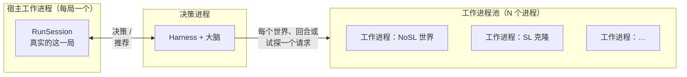

import { Aside } from '@astrojs/starlight/components';

搜索和自我对弈需要一个程序能运行的杀戮尖塔 2：开始一场战斗，试一条打法，退回去，再试另一条；一夜之间打一万局。**模拟器**就是这样的游戏。它不是规则的重写，而是游戏自己的 `sts2.dll`，加载进一个普通的 .NET 进程，以**无头**方式运行：没有 Godot 引擎，没有窗口，没有渲染，没有声音，CPU 有多快就跑多快。这个项目是 `Sts2Ai.SimWorker`，它的一个运行中的副本叫作*工作进程*（worker）。

本章讲游戏怎样被弄成这样运行，这样运行之后它能做什么（单场战斗、整局、搜索所探索的世界），以及它的许多副本怎样协同工作。

<Aside title="状态">

已有：无头宿主（[无头宿主](/arch/simulator/headless/)）；带快照、确定化和 CombatBuilder 的单场战斗会话（[战斗](/arch/simulator/combat/)）；经过每个决策画面的整局、两种连战，以及作为宿主、通过线路对接大脑来跑的对局（[整局](/arch/simulator/runs/)）；NoSL 战斗世界和 SL 节点克隆（[世界与 SL 克隆](/arch/simulator/worlds/)）；带四种请求的工作进程池（[工作进程池](/arch/simulator/pool/)）。规划中：整局世界，它能让 NoSL 搜索看到当前地图点之后的东西（[世界与 SL 克隆 §8](/arch/simulator/worlds/#sec-8)）。

</Aside>

## 1. 为什么用真实的游戏

杀戮尖塔 2 的每条规则都在游戏的 C# 代码里：几百张卡牌、遗物、能力、怪物和事件，每一个都有自己挂在回合、抽牌、伤害上的钩子。重写这些规则就等于做出第二个游戏，它必须在每个细节上都和第一个一致，而且游戏每打一次补丁它就会走偏。在一个稍有偏差的游戏里做规划的搜索，在真实游戏里就会打出稍有偏差的招。

所以项目的第四条约束是：模拟器*就是*真实的 `sts2.dll`（[前言 §2](/#sec-2)）。游戏版本固定在 v0.111.0。项目添加的是套在它外面的一层框架：一个代替引擎的桩（stub），一组关掉表现层、保持规则不变的补丁，以及一个扮演各个画面的驱动程序。

游戏的两个事实决定了其他的一切：

- **规则和画面是分开的**。游戏是一个 Godot 应用。规则在普通的 C# 对象里（卡牌、生物、房间、这一局），项目把它们称为*模型层*；画面是 Godot 节点（名字以 `N…` 开头的类，例如 `NCombatRoom`），它们绘制模型，并把点击变成调用。无头运行时只跑模型层，原本由画面调用模型的地方，改由驱动程序来调用（[无头宿主 §1](/arch/simulator/headless/#sec-1)）。
- **每个进程只有一局**。游戏把当前这一局和当前这场战斗放在进程级的单例里（`RunManager.Instance`、`CombatManager.Instance`）。在同一个进程里，第二局无法和第一局并存。所以分支靠**重播**来做（退回去的办法是从头开始，再把步骤重复一遍，[战斗 §2](/arch/simulator/combat/#sec-2)），并行搜索则需要多个**进程**（[工作进程池](/arch/simulator/pool/)）。

## 2. 工作进程做什么

一个工作进程有三种角色：

1. **做这一局的宿主**。在自我对弈和评估中，玩这一局的是模拟器而不是真实游戏：这是[仿真到实机阶梯](/arch/evaluation/#sec-1)的 R1–R3 几级。宿主工作进程持有唯一真实的这一局，每个决策都去问大脑，和 Mod 在真实游戏里的做法完全一样。
2. **搜索世界**。战斗大脑和宏观大脑在世界里试各种打法：NoSL 下是从观测构建的样本，SL 下是当前节点的克隆（[环境：世界 §1](/arch/environments/worlds/#sec-1)）。每个搜索请求发给池里的一个工作进程，由它构建或载入世界、在里面搜索，然后回复。
3. **基准测试和检查**。`bench`、`selftest`、`forkbench`、`fidelity` 和战斗测试集也在这里运行（[参考](/arch/simulator/reference/)）。

决策进程（Harness 和各个大脑在其中运行）从不加载游戏，它通过消息与工作进程通信（[前言 §3](/#sec-3)）。在真实游戏里，Mod 是宿主，工作进程只做搜索；在自我对弈中，宿主也是一个工作进程。Harness 分不出两者：“换世界，不换大脑”。

## 3. 全貌

在打整局的命令 `run` 里，宿主和决策进程是同一个进程：这一局在其中保持运行，各个大脑在它启动的工作进程池里搜索。用 `run --brain SOCKET` 时，大脑则是一个单独的进程，也就是 Mod 与之通信的那一个（[整局 §8](/arch/simulator/runs/#sec-8)）。

## 4. 代码

`src/Sts2Ai.SimWorker` 引用游戏、GameBridge、Protocol、Brain 和 Harness。它的代码按职责分文件夹；命名空间一律是 `Sts2Ai.SimWorker`。

| 文件夹 | 内容 |
|---|---|
| （根目录） | `Program.cs`：找到游戏的二进制文件，以本进程的副本启动工作进程 |
| `Runtime/` | 脱离引擎运行游戏：`HeadlessGame`（启动）、`GodotNativeStub`、`Pump`、各个补丁（`Runtime/Patches/`）、`FastHookListeners`、日志 |
| `Simulation/` | 战斗和整局的游戏一侧：`CombatSession`、`CombatBuilder`、`RunSession`、`SimWorlds`、`NodeWorld`、`PolicySelector`、`Loadout`、`GameSeeds` |
| `Brains/` | 一局的大脑需要的东西：冠军的选项（`ChampionOptions`、`LeafChoice`）、大脑连接和节点导出（`RunBrains`）、记录在日志里的对局 |
| `Commands/` | 命令行：每个命令一个类，共用的选项组在 `Args.cs` 里 |
| `Checks/` | 诊断（`selftest`、`fidelity`、`forkbench`），以及在克隆上回答 L0 试探的 `NodeProbe` |

`Simulation/` 和 `Runtime/` 不用 `Commands/` 里的任何东西。不需要游戏的 xUnit 测试在 `src/Sts2Ai.Tests` 里（[参考 §7](/arch/simulator/reference/#sec-7)）。

## 5. 本章内容

| 页面 | 讲什么 |
|---|---|
| [无头宿主](/arch/simulator/headless/) | 游戏怎样脱离引擎启动：原生桩、补丁、TestMode、JIT，以及让游戏具有确定性的单线程 `Pump` |
| [战斗](/arch/simulator/combat/) | 战斗会话、作为配方的快照、确定化、从观测构建战斗（CombatBuilder）、保真度和速度 |
| [整局](/arch/simulator/runs/) | `RunSession`：开局、“步进—稳定—决策”循环、每个决策画面、确定性、两种连战、作为宿主对接大脑跑对局 |
| [世界与 SL 克隆](/arch/simulator/worlds/) | NoSL 战斗世界、节点检查点、SL 克隆的载入与封存、SL 世界、整局世界 |
| [工作进程池](/arch/simulator/pool/) | 进程池、它的四种请求、跨进程的确定性、崩溃和速度 |
| [参考](/arch/simulator/reference/) | 构建与运行、每个命令和选项、退出码、每个测试 |

像 `Runs/RunManager.cs:295-312` 这样的文件引用指向反编译出的游戏程序集 `MegaCrit.Sts2.Core`（文件夹 `Runs/` 就是它的命名空间 `MegaCrit.Sts2.Core.Runs`）；像 `Simulation/RunSession.cs` 这样的项目路径，除非写明了别的项目，都在 `src/Sts2Ai.SimWorker/` 下。Godot 节点文件（`NGame.cs`、`NRestSiteRoom.cs`）按名字唯一，只给出文件名。
