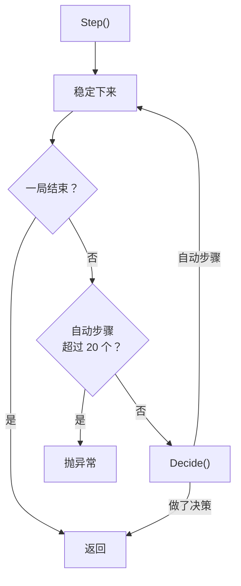

import { Badge } from '@astrojs/starlight/components';
import SurfaceCounts from '../../../../components/book/SurfaceCounts.svelte';

杀戮尖塔 2 的一局是三幕的地图点，以及几百到大约一千个决策：本书的示例对局是一局胜利，用了 997 个决策，其中四分之三在战斗里。`RunSession`（`Simulation/RunSession.cs`）在真实引擎里打这样的一局，每个决策都经过 GameBridge，也就是 Mod 在游戏里调用的同一批函数（[GameBridge](/arch/gamebridge/)）。本页从开始到结束跟着一局走一遍。

## 1. 一局是一个循环

无头运行时，游戏仍然自己运行每个房间：掷出遭遇、打怪物的回合、发放奖励。它不做的是显示画面，而在真实游戏里，有些事是由画面的代码决定的：战斗之后打开哪个画面，「继续」按钮做什么，什么时候打开地图。`RunSession` 扮演 UI 的这一部分。它知道此刻会显示哪个画面，询问这个画面上的决策，并做它的按钮会做的事（[无头宿主 §1](/arch/simulator/headless/#sec-1)）。

所以一局是一个循环：让游戏运转，直到它等待玩家；问一个问题；执行回答；如此反复。问题有三种，各由自己的接口回答：

| 问题 | 接口 | 由谁提问 |
|---|---|---|
| 战斗动作：打出一张牌、使用药水、结束回合 | `ICombatPolicy` | 驱动程序，在玩家的回合 |
| 选牌提示：弃一张牌、三选一、选要消耗的牌 | `IChoicePolicy` | 游戏，在某个动作内部，通过选牌器 `PolicySelector` |
| 其余一切：地图、奖励、卡牌奖励、事件、商店、休息处、宝箱、卡包、水晶球 | `IMacroPolicy` | 驱动程序 |

一局把每个决策记在它的**轨迹**里，每个决策一行文本：决策界面（surface，即决策画面的种类，[§4](#sec-4)）和动作，例如 `map 0,1`、`combat play:7:2` 或 `card_choice 3`。轨迹让一局可以重播：给定相同的设置和相同的回答，游戏打出的是同一局（[§6](#sec-6)）。

和战斗会话一样，一个进程同一时刻只有一局是活的：游戏的管理器（`RunManager.Instance`、`CombatManager.Instance`）是单例（[战斗 §1](/arch/simulator/combat/#sec-1)）。

## 2. 开局

一局的开始方式，与游戏开始一局新的单人游戏相同。游戏里做这件事的代码是 `NGame.StartRun`，它在一个 Godot 节点里 <Badge text="已核实" variant="success" />，所以 `RunSession.Start` 照抄了它（`Simulation/RunSession.cs:149-178`）。它的输入是 `RunSetup(Character, Seed, Ascension, Loadout?)`。

1. `Player.CreateForNewRun(character, UnlockState.all, netId)`，然后套用配置（如果给了的话，[参考 §3](/arch/simulator/reference/#sec-3)）。
2. 用种子掷出各幕：`ActModel.GetRandomList(new Rng(hash(seed), "act_selection"), UnlockState.all, isMultiplayer: false)`，与 `StartRunLobby.BeginRunLocally` 的做法相同（`Multiplayer.Game.Lobby/StartRunLobby.cs:469-472`）。
3. `RunState.CreateForNewRun([player], acts, [], GameMode.Standard, ascension, seed)`。
4. `RunManager.SetUpNewSingleplayer(run, shouldSave: false)`（`Runs/RunManager.cs:295-312`），它最后会生成房间（`GenerateRooms`）。
5. `FinalizeStartingRelics`，但只在配置没有指定遗物时才调用：配置里的遗物就是它们的最终状态，拾取效果已经做过，药水槽也包括在内。然后是 `Launch` 和 `EnterAct(0, doTransition: false)`（`Runs/RunManager.cs:711-738`）。
6. 稳定下来（[§3](#sec-3)）。第一个决策是第一幕的先古之民涅奥。

游戏里对应的源码是 `NGame.StartNewSingleplayerRun`（`Nodes/NGame.cs:1137-1144`）和 `NGame.StartRun`（`Nodes/NGame.cs:1179-1190`）。

有三点刻意没有照测试用的初始化那样做：

- 这一局不用游戏的 `SetUpTest`（`Runs/RunManager.cs:446-462`），因为它跳过 `GenerateRooms`（`Runs/RunManager.cs:743-767`）：没有它，就不会有先古之民，也不会有双 Boss。
- `UnlockState.all` 表示每个纪元和遭遇都已解锁，且已玩的局数极大（`Unlocks/UnlockState.cs:34`），所以给新玩家的第 1 幕调整和首局调整永远不会生效，一局从涅奥开始（[无头宿主 §5](/arch/simulator/headless/#sec-5)）。
- 没有做的：照搬真实玩家的档案（他们解锁了什么），以及把进阶等级限制在角色的上限之内，游戏的大厅会做这件事（`StartRunLobby.cs:485-491`）。调用方传入的都是合法值。

**种子**。一局的种子是游戏种子：12 个字符，取自游戏的字母表，即数字和去掉 I、O 的大写字母，例如 `0SSL7NS01MU6`。`run --seeds FILE` 从种子文件读入种子（[评估：指标、种子与报告 §5](/arch/evaluation/metrics/#sec-5)）；没有种子文件时，`run --seed B` 由基数 B 和序号得出第 *i* 局的种子：`GameSeeds.MakeSeed(B, i)`（`Simulation/GameSeeds.cs:7-12`）。

## 3. 步进、稳定、决策

`Step()` 做一个决策（`Simulation/RunSession.cs:226-241`）。它先稳定下来；如果一局还没结束，就调用 `Decide()`：要么问一个问题并开始执行回答，要么做一个画面不问任何问题就会做的自动步骤。自动步骤之后再稳定一次。连续超过 20 个自动步骤而没有决策，是驱动程序的 bug，会抛异常。



**稳定下来**（`Simulation/RunSession.cs:245-263`）就是不断 pump 游戏，直到玩家可以行动（[无头宿主 §7](/arch/simulator/headless/#sec-7)）：

- 战斗中，直到 `CombatActions.WaitingForInput` 成立（玩家的回合、处于出牌阶段、动作执行器空闲）；玩家结束回合之后，要等到后面的回合，所以敌人的回合先打完；
- 其他时候，直到 pump 的队列为空且动作执行器空闲。

**战斗回合上限**。游戏不限制一场战斗打多少回合，有的战斗可以永远打不完：玩家再也伤不到敌人，敌人也打不穿玩家的格挡，这场战斗就会一直打下去。所以第 81 回合开始时仍在进行的战斗算输。稳定下来时，一到第 81 回合玩家的回合，它就像游戏自己的击杀命令那样杀死玩家：`CreatureCmd.Kill`，强制执行，什么都救不回来（瓶中精灵之类），再做游戏的胜负检查，战斗就此结束（`Simulation/FightCap.cs:14-35`）。对局随之结束，结果是 `lost`，记录里是死在这场战斗中、生命值为 0，和其他死亡一样。搜索世界背后的战斗会话也这样稳定下来，所以搜索看到的是同样的输（[战斗 §1](/arch/simulator/combat/#sec-1)）。

然后它记下对局记录需要的东西：刚结束的战斗记下它的结局（生命值、最大生命值、药水），死在玩家自己的动作里的也算，新一幕的地图记下它的哈希。对局在第一个决策之前就死在其中的战斗，记一条 0 生命值的条目。最后，它收走驱动程序发起、已经完成的游戏任务（一次购买、一个休息选项、一个奖励、一次占卜）；出错的任务会抛异常。

**Decide**（`Simulation/RunSession.cs:298-325`）按这个顺序查看：

1. 打开着的奖励画面：一组不是房间最后一组、且东西都已领完的奖励自己关闭；否则最新打开的那组就是这次决策。
2. 驱动程序的任务还在运行，却没有可以回答的东西，这是 bug，会抛异常：奖励是已发起的任务唯一可能在等的画面。
3. 地图：在 `MapRoom` 里，或者已经离开当前房间时。
4. 房间：战斗、事件（水晶球小游戏打开着时先处理它）、商店、休息处、宝箱。其他种类的房间都会抛异常。

**画面本该记住的东西**按房间存放在 `RoomProgress` 里（`Simulation/RunSession.cs:599-608`）：是否已离开房间、是否已进入战斗、发放了哪些奖励、是否有休息选项成功、宝箱是否已打开、遗物是否已选。当前房间改变时它重新开始；事件里的战斗结束、事件继续时，也会这样。

**自动步骤**，即画面不需要决策就会做的事：

- 打赢的战斗发放奖励（`OfferRoomEndRewards`），如果它的遭遇不给奖励就继续前进（`ProceedFromTerminalRewardsScreen`），与 `NCombatUi.OnCombatWon` 的做法相同（`Nodes.Combat/NCombatUi.cs:363-373`）；
- 宝箱房的宝箱打开（先 `DoNormalRewards`，再 `DoExtraRewardsIfNeeded`），遗物选了或跳过之后离开房间。

## 4. 每一种决策画面

**决策界面**（surface）是决策画面的种类；协议定义了十一种（`Sts2Ai.Protocol/Surfaces.cs:9-19`）。下面按驱动程序的处理方式逐一列出。「合法动作」是 GameBridge 列出的清单，「执行」是把回答落实的游戏调用；每个动作的文本在[协议：观测与动作 §5](/arch/protocol/observation/#sec-5)中定义。

| 决策界面 | 合法动作 | 执行 | 驱动程序的部分 |
|---|---|---|---|
| `combat` | `CombatActions.Legal`：可打出的牌及其目标、可用的药水、结束回合 | `CombatActions.Start` | 在玩家的回合提问；战斗结束是一个自动步骤 |
| `card_choice` | 提示的选项，按规范顺序排列，数量范围来自它的上下文（`ChoiceContexts.Bounds`）；可取消的提示下限为 0 | 所选的牌，用游戏自己列表里的下标表示 | 在游戏的 `CardSelectCmd` 各入口内部提问，战斗内外都有 |
| `map` | `MapActions.Travelable`：起点；最后一行之后是 Boss；第一个 Boss 之后是第二个 Boss；其余情况用游戏的 `MapTravel.GetTravelablePointsFrom`；先按行、再按列排序 | `VoteForMapCoordAction`，与 `NMapScreen` 的做法相同 | 在 `MapRoom` 里，或者离开房间之后 |
| `rewards` | 每个未领取的奖励（药水只在有空槽时）；`rewards_done`，除非这组奖励不允许跳过且还有奖励没领 | `SelectLocalReward` | 奖励组通过 `RewardsSet.testSelector` 送达；选 `rewards_done` 时：不是房间最后一组的跳过，Boss 之后或在胜利房间里（不在两个 Boss 之间）换到下一幕，否则结束这个房间的奖励（`ProceedFromTerminalRewardsScreen`），与 `NRewardsScreen` 的做法相同 |
| `card_reward` | 每张牌一个 `card:i`，以及每个还没用掉的替代选项（每个画面提供一次重抽；用过之后按钮仍列在其中） | 选牌器的卡牌奖励处理器 | 画面还开着时，每选一次就再问一次 |
| `bundle` | `bundle:i`；不能跳过 | 选牌器的卡包处理器 | 无头时游戏会直接拿第一个卡包；一个补丁把这个选择交给驱动程序（[无头宿主 §4](/arch/simulator/headless/#sec-4)）；它唯一的来源是卷轴箱（ScrollBoxes） |
| `event` | 没有锁定的选项，记作 `event:i`；作为 UI 按钮的选项（「PROCEED」）记作 `proceed`；事件结束后只有 `proceed` | `EventSynchronizer.ChooseLocalOption(i)` | `proceed` 打开地图（游戏的 `NEventRoom.Proceed` 在无头时会抛异常）；Trial 的 DOUBLE_DOWN 是一个放弃弹窗，永远不合法 |
| `crystal_sphere` | 它的 3×3 区域里有任何隐藏格子时提供 `big:X,Y`，格子 X,Y 隐藏时提供 `small:X,Y` | 先 `SetTool`，再 `CellClicked` | 同名事件里的小游戏，由一个补丁交给驱动程序；最后一次占卜之后，它的奖励作为一组奖励送达 |
| `shop` | 有货且买得起的条目，记作 `buy:i`（药水还需要空槽，且角色允许获得药水：添水禁止获得）；删牌有货且买得起时提供 `remove`；`leave` | `OnTryPurchaseWrapper(inventory)` | 一个补丁把删牌标记为已用，这在游戏里是删牌画面的节点做的；它也覆盖领主阳伞的免费删牌 |
| `rest` | 可用的选项，按 id（`rest:HEAL`）；某个选项成功之后，或者没有可用选项时，提供 `leave` | `RestSiteSynchronizer.ChooseLocalOption` | |
| `treasure` | `relic:i`、`relic_skip` | `PickRelicLocally`、`SkipRelicLocally` | 宝箱自己打开；单人模式下跳过之后遗物仍列在那里，所以需要 `RoomProgress.RelicPicked` |

**药水栏**。随时可用的药水（`potion:S`；恶臭药水只在商人面前，[无头宿主 §4](/arch/simulator/headless/#sec-4)）和丢弃药水（`discard_potion:S`）出现在地图、奖励、事件、商店、休息处、宝箱和水晶球画面上，排在画面自己的动作之后（`Simulation/RunSession.cs:471-478`）。卡牌奖励、卡包和选牌提示没有。药水栏动作立即执行，然后再问一次这个画面。药水栏满时，药水奖励和购买药水都不合法，直到空出一个槽。战斗中药水属于战斗动作；战斗里没有丢弃。

**没有兜底**。驱动程序不认识的画面会抛异常，这一局就失败：未知的房间，未知类型的奖励、商店条目或水晶球物品，链接的奖励组，没有画面却还在等待的任务。不在合法清单里的回答也一样。失败从不被一个默认选择掩盖，所以打完的一局，每个决策都是经由它的策略回答的。

一局遇到每种画面的频率，取自冠军的静默猎手报告里的 100 局 SL 对局（[评估：冠军与基线 §2](/arch/evaluation/champions/#sec-2)）：

<SurfaceCounts client:visible lang="zh-CN" />

**正常游戏行为**。9999 生命值的对局遇到的一些情况看起来像 bug，其实不是：击杀机制，例如无厌沙虫（THE_INSATIABLE）的沙坑 `Kill`；失落与遗忘之物（THE_LOST_AND_FORGOTTEN）不断偷取力量和敏捷，直到这场战斗输掉（在 9999 生命值下约要 156 回合；战斗回合上限让它在第 81 回合结束）；以及 PunchOff 的「event not finished」警告，它的战斗带有 `shouldResumeAfterCombat: false`（`Models.Events/PunchOff.cs:138`），真实游戏也会同样警告。

## 5. 谁来回答，一局报告什么

**战斗决策和宏观决策**带着它们的合法动作，以及按需构建的观测（`CombatDecision`、`MacroDecision`）：不看观测的策略就永远不用为它付出代价。回答必须合法，否则这一局抛异常。

**选牌提示**经过 `PolicySelector`，也就是一局进行时游戏的选牌器（`Simulation/PolicySelector.cs:20-76`）：

- 它按规范顺序给出选项（`CardChoices.Canonical`），所以无论游戏列表是什么顺序，同样的牌都构成同样的提示；这个顺序里打平的，由一条以提示编号为种子的随机数流决定，它不知道任何隐藏的东西，重播时也相同；
- 它把回答记为游戏自己列表里的下标，这正是重播时交回的形式；
- 卡牌奖励和卡包是一局层面的决策，由驱动程序的处理器回答；单独的一场战斗没有这些处理器，在那里问到卡牌奖励或卡包会抛出异常；
- 每进入一个节点，提示都从 0 重新编号，与节点的克隆给自己的提示编号一致（[世界与 SL 克隆 §3](/arch/simulator/worlds/#sec-3)）。

在 `run` 里，三个接口都是同一个对象，即 Harness 的 `Dispatcher`，它把每个决策交给负责回答它的大脑（[Harness：路由、预算与种子 §1](/arch/harness/routing/#sec-1)）：战斗交给战斗大脑，战斗中的选牌提示交给 `first`（`FirstPicks`），除非战斗大脑的动作自带回答，其余一切（包括战斗外的选牌提示）交给宏观大脑（[宏观大脑](/arch/macro-brain/)）。

**结局**。一局以 `won`（在胜利房间里结束）、`lost`（在其他任何地方结束）、`truncated`（过了 `--max-decisions` 仍在进行，默认 20,000）或 `failed`（抛了异常）结束。获胜对局的记录里生命值是 0：一到胜利房间，游戏就会杀死玩家。示例对局的记录是：获胜，第 2 幕（从 0 数起），第 48 层，生命值 0/70。

**`run` 打印什么**。第一行写明这批对局、环境、冠军和游戏版本。然后每局一行，形式如下（示例对局，略去了牌组、遗物和药水）：

```text
#12 0SSL7NS01MU6 won act 2 floor 48 room THE_ARCHITECT hp 0/70 gold 160 deck [...] relics [...] potions [...] decisions 997 403012 ms maps <3 hashes>
```

SL 规划器重新规划过时，`maps` 之前还有 `replans N`；取过观测时，它之后还有 `obs <digest>`（[§6](#sec-6)）。失败的对局加一行 `failure:`，其后最多跟三行游戏错误 `game error:`。最后是汇总：

| 行 | 统计什么 |
|---|---|
| `done in S s: D decisions/s` | 墙钟时间和每秒决策数 |
| `pump idle waits: N (T ms)` | pump 不得不阻塞、等待另一个线程投递工作的次数；必须为 0（[§6](#sec-6)） |
| `outcomes:` | 每种结局的局数 |
| `surfaces:` | 每个决策界面的决策数 |
| `surfaces never reached:` | 没有任何一局遇到的决策界面；只在有的时候打印 |
| `failure xN:` | 每条失败信息，以及它结束了几局 |
| `determinism:` | 用 `--check` 时：走传输协议重播后完全相同的局数，以及从检查点精确重播的节点数，附每个节点的用时 |
| `game Log.Error lines:` | 游戏错误；用了工作进程池时其后是 `worker restarts`，用 SL 规划器时是 `replans` |

**退出码**：有一局失败、重播结果不同、有节点没有精确重播，或者记下了游戏错误时为 1；否则为 0。从未到达的决策界面和空闲等待只打印出来（`Commands/RunCommand.cs:140`）。

**记录与日志**。`--records FILE` 每行写一条对局记录，作为 `report` 和 `gate` 的输入（[评估：指标、种子与报告 §8](/arch/evaluation/metrics/#sec-8)）：

| 字段 | 内容 |
|---|---|
| `config` | `game`（版本）、`commit`（模拟器的提交，`src/` 有改动时带 `-dirty`）、`champion`（冠军的名字）、`env` |
| `seed`、`character`、`ascension`、`run_id` | 这一局；`run_id` 是大脑用来识别它的哈希（[§7](#sec-7)） |
| `outcome`、`act`、`floor`、`hp`、`max_hp`、`gold` | 在哪里结束 |
| `combats` | 每场战斗：幕、层、遭遇、房间种类，第一个决策时的生命值、最大生命值和药水，以及它的 `end`：是否死亡，以及剩下的生命值、最大生命值和药水 |
| `surfaces`、`brains` | 每个决策界面的决策数，以及回答它们的每个大脑的决策数 |
| `card_rewards`、`card_rewards_skipped` | 关闭的卡牌奖励画面数，以及其中一张牌都没拿就关闭的画面数 |
| `game_errors`、`failure`、`elapsed_ms` | 这一局的健康状况和墙钟时间 |

`--log FILE` 写出 Harness 的决策日志，每个决策一行（[Harness：决策日志 §1](/arch/harness/decision-log/#sec-1)）。两个文件都逐行刷新；一局的日志行在这一局结束时写出，所以中途停下的一批对局最多丢掉正在打的那一局。

## 6. 确定性

下游的一切都要求一局是它的设置和回答的函数。SL 克隆从检查点重播一个节点的决策，必须到达同一个状态（[世界与 SL 克隆](/arch/simulator/worlds/)）；晋级门槛在相同的种子上把挑战者和冠军配对（[评估：晋级门槛 §2](/arch/evaluation/gates/#sec-2)）；`--check` 把一局和它自己的重播相比较。给定种子，游戏是确定的，但前提是没有别的东西渗进来：没有时钟，没有线程时序，没有无序集合。pump 在一个线程上按投递顺序运行每个后续回调（[无头宿主 §7](/arch/simulator/headless/#sec-7)），用时钟做种子的随机数流从不被规则用到（[战斗 §2](/arch/simulator/combat/#sec-2)），GameBridge 还会给游戏无序存放的东西排序，例如一个地图点的子节点。

**`run --check`** 在它打的每一局上检查这一点（`Commands/RunCommand.cs:94-130`）：

- 它观测每个决策：每个观测都必须完全不变地经过 JSON 往返，并保留它的哈希；
- 它把每个种子再打一遍，这一遍走传输协议（[协议：线路 §1](/arch/protocol/wire/#sec-1)），连到同一进程里一个线程上的大脑，冠军相同，然后比较两遍：轨迹、观测哈希、概况、地图哈希、对局记录和决策日志，耗时除外；SL 下第二遍还带着节点消息；
- 它把第一遍的每个节点从检查点加载出来，重播这个节点的决策，要求克隆逐个显示这一局的观测，移动之后停在视野边界上，并拒绝再走一步（[世界与 SL 克隆 §5](/arch/simulator/worlds/#sec-5)）。

**通过的一批保证什么**。`run --check` 遇到任何不同都以 1 退出（[§5](#sec-5)），所以在通过的一批里，每一局走传输协议都打得一样，每个观测都经过了往返，每个节点都从检查点精确重播。一局的种子来自它的下标（`--start`、`GameSeeds.MakeSeed`），而不是来自打它的进程，所以一批对局可以分到多个进程上打；每局那一行上的 `obs <digest>` 用来比较在不同进程里打的对局。不管游戏以什么顺序存放一个地图点的子节点，`MapActions` 都会给它们排序（[§4](#sec-4)）。克隆的检查，以及载入和重播一个节点的开销，见[世界与 SL 克隆 §6](/arch/simulator/worlds/#sec-6)。

**真实时间等待**。模型代码不能等待时钟。`Task.Delay` 会让 pump 的队列一直空着，直到计时器线程投递工作，于是稳定下来时分不清游戏是空闲还是在等待（[无头宿主 §7](/arch/simulator/headless/#sec-7)）。Amalgamator 事件就是这样等待的，已经打了补丁。其他几处在无头时不会走到：`ActionExecutor.WaitForUnpause` 在游戏暂停时每 50 ms 轮询一次（`GameActions/ActionExecutor.cs:227-242`），`CombatState.GodotTimerTask` 给按 net id 查找生物设了超时（`Combat/CombatState.cs:603-609`），休息处的悬停提示是 UI。守护手段是 [§5](#sec-5) 的空闲等待计数，每一批都必须为 0。

**内联执行**。无头时游戏运行在 `NonInteractiveMode` 下，动作内联执行，而不是每帧让出一次，所以「发出即不管」（fire-and-forget）的工作，执行顺序可能和真实游戏不同。这是否会改变玩家看到的任何东西，还没有定论：这需要把游戏里的对局和这里的对局相比较（[评估 §2](/arch/evaluation/#sec-2)）。

## 7. 连到大脑上的对局

`run` 把大脑放在自己的进程里：Harness 和冠军的各个大脑都是那里的对象，它们的搜索交给它启动的工作进程池（[工作进程池](/arch/simulator/pool/)）。在游戏里，大脑是一个单独的进程 `brain`，由 Mod 启动，并通过它的 stdin 和 stdout 与它通信（[Mod：主循环 §8](/arch/mod/loop/#sec-8)）。走传输协议时，主机打一局的方式和 `run` 在进程内完全一样：每局发送 `hello`，带上它的环境和由种子哈希得到的对局 id，每个决策都连同它的观测和合法动作一起发出，然后打出大脑推荐的动作（[协议：线路 §3](/arch/protocol/wire/#sec-3)）。NoSL 下对局 id 隐藏了种子；SL 下种子确实会到达大脑，就在节点检查点的存档里，而这是 SL 可以知道的。SL 下主机还发送节点消息：新节点开始时发送检查点，然后是还没发送的决策，每个都在下一个决策之前发出（`Brains/RunBrains.cs:53-99`）。模拟器只在 `run --check` 下走传输协议打对局（见本节末尾）。

`brain` 就是那个进程（`Commands/BrainCommand.cs`）：单独运行的 Harness，在 stdin 和 stdout 上服务启动它的那个主机，直到 stdin 关闭。它自己不需要游戏；搜索用的工作进程各自启动自己的游戏。它的 stdout 只承载传输协议，别的每一行输出都写到 stderr。

```text
brain [--champion FILE] [champion options] [--sl-policy plan|pimc|play] [--log FILE] [--wire FILE]
```

- 主机在 `hello` 里写明它的环境：NoSL 主机得到 `--policy` 的战斗大脑，SL 主机得到 `--sl-policy` 的（默认是 SL 规划器），宏观大脑相同，而它的后续状态（afterstate）由环境决定，不管 `--afterstates` 怎么写：对 NoSL 主机，L0 从画面预测它们；对 SL 主机，冠军带有战斗网络时，L0 在节点的克隆上打出它的选项，由战斗网络给选项引发的战斗估值。所以一个冠军文件就能服务两种环境（`BrainCommand.Champions`）。主机还可以写明一个力度（`low`、`medium`、`high`、`max`），这一局的 SL 规划器就用它来打（[Harness §5](/arch/harness/#sec-5)）。
- 它的回答带着大脑打过分的选项，在地图上还带每个选项的路线，供 Mod 显示（[输出 §2](/arch/output/#sec-2)）。
- `--log` 写出决策日志；`--wire` 写出主机发来的每条消息，`clones` 重播这些消息，在各自的克隆上检查主机的 SL 决策（[Mod：SL 记录 §8](/arch/mod/sl-record/#sec-8)）。只有当设置文件打开 `Record` 时，Mod 才传这两个选项：它启动的每个大脑一对文件，放在大脑日志旁边的 `captures/` 里。
- 它每局在 stderr 上打印一行：对局 id、结局、层数、决策数、重新规划次数，以及它的工作进程的游戏错误，主机的对局记录不计入这些错误。

`run --check` 的第二遍在进程内使用同一个服务端，用一个以进程命名的抽象 Unix 套接字（`\0sts2ai-brain-PID`，`Brains/RunBrains.cs:200-220`），所以 `--check` 打的每一局都会检查线路这条路径。
