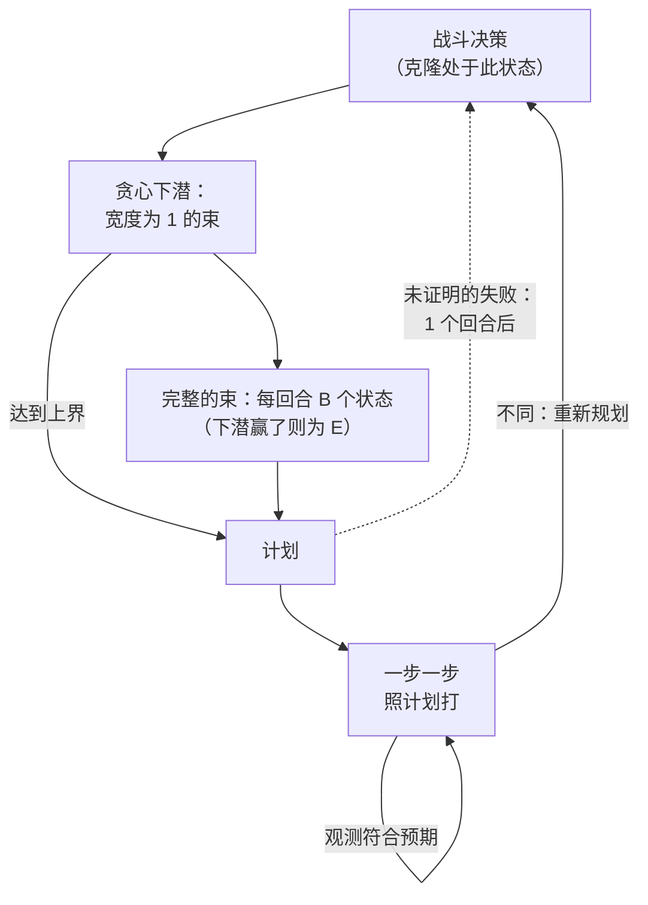
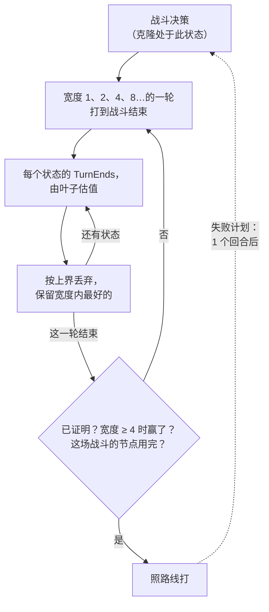

import { Aside, Badge } from '@astrojs/starlight/components';
import PlanTimeline from '../../../../components/combat/PlanTimeline.svelte';

在 SL 下，战斗大脑拿到战斗的一个精确副本：当前节点的克隆，里面有每一条随机数流。同样的动作在那里永远得到同样的结果，所以一场战斗是一个确定性规划问题，没有要猜的，也没有要平均的。剩下的是它的规模：SL 的战斗大脑是**剪枝 + 网络**，搜索丢掉不可能影响结果的路线，其余的问战斗网络。**SL 规划器**（`SlPlanner`）搜索一条打到战斗结束的最好路线，只搜一次，然后战斗一步一步照这条路线打。

<Aside title="已实现与规划中">

[§1](#sec-1)–[§4](#sec-4) 和它们链接的小节描述打出 SL 冠军的规划器：贪心下潜，然后是束，按一个力度级别。[§5](#sec-5) 概述规划中的搜索，它用宽度不断增长的多轮取代下潜和束。它尚未实现。

</Aside>

下面是它在一局真实对局里的样子。V v6-3-2 后来赢下的一局（种子 `E91KLB4BRWB4`，来自 v6-3-2 的 300 局评估）的第 17 层，第 1 幕的 Boss 是墨影幻灵：173 点生命值和 8 层滑溜，所以每次命中只造成 1 点伤害并去掉一层。在这场战斗的第一个决策处，玩家有 70 点里的 65 点生命值，规划器搜索了 5.2 秒，返回一条跨 6 个回合、共 22 个动作的路线。战斗照着它打完，没有再搜索。

<PlanTimeline client:visible lang="zh-CN" />

这条路线是一个中毒计划。中和与打击花掉两层滑溜，各造成 1 点伤害。计算下注弃掉手牌，再抽同样多的牌，而规划器已经知道它们会是肾上腺素、毒雾、冲刺和弹跳药瓶：SL 可以看到抽牌顺序，规划器也已经在克隆上试过这张计算下注。毒雾和蛇咬在第 1 回合开始叠毒。第 3 回合硬吃墨影幻灵 26 点伤害的一击（生命值 60 → 34），用来打出匕首雨、第二张计算下注和又一张蛇咬，而不去格挡。第 6 回合，计划不打任何牌就结束回合：墨影幻灵还剩 35 点生命值和 42 层中毒，在它自己的回合开始时死去。计划的估值 0.4914，就是叶子给 70 点里剩 34 点生命值的胜利定的价（$0.2 + 0.6 \times 34/70$），而这场战斗结束时正好剩 34 点生命值。

## 1. SL 可以看到什么

SL 就是 NoSL 加上**当前节点**内任何动作序列的真实结果：当前节点指当前的地图点，从到达开始，直到选定下一个点为止（[环境：信息与节点 §3](/arch/environments/information/#sec-3)）。在战斗里，这意味着抽牌顺序和每次重新洗牌、怪物的招式、生成的牌、随机目标，以及动作的顺序怎样改变所有这些：在节点内操纵随机数流是允许的。之后节点的任何东西都不可以：一个 `?` 最后是什么、接下来的遭遇、奖励或商店。

战斗的副本就是**节点克隆**（[模拟器：世界与 SL 克隆 §7](/arch/simulator/worlds/#sec-7)）。到达一个点时，游戏保存这一局；节点的检查点就是这份存档，加上存档丢掉的每个遗物的普通字段。到达以来的每个决策都记录为一条轨迹。像游戏的「继续」那样加载检查点，再重放轨迹，就得到当前决策处的真实战斗，连随机数流在内。**封存**（seal）让搜索留在房间里：克隆停在节点出口处，拒绝之后的任何一步；SL 世界拒绝越过它那场战斗的结束继续打，所以没有路线能偷看之后的东西。

## 2. 为什么最好的路线就是正确答案

只有一个世界时，取最好的路线就是对的。搜索采样世界时的陷阱，即策略融合（strategy fusion），要有好几个世界才融合得起来（[NoSL PIMC：搜索 §4](/arch/pimc/search/#sec-4)）：在单个精确世界里，知道未来不是错误，而是 SL 的规则。

把战斗写成一个确定性系统：状态 $s_t$，合法动作中的一个动作 $a_t$，以及游戏的状态转移 $s_{t+1} = f(s_t, a_t)$。一条路线 $a_1, \dots, a_T$ 在战斗结束处结束，它的价值是结束状态的叶子估值 $L(s_T)$（[叶子](/arch/combat-brain/leaf/)）。规划器寻找

$$
\max_{a_1, \dots, a_T} \; L\big(s_T\big), \qquad s_{t+1} = f(s_t, a_t).
$$

一场战斗的路线是有限的，所以最好的路线存在，尝试所有路线的搜索一定能找到它。它是相对于战斗结束处的 $L$ 而言最好的：路线一旦到达结束，战斗里就不再有任何估计，剩下的唯一误差在于 $L$ 认为一场赢下的战斗的生命值和药水值多少。

尝试所有路线是做不到的。在能量限制下选一个回合打哪些牌，本身就已经是一个背包问题；手牌、能量和回合数都不设上限时，这个问题是 NP 难的。真实的战斗有上限（手牌最多 10 张，3–15 个回合），但规模很大：每回合最多约 $10^4$ 个序列（[战斗大脑 §2](/arch/combat-brain/#sec-2)），一回合接一回合。所以规划器以最好的路线为目标，能证明时就证明它是最好的（[束搜索 §5](/arch/sl-planner/beam/#sec-5)），不能证明时就不要求证明。

## 3. 一张图看懂规划器

1. **每个回合完整搜索**。从一个状态出发，对本回合的动作做深度优先搜索，找出回合可能结束的各个不同状态，敌方回合真实地打完（[回合搜索](/arch/sl-planner/turn-search/)）。
2. **跨回合的束**。在所有保留状态的回合结束状态里，按叶子估值最好的 B 个进入下一回合（[束搜索 §1](/arch/sl-planner/beam/#sec-1)）。
3. **上界剪枝**。结束战斗的路线定下一个下限；一个状态即使以它现有的生命值赢下也比不过这个下限时，就被丢掉（[束搜索 §2](/arch/sl-planner/beam/#sec-2)）。
4. **先做一次贪心下潜**，在完整的束开始之前找到这个下限；下潜已经赢下时，完整的束收窄为简易束 E（[束搜索 §3–§4](/arch/sl-planner/beam/#sec-3)）。
5. **选出，能证明就证明**。选结束战斗的最好路线；当不可能存在更好的路线时，它就是已证明的（[束搜索 §5](/arch/sl-planner/beam/#sec-5)）。
6. **失败计划**一次只打一个回合，然后重新规划，最多连续三次（[束搜索 §6](/arch/sl-planner/beam/#sec-6)）。
7. **worker**。每个束状态的回合是发给 worker 进程池的一个请求（[预算 §4](/arch/sl-planner/budget/#sec-4)）。

## 4. 规划一次，照计划打

世界是精确的，所以计划只算一次，算出来什么样就怎样打。计划是路线上的动作，加上每个动作之前预期的观测的哈希。在这场战斗之后的每个决策处，如果战斗显示的是预期的观测、这个动作也合法，Harness 的路由就不经搜索打出计划的下一步（`TurnPlan`）。某一步对不上，说明克隆和真实战斗不同：路由重新规划，在决策日志里把这个决策标为 `replanned`，对局记录统计重新规划的次数（[Harness：决策日志 §6](/arch/harness/decision-log/#sec-6)）。

克隆的错误通过重新规划显现出来。在用规划器的前 40 局 SL 对局里，38 局没有重新规划，另外两局分别有 148 次和 120 次。两局都拿着熔岩石，这件遗物在第 1 幕 Boss 的奖励之后会把自己关掉，却只保存「已触发」。此后做出的每个克隆都把这件遗物显示为正常，所以计划的每一步都遇不到它预期的观测，每个战斗决策都从头重新规划。现在检查点带上每个遗物的普通字段，加载时把它们放回去（[模拟器：世界与 SL 克隆 §6](/arch/simulator/worlds/#sec-6)）。在 v6-3-2 评估的 300 局（5,375 场战斗）里，没有一步失败：0 次重新规划，95.6% 的战斗恰好规划一次（[预算 §3](/arch/sl-planner/budget/#sec-3)）。其余的是计划预计会输的战斗，它们是有意重新规划的（[束搜索 §6](/arch/sl-planner/beam/#sec-6)）。

`selftest` 专门检查同一件事：对局里的一场战斗在节点克隆上规划，在对局里一步一步执行，每个观测都和计划预期的一样，战斗结束时的生命值和药水必须正是计划的估值所说的；进程池里的规划器必须做出单个进程做出的计划。

## 5. 规划中的搜索 <Badge text="规划中" variant="caution" />

规划器的道理不变：一个世界、最好的路线、一步一步照着打的计划。变的是它周围的机制，缩减到一个循环。

- **剪枝**。上界比不过目前最好路线的状态被丢掉，和现在一样（[束搜索 §2](/arch/sl-planner/beam/#sec-2)）。
- **网络**。留下的由叶子排序，第一个用 SL 训练的网络取代 c2（[战斗大脑：叶子 §8](/arch/combat-brain/leaf/#sec-8)）。
- **一种枚举**。一个回合的结束状态来自 `TurnEnds`，与 NoSL 共用（[回合搜索 §5](/arch/sl-planner/turn-search/#sec-5)）。
- **多轮，而不是下潜和束**。宽度 1 就是下潜，之后的每一轮是更宽的束（[束搜索 §7](/arch/sl-planner/beam/#sec-7)）。
- **一个预算**。一场战斗的节点数和一个最小宽度，取代下潜、简易束、失败计划、重新规划选项和房间倍数（[预算 §7](/arch/sl-planner/budget/#sec-7)）。
- **提示**变成搜索的分支，取代 `p0`（[战斗大脑：提示、招式与 worker §4](/arch/combat-brain/shared/#sec-4)）。

## 6. 本章内容

| 小节 | 讲什么 |
|---|---|
| [回合搜索](/arch/sl-planner/turn-search/) | 完整搜索一个回合：深度优先，每一步都可以结束回合，置换按完整隐藏状态做键，节点在各个第一动作之间分配；规划中的 `TurnEnds` |
| [束搜索](/arch/sl-planner/beam/) | 跨回合的束、上界和它的剪枝、贪心下潜、简易束、选出并证明一条路线、失败计划；规划中的迭代加宽 |
| [预算](/arch/sl-planner/budget/) | 力度级别和低预算、时间花在哪里、worker、实测结果、弱点与未决问题；规划中的战斗预算 |
