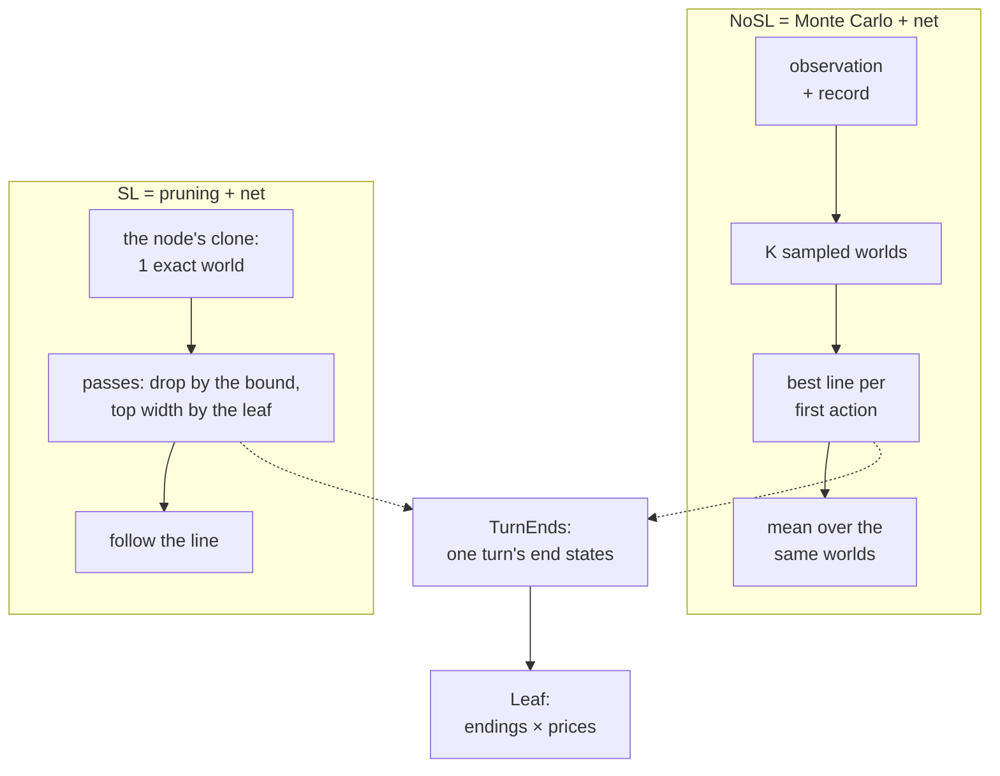

import { Aside, Badge } from '@astrojs/starlight/components';

The **combat brain** plays the fights. On the player's turn it chooses the next action: a card and its target, a potion, or ending the turn. It runs in the decision process next to the [macro brain](/en/arch/macro-brain/), which makes every decision outside combat, and [Harness](/en/arch/harness/) sends it every combat decision with the worlds it may search and a budget.

A fight is a search problem. The game's own code can play any line of actions from any state, so the brain does not need to know the rules as data: it tries lines in a simulated copy of the fight and keeps the best. What differs between the two environments ([Environments](/en/arch/environments/)) is how many copies there are and how much each one knows. SL (save and load) may see the true outcome of anything in the current room, so it gets one exact copy. NoSL sees only what a player sees, so it gets several sampled copies that agree with what is visible.

That gives the combat brain its shape, in two lines: **SL = pruning + net. NoSL = Monte Carlo + net.** In SL there is one world and the problem is its size, so the search drops what cannot matter. In NoSL the problem is what is hidden, so the search averages over worlds. Under both sit two shared pieces: enumerating one turn's end states, and valuing a state by the combat net's distribution of endings at a set of prices ([§3](#sec-3)).

This part of the book has three chapters:

- this one, the ground both algorithms stand on: the problem ([§2](#sec-2)), the shape ([§3](#sec-3)), the interface ([§4](#sec-4)), the leaf value ([The leaf](/en/arch/combat-brain/leaf/)), the combat net ([The combat net](/en/arch/combat-brain/network/), [One state through the net](/en/arch/combat-brain/walkthrough/)), card prompts, the record of enemy moves and the worker pool ([Prompts, moves and workers](/en/arch/combat-brain/shared/));
- [The SL planner](/en/arch/sl-planner/): pruning + net, on SL's one exact world;
- [NoSL PIMC](/en/arch/pimc/): Monte Carlo + net, over sampled worlds, averaged action by action.

<Aside title="Status">

**Built, and playing both champions.** SL: `SlPlanner` plans the whole combat on the node's clone and the fight follows its plan (`run --env SL --policy plan`, medium effort by default). NoSL: `PimcBrain` searches this turn in 8 sampled worlds of 300 nodes each and averages by first action (`run --policy pimc`). Both search in a pool of worker processes, and both score where they stop with the same leaf: the combat net, its endings priced by hand-set numbers ([The leaf](/en/arch/combat-brain/leaf/)). Card prompts during a fight go to a fixed rule, `p0` ([Prompts, moves and workers §1](/en/arch/combat-brain/shared/#sec-1)). A placeholder serves benchmarks and tests: `PlayPolicy` (`--policy play`, plays a random playable card).

**Planned, not implemented.** A simpler design for both algorithms, which these pages describe wherever a heading or a row carries <Badge text="planned" variant="caution" />. None of it has been measured or has code; everything without the badge describes today's code.

| piece | built today | planned |
|---|---|---|
| one turn's end states | two searches: `SlPlanner.SearchTurn`, `PimcBrain.SearchWorld` | one `TurnEnds` ([§3.1](#sec-3.1)) |
| SL's search | a greedy dive, then a beam; easy beam, loss plans, replans | iterative widening with one fight budget ([The SL planner: beam §7](/en/arch/sl-planner/beam/#sec-7)) |
| NoSL's search | PIMC, budget K and nodes per world | the same PIMC on `TurnEnds` ([NoSL PIMC: budget §8](/en/arch/pimc/budget/#sec-8)) |
| card prompts | the fixed rule `p0` | search branches ([Prompts, moves and workers §4](/en/arch/combat-brain/shared/#sec-4)) |

</Aside>

## 1. What it decides

The combat brain answers two kinds of question:

1. **The player's turn.** Which action next: play a card from the hand (on a target, if it needs one), use a potion, or end the turn. The legal actions come from the game, as Harness lists them ([Protocol: observations and actions §3](/en/arch/protocol/observation/#sec-3)).
2. **Card prompts during play.** Some cards ask a question when played: which card to discard, to exhaust, to put on top of the draw pile, which of three generated cards to take. Today these go to a fixed rule, `p0`, in the real fight and inside every simulated one ([Prompts, moves and workers §1](/en/arch/combat-brain/shared/#sec-1)).

A decision with one legal action is answered without a search. Every other one returns three things: the first action, the rest of the plan after it, and every first action the search looked at with its value (the *candidates*, which the decision log keeps and the mod shows, [Harness: the decision log §5](/en/arch/harness/decision-log/#sec-5)); the SL planner's also say how each one's best line ends, the chance to win and the HP left ([The leaf §5](/en/arch/combat-brain/leaf/#sec-5)). The plan matters: the SL planner's plan is the rest of the fight, and the fight plays it without searching again while the game shows what the plan expected; PIMC's plan is the rest of the turn, played without a search only when it repeats a cycle and every world agrees on it ([NoSL PIMC: budget §2](/en/arch/pimc/budget/#sec-2)).

## 2. A fight as a search problem

**A turn.** A turn is a sequence of actions that ends with `end_turn`. Within the turn, the uncertainty comes from draws and from random effects (a random target, a generated card). The enemies' turn that follows is deterministic once their moves are fixed. A fight lasts 3–15 turns.

**Branching.** A hand holds 5–10 cards, a targeted card can go to each living enemy, and potions add more. A turn's sequence is 3–8 actions long, so a turn has up to about $10^4$ sequences. Many of them reach the same state: playing A then B often leaves the game exactly as B then A. Such repeats are **transpositions**. With $n$ cards that can all be played in any order, there are

$$
\sum_{j=0}^{n} \frac{n!}{(n-j)!} \quad\text{ordered sequences, but only}\quad 2^n \quad\text{sets of cards played,}
$$

326 against 32 for $n = 5$, 109,601 against 256 for $n = 8$. Order does matter in Slay the Spire (Vulnerable before an attack, a draw before the card it draws), so a search cannot merge sequences by the set of cards played. It merges them by the state they reach: two lines that end in the same state, the hidden parts included, are searched once from there ([The SL planner: turn search §2](/en/arch/sl-planner/turn-search/#sec-2), [NoSL PIMC: search §1](/en/arch/pimc/search/#sec-1)).

**Horizon.** Searching one turn only is greedy: it cannot see that a block now saves a death in three turns. Searching to the end of the fight is exact, but in NoSL every draw and every random roll is a *chance node*, a point where the search must branch over outcomes it cannot know, and they multiply turn after turn. So NoSL searches to the end of the turn and scores the state there with a **leaf value** ([The leaf](/en/arch/combat-brain/leaf/)), while SL, which has no chance nodes, plans on to the end of the fight.

**Cost.** Every node of a search is one action played by the game's own code in a simulated fight ([Simulator: combats §1](/en/arch/simulator/combat/#sec-1)). Going back to an earlier state is a *restore*: start the fight again from its setup and replay the actions to that state. A restore takes 0.28 ms plus 0.073 ms per action replayed; a branch (restore, resample, play to the end) about 2.8 ms, about 330 a second on one core ([Simulator: combats §2](/en/arch/simulator/combat/#sec-2)). In SL a restore loads the node's clone instead, about 0.5 ms plus 0.1 ms per step since the node began, 10–20 ms late in a long fight ([Simulator: worlds and the SL clone §7](/en/arch/simulator/worlds/#sec-7)). Restores, not the leaf, are where the time goes ([Prompts, moves and workers §3](/en/arch/combat-brain/shared/#sec-3)).

## 3. Two environments, one shape

The macro brain and the value function V are the same in both environments ([Environments: worlds §5](/en/arch/environments/worlds/#sec-5)). The combat brain's two algorithms differ because the two environments pose different problems: too many lines in one known world, against too little known about the world.

| | NoSL: PIMC | SL: the planner |
|---|---|---|
| what is hidden | draw order, random streams, monsters' queued moves | nothing inside the room |
| worlds | K sampled from the observation ([NoSL PIMC §2](/en/arch/pimc/#sec-2)) | one: the node's clone ([The SL planner §1](/en/arch/sl-planner/#sec-1)) |
| chance nodes | at every reveal | none |
| what is optimal | the action best on average over the worlds | the best line in the one world |
| search today | each world to the end of this turn, then the mean by first action ([NoSL PIMC: search](/en/arch/pimc/search/)) | a beam over the fight's turns, each turn searched in full ([The SL planner: beam](/en/arch/sl-planner/beam/)) |
| search planned <Badge text="planned" variant="caution" /> | the same, on `TurnEnds` ([NoSL PIMC: search §7](/en/arch/pimc/search/#sec-7)) | passes of growing width, each to the fight's end ([The SL planner: beam §7](/en/arch/sl-planner/beam/#sec-7)) |
| how often it searches | at every action | once a fight, unless a plan loses ([The SL planner: beam §6](/en/arch/sl-planner/beam/#sec-6)) |
| transpositions keyed by | observation and the world's sampled hidden state | observation and the full hidden state |
| leaf | the start of the next turn | mostly the end of the fight |

Why not one algorithm for both? On the panel, PIMC run on SL's one exact world played almost exactly like PIMC in NoSL: the same outcome in 112 of 120 fights, within 5 HP in the other 8 ([NoSL PIMC: budget §6](/en/arch/pimc/budget/#sec-6)). Its search ends where the turn does, and within one turn little is revealed, so the true world tells it little that eight sampled ones do not. Knowing the future pays only for a search that looks past the turn, which is what the planner does: it wins 9 more of the same 120 fights ([The SL planner: budget §5](/en/arch/sl-planner/budget/#sec-5)). So PIMC plays in NoSL only.

### 3.1 TurnEnds <Badge text="planned" variant="caution" />

`TurnEnds` enumerates the states one turn can end in, from one state: depth first, ending the turn an option at every step, states merged by the observation and the hidden state. Both planned algorithms call it, in one world at a time. It is a step of the search and not an input of the net, which reads one state at a time.

Today two searches do this job, and they differ. `SlPlanner`'s turn search shares a turn's nodes over its first actions, a share left unspent passing on, and returns the distinct ends ([The SL planner: turn search](/en/arch/sl-planner/turn-search/)). `PimcBrain`'s world search gives every first action an equal share, keeps a memo of values across them, and returns the best line after each ([NoSL PIMC: search §1](/en/arch/pimc/search/#sec-1)). Merging them changes how PIMC's nodes are shared, so the merged search must pass a NoSL gate.

### 3.2 Leaf

The leaf turns a state into one number: the net's distribution over how the fight ends, times a price for each ending ([The leaf §3–§5](/en/arch/combat-brain/leaf/#sec-3)).



The figure is the planned shape; today's code differs in the search boxes, as the table above says.

## 4. The interface

```csharp
public sealed record Budget(int Worlds = 8, int NodesPerWorld = 300, int Beam = 0, int Replan = 1, int LossPlans = 0,
    int EasyBeam = 0);
    // PIMC reads Worlds and NodesPerWorld; the SL planner Beam, EasyBeam, Replan, LossPlans and
    // NodesPerWorld (per state and turn). Budget.Effort(level) gives the planner's presets.

public sealed class PimcBrain(ICombatLeaf leaf)
{
    // NoSL: search K sampled worlds, return the first action and the rest of the turn.
    // history: the combat's record of enemy moves so far (MoveRecord), for the leaves.
    public CombatDecisionResult Decide(CombatObservation observation, IReadOnlyList<CombatAction> legal,
                                       IWorldSource worlds, Budget budget, ulong seed,
                                       IReadOnlyList<EnemyTurns>? history = null);
}

public sealed class SlPlanner(ICombatLeaf leaf)
{
    // SL: plan the rest of the combat in the one exact world.
    public SlPlan Plan(CombatObservation observation, ICombatWorld world, Budget budget,
                       IReadOnlyList<EnemyTurns>? history = null);
}

public interface ICombatLeaf
{
    // A search leaf: the state after the turn ends, or after the combat does.
    double Value(CombatStatus status, CombatObservation obs, IReadOnlyList<EnemyTurns> history);
    // The value with the chance to win the combat and the HP held at a win, from one evaluation.
    LeafOutcome Outcome(CombatStatus status, CombatObservation obs, IReadOnlyList<EnemyTurns> history);
}

public sealed record CombatDecisionResult(
    CombatAction First,                  // one of legal
    IReadOnlyList<CombatAction> Plan,    // the rest of the plan after First
    IReadOnlyList<Candidate> Candidates, // every first action scored, the pick first
    IReadOnlyList<ulong>? PlanHashes);   // the observation each step of Plan expects, when it can be followed
```

- `PimcBrain` searches in NoSL, `SlPlanner` in SL; the champion's `--policy` names one (`pimc` or `plan`), and each refuses the other environment's runs ([Harness: routing, budgets and seeds §1](/en/arch/harness/routing/#sec-1)). In a run they search in the worker pool through `PooledPimc` and `PooledPlanner`, which send the same searches to worker processes and merge the replies in a fixed order, so the answer is the one a single process would give ([Prompts, moves and workers §3](/en/arch/combat-brain/shared/#sec-3)).
- `IWorldSource` hands out the worlds: K sampled ones in NoSL, the node's clone in SL ([Protocol: worlds and worker messages §1](/en/arch/protocol/worlds/#sec-1)). The brain never asks which environment it is in; the worlds carry it.
- `TurnPlan` follows a plan: a step is played without a search while the combat shows the observation the plan expected before it (its hash in `PlanHashes`); otherwise the decision is searched again and marked `replanned` in the decision log. `SlRoute` adds the planner's rule for losing plans ([The SL planner: beam §6](/en/arch/sl-planner/beam/#sec-6)).
- Planned: `Facts` on the result (expected HP lost, turns to kill, chance to draw a card), which would be narration's only source ([Output §5](/en/arch/output/#sec-5)). NoSL facts are probabilities and expectations; SL facts may be exact.
- `ICombatPolicy` and `IChoicePolicy` stay, for the placeholders and for fast policies that could play lines out inside a search.

- <Badge text="planned" variant="caution" /> The planner's budget shrinks to one fight's nodes and a minimum width ([The SL planner: budget §7](/en/arch/sl-planner/budget/#sec-7)); PIMC's stays K and the nodes per world ([NoSL PIMC: budget §8](/en/arch/pimc/budget/#sec-8)). The fields `Beam`, `EasyBeam`, `Replan` and `LossPlans` then have no reader.

## 5. How it is checked

1. **Tactics** (planned): positions with clear answers (take lethal, block exactly, apply Vulnerable before attacking), found or not.
2. **Whole runs**: version gates play the same seeds on both sides and pair them, so that differences come from the brain rather than from luck ([Evaluation: gates §5](/en/arch/evaluation/gates/#sec-5)). Fights measured on a fixed panel, the same fights for every player, are reported in [The SL planner: budget §5](/en/arch/sl-planner/budget/#sec-5) and [NoSL PIMC: budget §6](/en/arch/pimc/budget/#sec-6).
3. **NoSL counterfactual** (planned): the same public record with a different hidden state must give the same choice, for a fixed brain seed.
4. **SL seal**: any step past the node's exit throws. Holds (`selftest`): a node's clone loads at its horizon and refuses another step, and the SL world refuses any action after its combat's end.
5. **Reproducible**: with a fixed budget, two runs on the same seed give the same moves and results; the pooled searches give what one process gives (`selftest --workers N`).
6. **SL plan fidelity**: a plan made on the node's clone is played in the run step for step, each observation as the plan expects, and the fight ends with the HP and potions the plan's value says. Holds (`selftest`); in runs a step that does not hold counts as a replan.
7. **The planner without the game** (`Sts2Ai.Tests`): on a small exact combat, a full search finds the best line that trying every line finds, the line replays to the value it claims, a losing plan stops after its first turn unless it is proved, and a proved loss replays to its end.

## 6. The order of validation <Badge text="planned" variant="caution" />

The design goes through gates in order, so that each gate says what its step is worth:

1. **Prompts** as search branches ([Prompts, moves and workers §4](/en/arch/combat-brain/shared/#sec-4)), **then widening** ([The SL planner: beam §7](/en/arch/sl-planner/beam/#sec-7)), **then budgets** ([The SL planner: budget §7](/en/arch/sl-planner/budget/#sec-7)).

NoSL has two conditions of its own: merging `TurnEnds` needs a NoSL gate, and prompt branches need strategy fusion measured first ([NoSL PIMC: search §7](/en/arch/pimc/search/#sec-7)).

## 7. The three chapters

| chapter | section | what it explains | figures |
|---|---|---|---|
| Combat brain | [The leaf](/en/arch/combat-brain/leaf/) | where a search stops and what that state is worth: the net's two outputs, the prices, the bound, what the value cannot see | the net's outputs on real states |
| | [The combat net](/en/arch/combat-brain/network/) | the net from input to output: every tensor, each encoder, the body, the two heads and the mask, sizes | the net's diagram |
| | [One state through the net](/en/arch/combat-brain/walkthrough/) | a real round start followed by hand through every layer, to the value and a label | – |
| | [Prompts, moves and workers](/en/arch/combat-brain/shared/) | `p0` and prompts as branches, the record of enemy moves, the worker pool | – |
| [The SL planner](/en/arch/sl-planner/) | overview | the node clone, why the best line is right, plan once and follow, the planned shape | a real boss fight, planned at its first decision |
| | [Turn search](/en/arch/sl-planner/turn-search/) | one turn searched in full, transpositions, sharing the nodes, `TurnEnds` | a turn's search tree |
| | [Beam](/en/arch/sl-planner/beam/) | the beam over turns, the bound, the dive, the easy beam, proved and losing plans; planned iterative widening | the beam, turn by turn; widening, pass by pass |
| | [Budget](/en/arch/sl-planner/budget/) | effort levels, the low budget, where the time goes, results, weaknesses; the planned fight budget | – |
| [NoSL PIMC](/en/arch/pimc/) | overview | what is hidden, sampled worlds, how faithful they are, fair play, the planned shape | sampled draw orders |
| | [Search](/en/arch/pimc/search/) | one world's search, the average, noise and common random numbers, strategy fusion; the same search on `TurnEnds` | a real decision in 8 worlds |
| | [Budget](/en/arch/pimc/budget/) | worlds and nodes, following a cycle's plan, one share per first action, results, weaknesses; the planned budget | – |
