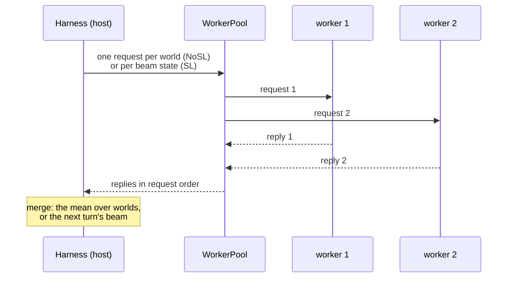

import { Badge } from '@astrojs/starlight/components';

Four pieces sit under both algorithms. A card prompt during a fight is a branch of the search: each answer of an action's first prompt is a line of its own, valued by the leaf like any other, and the answer the search picks is the one the run gives ([§1](#sec-1)). The record of what the enemies showed each round travels with every decision, so leaves read the same history wherever they are computed ([§2](#sec-2)). And the searches run in a pool of worker processes, with a protocol that makes the pooled answer equal to the one-process answer ([§3](#sec-3)). Last, search counts copies of a card as one action and the same cards in another order as one state ([§5](#sec-5)).

## 1. Card prompts: answers as branches

Some cards ask a question when played: Survivor asks for a card to discard, an exhaust or a "put a card on top of your draw pile" asks which card, and a card that generates three options asks which to take. So do some potions, Touch of Insanity among them, which asks which card in the hand to make free, and some effects at the end of a turn or the start of the next. Such a question is a **card prompt**: options in canonical order (sorted by what the card is, never by the game's order, which can reflect the hidden draw order), and a least and most number of picks ([Protocol: observations and actions §6](/en/arch/protocol/observation/#sec-6)).

**Every answer is a line.** In a search world, an action's first prompt is a branch of the search (`PromptAnswers.Others`, `src/Sts2Ai.Brain/Combat/Prompts.cs`). Once the action is played, the world tells the search which prompt it met and how it was answered (`ICombatWorld.LastPrompt`, a `PromptSeen`). Each other answer the prompt takes becomes an action of its own, the same action carrying that answer, tried right after it from the same state; each line is valued by the leaf like any other, and the best wins. The answers are listed once per choice of cards the player can tell apart (`PromptSeen.Others`, `src/Sts2Ai.Protocol/World.cs`): two copies of one card are one card twice, so picking one of them is picking the first. They come with the fewest picks first, then in the options' order: a discard of one or two cards from a hand of A, A and B, first answered with one A, tries B, then both A, then A and B. How many are tried is the action's share of the search's nodes, each answer at least one node: the search's own budget, not a judgment on the cards ([The SL planner: turn search §3](/en/arch/sl-planner/turn-search/#sec-3), [NoSL PIMC: search §1](/en/arch/pimc/search/#sec-1)).

**The answer is part of the action.** An action that carries its answer writes it after an `@`: the picked options' places in the prompt, in order and comma-separated, `play:12:3@1,3`, `potion:0@2`, `end_turn@0`, and `play:12@` for a prompt answered with no pick (`CombatAction.Pick`, `src/Sts2Ai.Protocol/CombatAction.cs`). It answers the first prompt the action raises, the card's or potion's own, or for `end_turn` the first one the end of the turn or the start of the next brings. The game never sees it: the host is told the plain action, and Harness hands the answer to the first card prompt in the fight that follows (`Dispatcher`, `src/Sts2Ai.Harness/Dispatcher.cs`). A plan replays the same way, in the real fight as on the clone.

**Where nothing searched.** A prompt that no search weighs, the second prompt of one action or a prompt the search had no node left for, is answered by `FirstPicks`: the first options in canonical order, as few as the prompt takes (`src/Sts2Ai.Brain/Combat/Prompts.cs`). It holds no view of what a card is worth; it only fixes an answer, the same in the real fight and in every simulated one, so a search expects what the run will do. In the champion's name the combat prompts route is `first` ([Harness: routing, budgets and seeds §1](/en/arch/harness/routing/#sec-1)).

## 2. The record of enemy moves

A monster's next move depends on its moves so far: a fixed cycle, a roll that never repeats a move three times, a move always followed by another ([NoSL PIMC §1](/en/arch/pimc/#sec-1)). A player remembers what each enemy did. So does the brain: `MoveRecord` keeps, for each enemy of the fight, the intents it showed at the first decision of each round, by uid. It is the one part of the public record that is built ([Harness §4](/en/arch/harness/#sec-4)).

- Harness collects it from the combat observations it is shown, starting over after each macro decision, and hands it to the combat brain with every decision (`history`). The decision log keeps it with each combat decision ([Harness: the decision log §7](/en/arch/harness/decision-log/#sec-7)).
- The search sends it to the workers in every request. A NoSL worker builds each monster's move log from it, so that a sampled world's monsters go on as the real ones would ([NoSL PIMC §2](/en/arch/pimc/#sec-2)). Both kinds of worker hand it to the leaves.
- The combat net reads it: each enemy's intents in its last 3 rounds and how many rounds it has shown ([The leaf §3](/en/arch/combat-brain/leaf/#sec-3)). Every leaf of one decision's search follows the same record: a leaf is the next round's start, and the record holds the rounds up to the decision's. The SL planner's later turns add the rounds its own lines reach (`MoveRecord.Witness` at each turn's end).

- <Badge text="planned" variant="caution" /> The record stays for NoSL's world building even if the net stops reading it: a built world's monsters take their move logs from it ([NoSL PIMC §3](/en/arch/pimc/#sec-3)).

## 3. The worker pool

A search is many independent pieces: K worlds in NoSL, a beam's states in SL. They run in a pool of worker processes. A worker is the same binary started as `serve`; `WorkerPool` (in Harness, which sees the game only through protocol types) starts N of them, by default one per world, and keeps them for its lifetime ([Simulator: the worker pool §2](/en/arch/simulator/pool/#sec-2)).

**The requests.** One JSON line each way, over the worker's stdin and stdout ([Protocol: worlds and worker messages §4](/en/arch/protocol/worlds/#sec-4)):

| request | who sends it | what the worker does |
|---|---|---|
| `PimcWorldRequest` | PIMC in NoSL (`PooledPimc`) | builds the combat from the observation with the build seed, takes world k of the worlds drawn from the search seed, searches this turn, and replies with the best line after each first action |
| `SlTurnRequest` | the SL planner (`PooledPlanner`) | loads the node's clone, plays the beam state's path from the decision, searches that turn in full, and replies with the turn's best ends ([The SL planner: turn search §4](/en/arch/sl-planner/turn-search/#sec-4)) |
| `SlMacroRequest` | the macro brain on the clone | plays a path of macro answers on the clone and replies with the next decision ([Macro brain: search §6](/en/arch/macro-brain/search/#sec-6)) |

**Self-contained.** A request carries everything its worker needs, and nothing carries over from one request to the next, so any free worker can take any request. In NoSL only the observation and the record leave the host: the true state never reaches a worker ([NoSL PIMC §4](/en/arch/pimc/#sec-4)). In SL the node's clone does, which SL may know.

**Deterministic.** Replies are merged in request order, never in the order they finish. With the same seeds the answer equals that of a search in one process exactly, values included: `selftest --workers N` checks it.

**Failures.** A worker that closes its output or breaks the pipe is restarted and gets the request once more; so is one that does not answer within 5 minutes (a request takes seconds), after it is killed. A second failure is an error. A worker that throws exits after sending the error, since a request that threw can leave the game set up and fail every later one ([Simulator: the worker pool §6](/en/arch/simulator/pool/#sec-6)).

**Where the time goes.** Not in the leaf. Restoring states is the largest share of a worker's time ([Simulator: combats §7](/en/arch/simulator/combat/#sec-7)): a NoSL worker builds each world from the observation and replays its line, an SL worker loads the node's clone and replays a path to the state it searches, and both restore again at every step back of a search ([The SL planner: budget §3](/en/arch/sl-planner/budget/#sec-3)).

## 4. Planned <Badge text="planned" variant="caution" />

- **Worlds that live in a worker.** For run worlds and for searches that outgrow one request: open a world by kind (build, clone, run host), branch on it by id, and close it; its branches go to that worker first, since a restore elsewhere costs a replay ([Simulator: the worker pool §8](/en/arch/simulator/pool/#sec-8)).

## 5. What search counts as the same

A hand often holds copies: two Strikes, three Defends. To the player they are one card twice; to the game each copy has its own id (`uid`), so two lines that play different copies, or the same cards in another order, reach observations that differ only in those ids or in the order of a pile. Search counts such actions and such states as one (`src/Sts2Ai.Brain/Combat/CombatBrain.cs:157-193`).

**The same action.** At every state, search tries one action of each that are the same (`PimcBrain.Ordered`): the same card, by everything the observation shows of it but its id (`ProtocolJson.CardKey`), or the same potion, at the same target, with the same answer to its prompt. The first in search order is kept: ending the turn, then the cards in hand order, then potions. An upgraded Strike is another card than a plain one; a second plain Strike is the first one again. So the root's shares of the nodes go to the distinct actions only ([The SL planner: turn search §3](/en/arch/sl-planner/turn-search/#sec-3), [NoSL PIMC: search §1](/en/arch/pimc/search/#sec-1)). A prompt's answers are listed the same way, once per choice of cards the player can tell apart ([§1](#sec-1)).

**The same state.** Where search remembers the states it has seen, a state's key is the observation as search tells it apart (`PimcBrain.StateKey`), with the world's hidden key beside it: the hand, the discard pile and the exhaust pile each as a multiset of cards without ids (sorted by card key), and the potions as a multiset. The draw pile is a multiset in the observation already, and its order is in the hidden key ([Protocol: worlds and worker messages §1](/en/arch/protocol/worlds/#sec-1)). So the same cards played in any order, or another copy of one, meet as one state. The key is used:

- by the SL planner's turn search, for the states it has seen and for each turn end's key, by which the beam keeps distinct states ([The SL planner: turn search §2](/en/arch/sl-planner/turn-search/#sec-2));
- by PIMC's memo in each world ([NoSL PIMC: search §1](/en/arch/pimc/search/#sec-1));
- by LoopSearch's cash-out ([The SL planner: turn search §5](/en/arch/sl-planner/turn-search/#sec-5)).

What a plan is checked against does not change: the observation hashes it carries for each step, which the run compares as it follows the plan, are the real observation's (`TurnPlan`).

**Enemies stay apart.** Two enemies of the same kind are two enemies: each has its own random stream and its own place in the turn order.

**What it gives up.** The game picks some random cards by their place in a pile: Mummified Hand picks a random card in the hand with the combat's card-selection stream, and Drain Power takes random cards from the discard pile. In SL, where search knows the random streams, which copy is played, and so the order the hand and the discard pile are left in, could steer such a pick. Search does not tell those lines apart: of two that differ only there, it keeps the first it found.
