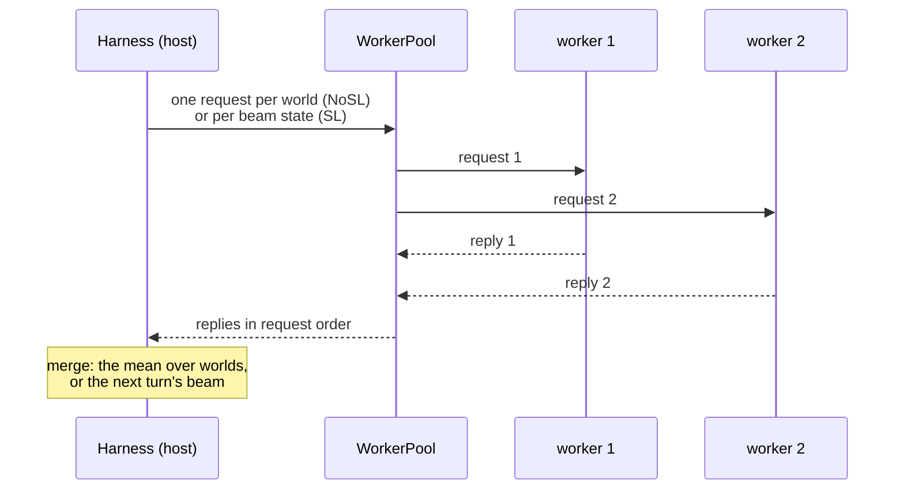

import { Badge } from '@astrojs/starlight/components';

Three pieces sit under both algorithms. Card prompts during a fight are answered by one fixed rule, in the real fight and in every simulated one, so a search expects the answers the run will give ([§1](#sec-1)); search branches are to replace it ([§4](#sec-4)). The record of what the enemies showed each round travels with every decision, so leaves read the same history wherever they are computed ([§2](#sec-2)). And the searches run in a pool of worker processes, with a protocol that makes the pooled answer equal to the one-process answer ([§3](#sec-3)).

## 1. Card prompts: p0

Some cards ask a question when played: Survivor asks for a card to discard, Calculated Gamble discards the hand on its own, an exhaust or a "put a card on top of your draw pile" asks which card, and a card that generates three options asks which to take. Today every card prompt in a fight goes to `PromptBrain`, called `p0`, a fixed rule by what happens to the picked cards ([§4](#sec-4) is the planned replacement):

- **Picks that leave the hand this turn** (a discard, an exhaust, a card put on top of the draw pile) take the least useful cards, Sly cards first in a discard, since discarding a Sly card plays it. Past the prompt's minimum it takes only the cards that are better gone: unplayable ones, and Sly ones in a discard.
- **A prompt that makes a card free** takes the dearest one.
- **Any other prompt** adds or improves cards (a card into the hand, a copy, an upgrade), so it takes the most useful ones, as many as it may.

A card's use is a sum of its numbers plus a flat part:

$$
\text{worth} = 5 + \text{damage} + 1.5\,\text{poison} + \text{block} + 4\,\text{cards drawn} + 4\,\text{energy} + 2\,(\text{Weak} + \text{Vulnerable}) + 2\,\text{upgrades}
$$

and an unplayable card (a status, a curse) has none. `p0` reads the prompt alone and never draws at random: ties go to the first option in canonical order. That is what lets a simulated world ask it too: the search's worlds answer every prompt as the run will, so a line through a prompt is valued with the answer that will really be given. In NoSL that holds in every sampled world; in SL the planner's plan replays exactly ([The SL planner §4](/en/arch/sl-planner/#sec-4)).

There is one exception: when another answer opens a cycle inside the turn, search takes that answer and writes it on the action (`potion:0@3`, the option's index in the prompt). The host is told only `potion:0`, and Harness gives that answer to the first prompt that follows ([SL planner: turn search §5](/en/arch/sl-planner/turn-search/#sec-5)).

The rule is hand-written strategy, the kind the project otherwise leaves to learned values, and a line through a prompt can only ever be valued with this one answer. It answered 2,035 prompts in 100 whole runs of the champion's V.

## 2. The record of enemy moves

A monster's next move depends on its moves so far: a fixed cycle, a roll that never repeats a move three times, a move always followed by another ([NoSL PIMC §1](/en/arch/pimc/#sec-1)). A player remembers what each enemy did. So does the brain: `MoveRecord` keeps, for each enemy of the fight, the intents it showed at the first decision of each round, by uid. It is the part of the public record that is built today ([Harness §4](/en/arch/harness/#sec-4)).

- Harness collects it from the combat observations it is shown, starting over after each macro decision, and hands it to the combat brain with every decision (`history`). The decision log keeps it with each combat decision ([Harness: the decision log §7](/en/arch/harness/decision-log/#sec-7)).
- The search sends it to the workers in every request. A NoSL worker builds each monster's move log from it, so that a sampled world's monsters go on as the real ones would ([NoSL PIMC §2](/en/arch/pimc/#sec-2)). Both kinds of worker hand it to the leaves.
- The combat net reads it: each enemy's intents in its last 3 rounds and how many rounds it has shown ([The leaf §3](/en/arch/combat-brain/leaf/#sec-3)). Every leaf of one decision's search follows the same record: a leaf is the next round's start, and the record holds the rounds up to the decision's. The SL planner's later turns add the rounds its own lines reach (`MoveRecord.Witness` at each turn's end).

- <Badge text="planned" variant="caution" /> The record stays for NoSL's world building even if the net stops reading it: it is what lifts a built world's fidelity from 82–89% to 96–98% on hallway fights ([NoSL PIMC §3](/en/arch/pimc/#sec-3)).

## 3. The worker pool

A search is many independent pieces: K worlds in NoSL, a beam's states in SL. They run in a pool of worker processes. A worker is the same binary started as `serve`; `WorkerPool` (in Harness, which sees the game only through protocol types) starts N of them, by default one per world, and keeps them for its lifetime ([Simulator: the worker pool §2](/en/arch/simulator/pool/#sec-2)).

**The requests.** One JSON line each way, over the worker's stdin and stdout ([Protocol: worlds and worker messages §4](/en/arch/protocol/worlds/#sec-4)):

| request | who sends it | what the worker does |
|---|---|---|
| `PimcWorldRequest` | PIMC in NoSL (`PooledPimc`) | builds the combat from the observation with the build seed, takes world k of the worlds drawn from the search seed, searches this turn, and replies with the best line after each first action |
| `SlTurnRequest` | the SL planner (`PooledPlanner`) | loads the node's clone, plays the beam state's path from the decision, searches that turn in full, and replies with the turn's best ends ([The SL planner: turn search §4](/en/arch/sl-planner/turn-search/#sec-4)) |
| `SlMacroRequest` | the macro brain on the clone | plays a path of macro answers on the clone and replies with the next decision ([Macro brain: search §6](/en/arch/macro-brain/search/#sec-6)) |

**Self-contained.** A request carries everything its worker needs, and nothing carries over from one request to the next, so any free worker can take any request. In NoSL only the observation and the record leave the host: the true state never reaches a worker ([NoSL PIMC §4](/en/arch/pimc/#sec-4)). In SL the node's clone does, which SL may know.

**Deterministic.** Replies are merged in request order, never in the order they finish. With the same seeds the answer equals that of a search in one process exactly, values included: `selftest --workers N` checks it, and a 6-combat panel trace with 8 workers diffs empty against the in-process one.

**Failures.** A worker that closes its output or breaks the pipe is restarted and gets the request once more; so is one that does not answer within 5 minutes (a request takes seconds), after it is killed. A second failure is an error. A worker that throws exits after sending the error, since a request that threw can leave the game set up and fail every later one ([Simulator: the worker pool §6](/en/arch/simulator/pool/#sec-6)).

**Where the time goes.** Not in the leaf. A NoSL worker sampled for 40 s during a whole-run gate searched 87% of the time; restoring worlds took 48% (starting the combat from its setup 38%, replaying the line 7%, resampling 4%), playing the searched actions 16%, building observations 16%, and the combat net 5% ([Simulator: combats §7](/en/arch/simulator/combat/#sec-7)). An SL planner's worker spends about 88% of its busy time on restores: loading the node's clone and replaying a path to the state it searches. That is why the planner's levers are the beam and the number of plans rather than the nodes ([The SL planner: budget §3](/en/arch/sl-planner/budget/#sec-3)). Each worker holds about 160 MB.

**Speed.** On 6 act 1 fights at 8 worlds × 300 nodes, 8 workers take 68.7 ms per action against 307.5 ms in one process.

## 4. Planned <Badge text="planned" variant="caution" />

- **Prompts as search branches.** Inside a search, the simulator's selector (the code that answers card prompts) is driven by the search, so each answer is a branch of `TurnEnds`, valued like any other action, and `p0` goes. A multi-pick is a sequence of single picks, so that a prompt of many cards adds depth and not a large fan of subsets. A prompt in the real fight is a decision like any other: in SL it is a step of the plan, in NoSL it is searched. It needs the world API's prompt branching and `ChoiceContext` ([Protocol: observations and actions §6](/en/arch/protocol/observation/#sec-6)).
- **What it costs NoSL.** A prompt's answer is chosen after the cards are seen, so branches on prompts widen strategy fusion; it is measured first ([NoSL PIMC: search §7](/en/arch/pimc/search/#sec-7)).
- **Worlds that live in a worker.** For run worlds and for searches that outgrow one request: open a world by kind (build, clone, run host), branch on it by id, and close it; its branches go to that worker first, since a restore elsewhere costs a replay ([Simulator: the worker pool §8](/en/arch/simulator/pool/#sec-8)).
