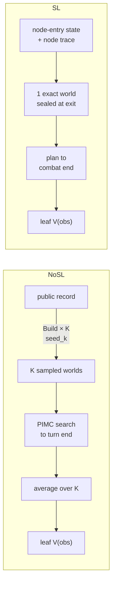

import { Aside, Badge } from '@astrojs/starlight/components';

The AI always plays in one of two **environments**. They differ in only one thing: how much the AI may know about randomness the game has not revealed yet. NoSL allows public information only. SL also allows the true outcomes inside the current map point, as if the player could save and reload there. Every other subsystem (protocol, simulator, brains, learning, evaluation) takes the environment as a parameter, so this page comes first.

<Aside title="Status">

Decided.

</Aside>

## 1. Definitions

Both environments share the same ground rules:

- single-player only, on the pinned game version (v0.111.0);
- the same rule knowledge and the same Brain, Harness and Protocol code;
- the same pre-registered seeds, with results reported separately;
- neither environment ever reloads the real game: the save field `SerializableRun.NumReloads` stays 0.

### NoSL: public information only

A decision may depend only on the public history of this run, on rule knowledge, and on anything learned offline.

The *public history* is everything shown on screen so far, plus what can be inferred from it. Examples: card counting; a posterior over a monster's next move given its intent history; counters for reward odds given the reward history. Search runs only on *determinized samples*: concrete hidden states (draw order, monster moves and so on) drawn so that they agree with the public history.

### SL: save & load inside the current node

SL is NoSL plus the true outcome of any action sequence inside the **current node**. The project calls this "limited cheating". It is the same as a player who may save and quit as often as they like inside the node and remembers everything.

A **node** is the current map point (`MapPoint`), from arrival until the next map point is chosen. It includes every room of that point (`MapPointHistoryEntry.Rooms`, e.g. a combat started by an event), the rewards screen, shop purchases, rest options, the chest, and every event page.

Examples of what SL may know:

- the draw order and every reshuffle, monster moves, generated cards, random targets, costs and orbs;
- how the order of actions changes all of these (manipulating the RNG inside the node is allowed);
- event outcomes. On Slippery Bridge, for example, SL knows which card is taken after each HOLD_ON: `SlipperyBridge.GetNewRandomCard` uses the event's `Rng`, seeded from seed + slot + hash(event id) (`Models/EventModel.cs:234`) <Badge text="verified" variant="success" />;
- this node's rewards, including how they depend on the way the node was played;
- which card an Ancient's "random rare card" option gives.

SL may **not** know anything about later nodes: what a `?` turns out to be, encounters, rewards, shop stock, events. This holds even though the simulator holds the true random streams.

<Aside type="caution" title="Rejected">

A whole-run horizon ("knows the whole order of this run") was considered and rejected. Do not build it.

</Aside>

## 2. Why the node

Why not use the game's own save points as the boundary? The game autosaves <Badge text="verified" variant="success" />:

- at run start;
- on arriving at a map point, before the `?` roll and `CreateRoom` (`Runs/RunManager.cs:899-901`, 915, 917);
- on winning a combat, with the room marked as pre-finished (`Combat/CombatManager.cs:1341-1342`);
- when an **Ancient** event finishes, and only for Ancient events (`Rooms/EventRoom.cs:129-141`).

There is no save in the middle of a combat. Reloading replays the room exactly: same encounter, same opening hand, same monster moves. A save stores the full RNG state `{counter, s0..s3}` of every stream (`Saves/SerializableRng.cs:51-63`).

So the game's own save & load is slightly narrower than a node. After a combat win the save has already moved past the combat, so "would a different line of play change the rewards?" cannot be tested in the real game. The node boundary was chosen anyway: it covers everything inside one map point (rooms, rewards, every event page) and gives a single point at which to seal the world. The difference between the two is open question 1 ([§10](#sec-10)).

## 3. Information table

What each environment may use:

| information | NoSL | SL |
|---|---|---|
| screen history and inferences from it, rule knowledge, offline learning (privileged information only at training time) | yes | yes |
| this node: draw order, shuffles | which cards (multiset) only | yes |
| this node: monsters' next moves | intents + posterior from history | yes |
| this node: generated cards, random targets, costs, orbs | distribution | yes |
| this node: event outcomes, chest, rewards | once shown | yes |
| later nodes | no | no |
| seed string, RNG state, save file, read directly | no | no (only through the sealed clone) |
| state edits, console, debug or multiplayer backdoors | no | no |
| real reloads (`NumReloads > 0`), picking seeds at evaluation | no | no |

Grey-zone rulings, the same in both environments (from the fair-play spec, local note `tmp/notes/fair-play-spec.md`):

- exact damage math is allowed;
- powers only if `IsVisible`, and only with the displayed amount;
- no `move_id` is exported;
- the draw pile only as a multiset, never its order;
- the hidden cells of the Crystal Ball event are never exported.

## 4. Node boundary

- **Entry:** arrival at a map point. This is a game save point, so the entry state is a `SerializableRun`.
- **Exit:** the map-travel action (`VoteForMapCoordAction`). The travel action belongs to the current node; everything after it belongs to the next one.
- **Special cases:** the Ancient at run start (Neow) is node 1. After a boss, the first point of the next act is a new node. The end of the run is an exit.
- Search that crosses the exit (e.g. "what is this card worth in the next fight?") must use determinized samples seeded by the search, never the true streams.

## 5. One macro brain, two combat algorithms

The macro brain and the value function V are the same in both environments. The combat brain is not: NoSL and SL pose different problems, so each has its own algorithm behind the same interface (`ICombatBrain`). Harness picks it by environment and hands it the matching worlds:

| | NoSL | SL |
|---|---|---|
| problem | hidden state and chance: the best action on average over the possible worlds | deterministic: the best line in the one world |
| where worlds come from | public record → Build / Determinize ([Simulator §6](/en/arch/simulator/#sec-6)) | node clone ([Simulator §7](/en/arch/simulator/#sec-7)) |
| number of worlds | K, averaged (no strategy fusion) | 1; taking the best line is correct, there is nothing to fuse |
| chance nodes | at every reveal | none |
| combat algorithm | PIMC: search to the end of the turn, average by first action, plan again after every action ([Combat brain §2](/en/arch/combat-brain/#sec-2)) | branch-and-bound over the whole combat, with an anytime beam; plan once ([Combat brain §3](/en/arch/combat-brain/#sec-3)) |
| transpositions keyed by | observation | full state, random streams included |
| budget is spent on | samples × depth | depth and breadth (a combat can usually be searched to its end) |
| past the horizon | already samples | the world stops (`AtHorizon`); continue only by re-determinizing from the exit observation |
| macro brain | afterstate + V, mean over K samples | the same brain, on the one exact outcome |
| value | V(observation) | the same V |

"No strategy fusion" means NoSL scores each action by its average over the K worlds. It does not pick the best line separately in each world, which would let the plan behave as if it already knew which world is the real one.

**One V for both.** In principle SL changes values outside combat too: from the same state SL wins more often, because it plays every later node better, so a value made for SL would accept more risk (more elites, high-variance events and cards). This is ignored: one V serves both environments, and in SL it is somewhat conservative. Which runs train it is open question 4 ([§10](#sec-10)).

Leaf evaluators read observations only, in both environments, so the true streams cannot leak in through evaluation. The environment lives in Harness, which picks the combat brain and the world source, and in the world implementation; the macro brain and V never see it. The interface is in [Protocol §7](/en/arch/protocol/#sec-7) (`IWorldSource`, `ICombatWorld`).

## 6. Where the SL clone comes from

- **R1–R3** (the simulator plays the run; rungs of the [sim-to-real ladder](/en/arch/evaluation/#sec-1)): the host worker holds the true state. At node entry it takes a checkpoint with `RunManager.ToSave(null)` (`Runs/RunManager.cs:670-709`) <Badge text="verified" variant="success" />. It takes it when the game saves on arrival at the map point. The clone is that checkpoint plus the node trace, loaded the way the game's Continue loads a save and then replayed ([Simulator §7](/en/arch/simulator/#sec-7)).
- **R4** (the real game): at node entry the mod calls `ToSave(null)` in memory. It never touches `current_run.save`, which is cloud-synced. It also logs every action in the node (and a `CombatReplayWriter` dump in the middle of a combat, [Mod §6](/en/arch/mod/#sec-6)) and sends both to a worker. The worker loads them through the Continue path and replays the actions.
- A clone may differ from a game that ran without interruption: loading re-runs map hooks and `OnRunLoaded`, and drops relic fields that are not marked as saved (`Runs/RunManager.cs:815-816`, `Runs/RunState.cs:330-332`). This is a game bug and is accepted as is: no checksum verification, no fallback, not modeled in training. In the simulator's runs it shows only as relic state, a status or counter that the relic keeps in memory ([Simulator §7](/en/arch/simulator/#sec-7)).
- **NoSL:** this channel is closed. The environment is fixed at session start and logged. The mod never exports saves and workers never offer clones. Any export found in a NoSL log makes the run invalid.
- The decision process never reads saves: Brain has no reference to the game, which the compiler enforces.

## 7. Guards (tests)

Each rule above has a test that keeps it true.

**Both environments**

1. Brain and Protocol reference no game assembly (exists, in selftest).
2. Search randomness comes from the caller only, never from the run seed.
3. The number of fallback decisions is 0.
4. `NumReloads == 0`.
5. Every observation field has a whitelist test.

**NoSL**

6. Counterfactual: same public record, different hidden state (draw order, all streams, monster moves and private AI fields, generated pools) → the same decision with a fixed brain seed.
7. Round trip: state → observation → Build → observation' gives an identical observation (exists for combat).

**SL**

8. Seal: any step after the exit action throws (exists for the clone, in `run --check`).
9. Horizon counterfactual: perturbing only state that is read after the exit → the same decision.
   - Can be perturbed <Badge text="verified" variant="success" />: the `RoomSet` entries past their counters for every act (events, weak/regular/elite encounters, boss, second boss, ancient; fixed at run start by UpFront in `GenerateRooms`, `Runs/RunManager.cs:743-767`, consumed through counters, `Rooms/RoomSet.cs:70-108`); the UnknownMapPoint stream (used only when entering a `?`, `Odds/UnknownMapPointOdds.cs:140-175`); the TreasureRoomRelics stream and the tail of the shared relic grab bag; the map seeds of future acts (`Rng(seed, "act_N_map")`).
   - Cannot be perturbed, because the current node shares them: Shuffle, MonsterAi, Niche, the six Combat* streams, and the player's Rewards, Shops and Transformations streams.
   - Each perturbable field needs a test showing the current node never reads it.
10. Clone queries are logged per decision.

## 8. Learning, evaluation, output

- One V for both environments ([§5](#sec-5)). Champions, gates and leaderboards stay per environment; a new V changes both champions, so it must pass the gate of each environment separately.
- The same seeds feed two leaderboards. The report includes the SL − NoSL difference: the value of node-level information. This is the formal version of the "omniscient vs resampled" ablation in plan v1 (local note `tmp/notes/plan.md`).
- Output: NoSL facts are probabilities and expectations; SL facts may be exact outcomes ("play A then B → you draw X").

## 9. Impact per subsystem

| subsystem | NoSL | extra for SL |
|---|---|---|
| protocol | observations, actions, prompts, recommendation, world API | `AtHorizon`; exact-outcome facts |
| GameBridge | whitelisted observations, enumerate / execute | none |
| simulator | Build from the record, Determinize | node checkpoint, load save + replay, seal |
| mod | observe, execute, overlay | node-entry export + action log (gated by environment) |
| Harness | record, K worlds | 1 clone |
| combat brain | PIMC expectation search | its own algorithm: the SL planner |
| macro brain | afterstate + V | none (the same brain; in-node outcomes come exact from the clone) |
| learning | V | none (the same V) |
| evaluation | NoSL leaderboard | SL leaderboard + delta |

## 10. Open questions

1. Rewards after a combat win: node rule (current) or the game's save rule? Once full runs work, measure how often rewards depend on how the combat used the random streams. The Rewards stream is shared with shops and events <Badge text="verified" variant="success" />, so inside a combat node this is probably rare.
2. SL budget: equal wall-clock time with NoSL, which is fairer than an equal number of branches.
3. Real reloads to verify clones: allowed only in tagged validation runs, never scored.
4. Which runs train the shared V: NoSL runs only, or both. NoSL values are roughly a lower bound for SL, so a V trained on NoSL alone is merely conservative in SL.
