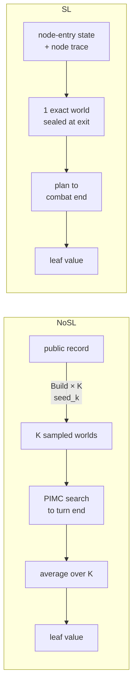

import Determinize from '../../../../../components/book/Determinize.svelte';
import StrategyFusion from '../../../../../components/book/StrategyFusion.svelte';

The two environments differ in what search may know ([Information and the node](/en/arch/environments/information/)). Search learns things by trying lines of play in a simulated game, so the difference shows up in *which simulated games* it may try them in. This page explains those games, the **worlds**: how NoSL makes them from what it has seen, the error that averaging over them can still make, and why SL, with one exact world, needs a different combat algorithm altogether. It ends with what stays the same: one macro brain and one value function V for both.

## 1. Worlds

A **world** is a simulator state that search may explore: a running game it can observe, act in, save (snapshot) and go back to (restore). Search never touches the real game. It asks for worlds through the world API ([Protocol: worlds and worker messages §1](/en/arch/protocol/worlds/#sec-1)), plays its candidate lines in them, and compares how the lines end.

Today every world is a **combat world**: one combat, which the combat brain searches ([Combat brain](/en/arch/combat-brain/)). The macro brain's searches outside combat use the SL clone directly ([Macro brain: search §2](/en/arch/macro-brain/search/#sec-2)); run worlds for NoSL, which would let it look past the current node, are planned ([Simulator: worlds and the SL clone §8](/en/arch/simulator/worlds/#sec-8)).

Where worlds come from is the one thing the environment changes:

| | NoSL world | SL world |
|---|---|---|
| made from | the observation and the public record | the node's checkpoint and the node's steps |
| how | build a combat that shows the observation, then draw the hidden state from a seed (*determinize*) | load the checkpoint as the game's Continue does, replay the steps |
| how many per decision | K, each from its own seed | one |
| what it is | one plausible guess of the hidden state | the exact real combat |
| class | `SimWorlds.NoSL` ([Simulator: worlds and the SL clone §2](/en/arch/simulator/worlds/#sec-2)) | `NodeWorld`, on the node's clone ([Simulator: worlds and the SL clone §7](/en/arch/simulator/worlds/#sec-7)) |

Both are built in worker processes from what the request carries ([Simulator: the worker pool §5](/en/arch/simulator/pool/#sec-5)). A NoSL request carries the observation and never the true state, so a NoSL worker cannot see more than the player.

## 2. Determinization: guessing the hidden state

NoSL's search cannot see the hidden state, but it can guess it. To **determinize** is to replace everything the player cannot know with a concrete sample that agrees with everything the player has seen. On one sample, the game is again a game of perfect information, and search can play it like any other simulation.

A NoSL world starts as a combat built to show the observation exactly (`CombatBuilder.Setup`, [Simulator: combats §5](/en/arch/simulator/combat/#sec-5)). Then `Determinize(seed)` draws the hidden part from the seed (`Simulation/CombatSession.cs:237-283`):

- every seeded random stream of the run, of the player and of each monster is reseeded: shuffles, generated cards, random targets, monster AI;
- the draw pile is put in an order that depends only on what the player sees (sorted by card key), then shuffled with the seed;
- the cards outside the hand are numbered again: the game numbers cards in draw order, so the old numbers would leak the true order;
- each monster's queued move is drawn among the moves that show the same intent, and its last move-log entry is rewritten to match.

The seed comes only from the caller, never from the run, so nothing of the real seed leaks into the sample. World k of a decision uses a seed mixed from the decision's search seed and k, so K worlds are K different, equally plausible futures. Not modelled yet: a draw-pile card whose position the player does know (one just put on top), and how a monster's history makes some of its moves likelier than others.

The figure takes a real start of a round from the training data of an earlier combat net: the Silent at 39 HP against LOUSE_PROGENITOR, nine cards in the draw pile. The player knows which nine; each world is one order of them. Draw K worlds and look at the five cards each one puts on top. The share of worlds in which a card comes up estimates the true chance of drawing it, with more noise the smaller K is.

<Determinize client:visible lang="en" />

The champion's NoSL combat brain searches 8 worlds at 300 nodes each by default ([NoSL PIMC: budget §1](/en/arch/pimc/budget/#sec-1)). A world is cheap once built (a restore costs about 0.3 ms plus 0.07 ms per replayed action, [Simulator: combats §2](/en/arch/simulator/combat/#sec-2)), but every world multiplies the search, so K trades accuracy against time.

## 3. Strategy fusion

Searching each world as if it were the truth has a known flaw. In one world the search knows exactly what will happen, so it may plan a line that commits to a choice *before* the information that choice depends on is revealed, and still pick the right choice, because it already knows. Averaged over worlds, such a line looks better than any real player could make it. This error is **strategy fusion**: the plan fuses several strategies, one per world, as if the player knew which world is real.

There are two places the error can enter.

- **At the root.** If each world simply picked its own best first action, the AI would play as if it knew the world. NoSL's PIMC never does this: it scores each first action by its mean over the K worlds, and plays the first action with the best mean ([NoSL PIMC: search §2](/en/arch/pimc/search/#sec-2)). This is what "no strategy fusion" in the comparison below means.
- **Below the root.** After the first action, each world's search goes on to the end of the turn on its own, and there it still sees its world's future. A line in which the player must choose before a hidden card is drawn gets, in each world, the choice that suits that world. Averaging the first actions does not remove this. PIMC plans again after every action, so what it plays is always a first action, but its values can still favour lines whose later steps are fused.

The figure has one decision with two worlds: the top card of the draw pile is either a Strike or a Defend. Playing safe is worth the same in both. The other first action leads to a second choice that must be made before the top card is drawn. Move the slider to change how likely each world is, and compare what each world's own search thinks, what PIMC's average thinks, and what the line is really worth to a player who cannot see the card.

<StrategyFusion client:visible lang="en" />

How much this costs in real combats is measured by the fusion panel: NoSL combat decisions from decision logs, PIMC's values against values whose lines are merged where the worlds cannot yet be told apart ([NoSL PIMC: search §4](/en/arch/pimc/search/#sec-4)). If the remaining error turns out to matter, the alternative is ISMCTS (information set Monte Carlo tree search), which searches one tree over all worlds and so shares a choice between worlds that look the same to the player.

## 4. SL: one exact world

SL's world is the node's clone: an exact copy of the real combat, with the true random streams. That changes the problem.

- **There is no chance left.** Every action has one outcome, and the whole combat is a deterministic puzzle. A line found in the world is a line that works in the real combat.
- **There is nothing to fuse.** With one world, taking its best line is correct: the plan cannot assume knowledge it does not have, because the world *is* what the player would meet.
- **States are told apart by everything.** Search remembers states it has seen (*transpositions*), so that two orders of the same plays are searched once. Besides the observation, a NoSL world's key holds what the observation hides that changes what happens next: the draw pile's order, each random stream's position and each monster's queued move (`HiddenState.Key`, `GameBridge/HiddenState.cs:19-29`). The SL world's key adds each monster's moves so far and this turn's entries of the combat's history, as a multiset so that another order of the same plays still meets (`HiddenState.Full`, `:36-44`); in the one real combat those change what happens next.
- **The budget goes into depth.** With one world and no averaging, the search can usually reach the end of the combat.
- **The world stops at the horizon.** The clone is sealed at the node's exit, and the SL world refuses any action after its combat's end ([Information and the node §8](/en/arch/environments/information/#sec-8)). Nothing searches past the exit today; a search that did would have to start from the exit observation with determinized worlds, as NoSL does.

## 5. One macro brain, two combat algorithms

So the two environments pose two different combat problems: NoSL must choose the action that is best on average over the worlds it cannot tell apart, and SL must find the best line in one known world. Each has its own algorithm. The champion's options pick it per environment: `run --policy` for a run (the SL planner, `plan`, is refused outside SL), and in the `brain` command `--policy` for NoSL hosts and `--sl-policy`, the SL planner by default, for SL hosts ([Overview §5](/en/arch/environments/#sec-5)). Harness then hands the combat route the matching input with every combat decision: in SL the node's clone, in NoSL nothing but the observation, from which the workers build their worlds (`Harness/Dispatcher.cs:132`). In a single process, as in the combat panel, the same two algorithms run behind one interface, `ICombatBrain`, on worlds from an `IWorldSource` ([Protocol: worlds and worker messages §1](/en/arch/protocol/worlds/#sec-1)):

| | NoSL | SL |
|---|---|---|
| problem | hidden state and chance: the action that is best on average over the possible worlds | deterministic: the best line in the one world |
| where worlds come from | public record → build and determinize ([Simulator: worlds and the SL clone §2](/en/arch/simulator/worlds/#sec-2)) | the node's clone ([Simulator: worlds and the SL clone §4](/en/arch/simulator/worlds/#sec-4)) |
| number of worlds | K, averaged by first action (no fusion at the root) | 1; its best line is correct, nothing to fuse |
| chance | K determinized worlds drawn at the root; inside one world's search there is none | none at all |
| combat algorithm | PIMC: search each world to the end of the turn, average by first action, search again after every action ([NoSL PIMC](/en/arch/pimc/)) | the SL planner: a beam over the whole combat's turns, each turn searched in full, pruned by the best line that ends the combat; it follows its plan, and plans again where a step does not go as planned or the plan runs out ([The SL planner §3](/en/arch/sl-planner/#sec-3)) |
| transpositions keyed by | observation, draw order, the streams' positions, the monsters' queued moves | the same, plus the monsters' moves so far and this turn's combat history |
| budget is spent on | samples × depth | depth and breadth: a combat can usually be searched to its end |
| past the horizon | – (no search crosses a node) | the world stops (`AtHorizon`); nothing searches past it |
| macro brain | afterstates predicted from the screen, valued by V | the same brain; with `--afterstates clone` it plays each option on the clone ([Macro brain: search §2](/en/arch/macro-brain/search/#sec-2)) |
| value | V(observation) | the same V |

The leaves of both searches are valued from public information only: the observation and the record of the monsters' intents so far ([Combat brain: the leaf §1](/en/arch/combat-brain/leaf/#sec-1)). So the true streams cannot leak in through evaluation. The macro brain and V never read the environment either; in SL with `--afterstates clone`, Harness hands the macro side the node's clone, so L0's search differs while the brain stays the same.

PIMC on the clone (`--policy pimc` with `--env SL`) also exists: it searches only the current turn of the one world, sending one request per first action ([Simulator: the worker pool §3](/en/arch/simulator/pool/#sec-3)), and stays as the SL planner's baseline.

## 6. One V for both environments

In principle SL would value states outside combat differently too. From the same state SL wins more often, because it plays every later node better, so a value made for SL would accept more risk: more elites, events and cards with a high variance. This is ignored on purpose. One V serves both environments, and it is trained on runs whose combats the SL combat brain played ([Macro brain: self-play §2](/en/arch/macro-brain/selfplay/#sec-2)).

The macro brain sees the same information in both environments, and V reads only what the run is ([Macro brain: the value network](/en/arch/macro-brain/network/)). The two environments' combat brains also share one net file, c8-2, which learned from SL's games; in NoSL it loads and plays, and it has never been trained or gated there ([Combat brain: the leaf §6](/en/arch/combat-brain/leaf/#sec-6)). What the shared V gives up is the difference between the two environments' values outside combat, and in NoSL it is somewhat optimistic.

## 7. Leaderboards, gates and explanations

- **Champions, gates and leaderboards stay per environment.** Each environment has its own champion file, and a gate pairs a challenger only with its own environment's champion, refusing runs from the other (`Harness/Gate.cs:44-52`); `gate --promote` rewrites only the file it is given ([Evaluation: gates §8](/en/arch/evaluation/gates/#sec-8)). One shared V does not change that: a new V reaches each environment's champion only through that environment's file. Both files name the same V, v8-2, and the same combat net, c8-2. Until a NoSL report of them exists, the NoSL file names the SL report, so a NoSL gate refuses to pair with it ([Evaluation §3](/en/arch/evaluation/#sec-3)).
- **The same seeds feed two leaderboards,** one table per environment, never ranked together. Below them the leaderboard gives the SL − NoSL difference for each champion that has a report in both environments under the same name ([Overview §3](/en/arch/environments/#sec-3)).
- **Explanations will differ.** The recommendation has no facts yet; when it does, a NoSL fact will be a probability or an expectation ("blocks 6 HP on average"), and an SL fact may be an exact outcome ("play A then B, and you draw X") ([Output §5](/en/arch/output/#sec-5)).

## 8. What each subsystem does per environment

| subsystem | NoSL | extra for SL |
|---|---|---|
| protocol | observations, actions, card prompts, recommendation, world API, NoSL worker requests | `node_checkpoint` and `node_action`; the clone type `NodeClone`; the SL worker requests (`SlWorldRequest`, `SlTurnRequest`, `SlMacroRequest`) |
| GameBridge | whitelisted observations, legal actions, starting actions | the node checkpoint (`Checkpoint.Take`, `Open`, `RestoreRelics`); SL's transposition key (`HiddenState.Full`) |
| simulator | build a combat from the observation, determinize | the node checkpoint (taken in both environments), loading a save and replaying it, the seal (`AtHorizon`) |
| mod | observe, ask, show the answer (assist; it never executes) | the node's checkpoint and steps, recorded in both environments, sent only in SL |
| Harness | routing, seeds, the record of the monsters' intents | the latest checkpoint and the node's steps: one clone, for every combat decision and, with `--afterstates clone`, every macro decision |
| combat brain | PIMC, an expectation search | its own algorithm: the SL planner |
| macro brain | afterstates predicted from the screen, valued by V | the same brain; with `--afterstates clone`, afterstates played on the clone (`CloneSearch`, `PooledClone`) |
| learning | V and the combat net, both from SL's games | none: both environments play the same two net files |
| evaluation | the NoSL leaderboard | the SL leaderboard, and the SL − NoSL difference |
