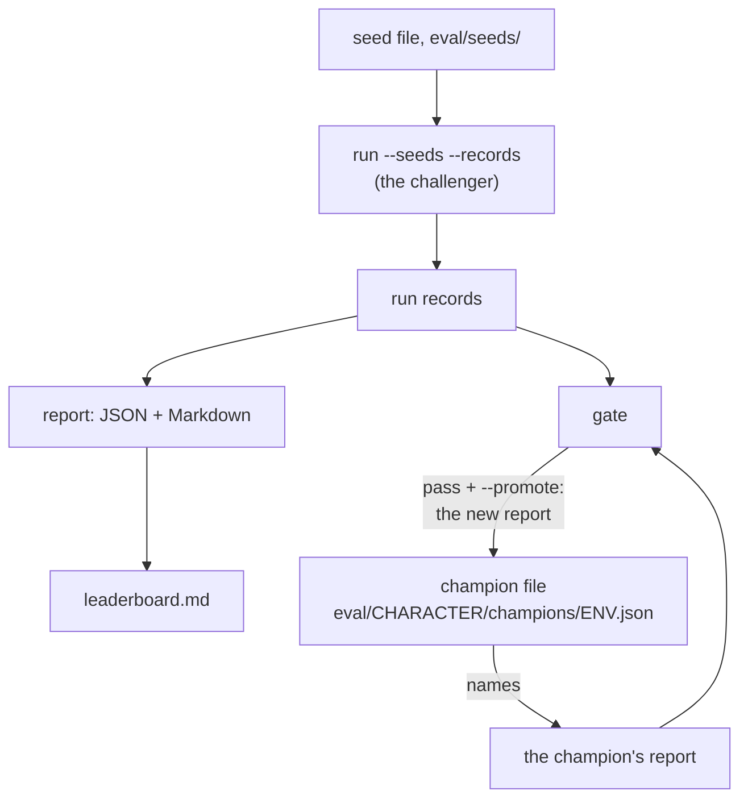

import { Aside } from '@astrojs/starlight/components';

A run of Slay the Spire 2 is a long chain of chance: the map, the encounters, the cards offered, every draw. The same AI can die on floor 9 with one seed and win with the next. Evaluation turns that noise into two answers: **how strong is the AI** (a leaderboard), and **did a change make it stronger** (a gate). Both play whole runs in the simulator, both are kept apart for the two environments, SL and NoSL, and both rest on fixed, registered seed sets.

Read first: [Environments](/en/arch/environments/) for SL and NoSL, and [Simulator: whole runs](/en/arch/simulator/runs/) for what a run is and what it records. In this chapter, `Harness/…` is a file of `src/Sts2Ai.Harness`, `SimWorker/…` one of `src/Sts2Ai.SimWorker`, and `learn/…` a Python script.

<Aside title="Status">

Built: whole runs in the simulator in both environments, rung R1 (`run --seeds FILE --records FILE`); the report (`report`) with its void rule; the leaderboards (`leaderboard`); seed files and their generator (`seeds`); the paired SPRT gate (`gate`) with champion files and `--promote`; the combat panel (`panel`); and `learn/gauntlet.py`'s paired lower-bound gate on whole runs, by wins. Planned: rungs R2–R4, the act-level gate, an A/A test, `NumReloads` and a NoSL save-export count among the must-be-zero metrics, calibration and search-compute numbers in reports, a run of the final set.

</Aside>

## 1. Two questions

**How strong is it?** One run says little. Strength is a rate over many runs on seeds fixed in advance: the share of runs won, with its interval, and while wins are rare the mean floor reached ([Metrics, seeds and reports §1](/en/arch/evaluation/metrics/#sec-1)). Every evaluation becomes a **report**, and every report goes on its environment's **leaderboard** ([§3](#sec-3)). A report of the current champion is pending.

**Did a change make it stronger?** A challenger (a new net, a new search budget, a code fix) faces the **champion**, the best accepted version, on the same seeds, pair by pair. The test it must pass is a **gate** ([Gates](/en/arch/evaluation/gates/)). Pairing by seed lets the luck both sides share cancel, and a sequential test can stop as soon as the evidence is clear.

The two answers are kept apart. A leaderboard lists every complete report, accepted or not; the champion changes only through a gate or a recorded decision, written into the environment's **champion file** ([Champions and baselines §1](/en/arch/evaluation/champions/#sec-1)).

## 2. The sim-to-real ladder

Results from the simulator count only if they carry over to the real game. The ladder gets there in four rungs, R1 to R4, each adding one step of realism. Every milestone is meant to run all rungs, reported separately:

| rung | world | measures | today |
|---|---|---|---|
| R1 | a whole run in the simulator, driven by Harness | the policy | built: whole runs in both environments; SL is the main context |
| R2 | R1 + the observation round trip (decisions only on worlds built from observations) | observation reconstruction | not a rung of its own: NoSL search already builds its worlds from observations, and `run --check` checks every observation's round trip |
| R3 | a whole run on the real DLL with real unlocks, the lobby's act selection and the live protocol | world setup and interfaces | none |
| R4 | the Steam game with the mod | everything | none: the mod's auto-run driver is planned ([Mod: auto-play and safety §2](/en/arch/mod/auto/#sec-2)) |

**Why one new variable per rung.** Each rung differs from the one below it in one respect only. If the win rate drops between two neighbouring rungs, only one thing changed, so the gap can be attributed to it:

- R1 → R2: observation reconstruction;
- R2 → R3: world setup and interfaces;
- R3 → R4: animation, timing, UI state and the executor (the mod code that performs actions in the game).

If R1 jumped straight to the real game, a lower win rate could have any of these causes, with no way to tell which.

- R4 runs in real time, so it is for confirmation, not for tuning.
- In NoSL, R1 decisions already go through the Build path, which builds worlds from observations ([Simulator: worlds and the SL clone §2](/en/arch/simulator/worlds/#sec-2)), so for decisions NoSL's R1 is about R2. In SL it is not: the combat planner and `--afterstates clone` search the node's clone, the game's save and the decisions since, not worlds built from an observation ([Harness: routing, budgets and seeds §2](/en/arch/harness/routing/#sec-2)).
- Every run record says `R1`: `run` writes the rung as a constant (`SimWorker/Commands/RunCommand.cs:285`).

## 3. Two leaderboards

A leaderboard ranks reports of one environment on one seed set. There is one per environment, and the two are never mixed:

| | NoSL | SL |
|---|---|---|
| seeds | the same registered sets | the same |
| champion | the NoSL champion file's report | the SL champion file's report |
| information allowed | [Environments: information §5](/en/arch/environments/information/#sec-5) | the same table |
| budget | per decision, the same tier | the same |

<Aside type="caution" title="Never mix environments">

Never put both environments in one table or in one promotion decision. The gate refuses a challenger played in the other environment, and `leaderboard` writes one table per environment ([Metrics, seeds and reports §9](/en/arch/evaluation/metrics/#sec-9)).

</Aside>

- **Now.** The two champions share the macro brain, one V (`v8-1`) and one combat net (`c8-1`); their combat search differs ([Environments: worlds §5](/en/arch/environments/worlds/#sec-5)). NoSL plays V with screen afterstates, since the clone is SL's. No NoSL report of that champion exists, so the NoSL file names an SL report: a NoSL gate refuses to pair with it (the environments differ), and the NoSL leaderboard marks no champion.
- **SL − NoSL.** The difference between a champion's results in the two environments, on the same seeds, is the value of in-node information. For reference, spire-mentor, a prior-art project, lost 22.8–25.5 percentage points (pp) of win rate without its cheat, which covered the whole run (`tmp/notes/refs/strong-bots.md:42`); ours is node-level only, so a smaller difference is expected. `leaderboard` computes it for each champion name that has a report in both environments (`Harness/Reports.cs:205-222`), and no board has shown it: SL champions are named `combat plan …`, NoSL ones `combat pimc …`, so no name has both. The nearest pair is one earlier V on `promotion-1`: SL with the planner 28.25, NoSL with PIMC 26.16, +2.09 floors paired by seed (standard error 0.55, computed from the two reports); it measures the planner together with the information, since the combat brains differ.
- How a board is built, field by field: [Metrics, seeds and reports §9](/en/arch/evaluation/metrics/#sec-9).

## 4. Where it stands

| piece | state | where |
|---|---|---|
| whole runs in both environments (R1), run records | built | [Metrics, seeds and reports §8](/en/arch/evaluation/metrics/#sec-8) |
| reports, the void rule, the Wilson interval | built | [Metrics, seeds and reports §2](/en/arch/evaluation/metrics/#sec-2), [§7](/en/arch/evaluation/metrics/#sec-7) |
| the seed sets, `promotion-1` and its extensions and `final-1`, and their generator | built; `final-1` never run | [Metrics, seeds and reports §5](/en/arch/evaluation/metrics/#sec-5) |
| leaderboards | built; the SL − NoSL section never shown | [Metrics, seeds and reports §9](/en/arch/evaluation/metrics/#sec-9) |
| the combat panel | built | [Gates §5](/en/arch/evaluation/gates/#sec-5) |
| the paired SPRT gate `gate`, champion files, promotion | built | [Gates §6](/en/arch/evaluation/gates/#sec-6) |
| the wins gate, `learn/gauntlet.py --against` on whole runs | built, in use | [Gates §10](/en/arch/evaluation/gates/#sec-10) |
| act-level gate, A/A test, McNemar's test | planned | [Gates §4](/en/arch/evaluation/gates/#sec-4), [§5](/en/arch/evaluation/gates/#sec-5) |
| R2–R4 | planned | [§2](#sec-2) |

**How a new net is gated.** A net is trained and judged in whole SL runs, by its chance to win ([Macro brain: self-play §1](/en/arch/macro-brain/selfplay/#sec-1)). Its gate plays the challenger on the 300 seeds of `promotion-1-300` with the champion's planner at medium effort (`--afterstates clone`, no exploration), pairs its runs with the champion's by seed, and promotes it when the 95% one-sided lower bound of the mean difference in wins, 1 or 0 per run, is above 0. The same seeds at the low budget are played for reference and decide nothing. If both nets of a generation pass, the one with more wins is promoted. So two gates coexist: the C# SPRT `gate`, sequential, on floors or on wins; and `learn/gauntlet.py`'s fixed-sample lower bound on wins.

## 5. This chapter

| page | what it explains |
|---|---|
| [Metrics, seeds and reports](/en/arch/evaluation/metrics/) | the main metric, what must be zero, the secondary metrics, the Wilson interval; the seed sets and their generator; the report, the run record and the leaderboard, field by field |
| [Gates](/en/arch/evaluation/gates/) | why pair; common random numbers, the SPRT, McNemar and A/A; the layered gates; every option of `gate` and of the wins gate; not worse, promotion, re-baselining |
| [Champions and baselines](/en/arch/evaluation/champions/) | the champion file, where the history and the reports live, external baselines, open questions |
