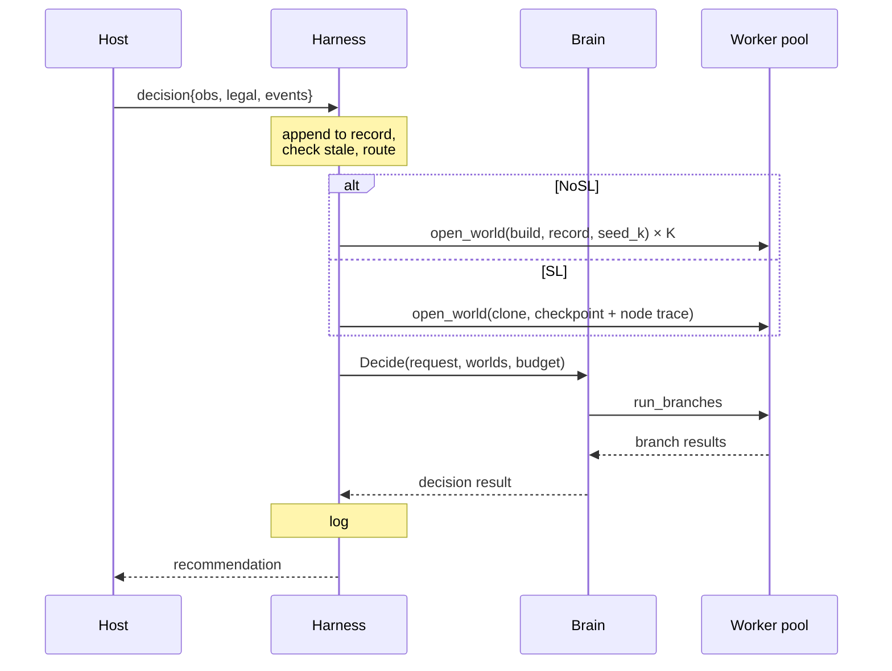

import { Aside } from '@astrojs/starlight/components';

Harness is the dispatcher of the decision process. On one side is the **host**, which runs the actual game: the mod in the real game, or a run-host worker in simulation. On the other side are the brains and the pool of SimWorker processes that run the search. Harness has no strategy of its own and touches no game objects; it works with Protocol types only. Its job is bookkeeping: what the AI has seen so far, which brain answers which screen, how much compute a decision may use, and what gets logged.

<Aside title="Status">

Partly built. `Sts2Ai.Harness` holds the worker pool ([Simulator §8](/en/arch/simulator/#sec-8)) and `PooledPimc`, the combat brain with its NoSL worlds searched in the pool; `PimcPolicy` wraps it as the combat policy of whole runs. Record, routing, budget control and the decision log are planned: today SimWorker's commands call the policies directly, through `ICombatPolicy` and `IChoicePolicy`.

</Aside>

## 1. Responsibilities

Harness does six things:

1. Handles Protocol messages: keeps them in `decision_id` order and drops stale requests, i.e. requests for a state the game has already left ([Protocol §2](/en/arch/protocol/#sec-2)).
2. Keeps the public record of each run ([§3](#sec-3)). In NoSL this record is the input to the belief, the AI's picture of the hidden state. In SL Harness also keeps the node checkpoint and the node trace.
3. Opens worlds for the current environment through `IWorldSource` ([Environments §5](/en/arch/environments/#sec-5), [Protocol §7](/en/arch/protocol/#sec-7)).
4. Routes each surface to a brain, with no fallback ([§4](#sec-4)).
5. Sets the budget ([§5](#sec-5)) and keeps the search seeds deterministic.
6. Writes the decision log ([§6](#sec-6)).

What Harness does not do:

- read or execute the game: that is GameBridge, inside the host;
- build or determinize states: that is the worker's job, because it needs game code;
- judge actions: that is the job of the brains ([Combat brain](/en/arch/combat-brain/), [Macro brain](/en/arch/macro-brain/)).

## 2. Processes and flow

One decision goes like this. The host sends a `decision` message with the observation, the legal actions and the events since the previous decision. Harness appends them to the record, checks that the request is not stale, and picks the brain for this surface. It then opens worlds in the worker pool: in NoSL, K worlds built from the record, each with its own search seed `seed_k`; in SL, one clone made from the node checkpoint plus the node trace. The brain searches those worlds within the budget and sends its branches to the pool with `run_branches`. Harness logs the result and sends a recommendation back to the host.



- The host is the mod (R4, the real game) or the run-host worker (R1–R3, simulation); R1–R4 are the rungs of the [sim-to-real ladder](/en/arch/evaluation/#sec-1). Harness cannot tell the two apart. This is the project's rule "swap the world, not the brain".
- Search workers are separate from the host process. In self-play the host worker only holds the true run; search runs on other workers.
- Single-process mode (bench, selftest): Harness and a worker run in one process, with the same interfaces and no IPC.

## 3. Public record

The public record is the NoSL belief: everything the AI knows about the run comes from it.

Harness keeps no mirror game that is kept in sync with the true RNG. That mirror is the structural bug of spire-mentor, a prior-art project this design learned from. Instead, every decision rebuilds its worlds from the record:

```csharp
// Planned. Protocol types only.
public sealed class PublicRecord
{
    public RunHeader Header { get; }                    // character, ascension, game version, env
    public IReadOnlyList<RecordEntry> Entries { get; }  // observations, events, own decisions, in order
    public Observation Latest { get; }
}
```

- The record is the only input of NoSL worlds. A worker receives (record, search seed) and samples a state consistent with the record, using game code. The rules this needs (monster state machines, pools, reward weights) live in the worker.
- Inferences the record must support, in order of priority:
  1. the draw-pile multiset plus the cards whose position is known (needs `move{pos}` events);
  2. a posterior for each monster's next move (a probability distribution given what has been seen), from its intent and effect history. Today the resampling is uniform among moves with the same intent;
  3. this turn's history, which gives the internal counters of powers and relics;
  4. at run level: the rewards, shops and events seen so far, which give the hidden odds counters.
- The record is saved with the run log. Crash recovery means replaying the log; no game save is needed.
- SL: the record is still kept, for logs and narration, but the search worlds come from the node clone ([Simulator §7](/en/arch/simulator/#sec-7)). Harness stores the latest node checkpoint and node trace; the trace is reset at each node entry.

## 4. Surface routing

Each surface (kind of decision screen) goes to exactly one brain:

| surface | brain |
|---|---|
| `combat` | combat |
| `card_choice` in combat (discard, exhaust, choose, put on top, …) | combat (with `ChoiceContext`) |
| `card_choice` out of combat (upgrade, transform, enchant, remove) | macro |
| `map`, `rewards`, `card_reward`, `bundle`, `event`, `shop`, `rest`, `treasure`, `potion_full` | macro |

- No route means the error "uncovered surface". The host pauses, asks for manual play and logs a coverage bug. There is never a random fallback. Evaluation requires the fallback count to be 0 ([Evaluation §3](/en/arch/evaluation/#sec-3)).
- The list of surfaces and their game entry points: [Simulator §5.2](/en/arch/simulator/#sec-5.2), [GameBridge §4](/en/arch/gamebridge/#sec-4).

## 5. Budget and determinism

The budget is counted in branches (one branch is one simulated line of play in a world) or in wall-clock time, depending on the mode:

| mode | unit | why |
|---|---|---|
| self-play, evaluation | fixed number of branches | reproducible: same request + brain seed + budget → same recommendation |
| assist | wall clock, anytime | a human is waiting: send the best answer so far, then refine it |
| auto-play (R4) | wall-clock cap + a minimum number of branches | do not stall, and do not go shallow |

"Anytime" means the search can be stopped at any moment and still has a best answer to give.

- Results computed in parallel are merged in a fixed order (world index, then candidate index), never in the order they finish, so timing cannot change the answer.
- The brain's RNG comes from Harness: `brainSeed = Hash(runId, decisionIndex, championVersion)`. It is never derived from the game seed.
- Allocation: stop when the top two candidates are separated by more than their confidence intervals (CI); otherwise add samples or depth ([Combat brain §5](/en/arch/combat-brain/#sec-5)).

## 6. Decision log

One JSON line per decision:

```json
{"decision_id": 412, "env": "NoSL", "surface": "combat", "obs_hash": "…",
 "budget": {"branches": 4000}, "worlds": 16,
 "candidates": [{"plan": ["play:7:3", "play:9", "end_turn"], "value": 0.412, "ci": 0.018, "n": 1600}],
 "chosen": "play:7:3", "elapsed_ms": 812, "brain": "champion-0007", "degraded": false}
```

Each candidate carries its plan, its value, its confidence interval `ci` and its sample count `n`. `degraded` marks a decision answered after a worker failure ([§7](#sec-7)).

Who reads the log:

- learning: value targets and ExIt labels (ExIt, expert iteration: training the learned parts to imitate what the search chose);
- evaluation: fallbacks, compute per decision, conservatism;
- output: narration is built only from the candidates and facts.

## 7. Failures

| case | handling |
|---|---|
| stale request (a newer `decision_id` exists) | cancel the search; send no reply |
| worker crash or timeout | reopen the world on another worker from a snapshot; answer with the branches that finished; `degraded=true` |
| building from the observation fails | report `BuildDifferences`; no search; the host pauses; the bug is logged. Never random |
| the host rejects the action as illegal | the host requests again; twice in a row → pause |

## 8. Tests

1. Routing coverage: N simulated runs hit every surface, with a fallback count of 0.
2. Reproducibility: replaying a decision log gives identical recommendations.
3. NoSL counterfactual at Harness level: same record, different hidden state → same recommendation ([Environments §7](/en/arch/environments/#sec-7)).
4. Stale handling: reordered or duplicated requests → only the latest is answered.

## 9. Open questions

1. How fine-grained the events in the record should be: start with the inferences in [§3](#sec-3), add more on demand.
2. Reuse built worlds across decisions within one turn (incrementally: take a snapshot after the build, then extend the trace with each executed action), or rebuild every time?
