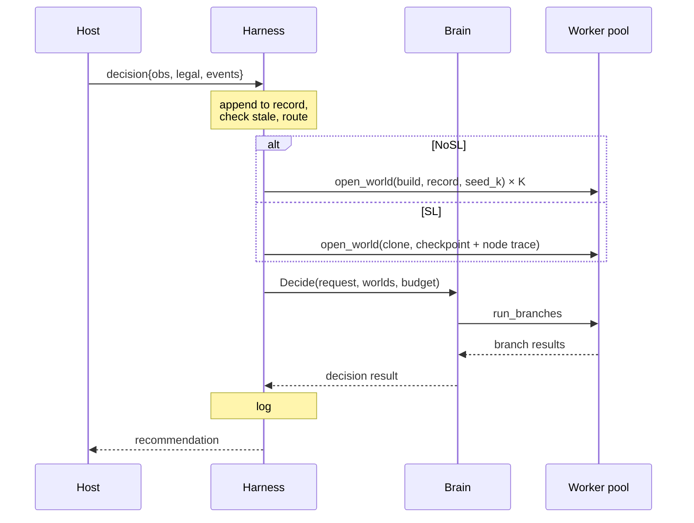

import { Aside } from '@astrojs/starlight/components';

Harness is the dispatcher of the decision process. On one side is the **host**, which runs the actual game: the mod in the real game, or a run-host worker in simulation. On the other side are the brains and the pool of SimWorker processes that run the search. Harness has no strategy of its own and touches no game objects; it works with Protocol types only. Its job is bookkeeping: what the AI has seen so far, which brain answers which screen, how much compute a decision may use, and what gets logged.

<Aside title="Status">

Partly built. `Sts2Ai.Harness` holds the worker pool ([Simulator: the worker pool §2](/en/arch/simulator/pool/#sec-2)), `PooledPimc` (the PIMC combat brain with its worlds searched in the pool, NoSL or SL), `PooledPlanner` (the SL planner with its turns searched in the pool) and `Dispatcher`, which routes a run's decisions to brains, draws their seeds and writes the decision log ([§4](#sec-4)–[§6](#sec-6)). SimWorker's `run` plays every run through it, in process or over the wire: `BrainServer` is Harness's end of the host–brain messages ([Protocol: the wire §1](/en/arch/protocol/wire/#sec-1)), and answers decisions in order. Planned: the rest of the public record ([§3](#sec-3); today it holds the enemies' intents per round, [§6](#sec-6)); stale requests and cancels while a search runs; wall-clock budgets and CI allocation; degraded answers.

</Aside>

## 1. Responsibilities

Harness does six things:

1. Handles Protocol messages: keeps them in `decision_id` order and drops stale requests, i.e. requests for a state the game has already left ([Protocol: the wire §5](/en/arch/protocol/wire/#sec-5)).
2. Keeps the public record of each run ([§3](#sec-3)). In NoSL this record is the input to the belief, the AI's picture of the hidden state. In SL Harness also keeps the node checkpoint and the node trace.
3. Opens worlds for the current environment through `IWorldSource` ([Environments: worlds §5](/en/arch/environments/worlds/#sec-5), [Protocol: worlds and worker messages §1](/en/arch/protocol/worlds/#sec-1)).
4. Routes each surface to a brain, with no fallback ([§4](#sec-4)).
5. Sets the budget ([§5](#sec-5)) and keeps the search seeds deterministic.
6. Writes the decision log ([§6](#sec-6)).

What Harness does not do:

- read or execute the game: that is GameBridge, inside the host;
- build or determinize states: that is the worker's job, because it needs game code;
- judge actions: that is the job of the brains ([Combat brain](/en/arch/combat-brain/), [Macro brain](/en/arch/macro-brain/)).

## 2. Processes and flow

One decision goes like this. The host sends a `decision` message with the observation, the legal actions and the events since the previous decision. Harness appends them to the record, checks that the request is not stale, and picks the brain for this surface. It then opens worlds in the worker pool: in NoSL, K worlds built from the record, each with its own search seed `seed_k`; in SL, one clone made from the node checkpoint plus the node trace. The brain searches those worlds within the budget and sends its branches to the pool with `run_branches`. Harness logs the result and sends a recommendation back to the host.



- The host is the mod (R4, the real game) or the run-host worker (R1–R3, simulation); R1–R4 are the rungs of the [sim-to-real ladder](/en/arch/evaluation/#sec-1). Harness cannot tell the two apart. This is the project's rule "swap the world, not the brain". SimWorker's `brain` command runs Harness alone behind its socket, and `run --brain` hosts runs against it ([Simulator: whole runs §8](/en/arch/simulator/runs/#sec-8)).
- Search workers are separate from the host process. In self-play the host worker only holds the true run; search runs on other workers.
- Single-process mode (bench, selftest): Harness and a worker run in one process, with the same interfaces and no IPC.

## 3. Public record

The public record is the NoSL belief: everything the AI knows about the run comes from it.

Harness keeps no mirror game that is kept in sync with the true RNG. That mirror is the structural bug of spire-mentor, a prior-art project this design learned from. Instead, every decision rebuilds its worlds from the record:

```csharp
// Planned. Protocol types only.
public sealed class PublicRecord
{
    public RunHeader Header { get; }                    // character, ascension, game version, env
    public IReadOnlyList<RecordEntry> Entries { get; }  // observations, events, own decisions, in order
    public Observation Latest { get; }
}
```

- The record is the only input of NoSL worlds. A worker receives (record, search seed) and samples a state consistent with the record, using game code. The rules this needs (monster state machines, pools, reward weights) live in the worker.
- Inferences the record must support, in order of priority:
  1. the draw-pile multiset plus the cards whose position is known (needs `move{pos}` events);
  2. a posterior for each monster's next move (a probability distribution given what has been seen), from its intent and effect history. Today the resampling is uniform among moves with the same intent;
  3. this turn's history, which gives the internal counters of powers and relics;
  4. at run level: the rewards, shops and events seen so far, which give the hidden odds counters.
- The record is saved with the run log. Crash recovery means replaying the log; no game save is needed.
- SL: the record is still kept, for logs and narration, but the search worlds come from the node clone ([Simulator: worlds and the SL clone §7](/en/arch/simulator/worlds/#sec-7)). Harness stores the latest node checkpoint and node trace; the trace is reset at each node entry. `Dispatcher` keeps them from the host's `node_checkpoint` and `node_action` messages, refuses them in NoSL, and hands the clone to the combat brain with each combat decision and, with `--afterstates clone`, to L0 at each macro decision and each card prompt outside combat, whose probes `PooledClone` plays in the worker pool ([Macro brain: search §6](/en/arch/macro-brain/search/#sec-6)). An SL decision before any checkpoint throws.

## 4. Surface routing

Each surface (kind of decision screen) goes to exactly one brain:

| surface | brain |
|---|---|
| `combat` | combat |
| `card_choice` in combat (discard, exhaust, choose, put on top, …) | combat (with `ChoiceContext`) |
| `card_choice` out of combat (upgrade, transform, enchant, remove) | macro |
| `map`, `rewards`, `card_reward`, `bundle`, `event`, `shop`, `rest`, `treasure`, `potion_full` | macro |

- The combat brain depends on the environment: PIMC in NoSL, the SL planner in SL (`--policy plan`, [Combat brain §3](/en/arch/combat-brain/#sec-3)), which plans on the node's clone and refuses to play in NoSL. PIMC on the clone (`--policy pimc` in SL) stays as the planner's baseline: it searches this turn only. The macro brain is the same in both ([Environments: worlds §5](/en/arch/environments/worlds/#sec-5)). Each host names its environment at `hello`, so the `brain` command serves both: NoSL hosts get `--policy`'s combat brain, SL hosts `--sl-policy`'s, the SL planner by default ([Mod §5](/en/arch/mod/#sec-5)).
- `Dispatcher` implements this table for one run. The host gives it as its combat, card-prompt and macro policy. It holds one brain per side (combat, prompts in combat, macro, prompts out of combat) and sends a card prompt to a side by `ChoiceContext.InCombat` ([Protocol: observations and actions §6](/en/arch/protocol/observation/#sec-6)). Today prompts in combat go to `p0` ([Combat brain: prompts, moves and workers §1](/en/arch/combat-brain/shared/#sec-1), rule 7), and the macro side and its prompts to L0 or to the random placeholder.
- No route means the error "uncovered surface": `Dispatcher` throws on a surface outside `Dispatcher.MacroSurfaces`, and on a brain's answer that is not legal. The host pauses, asks for manual play and logs a coverage bug. There is never a random fallback. Evaluation requires the fallback count to be 0 ([Evaluation §3](/en/arch/evaluation/#sec-3)).
- The list of surfaces and their game entry points: [Simulator: whole runs §4](/en/arch/simulator/runs/#sec-4), [GameBridge §4](/en/arch/gamebridge/#sec-4).

## 5. Budget and determinism

The budget is counted in branches (one branch is one simulated line of play in a world) or in wall-clock time, depending on the mode:

| mode | unit | why |
|---|---|---|
| self-play, evaluation | fixed number of branches | reproducible: same request + brain seed + budget → same recommendation |
| assist | wall clock, anytime | a human is waiting: send the best answer so far, then refine it |
| auto-play (R4) | wall-clock cap + a minimum number of branches | do not stall, and do not go shallow |

"Anytime" means the search can be stopped at any moment and still has a best answer to give.

- Results computed in parallel are merged in a fixed order (world index, then candidate index), never in the order they finish, so timing cannot change the answer.
- The brain's RNG comes from Harness: `brainSeed = SplitMix64(Hash(runId), decisionIndex)`, where the decision index counts every decision of the run, card prompts included, and the run id is a hash of the run's seed, so the brain never sees the seed ([Protocol: the wire §3](/en/arch/protocol/wire/#sec-3)). The brain never draws from the game's own random streams. The champion's version joins the hash once brains have versions. PIMC's build seed is the brain seed in hex.
- Allocation: stop when the top two candidates are separated by more than their confidence intervals (CI); otherwise add samples or depth ([NoSL PIMC: budget §1](/en/arch/pimc/budget/#sec-1)).

## 6. Decision log

One JSON line per decision:

```json
{"run": "97eef296cd6717a2", "decision_id": 4, "env": "NoSL", "surface": "combat", "brain": "pimc",
 "obs_hash": "67f99089ea94de49", "legal": 7, "chosen": "play:2", "plan": ["play:3:1", "play:5", "end_turn"],
 "candidates": [{"action": "play:2", "value": 0.673, "ci": 0.0, "samples": 8,
                 "values": [0.673, 0.673, …], "nodes": [37, 35, …]}, …],
 "budget": {"worlds": 8, "nodes_per_world": 300, "elite": 1, "boss": 1, "halving": false, "follow": false}, "seed": 16058448958323553205, "elapsed_ms": 104.6,
 "obs": {"encounter": "NIBBITS_WEAK", "room": "Monster", …}}
```

- `obs_hash` is the hash of what the brain was shown: the combat observation, the run observation, or the card prompt. `legal` counts the legal actions (the options, for a prompt). `chosen` is the action in text form, or the picked option indexes.
- A searching brain adds `plan` (the rest of the turn after `chosen`, in the first world; for the SL planner, the rest of the combat), `candidates` (each first action's mean value, confidence half-width `ci` and number of worlds, best first; then its value in each world, in world order, and the nodes the search spent below it in each world; for the SL planner, each first action its kept lines began with, valued by the best of them) and `budget`. A step played from a followed plan ([NoSL PIMC: budget §2](/en/arch/pimc/budget/#sec-2)) has a `plan` but no `candidates`, like a decision with one legal action. Placeholders log neither. The per-world values are the Q of ExIt's policy target ([Learning §2](/en/arch/learning/#sec-2)).
- On the map, L0 adds `plan` too: the rest of the act's route after `chosen` ([Macro brain: search §1](/en/arch/macro-brain/search/#sec-1)).
- `explored: true` marks a step that self-play's exploration drew instead of the brain's best, and that the brain valued lower by more than a hundredth of the temperature ([Learning §5](/en/arch/learning/#sec-5)). Closer than that it is a tie, such as another order of the same turn, and is not marked. With even draws (`--explore ε`) every drawn answer is marked, also one that happens to be the brain's own pick. Other steps have no `explored`. A combat step drawn instead of the search's pick keeps its `candidates` but has no `plan`, since the plan was the pick's.
- `replanned: true` marks a combat step searched again because a step of the brain's plan did not hold: the combat did not show the observation the plan expected ([NoSL PIMC: budget §2](/en/arch/pimc/budget/#sec-2)). With PIMC's `--follow` that is the turn revealing something; with the SL planner it means the clone differs from the real combat ([The SL planner §4](/en/arch/sl-planner/#sec-4)). The run's line counts them (`replans`).
- A run's combat decisions come in one block per combat, between macro decisions, in the order of the combats in its run record. That is how a decision finds how its combat ended ([Evaluation §6](/en/arch/evaluation/#sec-6)).
- A combat decision adds `obs`, the combat observation the brain was shown ([Protocol: observations and actions §3](/en/arch/protocol/observation/#sec-3)): the input of the learned combat parts and of the fusion panel ([NoSL PIMC: search §4](/en/arch/pimc/search/#sec-4)). It is about 1.6 KB.
- A combat decision adds `history` too: what each enemy of the combat showed at the start of each round so far, this round's included, by uid, as `{round, intents}` entries. It is the part of the public record ([§3](#sec-3)) built today: Harness collects it from the combat observations it is shown, starting over after each macro decision. The combat net reads it, with the round, so that it can learn each monster's move order from data instead of from rules written by hand ([Learning §1](/en/arch/learning/#sec-1)). `MoveRecord` in Brain keeps it, and Harness hands it to the combat brain with each decision (the combat route's last argument), whose search sends it to the workers for the leaves ([Combat brain: prompts, moves and workers §2](/en/arch/combat-brain/shared/#sec-2)).
- A macro decision adds `features`: V's features of the run view the brain was shown ([Learning §1](/en/arch/learning/#sec-1)), whatever brain decided. V v0's fit and V v2's training read them; both are removed, and pure V does not read them ([Learning §2](/en/arch/learning/#sec-2)).
- A macro decision adds `run_view` as well: the run view itself, about 6 KB, which V v2 is trained on ([Learning §2](/en/arch/learning/#sec-2)).
- `run --log FILE` writes it, one line per decision ([Simulator: whole runs §5](/en/arch/simulator/runs/#sec-5)); it is kept beside the run records, in `data/` ([Learning §6](/en/arch/learning/#sec-6)).
- `degraded`, for an answer given after a worker failure, is planned with worlds reopened on other workers ([§7](#sec-7)). A crashed or stuck worker is restarted and gets its request once more, which gives the same answer, so nothing is degraded yet.

Who reads the log:

- learning: value targets and ExIt labels (ExIt, expert iteration: training the learned parts to imitate what the search chose);
- evaluation: fallbacks, compute per decision, conservatism;
- output: narration is built only from the candidates and facts.

## 7. Failures

| case | handling |
|---|---|
| stale request (a newer `decision_id` exists) | cancel the search; send no reply |
| worker crash or timeout | reopen the world on another worker from a snapshot; answer with the branches that finished; `degraded=true` |
| building from the observation fails | report `BuildDifferences`; no search; the host pauses; the bug is logged. Never random |
| the host rejects the action as illegal | the host requests again; twice in a row → pause |

Today: a worker that dies, or does not answer within 5 minutes, is killed, restarted and gets its request once more; a second failure fails the decision ([Simulator: the worker pool §6](/en/arch/simulator/pool/#sec-6)). A request is one world's search, seconds at most, so the timeout catches a stuck worker, not a slow one. A combat not built as observed fails the decision with its differences (`SimWorlds.NoSL`), which in `run` fails the run. An illegal answer from a brain throws in `Dispatcher`.

## 8. Tests

1. Routing coverage: N simulated runs hit every surface, with a fallback count of 0. Exists: `run` lists the surfaces never reached, and `Dispatcher` throws on an uncovered one.
2. Reproducibility: replaying a decision log gives identical recommendations. Exists in part: `run --check` plays each seed twice, the second time over the wire to a Harness in the same process, and compares the decision logs, every field but `elapsed_ms`.
3. NoSL counterfactual at Harness level: same record, different hidden state → same recommendation ([Environments: information §8](/en/arch/environments/information/#sec-8)).
4. Stale handling: reordered or duplicated requests → only the latest is answered.

## 9. Open questions

1. How fine-grained the events in the record should be: start with the inferences in [§3](#sec-3), add more on demand.
2. Reuse built worlds across decisions within one turn (incrementally: take a snapshot after the build, then extend the trace with each executed action), or rebuild every time?
