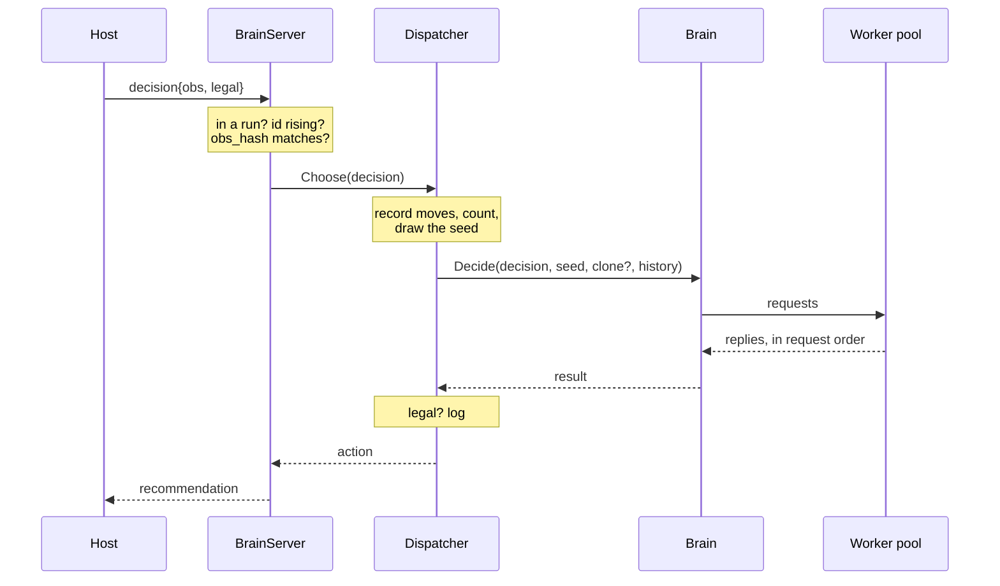

import { Aside, Badge } from '@astrojs/starlight/components';

A decision starts in a **host**, the process that holds the run: the simulator in self-play, the mod in the real game. It ends in a **brain**, which judges the options: the combat brain or the macro brain. Between them sits Harness (`src/Sts2Ai.Harness`). It has no strategy of its own and touches no game object: it sees the game only through Protocol types ([Protocol](/en/arch/protocol/)). Its job is bookkeeping: which brain answers which screen, what the run has shown so far, which seed a decision gets, whether the answer is legal, and what goes into the log.

<Aside title="Status">

Exists: `Dispatcher`, one per run, which routes, keeps the record of enemy moves and the SL node, draws seeds, checks answers and writes the decision log; `BrainServer`, Harness's end of the host–brain wire; the worker pool and the brains that search in it (`PooledPimc`, `PooledPlanner`, `PooledClone`); and the types evaluation uses (run records, reports, the gate, champion files, [Evaluation](/en/arch/evaluation/)). SimWorker's `run` plays every run through it in its own process, and a second time over the wire under `run --check`; the `brain` command serves the mod over the wire ([§5](#sec-5)). Planned: the rest of the public record ([§4](#sec-4)); dropping stale requests while a search runs; wall-clock budgets; degraded answers ([Routing, budgets and seeds §4](/en/arch/harness/routing/#sec-4), [§6](/en/arch/harness/routing/#sec-6)).

</Aside>

## 1. What Harness does, and what it does not

Harness does eight things:

1. Gives each run one `Dispatcher`, which the host asks as its combat, card-prompt and macro policy ([§2](#sec-2)).
2. Routes each decision to exactly one brain, by its surface, with no fallback ([Routing, budgets and seeds §1](/en/arch/harness/routing/#sec-1)).
3. Keeps what the run has shown that search needs: the record of enemy moves, and in SL the current node's checkpoint and trace, from which it makes the node's clone ([§4](#sec-4)).
4. Draws each decision's seed from the run id and the decision's number, never from the game ([Routing, budgets and seeds §5](/en/arch/harness/routing/#sec-5)).
5. Checks that every answer is legal, and throws if it is not.
6. Writes the decision log ([The decision log](/en/arch/harness/decision-log/)).
7. Serves the host–brain wire: `BrainServer` ([§5](#sec-5)).
8. Sends search to other processes: the worker pool, and the brains that split their search into its requests ([Simulator: the worker pool](/en/arch/simulator/pool/)).

What Harness does not do:

- **read or execute the game**: that is GameBridge, inside the host ([GameBridge](/en/arch/gamebridge/));
- **build or determinize worlds**: a worker does, since it needs game code. The pooled brains send self-contained requests, and the worker builds the world from what a request carries; Harness never opens a world itself ([Protocol: worlds and worker messages §4](/en/arch/protocol/worlds/#sec-4));
- **judge actions**: the brains do ([Combat brain](/en/arch/combat-brain/), [Macro brain](/en/arch/macro-brain/));
- **drop stale requests**: the mod does. When the screen changes while a search runs, it sends `cancel`, waits for the answer and throws it away; Harness answers every request in order ([Mod: the main loop §3](/en/arch/mod/loop/#sec-3)).

## 2. One decision, step by step



1. **The host asks.** Over the wire, the host sends a `decision` message: the observation, its hash and the legal actions ([Protocol: the wire §3](/en/arch/protocol/wire/#sec-3)). `BrainServer` checks that it belongs to a run, that its id is above the last one, and that the hash is the observation's, then hands it to the run's `Dispatcher` as a combat, card-prompt or macro decision ([§5](#sec-5)). In process, the simulator asks the `Dispatcher` directly.
2. **Harness notes it.** A combat decision's observation joins the record of enemy moves (`MoveRecord.Witness`); a macro decision ends the combat's record ([§4](#sec-4)). The decision gets its number in the run, its brain's count goes up, and its seed is drawn (`Dispatcher.cs:197-202`).
3. **One brain decides.** The route for the surface gets the decision, the seed, in SL the node's clone, and the combat's moves so far. A searching brain splits its search into worker requests and merges the replies, which come back in request order ([Routing, budgets and seeds §2](/en/arch/harness/routing/#sec-2)).
4. **Harness checks and logs.** An answer that is not legal throws. The brain's name, plan and candidates become the decision's note (`Dispatcher.Last`), and, when logging, one line of the decision log. Outside combat the candidates are the options the macro or prompt policy scored (`Scored`), which only the note keeps.
5. **The host gets a recommendation**: the action, the brain, its plan and candidates, with the request's id and hash echoed ([Protocol: the wire §7](/en/arch/protocol/wire/#sec-7)).

**In process and over the wire.** `run` gives each run a `Dispatcher` in its own process. The mod starts the `brain` command as a child process and sends every decision over the brain's stdin and stdout instead, where `BrainServer` gives the run a `Dispatcher` just the same ([Protocol: the wire §1](/en/arch/protocol/wire/#sec-1)). The answers are the same: `run --check` plays each seed a second time over the wire, to a `BrainServer` in its own process, and compares ([The decision log §8](/en/arch/harness/decision-log/#sec-8)). The host says whether it is the mod or a simulated run (`hello.role`), but the champion is made without reading it: the brain cannot tell the real game from the simulator. This is the project's rule "swap the world, not the brain" ([Introduction §1](/en/#sec-1)).

## 3. What Harness keeps for a run

| what | for | starts over |
|---|---|---|
| the decision counter | each decision's number in the log and its seed; combat decisions, card prompts and macro decisions share it, from 0 | never in a run |
| decisions per brain (`Brains`) | the run record's `brains` | never in a run |
| `Replans` | combat steps searched again because the plan did not hold | never in a run |
| `Last` | the latest decision's brain, plan and candidates (outside combat, the options the policy scored): what the recommendation carries | each decision |
| the record of enemy moves (`History`) | the combat brain's leaves, and the worlds' monster move logs ([§4](#sec-4)) | at a macro decision, or when the round goes back |
| the SL node: checkpoint and trace | the node's clone, handed to the combat brain and, with `--afterstates clone`, to the macro side | at each node checkpoint |
| the decision log | the run's lines, in memory until the run ends | never in a run |
| the routes' own state | PIMC's followed cycle (`TurnPlan`) and the SL planner's route (`SlRoute`), one per run | never: not at a combat's end, not at a macro decision |

## 4. The public record

**The idea.** In NoSL, everything the AI may know about a run is what the run has shown: the **public record**. Search does not keep a copy of the game running beside the real one. Such a mirror, kept in step with the true random streams, is the structural bug of spire-mentor, a prior-art project this design learned from. Instead, every decision rebuilds its worlds from what is public, and a worker samples the hidden rest with game code ([Environments: worlds §2](/en/arch/environments/worlds/#sec-2)).

**Built: the record of enemy moves.** Of the public record, one part exists: what each enemy showed. `MoveRecord` (`Brain/Combat/MoveRecord.cs`) is kept by the `Dispatcher`, one per run:

- At the first decision of each round, each living enemy that has a uid and intents adds the round and its intents. Later decisions of the round add nothing.
- An entry is the enemy's uid, its monster id, and its rounds, oldest first: `{uid, id, turns: [{round, intents}]}` ([Protocol: worlds and worker messages §2](/en/arch/protocol/worlds/#sec-2)).
- A macro decision clears it, and so does a round number that goes back, which means a new combat. A card prompt does not.
- Each combat decision hands it to the combat brain, whose requests carry it to the workers. There it does two things: the combat net in the leaves reads it, with the round, so that it can learn each monster's move order from data ([Combat brain: the leaf §3](/en/arch/combat-brain/leaf/#sec-3)); and a NoSL world built from the observation gives each monster the moves it showed as its move log ([Simulator: combats §5](/en/arch/simulator/combat/#sec-5)).
- It goes into each combat line of the decision log as `history` ([The decision log §7](/en/arch/harness/decision-log/#sec-7)).

**Built: the SL node.** In SL the host also sends the current node's checkpoint at entry and each decision taken in the node since ([Protocol: the wire §6](/en/arch/protocol/wire/#sec-6)). The `Dispatcher` keeps them:

- `Checkpoint` refuses a checkpoint in NoSL, and one whose node index does not rise; it starts the node's trace over.
- `Act` refuses an action in NoSL, and one that is not for the current node or whose sequence number is not the trace's length; it adds the action to the trace.
- At a decision that needs it, the node's clone is the checkpoint's save and a copy of the trace, with the run's auto-win rule if the checkpoint carries one (`NodeClone`). An SL decision that needs a clone before any checkpoint throws. That is every SL combat decision, and with `--afterstates clone` every macro decision and every card prompt outside combat ([Routing, budgets and seeds §3](/en/arch/harness/routing/#sec-3)).

**Planned: the rest of the record** <Badge text="planned" variant="caution" />. A NoSL belief about more than the monsters' moves needs more of what was public:

```csharp
// Planned. Protocol types only.
public sealed class PublicRecord
{
    public RunHeader Header { get; }                    // character, ascension, game version, env
    public IReadOnlyList<RecordEntry> Entries { get; }  // observations, events, own decisions, in order
    public Observation Latest { get; }
}
```

- The record would be the only input of NoSL worlds: a worker receives the record and a search seed, and samples a state that agrees with it, using game code. The rules this needs (monster state machines, pools, reward weights) live in the worker.
- What the record must support, in order of priority:
  1. the draw pile's multiset plus the cards whose position is known (this needs `move{pos}` events, [Protocol: observations and actions §8](/en/arch/protocol/observation/#sec-8));
  2. a posterior for each monster's next move (a probability distribution given what has been seen), from its intent and effect history. Today the move queued in a world is drawn uniformly among the moves that show the same intent ([Simulator: combats §5](/en/arch/simulator/combat/#sec-5));
  3. this turn's history, which gives the internal counters of powers and relics;
  4. at run level, the rewards, shops and events seen so far, which give the hidden odds counters.
- The record would be saved with the run's log, so that recovering from a crash means replaying the log; no game save is needed.
- In SL the record is still kept, for logs and narration, but search plays on the node's clone.

## 5. The brain server

`BrainServer` (`BrainServer.cs`) is the brain's end of the wire ([Protocol: the wire](/en/arch/protocol/wire/)). It is given a factory that makes a run's `Dispatcher` from the host's `hello`, and optionally what to do at each `run_end` and a hook that sees every message.

**Serving.** `Serve(wire)` reads the host's messages from a `WireStream` and answers on it, one message at a time, until the host closes its end. The `brain` command serves the one host that started it, on its own stdin and stdout: when stdin closes, the brain ends. An I/O error, a malformed message, bad JSON or a protocol version that does not match ends `Serve` with an exception, and the brain with it; the mod then starts it again ([Mod: the main loop §8](/en/arch/mod/loop/#sec-8)). Only `run --check` uses a socket: `Bind(path)` makes a Unix socket at an abstract name (a path that starts with a NUL byte, which has no file), and a thread of the same process serves the one connection the check's second play makes.

**The message loop** (`BrainServer.cs:40-94`):

| message from the host | what the server does |
|---|---|
| `hello` | asks the factory for a new run's `Dispatcher` and answers `ready{champion}`; if the factory refuses the run (it throws), answers `error`. A second `hello` starts a new run without a `run_end` |
| `decision` | answers a `recommendation`, or an `error` if: no run is open, an SL node message of the run was refused, its id is not above the last one, its observation does not match its hash ("are the mod and the brain built from the same commit?"), a combat or card prompt decision has no screen of its kind, or Harness throws (an illegal pick, an uncovered surface). The host then ends the run |
| `node_checkpoint`, `node_action` | passes them to the run's `Dispatcher`; never answered. A refusal is remembered and fails the run's next decision |
| `run_end` | gives the run's `Dispatcher` to the `ended` callback, and closes the run |
| `executed`, `cancel` | ignored: each decision is answered before the next message is read, so there is no search to drop |
| anything else | `error` |

**Answering** (`BrainServer.cs:97-113`). A combat decision's legal actions are parsed into combat actions and its screen's combat observation is what the brain sees; a card prompt's answer is written `pick:i,j`; every other surface is a macro decision. The recommendation echoes the request's id and hash and carries the decision's note: its brain, plan and candidates. A card prompt's carries no plan, and in combat no candidates either; outside combat, its candidates are the answers L0 weighed.

**Explained answers.** The `brain` command makes its `Dispatcher`s with `explain`, for hosts that show answers: at a map decision each option the macro brain scored then also carries the route to the boss it would take after that option, `IMacroPolicy.Plan` asked once per option (`Candidate.plan`, [Protocol: the wire §7](/en/arch/protocol/wire/#sec-7)). `run` in process makes them without it.

**The `brain` command** wraps it ([Simulator: reference §4](/en/arch/simulator/reference/#sec-4)): it serves the host that started it on its stdin and stdout, until stdin closes (`SimWorker/Commands/BrainCommand.cs`). The wire owns stdout, so everything else it prints goes to stderr: a first line naming both champions, then a line per run with its end, its floor and its decisions; the mod keeps these lines in `brain.log` ([Mod §4](/en/arch/mod/#sec-4)). It makes two champions, one per environment, from its options: NoSL hosts get `--policy`'s combat brain, SL hosts `--sl-policy`'s, the SL planner by default ([Environments §5](/en/arch/environments/#sec-5)). Both have the same macro brain, whose afterstates the host's environment sets, whatever `--afterstates` says: L0 predicts them from the screen for NoSL hosts and plays each option on the node's clone for SL hosts, the only pairings the champion factory takes (`BrainCommand.Champions`; the clone needs a combat net, and without one SL hosts are refused). So one champion file serves both kinds of host: the mod ships the NoSL champion's file, and its SL hosts get the SL planner with the same nets and L0 on the clone, under the SL champion's name ([Routing, budgets and seeds §1](/en/arch/harness/routing/#sec-1)). Both share one worker pool. A host may ask in `hello` for one of the SL planner's efforts (`low`, `medium`, `high`, `max`, [The SL planner: budget §1](/en/arch/sl-planner/budget/#sec-1)): that run's SL planner then plays with the preset's budget, and the champion's name in `ready` says so; another combat brain plays as it is, and an effort it does not know is refused with an `error`. The `Dispatcher` maker for each environment and effort is made at the first run that asks for it. Two options record a session; the mod passes both only when its settings' `Record` is on, as a pair of files in `captures/` beside `brain.log`. `--log FILE` writes each run's decision log at its `run_end`, so a host that drops without one leaves no lines; `--wire FILE` records every message the host sends, from which `clones` checks the mod's SL records ([Mod: the SL record §8](/en/arch/mod/sl-record/#sec-8)).

## 6. The code

`Sts2Ai.Harness` references Brain (and through it Protocol), nothing of the game; `selftest` checks its compiled references ([Simulator: reference §5](/en/arch/simulator/reference/#sec-5)).

| file | types | what |
|---|---|---|
| `Dispatcher.cs` | `CombatRoute`, `Route<T>`, `DecisionEntry`, `DecisionNote`, `Dispatcher` | one run's routing, seeds, checks, SL node and log ([Routing, budgets and seeds](/en/arch/harness/routing/), [The decision log](/en/arch/harness/decision-log/)) |
| `BrainServer.cs` | `BrainServer` | the brain's end of the wire ([§5](#sec-5)) |
| `WorkerPool.cs` | `WorkerPool` | the search's worker processes ([Simulator: the worker pool](/en/arch/simulator/pool/)) |
| `PooledPimc.cs` | `PooledPimc` | PIMC in NoSL, with its worlds searched in the pool |
| `PooledPlanner.cs` | `PooledPlanner` | the SL planner with its turns searched in the pool |
| `PooledClone.cs` | `PooledClone` | the node's clone for the macro side, its probes played in the pool |
| `RunRecords.cs` | `RunConfig`, `RunRecord`, `CombatEntry`, `CombatEnd` | the run record ([Evaluation: metrics, seeds and reports §8](/en/arch/evaluation/metrics/#sec-8)) |
| `Reports.cs` | `Rate`, `BossEntry`, `Metrics`, `EvalReport`, `Leaderboard` | reports and the leaderboard ([Evaluation: metrics, seeds and reports §7](/en/arch/evaluation/metrics/#sec-7)) |
| `Gate.cs` | `Gate`, `ChampionFile` | the paired gate and champion files ([Evaluation: gates §6](/en/arch/evaluation/gates/#sec-6)) |

**`Dispatcher`** (`Dispatcher.cs:58-217`), made with the run id, the environment, the four routes, whether to log, for `--afterstates clone` how to open the node's clone for the macro side, and whether to explain map options ([§5](#sec-5)):

| member | what |
|---|---|
| `static MacroSurfaces` | the surfaces outside combat that have a route: map, rewards, card_reward, bundle, event, shop, rest, treasure, crystal_sphere |
| `Choose(CombatDecision)` → `CombatAction` | a combat decision ([§2](#sec-2)) |
| `Choose(ChoiceDecision)` → picks | a card prompt: to the combat side if it was asked during a combat (`ChoiceContext.InCombat`), else to the macro side; the answer must be one the prompt accepts |
| `Choose(MacroDecision)` → action | a decision outside combat; an uncovered surface throws |
| `Checkpoint(NodeCheckpoint)`, `Act(NodeAction)` | SL: the node's checkpoint and each decision taken in it ([§4](#sec-4)) |
| `Log` | the run's decision log so far, when logging |
| `Last`, `Brains`, `Replans`, `History` | the state of [§3](#sec-3) |
| `Champion` | the run's brains as reports name them: `combat B[ budget], combat prompts B, macro B, macro prompts B` ([Routing, budgets and seeds §1](/en/arch/harness/routing/#sec-1)) |

**What Harness calls in Brain** (`Brain/Decisions.cs`, `Brain/Combat/`):

| type | what |
|---|---|
| `ICombatPolicy`, `IChoicePolicy`, `IMacroPolicy` | a policy for each kind of decision; `IChoicePolicy` and `IMacroPolicy` also say whether their last answer was explored and which options it was chosen among, with their values (`Scored`, none by default), and `IMacroPolicy` what it plans after an answer (`Plan`) |
| `CombatDecision`, `ChoiceDecision`, `MacroDecision` | a decision: its legal actions (or its prompt), its observation made on demand, and for the macro side the node's clone if one is open (`IMacroClone`) |
| `CombatDecisionResult` | a combat brain's answer: the first action, the plan after it, the candidates, the plan's observation hashes, replanned, and whether its line repeats a cycle |
| `Budget`, `TurnPlan`, `SlRoute`, `MoveRecord` | the search budget, following a plan, the planner's route, the record of enemy moves |

## 7. This chapter

| page | what it explains |
|---|---|
| [Routing, budgets and seeds](/en/arch/harness/routing/) | the routing table and each route, the budget, seeds and determinism, and what happens when something fails |
| [The decision log](/en/arch/harness/decision-log/) | one line per decision, every field, candidates and plans, who reads it, and the tests |

Open questions:

1. How fine-grained the events in the public record should be: start with the inferences in [§4](#sec-4), add more on demand.
2. Reuse built worlds across the decisions of one turn (take a snapshot after the build, then extend the trace with each action played), or rebuild every time, as today?
