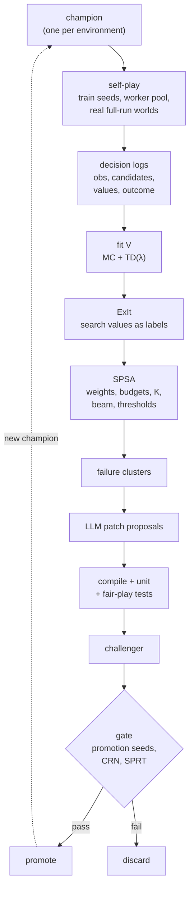
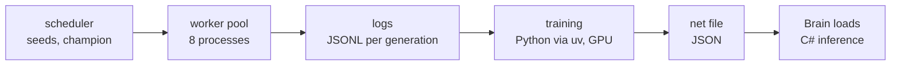

import { Aside } from '@astrojs/starlight/components';

This page defines the value function V that both brains use to score positions, and the offline loop that makes it better. Strategy is learned from zero by self-play, not from the user's play. Online, every decision is search plus the learned value. The improvement loop follows the development process of Stockfish (the open-source chess engine, taken here as the model): self-play, fit the value, tune, propose patches, and keep a change only if it passes a gate. An LLM takes part only offline (patch proposals, failure analysis), never in an online decision. The loop runs offline, in processes separate from the decision process.

<Aside title="Status">

V v0 exists: `RunValue` in Brain, 17 hand-written features of the run view times linear weights, the initial ones set by hand ([§1](#sec-1)). The macro brain's L0 uses it ([Macro brain §2](/en/arch/macro-brain/#sec-2)). `learn/fit_value.py` fits the weights from self-play, `learn/spsa.py` tunes them, or PIMC's leaf weights, by SPSA, `run --value` plays with either, and `learn/challenge.py` takes a challenger through the gate ([§2](#sec-2)); no fitted or tuned weights are promoted yet. V v2 is built too: `RunNet` in Brain, a net over the run's cards, relics, potions and context ([§1](#sec-1)), trained by `learn/train_value.py` ([§2](#sec-2)); `run --value` reads its file as well, and `run --macro-explore` and `--combat-explore` give self-play its exploration ([§5](#sec-5)). No V v2 is promoted yet. The combat net is built as well: `CombatNet` in Brain, PIMC's learned leaf (`--combat-net`), trained by `learn/train_combat.py` from the round starts of self-play ([§1](#sec-1), [§2](#sec-2)); its first generation, c2, is the NoSL champion's leaf since 2026-10-27 ([Combat brain §7.2](/en/arch/combat-brain/#sec-7.2)). `learn/` is the Python project (uv, PyTorch) for the learning loop.

</Aside>

## 1. Value function

**V(obs) = P(win this run from here, playing the current champion).** A value function estimates how good a situation is. Here the estimate is a probability: the chance of winning the run from this observation if the current *champion* (the best version of the AI accepted so far) plays the rest of it.

- One scale for combat leaves, macro afterstates and the map ([Combat brain §4](/en/arch/combat-brain/#sec-4), [Macro brain §2](/en/arch/macro-brain/#sec-2)). Because every value is a win probability, HP lost in a fight and a card taken at a reward can be compared directly.
- The input is the observation only. Hidden state may be used at training time as an auxiliary input ([§4](#sec-4)), never as an input of the deployed model.
- There is one V for both environments. An SL policy plays every later node better, so from the same observation its true win probability is higher; the shared V ignores this on purpose ([Environments §5](/en/arch/environments/#sec-5)). It is trained on runs whose combats the SL combat brain plays, in self-play and in fork rollouts (decided 2026-10-28); the macro brain sees the same information in both environments.

Planned versions:

| version | form | training |
|---|---|---|
| v0 | hand-written features times linear weights (widely spaced initial weights keep the lexicographic intent) | SPSA |
| v1 | hand-written features + small MLP | supervised: MC + TD(λ) |
| v2 | observation encoder (card / relic / potion / context embeddings, a set encoder over the deck) + V v0's features; a hazard head per floor | supervised: MC (TD(λ) and ExIt planned) |

Reading the table:

- **Lexicographic intent** (v0): the starting feature list comes from bottled_ai (a prior-art Slay the Spire bot), which ranks features in a strict order of importance: compare by the first, and use the next only to break ties ([Combat brain §4](/en/arch/combat-brain/#sec-4)). Linear weights that start far apart reproduce that order, and tuning starts from there.
- **V v0 as built** (`RunValue`): HP, max HP, gold, potions, relics, deck size, unplayable cards, upgrades; the mean damage (poison included), block and draw of the playable cards; and the expected elites, rest sites, shops, treasures and `?` points ahead on the map; and the floor, which has no initial weight: every option of a decision shares it, but a fit needs it, so that progress is not credited to what comes with it (relics, gold). Its weights are in units of one HP, not far apart: run-level features trade against each other (a relic against HP), which a strict order cannot express. They are hypotheses for tuning to replace.
- **V v2 as built** (`RunNet`, trained by `learn/train_value.py`): its inputs are tokens of the run view and V v0's features, standardized. A card's vector is its id's vector, plus its upgrade level (at most 3) times its id's upgrade vector, plus its enchantment's and affliction's vectors. A small MLP (phi) maps each card, and the deck is the mean and the sum (times 1/16) of the results: a set encoder, which reads any deck and ignores the order of its cards. Relics (a used-up one as an id of its own), potions and the context (character, act, boss or bosses, the act's ancient) are sums of their vectors. A card's and a relic's numbers are read as in the combat net below: a card adds its cost, its modifiers' amounts, its star cost and X, and each of its numbers by name; a relic adds its counter, whether one shows, whether it is melted, and its status. The ascension joins the features. Two layers of 256 then give one logit per floor: the **hazard**, the chance to die on that floor if still alive there. Ids seen fewer than 3 times in training read as one unknown id. A few hundred thousand weights in all.
  - From the hazards, the chance to survive every floor from here on is P(win), and the start floor plus the chance to survive each floor is the **expected floor reached**. Until runs win now and then, P(win) has no signal, so V v2's value is the expected floor (objective `floor` in the net file); once they do, it switches to P(win) (objective `win`), read from the same head.
  - The expected floor weighs every floor the same. It can prefer a safe line that reliably reaches act 2 to a riskier one that sometimes wins, which is why it is only a stopgap.
- **Card sense:** `ranks --logs LOGS [--value FILE]` reads either V's taste in cards: per act, each card's mean change of V when one more copy joins the decks of the logs' card rewards. V v0 ranks GRAND_FINALE first by far (its damage is large, and it plays only once the draw pile is empty) and powers such as FOOTWORK near zero, since they carry no damage, block or draw.
- **MLP** is a small fully connected neural network. **Embeddings** are learned vectors, one per card, relic or power id, so the encoder can read any deck.
- **SPSA** (simultaneous perturbation stochastic approximation) tunes parameters from noisy results alone. Each step nudges all parameters at once in a random direction, measures both the "plus" and the "minus" version, and moves the parameters toward the better one. It needs two measurements per step however many parameters there are, and no gradient, which suits weights whose only test is playing games.
- **MC** (Monte Carlo) target: the real result of the run (win 1, loss 0), used as the label for every decision in it. Unbiased, but noisy: the luck of one run lands on all of its decisions.
- **TD(λ)** (temporal difference) target: mixes the real result with V's own estimates at the following decisions (k+1, k+2, …). λ, between 0 and 1, sets the mix: λ = 1 is pure MC, λ = 0 looks only one decision ahead. It is less noisy than MC and gives a learning signal at every transition.
- **ExIt** (expert iteration): search guided by V plays better than V alone, so the values the search finds become the training labels for the next V. A better V makes the next search stronger, and so on.

**Heads** (v1 and later). A head is one output of a network whose body is shared with the other outputs:

- main head: P(win); in V v2 as built, the hazard head, which gives P(win) and the expected floor;
- auxiliary heads, which only help the network learn a good representation and are never used to decide: HP lost in the next combat, the distribution of the floor reached, the kill probability for each boss;
- combat head, for combat leaves: the distribution of the combat's outcome, a death class plus buckets of the HP left at its end, optionally with the potions left (as in r33hab and ytcs, prior-art STS2 projects). It does not predict P(win): the macro V prices its outcomes once per combat ([§3](#sec-3)). Two training targets are compared through the gate:
  - TD(λ ≈ 0.95) inside the combat, bootstrapping on the head's own distribution at the next decision, with the final bucket smoothed over its neighbours by HL-Gauss (a Gaussian of about 0.75 buckets), as ytcs does; ytcs found λ = 1 worse;
  - 0.3 × the search's distribution + 0.7 × the outcome, as r33hab does.

**Combat net as built** (`CombatNet`, trained by `learn/train_combat.py`): the combat head, on a net of its own that values the start of a round ([Combat brain §4](/en/arch/combat-brain/#sec-4)).

- Cards: every card of the four piles (hand, draw, discard, exhaust) is a token: its id's vector, plus its upgrade level times its id's upgrade vector, its enchantment's and affliction's vectors, its pile's vector, and its cost / 3 times a cost vector. A small MLP maps each card, and each pile is the sum of its cards (times 1/8).
- The player: HP share, HP, max HP, block, energy, max energy, stars and the round, and the sum of its powers (each its id's vector plus its amount / 10 times its id's amount vector, through a small MLP).
- Each living enemy: its id's vector plus a projection of its HP share, HP, max HP, block and the number of rounds it has shown; its powers, as the player's; and its intent slots: the intents it shows now, then those of its last 3 rounds, most recent first. A slot is the sum of its intents, each the type's vector plus damage / 10 and total damage / 20 times vectors of that type. An MLP maps each enemy, and the enemies are summed.
- Relics, potions and the context (character, encounter, room, act) are sums of their vectors. Every scaled number is capped at ±10, since a few states show huge ones (an erupting WATERFALL_GIANT's HP).
- What the first nets (c1, c2) did not read, since 2026-10-27; identical states cannot be told apart by any amount of data, so the observation's numbers go in:
  - a card's numbers: its enchantment's and affliction's amounts / 10 (each times its modifier's amount vector), its star cost / 3 and whether it costs X, and each of its numbers (`vars`) / 10 times its name's vector;
  - a power's stacks, where its tooltip states them apart from its icon (Sloth), times its id's stacks vector, and the card it keeps (Nightmare) as that card's vector;
  - a relic's counter / 10 times its id's counter vector (Pen Nib, Nunchaku, Happy Flower, Stone Calendar), whether a counter shows, whether it is melted, and its status;
  - the orbs (id, passive and evoke numbers / 10) and the living allies (id, HP share, HP, max HP, block and powers, through a small MLP), summed;
  - the ascension / 10, the orb slots / 10 and the gold / 100.

  A net file made before them does not declare these inputs, and `CombatNet` and `RunNet` feed a graph only the inputs it declares, so c2 plays as before. Parity of every new input was checked with nets of random weights, scaled so that each input moves the output: the trainer's test states load, and a copy with any one input changed fails the check on load.
- Two layers of 256 then give 51 classes, a death or the share of max HP still to be lost from here in one of 50 buckets (from −0.25, a combat that heals, to 1), and the potions still to be used after a win.
- The head predicts what is still to come, not what is left. The first net (c1) predicted the HP share left at the end, and learned only about half of what the HP held now is worth there: one HP less now lowered its value by 0.0038, where it lowers the end by a full HP, 0.0078 at `LeafValue`'s prices. Its search then traded HP away too cheaply, lost more HP than the champion in normal and elite fights (7.8 against 6.5 and 26.4 against 18.0 HP per win) and failed the gate after 32 pairs (floor −1.41). With the loss from here, the HP held now counts in full (0.0083 per HP on the same states), and the held-out squared error of the value fell from 0.0090 to 0.0077.
- Nothing about a monster's moves is written by hand. From its id, the round, how many rounds it has shown and its last intents, the net can learn each monster's move order, and where in it the monster is, from the data. The history is Harness's ([Harness §6](/en/arch/harness/#sec-6)).
- As a leaf, a state in progress is worth Σₖ p(k) × (WinBase + PerHp × (the HP share now − the middle of bucket k)) + P(win) × PerPotion × (the potions held − those used): `LeafValue`'s prices for a won combat. Pricing the outcomes by V is the plan ([§3](#sec-3)).

## 2. Self-play loop

In self-play the champion plays whole runs by itself, in real full-run worlds: the real game code running headless in the worker pool. The loop turns those runs into a *challenger*, and the gate decides whether it replaces the champion:

1. **Self-play:** the champion plays whole runs on train seeds, with exploration ([§5](#sec-5)). Log format: [Harness §6](/en/arch/harness/#sec-6).
2. **Fit:** the target is a mix of the MC outcome and TD(λ) (from decision k to decision k+1). Early on there are no wins, so every MC target of P(win) is 0; V v2's hazard head learns from the floor each run died on instead, and its value is the expected floor reached until runs win ([§1](#sec-1)). Never mix HP targets and win targets in one backward pass (a lesson from r33hab).

   A dense target such as the floor reached is a stopgap. A change it brings is accepted only through the gate on real outcomes, and only after it reproduces on several training seeds: in a GuanDan study (arXiv 2610.29411) one lineage looked strong, and none of its 5 pre-registered replication seeds came out positive.

   v0's fit is `learn/fit_value.py`. Every macro decision in the decision logs carries V's features ([Harness §6](/en/arch/harness/#sec-6)), and the run records give the floor its run reached, joined by run id, each log only with the record file its `run` wrote beside it (`--logs` and `--records` list them in the same order). A run id is a hash of the seed alone, so another run of the same seed, by another policy or in an exploration scan, can be in other files; a run id twice in one record file is refused. It is ridge regression on standardized features (ridge regression: least squares with a small penalty on the size of the weights, which keeps correlated features from taking extreme weights). Each run weighs the same however many decisions it has, and every fifth run (by run id) is held out. It reports R² on the held-out runs (R²: the share of the floor's variance the fit explains, 1 at best, below 0 when it does worse than the mean), next to a fit on the floor alone. The weights go to `weights/CHARACTER/history/NAME.json` ([§6](#sec-6)); `run --value FILE` plays L0 with them, and the champion shows them as `l0 NAME`.

   V v2's training is `learn/train_value.py`. Every macro decision in the decision logs carries its run view too ([Harness §6](/en/arch/harness/#sec-6)), joined to its run as in v0's fit, and its targets are its run's outcome: it survived every floor from the decision's up to the floor it died on, and died there, or survived every floor if the run won. A truncated run says nothing from its last floor on; a failed one is left out. The loss is the cross-entropy of the hazards over those floors. Each run weighs the same, and every fifth run (by run id) is held out, for early stopping (AdamW at lr 3e-5; at most 40 epochs, ending after 5 without a better held-out loss) and for the report. The head starts at the baseline's hazards (below), so the net learns how the state moves each floor's hazard away from them. The report gives the held-out loss and the R² of the expected floor against the floor reached, next to a baseline that knows only the floor (each floor's hazard over the training runs). The net file goes to `weights/CHARACTER/history/NAME.json` with a few held-out run views and the values the trainer gave them; `RunNet` checks them on load, which keeps the encoding and the forward pass the same in training and in play ([§7](#sec-7)). `run --value FILE` plays L0 with it, shown as `l0 NAME`. A second head, for training only, predicts the share of max HP each of the run's next six combats cost (from the run record); its squared error joins the loss at `--aux-weight` (3 by default). It shapes the body that both heads read, and the net file holds the hazards alone.

   First measurements, on g0 and g1 (859 runs, 60,480 macro decisions), one fold: the held-out loss is 1.229 against the baseline's 1.291, and the R² 0.368 against 0.313. V v0's 17 features, refit on the same runs (`fit_value.py`), reach 0.315, no more than the baseline. The decisions of a run share its one outcome, so there are about 700 outcomes to learn from, and the net overfits fast. From a random head at lr 1e-3 it memorizes the runs within an epoch: 1.331 after the first, 4.12 after the sixth. Started at the baseline it is 1.573 at lr 1e-3, 1.235 at 1e-4 and 1.229 at 3e-5; a weight decay of 0.1 instead of 1e-4 changes nothing. Its card sense (`ranks` over g1's logs) puts the poison cards first in act 0: one more OUTBREAK is worth 0.77 floors, then SNAKEBITE, BUBBLE_BUBBLE, BOUNCING_FLASK and DEADLY_POISON. In act 1, which far fewer runs reach, it is noise: the curses, too rare to have ids of their own, rank near the top at +0.1. n1 was trained without the second head. With it, at weight 3, on the same runs and three training seeds, the held-out loss is 1.222 against 1.235 (1.208, 1.237 and 1.222 against 1.229, 1.246 and 1.232) and the R² 0.384 against 0.371, the loss lower and the R² higher in every seed; at weights 1 and 10 (one seed) 1.224 and 1.210.

   n1's gate, L0 with n1 against the champion's L0 with V v0's initial weights, the combat the same (c2), failed after 157 of the 200 seeds. On all 200 it reached floor 21.97 against 22.58 (paired −0.61 ± 1.32). It plays otherwise: it skipped 15 of 2,261 card rewards against 906 of 2,081 and fought 0.94 elites per run against 0.39. It beat the act 1 boss more often (100 of the 171 runs that reached it, against 94 of 190) but died more on the way there and in act 2, where far fewer of its training runs went: 22 runs reached the act 2 boss against 45. Taking nearly every card is what the training runs show, not what one card does: runs that won more fights took more cards and went deeper, so a bigger deck reads as a deeper floor. Exploration and more runs give the net the comparisons that tell the two apart.

   **Counterfactual pairs.** More runs of the same kind do not untangle this: in every run the choices and the luck go together. What does is the same state played on with two choices and the same luck, the counterfactual lab of [§5](#sec-5), built for V v2's next generation. The decision logs keep only the run before each decision and what was chosen, so two commands go back to it. Both replay a logged run from its seed, answering each decision as the log did, combat and card prompts included, and checking each observation's hash against the log's. g1's 508 runs replay exactly. g0's 356 reach the same ends on the same surfaces, but most of their hashes differ, since the observation has gained fields since. A replay takes about 0.7 s a run.
   - `afterstates --log LOGS --records RECORDS --out FILE [--start I] [--n N] [champion options]` writes every macro decision's options as L0 weighs them with the champion's V: each option's afterstate (the run view's fields it changes) and value, and V v0's features of it, which V v2 reads too.
   - `fork --log LOGS --records RECORDS --out FILE [--per-run K] [--surfaces map,card_reward,rest,shop] [--act 0] [champion options]` draws K decisions of the act from each logged run, one surface at a time, replays the run to each and plays it twice from there: once with L0's best action, once with another of the screen's actions drawn uniformly (not a potion's, which every screen offers). The champion plays both branches on to the end of the act, past its boss. The branches share the game's random state and the brains' seeds up to the decision; after it, the game's random streams stay in step except where the choice moves them. Each fork records both branches' end (died or lived, floor, HP, gold) and the run at the horizon.
   - Step 0, 27 forks over g1's runs: the floors the two branches reached correlate at ρ = 0.66 (0.64 with the share of HP left), so a difference has about a third of the variance two independent runs would have. 20 of the 27 had been drawn on rewards screens, whose choice is mostly the order of taking the rewards, and 17 of those tied; rewards screens are left out by default since, and the surfaces take turns. Most pairs end the act alike (both died at the boss, or both lived); what tells them apart is the HP and the deck at the act's end. A fork takes about 70 s of one process for both branches.

   `train_value.py` takes both. `--forks FILES`: each branch's afterstate is a sample like a decision's, its outcome censored at the end of the act if it lived (`--fork-weight`, 1 by default); and the difference of the two afterstates' expected floors is fitted to the pair's played difference (`--pair-weight`, 1, in units of the played differences' mean square): a branch that died reached its floor, one that lived what V expects of the run at its horizon, with no gradient through it (an n-step bootstrap, so the act's end is valued by V as it stands; early stopping leaves this term out, since its targets move as V learns). `--afterstates FILES --kl-weight β` pulls V's softmax over each logged decision's options (at `--kl-temperature`, in floors) towards the policy that played the logs, the softmax of V v0's values at the log's exploration temperature: a conservative update, as in offline RL with narrow data (BCQ, CQL, TD3+BC), which keeps V's argmax near what the data covers. Forks and decisions are split by run id like the rest. The report adds, on the held-out forks, how often the sign of V's predicted difference matches the played one (floors reached plus the HP share left, each pair weighed by its size, ties left out), with V v0's for comparison; on the held-out decisions, per surface, the KL from the logs' policy, how often V's best is V v0's, and on card rewards how often each skips; the slope of V's values on V v0's within a decision (V v0's temperature times it is the same temperature in floors); and an off-policy check (inverse propensity scoring): on the decisions where V v0's best had a chance between 2% and 98%, the floor reached after another draw against after the best, each weighed by the inverse of its chance, next to what V expects of the same.

   **n2**, on g0–g2 (1,198 runs, 85,089 macro decisions; g2's 339 runs were played by c2 with V v0, exploring at 0.25):
   - The outcome-only net (as n1, with the second head, on g0 and g1) repeats n1's pattern. On card rewards its best option is a skip in 0.2% of the held-out decisions, against V v0's 14.4%; its best is V v0's in 56% of the decisions, 35% on card rewards and 26% in shops.
   - The pull's temperature comes from the slope of V's values on V v0's within a decision, 0.031: V v0's 0.25 is about 0.008 floors, so the pull runs at 0.01. At that temperature its gradient is about β / 0.01 times the outcome loss's. At β = 1 the held-out outcome loss did not move in three epochs: V copied V v0's ranking. At β = 0.1 it is 1.319 against the floor-only 1.350 (R² 0.330 against 0.312); V's best is V v0's in 93.5% of the decisions, and it skips 13.1% of the card rewards (V v0: 13.8%). At β = 0.03: 1.318, 89.9% and 15.9%.
   - Forks: 651 over g1's and g2's runs, in two hours on the three machines (about 111 s of one process each). The two branches' floors reached plus HP share left correlate at ρ = 0.62; in 303 pairs both died (all but a few at the act 1 boss), in 226 both lived, in 122 one did. L0's best did better than the other action by 0.24 on the map, 0.10 at rest sites, 0.08 on card rewards and 0.07 in shops, in floors reached within the act plus HP share left: within its act, one choice moves little. On the held-out forks the sign of V's predicted difference matched the played one 0.605 of the time for β = 0.1 and 0.658 for β = 0.03, against V v0's 0.605 and 0.615 on the same forks.
   - n2-b0.1's gate, L0 with it against the champion's, the combat the same (c2), passed after 122 of the 200 seeds at +2.00 floors (LLR 2.95). On all 200 it reached floor 23.96 against 22.58 (paired +1.39 ± 0.65). It beat the act 1 boss in 117 of the 186 runs that reached it, against 94 of 190, and reached the act 2 boss 62 times against 45; it skipped 36% of the card rewards against 44%, and fought 0.44 elites per run against 0.39. Seeds 0–59 were played on the main machine, 60–139 on cshinnku, 140–199 on hostc. It is the NoSL champion since 2026-10-28. It has one training seed so far; the ablations (the pull alone, forks alone, both, against the outcome-only net) need three each.

   The combat net's training is `learn/train_combat.py`. A sample is the first combat decision of each round in the decision logs: the state a search leaf stands in, since the search's leaves are the starts of the next round ([Combat brain §2](/en/arch/combat-brain/#sec-2)). The enemies' history before it is rebuilt from the earlier rounds' observations, the way Harness builds it, so logs from before the `history` field serve too. The target is how that combat ended in the run record ([Evaluation §6](/en/arch/evaluation/#sec-6)), joined by run as in v0's fit and by the combats' order: the ending's class, from the HP share lost between the state and the end, and the potions used after a win. It is an MC target under the policy that played. The loss is the cross-entropy plus 0.1 × the squared error of the potions after a win. A fifth of the runs (by run id; `--fold` picks which) is held out, for early stopping (AdamW; at most 60 epochs, ending after 6 without a better held-out loss) and for the report: the held-out cross-entropy next to a prior (the training endings' frequencies), and the squared error and correlation of the net's value and of `LeafValue`'s against the value of the real ending. `--lags 0` and `--no-round` hide the intent history and the round, `--train-share` trains on a share of the training runs and `--width` scales every layer, for ablations. `--next-weight W` adds a head, for training only, that predicts each enemy's intents at the next round's start (their types and total damage) from the enemy's own vector; the report then gives how often it gets the types right, against guessing that the enemy repeats its current intents.

   First measurements, on 315 self-play runs (13,954 round starts), three folds:
   - Data, not size, is what limits the net. With a quarter, half and all of the training runs the held-out cross-entropy is 1.446, 1.379 and 1.337. At half the width it is the same (1.337), at twice the width no better (1.340).
   - The net learns the monsters' moves from data. With the next-intent head it gets the next intents' types right for 57.7% of the enemies, against 28.9% for repeating the current ones, and the next total damage within 4.15 on average, against 7.65. Most of it needs only the monster and its current intents: without the history and the round it gets 56.7%. The history helps a few monsters most, such as LAGAVULIN_MATRIARCH (43% against 33%) and NIBBIT (41% against 35%). Many of the misses are moves the game picks at random.
   - The head does not change the outcome's held-out cross-entropy or the value's error beyond the noise, so it stays off by default; it serves as the check that a generation learned the moves. The net file goes to `weights/CHARACTER/history/NAME.json` with a few held-out round starts and the trainer's outcomes for them, which `CombatNet` checks on load. `--combat-net FILE` plays PIMC with it, shown as `pimc NAME`.
   On g1's 505 runs (27,909 round starts, played by c2), which c3 is trained on, three folds:
   - Width still does not matter. The held-out cross-entropy is 1.348, 1.348 and 1.334 at width 1, 1.356, 1.327 and 1.317 at half the width (the prior: 2.041, 1.973 and 2.014), the same within the folds' spread. Nor does it change the search's speed: run side by side on an 8-combat act 1 panel, nets of width 0.5, 1 and 2 and c2 take 1.58–1.76 s per action, since the game's simulation costs far more than the net. c3 keeps width 1, so that its gate tests the data alone. Nor do the optimizer's settings matter: on fold 0, lr 3e-4 or 1e-4 instead of 1e-3, or a weight decay of 1e-2 instead of 1e-4, give 1.346–1.348, against 1.348.
   - The net's value correlates 0.960 with the real ending's, `LeafValue`'s 0.829.
   - c3's gate, with the champion's other options, was void after 160 of the 200 seeds: one of its runs bought the same potion in a shop under Sozu until it was truncated, a harness bug since fixed (commit `c5ee8de`). Up to then it reached 0.58 floors more than the champion on average (LLR −0.65, open). A gain of that size is well below the gate's δ of 1.5 floors.
3. **ExIt:** search values become labels for V and for the priors (which actions the search tries first). The teacher is a fair search in the same environment, one that obeys that environment's information rules. No behavior cloning (training a model to copy a teacher's moves) of an omniscient teacher: that failed in several projects.

   The combat policy target is softmax(prior logits + c · minmax(Q)), not the visit counts. Q is each first action's mean value over the worlds, which PIMC already computes; minmax rescales the Q of one decision to [0, 1]; the prior logits are 0 while the prior is uniform. c is tuned by how well the target predicts the choice of a search with a much larger budget (log-likelihood). Visit counts would be a poor target: CRN at the root flattens them (r33hab), and with mctx's (a Gumbel MuZero library) transform, at our 300 nodes per world, the target is almost one-hot. So the decision log records, for each combat decision, every first action's value in every world and the nodes spent on it, and for each combat its outcome (death, HP, potions). Both are logged: the per-world values and nodes in each candidate ([Harness §6](/en/arch/harness/#sec-6)), each combat's end in the run record ([Evaluation §6](/en/arch/evaluation/#sec-6)).

   Two preconditions. A learned prior steers the search only after it beats the uniform prior in the gate. A learned leaf replaces `LeafValue` only after it beats both `LeafValue` and a rollout to the end of the combat: in r33hab, at 15 simulations, the value head lost 10.6 HP more than rollouts.
4. **SPSA** on the v0 weights and on the search parameters.

   For V's weights this is `learn/spsa.py`. It starts from a weights file (V's initial weights by default, which `weights` prints). Each step draws a random sign for every weight, moves all of them by c times their scale with those signs and against them, and plays the same fresh train seeds with both versions (`run --macro l0 --value`, plus the run options given, such as the combat policy). CRN makes the two comparable on few seeds. The weights then move toward the side that reached the higher mean floor, by Spall's decreasing step sizes, at most a tenth of each weight's scale per step. A weight's scale is its starting size. The floor's weight is left alone, since it changes no choice. The result is a weights file for `run --value`.

   For the search parameters, `--param leaf` tunes PIMC's leaf weights ([Combat brain §4](/en/arch/combat-brain/#sec-4)) the same way, with `--leaf` as the sides' option and the default leaf weights (`weights --leaf`) as the start; they stay positive, since each is a rate, a share or a value above a loss. The runs then need `--policy pimc`, which makes them slow, so `--objective panel` plays panel combats instead (`panel --player pimc --leaf`, [Combat brain §7](/en/arch/combat-brain/#sec-7)): a won combat scores the share of its starting HP left, any other end −1. The panel's score spans 2 where a run's floor spans about 50, so its default step size is larger (0.5 against 0.02). The result is a leaf file for `--leaf`, and the gate on whole runs still decides.
5. **LLM:** the input is pre-aggregated failure clusters plus death summaries; the output is K candidate patches (features, pruning rules, parameters). The candidates are filtered by compiling, unit tests and fair-play tests, then gated. Only cheap models through the LLM gateway.
6. **Gate:** see [Evaluation §5](/en/arch/evaluation/#sec-5). `learn/challenge.py` takes a challenger, given by its run options, through it: it plays the champion's seed set in chunks and runs the gate after each chunk. It stops at a fail or a void verdict; after a pass it plays the rest of the set and promotes the challenger, which rewrites the champion file and rebuilds the leaderboard.

**Running the loop** (planned):

- Combat exploration goes only on the root of self-play's searches, and is off in evaluation. It is built ([§5](#sec-5)): the action played is drawn with chance ∝ exp(Q / T) over the root's values Q, the same as adding Gumbel noise to Q / T and taking the best.
- PCR (playout cap randomization, from KataGo): 25% of the decisions get the full budget and give policy targets; the other 75% get a quarter of it and give value targets only.
- Reanalyse (from MuZero): after each new net, a share of old positions is replayed from seed and trace and searched again with it, which refreshes their policy targets and bootstrapped value targets.
- Every generation goes through the gate. AlphaZero dropped its gate because its signal was clean and its games many; a run here has a high variance, and runs are few.

## 3. Reward and credit

The only reward is the run outcome. The hard part is not a missing signal but credit assignment (which of the many decisions in a run caused the win or the loss) and variance (luck that hides the effect of a single decision).

1. The hierarchy shortens the chain. Combat is solved by search, and its result is an outcome distribution p(k): death, or the HP left at its end in buckets k. The macro V prices it once per combat: at the start, u[k] = V(the afterstate after the combat, with its HP in bucket k), recomputed when potions or relics change, and u = 0 for death; a leaf's value is Σₖ p(k) · u[k]. So the combat net does not depend on V's version: a new V only reprices, and combat and macro still trade HP against everything else on one scale. With V v0, which is linear in HP, the pricing reduces to P(death) and the expected HP. Run-level credit then only has to span about 50 macro decisions plus the combat results.
2. TD(λ) gives a gradient at every transition.
3. Auxiliary reward terms must be potential-based: F = Φ(s') − Φ(s) (Ng, Harada and Russell, 1999). See below.
4. Auxiliary heads give dense supervision, for the representation only.
5. Variance: a reverse curriculum (start near the bosses), and CRN-paired forks at key decisions ([§5](#sec-5)).

**Potential-based shaping.** Shaping adds small intermediate rewards so that a learner gets feedback before the run ends. In the potential-based form, a function Φ scores each state, and the bonus for a step from s to s' is Φ(s') − Φ(s). Over a whole run the bonuses telescope to Φ(end) − Φ(start): every intermediate term cancels, so the bonus depends only on where the run starts and ends, not on the route in between. Ng, Harada and Russell proved that shaping of this form leaves the optimal policy unchanged. Raw HP penalties do not cancel like this: they would forbid lines such as "bleed in act 1 to win act 3".

**Reverse curriculum.** Training starts on situations close to the end, where the outcome is near and its signal clear (snapshots just before bosses), and then moves the starting points earlier ([§5](#sec-5)).

**CRN** (common random numbers): two lines are played with the same random seeds, so the luck they share cancels out of their difference. To *fork* a decision is to play two of its options from the same point.

## 4. Privileged information

Privileged information is hidden state that a player could not see. The fair-play spec (local note `tmp/notes/fair-play-spec.md`) allows it at training time, as long as the deployed policy reads only observations:

- An *oracle critic* branch, a value branch used only in training, sees hidden state (true draw order, monster moves) to reduce the variance of the targets. Only the observation branch is deployed.
- Counterfactual labels: fork the same decision point with the same randomness, play both lines to the end, and get an unbiased label for the difference.
- This lives in the offline pipeline only, in an assembly and process separate from the decision process.

## 5. Local vs global optimum

A self-improving loop can settle into a local optimum: a way of playing that every small change makes worse, while a quite different way would win more often (for example, always playing conservatively). These mechanisms work against it:

| mechanism | effect |
|---|---|
| value target = run outcome only | how much HP is worth is learned from data |
| reverse curriculum | snapshot pool from acts 2/3 and pre-boss first; learn late value, then push earlier |
| counterfactual lab | at sampled key macro decisions, CRN-fork both lines to the end for an unbiased ΔP(win); tests hypotheses like "bleed in act 1" |
| population / archive | one champion per style descriptor (MAP-Elites), so no collapse to "always conservative" |
| exploration | Thompson or softmax sampling of decisions in self-play; afterstate MC targets are robust to it. Softmax is built (below); never in evaluation |
| conservatism monitors | elites taken, skip rate, HP at boss, gold/potion hoarding ([Evaluation §3](/en/arch/evaluation/#sec-3)) |
| contrarian hypotheses | human/LLM ideas → constrained policy variants → sim A/B; results back to discussion |

- **MAP-Elites** keeps an archive instead of a single best policy. Each policy is placed in a cell by its style descriptor (a few numbers describing how it plays), and each cell keeps its own best champion. Styles that are not the best yet survive, so the population cannot collapse into one style.
- **Thompson sampling** explores by drawing a plausible value for each option from its uncertainty and picking the best draw; an option is tried about as often as it might really be the best one.
- **Softmax exploration** (built) draws each option with chance ∝ exp((v − best) / T) over the values the brain gave its options: options near the best are tried often, poor ones seldom, equal ones equally often. A uniform ε, which it replaces, tried a poor option as often as a good one. `run --macro-explore T` does this for L0 at every decision outside combat, card prompts included (at a prompt, each pick and whether to stop), over V's values; `--combat-explore T` for pimc's first action, over the search's candidates. The champion's name shows it (`l0 explore T`, `pimc c2 explore T`); the gate refuses an exploring challenger ([Evaluation §5](/en/arch/evaluation/#sec-5)). The decision log marks the steps drawn below the best (`explored`, [Harness §6](/en/arch/harness/#sec-6)); the trainers do not read the mark yet.
- **The temperatures** are in V's units and the leaf's, so they are chosen again when those change. The rule: for pimc, about 1 HP given up per combat; for L0, a temperature at which about 4–5% of its decisions are explored. Only decisions with two or more legal options count, and only draws below the best: ties are not counted, and `p0`'s card prompts do not explore.
  - pimc with the c2 leaf: T = 0.003 gives up about 1.0 HP per combat by the search's own values, over 54 combats of self-play (T = 0.002: 0.5 HP, 0.005: 2.3 HP). In g1's logs that is 0.85 HP per hallway combat, with 3.1 of its 22 searched decisions explored; 1.13 HP per elite; 1.85 HP per boss, with 8.3 of 34 explored.
  - L0 with V v0's initial weights (in HP), pimc c2 at T = 0.003 in combat, 8 runs per temperature: T = 0.25 explores 4.8% of L0's decisions (7 of 49 card rewards), 0.4 explores 7.1%, 0.7 explores 13.5%. T = 0.25 is chosen. The floor differences (−1.75, −2.00, −4.38) are noise at 8 runs. V v2's temperature is to be chosen by the same rule, in floors.
  - The earlier rule for L0, the highest T that costs at most 1 floor, chose T = 2 with the placeholder `play` combat policy: 0.90 ± 0.39 floors less over 600 paired runs. Under pimc the deck matters more, and T = 2 cost more. g1's first runs played combat 0.003 and macro 2 and reached floor 17.1 on average, against the c2 champion's 21.80 over 199 runs (act 1 boss won 85 of 181). Paired on g1's first 56 seeds:
    - no exploration: floor 21.68, act 1 boss won 25 of 51;
    - combat only, T = 0.003: 0.89 ± 1.82 floors less, boss won 17 of 53, within the rule;
    - macro only, T = 2: 3.10 ± 2.10 floors less over 40 runs, boss won 9 of 35;
    - both, as g1 played: 4.65 ± 2.01 floors less, boss won 5 of 48.

    Macro at T = 2 explored 24.9% of 3,009 L0 decisions, 55% of the card rewards.
  - Self-play uses combat T = 0.003 and macro T = 0.25, and its mean floor is checked against the champion's report as its runs come in. g1's first 56 runs, at macro T = 2, stay in the data under their own champion name (`macro l0 explore 2`).
- **Sim A/B:** play two policy variants in the simulator on the same seeds and compare the results.

## 6. Infrastructure

The pipeline from runs to weights (a *generation* is one turn of the loop in [§2](#sec-2)):

- Compute: 8 physical cores / 16 threads. 8 processes reach about 1,860 combats/s, against 275 in a single process ([Simulator §4](/en/arch/simulator/#sec-4)). The GPU (RTX 5070 Ti) is for value-net training only.
- Training is Python, managed with uv, reading the JSONL logs. Inference is C# inside Brain: `RunNet` turns the run into the graph's inputs and runs the ONNX graph the trainer exports with ONNX Runtime (`Microsoft.ML.OnnxRuntime`) on the CPU, one thread, about 0.9 ms per macro decision. `CombatNet` does the same for each search leaf, in the workers. A net is defined once, in Python. The net file is JSON: the graph in base64, plus the vocabulary, the features' standardization and the test runs.
- Code: the scripts in `learn/` take their options with Typer (`--help`) and log with loguru on stderr at `LOG_LEVEL` (INFO by default), so stdout carries only their results. A `LearnError` (bad input, a file in the way, a sim that failed) ends a script in one line with exit code 1; anything else is a bug and ends it with a traceback. The sim's command line works the same way ([Simulator §1](/en/arch/simulator/#sec-1)).
- Reproducibility: each generation records its champion, seed sets, hyperparameters and commit. Logs go into one directory per character and generation, `tmp/selfplay/CHARACTER/gN/`, outside git.
- Weights: each character is trained and judged on its own, by a brain of its own; all the ascensions of a character are played by that one brain, which climbs them in turn. So each character's files have a folder of their own. Every file a trainer writes (`fit_value.py`, `spsa.py`, `train_value.py`, `train_combat.py`) goes to `weights/CHARACTER/history/NAME.json` (`weights/silent/history/` for the Silent) unless `--out` says otherwise, and is never overwritten, so each name is used once. A trainer's `--character` (SILENT by default) names the character: a run of another character in its records is refused, and the file records the character. Each character's champion in each environment plays from its main names, `weights/CHARACTER/ENV/value.json`, `leaf.json` and `combat.json`: a promotion copies the challenger's files onto them, and the champion file names them ([Evaluation §5](/en/arch/evaluation/#sec-5)). Which generation a main name holds is the name inside the file, which the champion's name shows. `weights/` is outside git, so the files live on the machine that trains them.
- Storage: about 50 macro decisions plus a few hundred combat decisions per run, most of the bytes in the combat observations and the macro run views; not compressed yet. Old generations are pruned on demand.

## 7. Tests

1. Calibration on held-out seeds. Calibrated means the predictions match reality: of the positions where V says 30%, about 30% should be won. Check it with a reliability plot (group the predictions into bins and plot predicted against actual win rate). The Brier score (mean squared error between the predicted probability and the 0/1 result) must beat a constant prediction; the run model of ytcs (a prior-art STS2 solver) failed this.
2. The potential-based auxiliary terms telescope exactly.
3. Train/deploy input parity: the deployed model reads protocol observations only, and training reads the same JSON. A V v2 net file carries test runs that `RunNet` checks on load; a combat net file carries test round starts that `CombatNet` checks the same way. A check passes when a changed input moves the output by less than its tolerance, so a new input is checked once more on a net whose weights make every input count ([§1](#sec-1)).
4. Gate A/A test: a challenger that is the champion itself has nothing to gain, so the gate must not promote it more often than the SPRT false-positive rate.
5. Unit tests of the scripts: `uv run pytest` in `learn/` (the shared helpers, the combat net's targets and inputs, where weights files go), and `uv run ruff check`. The C# side has its own ([Simulator §9](/en/arch/simulator/#sec-9)).

## 8. Open questions

1. The v0 feature set: V v0 starts with 17; whether to grow it toward bottled_ai's 42 features is open.
2. When V v2's value switches from the expected floor to P(win): after how many wins, and with which check of the head's calibration.
3. One net with an environment input bit, or separate nets (start with separate nets).
