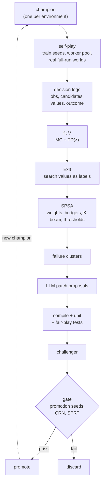
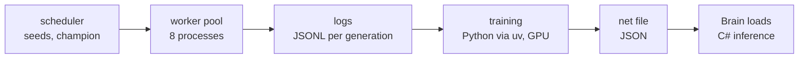

import { Aside } from '@astrojs/starlight/components';

This page defines the value function V that both brains use to score positions, and the offline loop that makes it better. Strategy is learned from zero by self-play, not from the user's play. Online, every decision is search plus the learned value. The improvement loop follows the development process of Stockfish (the open-source chess engine, taken here as the model): self-play, fit the value, tune, propose patches, and keep a change only if it passes a gate. An LLM takes part only offline (patch proposals, failure analysis), never in an online decision. The loop runs offline, in processes separate from the decision process.

<Aside title="Status">

V v0 exists: `RunValue` in Brain, 17 hand-written features of the run view times linear weights, the initial ones set by hand ([§1](#sec-1)). The macro brain's L0 uses it ([Macro brain §2](/en/arch/macro-brain/#sec-2)). `learn/fit_value.py` fits the weights from self-play, `learn/spsa.py` tunes them, or PIMC's leaf weights, by SPSA, `run --value` plays with either, and `learn/challenge.py` takes a challenger through the gate ([§2](#sec-2)); no fitted or tuned weights are promoted yet. V v2 is built too: `RunNet` in Brain, a net over the run's cards, relics, potions and context ([§1](#sec-1)), trained by `learn/train_value.py` ([§2](#sec-2)); `run --value` reads its file as well, and `run --explore` gives self-play its exploration ([§5](#sec-5)). No V v2 is promoted yet. The combat net is built as well: `CombatNet` in Brain, PIMC's learned leaf (`--combat-net`), trained by `learn/train_combat.py` from the round starts of self-play ([§1](#sec-1), [§2](#sec-2)); none is promoted yet. `learn/` is the Python project (uv, PyTorch) for the learning loop.

</Aside>

## 1. Value function

**V(obs) = P(win this run from here, playing the current champion).** A value function estimates how good a situation is. Here the estimate is a probability: the chance of winning the run from this observation if the current *champion* (the best version of the AI accepted so far) plays the rest of it.

- One scale for combat leaves, macro afterstates and the map ([Combat brain §4](/en/arch/combat-brain/#sec-4), [Macro brain §2](/en/arch/macro-brain/#sec-2)). Because every value is a win probability, HP lost in a fight and a card taken at a reward can be compared directly.
- The input is the observation only. Hidden state may be used at training time as an auxiliary input ([§4](#sec-4)), never as an input of the deployed model.
- There is one V for both environments. An SL policy plays every later node better, so from the same observation its true win probability is higher; the shared V ignores this and is somewhat conservative in SL ([Environments §5](/en/arch/environments/#sec-5)). Which runs train it is still open ([Environments §10](/en/arch/environments/#sec-10)).

Planned versions:

| version | form | training |
|---|---|---|
| v0 | hand-written features times linear weights (widely spaced initial weights keep the lexicographic intent) | SPSA |
| v1 | hand-written features + small MLP | supervised: MC + TD(λ) |
| v2 | observation encoder (card / relic / potion / context embeddings, a set encoder over the deck) + V v0's features; a hazard head per floor | supervised: MC (TD(λ) and ExIt planned) |

Reading the table:

- **Lexicographic intent** (v0): the starting feature list comes from bottled_ai (a prior-art Slay the Spire bot), which ranks features in a strict order of importance: compare by the first, and use the next only to break ties ([Combat brain §4](/en/arch/combat-brain/#sec-4)). Linear weights that start far apart reproduce that order, and tuning starts from there.
- **V v0 as built** (`RunValue`): HP, max HP, gold, potions, relics, deck size, unplayable cards, upgrades; the mean damage (poison included), block and draw of the playable cards; and the expected elites, rest sites, shops, treasures and `?` points ahead on the map; and the floor, which has no initial weight: every option of a decision shares it, but a fit needs it, so that progress is not credited to what comes with it (relics, gold). Its weights are in units of one HP, not far apart: run-level features trade against each other (a relic against HP), which a strict order cannot express. They are hypotheses for tuning to replace.
- **V v2 as built** (`RunNet`, trained by `learn/train_value.py`): its inputs are tokens of the run view and V v0's features, standardized. A card's vector is its id's vector, plus its upgrade level (at most 3) times its id's upgrade vector, plus its enchantment's and affliction's vectors. A small MLP (phi) maps each card, and the deck is the mean and the sum (times 1/16) of the results: a set encoder, which reads any deck and ignores the order of its cards. Relics (a used-up one as an id of its own), potions and the context (character, act, boss or bosses, the act's ancient) are sums of their vectors. Two layers of 256 then give one logit per floor: the **hazard**, the chance to die on that floor if still alive there. Ids seen fewer than 3 times in training read as one unknown id. A few hundred thousand weights in all.
  - From the hazards, the chance to survive every floor from here on is P(win), and the start floor plus the chance to survive each floor is the **expected floor reached**. Until runs win now and then, P(win) has no signal, so V v2's value is the expected floor (objective `floor` in the net file); once they do, it switches to P(win) (objective `win`), read from the same head.
  - The expected floor weighs every floor the same. It can prefer a safe line that reliably reaches act 2 to a riskier one that sometimes wins, which is why it is only a stopgap.
- **Card sense:** `ranks --logs LOGS [--value FILE]` reads either V's taste in cards: per act, each card's mean change of V when one more copy joins the decks of the logs' card rewards. V v0 ranks GRAND_FINALE first by far (its damage is large, and it plays only once the draw pile is empty) and powers such as FOOTWORK near zero, since they carry no damage, block or draw.
- **MLP** is a small fully connected neural network. **Embeddings** are learned vectors, one per card, relic or power id, so the encoder can read any deck.
- **SPSA** (simultaneous perturbation stochastic approximation) tunes parameters from noisy results alone. Each step nudges all parameters at once in a random direction, measures both the "plus" and the "minus" version, and moves the parameters toward the better one. It needs two measurements per step however many parameters there are, and no gradient, which suits weights whose only test is playing games.
- **MC** (Monte Carlo) target: the real result of the run (win 1, loss 0), used as the label for every decision in it. Unbiased, but noisy: the luck of one run lands on all of its decisions.
- **TD(λ)** (temporal difference) target: mixes the real result with V's own estimates at the following decisions (k+1, k+2, …). λ, between 0 and 1, sets the mix: λ = 1 is pure MC, λ = 0 looks only one decision ahead. It is less noisy than MC and gives a learning signal at every transition.
- **ExIt** (expert iteration): search guided by V plays better than V alone, so the values the search finds become the training labels for the next V. A better V makes the next search stronger, and so on.

**Heads** (v1 and later). A head is one output of a network whose body is shared with the other outputs:

- main head: P(win); in V v2 as built, the hazard head, which gives P(win) and the expected floor;
- auxiliary heads, which only help the network learn a good representation and are never used to decide: HP lost in the next combat, the distribution of the floor reached, the kill probability for each boss;
- combat head, for combat leaves: the distribution of the combat's outcome, a death class plus buckets of the HP left at its end, optionally with the potions left (as in r33hab and ytcs, prior-art STS2 projects). It does not predict P(win): the macro V prices its outcomes once per combat ([§3](#sec-3)). Two training targets are compared through the gate:
  - TD(λ ≈ 0.95) inside the combat, bootstrapping on the head's own distribution at the next decision, with the final bucket smoothed over its neighbours by HL-Gauss (a Gaussian of about 0.75 buckets), as ytcs does; ytcs found λ = 1 worse;
  - 0.3 × the search's distribution + 0.7 × the outcome, as r33hab does.

**Combat net as built** (`CombatNet`, trained by `learn/train_combat.py`): the combat head, on a net of its own that values the start of a round ([Combat brain §4](/en/arch/combat-brain/#sec-4)).

- Cards: every card of the four piles (hand, draw, discard, exhaust) is a token: its id's vector, plus its upgrade level times its id's upgrade vector, its enchantment's and affliction's vectors, its pile's vector, and its cost / 3 times a cost vector. A small MLP maps each card, and each pile is the sum of its cards (times 1/8).
- The player: HP share, HP, max HP, block, energy, max energy, stars and the round, and the sum of its powers (each its id's vector plus its amount / 10 times its id's amount vector, through a small MLP).
- Each living enemy: its id's vector plus a projection of its HP share, HP, max HP, block and the number of rounds it has shown; its powers, as the player's; and its intent slots: the intents it shows now, then those of its last 3 rounds, most recent first. A slot is the sum of its intents, each the type's vector plus damage / 10 and total damage / 20 times vectors of that type. An MLP maps each enemy, and the enemies are summed.
- Relics, potions and the context (character, encounter, room, act) are sums of their vectors. Every scaled number is capped at ±10, since a few states show huge ones (an erupting WATERFALL_GIANT's HP).
- Two layers of 256 then give 21 classes, a death or the HP share left in one of 20 buckets, and the potions left after a win.
- Nothing about a monster's moves is written by hand. From its id, the round, how many rounds it has shown and its last intents, the net can learn each monster's move order, and where in it the monster is, from the data. The history is Harness's ([Harness §6](/en/arch/harness/#sec-6)).
- As a leaf, a state in progress is worth Σₖ p(k) × (WinBase + PerHp × the middle of bucket k) + P(win) × PerPotion × the potions left: `LeafValue`'s prices for a won combat. Pricing the outcomes by V is the plan ([§3](#sec-3)).

## 2. Self-play loop

In self-play the champion plays whole runs by itself, in real full-run worlds: the real game code running headless in the worker pool. The loop turns those runs into a *challenger*, and the gate decides whether it replaces the champion:

1. **Self-play:** the champion plays whole runs on train seeds. Log format: [Harness §6](/en/arch/harness/#sec-6).
2. **Fit:** the target is a mix of the MC outcome and TD(λ) (from decision k to decision k+1). Early on there are no wins, so every MC target of P(win) is 0; V v2's hazard head learns from the floor each run died on instead, and its value is the expected floor reached until runs win ([§1](#sec-1)). Never mix HP targets and win targets in one backward pass (a lesson from r33hab).

   A dense target such as the floor reached is a stopgap. A change it brings is accepted only through the gate on real outcomes, and only after it reproduces on several training seeds: in a GuanDan study (arXiv 2610.29411) one lineage looked strong, and none of its 5 pre-registered replication seeds came out positive.

   v0's fit is `learn/fit_value.py`. Every macro decision in the decision logs carries V's features ([Harness §6](/en/arch/harness/#sec-6)), and the run records give the floor its run reached, joined by run id. It is ridge regression on standardized features (ridge regression: least squares with a small penalty on the size of the weights, which keeps correlated features from taking extreme weights). Each run weighs the same however many decisions it has, and every fifth run (by run id) is held out. It reports R² on the held-out runs (R²: the share of the floor's variance the fit explains, 1 at best, below 0 when it does worse than the mean), next to a fit on the floor alone. The weights go to `eval/values/NAME.json`; `run --value FILE` plays L0 with them, and the champion shows them as `l0 NAME`.

   V v2's training is `learn/train_value.py`. Every macro decision in the decision logs carries its run view too ([Harness §6](/en/arch/harness/#sec-6)), and its targets are its run's outcome: it survived every floor from the decision's up to the floor it died on, and died there, or survived every floor if the run won. A truncated run says nothing from its last floor on; a failed one is left out. The loss is the cross-entropy of the hazards over those floors. Each run weighs the same, and every fifth run (by run id) is held out, for early stopping (AdamW; at most 40 epochs, ending after 5 without a better held-out loss) and for the report. The report gives the held-out loss and the R² of the expected floor against the floor reached, next to a baseline that knows only the floor (each floor's hazard over the training runs). The net file goes to `eval/values/NAME.json` with a few held-out run views and the values the trainer gave them; `RunNet` checks them on load, which keeps the encoding and the forward pass the same in training and in play ([§7](#sec-7)). `run --value FILE` plays L0 with it, shown as `l0 NAME`.

   The combat net's training is `learn/train_combat.py`. A sample is the first combat decision of each round in the decision logs: the state a search leaf stands in, since the search's leaves are the starts of the next round ([Combat brain §2](/en/arch/combat-brain/#sec-2)). The enemies' history before it is rebuilt from the earlier rounds' observations, the way Harness builds it, so logs from before the `history` field serve too. The target is how that combat ended in the run record ([Evaluation §6](/en/arch/evaluation/#sec-6)), joined by run and by the combats' order: the ending's class, and the potions left after a win. It is an MC target under the policy that played. The loss is the cross-entropy plus 0.1 × the squared error of the potions after a win. A fifth of the runs (by run id; `--fold` picks which) is held out, for early stopping (AdamW; at most 60 epochs, ending after 6 without a better held-out loss) and for the report: the held-out cross-entropy next to a prior (the training endings' frequencies), and the squared error and correlation of the net's value and of `LeafValue`'s against the value of the real ending. `--lags 0` and `--no-round` hide the intent history and the round, for ablations. The net file goes with a few held-out round starts and the trainer's outcomes for them, which `CombatNet` checks on load. `--combat-net FILE` plays PIMC with it, shown as `pimc NAME`.
3. **ExIt:** search values become labels for V and for the priors (which actions the search tries first). The teacher is a fair search in the same environment, one that obeys that environment's information rules. No behavior cloning (training a model to copy a teacher's moves) of an omniscient teacher: that failed in several projects.

   The combat policy target is softmax(prior logits + c · minmax(Q)), not the visit counts. Q is each first action's mean value over the worlds, which PIMC already computes; minmax rescales the Q of one decision to [0, 1]; the prior logits are 0 while the prior is uniform. c is tuned by how well the target predicts the choice of a search with a much larger budget (log-likelihood). Visit counts would be a poor target: CRN at the root flattens them (r33hab), and with mctx's (a Gumbel MuZero library) transform, at our 300 nodes per world, the target is almost one-hot. So the decision log records, for each combat decision, every first action's value in every world and the nodes spent on it, and for each combat its outcome (death, HP, potions). Both are logged: the per-world values and nodes in each candidate ([Harness §6](/en/arch/harness/#sec-6)), each combat's end in the run record ([Evaluation §6](/en/arch/evaluation/#sec-6)).

   Two preconditions. A learned prior steers the search only after it beats the uniform prior in the gate. A learned leaf replaces `LeafValue` only after it beats both `LeafValue` and a rollout to the end of the combat: in r33hab, at 15 simulations, the value head lost 10.6 HP more than rollouts.
4. **SPSA** on the v0 weights and on the search parameters.

   For V's weights this is `learn/spsa.py`. It starts from a weights file (V's initial weights by default, which `weights` prints). Each step draws a random sign for every weight, moves all of them by c times their scale with those signs and against them, and plays the same fresh train seeds with both versions (`run --macro l0 --value`, plus the run options given, such as the combat policy). CRN makes the two comparable on few seeds. The weights then move toward the side that reached the higher mean floor, by Spall's decreasing step sizes, at most a tenth of each weight's scale per step. A weight's scale is its starting size. The floor's weight is left alone, since it changes no choice. The result is a weights file for `run --value`.

   For the search parameters, `--param leaf` tunes PIMC's leaf weights ([Combat brain §4](/en/arch/combat-brain/#sec-4)) the same way, with `--leaf` as the sides' option and the default leaf weights (`weights --leaf`) as the start; they stay positive, since each is a rate, a share or a value above a loss. The runs then need `--policy pimc`, which makes them slow, so `--objective panel` plays panel combats instead (`panel --player pimc --leaf`, [Combat brain §7](/en/arch/combat-brain/#sec-7)): a won combat scores the share of its starting HP left, any other end −1. The panel's score spans 2 where a run's floor spans about 50, so its default step size is larger (0.5 against 0.02). The result is a leaf file for `--leaf`, and the gate on whole runs still decides.
5. **LLM:** the input is pre-aggregated failure clusters plus death summaries; the output is K candidate patches (features, pruning rules, parameters). The candidates are filtered by compiling, unit tests and fair-play tests, then gated. Only cheap models through the LLM gateway.
6. **Gate:** see [Evaluation §5](/en/arch/evaluation/#sec-5). `learn/challenge.py` takes a challenger, given by its run options, through it: it plays the champion's seed set in chunks and runs the gate after each chunk. It stops at a fail or a void verdict; after a pass it plays the rest of the set and promotes the challenger, which rewrites the champion file and rebuilds the leaderboard.

**Running the loop** (planned):

- Exploration noise (Gumbel) goes only on the root of self-play's combat searches, and is off in evaluation. Macro exploration: [§5](#sec-5).
- PCR (playout cap randomization, from KataGo): 25% of the decisions get the full budget and give policy targets; the other 75% get a quarter of it and give value targets only.
- Reanalyse (from MuZero): after each new net, a share of old positions is replayed from seed and trace and searched again with it, which refreshes their policy targets and bootstrapped value targets.
- Every generation goes through the gate. AlphaZero dropped its gate because its signal was clean and its games many; a run here has a high variance, and runs are few.

## 3. Reward and credit

The only reward is the run outcome. The hard part is not a missing signal but credit assignment (which of the many decisions in a run caused the win or the loss) and variance (luck that hides the effect of a single decision).

1. The hierarchy shortens the chain. Combat is solved by search, and its result is an outcome distribution p(k): death, or the HP left at its end in buckets k. The macro V prices it once per combat: at the start, u[k] = V(the afterstate after the combat, with its HP in bucket k), recomputed when potions or relics change, and u = 0 for death; a leaf's value is Σₖ p(k) · u[k]. So the combat net does not depend on V's version: a new V only reprices, and combat and macro still trade HP against everything else on one scale. With V v0, which is linear in HP, the pricing reduces to P(death) and the expected HP. Run-level credit then only has to span about 50 macro decisions plus the combat results.
2. TD(λ) gives a gradient at every transition.
3. Auxiliary reward terms must be potential-based: F = Φ(s') − Φ(s) (Ng, Harada and Russell, 1999). See below.
4. Auxiliary heads give dense supervision, for the representation only.
5. Variance: a reverse curriculum (start near the bosses), and CRN-paired forks at key decisions ([§5](#sec-5)).

**Potential-based shaping.** Shaping adds small intermediate rewards so that a learner gets feedback before the run ends. In the potential-based form, a function Φ scores each state, and the bonus for a step from s to s' is Φ(s') − Φ(s). Over a whole run the bonuses telescope to Φ(end) − Φ(start): every intermediate term cancels, so the bonus depends only on where the run starts and ends, not on the route in between. Ng, Harada and Russell proved that shaping of this form leaves the optimal policy unchanged. Raw HP penalties do not cancel like this: they would forbid lines such as "bleed in act 1 to win act 3".

**Reverse curriculum.** Training starts on situations close to the end, where the outcome is near and its signal clear (snapshots just before bosses), and then moves the starting points earlier ([§5](#sec-5)).

**CRN** (common random numbers): two lines are played with the same random seeds, so the luck they share cancels out of their difference. To *fork* a decision is to play two of its options from the same point.

## 4. Privileged information

Privileged information is hidden state that a player could not see. The fair-play spec (local note `tmp/notes/fair-play-spec.md`) allows it at training time, as long as the deployed policy reads only observations:

- An *oracle critic* branch, a value branch used only in training, sees hidden state (true draw order, monster moves) to reduce the variance of the targets. Only the observation branch is deployed.
- Counterfactual labels: fork the same decision point with the same randomness, play both lines to the end, and get an unbiased label for the difference.
- This lives in the offline pipeline only, in an assembly and process separate from the decision process.

## 5. Local vs global optimum

A self-improving loop can settle into a local optimum: a way of playing that every small change makes worse, while a quite different way would win more often (for example, always playing conservatively). These mechanisms work against it:

| mechanism | effect |
|---|---|
| value target = run outcome only | how much HP is worth is learned from data |
| reverse curriculum | snapshot pool from acts 2/3 and pre-boss first; learn late value, then push earlier |
| counterfactual lab | at sampled key macro decisions, CRN-fork both lines to the end for an unbiased ΔP(win); tests hypotheses like "bleed in act 1" |
| population / archive | one champion per style descriptor (MAP-Elites), so no collapse to "always conservative" |
| exploration | Thompson or ε on macro decisions in self-play; afterstate MC targets are robust to it. ε is built: `run --explore E` makes L0 answer every decision outside combat, card prompts included, at random with chance E (`l0 explore E` in the champion's name); never in evaluation |
| conservatism monitors | elites taken, skip rate, HP at boss, gold/potion hoarding ([Evaluation §3](/en/arch/evaluation/#sec-3)) |
| contrarian hypotheses | human/LLM ideas → constrained policy variants → sim A/B; results back to discussion |

- **MAP-Elites** keeps an archive instead of a single best policy. Each policy is placed in a cell by its style descriptor (a few numbers describing how it plays), and each cell keeps its own best champion. Styles that are not the best yet survive, so the population cannot collapse into one style.
- **Thompson sampling** explores by drawing a plausible value for each option from its uncertainty and picking the best draw; an option is tried about as often as it might really be the best one. **ε-greedy** picks a random option with a small probability ε.
- **Sim A/B:** play two policy variants in the simulator on the same seeds and compare the results.

## 6. Infrastructure

The pipeline from runs to weights (a *generation* is one turn of the loop in [§2](#sec-2)):

- Compute: 8 physical cores / 16 threads. 8 processes reach about 1,860 combats/s, against 275 in a single process ([Simulator §4](/en/arch/simulator/#sec-4)). The GPU (RTX 5070 Ti) is for value-net training only.
- Training is Python, managed with uv, reading the JSONL logs. Inference is C# inside Brain: `RunNet` turns the run into the graph's inputs and runs the ONNX graph the trainer exports with ONNX Runtime (`Microsoft.ML.OnnxRuntime`) on the CPU, one thread, about 0.9 ms per macro decision. `CombatNet` does the same for each search leaf, in the workers. A net is defined once, in Python. The net file is JSON: the graph in base64, plus the vocabulary, the features' standardization and the test runs.
- Reproducibility: each generation records its champion, seed sets, hyperparameters and commit. Logs go into one directory per generation, `tmp/selfplay/gN/`, outside git.
- Storage: about 50 macro decisions plus a few hundred combat decisions per run, most of the bytes in the combat observations and the macro run views; not compressed yet. Old generations are pruned on demand.

## 7. Tests

1. Calibration on held-out seeds. Calibrated means the predictions match reality: of the positions where V says 30%, about 30% should be won. Check it with a reliability plot (group the predictions into bins and plot predicted against actual win rate). The Brier score (mean squared error between the predicted probability and the 0/1 result) must beat a constant prediction; the run model of ytcs (a prior-art STS2 solver) failed this.
2. The potential-based auxiliary terms telescope exactly.
3. Train/deploy input parity: the deployed model reads protocol observations only, and training reads the same JSON. A V v2 net file carries test runs that `RunNet` checks on load; a combat net file carries test round starts that `CombatNet` checks the same way.
4. Gate A/A test: a challenger that is the champion itself has nothing to gain, so the gate must not promote it more often than the SPRT false-positive rate.

## 8. Open questions

1. The v0 feature set: V v0 starts with 17; whether to grow it toward bottled_ai's 42 features is open.
2. When V v2's value switches from the expected floor to P(win): after how many wins, and with which check of the head's calibration.
3. One net with an environment input bit, or separate nets (start with separate nets).
