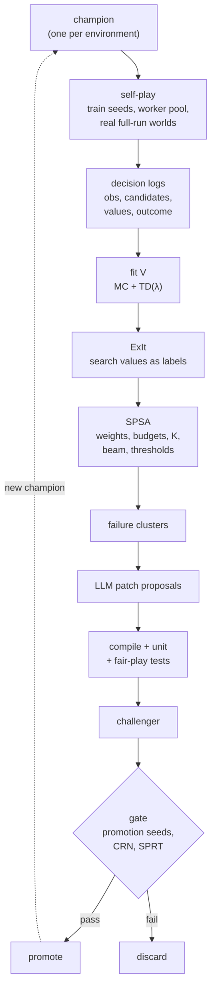
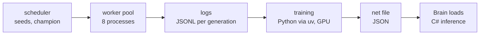

import { Aside } from '@astrojs/starlight/components';

This page defines the value function V that both brains use to score positions, and the offline loop that makes it better. Strategy is learned from zero by self-play, not from the user's play. Online, every decision is search plus the learned value. The improvement loop follows the development process of Stockfish (the open-source chess engine, taken here as the model): self-play, fit the value, tune, propose patches, and keep a change only if it passes a gate. An LLM takes part only offline (patch proposals, failure analysis), never in an online decision. The loop runs offline, in processes separate from the decision process. The macro brain's V, pure V, is explained step by step in the macro brain chapter: what it reads and how its net computes ([The value network](/en/arch/macro-brain/network/)), its heads, labels and training ([From hazards to value](/en/arch/macro-brain/value/)), and its self-play, exploration and gates ([Self-play](/en/arch/macro-brain/selfplay/)).

<Aside title="Status">

V v0 exists: `RunValue` in Brain, 17 hand-written features of the run view times linear weights set by hand ([§1](#sec-1)). The macro brain's L0 uses it when `run --value` names no net ([Macro brain: search §1](/en/arch/macro-brain/search/#sec-1)). No fitted or tuned weights were ever promoted, and the scripts that fitted and tuned them are removed (`9b9d170`). V v2 is built too: `RunNet` in Brain, a net over the run's cards, relics, potions and context that also reads V v0's features ([§1](#sec-1)). It was trained by `learn/train_value.py`, also removed in `9b9d170` ([§2](#sec-2)), and its n2-b0.03 was the NoSL champion's V from 2026-10-28 to 2026-10-30. Pure V replaced it: a net over the run's ids and raw state alone, which `learn/v/` trains and `RunNet` reads ([§1](#sec-1), [§2](#sec-2)). Its first nets were trained on whole runs, and pure-1-g was the SL champion's V from 2026-10-29. Since 2026-10-29 pure V is trained and judged in the elite gauntlet, a simplified run in which plain monster combats are won at their start ([§2](#sec-2)). The gauntlet's third generation, v6-3-2, is the V of both champions since 2026-10-30: in whole SL runs it wins 23 of 300 (7.7%), the first V that wins at all. `run --value` plays with any of these nets. `run --explore ε` gives V's self-play its exploration, an even draw at a share ε of the macro decisions; `--macro-explore` and `--combat-explore` are softmax draws by value ([§5](#sec-5)). `learn/gauntlet.py` reports the gauntlet's runs and pairs a challenger with the champion, and `learn/challenge.py` takes a challenger through the whole-run gate ([§2](#sec-2)). The combat net is built as well: `CombatNet` in Brain, the search's learned leaf (`--combat-net`), trained by `learn/combat/` from one environment's round starts ([§1](#sec-1), [§2](#sec-2)). Its c2, trained by the removed `learn/train_combat.py` on NoSL self-play, is the NoSL champion's leaf since 2026-10-27 ([Combat brain §7.2](/en/arch/combat-brain/#sec-7.2)) and the SL champion's too; SL's own net is not trained yet. `learn/` is the Python project (uv, PyTorch) for the learning loop.

</Aside>

## 1. Value function

**V(obs) = P(win this run from here, playing the current champion).** A value function estimates how good a situation is. Here the estimate is a probability: the chance of winning the run from this observation if the current *champion* (the best version of the AI accepted so far) plays the rest of it.

- One scale for combat leaves, macro afterstates and the map ([Combat brain §4](/en/arch/combat-brain/#sec-4), [Macro brain: afterstates §2](/en/arch/macro-brain/afterstates/#sec-2)). Because every value is a win probability, HP lost in a fight and a card taken at a reward can be compared directly.
- The input is the observation only. Hidden state may be used at training time as an auxiliary input ([§4](#sec-4)), never as an input of the deployed model.
- There is one V for both environments. An SL policy plays every later node better, so from the same observation its true win probability is higher; the shared V ignores this on purpose ([Environments §5](/en/arch/environments/#sec-5)). It is trained on runs whose combats the SL combat brain plays, in self-play and in fork rollouts (decided 2026-10-28); the macro brain sees the same information in both environments.

Planned versions:

| version | form | training |
|---|---|---|
| v0 | hand-written features times linear weights (widely spaced initial weights keep the lexicographic intent) | SPSA |
| v1 | hand-written features + small MLP | supervised: MC + TD(λ) |
| v2 | observation encoder (card / relic / potion / context embeddings, a set encoder over the deck) + V v0's features; a hazard head per floor | supervised: MC (TD(λ) and ExIt planned) |
| pure V | v2's encoder over ids and the raw state alone: no hand-written features, no card or relic numbers; the map still reachable | supervised: MC and measured boss fights |
| the gauntlet's V | pure V with a third head: the share of the enemies' HP taken where the run ends | supervised: MC on the elite gauntlet's runs |

Reading the table:

- **Lexicographic intent** (v0): the starting feature list comes from bottled_ai (a prior-art Slay the Spire bot), which ranks features in a strict order of importance: compare by the first, and use the next only to break ties ([Combat brain §4](/en/arch/combat-brain/#sec-4)). Linear weights that start far apart reproduce that order, and tuning starts from there.
- **V v0 as built** (`RunValue`): HP, max HP, gold, potions, relics, deck size, unplayable cards, upgrades; the mean damage (poison included), block and draw of the playable cards; and the expected elites, rest sites, shops, treasures and `?` points ahead on the map; and the floor, which has no initial weight: every option of a decision shares it, but a fit needs it, so that progress is not credited to what comes with it (relics, gold). Its weights are in units of one HP, not far apart: run-level features trade against each other (a relic against HP), which a strict order cannot express. They are hypotheses for tuning to replace.
- **V v2 as built** (`RunNet`, trained by `learn/train_value.py`, removed in `9b9d170`): its inputs are tokens of the run view and V v0's features, standardized. A card's vector is its id's vector, plus its upgrade level (at most 3) times its id's upgrade vector, plus its enchantment's and affliction's vectors. A small MLP (phi) maps each card, and the deck is the mean and the sum (times 1/16) of the results: a set encoder, which reads any deck and ignores the order of its cards. Relics (a used-up one as an id of its own), potions and the context (character, act, boss or bosses, the act's ancient) are sums of their vectors. A card's and a relic's numbers are read as in the combat net below: a card adds its cost, its modifiers' amounts, its star cost and X, and each of its numbers by name; a relic adds its counter, whether one shows, whether it is melted, and its status. The ascension joins the features. Two layers of 256 then give one logit per floor: the **hazard**, the chance to die on that floor if still alive there. Ids seen fewer than 3 times in training read as one unknown id. A few hundred thousand weights in all.
  - From the hazards, the chance to survive every floor from here on is P(win), and the start floor plus the chance to survive each floor is the **expected floor reached**. Until runs win now and then, P(win) has no signal, so V v2's value is the expected floor (objective `floor` in the net file); once they do, it switches to P(win) (objective `win`), read from the same head. Whole SL runs win now and then since v6-3-2 (23 of 300); the champions' V still decides by the gauntlet's progress (below, [§8](#sec-8)).
  - The expected floor weighs every floor the same. It can prefer a safe line that reliably reaches act 2 to a riskier one that sometimes wins, which is why it is only a stopgap.
- **Pure V as built** (`learn/v/`, commits `d5e4fe1`, `59af0bf`, `4a0e215`): V v2's net with only what the run is and its raw state as input. What matters in a card's or a relic's numbers, or in the deck as a whole, is the net's to learn. Its one spec is `learn/v/encode.py`, and `RunNet` (its `Tokens`, `MapTokens` and the state) follows it. The inputs:
  - each card: its id, its upgrade level (at most 3) and its enchantment's and affliction's ids;
  - each relic's id, with `:used` once it is used up; each potion's id;
  - the context: the character, the act's id, the boss or bosses and the act's ancient;
  - the map: every point reachable along the map's paths from where the player stands (the last visited point, or the start before any), each as one token, its type plus how many floors ahead it is (`Elite+3`), with `:quest` where a quest marks it;
  - the state, six numbers: the floor, HP, max HP, gold, the ascension and the potion slots, standardized by the training data's mean and standard deviation, which the net file keeps.

  It has none of V v0's 17 features and no card or relic numbers. The rest is V v2's: a card's vector is its id's vector plus its upgrade level times its id's upgrade vector plus its modifiers' vectors, the deck is the mean and the sum of the cards through phi, the relics, potions, context and map are sums of their vectors, and two layers of 256 give the hazards. A second head, for training only, learns the next six combats' HP costs and a boss score ([§2](#sec-2)).
- **The gauntlet's V as built** (`v.train --gauntlet`, commit `dd4b71e`): pure V's net and inputs, trained on the elite gauntlet's runs alone ([§2](#sec-2)), with a third head: per floor, the share of the enemies' HP taken in the combat the run ends in there. Its target is the run's **progress**: the floor reached, plus that share for a run lost in a combat; a won run ends on its last floor with its last boss all taken (+1). Its value is the progress expected: the expected floor, plus, per floor, the chance to end there times its share (objective `progress` in the net file, which `RunNet.Value` computes the same way). The share tells apart runs lost on the same floor: the bosses of acts 2 and 3 are seldom beaten, and a run that took 60% of a boss's HP before it died did better than one that took 10%. Its second head learns the HP costs of the next six fought combats only (elites and bosses).
- **Card sense:** `ranks --logs LOGS [--value FILE]` reads either V's taste in cards: per act, each card's mean change of V when one more copy joins the decks of the logs' card rewards. V v0 ranks GRAND_FINALE first by far (its damage is large, and it plays only once the draw pile is empty) and powers such as FOOTWORK near zero, since they carry no damage, block or draw.
- **MLP** is a small fully connected neural network. **Embeddings** are learned vectors, one per card, relic or power id, so the encoder can read any deck.
- **SPSA** (simultaneous perturbation stochastic approximation) tunes parameters from noisy results alone. Each step nudges all parameters at once in a random direction, measures both the "plus" and the "minus" version, and moves the parameters toward the better one. It needs two measurements per step however many parameters there are, and no gradient, which suits weights whose only test is playing games.
- **MC** (Monte Carlo) target: the real result of the run (win 1, loss 0), used as the label for every decision in it. Unbiased, but noisy: the luck of one run lands on all of its decisions.
- **TD(λ)** (temporal difference) target: mixes the real result with V's own estimates at the following decisions (k+1, k+2, …). λ, between 0 and 1, sets the mix: λ = 1 is pure MC, λ = 0 looks only one decision ahead. It is less noisy than MC and gives a learning signal at every transition.
- **ExIt** (expert iteration): search guided by V plays better than V alone, so the values the search finds become the training labels for the next V. A better V makes the next search stronger, and so on.

**Heads** (v1 and later). A head is one output of a network whose body is shared with the other outputs:

- main head: P(win); in V v2 as built, the hazard head, which gives P(win) and the expected floor;
- auxiliary heads, which only help the network learn a good representation and are never used to decide: HP lost in the next combat, the distribution of the floor reached, the kill probability for each boss;
- combat head, for combat leaves: the distribution of the combat's outcome, a death class plus buckets of the HP left at its end, optionally with the potions left (as in r33hab and ytcs, prior-art STS2 projects). It does not predict P(win): the macro V prices its outcomes once per combat ([§3](#sec-3)). Two training targets are compared through the gate:
  - TD(λ ≈ 0.95) inside the combat, bootstrapping on the head's own distribution at the next decision, with the final bucket smoothed over its neighbours by HL-Gauss (a Gaussian of about 0.75 buckets), as ytcs does; ytcs found λ = 1 worse;
  - 0.3 × the search's distribution + 0.7 × the outcome, as r33hab does.

**Combat net as built** (`CombatNet`; c1–c4 trained by `learn/train_combat.py`, now `learn/combat/`): the combat head, on a net of its own that values the start of a round ([Combat brain §4](/en/arch/combat-brain/#sec-4)).

- Cards: every card of the four piles (hand, draw, discard, exhaust) is a token: its id's vector, plus its upgrade level times its id's upgrade vector, its enchantment's and affliction's vectors, its pile's vector, and its cost / 3 times a cost vector. A small MLP maps each card, and each pile is the sum of its cards (times 1/8).
- The player: HP share, HP, max HP, block, energy, max energy, stars and the round, and the sum of its powers (each its id's vector plus its amount / 10 times its id's amount vector, through a small MLP).
- Each living enemy: its id's vector plus a projection of its HP share, HP, max HP, block and the number of rounds it has shown; its powers, as the player's; and its intent slots: the intents it shows now, then those of its last 3 rounds, most recent first. A slot is the sum of its intents, each the type's vector plus damage / 10 and total damage / 20 times vectors of that type. An MLP maps each enemy, and the enemies are summed.
- Relics, potions and the context (character, encounter, room, act) are sums of their vectors. Every scaled number is capped at ±10, since a few states show huge ones (an erupting WATERFALL_GIANT's HP).
- What the first nets (c1, c2) did not read, since 2026-10-27; identical states cannot be told apart by any amount of data, so the observation's numbers go in:
  - a card's numbers: its enchantment's and affliction's amounts / 10 (each times its modifier's amount vector), its star cost / 3 and whether it costs X, and each of its numbers (`vars`) / 10 times its name's vector;
  - a power's stacks, where its tooltip states them apart from its icon (Sloth), times its id's stacks vector, and the card it keeps (Nightmare) as that card's vector;
  - a relic's counter / 10 times its id's counter vector (Pen Nib, Nunchaku, Happy Flower, Stone Calendar), whether a counter shows, whether it is melted, and its status;
  - the orbs (id, passive and evoke numbers / 10) and the living allies (id, HP share, HP, max HP, block and powers, through a small MLP), summed;
  - the ascension / 10, the orb slots / 10 and the gold / 100.

  A net file made before them does not declare these inputs, and `CombatNet` and `RunNet` feed a graph only the inputs it declares, so c2 plays as before. Parity of every new input was checked with nets of random weights, scaled so that each input moves the output: the trainer's test states load, and a copy with any one input changed fails the check on load.
- `learn/combat/`'s nets (commits `d290783`, `3a95439`) read all of the above less the numbers printed on cards, relics and orbs, as pure V does: no card cost, numbers (`vars`), star cost, X or enchantment and affliction amounts, no relic counter, melted flag or status, no orb passive or evoke numbers. What matters in them is the net's to learn. The rest stays, under the names and encodings `CombatNet` already feeds: the cards' ids, upgrades, modifiers and piles; the player's HP, block, energy, stars and the round; the powers' ids and amounts, with the stacks and kept card a tooltip states apart; the enemies' ids, HP, block, rounds shown, powers and intents now and in their last 3 rounds; the relics', potions', orbs' and allies' ids; the encounter; the ascension, orb slots and gold. Its one spec is `learn/combat/encode.py`, which `CombatNet.Predict` follows; a graph declares a subset of `CombatNet`'s inputs, so c1–c4 still load and read their numbers.
- Two layers of 256 then give 51 classes, a death or the share of max HP still to be lost from here in one of 50 buckets (from −0.25, a combat that heals, to 1), and the potions still to be used after a win.
- The head predicts what is still to come, not what is left. The first net (c1) predicted the HP share left at the end, and learned only about half of what the HP held now is worth there: one HP less now lowered its value by 0.0038, where it lowers the end by a full HP, 0.0078 at `LeafValue`'s prices. Its search then traded HP away too cheaply, lost more HP than the champion in normal and elite fights (7.8 against 6.5 and 26.4 against 18.0 HP per win) and failed the gate after 32 pairs (floor −1.41). With the loss from here, the HP held now counts in full (0.0083 per HP on the same states), and the held-out squared error of the value fell from 0.0090 to 0.0077.
- Nothing about a monster's moves is written by hand. From its id, the round, how many rounds it has shown and its last intents, the net can learn each monster's move order, and where in it the monster is, from the data. The history is Harness's ([Harness §6](/en/arch/harness/#sec-6)).
- As a leaf, a state in progress is worth Σₖ p(k) × (WinBase + PerHp × (the HP share now − the middle of bucket k)) + P(win) × PerPotion × (the potions held − those used): `LeafValue`'s prices for a won combat, by default. With `--leaf-prices v`, the SL planner prices the outcomes by V instead ([Combat brain §4](/en/arch/combat-brain/#sec-4), [§3](#sec-3)).

## 2. Self-play loop

In self-play the champion plays whole runs by itself, in real full-run worlds: the real game code running headless in the worker pool. The loop turns those runs into a *challenger*, and the gate decides whether it replaces the champion:

1. **Self-play:** the champion plays whole runs on train seeds, with exploration ([§5](#sec-5)). Log format: [Harness §6](/en/arch/harness/#sec-6).
2. **Fit:** the target is a mix of the MC outcome and TD(λ) (from decision k to decision k+1). Early on there are no wins, so every MC target of P(win) is 0; V v2's hazard head learns from the floor each run died on instead, and its value is the expected floor reached until runs win ([§1](#sec-1)). Never mix HP targets and win targets in one backward pass (a lesson from r33hab).

   A dense target such as the floor reached is a stopgap. A change it brings is accepted only through the gate on real outcomes, and only after it reproduces on several training seeds: in a GuanDan study (arXiv 2610.29411) one lineage looked strong, and none of its 5 pre-registered replication seeds came out positive.

   v0's fit was `learn/fit_value.py`, a ridge regression of V v0's features, which every macro decision in the decision logs carries ([Harness §6](/en/arch/harness/#sec-6)), on the floor its run reached (ridge regression: least squares with a small penalty on the size of the weights, which keeps correlated features from taking extreme weights). No fitted weights were promoted, and the script is removed (`9b9d170`; it stays in git's history). How it joined the logs to the runs is what the trainers below do too. The run records give the floor each run reached, joined by run id, each log only with the record file its `run` wrote beside it (`--logs` and `--records` list them in the same order). A run id is a hash of the seed alone, so another run of the same seed, by another policy or in an exploration scan, can be in other files; a run id twice in one record file is refused. Each run weighs the same however many decisions it has, and every fifth run (by run id) is held out. The report gives R² on the held-out runs (R²: the share of the floor's variance the fit explains, 1 at best, below 0 when it does worse than the mean), next to a fit on the floor alone.

   **Pure V's training** is `learn/v/` (commit `59af0bf`): `uv run python -m v.train --list PREFIX --name NAME`, on a list pair `PREFIX-logs.txt` and `PREFIX-recs.txt` ([§6](#sec-6)). Its nets so far are below. Its targets are only what was measured:
   - **The floor reached.** Every macro decision of the logs is a sample, joined to its run as above: it survived every floor from the decision's up to the floor its run died on, and died there, or survived every floor if the run won. A truncated run says nothing from its last floor on; a failed one is left out. The loss is the cross-entropy of the hazards over those floors. The head starts at the baseline's hazards (below), so the net learns how the state moves each floor's hazard away from them.
   - **The next combats.** The second head predicts the share of max HP each of the run's next six combats cost (from the run record); its squared error joins the loss at weight 3. It shapes the body that both heads read, and the net file holds the hazards alone.
   - **Boss sims** (`--boss-sims` with `--boss-afterstates`) and **door states** (`--boss-states`), below.

   A boss gauntlet pilot's runs (`run --auto-win`, records with `auto_win`) are refused, since their floors and HP costs are not real; so are the elite gauntlet's (`gauntlet`), which only the gauntlet's V reads (`--gauntlet`, below). Nothing else enters the loss: no pull towards another V and no fork pairs, as V v2's training had (below). The net's sizes and the training's settings are fixed in `v/train.py`, not options: embeddings 32, card net 128, body 256; AdamW at lr 3e-5 and weight decay 1e-4; batches of 256; at most 40 epochs, ending after 5 without a better held-out loss; ids seen fewer than 3 times read as one unknown id; the second head at weight 3 and each kind of boss label at weight 1. An experiment changes them in the code, and only a result keeps the change. Early stopping weighs the held-out terms the same way as the loss. `--afterstates FILES`, the logged decisions' options, feed only the report's `explore_temperature` ([§5](#sec-5)). The report gives the held-out loss and the R² of the expected floor against the floor reached, next to a baseline that knows only the floor (each floor's hazard over the training runs), and the boss labels' fields below. The net file goes to `weights/CHARACTER/NAME.json` with 8 held-out run views and the values the trainer gave them; `RunNet` checks them on load, which keeps the encoding and the forward pass the same in training and in play ([§7](#sec-7)). `run --value FILE` plays L0 with it, shown as `l0 NAME`.

   **Boss sims** are simulated boss fights as labels for card rewards. Each option's afterstate (its deck, relics and potions, at a fixed share of max HP, 96% in act 1 and 81% in act 2, about what runs enter that boss with) fights its act's boss a few times with the SL planner, the same seeds for every option of a decision, so the options share their luck. `learn/bosslab.py` (commit `7b5ed23`) makes them: `tasks` writes one `panel` command per option, `play` plays them, `collect` joins the fights to the decisions for `--boss-sims`, and `compare` says how often the option V valued best is the fights' best. `doors` (commit `bba40ed`) writes the same files, but each option fights at the boss's door: the run's loadout before its boss fight, at the HP it entered with, with the decision's pick swapped for the option. Its planner budget is the low effort from before `c8d45b3` (`--effort low --nodes 150 --beam 4 --easy-beam 0 --loss-plans 0 --replan 0`), about 9 s a fight, and unlike the rest of `learn/` it needs only Python's standard library. `--boss-afterstates FILES` names those decisions' afterstates (`afterstates`, below). The sims' absolute odds are far from real play's: the planner is weaker, the HP fixed and the deck the one at the decision. The fights were won 2.6% of the time in act 2 (742 fights, the first 92 decisions played) and 24% in act 1 (a sample of 30 decisions), while 359 of the 413 g3 SL runs that reached the act 1 boss beat it (87%). So the sims give no hazard label, and only the options' differences within a decision count (commit `a2071ca`).
   - The boss score has one definition, in `bosslab.py`: a win is 0.5 plus half the share of max HP left, a loss half the share of the boss's HP taken. `bosslab.py compare` scores each fight against the HP it started with instead, which keeps the order of a decision's options, since they all start with the same HP.
   - Each option's fights have a mean boss score. V's expected floors, less the decision's mean, are fitted to the scores less the decision's mean, times 2k floors per unit of score. k is what beating the act's boss is worth in the runs: the mean floor reached by the runs that beat it, less the boss floor, one k per act. A win against a loss is about half a unit of score.
   - The squared error is in units of the targets' mean square, and a decision's options weigh one decision together. The score is also one more target of the second head, which shapes the body only.
   - The report adds k per act (`boss_worth`), the held-out loss on the sims (`held_out_boss_loss`), how often V's best option is the sims' best on the held-out decisions with one best option (`boss_agree`), and the correlation of V's centred values with the targets (`boss_corr`).

   **Door states** (`bosslab.py states`, commit `e044abd`) are a run's whole loadout at an act boss's door, fought at the HP it entered with and at shares of max HP (0.4, 0.7 and 1 by default). The second head learns their boss scores, in units of the scores' variance, a door's HP levels weighing one door together; this shapes the body only. The report adds, per act, the correlation of the sims' scores with the second head's and with V's chance to live through the boss floor (`door_corr`).

   Door states come from the boss gauntlet ([Simulator §5](/en/arch/simulator/#sec-5)): `run --auto-win` wins every combat at its start, so a run reaches each act's boss door in about a second, its picks free to explore (`--card-explore`, [§5](#sec-5)), and only the bosses are fought, by `bosslab.py states` at the doors; no hallway or elite fight is played. `states` takes the act's index (0 to 2), the HP shares (`--hp-shares`) and the fights per HP level (`--seeds`, 2 by default), at the boss sims' planner budget; `collect` joins the fights for `v.train --boss-states`. The gauntlet's runs are a source of labels only: their records never count as runs, and `--door-logs FILES` reads their decision logs only as the views of their door states, never as samples (commit `f91307b`).

   **Every pure V training** also takes `--init FILE` (commit `b4dabfa`), which goes on from a net file instead of from scratch: its token tables (an id the file never saw reads as unknown), its state scaling and its weights, read back from its ONNX graph; the second head is not in the file and starts anew. A sample keeps its tokens and state, not its run view: a view as Python objects is about ten times as large, and the 2,160,792 decisions of the elite gauntlet's third generation took about 117 GB a training with every view kept, 20.9 GB without. A held-out sample keeps its view as JSON, for the net file's test runs (commit `f0f47e7`).

   **Pure V's first nets**, on v-g0-g3 (1,617 whole runs), each judged by a 200-run SL report on promotion-1 at `6ce07fc` with screen afterstates:
   - pure-1, the runs only: floor 22.64, +7.35 ± 0.62 paired against random macro decisions (15.29);
   - pure-1-b, with the decision-time boss sims of 2,358 act 0 card rewards: 21.44, −1.21 ± 0.67 against pure-1, so boss sims at the decision do not help;
   - pure-1-d, with the door states of 1,891 real runs at the act 0 and act 1 bosses: 24.77, +2.12 ± 0.70 against pure-1;
   - pure-1-g, with the boss gauntlet pilot's 900 doors (acts 0–2) on top: 25.69, +0.93 ± 0.58 against pure-1-d, no run won. It became the SL champion's V on 2026-10-29 with no gate, as the first of a new line ([Evaluation §5](/en/arch/evaluation/#sec-5)), below n2-b0.03's 28.25, which read V v0's features. It fought 1.80 elites a run against n2-b0.03's 0.47, and 23 of its runs died before the act 1 boss, against 8.

   **The elite gauntlet** (gauntlet-elite, since 2026-10-29) is the simplified run that V is trained and judged in since ([Simulator §5](/en/arch/simulator/#sec-5)). Every macro decision is made as usual. A plain monster combat is won at its start, with its rewards; elites and bosses are fought by the SL planner, HP and potions carried in and out, and a death ends the run. Events, shops, rest sites and the map are the game's own, and L0 plays each option on the node's clone (`--afterstates clone`). Why this game:
   - bosses and elites kill most runs: the SL champion's runs then died at a boss in 134 of 200, while a plain monster combat cost 3% (act 1) to 18% of max HP on average;
   - a gauntlet run takes 45–53 s of a slot at the budget below, a fraction of a whole SL run;
   - elites are fought, so an elite costs HP. A first version that won elites at their start was dropped before it ran: V would learn that more elites are better.

   How it runs:
   - **Budget:** the SL planner at the low budget (`--effort low --nodes 150 --beam 4 --easy-beam 0 --loss-plans 0 --replan 0`, the boss sims'). On 515 boss doors at full HP, two seeds at the low budget correlate 0.83, and the low and the medium budget on the same seed 0.94, so the cheaper budget ranks doors as well as a second seed of the same one.
   - **Exploration:** even draws at a share ε of the macro decisions, ε fixed per run, three tiers on a third of the runs each ([§5](#sec-5)). Evaluations do not explore.
   - **Generations:** the champion plays one, a net is trained on it with `v.train --gauntlet` ([§1](#sec-1)), and the net is gated on the gauntlet's evaluation seeds ([Evaluation §5](/en/arch/evaluation/#sec-5)). A whole run's V refuses gauntlet runs, and the gauntlet's V whole runs.
   - generation 1: 5,775 runs by pure-1-g, ε 1.0 / 0.5 / 0.15. v6-1, from scratch: progress 36.07 ± 0.34 on the evaluation seeds, +1.60 ± 0.44 paired against pure-1-g. The reference lines: pure-1-g 34.47 ± 0.33, n2-b0.03 33.71 ± 0.35 (−0.76 ± 0.45), every macro decision drawn evenly 21.89 ± 0.35 (−12.58 ± 0.46). In the gauntlet, pure-1-g fought 2.37 elites a run and died in one in 95 of 500 runs; v6-1 fought 1.21 and died in 39.
   - generation 2: 6,080 runs by v6-1, the same tiers. v6-2, from scratch on generations 1–2 (11,855 runs): 40.69 ± 0.38, +4.62 ± 0.46 against v6-1.
   - generation 3: 14,828 runs by v6-2 (2,160,792 decisions), ε 0.3 / 0.15 / 0.05, trained on alone: a weaker V's runs label states lower than the champion would play them. v6-3-1, from scratch: 42.42 ± 0.43, held-out loss 1.7926 (R² 0.355, best epoch 3 of 9). v6-3-2, with `--init` v6-2: 43.36 ± 0.38, +2.67 ± 0.49 against v6-2 and +0.94 ± 0.49 against v6-3-1, held-out loss 1.7736 (R² 0.369, best epoch 1 of 7). It beats the bosses of acts 1–3 in 96%, 75% and 51% of the runs that reach them, and wins 173 of 500.
   - **In whole runs** (SL, promotion-1-300, the SL champion's planner at medium, clone): v6-2 reaches floor 31.37 ± 0.48 and wins 1 of 300; v6-3-1 31.11 ± 0.63 and 13; v6-3-2 33.56 ± 0.58 and 23 (7.7%), beating the bosses of acts 1–3 in 95%, 55% and 35% of the runs that reach them. The gauntlet's order does not always carry over: v6-3-1 is +1.73 ± 0.54 against v6-2 in the gauntlet, −0.26 ± 0.70 floors in whole runs, with 13 wins against 1. About 144 of v6-3-2's 277 losses come between two bosses, most of them in act 2 before its boss, where the gauntlet's monster combats are free; offered a monster and a rest site on the map, v6-2 took the monster in 46% of the cases at 40% of max HP or less and in 50% at 70–90%.

   V v2's training was `learn/train_value.py`, removed in `9b9d170`; n2-b0.03 and the other V v2 nets below were trained by it. It fitted V v2's inputs to the floor reached and the next combats as pure V does, and the boss sims with the same target (where its report also gave the logging V's agreement, `boss_agree_logged`). On top of them it had the forks and the pull below, and options for experiments that pure V dropped: `--train-share S` and `--train-start A` trained on the training runs whose place among them, set by the run id, lay in [A, A + S), for learning curves and split-half tests; `--aux-act` gave the second head two more targets for the decision's act, whether the run beat the act's last boss fight and the share of max HP left after it; `--width W` scaled the net's widths; `--attention N` put N self-attention blocks over the deck's card vectors before they were pooled; and `--state-out FILE` also wrote the torch net with both heads, for analysis.

   First measurements, on g0 and g1 (859 runs, 60,480 macro decisions), one fold: the held-out loss is 1.229 against the baseline's 1.291, and the R² 0.368 against 0.313. V v0's 17 features, refit on the same runs (`fit_value.py`), reach 0.315, no more than the baseline. The decisions of a run share its one outcome, so there are about 700 outcomes to learn from, and the net overfits fast. From a random head at lr 1e-3 it memorizes the runs within an epoch: 1.331 after the first, 4.12 after the sixth. Started at the baseline it is 1.573 at lr 1e-3, 1.235 at 1e-4 and 1.229 at 3e-5; a weight decay of 0.1 instead of 1e-4 changes nothing. Its card sense (`ranks` over g1's logs) puts the poison cards first in act 0: one more OUTBREAK is worth 0.77 floors, then SNAKEBITE, BUBBLE_BUBBLE, BOUNCING_FLASK and DEADLY_POISON. In act 1, which far fewer runs reach, it is noise: the curses, too rare to have ids of their own, rank near the top at +0.1. n1 was trained without the second head. With it, at weight 3, on the same runs and three training seeds, the held-out loss is 1.222 against 1.235 (1.208, 1.237 and 1.222 against 1.229, 1.246 and 1.232) and the R² 0.384 against 0.371, the loss lower and the R² higher in every seed; at weights 1 and 10 (one seed) 1.224 and 1.210.

   n1's gate, L0 with n1 against the champion's L0 with V v0's initial weights, the combat the same (c2), failed after 157 of the 200 seeds. On all 200 it reached floor 21.97 against 22.58 (paired −0.61 ± 1.32). It plays otherwise: it skipped 15 of 2,261 card rewards against 906 of 2,081 and fought 0.94 elites per run against 0.39. It beat the act 1 boss more often (100 of the 171 runs that reached it, against 94 of 190) but died more on the way there and in act 2, where far fewer of its training runs went: 22 runs reached the act 2 boss against 45. Taking nearly every card is what the training runs show, not what one card does: runs that won more fights took more cards and went deeper, so a bigger deck reads as a deeper floor. Exploration and more runs give the net the comparisons that tell the two apart.

   **Counterfactual pairs.** More runs of the same kind do not untangle this: in every run the choices and the luck go together. What does is the same state played on with two choices and the same luck, the counterfactual lab of [§5](#sec-5), built for V v2's next generation. The decision logs keep only the run before each decision and what was chosen, so two commands go back to it. Both replay a logged run from its seed, answering each decision as the log did, combat and card prompts included, and checking each observation's hash against the log's. g1's 508 runs replay exactly. g0's 356 reach the same ends on the same surfaces, but most of their hashes differ, since the observation has gained fields since. A replay takes about 0.7 s a run.
   - `afterstates --log LOGS --records RECORDS --out FILE [--start I] [--n N] [champion options]` writes every macro decision's options as L0 weighs them with the champion's V: each option's afterstate (the run view's fields it changes) and value, and V v0's features of it, which V v2 reads too.
   - `fork --log LOGS --records RECORDS --out FILE [--per-run K] [--surfaces map,card_reward,rest,shop] [--act 0] [champion options]` draws K decisions of the act from each logged run, one surface at a time, replays the run to each and plays it twice from there: once with L0's best action, once with another of the screen's actions drawn uniformly (not a potion's, which every screen offers). The champion plays both branches on to the end of the act, past its boss. The branches share the game's random state and the brains' seeds up to the decision; after it, the game's random streams stay in step except where the choice moves them. Each fork records both branches' end (died or lived, floor, HP, gold) and the run at the horizon.
   - Step 0, 27 forks over g1's runs: the floors the two branches reached correlate at ρ = 0.66 (0.64 with the share of HP left), so a difference has about a third of the variance two independent runs would have. 20 of the 27 had been drawn on rewards screens, whose choice is mostly the order of taking the rewards, and 17 of those tied; rewards screens are left out by default since, and the surfaces take turns. Most pairs end the act alike (both died at the boss, or both lived); what tells them apart is the HP and the deck at the act's end. A fork takes about 70 s of one process for both branches.

   `train_value.py` took both. `--forks FILES`: each branch's afterstate was a sample like a decision's, its outcome censored at the end of the act if it lived (`--fork-weight`, 1 by default); and the difference of the two afterstates' expected floors was fitted to the pair's played difference (`--pair-weight`, 1, in units of the played differences' mean square): a branch that died reached its floor, one that lived what V expects of the run at its horizon, with no gradient through it (an n-step bootstrap, so the act's end is valued by V as it stands; early stopping left this term out, since its targets move as V learns). `--afterstates FILES --kl-weight β` pulled V's softmax over each logged decision's options towards the policy that played the logs, the softmax of the logging V's values at the log's exploration temperature: a conservative update, as in offline RL with narrow data (BCQ, CQL, TD3+BC), which kept V's argmax near what the data covers. V's own softmax was at the temperature that matches the logs' policy: `--kl-temperature` (in floors) for V v0's logs, and for a V v2 net's the log's own, since such a net values in floors as V does. The afterstates had to be valued by the V the log names. Where the log says a pick did not explore, that pick is within T / 100 of the best, so a warning named every brain for which more than 1% of those picks are not the afterstates' best: g1's and g2's are at 0.1% and 0%, g0's at 12%, since its observations have gained fields since. Forks and decisions were split by run id like the rest. The report added, on the held-out forks, how often the sign of V's predicted difference matched the played one (floors reached plus the HP share left, each pair weighed by its size, ties left out), with V v0's for comparison; on the held-out decisions, per surface, the KL from the logs' policy, how often V's best is V v0's, and on card rewards how often each skips; the slope of V's values on V v0's within a decision (V v0's temperature times it is the same temperature in floors); the temperature at which V would explore as often as the logs' policies did (`explore_temperature`); and an off-policy check (inverse propensity scoring): on the decisions where V v0's best had a chance between 2% and 98%, the floor reached after another draw against after the best, each weighed by the inverse of its chance, next to what V expects of the same.

   **n2**, on g0–g2 (1,198 runs, 85,089 macro decisions; g2's 339 runs were played by c2 with V v0, exploring at 0.25):
   - The outcome-only net (as n1, with the second head, on g0 and g1) repeats n1's pattern. On card rewards its best option is a skip in 0.2% of the held-out decisions, against V v0's 14.4%; its best is V v0's in 56% of the decisions, 35% on card rewards and 26% in shops.
   - The pull's temperature comes from the slope of V's values on V v0's within a decision, 0.031: V v0's 0.25 is about 0.008 floors, so the pull runs at 0.01. At that temperature its gradient is about β / 0.01 times the outcome loss's. At β = 1 the held-out outcome loss did not move in three epochs: V copied V v0's ranking. At β = 0.1 it is 1.319 against the floor-only 1.350 (R² 0.330 against 0.312); V's best is V v0's in 93.5% of the decisions, and it skips 13.1% of the card rewards (V v0: 13.8%). At β = 0.03: 1.318, 89.9% and 15.9%. At β = 0.01: 1.317, 84.4% and 14.1% (R² 0.335).
   - Forks: 651 over g1's and g2's runs (about 111 s of one process each). The two branches' floors reached plus HP share left correlate at ρ = 0.62; in 303 pairs both died (all but a few at the act 1 boss), in 226 both lived, in 122 one did. L0's best did better than the other action by 0.24 on the map, 0.10 at rest sites, 0.08 on card rewards and 0.07 in shops, in floors reached within the act plus HP share left: within its act, one choice moves little. On the held-out forks the sign of V's predicted difference matched the played one 0.605 of the time for β = 0.1 and 0.658 for β = 0.03, against V v0's 0.605 and 0.615 on the same forks (54 and 74 of them: these two nets were trained while the forks were still being played); for β = 0.01, on all 114, 0.698 against 0.643.
   - Forks and pull together (β = 0.1, fork and pair weights 1): the held-out outcome loss is 1.359, above the floor-only 1.350 (R² 0.273), though the held-out forks' sign accuracy is 0.685 against V v0's 0.643. Why the forks hurt the fit to the self-play outcomes is open; one guess is that the branches, which the greedy champion plays, die at other rates than the exploring self-play. It was not gated.
   - The off-policy check cannot rank these nets: on 4,703 held-out decisions, another draw than V v0's best reached −0.37 ± 1.23 floors against the best, while every net expects about −0.02.
   - n2-b0.1's gate, L0 with it against the champion's, the combat the same (c2), passed after 122 of the 200 seeds at +2.00 floors (LLR 2.95). On all 200 it reached floor 23.96 against 22.58 (paired +1.39 ± 0.65). It beat the act 1 boss in 117 of the 186 runs that reached it, against 94 of 190, and reached the act 2 boss 62 times against 45; it skipped 36% of the card rewards against 44%, and fought 0.44 elites per run against 0.39. It was the NoSL champion from 2026-10-28 until n2-b0.03 replaced it the same day.
   - n2-b0.03's gate, against n2-b0.1, passed after 136 of the 200 seeds at +1.78 floors (LLR 2.99). On all 200 it reached floor 26.16 against 23.96 (paired +2.20 ± 0.63). It beat the act 1 boss in 137 of the 190 runs that reached it, against 117 of 186, and reached the act 2 boss 83 times against 62; it skipped 34% of the card rewards against 36%. Its first play, on the build before two fixes, had one failed and two truncated runs: a rest site's smithing that V then declined to use, which went back to the rest site and chose smithing again, and a builder that could not give WATERFALL_GIANT's eruption a value past 99 ([Macro brain: search §1](/en/arch/macro-brain/search/#sec-1), [Simulator](/en/arch/simulator/)). Played again on the fixed build, the verdict is the same, and 182 of the 200 seeds end as in the first play. It is the NoSL champion since 2026-10-28. Each has one training seed so far; the ablations (the pull alone, forks alone, both, against the outcome-only net) need three each.

   **n3**, on g0–g3 (1,617 runs: g0–g2 and SL g3's batch 1), with the floor reached and the next combats, no boss labels:
   - n3-ctl, with the pull (β = 0.03, towards V v0's choices on g0–g2): held-out loss 1.5065 against the floor-only 1.5786, R² 0.376; V's best is V v0's in 89.8% of the held-out decisions. It was not gated.
   - n3-free-ctl, with no pull, reads only 9 of V v0's 17 features (floor, HP, max HP, gold and the map ahead; `--features`), so none of its deck summaries: held-out loss 1.4429, R² 0.457. Its SL gate against the SL champion, for non-inferiority (`--not-worse`, δ = 1.5 floors), failed at 33 pairs; over all 200 seeds it went 5.77 ± 0.64 floors less far and reached the act 2 boss 12 times against 105.

   The combat net's training is `learn/combat/` (commit `d290783`): `uv run python -m combat.train --list PREFIX --env SL|NoSL --name NAME`. It replaces `learn/train_combat.py`, which trained c1–c4 and is removed (`455d437`). Each environment has its own combat nets: a net learns how combats end under the policy that played them, and SL's planner, which sees what NoSL's search must guess, wins more from the same state. `--env` reads only that environment's logs, and a log of the other fails. A sample is the first combat decision of each round in the decision logs: the state a search leaf stands in, since the search's leaves are the starts of the next round ([Combat brain §2](/en/arch/combat-brain/#sec-2)). The enemies' history before it is rebuilt from the earlier rounds' observations, the way Harness builds it. The target is how that combat ended in the run record ([Evaluation §6](/en/arch/evaluation/#sec-6)), joined by run as pure V's samples are and by the combats' order: the ending's class, from the HP share lost between the state and the end, and the potions used after a win. It is an MC target under the policy that played. The loss is the cross-entropy plus 0.1 × the squared error of the potions after a win. Every fifth run (by run id) is held out, for early stopping and for the report. The settings are fixed in `combat/train.py`, as c2 had them: 50 buckets from −0.25, the intents of the last 3 rounds and the round read, ids seen fewer than 3 times read as unknown, AdamW at lr 1e-3 and weight decay 1e-4, batches of 256, at most 60 epochs, ending after 6 without a better held-out loss. The next-intent head, the report's comparison with `LeafValue` and the options for ablations (`--width`, `--train-share`, `--fold`, `--lags`, `--no-round`) are gone. The report gives the held-out cross-entropy next to a prior (the training endings' frequencies), also by room, and the correlation of the net's chance of death with the deaths (`death_corr`). The list `sl-combat` holds SL's training set, 819 runs and 54,405 round starts ([§6](#sec-6)); SL's first net, sl-c1, is not trained yet.

   First measurements, with `train_combat.py` on 315 NoSL self-play runs (13,954 round starts), three folds:
   - Data, not size, is what limits the net. With a quarter, half and all of the training runs the held-out cross-entropy is 1.446, 1.379 and 1.337. At half the width it is the same (1.337), at twice the width no better (1.340).
   - The net learns the monsters' moves from data. With the next-intent head it gets the next intents' types right for 57.7% of the enemies, against 28.9% for repeating the current ones, and the next total damage within 4.15 on average, against 7.65. Most of it needs only the monster and its current intents: without the history and the round it gets 56.7%. The history helps a few monsters most, such as LAGAVULIN_MATRIARCH (43% against 33%) and NIBBIT (41% against 35%). Many of the misses are moves the game picks at random.
   - The head does not change the outcome's held-out cross-entropy or the value's error beyond the noise, so it stayed off by default, and `learn/combat/` dropped it. The net file goes to `weights/CHARACTER/NAME.json` with a few held-out round starts and the trainer's outcomes for them, which `CombatNet` checks on load. `--combat-net FILE` plays PIMC with it, shown as `pimc NAME`.
   On g1's 505 runs (27,909 round starts, played by c2), which c3 is trained on, three folds:
   - Width still does not matter. The held-out cross-entropy is 1.348, 1.348 and 1.334 at width 1, 1.356, 1.327 and 1.317 at half the width (the prior: 2.041, 1.973 and 2.014), the same within the folds' spread. Nor does it change the search's speed: run side by side on an 8-combat act 1 panel, nets of width 0.5, 1 and 2 and c2 take 1.58–1.76 s per action, since the game's simulation costs far more than the net. c3 keeps width 1, so that its gate tests the data alone. Nor do the optimizer's settings matter: on fold 0, lr 3e-4 or 1e-4 instead of 1e-3, or a weight decay of 1e-2 instead of 1e-4, give 1.346–1.348, against 1.348.
   - The net's value correlates 0.960 with the real ending's, `LeafValue`'s 0.829.
   - c3's gate, with the champion's other options, was void after 160 of the 200 seeds: one of its runs bought the same potion in a shop under Sozu until it was truncated, a harness bug since fixed (commit `c5ee8de`). Up to then it reached 0.58 floors more than the champion on average (LLR −0.65, open). A gain of that size is well below the gate's δ of 1.5 floors.
3. **ExIt:** search values become labels for V and for the priors (which actions the search tries first). The teacher is a fair search in the same environment, one that obeys that environment's information rules. No behavior cloning (training a model to copy a teacher's moves) of an omniscient teacher: that failed in several projects.

   The combat policy target is softmax(prior logits + c · minmax(Q)), not the visit counts. Q is each first action's mean value over the worlds, which PIMC already computes; minmax rescales the Q of one decision to [0, 1]; the prior logits are 0 while the prior is uniform. c is tuned by how well the target predicts the choice of a search with a much larger budget (log-likelihood). Visit counts would be a poor target: CRN at the root flattens them (r33hab), and with mctx's (a Gumbel MuZero library) transform, at our 300 nodes per world, the target is almost one-hot. So the decision log records, for each combat decision, every first action's value in every world and the nodes spent on it, and for each combat its outcome (death, HP, potions). Both are logged: the per-world values and nodes in each candidate ([Harness §6](/en/arch/harness/#sec-6)), each combat's end in the run record ([Evaluation §6](/en/arch/evaluation/#sec-6)).

   Two preconditions. A learned prior steers the search only after it beats the uniform prior in the gate. A learned leaf replaces `LeafValue` only after it beats both `LeafValue` and a rollout to the end of the combat: in r33hab, at 15 simulations, the value head lost 10.6 HP more than rollouts.
4. **SPSA** on the v0 weights and on the search parameters.

   `learn/spsa.py` did this for V v0's weights and, with `--param leaf`, for PIMC's leaf weights ([Combat brain §4](/en/arch/combat-brain/#sec-4)): each step moved all the weights at once by a random sign, played the same fresh train seeds (or panel combats) with both sides, and moved the weights toward the better side. No tuned weights were promoted, and the script is removed (`9b9d170`). No tool tunes these weights now: strategy is left to the nets, and `LeafValue` is to be replaced by learned values rather than tuned by hand.
5. **LLM:** the input is pre-aggregated failure clusters plus death summaries; the output is K candidate patches (features, pruning rules, parameters). The candidates are filtered by compiling, unit tests and fair-play tests, then gated. Only cheap models through the LLM gateway.
6. **Gate:** see [Evaluation §5](/en/arch/evaluation/#sec-5). `learn/challenge.py` takes a challenger, given by its run options, through it: it plays the champion's seed set in chunks and runs the gate after each chunk. It stops at a fail or a void verdict; after a pass it plays the rest of the set and promotes the challenger, which rewrites the champion file and rebuilds the leaderboard. The challenger's run records stay in `--records-dir`, `data/CHARACTER/ENV/eval/DATE-gate-NAME/` ([§6](#sec-6)).

**Running the loop** (planned):

- Combat exploration goes only on the root of self-play's searches, and is off in evaluation. It is built ([§5](#sec-5)): the action played is drawn with chance ∝ exp(Q / T) over the root's values Q, the same as adding Gumbel noise to Q / T and taking the best.
- PCR (playout cap randomization, from KataGo): 25% of the decisions get the full budget and give policy targets; the other 75% get a quarter of it and give value targets only.
- Reanalyse (from MuZero): after each new net, a share of old positions is replayed from seed and trace and searched again with it, which refreshes their policy targets and bootstrapped value targets.
- Every generation goes through the gate. AlphaZero dropped its gate because its signal was clean and its games many; a run here has a high variance, and runs are few.

## 3. Reward and credit

The only reward is the run outcome. The hard part is not a missing signal but credit assignment (which of the many decisions in a run caused the win or the loss) and variance (luck that hides the effect of a single decision).

1. The hierarchy shortens the chain. Combat is solved by search, and its result is an outcome distribution p(k): death, or the HP left at its end in buckets k. The macro V prices it once per combat: at the start, u[k] = V(the afterstate after the combat, with its HP in bucket k), recomputed when potions or relics change, and u = 0 for death; a leaf's value is Σₖ p(k) · u[k]. So the combat net does not depend on V's version: a new V only reprices, and combat and macro still trade HP against everything else on one scale. With V v0, which is linear in HP, the pricing reduces to P(death) and the expected HP. Run-level credit then only has to span about 50 macro decisions plus the combat results.
2. TD(λ) gives a gradient at every transition.
3. Auxiliary reward terms must be potential-based: F = Φ(s') − Φ(s) (Ng, Harada and Russell, 1999). See below.
4. Auxiliary heads give dense supervision, for the representation only.
5. Variance: a reverse curriculum (start near the bosses), and CRN-paired forks at key decisions ([§5](#sec-5)).

**Potential-based shaping.** Shaping adds small intermediate rewards so that a learner gets feedback before the run ends. In the potential-based form, a function Φ scores each state, and the bonus for a step from s to s' is Φ(s') − Φ(s). Over a whole run the bonuses telescope to Φ(end) − Φ(start): every intermediate term cancels, so the bonus depends only on where the run starts and ends, not on the route in between. Ng, Harada and Russell proved that shaping of this form leaves the optimal policy unchanged. Raw HP penalties do not cancel like this: they would forbid lines such as "bleed in act 1 to win act 3".

**Reverse curriculum.** Training starts on situations close to the end, where the outcome is near and its signal clear (snapshots just before bosses), and then moves the starting points earlier ([§5](#sec-5)).

**CRN** (common random numbers): two lines are played with the same random seeds, so the luck they share cancels out of their difference. To *fork* a decision is to play two of its options from the same point.

## 4. Privileged information

Privileged information is hidden state that a player could not see. The fair-play spec (local note `tmp/notes/fair-play-spec.md`) allows it at training time, as long as the deployed policy reads only observations:

- An *oracle critic* branch, a value branch used only in training, sees hidden state (true draw order, monster moves) to reduce the variance of the targets. Only the observation branch is deployed.
- Counterfactual labels: fork the same decision point with the same randomness, play both lines to the end, and get an unbiased label for the difference.
- This lives in the offline pipeline only, in an assembly and process separate from the decision process.

## 5. Local vs global optimum

A self-improving loop can settle into a local optimum: a way of playing that every small change makes worse, while a quite different way would win more often (for example, always playing conservatively). These mechanisms work against it:

| mechanism | effect |
|---|---|
| value target = run outcome only | how much HP is worth is learned from data |
| reverse curriculum | snapshot pool from acts 2/3 and pre-boss first; learn late value, then push earlier |
| counterfactual lab | at sampled key macro decisions, CRN-fork both lines to the end for an unbiased ΔP(win); tests hypotheses like "bleed in act 1" |
| population / archive | one champion per style descriptor (MAP-Elites), so no collapse to "always conservative" |
| exploration | even draws, Thompson or softmax sampling of decisions in self-play; afterstate MC targets are robust to it. Even draws and softmax are built (below); never in evaluation |
| conservatism monitors | elites taken, skip rate, HP at boss, gold/potion hoarding ([Evaluation §3](/en/arch/evaluation/#sec-3)) |
| contrarian hypotheses | human/LLM ideas → constrained policy variants → sim A/B; results back to discussion |

- **MAP-Elites** keeps an archive instead of a single best policy. Each policy is placed in a cell by its style descriptor (a few numbers describing how it plays), and each cell keeps its own best champion. Styles that are not the best yet survive, so the population cannot collapse into one style.
- **Thompson sampling** explores by drawing a plausible value for each option from its uncertainty and picking the best draw; an option is tried about as often as it might really be the best one.
- **Even draws** (built, `run --explore ε`, commit `7a9f845`) are V's exploration since the elite gauntlet ([§2](#sec-2)). With chance ε a macro decision's answer is drawn evenly among its options, whatever V says; otherwise L0 takes V's best. That covers every decision outside combat:
  - a card reward's outcome, among its cards and skipping: a skip drawn is never opened, a card drawn is opened and taken;
  - a card prompt's picks: how many, evenly, then which;
  - every other screen's options, but the potion belt's and those that would come back to a state already decided.

  ε is fixed per run. What is drawn depends neither on V nor on how strong the run is, so its outcomes are causal, and every kind of decision is drawn as often. A softmax over V's values (below) explores far more where V's options lie close (card picks) than where they lie apart (rest sites, shops), and it follows V's own beliefs, so the data never holds their counterexamples: with V v0, at 75% HP, a softmax at T = 2 took smithing over a rest worth 18 HP more about once in 8,000. Every drawn answer is marked `explored` in the log ([Harness §6](/en/arch/harness/#sec-6)), the champion's name ends in `eps ε`, and the gate refuses it ([Evaluation §5](/en/arch/evaluation/#sec-5)). It replaced `--card-explore`, removed.
  - The tiers: ε 1.0 / 0.5 / 0.15 in the gauntlet's generations 1–2, 0.3 / 0.15 / 0.05 from generation 3, each on a third of the runs. At ε = 1.0 a run barely depends on V (progress 21.8 with pure-1-g, 21.2 with v6-1, while ε = 0.15 rose from 31.9 to 34.1), and about 69% of the training weight sat in act 1, whose boss the champion already beat 95% of the time.
  - At ε = 0.15 a gauntlet run has about 102 decisions that can be drawn, 15 of them drawn; rewards screens take more than half of the draws, card rewards about an eighth, the map about an eighth.
  - A decision's label is how its run ended, the later draws included, and V is not told the run's ε: in generation 3's second box the three tiers reached a progress of 32.8, 36.4 and 39.1 ([§8](#sec-8)).
- **Softmax exploration** (built) draws each option with chance ∝ exp((v − best) / T) over the values the brain gave its options: options near the best are tried often, poor ones seldom, equal ones equally often. A uniform ε, which it replaced at first, tried a poor option as often as a good one; even draws (above) came back for V's data for the reasons above, and the softmax stays for older jobs and for combat. `run --macro-explore T` does this for L0 at every decision outside combat, card prompts included (at a prompt, each pick and whether to stop), over V's values; `--combat-explore T` for pimc's first action, over the search's candidates. The champion's name shows it (`l0 explore T`, `pimc c2 explore T`); the gate refuses an exploring challenger ([Evaluation §5](/en/arch/evaluation/#sec-5)). The decision log marks the steps drawn below the best (`explored`, [Harness §6](/en/arch/harness/#sec-6)); `train_value.py` read the mark to check that its afterstates were valued by the V that played ([§2](#sec-2)).
- **Card draws** (removed; even draws above took their place): `run --card-explore P` had L0 draw, at each card reward with chance P, its outcome evenly among the reward's cards and skipping, whatever V said. The boss gauntlet pilot's runs played with it ([§2](#sec-2)).
- **The temperatures** are in V's units and the leaf's, so they are chosen again when those change. The rule: for pimc, about 1 HP given up per combat; for L0, a temperature at which about 4–5% of its decisions are explored. Only decisions with two or more legal options count, and only draws below the best: ties are not counted, and `p0`'s card prompts do not explore.
  - pimc with the c2 leaf: T = 0.003 gives up about 1.0 HP per combat by the search's own values, over 54 combats of self-play (T = 0.002: 0.5 HP, 0.005: 2.3 HP). In g1's logs that is 0.85 HP per hallway combat, with 3.1 of its 22 searched decisions explored; 1.13 HP per elite; 1.85 HP per boss, with 8.3 of 34 explored.
  - L0 with V v0's initial weights (in HP), pimc c2 at T = 0.003 in combat, 8 runs per temperature: T = 0.25 explores 4.8% of L0's decisions (7 of 49 card rewards), 0.4 explores 7.1%, 0.7 explores 13.5%. T = 0.25 is chosen. The floor differences (−1.75, −2.00, −4.38) are noise at 8 runs. V v2's temperature is to be chosen by the same rule, in floors.
  - L0 with n2-b0.03 (in floors): its options lie about 40 times closer than V v0's, so T = 0.25 explored 45% of its macro decisions in g3's first runs (2026-10-28), close to random play, and those runs were stopped. Over n2-b0.03's values on 2,355 of their decisions, the share explored is 8.5% at T = 0.01, 6.9% at 0.008, 5.3% at 0.006 and 4.5% at 0.005, against V v0's 5.4% at 0.25 over g2's; T = 0.006 is chosen. Given the logged decisions' options (`--afterstates`), `v.train` reports the temperature at which the net would explore the held-out decisions as often as the logs' policies did (`explore_temperature`, [§2](#sec-2)): the next generation's `--macro-explore`.
  - The earlier rule for L0, the highest T that costs at most 1 floor, chose T = 2 with the placeholder `play` combat policy: 0.90 ± 0.39 floors less over 600 paired runs. Under pimc the deck matters more, and T = 2 cost more. g1's first runs played combat 0.003 and macro 2 and reached floor 17.1 on average, against the c2 champion's 21.80 over 199 runs (act 1 boss won 85 of 181). Paired on g1's first 56 seeds:
    - no exploration: floor 21.68, act 1 boss won 25 of 51;
    - combat only, T = 0.003: 0.89 ± 1.82 floors less, boss won 17 of 53, within the rule;
    - macro only, T = 2: 3.10 ± 2.10 floors less over 40 runs, boss won 9 of 35;
    - both, as g1 played: 4.65 ± 2.01 floors less, boss won 5 of 48.

    Macro at T = 2 explored 24.9% of 3,009 L0 decisions, 55% of the card rewards.
  - Self-play uses combat T = 0.003 and macro T = 0.25 (with V v0; 0.006 with n2-b0.03), and its mean floor is checked against the champion's report as its runs come in. g1's first 56 runs, at macro T = 2, stay in the data under their own champion name (`macro l0 explore 2`).
- **Sim A/B:** play two policy variants in the simulator on the same seeds and compare the results.

## 6. Infrastructure

The pipeline from runs to weights (a *generation* is one turn of the loop in [§2](#sec-2)):

- Compute: the simulator scales over processes: 8 processes reach about 1,860 combats/s, against 275 in a single process ([Simulator §4](/en/arch/simulator/#sec-4)). Jobs run on several remote hosts, about 50 SL runs at once. A job is time-boxed: it gets a deadline instead of a number of runs, every host stops then, and the job is what finished. Each host sends a job's files to a storage host; they are analysed and the nets trained on a lab host with two RTX 4080s, and only the results (weights, reports) come back to the development machine, which builds, tests and serves the brain. How is a project skill, `.claude/skills/fleet/SKILL.md`.
- Training is Python, managed with uv, reading the JSONL logs. Inference is C# inside Brain: `RunNet` turns the run into the graph's inputs and runs the ONNX graph the trainer exports with ONNX Runtime (`Microsoft.ML.OnnxRuntime`) on the CPU, one thread, about 0.9 ms per macro decision. `CombatNet` does the same for each search leaf, in the workers. A net is defined once, in Python. The net file is JSON: the graph in base64, plus the vocabulary, the standardization of its numbers (V v0's features for V v2, the state for pure V) and the test runs.
- Code: the scripts in `learn/` take their options with Typer (`--help`) and log with loguru on stderr at `LOG_LEVEL` (INFO by default), so stdout carries only their results. A `LearnError` (bad input, a file in the way, a sim that failed) ends a script in one line with exit code 1; anything else is a bug and ends it with a traceback. The sim's command line works the same way ([Simulator §1](/en/arch/simulator/#sec-1)). Code in `src/` that only V v0, V v2 and the combat nets c1–c4 use is marked `OLD NETS` (commit `28fc273`); it stays while a champion plays one of them.
- Procedures: how the elite gauntlet, SL self-play, evaluations, gates and the boss gauntlet pilot are run (the options, the exploration settings, what the output must show) is a project skill, `.claude/skills/sl-selfplay/SKILL.md`.
- Data: the run records and decision logs are raw data, kept outside git in `data/CHARACTER/ENV/` (ENV is `sl` or `nosl`), one folder per job. Its `manifest.json` says what played (the commit, the run options, the weights names), on which seeds, why, and how many runs it kept. The files are `rec-SHARD.jsonl` (run records), `log-SHARD.jsonl` (decision logs) and `out-SHARD.txt` (the sim's output), one of each per process.
  - Self-play goes to `selfplay/gN/bK/`. Generation N is one turn of the loop ([§2](#sec-2)), counted the same in both environments: `sl/selfplay/g3/` and `nosl/selfplay/g3/` are the third turn, played in each. Batch K is one launch, of a few hours at most. A batch's afterstates go into its folder. The elite gauntlet's generations go to `sl/selfplay/v6gN/eXXX/`, one folder per ε (`e030` is ε = 0.3), a generation's later boxes to `eXXX-b`, `eXXX-c`.
  - Evaluations go to `eval/DATE-KIND-SUBJECT/`: KIND is `gate`, `rebaseline`, `eval`, `panel` or `bench`, and SUBJECT names what was tested as its weights or options do, such as `2026-10-28-gate-n2-b0.01`. Forks go to `forks/DATE-SUBJECT/`, and the logs of the assist mode in the real game to `assist/DATE-SUBJECT/` ([Mod §8](/en/arch/mod/#sec-8)).
  - Data that must not be used (played with a wrong option, stopped too early) moves to `data/CHARACTER/void/`, under its old path, with a `VOID.txt` that says why.
  - Shared training sets are lists in `data/CHARACTER/lists/`: `NAME-logs.txt` and `NAME-recs.txt` hold one path per line, relative to the repo's root, and line i of one is the decision log of the run records on line i of the other, so a trainer's `--logs` and `--records` get the same set in the same order (each path prefixed with the root, joined by commas); `v.train --list PREFIX` reads a pair itself. The folder's `manifest.json` says what each list holds. `v-g0-g3` is V's self-play so far: batch 1 of NoSL g0–g2 and of SL g3, 1,198 and 419 runs, plus 5 failed runs in g0–g2 that training leaves out. `sl-combat` is the SL combat net's: SL g3's batch 1 (419 runs) and the SL evaluations played by plan c2 at medium effort (promotion-1, 160 runs; promotion-1b, 40; gate-n3-free-ctl, 200), 819 runs and 54,405 round starts. The fix68 reruns are left out, since their seeds are promotion-1's.
- Ledger: `eval/CHARACTER/ledger.md`, in git, traces the lineage. It lists each self-play batch (generation, environment, the brain that played it, its train seeds, its runs, whether it is used) and each weights file (kind, the generations it learned from, its gate). Each batch takes a fresh block of 100,000 train seeds from it (`run --seed 1 --start K`), so two batches never share a seed.
- Weights: each character is trained and judged on its own, by a brain of its own; all the ascensions of a character are played by that one brain, which climbs them in turn. So each character's files have a folder of their own. Every file a trainer writes (`v.train`, `combat.train`, and before them `fit_value.py`, `spsa.py`, `train_value.py` and `train_combat.py`) goes to `weights/CHARACTER/NAME.json` (`weights/silent/` for the Silent) unless `--out` says otherwise, and is never overwritten, so a name is used once and always means the same weights. A trainer's `--character` (SILENT by default) names the character: a run of another character in its records is refused, and the file records the character. A name is the kind and a number, with a variant after a dash: `cN` for the combat nets so far, all NoSL's, `sl-cN` for SL's, `nN` for V v2's nets (`n2-b0.03`). A combat net file names its environment (`env`, SL or NoSL), and `run`, `brain`, `gate` and `panel` refuse it in the other one; c1–c4 have none and play in either, which is how both champions play c2. The champion files name the weights files where they are ([Evaluation §5](/en/arch/evaluation/#sec-5)). `weights/` is in git: a file is 1–2 MB and never changes, so a commit fixes the code, the weights and the champion files together. A trial that no kept run plays goes elsewhere, with `--out`.
- Storage: about 50 macro decisions plus a few hundred combat decisions per run, most of the bytes in the combat observations and the macro run views; not compressed yet. Old generations are pruned on demand.

## 7. Tests

1. Calibration on held-out seeds. Calibrated means the predictions match reality: of the positions where V says 30%, about 30% should be won. Check it with a reliability plot (group the predictions into bins and plot predicted against actual win rate). The Brier score (mean squared error between the predicted probability and the 0/1 result) must beat a constant prediction; the run model of ytcs (a prior-art STS2 solver) failed this.
2. The potential-based auxiliary terms telescope exactly.
3. Train/deploy input parity: the deployed model reads protocol observations only, and training reads the same JSON. A V v2 or pure V net file carries test runs that `RunNet` checks on load, and a tiny untrained pure V net with three real run views (`Fixtures/pure-v-tiny.json` in the C# tests) checks that `RunNet` values them as the trainer did, while n2-b0.03 still loads; a combat net file carries test round starts that `CombatNet` checks the same way, and a tiny untrained SL net (`Fixtures/combat-sl-tiny.json`) with three real SL round starts checks that `CombatNet` predicts them as the trainer did, while c2 still loads and a net of the other environment is refused. A check passes when a changed input moves the output by less than its tolerance, so a new input is checked once more on a net whose weights make every input count ([§1](#sec-1)).
4. Gate A/A test: a challenger that is the champion itself has nothing to gain, so the gate must not promote it more often than the SPRT false-positive rate.
5. Unit tests of the scripts: `uv run pytest` in `learn/` (the shared helpers, the boss labels, pure V's encoding, samples, training, `--init` and export, the gauntlet's V and its report, the combat net's targets and inputs, where weights files go), and `uv run ruff check`. The C# side has its own ([Simulator §9](/en/arch/simulator/#sec-9)).

## 8. Open questions

1. How V comes back to whole runs. The gauntlet's V values routes and rest sites for a game in which plain monster combats are free, and in whole runs about half of v6-3-2's losses come between two bosses ([§2](#sec-2)).
2. When V's value switches from the expected floor or progress to P(win), now that whole SL runs win now and then (v6-3-2: 23 of 300), and with which check of the head's calibration. A gate on wins then needs more seeds than one on floors.
3. Each decision's label carries its run's later draws ([§5](#sec-5)). A cut point per run would remove them: draws before it, V's best after it, and training only on the decisions after it, as AlphaGo's value net was trained.
