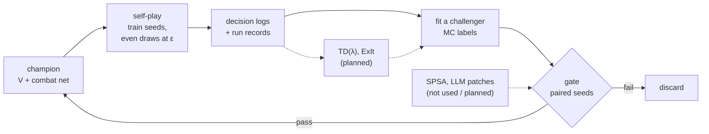

import { Aside, Badge } from '@astrojs/starlight/components';

This chapter is about the parts of the AI that are learned rather than written, and about the loop that makes them better. Two things are learned: the macro brain's value function V, which scores every situation outside combat, and the combat net, which tells a combat search what the state at the end of its lookahead is worth. Both learn from the runs the AI plays by itself. A change to either replaces the current version only if it passes a gate: a paired test on fixed seeds against the version in play.

Read first: [Macro brain](/en/arch/macro-brain/) for what V is used for, and [Combat brain: the leaf](/en/arch/combat-brain/leaf/) for what the combat net does in a search. The macro brain chapter also explains V's network and its training labels in detail ([Macro brain: the value network](/en/arch/macro-brain/network/), [Macro brain: from hazards to value](/en/arch/macro-brain/value/)); this chapter links there rather than repeating it, and covers what is not there: the combat net's training, the loop as a whole with the methods it uses or plans to use, and the files and scripts.

<Aside title="Status">

Built: V's trainer `learn/v/` (`v.train`) and the combat net's trainer `learn/combat/` (`combat.train`), both Monte Carlo (each decision labelled by how its run really ended); the even-draw exploration of self-play (`run --explore ε`); `learn/gauntlet.py`, the report and paired gate of a V's runs; `learn/challenge.py`, which drives the simulator's sequential gate; `learn/bosslab.py`, the boss-fight labels. Planned, not built: TD(λ) targets, expert iteration, LLM patch proposals, reward shaping, privileged training, and the mechanisms against local optima beyond even draws ([The loop](/en/arch/learning/loop/)).

</Aside>

## 1. What is learned

**The macro brain's V.** Outside combat the macro brain plays each option of a decision, looks at the situation right after it (the *afterstate*), and takes the option whose afterstate V values highest ([Macro brain §2](/en/arch/macro-brain/#sec-2)). V is a neural network that reads what the run is (the ids of its cards, relics, potions, act and bosses, the map ahead) and six raw numbers, and returns one number, the chance to win the run from here ([Macro brain: from hazards to value §1](/en/arch/macro-brain/value/#sec-1)). One V scores every surface, so a card, a relic, an HP heal and a path on the map are compared on one scale without exchange rates written by hand.

**The combat net.** A combat search looks a turn or a fight ahead and must then say what the state it reached is worth: its *leaf value*. The combat net reads a round's start and predicts how the fight will end: a death, or how much of max HP is still to be lost, in 50 buckets, and each held potion's chance of being gone after a win ([The combat net](/en/arch/combat-brain/network/), [Combat brain: the leaf §4](/en/arch/combat-brain/leaf/#sec-4)). Its training is in [Training the combat net](/en/arch/learning/combat-net/).

**Two units.** V's unit is the run's chance to win. The combat leaf keeps its own: it prices the net's endings with hand-set numbers ([Combat brain: the leaf §5](/en/arch/combat-brain/leaf/#sec-5)).

**Strategy is learned, not written.** Nothing about how to play is written by hand into either net: no card is called good, no monster's move order is listed. What is written by hand is the game's rules (the simulator plays the real game) and the targets (how a run ended, how a fight ended). V learns from zero, from the AI's own runs, not from human play.

**Offline only.** Training happens in separate processes, on other machines, from logged runs. Online, every decision is search plus the learned values; nothing learns during a decision. A language model was to take part only offline, proposing patches for the gate to judge, never in a decision; that part is planned ([The loop §7](/en/arch/learning/loop/#sec-7)).

## 2. The loop in one picture

The loop is modelled on how the open-source chess engine Stockfish is developed. Stockfish's developers propose a change, a distributed framework (Fishtest) plays thousands of games of the changed engine against the current one, and a sequential test (SPRT) accepts the change only if it is measurably stronger; its evaluation net is trained on positions from the engine's own games, and its search parameters are tuned by SPSA. The essential idea is the same here: **self-play, fit, gate**. The current best version, the *champion*, plays runs by itself; a new version, the *challenger*, is fitted to those runs; and the challenger replaces the champion only if it wins a paired comparison on seeds it was never trained on.

1. **Self-play.** The champion plays runs on train seeds, drawing a share ε of its macro decisions at random so that the data shows what other options lead to ([The loop §2](/en/arch/learning/loop/#sec-2), [§9](/en/arch/learning/loop/#sec-9)).
2. **Fit.** A new V (or combat net) is trained on those runs. Each decision's label is how its run actually ended, a *Monte Carlo* target ([The loop §3](/en/arch/learning/loop/#sec-3)). TD(λ) and expert iteration, which would also learn from the values the search computes, are planned ([§4](/en/arch/learning/loop/#sec-4), [§5](/en/arch/learning/loop/#sec-5)).
3. **Gate.** The challenger plays fixed evaluation seeds, paired seed by seed with the champion's runs, and passes only if the difference is clearly above zero ([The loop §8](/en/arch/learning/loop/#sec-8)).

A *generation* is one turn of this loop ([Macro brain: self-play §4](/en/arch/macro-brain/selfplay/#sec-4)).

## 3. What is built and what is planned

| part | status | where |
|---|---|---|
| self-play: whole runs, even draws at ε | built | `run --explore`, [The loop §2](/en/arch/learning/loop/#sec-2) |
| softmax exploration over the logs of V's values or the search's values | built; L0's beside even draws in `v7g2` | `run --macro-explore`, `--combat-explore`, [The loop §9](/en/arch/learning/loop/#sec-9) |
| V's training, Monte Carlo labels | built | `learn/v/`, [Macro brain: from hazards to value §5](/en/arch/macro-brain/value/#sec-5) |
| the combat net's training, Monte Carlo labels | built | `learn/combat/`, [Training the combat net](/en/arch/learning/combat-net/) |
| boss-fight labels for V (boss sims, door states) | built, unused | `learn/bosslab.py`, [Reference §9](/en/arch/learning/reference/#sec-9) |
| counterfactual forks | built as commands; no trainer reads them now | `fork`, `afterstates`, [The loop §10](/en/arch/learning/loop/#sec-10) |
| gates: the simulator's SPRT, the paired lower bound on wins | built | `gate`, `learn/challenge.py`, `learn/gauntlet.py`, [The loop §8](/en/arch/learning/loop/#sec-8) |
| TD(λ) targets | <Badge text="planned" variant="caution" /> | [The loop §4](/en/arch/learning/loop/#sec-4) |
| expert iteration (search values as labels, a learned prior) | <Badge text="planned" variant="caution" /> | [The loop §5](/en/arch/learning/loop/#sec-5) |
| SPSA tuning of hand-set weights | not used | [The loop §6](/en/arch/learning/loop/#sec-6) |
| LLM patch proposals | <Badge text="planned" variant="caution" /> | [The loop §7](/en/arch/learning/loop/#sec-7) |
| potential-based shaping, privileged training, archives against local optima | <Badge text="planned" variant="caution" /> | [The loop §11](/en/arch/learning/loop/#sec-11)–[§13](/en/arch/learning/loop/#sec-13) |

## 4. This chapter

- [Training the combat net](/en/arch/learning/combat-net/): what it reads and predicts in brief, its samples, labels and training, and its measurements.
- [The loop](/en/arch/learning/loop/): self-play, Monte Carlo, TD(λ), expert iteration, SPSA, LLM patches and gates, exploration, credit assignment, shaping, privileged information and local optima, each with what is built.
- [Reference](/en/arch/learning/reference/): compute, the data directory, lists, the ledger, weight names, net files, C# inference, every script with its options, tests and open questions.

The champions are in [Evaluation: champions and baselines §1](/en/arch/evaluation/champions/#sec-1). The project plays two nets, V v8-1 and the combat net c8-1, on a structure all five characters share, with weights per character; the history of its nets and data is the ledger, `eval/silent/ledger.md`.
