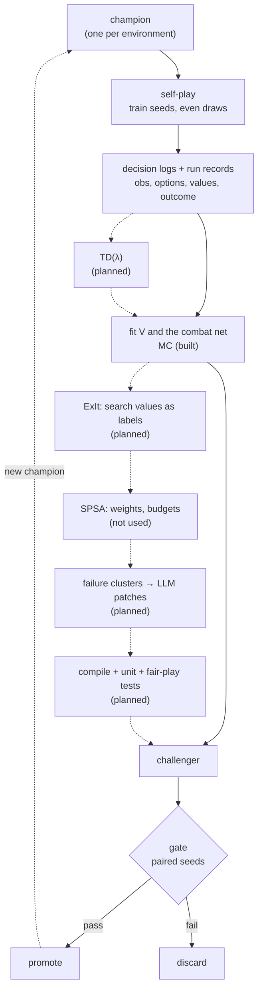

import { Aside, Badge } from '@astrojs/starlight/components';
import TdTargets from '../../../../../components/book/TdTargets.svelte';
import ShapingToy from '../../../../../components/book/ShapingToy.svelte';

The loop turns the champion's own runs into a challenger, and a gate decides whether the challenger replaces the champion. This page goes through the loop as it was designed, step by step, and says for each step what is built. Several steps rest on methods from reinforcement learning (Monte Carlo targets, TD(λ), expert iteration, SPSA, reward shaping); each is explained from scratch where it first appears. Read [Learning](/en/arch/learning/) first for what is learned; the macro brain's side of the loop is told in [Macro brain: self-play](/en/arch/macro-brain/selfplay/).

<Aside title="Status">

Built: self-play with even-draw exploration, Monte Carlo fitting of V and of the combat net, and the gates (the simulator's SPRT, `gate`, and `learn/gate.py`'s paired lower bound on wins). Not used: SPSA. Planned: TD(λ), expert iteration, PCR and Reanalyse, LLM patch proposals, potential-based shaping, privileged training, counterfactual forks, MAP-Elites archives, Thompson sampling and a reverse curriculum.

</Aside>

## 1. The loop as designed

| step | what it does | status |
|---|---|---|
| self-play ([§2](#sec-2)) | the champion plays runs on train seeds, exploring | built |
| fit ([§3](#sec-3)) | train V and the combat net on the runs' outcomes | built: Monte Carlo |
| TD(λ) ([§4](#sec-4)) | targets that mix the outcome with V's later values | <Badge text="planned" variant="caution" /> |
| ExIt ([§5](#sec-5)) | the search's values as labels for V and for a prior | <Badge text="planned" variant="caution" /> |
| SPSA ([§6](#sec-6)) | tune hand-set numbers by playing | not used |
| LLM patches ([§7](#sec-7)) | propose code changes from clustered failures | <Badge text="planned" variant="caution" /> |
| gate ([§8](#sec-8)) | keep a challenger only if it beats the champion on paired seeds | built |

The loop runs offline, in processes and on machines separate from any decision; an LLM was never to take part in a decision. Every generation goes through the gate. AlphaZero dropped its gate because its signal was clean and its games many; a run here has a high variance and runs are few.

## 2. Self-play

In self-play the champion plays runs by itself on *train seeds*, seeds kept apart from the evaluation seeds the gates use ([Reference §5](/en/arch/learning/reference/#sec-5)). Each run is the real game running headless in the simulator: the host process plays the run's one live game, and the worker pool runs the searches ([Simulator: whole runs](/en/arch/simulator/runs/), [Simulator: the worker pool](/en/arch/simulator/pool/)). Every decision goes into the decision log, the observation and options with the brain's values ([Harness: the decision log](/en/arch/harness/decision-log/)), and every run's outcome into its run record, with how each combat ended ([Evaluation: metrics, seeds and reports §8](/en/arch/evaluation/metrics/#sec-8)). Joined by run id, the two are the training data.

**What it plays.** Whole SL runs: the SL planner, with the combat net in its leaves, fights every combat, and L0 on the node's clone makes every macro decision ([Macro brain: self-play §2](/en/arch/macro-brain/selfplay/#sec-2)). The champion plays, so a generation's data is played by the V and the combat net it follows. The newest dataset is `v9g0`: 29,987 whole SL runs of all five characters at ascension 0 and the low budget, about 6,000 each, played by v9-0 and c9-0. The Silent won 1,981 of its runs, the Defect 48, the Ironclad 14, the Regent 12 and the Necrobinder 2; their mean floors were 37.89, 29.40, 21.27, 19.52 and 16.56. V v9-1 and the combat net c9-1 went on from those two nets on all its runs, and are the champions' nets ([Reference §5](/en/arch/learning/reference/#sec-5)).

**Exploration.** Self-play draws some decisions on purpose instead of taking V's best, so that the data shows what the other options lead to ([§9](#sec-9)).

**The newest generation.** A net trains on the newest generation's runs alone: runs played by a weaker V label states lower than the champion would now play them ([Macro brain: self-play §4](/en/arch/macro-brain/selfplay/#sec-4)). Each generation's runs are one time-boxed job per exploration tier, under one deadline that can be moved while it plays ([Reference §1](/en/arch/learning/reference/#sec-1)).

**Budget.** `v7g1` was played at the SL planner's low budget (`--effort low --nodes 150 --beam 4 --easy-beam 0 --loss-plans 0 --replan 0`), `v7g2` and `v8g2` at the champion's medium, and `v9g0` at the low budget again; the gates play at medium, with the low budget as a reference ([The SL planner: budget, cost and results §2](/en/arch/sl-planner/budget/#sec-2)).

## 3. Fit: Monte Carlo targets

A trained value function needs a target for each training state: the number it should have predicted there. The simplest is the **Monte Carlo (MC) target**: play the run to its end and use its real outcome $G$ (win 1, loss 0; or the proxy, the floor reached) as the label of every decision $k$ in it,

$$
y_k = G .
$$

Its expectation, over the luck of the rest of the run, is exactly the value of decision $k$'s state under the policy that played, so the target is *unbiased*. But it is *noisy*: the luck of one run, every draw and every fight after decision $k$, lands on all of its decisions alike, and a run's macro decisions (181 in the book's example run; [Macro brain §1](/en/arch/macro-brain/#sec-1)) all share its one outcome.

**As built, both trainers use MC targets only.** V's are the masked hazard labels of the floor each run ended on ([Macro brain: from hazards to value §3](/en/arch/macro-brain/value/#sec-3)); the combat net's are how each fight really ended ([Training the combat net §3](/en/arch/learning/combat-net/#sec-3)). Nothing in `learn/` bootstraps on a value. Two measures keep MC's noise in check:

- **every run weighs the same** however many decisions it has (each sample weighs one over its run's decisions), and the held-out runs are split by run, not by decision;
- **a second head** with denser targets, the next six combats' HP costs, shapes the body ([Macro brain: from hazards to value §4](/en/arch/macro-brain/value/#sec-4)). The design had a rule from r33hab, a prior-art STS2 project: never mix HP targets and win targets in one backward pass. V's training does mix them, the second head's squared errors added to the hazards' loss at weight 3 (`learn/v/train.py:139`); it lowered the held-out loss in every training seed it was tried with.

**A proxy is accepted only through the gate.** A dense target such as the floor reached is a stopgap ([Macro brain: from hazards to value §2](/en/arch/macro-brain/value/#sec-2)). A change it brings is accepted only through the gate on real outcomes, and only after it reproduces on several training seeds: in a GuanDan study (arXiv 2610.29411) one lineage looked strong, and none of its 5 pre-registered replication seeds came out positive.

## 4. TD(λ) targets <Badge text="planned" variant="caution" />

**Temporal-difference (TD) learning** replaces part of the real outcome with V's own estimate. The run's states $s_0, s_1, \dots, s_{N-1}$ are the macro decisions; no reward comes before the end, where the outcome is $G$. Write $V_k$ for V's value at decision $k$. Then:

- **TD(0)**, one step: $y_k = V_{k+1}$, and $y_{N-1} = G$. The label is what V itself thinks one decision later. It has little variance (the luck of one step) but is biased by V's errors.
- **$n$ steps**: $y^{(n)}_k = V_{k+n}$, or $G$ once $k + n \ge N$.
- **TD(λ)** averages every $n$, each weighted by $(1-\lambda)\lambda^{n-1}$, the weight of all $n \ge N-k$ going to $G$. This is the *λ-return*:

$$
G^\lambda_k = (1-\lambda)\sum_{n=1}^{N-1-k} \lambda^{n-1}\, V_{k+n} \;+\; \lambda^{N-1-k}\, G,
\qquad
G^\lambda_k = (1-\lambda)\, V_{k+1} + \lambda\, G^\lambda_{k+1}, \quad G^\lambda_{N-1} = G .
$$

$\lambda$, between 0 and 1, sets the mix. $\lambda = 1$ gives $G^\lambda_k = G$, pure MC; $\lambda = 0$ gives TD(0). In between, the label looks about $1/(1-\lambda)$ decisions ahead: at $\lambda = 0.9$, about ten. The point is variance: the further ahead a label looks, the more luck it carries, and a decision's label should mostly reflect what happened soon after it. TD also gives a learning signal at every transition, which helps credit assignment ([§10](#sec-10)).

The figure computes these targets on the book's example run, the whole SL run on seed `0SSL7NS01MU6` that an earlier V won on floor 48 ([Macro brain §1](/en/arch/macro-brain/#sec-1)). That V valued a run in expected progress, roughly the floor it would reach, so a won run's outcome is 48 + 1 = 49. Each dot is the λ-return of one of its 181 macro decisions, against V's own values.

<TdTargets client:visible lang="en" />

The run was won, so its MC target, 49, is far above V's early values: V started at 33, and the MC label credits every early decision with the luck of the whole run (over the first 60 decisions, 12.1 above V's own values on average). At $\lambda = 0.9$ those labels lie 1.2 above V on average: most of the credit goes to the decisions just before V's value rose, around the bosses of acts 1 and 2 (floors 16–17 and 32–33). At $\lambda = 0$ each label is simply V's next value.

**What is planned.** The design trains V on a mix of MC and TD(λ) targets, and the combat net on TD(λ ≈ 0.95) inside a fight. Nothing in `learn/` computes a λ-return now; the figure's targets are computed in the page (`components/book/td.ts`), checked against the explicit sum above on the same 181 values.

## 5. Expert iteration <Badge text="planned" variant="caution" />

**Expert iteration (ExIt)** uses a search as a teacher. A search guided by V plays better than V alone, because it looks ahead; so the values and choices the search finds become the training labels of the next V, and of a *prior*, a policy that tells the search which actions to try first. A better V makes the next search stronger, and so on. AlphaZero is the best-known instance.

- **A fair teacher.** The teacher is a search in the same environment, one that obeys that environment's information rules. No behaviour cloning (training a model to copy a teacher's moves) of an omniscient teacher, which failed in several projects.
- **The combat policy target** is $\mathrm{softmax}(\text{prior logits} + c \cdot \mathrm{minmax}(Q))$, not the search's visit counts. $Q$ is each first action's mean value over the worlds, which PIMC already computes; minmax rescales one decision's $Q$ to $[0, 1]$; the prior logits are 0 while the prior is uniform; $c$ is tuned by how well the target predicts the choice of a search with a much larger budget (log-likelihood). Visit counts would be a poor target: common random numbers at the root flatten them (r33hab), and with mctx's transform (a Gumbel MuZero library), at our 300 nodes per world, the target is almost one-hot.
- **What the logs hold for it now.** PIMC's candidates in the decision log carry every first action's value in every world and the nodes spent on it ([Harness: the decision log §5](/en/arch/harness/decision-log/#sec-5)), and each combat's end is in the run record. The SL planner, which plays the SL champion's fights, logs one value per candidate and no nodes (`Brain/Combat/SlPlanner.cs:205-206`), so SL's data has no per-world Q.
- **Two preconditions.** A learned prior steers the search only after it beats the uniform prior in the gate. A learned leaf should beat a rollout to the end of the fight: in r33hab, at 15 simulations, the value head lost 10.6 HP more than rollouts. No rollout leaf is built.
- **PCR** (playout cap randomization, from KataGo): 25% of the decisions get the full budget and give policy targets; the other 75% get a quarter of it and give value targets only.
- **Reanalyse** (from MuZero): after each new net, a share of old positions is replayed from seed and trace and searched again with it, which refreshes their policy targets and bootstrapped value targets.

## 6. SPSA <Badge text="not used" variant="note" />

**SPSA** (simultaneous perturbation stochastic approximation) tunes parameters from noisy results alone. Each step draws a random sign $\Delta_i = \pm 1$ for every parameter, measures the result $J$ of both $\theta + c\Delta$ and $\theta - c\Delta$, and moves every parameter at once:

$$
\hat g_i = \frac{J(\theta + c\Delta) - J(\theta - c\Delta)}{2c\,\Delta_i}, \qquad \theta \leftarrow \theta + a\,\hat g .
$$

It needs two measurements per step however many parameters there are, and no gradient, which suits weights whose only test is playing games; Stockfish tunes its search this way.

The project does not use it. No tool tunes V or the leaf's hand-set prices ([Combat brain: the leaf §2](/en/arch/combat-brain/leaf/#sec-2)): strategy is left to the nets. The search's own parameters (budgets, K, beam widths, thresholds) could be tuned this way; none is.

## 7. LLM patch proposals <Badge text="planned" variant="caution" />

The input would be pre-aggregated failure clusters (runs grouped by how and where they were lost) plus death summaries; the output K candidate patches (features, pruning rules, parameters). Candidates are filtered by compiling, unit tests and fair-play tests, then gated like any challenger. Only cheap models through the project's LLM gateway, and never in a decision. Nothing of it is built.

## 8. Gates

A gate is the test a challenger must pass to replace the champion: it plays seeds it was never trained on, paired seed by seed with the champion's runs, so that most of a run's luck is shared by both and cancels in the difference (common random numbers, [Evaluation: gates §2](/en/arch/evaluation/gates/#sec-2)). Exploring challengers are refused: exploration is for self-play (`SimWorker/Commands/EvalCommands.cs:91-92`).

**The paired lower bound on wins** (`learn/gate.py --against`) is the gate V faces. The challenger plays the 300 seeds of `promotion-1-300` (at ascension 10, the first 200: [Evaluation: gates §10](/en/arch/evaluation/gates/#sec-10)) at the champion's medium budget, and again at the low budget, a reference that decides nothing. For seed $i$, $d_i$ is 1 − 0, 0 − 1 or 0: whether the challenger won seed $i$ less whether the champion did. With $n$ pairs on the seeds both finished,

$$
\bar d = \frac1n \sum_i d_i, \qquad \mathrm{SE} = \frac{\mathrm{sd}(d)}{\sqrt n}, \qquad \text{promote if } \bar d - 1.645\, \mathrm{SE} > 0,
$$

the 95% one-sided lower bound above 0 (`learn/gate.py:130-151`; [Macro brain: self-play §5](/en/arch/macro-brain/selfplay/#sec-5)). The report also pairs the floors.

**The simulator's SPRT** (`gate`, `Harness/Gate.cs`). A sequential test of the challenger's run records against the champion's report, paired by seed, that stops at the first clear verdict: by floor (δ = 1.5 floors) or by wins, α = β = 0.05, or for non-inferiority with `--not-worse` ([Evaluation: gates §6](/en/arch/evaluation/gates/#sec-6)). The challenger first plays the champion's seed set with `run`; the gate reads only the records.

**Promotion.** The simulator's gate writes the champion file on a pass. `learn/gate.py` only gives the verdict, and a promotion rewrites the champion files by hand; both environments' files name the same V and the same combat net ([Evaluation: champions and baselines §1](/en/arch/evaluation/champions/#sec-1)). A gate's A/A test, the champion against itself to measure how often a gate passes with nothing to gain, is planned ([Reference §11](/en/arch/learning/reference/#sec-11)).

## 9. Exploration

V learns only from what the runs did. If self-play always took V's best option, the data would never show what the other options lead to, and V could never find out it was wrong about them. So self-play sometimes takes another option on purpose; how it picks that option matters ([Macro brain: self-play §3](/en/arch/macro-brain/selfplay/#sec-3)).

**Even draws** (`run --explore ε`, built; `Uniform`, `Brain/Exploration.cs:8-26`) are V's exploration. With chance ε a macro decision's answer is drawn uniformly among its $n$ options, whatever V says; otherwise L0 takes V's best $a^\ast$:

$$
P(a) = (1-\varepsilon)\,[a = a^\ast] + \frac{\varepsilon}{n} .
$$

It covers every decision outside combat: a card reward's outcome among its cards and skipping (a skip drawn is never opened, a card drawn is opened and taken); a card prompt's picks (how many, evenly, then which); every other screen's options but the potion belt's and those that would come back to a state already decided. ε is fixed per run. What is drawn depends neither on V nor on how strong the run is, so its outcomes are causal evidence about the options, and every kind of decision is drawn as often. Every drawn answer is marked `explored` in the log ([Harness: the decision log §6](/en/arch/harness/decision-log/#sec-6)), and the champion's name ends in `eps ε`.

- **The tiers.** A generation's runs are split into three tiers of ε, a third of the runs each: 0.3, 0.15 and 0.05 in `v7g1`, 0.15, 0.08 and 0.03 in `v7g2`, 0.06, 0.03 and 0.01 in `v8g2`, and 0.3, 0.1 and 0.02 in `v9g0`.
- **A label carries the later draws.** A decision's label is how its run ended, the draws made after it included, and V is not told the run's ε; the same state is labelled lower in a run that explores more. A *cut point* per run would remove this (draws before it, V's best after it, training only on the decisions after it, as AlphaGo's value network was trained on one position per game); it is not done ([Macro brain: weaknesses and next steps §3](/en/arch/macro-brain/next/#sec-3)).
- **Check.** The share of `explored` decisions among those with two or more options should be about ε: 0.161 at ε = 0.15 over 2,347 decisions in one test.

**Thompson sampling** <Badge text="planned" variant="caution" /> would draw a plausible value for each option from V's uncertainty and pick the best draw, so that an option is tried about as often as it might really be the best. V has no uncertainty estimate to draw from yet.

## 10. Credit assignment

The only reward is the run's outcome. The hard part is not a missing signal but *credit assignment* (which of a run's many decisions caused the win or the loss) and *variance* (the luck that hides the effect of any one decision). The design attacks both:

1. **The hierarchy shortens the chain.** Combat is solved by search, and the combat net learns how fights end, so run-level credit only spans the macro decisions plus the combat results. Combat and macro keep their own units: the leaf prices HP and potions by hand-set numbers ([Combat brain: the leaf §5](/en/arch/combat-brain/leaf/#sec-5)), and V learns what they mean for the run.
2. **TD(λ)** <Badge text="planned" variant="caution" /> gives a learning signal at every transition ([§4](#sec-4)).
3. **Auxiliary reward terms must be potential-based** <Badge text="planned" variant="caution" /> ([§11](#sec-11)).
4. **Auxiliary heads** give dense supervision, for the representation only: built, the second head ([Macro brain: from hazards to value §4](/en/arch/macro-brain/value/#sec-4)).
5. **Variance**: common random numbers in every gate (built), counterfactual forks at key decisions (planned, below), and a reverse curriculum (planned, [§13](#sec-13)).

### Counterfactual forks <Badge text="planned" variant="caution" />

More runs of the same kind do not untangle a choice from the luck that came with it: in every run they go together. What does is the same state played on with two choices and the same luck. **CRN** (common random numbers): two lines are played with the same random seeds, so the luck they share cancels out of their difference. To *fork* a decision is to play two of its options from the same point.

A fork would replay a logged run from its seed to the decision, answering each earlier decision as the log did, and play on from there twice: once with L0's best action, once with another of the screen's actions drawn uniformly, both to the end of the act with the same random streams. No command plays forks, and no trainer reads them.

## 11. Potential-based shaping <Badge text="planned" variant="caution" />

*Shaping* adds small intermediate rewards so that a learner gets feedback before the run ends. Done naively it changes what the best policy is: a penalty for every HP lost would forbid lines such as "bleed in act 1 to win act 3". The **potential-based** form avoids that (Ng, Harada and Russell, 1999). A function $\Phi$ scores each state, and the bonus for a step from $s$ to $s'$ is

$$
F(s, s') = \Phi(s') - \Phi(s), \qquad \Phi(\text{end of run}) = 0 .
$$

Over a whole run the bonuses *telescope*: every intermediate term cancels, and the sum is $\Phi(\text{end}) - \Phi(s_0) = -\Phi(s_0)$, the same for every way of playing from the same start. So the shaped return of any policy is its real return less the same constant, and the best policy is unchanged; Ng, Harada and Russell proved that potential-based terms are the only ones with this guarantee for every task. The terminal state's potential must be the same for every ending (here 0); otherwise the sum would depend on how the run ended.

<ShapingToy client:visible lang="en" />

Nothing in `learn/` shapes rewards: V's labels are the outcomes alone. A test that the shaping terms telescope exactly belongs with them when they are built ([Reference §11](/en/arch/learning/reference/#sec-11)).

## 12. Privileged information <Badge text="planned" variant="caution" />

*Privileged information* is hidden state the player cannot see: the draw order, the monsters' queued moves, the random streams. The project's fair-play specification (a local note, `tmp/notes/fair-play-spec.md`, not in git) allows it at training time, as long as the deployed policy reads only observations ([Environments: information and the node](/en/arch/environments/information/)):

- an **oracle critic**, a value branch used only in training, would see hidden state to reduce the variance of the targets; only the observation branch is deployed;
- **counterfactual labels**: fork the same decision with the same randomness, play both lines to the end, and get an unbiased label for the difference ([§10](#sec-10));
- all of it lives in the offline pipeline only, in an assembly and a process separate from the decision process.

No trainer reads hidden state now: V reads the run view (`learn/v/data.py`), the combat net the observation (`learn/combat/data.py`).

## 13. Local optima

A self-improving loop can settle into a *local optimum*: a way of playing that every small change makes worse, while a quite different way would win more often (always playing conservatively, for instance). These mechanisms work against it:

| mechanism | effect | status |
|---|---|---|
| the value target is the run's outcome only | how much HP is worth is learned from data, not set | built |
| even draws | every kind of decision is tried, independently of V ([§9](#sec-9)) | built |
| Thompson sampling of decisions | tries options as often as V thinks they might be the best | planned |
| counterfactual lab | at sampled key decisions, CRN-fork both lines to the end for an unbiased difference; tests hypotheses like "bleed in act 1" ([§10](#sec-10)) | planned |
| reverse curriculum | train first on situations close to the end (snapshots just before bosses), where the outcome is near and its signal clear, then move the starting points earlier | planned |
| population / archive | one champion per style descriptor (MAP-Elites), so no collapse into one style | planned |
| conservatism monitors | elites taken, skip rate, HP at bosses, gold and potion hoarding ([Evaluation: metrics, seeds and reports §3](/en/arch/evaluation/metrics/#sec-3)) | partly: `learn/gate.py` reports elites, rest, map and shop choices; reports the elites, skips and gold |
| contrarian hypotheses | ideas from people or an LLM → constrained policy variants → A/B in the simulator; results back to discussion | planned |

- **MAP-Elites** keeps an archive instead of a single best policy. Each policy is placed in a cell by its *style descriptor* (a few numbers describing how it plays, such as elites per run and cards skipped), and each cell keeps its own best. Styles that are not the best yet survive, so the population cannot collapse into one.
- **Sim A/B**: play two policy variants in the simulator on the same seeds and compare the results, as the gates do.
