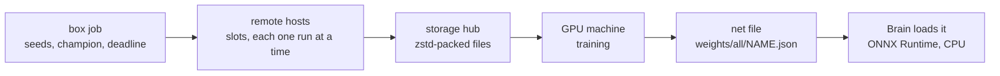

import { Badge } from '@astrojs/starlight/components';
import NetFileAnatomy from '../../../../../components/book/NetFileAnatomy.svelte';

This page is for looking things up. The pages before it explain the learning loop; this one lists its machinery. Everything was checked against the code at the commit the page was written at (`learn/`, `src/Sts2Ai.Brain`, `src/Sts2Ai.SimWorker`, `weights/`, `eval/`); where the code says otherwise, the code is right. Paths of Python files are relative to the repository, C# paths to `src/Sts2Ai.*`.

## 1. Compute

- **Simulation.** The simulator scales over processes: 8 processes reach about 1,860 combats/s, against 275 in a single process ([Simulator: combats §7](/en/arch/simulator/combat/#sec-7)). A whole SL run at the low budget takes 43–52 s of a slot on one host and 83 s on another. Self-play and gates run on several remote hosts at once.
- **Time-boxed jobs.** A job gets a deadline instead of a number of runs, and more seeds than fit; every host stops at the deadline, and the job is what finished. The deadline is a file on every host, `~/sts2/deadline/NAME.txt` (a comment line, then one time); jobs launched with the same `NAME` share it, so one edit moves every job of a generation. Each slot reads it before each chunk, and a watcher every 10 s while a run plays; a run still going at the deadline is ended and dropped, so only whole finished runs are kept. How jobs are launched, moved, stopped and fetched is a project skill, `.claude/skills/fleet/SKILL.md`; how SL self-play, gates and evaluations are run (options, exploration, checks) is another, `.claude/skills/sl-selfplay/SKILL.md`.
- **Where data goes.** Each host sends a job's files to a storage host when it ends, packed with zstd (logs shrink 40–80 times). They are unpacked and analysed where they are kept, and a net is trained on a GPU machine, one training per GPU; only the results (weights, report text) reach the development machine, which builds, tests and serves the brain. The trainers run with a uv virtual environment from `git archive REV learn/`, so a training's code is a commit.
- **Training** is Python with PyTorch, on a GPU when one is free (`device = "cuda" if torch.cuda.is_available()`). Inference is C#, on the CPU, in the decision process and the workers ([§8](#sec-8)).

## 2. The `learn/` project

`learn/` is the Python project for the loop, managed with uv (`learn/pyproject.toml`, `uv.lock`): `sts2-learn` 0.1.0, Python ≥ 3.12, dependencies loguru ≥ 0.7.3, onnx ≥ 1.23.2, torch (from the PyTorch CUDA 12.8 index) and typer ≥ 0.27.3; development pytest ≥ 9.1.1 and ruff ≥ 0.17.3 (line length 120, rules E, F, W, I, B, UP). Run a script with `uv run python -m v.train …` or `uv run python gate.py …` from `learn/`.

**Conventions** (`learn/common.py`):

- Every script has one Typer command whose help is its docstring (`common.app`, `:24-26`), so `--help` shows the docstring.
- Logs go to stderr through loguru at `LOG_LEVEL` (INFO by default), as `HH:mm:ss LEVEL message`; stdout carries only results, a JSON line for reports (`common.run`, `:29-41`).
- A `LearnError` (bad input, a file in the way, a simulator that failed) ends a script in one line with exit code 1; anything else is a bug and ends with a traceback. The simulator's command line works the same way ([Simulator: reference §2](/en/arch/simulator/reference/#sec-2)).

## 3. The data directory

Run records and decision logs are raw data, kept outside git in `data/CHARACTER/ENV/` (`ENV` is `sl` or `nosl`; `.gitignore:8-9`), one folder per job. The full files live on the storage host; the development machine keeps each job's `manifest.json` and small files.

| folder | what | example |
|---|---|---|
| `selfplay/gN/bK/` | an early self-play generation N, batch K (one launch of a few hours at most) | `sl/selfplay/g3/b1` |
| `selfplay/vNgM/eXXX/`, `eXXX-b`, `-c`, `-d` | a generation's jobs, one folder per ε (`e030` is ε = 0.3), later boxes of a generation with a suffix; `vNgM` names the data, never a net | `sl/selfplay/v7g1/e030` |
| `eval/DATE-KIND-SUBJECT/` | evaluations; KIND is `gate`, `rebaseline`, `eval`, `panel`, `bench`, `gauntlet`, `gauntlet-ref`, `gauntlet-smoke`, or `train` for a training's lists, scripts and logs; SUBJECT names what was tested as its weights or options do | `sl/eval/2026-10-31-eval-v7-1f-clone`, `sl/eval/2026-10-31-train-v7` |
| `forks/DATE-SUBJECT/` | counterfactual forks, the boss gauntlet pilot, and tests | `sl/forks/2026-10-31-deadline-test` |
| `assist/DATE-SUBJECT/` | the logs of the assist mode in the real game ([Mod: auto-play and safety §3](/en/arch/mod/auto/#sec-3)) | – |
| `data/CHARACTER/void/` | data that must not be used (played with a wrong option, stopped too early), under its old path, with a `VOID.txt` that says why | `void/sl/selfplay/g3/t025` |
| `data/CHARACTER/lists/` | shared training sets ([§4](#sec-4)) | `lists/c7-logs.txt` |

**Files.** A job's folder holds one set of files per chunk of seeds, named by the shard that played it and the chunk's first index: `rec-SHARD-INDEX.jsonl` (run records), `log-SHARD-INDEX.jsonl` (decision logs), `counts-SHARD-INDEX.txt` (both files' line counts) and, written last, `done-SHARD-INDEX.txt` (the indices of its runs), so a chunk is whole or absent, and a chunk with no `done-` file is left out when the job is read. Each shard also has `out-SHARD.txt`, the simulator's output. Older jobs keep one set per shard: `rec-SHARD.jsonl`, `log-SHARD.jsonl` and, if time-boxed, `done-SHARD.txt`. Either way a log file goes with the record file of the same name, and a list pair holds the two on the same line ([§4](#sec-4)). A whole run's decision log is about 1.6 MB at the low budget; most of the bytes are combat observations and macro run views.

**The manifest** (`manifest.json`, one per job) says what played and why: `job`, `kind`, `character`, `env`, `owner`, `purpose`, `rev` (the commit the simulator was built from), `game` (the game version), `options` (the run options), `inputs` (a copy of `eval/` and `weights/` the job reads, when the simulator's commit is older), `shards`, `launched`, `status`, and for a box job `box`: the deadline (UTC and epoch, the file, its changes), the seed range, the chunk, each host's slots, speed, clock offset and queue. Fetching adds `done` (runs finished), `prefix` (the complete head of the range), each slot's end and how far apart the slots stopped.

## 4. Lists

Shared training sets are list pairs in `data/CHARACTER/lists/`: `NAME-logs.txt` and `NAME-recs.txt` hold one path per line, relative to the repository's root (or absolute), and line i of one is the decision log of the run records on line i of the other (`common.lists`, `learn/common.py:84-95`). `v.train --list PREFIX` and `combat.train --list PREFIX` read a pair; the trainers join each log only with the record file on its own line. The folder's `manifest.json` says what each list holds.

| list | holds | read by |
|---|---|---|
| `v8g2` | the whole SL self-play at ascension 10 of generation `v8g2` | `v.train` and `combat.train --list`, for v8-3 and c8-3 |
| `v8g1` | the whole SL self-play at ascension 10, generation `v7g2` under the name its training gave it | `v.train` and `combat.train --list`, for v8-2 and c8-2 |
| `v7g1` | the whole SL self-play of generation `v7g1` | `v.train`, for the weights of v8-1 |
| `c7` | the combat net's earlier set: whole SL self-play and 600 medium-budget runs on `promotion-301-500`, kept beside the data | `combat.train --list`, for the weights of c8-1 |
| `medium` | medium-budget runs, all reported and never trained on | `combat.train --test-list` |
| `v-g0-g3`, `sl-combat` | earlier self-play and evaluation runs, kept with the data | no net in `weights/` |

## 5. The ledger and the seeds

`eval/ledger.md`, in git, one for every character, is the project's only history of its nets and data: which brain played which data, which data trained which weights, and what each gate said. The session that runs the training loop keeps it:

- a paragraph on the champions;
- the **seed blocks**: train seeds are `run --seed 1 --start K`; each dataset takes a block of 100,000 entered before it starts, and its jobs take sub-ranges of it, so two batches never share a seed. 100000–199999 holds `v7g1` (generation 1 on 100000–159999, tests on 199000–199999); 200000–299999 holds the gauntlets' runs; 300000–399999 holds the elite gauntlet's evaluation seeds 300000–300499, fixed, never trained on; 400000–499999 is the A10 dataset's, `v7g2` (`v8g1` to its training); 500000–599999 is `v8g2`'s; 600000–699999 is `v8g3`'s; 700000–799999 is `v9g0`'s, 20,000 seeds a character; the next free block is 800000–899999;
- the **rule**: train seeds and test seeds never meet. A self-play or fork job plays train seeds, and an eval job a file of `eval/seeds/`; `box.py` refuses anything else. Both trainers refuse a list holding an eval job's runs (`common.train_lists`);
- a **batch table**: batch, character, environment, the brain that played it, commits, train seeds, runs, whether it is used, and its folder;
- a **weights table**: name, kind, what it was trained on, its gate, its role.

The evaluation seed files are in `eval/seeds/`: `promotion-1` (200), `promotion-1-300` (its 200 in order, then the next 100), its slices `promotion-1-100`, `promotion-1-200` and `promotion-101-300`, `final-1` and `a10-check-1`; `eval/seeds/retired/` holds `promotion-1-500`, whose last 200 seeds are in training data ([Evaluation: metrics, seeds and reports §5](/en/arch/evaluation/metrics/#sec-5)). `eval/CHARACTER/gauntlet-leaderboard.md` holds the elite gauntlet's results, kept by hand; `eval/CHARACTER/leaderboard.md` is generated by `leaderboard` from whole-run reports.

## 6. Weights

The combat net and V are each one net for every character, every ascension and both environments, so their files share one folder, `weights/all/` (`learn/weights.py`). Each character is still judged on its own: its reports and leaderboard are in `eval/CHARACTER/`, its data in `data/CHARACTER/` ([§3](#sec-3)); the champion files and the ledger are every character's, `eval/champions/` and `eval/ledger.md`.

`weights/all/` holds `v9-0.json`, the macro brain's V, and `c9-0.json`, the combat net, which both champions, SL's and NoSL's, play for every character ([Evaluation: champions and baselines §1](/en/arch/evaluation/champions/#sec-1)); their weights are those of v8-3 and c8-3, which learned from the Silent's runs alone. Beside them are `v9-1.json` and `c9-1.json`, the first nets trained on every character's runs (`v9g0`), going on from v9-0 and c9-0.

- **Never overwritten.** A trainer writes to `weights/all/NAME.json` unless `--out` says otherwise, and refuses a name whose file is already in `weights/all/` (`out_path`, `learn/weights.py:14-20`), so a name is used once and always means the same weights. A trial that no kept run plays goes elsewhere, with `--out`.
- **Every character.** Both trainers read the runs of every character in their lists (`runs_by_log`, `learn/common.py:61-81`), since the nets are shared, and a net file records no character.
- **Names.** `vN-M` is a V and `cN-M` a combat net, with a variant's letter after the number when there is one (`v7-1f`). `vNgM` names a generation's data, never a net.
- **In git.** `weights/` is in git: a file is 4.9–8.8 MB and never changes, so a commit fixes the code, the weights and the champion files together; the champion files name the weights where they are. Earlier net files are in git's history (the last commit holding them is `a27e4ad`), and `eval/ledger.md` says what each was.
- **The environment.** A combat net file records the environment it learned from (`env`), and C# does not read it: SL and NoSL play the same file ([Combat brain: the leaf §6](/en/arch/combat-brain/leaf/#sec-6)). c9-0's weights learned from SL's games; in NoSL it loads and plays, and it has never been trained or gated there.

## 7. Net files

A net file is JSON: the graph as base64 ONNX, plus what C# needs to feed it, and test inputs with the trainer's outputs that loading checks. A net is defined once, in Python; C# only turns a run or a round start into the graph's inputs ([§8](#sec-8)).

**V's file** (`learn/v/export.py:41-61`):

| field | content | read by C# |
|---|---|---|
| `name` | the net's name, as the champion shows it (`l0 NAME`) | yes |
| `floors` | 64 | yes |
| `vocab` | per table, every id of the game build (`learn/game_ids.py`), entry 0 `<unk>`: `cards`, `modifiers`, `relics`, `potions`, `context`, `map` | yes |
| `state` | `names` (floor, hp, max_hp, gold, ascension, potion_slots), `mean`, `std` | yes |
| `fit` | the training report ([§9](#sec-9)) | no |
| `onnx` | the graph: inputs as `learn/v/encode.py`'s `INPUTS` name them, with free batch and length dimensions; output `hazards` (batch × 64); opset 20 | yes |
| `tests` | up to 8 held-out samples drawn by the training seed: `run` (the run view) and `value` (the trainer's value on the CPU) | yes |

**The combat net's file** (`learn/combat/export.py:72-105`):

| field | content | read by C# |
|---|---|---|
| `name` | as the champion shows it (`pimc NAME`, `plan NAME`) | yes |
| `env` | the environment whose games it learned from, written as a record | no |
| `buckets`, `loss_min` | 50 buckets from −0.25: what the net predicts | yes |
| `lags` | 3 earlier rounds of intents | yes |
| `vocab` | per table, every id of the game build: `cards`, `modifiers`, `powers`, `enemies`, `intents`, `relics`, `potions`, `context`, `orbs`, `allies`, `relic_status`; `context` holds encounters only | yes |
| `fit` | the training report | no |
| `onnx` | inputs as `learn/combat/encode.py`'s `INPUTS` name them; outputs `outcome` (batch × 51, softmax, the closed buckets 0) and `potion_used` (batch × potion ids, sigmoid) | yes |
| `tests` | up to 16 held-out round starts, among them a multi-hit attack, a held potion and low HP: `obs`, `history`, `outcome`, `potion_used` | yes |

The figure opens the two net files, v9-0.json and c9-0.json, field by field: sizes, the graph's inputs and outputs with their shapes, its initializers (the weight tensors, by shape only) and operators, and the training report.

<NetFileAnatomy client:visible lang="en" />

## 8. Inference in C#

- **Which nets.** `run --value FILE` reads V's net file (`RunNet.Read`); `--value` and `--macro l0` go together (`SimWorker/Commands/Args.cs:228`). `run --combat-net FILE` loads the combat net (`CombatNet.Load`), the leaf of every combat search: `--combat-net` and `--policy pimc` or `plan` go together (`:236`).
- **`IRunValue`** (`Brain/Macro/RunValue.cs`) is the macro brain's view of V: a name and a value of a run view. `RunNet` implements it.
- **`RunNet`** (`Brain/Macro/RunNet.cs`) runs the graph with ONNX Runtime (`Microsoft.ML.OnnxRuntime`), one thread intra- and inter-op (`:49`), since the simulator runs many processes and a macro decision values a handful of small inputs. It builds the inputs from the run view as `learn/v/encode.py` does. Unknown ids read as entry 0. `Value` is the chance to survive every floor from the run's current floor on (`:75-82`).
- **`CombatNet`** (`Brain/Combat/CombatNet.cs`) does the same for a state, with one thread as well. `Graph` builds the inputs from `Cards`, `Player`, `Enemies`, `PowerNumbers`, `RelicNumbers`, `Allies`, `Bag` and `Powers`, as `learn/combat/encode.py` reads a state, and returns the two outputs; `Value` prices them with `LeafValue`'s prices ([Combat brain: the leaf §5](/en/arch/combat-brain/leaf/#sec-5)).
- **The load check.** `RunNet.Load` values every test run and refuses the file if any value is off by more than the larger of 10⁻³ × |value| and 10⁻⁶ (`:59-73`); `CombatNet.Load` predicts every test state and refuses it if any class or potion chance is off by more than 10⁻³, or an output's length differs. This keeps the encoding and the forward pass the same in training and in play.
- **Cost.** An earlier V of the same structure takes 0.093 ms a call, against 70–90 ms a macro decision with the clone (commit `b0ec4b7`).

## 9. Scripts

### `learn/common.py` and `learn/weights.py`

| function | what |
|---|---|
| `read_lines(paths, needle)` | the JSON lines of comma-separated files that contain the needle; blank lines and a line still being written are skipped; a missing file is a `LearnError` (`:44-58`) |
| `runs_by_log(logs, records)` | pairs log i with record file i (the counts must match); per record file, its runs by run id; refuses a run id twice in one file; every character's runs (`:61-81`) |
| `lists(prefix)` | a list pair as two comma-joined strings (`:84-95`) |
| `train_lists(prefix)` | a list pair a net trains on: as `lists`, refusing a path inside an eval job (`:98-104`) |
| `out_path(name, out)` | where a weights file goes ([§6](#sec-6)) |

### `v.train`: V

`uv run python -m v.train --list PREFIX --name NAME [options]` (`learn/v/train.py:46-58`).

| option | default | meaning |
|---|---|---|
| `--list` | required | the list pair `PREFIX-logs.txt` and `PREFIX-recs.txt` |
| `--name` | required | the net's name, as the champion will show it |
| `--out` | `weights/all/NAME.json` | where the file goes |
| `--init` | – | a net file to go on from: its state scaling and weights, the second head anew |
| `--seed` | 0 | torch's and Python's seeds; also picks the 8 test runs |

**Refusals** (`:69-70`, `:80-81`): too few train or held-out samples; `--init` with other tables than the game's, or without one of the net's weights at its shape (`export.weights`, `learn/v/export.py:91-92`).

**Constants** (`:39-43`): 64 floors; at most 40 epochs, stopping after 5 without a held-out loss lower by 10⁻⁴; batches of 256 decisions; AdamW, learning rate 3 × 10⁻⁵, weight decay 10⁻⁴; the second head at weight 3. The net's sizes are `Net`'s: embeddings 64, card net 256, body 512 (`learn/v/net.py:74-91`).

**The flow.** Read the samples; split by run id; take the game's tables (`learn/game_ids.py`), and the state's weighted mean and standard deviation (or `--init`'s); the baseline hazards, each floor's $(\text{deaths} + 0.5)/(\text{alive} + 1)$ clamped to $[10^{-4}, 1 - 10^{-4}]$, as the head's biases; train; keep the epoch with the best held-out hazard loss. The second head's next-combats term is logged each epoch but not added to it (`:145-148`). The module docstring says early stopping weighs the terms the same way as the loss; the code does not add that term. Then the report and the file.

**The report** (one JSON line, `:165-177`):

| field | when | what |
|---|---|---|
| `runs`, `held_out_runs`, `samples`, `won` | always | the runs and decisions read, and the runs won |
| `vocab` | always | each table's size |
| `held_out_loss`, `held_out_loss_floor_only` | always | the held-out hazard loss per run, against the baseline's |
| `held_out_next_combats` | always | the second head's held-out squared error |
| `won_held_out_runs`, `brier_held_out`, `brier_held_out_floor_only` | always | the held-out runs won, and the Brier score of the chance to win, against the baseline's |

### `combat.train`: the combat net

`uv run python -m combat.train --list data/silent/lists/v8g2 --env SL --name NAME --test-list data/silent/lists/medium`, plus optional `--out`, `--init` (a net file to go on from) and `--seed` (0); it reads every character's runs. `--list` is refused if it holds an eval job's runs; `--test-list` names a list pair whose games are only reported, as `medium`. `learn/combat/report.py` holds the report (`ranks`, `rank_within`, `auc_within`, `potion_rates`, `log_loss`, `predict`, `summary`). Its samples, loss, constants and report are in [Training the combat net §3](/en/arch/learning/combat-net/#sec-3)–[§4](/en/arch/learning/combat-net/#sec-4).

### `learn/gate.py`: a V's report and gate

`uv run python gate.py --records R1,R2 [--logs L1,L2] [--against C1,C2]` (`learn/gate.py:154-170`). It reads finished runs, failed ones out, truncated kept (`:40-42`). One JSON line:

- **from the records** (`runs_report`, `:45-72`): `runs`, `floor` and `floor_se`; `won`; per act `boss` (reached, beaten, rate); `elites_per_run`, `elite_deaths`; `died_in`, per act, the room of the combat each lost run died in, or `outside combat`;
- **from the logs** (`logs_report`, `:101-127`), for runs with a record: `rest`, the rest sites' choices by HP share (0–40%, 40–70%, 70–90%, 90–100%); `monster_or_rest`, the map's choices where a monster and a rest site were both offered, by the same shares; `shop`, what the shops sold (a relic, a card, a potion, as the next decision's run view shows) and the removals and leaves;
- **with `--against`** (`paired`, `:130-151`), under `against`, pairing by seed on the seeds both finished: `pairs`, `won`, `champion_won`, `wins_diff`, `wins_diff_se`, `wins_lower_95` (mean − 1.645 SE), `floor_diff`, `floor_diff_se` and `promote`, on the wins.

## 10. Simulator commands the loop uses

Every command with every option is in [Simulator: reference §4](/en/arch/simulator/reference/#sec-4). The ones the loop calls:

| command | for |
|---|---|
| `run --explore ε` | self-play's even draws ([The loop §9](/en/arch/learning/loop/#sec-9)); needs `--macro l0` |
| `run --value FILE`, `--combat-net FILE` | which V and which leaf play |
| `run --log FILE --records FILE` | the decision log and the run records |
| `report`, `gate`, `leaderboard` | reports, the SPRT gate, the leaderboards ([Evaluation: gates §6](/en/arch/evaluation/gates/#sec-6), [Evaluation: metrics, seeds and reports §7](/en/arch/evaluation/metrics/#sec-7)) |

## 11. Tests

**Python** (`uv run pytest` in `learn/`, 55 tests in 7 files; `uv run ruff check`):

| file | tests | what |
|---|---|---|
| `test_common.py` | 11 | `train_lists` refuses an eval job's runs in either environment and takes self-play and forks; `read_lines` skips blank and partial lines, reads every file, finds the needle, fails on a missing file; a list pair gives the logs and records in the same order; `runs_by_log` joins each log with its own records, wants one record file per log, refuses a run id twice and reads every character's runs |
| `test_weights.py` | 3 | the default path in `weights/all/`; a file there never replaced; an explicit path elsewhere may be |
| `test_v_encode.py` | 7 | the reachable map with floors ahead, the point entered on a map move and only then, before any visit and at the boss; ids only; a card's keywords and what Tinker Time made of it; the state's order |
| `test_v_train.py` | 10 | samples and per-run weights; a lost run's last fight with no end costs what was left; hazard labels and censoring; the chance to win; ONNX against torch; a net file's weights read back, the second head anew; `--init` keeps the tables and the state scaling, and refuses other tables; the net file and its report; a map move's sample |
| `test_game_ids.py` | 3 | each table starts with `<unk>` and holds each id once, in order; every character and what the nets read are there; none of the game's test models |
| `test_combat.py` | 17 | card tokens: ids, upgrades, piles, modifiers, costs and numbers; a card's keywords, Tinker, spent enchantment and gathered numbers; a power's moved number and stolen card, a relic's effect spent; the player's and each enemy's raw state, scaled; intents most recent first; the ending's buckets; potions gone from the view after the fight; buckets the HP rules out; a card's numbers and modifiers and the orbs' numbers and order moving the output; the potion loss on held potions after wins; round-start samples with history; another environment refused; ONNX against torch; training writes a net file of its environment; `c9-0.json`'s weights read back giving its test states; training going on from a net file and keeping it unless an epoch beats it; a combat the run died in before its first decision |
| `test_gate.py` | 4 | bosses, elites and deaths; rest choices by HP and shop purchases; monster or rest by HP; whole runs pair on wins and floors and promote on wins |

**C#** ([Simulator: reference §7](/en/arch/simulator/reference/#sec-7)), the train/deploy parity of the nets, on fixtures in `Sts2Ai.Tests/Fixtures/` and the two net files themselves:

- `RunNetTests` (4): a tiny untrained net (`pure-v-tiny-win.json`, its hazard head's bias lowered by 6) values three real run views at the trainer's chance to win; `v9-0.json` loads, its test runs at its trainer's values; the map tokens on a shared test map; the point entered reads on a map move and only then.
- `CombatNetTests` (5): `c9-0.json` loads, its 16 test states as its trainer read them; a tiny untrained net (`combat-tiny.json`) whose test states, real SL round starts with four rounds of an enemy's history, an ally, two potions of one id, a potion off the table, a state at 5% HP, a multi-hit attack, cards with damage and orbs on and off the table past the places the net tells apart, read as its trainer did; a state in progress is its endings and the potions kept; a bucket the HP held rules out has no weight; a finished state and the bound are `LeafValue`'s.
- A check passes when a changed input moves the output by less than its tolerance, so each new input was checked once more on a net whose weights make every input count ([The combat net §9](/en/arch/combat-brain/network/#sec-9)).

**Planned** <Badge text="planned" variant="caution" />:

1. **Calibration** on held-out seeds: of the states where V says 30%, about 30% should be won. A reliability plot (predictions grouped into bins, predicted against actual win rate) is not built; the Brier score (the mean squared gap between the predicted chance and the 0/1 result) is, in `v.train`'s whole-run report, and must beat the baseline's (the run model of ytcs, a prior-art STS2 solver, failed this).
2. **Shaping telescopes exactly**, once shaping terms exist ([The loop §11](/en/arch/learning/loop/#sec-11)).
3. **A gate's A/A test**: a challenger that is the champion itself must not pass more often than the gate's false-positive rate. `Sts2Ai.Tests/Harness/GateTests.cs` checks that 200 zero-difference pairs fail (`NoGainFails`), a deterministic check, not a measured rate.

## 12. Open questions

1. What the champion's weights are worth in whole runs: as v8-3 and c8-3 they were gated with the Silent at ascension 10, V passed by paired wins on 200 seeds, the combat net showed no gain apart, the pair falls short of passing against v8-2 and c8-2 alone (lower 95 % −0.26), and neither net has seen a cycle's outcome ([Evaluation: champions and baselines §2](/en/arch/evaluation/champions/#sec-2)); in NoSL neither has been trained or gated.
2. How much a net that learns all five characters keeps of what it knew of one, and whether it needs to be wider for them: only data of all five can say, and a net can be widened with its outputs kept.
3. How to check P(win)'s calibration once V decides by it, beyond the Brier score.
4. Each decision's label carries its run's later draws. A cut point per run would remove them: draws before it, V's best after it, training only on the decisions after it, as AlphaGo's value network was trained ([The loop §9](/en/arch/learning/loop/#sec-9)). It is not done.
5. Whether TD(λ) or expert iteration would help V, whose labels are Monte Carlo only.
