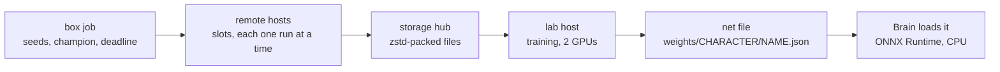

import { Badge } from '@astrojs/starlight/components';
import NetFileAnatomy from '../../../../../components/book/NetFileAnatomy.svelte';

This page is for looking things up. The pages before it explain the learning loop; this one lists its machinery. Everything was checked against the code at the commit the page was written at (`learn/`, `src/Sts2Ai.Brain`, `src/Sts2Ai.SimWorker`, `weights/`, `eval/`); where the code says otherwise, the code is right. Paths of Python files are relative to the repository, C# paths to `src/Sts2Ai.*`.

## 1. Compute

- **Simulation.** The simulator scales over processes: 8 processes reach about 1,860 combats/s, against 275 in a single process ([Simulator: combats §7](/en/arch/simulator/combat/#sec-7)). A whole SL run at the low budget takes 43–52 s of a slot on one host and 83 s on another; an elite gauntlet run 45–53 s ([The experiment log §11](/en/arch/learning/experiments/#sec-11)). Self-play and gates run on several remote hosts at once.
- **Time-boxed jobs.** A job gets a deadline instead of a number of runs, and more seeds than fit; every host stops at the deadline, and the job is what finished. Since `4c36cad` the deadline is a file on every host, `~/sts2/deadline/NAME.txt` (a comment line, then one time); jobs launched with the same `NAME` share it, so one edit moves every job of a generation (plan v7: `DEADLINE=v7gN` for its three tiers). Each slot reads it before each chunk, and a watcher every 10 s while a run plays; a run still going at the deadline is ended and dropped, so only whole finished runs are kept. How jobs are launched, moved, stopped and fetched is a project skill, `.claude/skills/fleet/SKILL.md`; how SL self-play, gates and evaluations are run (options, exploration, checks) is another, `.claude/skills/sl-selfplay/SKILL.md`.
- **Where data goes.** Each host sends a job's files to a storage host when it ends, packed with zstd (logs shrink 40–80 times). They are unpacked, analysed and trained on at a lab host with two RTX 4080s, one training per GPU; only the results (weights, report text) come back to the development machine, which builds, tests and serves the brain. There the trainers run with a uv virtual environment from `git archive REV learn/`, so a training's code is a commit.
- **Training** is Python with PyTorch, on a GPU when one is free (`device = "cuda" if torch.cuda.is_available()`). Inference is C#, on the CPU, in the decision process and the workers ([§8](#sec-8)).

## 2. The `learn/` project

`learn/` is the Python project for the loop, managed with uv (`learn/pyproject.toml`, `uv.lock`): `sts2-learn` 0.1.0, Python ≥ 3.12, dependencies loguru ≥ 0.7.3, onnx ≥ 1.23.2, torch (from the PyTorch CUDA 12.8 index) and typer ≥ 0.27.3; development pytest ≥ 9.1.1 and ruff ≥ 0.17.3 (line length 120, rules E, F, W, I, B, UP). Run a script with `uv run python -m v.train …` or `uv run python gauntlet.py …` from `learn/`.

**Conventions** (`learn/common.py`):

- Every script but `bosslab.py` has one Typer command whose help is its docstring (`common.app`, `:25-27`), so `--help` shows the docstring.
- Logs go to stderr through loguru at `LOG_LEVEL` (INFO by default), as `HH:mm:ss LEVEL message`; stdout carries only results, a JSON line for reports (`common.run`, `:30-42`).
- A `LearnError` (bad input, a file in the way, a simulator that failed) ends a script in one line with exit code 1; anything else is a bug and ends with a traceback. The simulator's command line works the same way ([Simulator: reference §2](/en/arch/simulator/reference/#sec-2)).
- `bosslab.py` uses only the standard library and argparse, prints to stdout and has no `LearnError`: the hosts that play its tasks run it with a plain `python3`.

## 3. The data directory

Run records and decision logs are raw data, kept outside git in `data/CHARACTER/ENV/` (`ENV` is `sl` or `nosl`; `.gitignore:8-9`), one folder per job. Since the box jobs, the full files live on the storage host; the development machine keeps each job's `manifest.json` and small files.

| folder | what | example |
|---|---|---|
| `selfplay/gN/bK/` | self-play generation N, batch K (one launch of a few hours at most); its afterstates go into its folder | `nosl/selfplay/g2/b1`, `sl/selfplay/g3/b1` |
| `selfplay/v6gN/eXXX/`, `eXXX-b`, `-c`, `-d` | the elite gauntlet's generation N, one folder per ε (`e030` is ε = 0.3), later boxes of a generation with a suffix | `sl/selfplay/v6g3/e015-b` |
| `selfplay/v7gN/eXXX/` | plan v7's generation N, one job per ε | `sl/selfplay/v7g1/e030` |
| `eval/DATE-KIND-SUBJECT/` | evaluations; KIND is `gate`, `rebaseline`, `eval`, `panel`, `bench`, `gauntlet`, `gauntlet-ref`, `gauntlet-smoke`, or `train` for a training's lists, scripts and logs; SUBJECT names what was tested as its weights or options do | `sl/eval/2026-10-30-eval-v6-3-2-clone`, `sl/eval/2026-10-30-gauntlet-v6-2`, `sl/eval/2026-10-29-train-pure1`, `nosl/eval/2026-10-28-gate-n2-b0.03` |
| `forks/DATE-SUBJECT/` | counterfactual forks, the boss gauntlet pilot, and tests | `sl/forks/2026-10-29-gauntlet`, `sl/forks/2026-10-31-deadline-test` |
| `assist/DATE-SUBJECT/` | the logs of the assist mode in the real game ([Mod: auto-play and safety §3](/en/arch/mod/auto/#sec-3)) | – |
| `data/CHARACTER/void/` | data that must not be used (played with a wrong option, stopped too early), under its old path, with a `VOID.txt` that says why | `void/sl/selfplay/g3/t025` |
| `data/CHARACTER/lists/` | shared training sets ([§4](#sec-4)) | `lists/v-g0-g3-logs.txt` |

Generation N is counted the same in both environments: `sl/selfplay/g3/` and `nosl/selfplay/g3/` are the third turn, played in each.

**Files.** A fixed-shard job has `rec-SHARD.jsonl` (run records), `log-SHARD.jsonl` (decision logs) and `out-SHARD.txt` (the simulator's output), one of each per process. A box job has one set per slot, `rec-`, `log-`, `out-` and `done-HOST-i` (each slot runs a new `run` process per chunk of seeds), plus each host's `queue-`, `counts-`, `stored-` and `push-` files. A whole run's decision log is about 1.6 MB at the low budget, a gauntlet run's about 1 MB; most of the bytes are combat observations and macro run views.

**The manifest** (`manifest.json`, one per job) says what played and why: `job`, `kind`, `character`, `env`, `owner`, `purpose`, `rev` (the commit the simulator was built from), `game` (the game version), `options` (the run options), `inputs` (a copy of `eval/` and `weights/` the job reads, when the simulator's commit is older), `shards`, `launched`, `status`, and for a box job `box`: the deadline (UTC and epoch, the file, its changes), the seed range, the chunk, each host's slots, speed, clock offset and queue. Fetching adds `done` (runs finished), `prefix` (the complete head of the range), each slot's end and how far apart the slots stopped.

## 4. Lists

Shared training sets are list pairs in `data/CHARACTER/lists/`: `NAME-logs.txt` and `NAME-recs.txt` hold one path per line, relative to the repository's root (or absolute), and line i of one is the decision log of the run records on line i of the other (`common.lists`, `learn/common.py:90-101`). `v.train --list PREFIX` and `combat.train --list PREFIX` read a pair; the trainers join each log only with the record file on its own line ([The experiment log §2](/en/arch/learning/experiments/#sec-2)). The folder's `manifest.json` says what each list holds.

| list | holds | read by |
|---|---|---|
| `v-g0-g3` | V's whole-run self-play: batch 1 of NoSL g0–g2 and of SL g3, 1,198 and 419 runs, plus 5 failed runs in g0–g2 that training leaves out; 69 pairs | pure-1, pure-1-b, pure-1-d, pure-1-g |
| `sl-combat` | SL's combat set: SL g3's batch 1 (419 runs) and the SL evaluations played by the planner with c2 at medium effort (`promotion-1`, 160 runs; `promotion-1b`, 40; the gate of n3-free-ctl, 200), 819 runs and 54,405 round starts; 89 pairs | `sl-c1`, planned |
| `v6-1`, `v6-2`, `v6-3-1`, `v6-3-2` | each gauntlet net's generations | on the lab host, in `sl/eval/2026-10-29-train-v6/lists/` |

The fix68 reruns are left out of `sl-combat`, since their seeds are `promotion-1`'s.

## 5. The ledger and the seeds

`eval/CHARACTER/ledger.md`, in git, traces the lineage ([The experiment log §1](/en/arch/learning/experiments/#sec-1)). The session that runs the training loop keeps it:

- a paragraph on the champions now and before, and the elite gauntlet's champions;
- the **seed blocks**: train seeds are `run --seed 1 --start K`; each plan takes a block of 100,000 entered before it starts, and its jobs take sub-ranges of it, so two batches never share a seed. Plan v6 took 205400–276999 of 200000–299999 (the boss gauntlet pilot took 200000–205399); plan v7 takes 100000–199999 (199000–199999 its first tests, generation 1 100000–159999); 300000–399999 holds the elite gauntlet's evaluation seeds 300000–300499, fixed, never trained on; the next free block is 400000–499999;
- a **batch table**: batch, environment, the brain that played it, commits, train seeds, runs, whether it is used, and its folder;
- a **weights table**: name, kind, what it was trained on, its gate, its role now.

The evaluation seed files are in `eval/seeds/`: `promotion-1` (200), `promotion-1-300` (its 200 in order, then the next 100), `promotion-1-500` (`seeds --base 2 --n 500`, whose first 300 are `promotion-1-300`, added in `7ce03bd`) and `final-1` ([Evaluation: metrics, seeds and reports §5](/en/arch/evaluation/metrics/#sec-5)). `eval/CHARACTER/gauntlet-leaderboard.md` lists the gauntlet's champions, kept by hand; `eval/CHARACTER/leaderboard.md` is generated by `leaderboard` from whole-run reports.

## 6. Weights

Each character is trained and judged on its own, by a brain of its own; every ascension of a character is played by that one brain, which climbs them in turn. So each character's files have a folder, `weights/CHARACTER/` (`weights/silent/` for the Silent; `learn/weights.py`).

- **Never overwritten.** A trainer writes to `weights/CHARACTER/NAME.json` unless `--out` says otherwise, and refuses a name whose file exists in any character folder (`out_path`, `learn/weights.py:18-25`), so a name is used once and always means the same weights. A trial that no kept run plays goes elsewhere, with `--out`.
- **The character.** A trainer's `--character` (SILENT by default) names it: a run of another character in its records is refused (`learn/common.py:83-84`), and the file records it.
- **Names.** The kind and a number, with a variant after a dash: `cN` the combat nets so far (all NoSL's), `sl-cN` SL's (planned), `nN` V v2's nets (`n2-b0.03`: generation 2, pull β 0.03), `pure-N` pure V on whole runs (`pure-1-g`: with the pilot's doors), `v6-N` the elite gauntlet's generation N (`v6-3-2`: its second net), and plan v7's `v7-N`, `v7-Ne` (the encoders' net), `v7-1e2` (encoders, pre-trained on older generations) and `v7-1f` (the map move's point entered). `vNgM` names a generation's data, never a net.
- **In git.** `weights/` is in git: a file is 1.3–2.0 MB and never changes, so a commit fixes the code, the weights and the champion files together; the champion files name the weights where they are ([Evaluation: champions and baselines §1](/en/arch/evaluation/champions/#sec-1)). `weights/silent/history/` and `weights/silent/nosl/` are ignored copies of an old layout (`.gitignore:11-13`).
- **The environment.** A combat net file names its environment (`env`, SL or NoSL), and `run`, `brain`, `gate` and `panel` refuse it in the other one; c1–c4 have none and play in either ([Training the combat net §1](/en/arch/learning/combat-net/#sec-1)).

Files in `weights/silent/` now: c1–c4; n1, n2-b0.1, n2-b0.03, n2-b0.01, n3-ctl, n3-free-ctl; pure-1, pure-1-b, pure-1-d, pure-1-g; v6-1, v6-2, v6-3-1, v6-3-2.

## 7. Net files

A net file is JSON: the graph as base64 ONNX, plus what C# needs to feed it, and test inputs with the trainer's outputs that loading checks. A net is defined once, in Python; C# only turns a run or a round start into the graph's inputs ([§8](#sec-8)).

**V's file** (`learn/v/export.py:43-66`):

| field | content | read by C# |
|---|---|---|
| `name` | the net's name, as the champion shows it (`l0 NAME`) | yes |
| `character` | the character, e.g. `SILENT` | no |
| `objective` | `floor`, `win`, or `progress` (any net with a share head) | yes |
| `floors` | 64 | yes |
| `vocab` | per table, its ids, entry 0 `<unk>`: `cards`, `modifiers`, `relics`, `potions`, `context`, `map`, and `route` for the encoders' net | yes |
| `state` | `names` (floor, hp, max_hp, gold, ascension, potion_slots), `mean`, `std` | yes |
| `fit` | the training report ([§9](#sec-9)) | no |
| `onnx` | the graph: inputs as `learn/v/encode.py`'s `INPUTS` or `ENCODER_INPUTS` name them, with free batch and length dimensions; output `hazards` (batch × 64, or × 128 with the shares); opset 20 | yes |
| `tests` | up to 8 held-out samples drawn by the training seed: `run` (the run view) and `value` (the trainer's value on the CPU) | yes |

V v2's files (n1, n2-\*, n3-\*) have `features` (the 17 or 9 V v0 feature names), `mean` and `std` instead of `state`, and their graphs take `features`, `costs`, `mod_amounts`, `card_scalars`, `vars`, `var_values`, `var_mask`, `relic_values`, `relic_status` and `extra` and no map bag.

**The combat net's file** (`learn/combat/export.py:53-78`):

| field | content | read by C# |
|---|---|---|
| `name` | as the champion shows it (`pimc NAME`, `plan NAME`) | yes |
| `character` | the character (not in c1, c2) | no |
| `env` | SL or NoSL (not in c1–c4) | yes |
| `buckets`, `loss_min` | 50 and −0.25 (c1: 20 buckets of HP left, no `loss_min`) | yes |
| `lags`, `round` | 3 earlier rounds of intents, and the round read | yes |
| `vocab` | per table: `cards`, `modifiers`, `powers`, `enemies`, `intents`, `relics`, `potions`, `context`, and in newer nets `orbs`, `allies` | yes |
| `fit` | the training report | no |
| `onnx` | inputs as `learn/combat/encode.py`'s `INPUTS` name them (c1–c4 their own); outputs `outcome` (batch × 51, softmax) and `potions_used` (batch) | yes |
| `tests` | up to 8 held-out round starts: `obs`, `history`, `outcome` (51 numbers), `potions_used` | yes |

The figure opens the champions' two files, v6-3-2.json and c2.json, field by field: sizes, the graph's inputs and outputs with their shapes, its initializers (the weight tensors, by shape only) and operators, and the training report.

<NetFileAnatomy client:visible lang="en" />

## 8. Inference in C#

- **Which V.** `run --value FILE` (with `--macro l0`, `SimWorker/Commands/Args.cs:249-253`) reads V v0's weights or a net: a file with `onnx` is a net (`RunNet.Load`), else V v0's `{name, weights}` (`RunValue.Read`, `Brain/Macro/RunValue.cs:52-58`). The option's help text still says "V v0's weights or a net file of V v2" (`Args.cs:216`). `run --combat-net FILE` loads a combat net (`CombatNet.Load`).
- **`RunNet`** (`Brain/Macro/RunNet.cs`) runs the graph with ONNX Runtime (`Microsoft.ML.OnnxRuntime`), one thread intra- and inter-op (`:71`), since the simulator runs many processes and a macro decision values a handful of small inputs. It builds the inputs from the run view as `learn/v/encode.py` does, feeds a graph only the inputs it declares (`NetNumbers.Declared`, `:247`), the route only when the graph has a `route` input (`:225`), and V v2's features, card and relic numbers and `extra` only to graphs that take them. Unknown ids read as entry 0. `Value` reads the objective (`:93-106`).
- **The load check.** `RunNet.Load` values every test run and refuses the file if any value is off by more than 10⁻³ × max(1, |value|) (`:78-91`); `CombatNet.Load` predicts every test state and refuses it if any class or the potions are off by more than 10⁻³, or the outcome's length differs (`Brain/Combat/CombatNet.cs:65-80`). This keeps the encoding and the forward pass the same in training and in play.
- **`CombatNet`** reads its outputs by position (so c1's older head would be read as HP lost) and prices them with `LeafValue`'s prices or, with `--leaf-prices v`, V's ([Combat brain: the leaf §5](/en/arch/combat-brain/leaf/#sec-5)).
- **Cost.** v6-3-2 takes 0.093 ms a call, a full-size encoders' net 0.44 ms, against 70–90 ms a macro decision with the clone (commit `b0ec4b7`); V v2 took about 0.9 ms a macro decision (`648026c`). The combat net's cost is lost in the game's simulation: nets of width 0.5, 1 and 2 searched at the same 1.58–1.76 s per action ([Training the combat net §6](/en/arch/learning/combat-net/#sec-6)).
- **V v0** (`RunValue`, `Brain/Macro/RunValue.cs`): 17 features of the run view times linear weights, the macro brain's V when `run --value` names no file. The features (`RunValue.cs:68-92`): the floor, HP, max HP, gold, the potions held, the relics, the cards in the deck, the unplayable cards, the upgraded cards; the mean damage (poison included), block and draw of the playable cards; and the expected number of elites, rest sites, shops, treasures and `?` points from the current point to the boss, if each step took a random path. They are still written on every macro line of the decision log and into every afterstate, whatever V decides (`RunValue.cs:15-16`; [Harness: the decision log §7](/en/arch/harness/decision-log/#sec-7)). No champion plays it.
- **`OLD NETS`.** Code in `src/` that only V v0, V v2 and the combat nets c1–c4 use is marked `OLD NETS` (commit `28fc273`) and stays while a champion plays one of them. No champion plays V v0 or V v2 since 2026-10-30; c2, which reads `costs` (`CombatNet.cs:133-135`), is both champions' leaf. V v0's features still go into every macro log line and afterstate.

## 9. Scripts

### `learn/common.py` and `learn/weights.py`

| function | what |
|---|---|
| `read_lines(paths, needle)` | the JSON lines of comma-separated files that contain the needle; blank lines and a line still being written are skipped; a missing file is a `LearnError` (`:45-59`) |
| `runs_by_log(logs, records, character)` | pairs log i with record file i (the counts must match); per record file, its runs by run id; refuses a run id twice in one file and a run of another character (`:62-87`) |
| `lists(prefix)` | a list pair as two comma-joined strings (`:90-101`) |
| `start_sim`, `wait_sims` | start simulator commands with their output in a log file; fail with the first failed one's last 12 log lines (`:104-119`) |
| `out_path(name, out, character)` | where a weights file goes ([§6](#sec-6)) |

### `v.train`: V

`uv run python -m v.train --list PREFIX --name NAME [options]` (`learn/v/train.py:177-209`).

| option | default | meaning |
|---|---|---|
| `--list` | required | the list pair `PREFIX-logs.txt` and `PREFIX-recs.txt` |
| `--name` | required | the net's name, as the champion will show it |
| `--out` | `weights/CHARACTER/NAME.json` | where the file goes |
| `--character` | SILENT | the character whose runs these are |
| `--boss-sims` | – | boss sims (`bosslab.py collect`), comma-separated; with `--boss-afterstates` only |
| `--boss-afterstates` | – | the afterstates (`afterstates`) the boss sims were played from |
| `--boss-states` | – | door states (`bosslab.py states`, collected) |
| `--door-logs` | – | boss gauntlet pilot logs (`run --auto-win`) whose door states `--boss-states` holds |
| `--afterstates` | – | the logged decisions' options, for `explore_temperature` only |
| `--gauntlet` | off | the elite gauntlet's V, on its runs alone (share head, objective `progress`) |
| `--objective` | `floor` | a whole run's value: `floor` or `win` |
| `--encoders` | off | the encoders' net (`net.EncoderNet`) |
| `--init` | – | a net file to go on from: its tables, state scaling and weights |
| `--seed` | 0 | torch's and Python's seeds; also picks the 8 test runs |

**Refusals** (`:211-230`): an objective other than `floor` or `win`; `--gauntlet` with `--objective win` or with boss sims, door states, door logs or afterstates; boss sims with `win`; `--init` of the wrong objective (the gauntlet needs `progress`) or not of 64 floors; `--init` and `--encoders` not matching; state names that differ; `--boss-sims` without `--boss-afterstates` or the reverse; too few train or held-out samples.

**Constants** (`:67-74`): 64 floors; ids seen fewer than 3 times read as unknown; at most 40 epochs, stopping after 5 without a held-out total lower by 10⁻⁴; batches of 256 decisions, plus 64 boss-sim decisions and 64 doors a step; AdamW, learning rate 3 × 10⁻⁵, weight decay 10⁻⁴; the second head at weight 3, the boss sims and doors at 1. The net's sizes are `Net`'s: embeddings 32, card net 128, body 256 (`learn/v/net.py:142-157`).

**The flow.** Read the samples (views kept only for boss sims, door states or afterstates); split by run id; build the tables from the training samples (or take `--init`'s), and the state's weighted mean and standard deviation; the baseline hazards, each floor's $(\text{deaths} + 0.5)/(\text{alive} + 1)$ clamped to $[10^{-4}, 1 - 10^{-4}]$, as the head's biases (the share head at the mean share); train; keep the epoch with the best held-out total. The early-stopping total is the held-out hazard (and share) loss plus the boss sims' and doors' terms; the second head's next-combats term is logged each epoch but not added (`:388-391`). The module docstring says the held-out runs weigh the terms "the same way" as the loss; the code does not add that term. Then the report and the file.

**The report** (one JSON line, `:429-459`):

| field | when | what |
|---|---|---|
| `runs`, `held_out_runs`, `samples`, `won` | always | the runs and decisions read, and the runs won |
| `gauntlet`, `objective`, `encoders`, `vocab` | always | what was trained, each table's size |
| `held_out_loss`, `held_out_loss_floor_only` | always | the held-out hazard (and share) loss per run, against the baseline's |
| `held_out_next_combats` | always | the second head's held-out squared error |
| `r2_held_out`, `r2_held_out_floor_only` | always | $R^2$ of V's value (expected floor or progress) against the floor (or progress) reached |
| `won_held_out_runs`, `brier_held_out`, `brier_held_out_floor_only` | whole runs | the held-out runs won, and the Brier score of the chance to win, against the baseline's |
| `boss_sims`, `held_out_boss_sims`, `boss_worth`, `held_out_boss_loss`, `boss_decisions`, `boss_agree`, `boss_corr` | boss sims | [§9](#sec-9) |
| `doors`, `held_out_doors`, `held_out_door_loss`, `door_corr` | door states | the same |
| `explore_decisions`, `explore_share_logs`, `explore_temperature` | afterstates | the held-out logged decisions, the share the logs' brains explored, and the temperature at which this V would explore as often |

The v6 nets' files predate `objective`, `encoders` and the Brier fields in their reports.

### `combat.train`: the combat net

`uv run python -m combat.train --list PREFIX --env SL|NoSL --name NAME [--out FILE] [--character SILENT] [--seed 0]`. Its samples, loss, constants and report are in [Training the combat net §3](/en/arch/learning/combat-net/#sec-3)–[§4](/en/arch/learning/combat-net/#sec-4).

### `learn/gauntlet.py`: a V's report and gate

`uv run python gauntlet.py --records R1,R2 [--logs L1,L2] [--against C1,C2]` (`learn/gauntlet.py:164-183`). It reads finished runs (failed ones out, truncated kept), all of one kind: the elite gauntlet's or whole runs, never both (`:42-48`). One JSON line, `{"gauntlet": …, …}`:

- **from the records** (`runs_report`, `:51-78`): `runs`, `floor` and `floor_se`; for the gauntlet `progress` and `progress_se`; `won`; per act `boss` (reached, beaten, rate); `elites_per_run`, `elite_deaths`; `died_in`, per act, the room of the combat each lost run died in, or `outside combat`;
- **from the logs** (`logs_report`, `:107-133`), for runs with a record: `rest`, the rest sites' choices by HP share (0–40%, 40–70%, 70–90%, 90–100%); `monster_or_rest`, the map's choices where a monster and a rest site were both offered, by the same shares; `shop`, what the shops sold (a relic, a card, a potion, as the next decision's run view shows) and the removals and leaves;
- **with `--against`** (`paired`, `:136-161`), pairing by seed on the seeds both finished: for the gauntlet `pairs`, `diff`, `diff_se`, `lower_95` (mean − 1.645 SE) and `promote`; for whole runs `pairs`, `won`, `champion_won`, `wins_diff`, `wins_diff_se`, `wins_lower_95`, `floor_diff`, `floor_diff_se` and `promote`, on the wins.

### `learn/challenge.py`: the simulator's gate, in chunks

`uv run python challenge.py --sim CMD --champion FILE --records-dir DIR [--chunk 40] [--processes 4] [--metric floor|win] [--not-worse] [--promote PATH] -- RUN OPTIONS` (`learn/challenge.py:91-161`).

- It reads the champion file and its report: the seed set, its size, and the first run's character and ascension, which the challenger plays too.
- For each chunk it plays `run --seeds eval/seeds/SET.txt --start A --n N --records DIR/AAAA-BBBB.jsonl --character C --asc A RUN OPTIONS`, split over the processes, each logging to its record file's name with `.log`; then runs `gate --champion FILE --records … --metric M [--not-worse] RUN OPTIONS` and reads its verdict.
- It stops with exit code 1 at a fail or a void verdict, or with no verdict on the whole set. After a pass, with `--promote`, it plays the rest of the set, gates again with `--promote PATH`, and rebuilds the leaderboard (`leaderboard --character C`). It writes run records only, no decision logs.
- The records go to `--records-dir`, `data/CHARACTER/ENV/eval/DATE-gate-NAME/`. Paths are the repository root's, where the simulator runs.

### `learn/bosslab.py`: boss labels

`python3 bosslab.py SUBCOMMAND …` (standard library only; `learn/bosslab.py:423-472`). Common to `tasks`, `doors` and `states`: `--seeds 2` (fights per option or HP level), `--budget` (default `--effort low --nodes 150 --beam 4 --easy-beam 0 --loss-plans 0 --replan 0`, about 9 s a fight), `--combat-net weights/silent/c2.json`, `--results res` (where the outputs go, as the playing host sees it), `--out` (required). Each writes `OUT/tasks.txt`, one `panel --player plan --env SL BUDGET --combat-net NET --n SEEDS --seed S --out RES/KEY.jsonl LOADOUT` per option (the seed: the run id mod 100000 plus the decision id, the same for every option of a decision), and `OUT/decisions.jsonl`.

| subcommand | options | what |
|---|---|---|
| `tasks` | `--logs`, `--afterstates`, `--acts 1`, `--every 1` | each card reward's options, each option's afterstate fighting its act's boss at the act's HP share (0.96, 0.81, 0.6) |
| `doors` | `--logs`, `--records`, `--afterstates`, `--act 1`, `--acts`, `--max-runs` | each option fights at the boss's door: the run's loadout before its boss fight, at the HP it entered with, the pick swapped for the option |
| `states` | `--logs`, `--records`, `--act 1`, `--hp-shares 0.4,0.7,1`, `--max-runs` | the runs' loadouts at a boss's door alone, at the HP entered with and at the shares, one line per door |
| `play SIM TASKS PROCS [--root]` | – | plays the task lines whose output is missing, PROCS at a time at nice 19, each decision's options together, the decisions in a fixed shuffled order; a stopped play leaves no partial file |
| `collect` | `--decisions`, `--results`, `--out` | joins the outputs back: each option's `fights` (won, HP, HP at the start, the enemy's HP and max HP, rounds) and `failed` |
| `compare DECISIONS RESULTS` | – | on the decisions with every option played twice: how often the fights' best is V's best and the run's pick, how often seed 1's best is seed 2's, and the score regrets |

**Boss sims** (`v.train --boss-sims FILES --boss-afterstates FILES`; `tasks`, `play`, `collect`). At a card reward, each option's afterstate fights its act's boss a few times with the SL planner, at a fixed share of max HP, with the same seeds for every option of a decision. The fights' absolute odds are far from real play's, so they give no hazard label, and only the options' differences within a decision count. The **boss score** (`bosslab.py:378-383`): a win is 0.5 plus half the share of max HP left, a loss half the share of the boss's HP taken. V's expected floors less the decision's mean are fitted to the scores less the decision's mean, times $2k$ floors per unit of score, where $k$, one per act, is the mean floor reached by the runs that beat that boss, less the boss floor (`boss_worth`, `learn/v/data.py:149-156`). The score is also the second head's seventh target. A `win` net refuses boss sims, whose targets are floors.

**Door states** (`v.train --boss-states FILES`; `doors`, `states`). A run's whole loadout at an act boss's door fights the boss at the HP it entered with and at shares of max HP. The second head learns their boss scores, which shapes the body only. Door states came mostly from the boss gauntlet pilot (`run --auto-win`, [Simulator: whole runs §7](/en/arch/simulator/runs/#sec-7)), whose records never count as runs (`--door-logs FILES` reads only their views).

A loadout is the afterstate's deck, relics and potions; cards keep their upgrade levels and enchantments; used-up or disabled relics are left out (`loadout`, `:70-93`).

### Removed scripts

They stay in git's history; their nets still load.

| script | removed | what it did |
|---|---|---|
| `learn/fit_value.py` | `9b9d170` | ridge regression of V v0's features on the floor reached ([The experiment log §2](/en/arch/learning/experiments/#sec-2)) |
| `learn/spsa.py` | `9b9d170` | SPSA on V v0's weights, and with `--param leaf` on `LeafValue`'s ([The loop §6](/en/arch/learning/loop/#sec-6)) |
| `learn/curselab.py` | `9b9d170` | a one-off study: Knowledge Demon's Curse of Knowledge picks, each forced at every prompt in replayed act 2 boss fights |
| `learn/train_value.py` | `9b9d170` | V v2: n1, n2-\*, n3-\* |
| `learn/train_combat.py` | `455d437` | c1–c4, with a next-intent head, a comparison with `LeafValue`, and `--width`, `--train-share`, `--fold`, `--lags`, `--no-round` |

`train_value.py`'s options (at `9b9d170^`): `--logs`, `--records`, `--name`, `--out`, `--character`, `--floors 64`, `--objective floor|win`, `--min-count 3`, `--epochs 40`, `--patience 5`, `--batch 256`, `--lr 3e-5`, `--weight-decay 1e-4`, `--aux-weight 3` (0: no second head), `--aux-act` (the second head also learns whether the run beat the act's last boss fight and the HP share left after it), `--width 1` (scales the widths), `--attention 0` (self-attention blocks over the deck's cards before pooling), `--boss-sims`, `--boss-afterstates`, `--boss-weight 1`, `--boss-states`, `--boss-state-weight 1`, `--state-out FILE` (also the torch net with both heads, for analysis), `--forks`, `--fork-weight 1`, `--pair-weight 1`, `--afterstates`, `--kl-weight 0`, `--kl-temperature 1` (floors), `--side-batch 64`, `--train-share 1` and `--train-start 0` (train on the training runs whose place among them, by run id, lies in [A, A + S), for learning curves and split-half tests), `--features` (the V v0 features read), `--seed 0`. Its report added, on held-out forks, how often the sign of V's predicted difference matched the played one (floors reached plus the HP share left, each pair weighed by its size, ties left out), with V v0's for comparison; on held-out decisions, per surface, the KL from the logs' policy, how often V's best is V v0's, and on card rewards how often each skips; the slope of V's values on V v0's within a decision; `explore_temperature`; an off-policy check by inverse propensity scoring; and on boss sims the logging V's agreement (`boss_agree_logged`).

## 10. Simulator commands the loop uses

Every command with every option is in [Simulator: reference §4](/en/arch/simulator/reference/#sec-4). The ones the loop calls:

| command | for |
|---|---|
| `run --explore ε` | self-play's even draws ([The loop §9](/en/arch/learning/loop/#sec-9)); needs `--macro l0` |
| `run --macro-explore T`, `--combat-explore T` | softmax exploration; the second needs `--policy pimc` |
| `run --value FILE`, `--combat-net FILE`, `--leaf-prices v` | which V and which leaf play |
| `run --gauntlet`, `run --auto-win` | the elite gauntlet and the boss gauntlet pilot ([Simulator: whole runs §7](/en/arch/simulator/runs/#sec-7)) |
| `run --log FILE --records FILE` | the decision log and the run records |
| `afterstates`, `fork` | every logged decision's options with their values; counterfactual pairs ([The loop §10](/en/arch/learning/loop/#sec-10)) |
| `panel` | a fixed fight played by a policy, which `bosslab.py`'s tasks are |
| `report`, `gate`, `leaderboard` | reports, the SPRT gate, the leaderboards ([Evaluation: gates §6](/en/arch/evaluation/gates/#sec-6), [Evaluation: metrics, seeds and reports §7](/en/arch/evaluation/metrics/#sec-7)) |
| `ranks` | V's card sense: `ranks --logs LOGS [--value FILE] [--per-act 200] [--top 30]` (`SimWorker/Commands/EvalCommands.cs:175-232`): per act, each card's mean change of V when one more copy joins the decks of a sample of the logs' card rewards. A mean for reading, not a test |
| `weights` | V v0's initial weights as a weights file (`--leaf`: the leaf weights); its help still says "for tuning to start from" |

## 11. Tests

**Python** (`uv run pytest` in `learn/`, 69 tests in 7 files; `uv run ruff check`):

| file | tests | what |
|---|---|---|
| `test_common.py` | 9 | `read_lines` skips blank and partial lines, reads every file, finds the needle, fails on a missing file; `wait_sims`' failure tail and success; `runs_by_log` pairs logs and record files, one record file per log, refuses a run id twice and another character |
| `test_weights.py` | 3 | the default path; never replaced in a character folder; an explicit path elsewhere may be |
| `test_v_encode.py` | 7 | the reachable map with floors ahead, the point entered on a map move, before any visit and at the boss; ids only; the state's order; the route |
| `test_v_train.py` | 32 | a map move's sample and the map table growing under `--init`; list pairs; samples and per-run weights; views kept; the boss gauntlet pilot refused; whole and gauntlet runs refuse each other; gauntlet labels and shares; `boss_worth`; door states; the boss score; the temperature from the brain name; hazard labels and censoring; the expected floor, the chance to win, the expected progress; `explored`, `centred`; ONNX against torch for floor, win, encoders and gauntlet nets; weights read back; `--init` keeps the tables and scaling; a whole run from a gauntlet net and not the reverse; the report's fields; door logs give views only; the encoders' training and `--init` only from an encoders' net |
| `test_combat.py` | 8 | card tokens, the scaled state, intents most recent first, the ending's buckets, round-start samples with history, another environment refused, ONNX against torch, training writes a net file of its environment |
| `test_gauntlet.py` | 6 | progress, bosses, elites and deaths; rest choices by HP and shop purchases; monster or rest by HP; whole runs pair on wins and floors and promote on wins; gauntlet and whole runs never paired; gauntlet pairing by seed |
| `test_bosslab.py` | 7 | live relics and the act's HP share; upgrades and enchantments; the same seeds per decision; the door swap; door tasks; a win scores above a loss; door states at HP levels |

**C#** ([Simulator: reference §7](/en/arch/simulator/reference/#sec-7)), the train/deploy parity of the nets, on fixtures in `Sts2Ai.Tests/Fixtures/`:

- `RunNetTests` (8): the point entered reads on a map move and only then, and a net whose table lacks it leaves it out; a tiny untrained pure V net with three real run views (`pure-v-tiny.json`) is valued as the trainer valued it; a win net (`pure-v-tiny-win.json`, the same with its hazard head's bias lowered by 6: test runs at 0.63, 0.18 and 0.03) at the trainer's chance to win; a tiny encoders' net (`pure-v-tiny-encoders.json`, weights × 3), whose values move 10 times the load check's tolerance when the route loses its links or floors ahead and 3 times when every type reads unknown; n2-b0.03 still loads; the map tokens and the route on a shared test map.
- `CombatNetTests` (5): a tiny untrained SL net with three real SL round starts (`combat-sl-tiny.json`, one with 4 rounds of history, one with an ally); c2 still loads; a net plays only in its environment and an old one in either; V's prices of the endings; the value at V's prices.
- A check passes when a changed input moves the output by less than its tolerance, so each new input was checked once more on a net whose weights make every input count ([Training the combat net §2](/en/arch/learning/combat-net/#sec-2)).

**Planned** <Badge text="planned" variant="caution" />:

1. **Calibration** on held-out seeds: of the states where V says 30%, about 30% should be won. A reliability plot (predictions grouped into bins, predicted against actual win rate) is not built; the Brier score (the mean squared gap between the predicted chance and the 0/1 result) is, in `v.train`'s whole-run report, and must beat the baseline's (the run model of ytcs, a prior-art STS2 solver, failed this).
2. **Shaping telescopes exactly**, once shaping terms exist ([The loop §11](/en/arch/learning/loop/#sec-11)).
3. **A gate's A/A test**: a challenger that is the champion itself must not pass more often than the gate's false-positive rate. `Sts2Ai.Tests/Harness/GateTests.cs` checks that 200 zero-difference pairs fail (`NoGainFails`), a deterministic check, not a measured rate.

## 12. Open questions

1. Whether plan v7 works: whole-run self-play, V by P(win) and a gate on wins, with no net trained yet ([Macro brain: self-play §1](/en/arch/macro-brain/selfplay/#sec-1)).
2. How to check P(win)'s calibration once V decides by it, beyond the Brier score.
3. Each decision's label carries its run's later draws. A cut point per run would remove them: draws before it, V's best after it, training only on the decisions after it, as AlphaGo's value network was trained ([The loop §9](/en/arch/learning/loop/#sec-9)). Deferred again for plan v7.
4. Whether TD(λ) or expert iteration would help V, whose labels are Monte Carlo only.
5. `--leaf-prices v` prices a death at the run's floor whatever V's objective, which suits `floor` and `progress` nets but not a `win` net ([The loop §10](/en/arch/learning/loop/#sec-10)).
